<!-- PDF_PAGE: 1 -->

# DEVELOPMENT OF A STANDARD MODEL BASED SYSTEM ARCHITECTURE FOR CUBESAT MISSIONS

A Project Presented to the Faculty of

# California State Polytechnic University, Pomona

# In Partial Fulfillment Of the Requirements for the Degree Master of Science

In Systems Engineering

By

Steve T. Jaworski

2021

<!-- PDF_PAGE: 2 -->

## SIGNATURE PAGE

## PROJECT: DEVELOPMENT OF A STANDARD MODEL BASED SYSTEM ARCHITECTURE FOR CUBESAT MISSIONS

AUTHOR: Steve T. Jaworski

DATE SUBMITTED: Spring 2021 Department of Industrial & Manufacturing Engineering

Dr. Navid Nakhjiri ___

Professor of Aerospace Engineering

Dr. Shokoufeh Mirzaei ___

Professor of Industrial &

Manufacturing Engineering

Mr. Steven Davies ___

Professor of Industrial &

Manufacturing Engineering

<!-- PDF_PAGE: 3 -->

## ACKNOWLEDGEMENTS

I would like to thank the CubeSTEP design team, Dr. Navid Nakhjiri, Dr. Shokoufeh Mirzaei, and most importantly my family and friends at home for their assistance and support throughout this project. The backing from the CubeSTEP collaborators at NASA JPL and AFRL is greatly appreciated as it drove my efforts forward over the past several months. The guidance and efforts from all have been incredible which has led to the development of the generalized CubeSat systems model and the implementation of it to the CubeSTEP.

<!-- PDF_PAGE: 4 -->

## ABSTRACT

the exponential growth in its associative technologies, alongside the gradual increase in system reliability. Utilization of the nanosatellite class of spacecraft has opened unparalleled potential for Low Earth Orbit (LEO) and Deep Space missions. However, there currently is no engineering standard set for the development of this class of satellite. The closest documentation is the yearly design specification paper, published by California Polytechnic State University San Luis Obispo (CPSLO), which primarily covers general system requirements, CubeSat properties, and launch systems.

This paper aims to bridge the gap between the design specification document from CPSLO and traditional satellite design practices, such as iterative design and systems engineering approaches. The standardized design process and methods of development described later in this paper will lead to increasing CubeSat reliability, further exposure for the field of research, and improvement on scalable technologies. To exemplify this paper, it has been developed alongside an actualized collaborative project between industry and the California State Polytechnic University of Pomona (CPP).

Using the collaborative project and standards of practice in satellite design, the chapters following describe the usage of the Model-based Systems Engineering (MBSE) software Systems Modeling Language (SysML) and its application to the design, simulation, and function of a CubeSat.

A significant portion of the CubeSat’s features, components, and life cycle has been developed within the diagram models shown in the later chapters with explanations of their usage and implementation into the design and development of the satellite.

However, due to the extensive nature of designing a fully functional satellite and

<!-- PDF_PAGE: 5 -->

modeling all functions and sequences within SysML, many portions of the model-based system are intended for future work. Most of the features of the software and CubeSat are shown with place holders for actual interconnections within the model. These can be edited and updated later as needed. Further development of the model for the collaborative project is intended to be done with a larger team in the future. Upon the completion of the SysML model and the thorough documentation of the design approach, future CubeSat projects will be able to follow and modify the information provided to develop a functioning CubeSat.

<!-- PDF_PAGE: 6 -->

## TABLE OF CONTENTS

SIGNATURE PAGE...ii

ACKNOWLEDGEMENTS...iii

ABSTRACT...iv

LIST OF TABLES...viii

LIST OF FIGURES...ix

CHAPTER 1 – INTRODUCTION ...1

Literature Review...2

Research Objectives...4

Project Development and Support ...5

CHAPTER 2 – SATELLITE DEVELOPMENT ...7

System Engineering in Satellite Design...8

Traditional Methods vs Model-Based...9

CHAPTER 3 – SYSTEMS ARCHITECTURE ...11

Implementation of SysML ...11

CubeSat Requirements Development ...13

CubeSat Structural Modeling...19

CubeSat Behavior Simulation...25

CubeSat Model Analysis and External Integration...32

CHAPTER 4 – RELIABILITY ...34

CubeSat Failure Modes...34

CubeSat Fault Trees and Analysis...35

CHAPTER 5 – SUMMARY ...39

<!-- PDF_PAGE: 7 -->

Future Endeavors ... 39

REFERENCES... 41

APPENDIX A – CubeSat Requirement Diagrams... 44

APPENDIX B – CubeSat Block Definition Diagrams... 48

APPENDIX C – CubeSat Internal Block Diagrams... 51

APPENDIX D – CubeSat Activity Diagrams ... 54

APPENDIX E – CubeSat Parametric Diagrams... 56

APPENDIX F – CubeSat Fault Trees ... 57

<!-- PDF_PAGE: 8 -->

## LIST OF TABLES

Table 1 Baseline Stakeholder Requirements ... 15

Table 2 CubeSTEP Mission Requirements... 16

Table 3 Example Fault Tree Cut Set Minimization ... 37

<!-- PDF_PAGE: 9 -->

## LIST OF FIGURES

Figure 1 NASA Technology Readiness Levels ... 2

Figure 2 Comparison of Project Life Cycles at Various Organizations ... 7

Figure 3 System of Systems for Satellite Operations ... 8

Figure 4 CubeSat Model Package Diagram ... 12

Figure 5 Model Filing System Based on Package Diagram Design ... 12

Figure 6 CubeSat Mission Stakeholder Use Case Diagram ... 14

Figure 7 CubeSat Use Case Diagram for Satellite Operations ... 14

Figure 8 CubeSTEP Mission Requirements ... 16

Figure 9 CubeSTEP SysML Requirements Table Section Cut ... 17

Figure 10 CubeSTEP Structure and Mechanism Requirements ... 18

Figure 11 CubeSTEP Attitude Control System Requirements ... 18

Figure 12 CubeSTEP Flight Structure Subsystems and Components ... 19

Figure 13 CubeSTEP Command & Data Handling Components and Characteristics ... 20

Figure 14 CubeSTEP Power System Components and Characteristics ... 21

Figure 15 CubeSTEP Structures & Mechanisms Components and Characteristics ... 22

Figure 16 CubeSTEP Power System Internal Connections and Information Flow ... 23

Figure 17 CubeSTEP Command & Data Handling Connections and Information Flow. 24

Figure 18 CubeSTEP Subsystem Interconnection and Information Flow ... 25

Figure 19 CubeSTEP Satellite Operation Actions ... 26

Figure 20 CubeSTEP Trajectory Control Actions ... 27

Figure 21 CubeSTEP Mechanism Deployment Actions ... 28

Figure 22 CubeSTEP Launch Vehicle Separation Actions ... 28

<!-- PDF_PAGE: 10 -->

Figure 23 CubeSTEP Mission Events Sequence ... 29

Figure 24 CubeSTEP Operations and Data Collection Sequence ... 30

Figure 25 CubeSTEP Operational States ... 31

Figure 26 CubeSTEP Mass Budget Analysis ... 32

Figure 27 CubeSTEP Power and Solar Array Analysis ... 33

Figure 28 CubeSat Mission Failure Modes ... 34

Figure 29 Fault Tree Object Nomenclature ... 35

Figure 30 CubeSat Fault Tree ... 36

Figure 31 CubeSat Guidance, Navigation, and Control Fault Tree ... 36

Figure 32 CubeSat Power System Fault Tree ... 36

Figure 33 Example Fault Tree for Cut Set Determination ... 37

Figure 34 CubeSTEP SysML Requirements Table ... 44

Figure 35 CubeSTEP Project Requirements ... 44

Figure 36 CubeSTEP Orbital Requirements ... 45

Figure 37 CubeSTEP Performance Requirements for Hierarchy Control ... 45

Figure 38 CubeSTEP Thermal System Requirements ... 46

Figure 39 CubeSTEP Command & Data Handling System Requirements ... 46

Figure 40 CubeSTEP Power System Requirements ... 46

Figure 41 CubeSTEP Communication System Requirements ... 47

Figure 42 CubeSTEP Propulsion System Requirements ... 47

Figure 43 CubeSTEP Attitude Control Components and Characteristics ... 48

Figure 44 CubeSTEP Propulsion System Components and Characteristics ... 48

Figure 45 CubeSTEP Mission Payload Components and Characteristics ... 49

<!-- PDF_PAGE: 11 -->

Figure 46 CubeSTEP Thermal System Components and Characteristics ... 49

Figure 47 CubeSTEP Communications System Components and Characteristics ... 50

Figure 48 CubeSTEP Required Software Command Chain and Overview ... 50

Figure 49 CubeSTEP Mission Payload Connections and Information Flow ... 51

Figure 50 CubeSTEP Attitude Control Connections and Information Flow ... 51

Figure 51 CubeSTEP Propulsion Connections and Information Flow ... 52

Figure 52 CubeSTEP Structures & Mechanisms Connections and Information Flow... 52

Figure 53 CubeSTEP Communications Connections and Information Flow... 53

Figure 54 CubeSTEP Thermal System Connections and Information Flow... 53

Figure 55 CubeSTEP Launch Actions... 54

Figure 56 CubeSTEP Maintaining System Operation Actions... 54

Figure 57 CubeSTEP Actions for Transmission of Observational Data ... 55

Figure 58 CubeSTEP Cost Estimation Analysis... 56

Figure 59 CubeSTEP Volume Budget Analysis... 56

Figure 60 CubeSTEP Orbital Analysis... 56

Figure 61 CubeSat Command and Data Handling Fault Tree ... 57

Figure 62 CubeSat Propulsion System Fault Tree... 57

Figure 63 CubeSat Structure and Mechanism Fault Tree... 58

Figure 64 CubeSat Thermal System Fault Tree... 58

Figure 65 CubeSat Telemetry, Tracking, and Communications Fault Tree ... 58

<!-- PDF_PAGE: 12 -->

## CHAPTER 1-INTRODUCTION

An ever-existent force is the growth and development of technology done to either improve an already existing system or to improve the standards of human life. In the past half century there have been leaps and bounds in technology improvement, as well as the standards of living, specifically because of the design and development of spacecraft. The continued growth and innovation have introduced boundless potential for engineering and science in the technological age. Though the usage of conventional spacecraft requires up to 15 years of development and operate for nearly the same amount of time (Larson and Wertz), this limits the frequency to which spacecraft can aid in the improvement of technology.

However, a new age satellite is the CubeSat. A satellite roughly 10 x 10 x 10 $ cm^{3} $ referred to as a 1U CubeSat. CubeSats, which fall under the nanosatellite class, often operate in Low Earth Orbit (LEO), conducting missions of all kinds from simple Earth imaging missions to RaInCube's precipitation profiling of Earth in 2018 (Peral et al.). Initially developed and designed by California Polytechnic State University San Luis Obispo (CPSLO) and Stanford University in 1999 (Chin et al.; Helvajian and Janson). These nanosatellites have become the cornerstone for universities to enable their students to obtain hands on experience with satellite development and testing. Simultaneously, CubeSats are also used in the Aerospace industry as testing equipment and sometimes as support vehicles for space missions, such as the Mars Cube One (MarCO) satellites used by the National Aeronautics and Space Administration (NASA) in 2018 (Asmar and Matousek).

<!-- PDF_PAGE: 13 -->

However, even with the creation of CubeSats and an ever-growing space industry, the testing and improvement of novel technologies can be extremely slow. Thus, the Technology Readiness Levels (TRL), which dictates a technology's readiness to be implemented into future projects, is long and arduous process that all new technologies must abide by presenting the results of their tests to show readiness for t

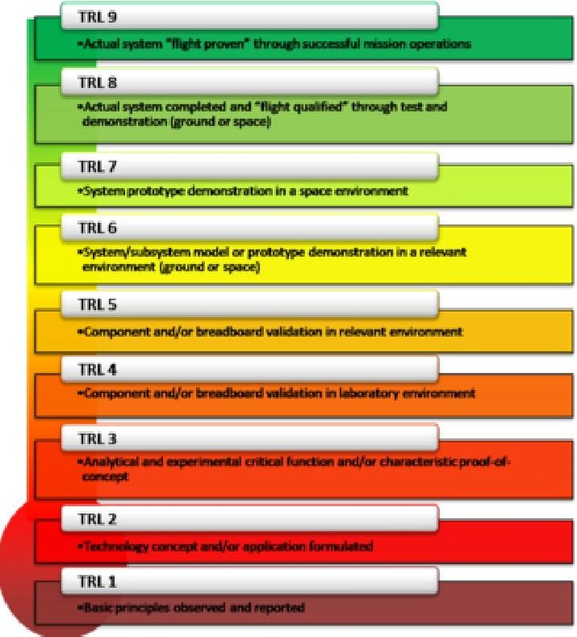

Figure 1 NASA Technology Readiness Levels

next stage of development, as shown in Figure 1 NASA Technology Readiness Levels (Tzinis). Thus, the usage of CubeSats to aid in development of technology is near essential because of their rapid development time and relatively inexpensive costs in manufacturing and operations.

## Literature Review

Research and development of CubeSats has become a common field for Universities and engineering societies to write articles and publications on over the past decade. These scholarly works vary in purpose and observation; however, they provide instructive insight into the usage and development of CubeSats.

Some articles provide baseline methods of approach to designing a CubeSat. One such article focused on a systems engineering approach to CubeSat development based on NASA's Systems Engineering Handbook. This was developed to reduce the ad hoc

<!-- PDF_PAGE: 14 -->

designs normally done by developers resulting in lower mission reliability (Asundi and Fitz-Coy). In compliment of the CubeSat Mission Design by Asundi, the coordination of research objectives as well as the development and design of a CubeSat was necessary for reliable missions. Based on a case study project, the team management, reviews, and design revisions of a CubeSat were focused and discussed in Honoré-Livermore's article on CubeSats in University.

Meanwhile, within the International Council on Systems Engineering's (INCOSE) Space Systems Working Group (SSWG), the development of Model-Based Systems Engineering (MBSE) for CubeSat architecture has been in the works for nearly a decade now. The SSWG has published multiple articles on the physical and behavioral segments of CubeSats and their modeling within the MBSE program Systems Modeling Language (SysML) (Spangelo et al.; Kaslow et al.). However, these articles are limited in their actualization and usage due to their lack application to a non-hypothetical CubeSat project.

Though some publications provide information on the design and development of CubeSats and the application of systems engineering, a majority focus on the reliability of CubeSats and how to improve it (Nieto-Peroy and Emami; Venturini et al.; Ancheta). While some look into the statistical analysis behind CubeSat flight history (Toorian et al.; Villela et al.) and the areas to which reliability and missions correlate.

In some ways like the articles and publications mentioned above, this paper seeks to applied systems engineering methods to a CubeSat. The intention is to create a standardized model, similar to the SSWG's but applied to a non-hypothetical project that seeks to improve upon a technology. This standardized model, created with MBSE

<!-- PDF_PAGE: 15 -->

methodologies and software, will be designed to improve the reliability of CubeSats throughout their development, design, and mission operations.

## Research Objectives

In support of technology development, this paper aims to achieve the following research objectives using CubeSats.

Objective 1: Create a standardized systems engineering model for CubeSat designers and developers as a basis to construct their satellites from. Currently, there has been little implementation of MBSE in existing CubeSat projects. This is similar to the SSWG research groups goal, who have been investigating for several years to determine the efficacy of MBSE in CubeSat development (Kaslow et al.; Spangelo et al.). The later sections of this paper are to demonstrate the usage of MBSE with the CubeSat design process from beginning stages of requirements development to the operation of the CubeSat in LEO.

Objective 2: Improve the success rate of CubeSats from academia and the viability of their usage in technology demonstration for industry. From 2002 to 2018 there have been over 850 CubeSats launched with only 29% of them being from academia. Furthermore, only about 240 CubeSats have been used in technology development and demonstration without even considering the success in their missions (Villela et al.). The standardization of CubeSat design and decision making including the integration and verification and validation (V&V) explained throughout this paper are intended to increase the usage rate of academic CubeSats in technology development while also decreasing the mortality rate.

<!-- PDF_PAGE: 16 -->

Objective 3: Detail the usage of the standardized model in an actual technology development and demonstration project. The demonstration of the model in a CubeSat project that involves technology development is the paramount to proving the efficacy of CubeSats developed by academia as viable options for the mutual benefit of industry and universities. The later sections of the paper describe the process by which the MBSE model was used in a collaboration project between California State Polytechnic University of Pomona's (CPP) Aerospace Engineering department, NASA Jet Propulsion Laboratory (JPL), and the United States Air Force Research Laboratory (AFRL). Project Development and Support

The collaboration project above involves the design and development of a 3U CubeSat, by CPP students and staff. This CubeSat will incorporate a new thermal technology, proposed by several JPL technologists, and will be manufactured using additive manufacturing techniques on several of the CubeSat subsystems using AFRL facilities. The complexity of the project required the usage of systems engineering methodologies to address requirements tracking and documentation, subsystem designs, and system operational parameters including the life cycle of the CubeSat. To obtain concise data and design parameters and decisions, MBSE was a necessary practice for the project.

The usage of MBSE was welcomed by both the CPP team and the JPL advisors because of the simplicity of documentation and hierarchical needs as well as the operations and parametric analysis conducted within it. The CubeSat model became one of the backbones for the project as it gave direct context to constraints and design decisions needed to be carried out by the CPP team. The model's fidelity increased with

<!-- PDF_PAGE: 17 -->

the assistance of the JPL advisors as it was tailored to the specific needs for the CubeSat project. The enthusiasm from the collaborators bolstered the potential of it from being a single project to a multi-project program, as such the need for a documented model that is easily modifiable for changing project goals is needed for the CubeSat Technology Exploration Program (CubeSTEP) to continue in the coming years.

<!-- PDF_PAGE: 18 -->

## CHAPTER 2-SATELLITE DEVELOPMENT

Satellite development is an extremely complex process involving design, testing, manufacturing, and operations of the satellite. These projects involve countless numbers of personnel and work hours to ensure the successful development of the project from conceptual phases well into flight and operations finally ending in disposal and end of life modes. There are many different approaches to the life cycle of a project by various organizations as shown in Figure 2 below from Visualizing Project Management (Forsberg et al.). However, to fully encompass all aspects of a satellite's development process systems engineering is required to lead the way of successful projects.

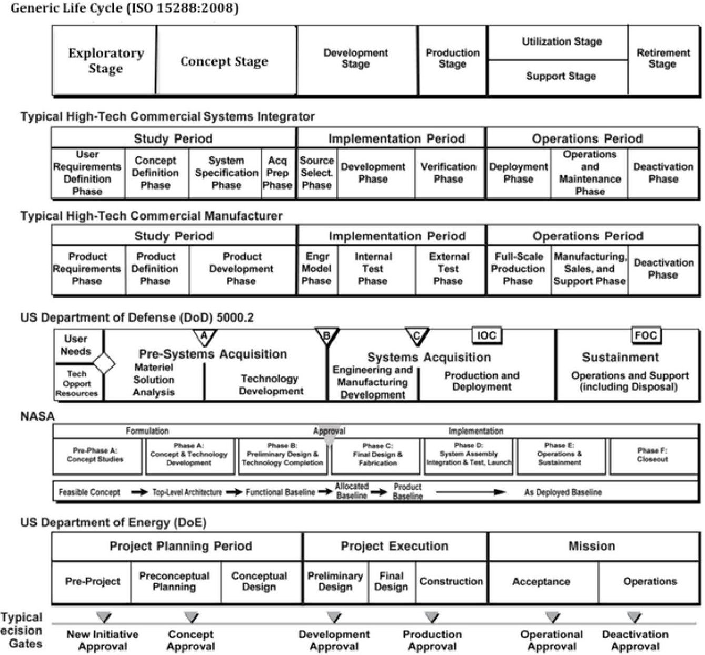

Figure 2 Comparison of Project Life Cycles at Various Organizations

<!-- PDF_PAGE: 19 -->

System Engineering in Satellite Design

Acting as the cornerstone of any project, systems engineering encompasses all stages of the design process from requirements development to architecture design and the eventual operations, maintenance, and disposal phases. Since the conception of spacecraft design, systems engineering has been an integral part of the design approach for these highly complex systems. Though industry has only steadily increased the implementation and usage of systems engineering in projects. However, it was originally used as a method of documentation for various project aspects such as design changes, testing plans, and review reports. With the increasing complexity of satellites and all supporting infrastructure and information, systems engineering became the go-to method of interconnection and integration of all parts of a project. The ability to define, design, and document all parts and decisions within a project has led to reduced costs, better scheduling, and increased reliability (Hirshorn).

While spacecraft themselves consist of tens of thousands of parts forming the system, these systems must interact with many other entities such as ground stations,

launch vehicles, and even with other satellites. As such, spacecraft are considered a part of a system of systems, Figure 3, sfurther increasing the complexity of their design and functions. In both Spacecraft Systems Engineering (Fortescue

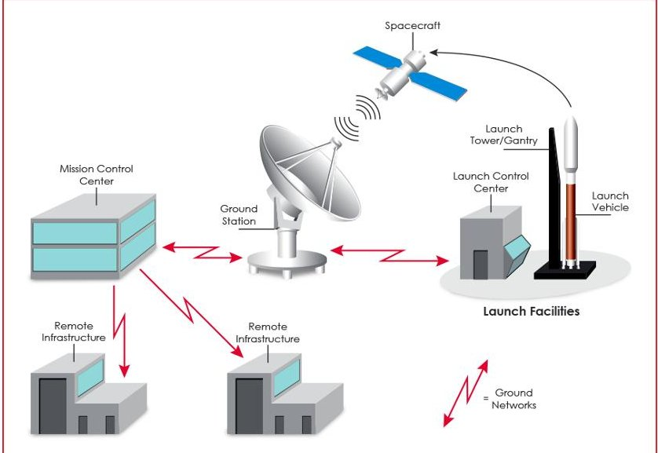

Figure 3 System of Systems for Satellite Operations

<!-- PDF_PAGE: 20 -->

et al.) and Space Mission Analysis and Design (Larson and Wertz), well documented approaches to designing these complex systems is provided, including the practices of systems engineering. However, even these systems engineering methodologies are becoming impractical as spacecraft become increasingly unwieldy and complex in their system of systems for standard methods of approach, let alone are even less applicable for CubeSat missions.

Traditional Methods vs Model-Based

Spacecraft design and development came from humble origins as did all engineering fields. Originally done with paper and pen methods for design and development, this often led to thousands of documents. These files were extremely difficult to track and ensure that they were up to date with the latest versions of a system's design. Due to this unmanageable practice, systems engineering took the stage to ensure the organization of a project's documents were orderly as well as distributed properly, becoming key in the flow of information on project details. Being the keystone of information for a project, systems engineering relies heavily on keeping up to date information, documentation of design changes, as well as managing integration and interconnection control throughout the system (Fortescue et al.).

Once the digital age began, systems practices became even more robust and prominent in projects. Digitizing the efforts of systems engineers and their tasks has significantly increase the efficiency and efficacy of their work. Digital documents and databases enable massive amounts of information to be stored, recorded, and kept with minimal additional work. However, even with the use of computers ensuring the distribution of up-to-date information is bulky and can often be misinterpreted when not

<!-- PDF_PAGE: 21 -->

conveyed properly. To address the document-based information exchange in systems engineering, MBSE was developed introduced by INCOSE. With the creation of MBSE, direct interaction between teams and engineers on project became simple with models providing immediate updates to changes in design to all members working on a system. As MBSE has grown over the past two decades, it has become incredibly useful in providing system simulation and testing opportunities on designs before manufacturing even begins, significantly reducing costs and time associated with the design cycles.

MBSE's influence is sweeping across industry with many organizations switching from the digital format of systems engineering to MBSE. With the trend of MBSE, it will likely become the most integral part of a system design regardless of the industry or size of project. It’s usage in nano-satellite development is inevitable, becoming one of the major reasons why INCOSE and many other organizations are putting focus into developing systems engineering practices for CubeSats (Spangelo et al.; Kaslow et al.; Schultz et al.; Bajaj et al.; Ancheta). Thus, a practical model of a CubeSat, developed alongside the beginning of an actual mission, is paramount to the future of MBSE and small satellite development.

<!-- PDF_PAGE: 22 -->

# CHAPTER 3 - SYSTEMS ARCHITECTURE

The development of a systems architecture for CubeSats using MBSE methodologies is essential to the improvement of design and reliability of CubeSats in the future. To achieve this, the MBSE program Cameo Enterprise Architecture (CEA) from No Magic at Dassault Systemes is used to design the model-based design of the satellite and its supporting elements. The application of this software and a supporting add-on called SysML from No Magic is described in the remaining sections of the paper.

Due to the limitations of time, personnel, access to the SysML software capabilities, this constrained the level of fidelity of the designed CubeSat model. As such the model diagrams described in the remaining sections are based on the availability of the resources at hand as well as the knowledge of the software acquired during its development. Thus, the scope of the model was restricted to high and medium level modeling where overall system properties and elements like requirements development as well as the detailed subsystem design were implemented. However, intricate modeling of component interconnections and detailed software processing and sequencing was limited.

## Implementation of SysML

The CEA software and SysML plugin offer systems engineers many features for designing and maintaining the system life cycle as well as the design architecture within the program. With the rather steep learning curve of the software and the specifications behind the elements being used, the documentation provided by No Magic as well as the book A Practical Guide to SysML The Systems Modeling Language by (Friedenthal et al.) provide incredible resources to quickly understand the software and its basic features.

<!-- PDF_PAGE: 23 -->

The model diagrams in the next sections are the results of combining satellite design practices (Larson and Wertz; Helvajian and Janson; Fortescue et al.), system life cycle Information, as well as referencing the work done by the INCOSE SSWG (Kaslow et al.; Spangelo et al.). The organization of the model's structure within the software was the first concern, management of this is done through the usage of Package diagrams, Figure 4, which operates as the file system for the model like a computer's file system, Figure 5.

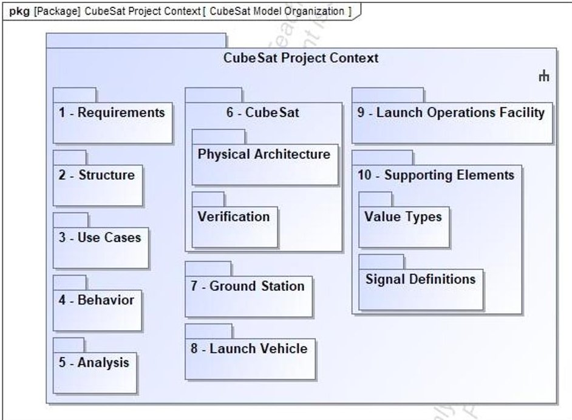

Figure 4 CubeSat Model Package Diagram

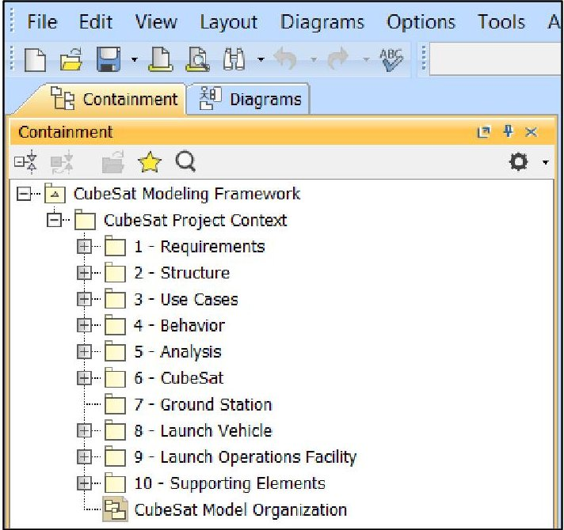

Figure 5 Model Filing System Based on Package Diagram Design

<!-- PDF_PAGE: 24 -->

The major elements of the model show above describe a majority of the life cycle elements involved in the design of a satellites and its mission, including conceptual development, system definition, system design, and into satellite operations. Within these element folders differing diagrams are developed showing the both the physical and logical characteristics of the CubeSTEP's design within the model-based system. However, to ensure the usage of this MBSE design for CubeSats in general, many of the systems and diagrams were design with generalities and optional functions that may not be used in every mission, such as deployable mechanisms and propulsion subsystems. It is worth noting that all model diagrams developed for the CubeSTEP are either utilized in this chapter to describe the efforts and utility of them or provided later in the appendices. CubeSat Requirements Development

Following the same guidelines as traditional project development, the system stakeholders were determined first including their involvement within the CubeSTEP project. In CEA SysML, the Use Case diagram provides the user with multiple tools to describe the stakeholders and their goals when involved in the project, as shown below in Figure 6. For the CubeSTEP project, the primary stakeholders involved included CPP, NASA JPL, and the US AFRL with each specifying various necessities the system will undergo from testing and development to funding and program initiatives.

<!-- PDF_PAGE: 25 -->

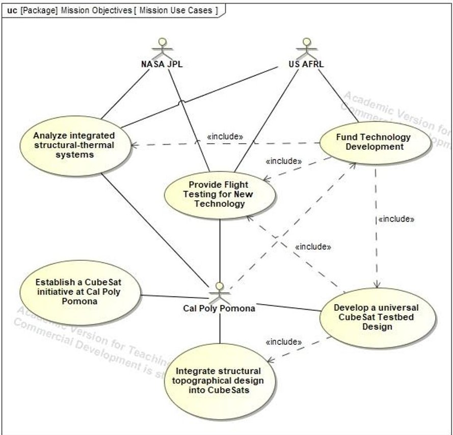

Figure 6 CubeSat Mission Stakeholder Use Case Diagram

However, the Use Case diagrams can also be utilized to describe the system's specific operations and control. Figure 7 below, exemplifies the design of a Use Case diagram with the operations that the satellite will undergo from system launch and deployment to in-operation activities. As stated before, with general design in mind, some diagram elements are not fully utilized for CubeSTEP mission.

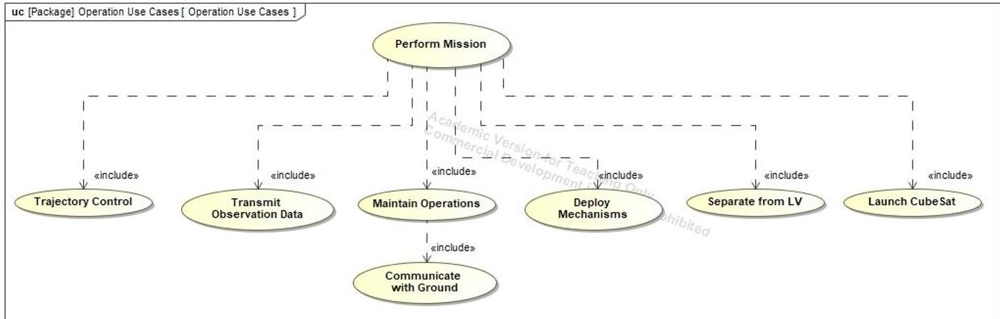

Figure 7 CubeSat Use Case Diagram for Satellite Operations

<!-- PDF_PAGE: 26 -->

The requirements of the system are then defined from the needs of the stakeholders of CubeSTEP. After compiling each entity's needs into Table 1, the system requirements were developed with these baseline needs in mind for the project goals.

Table 1 Baseline Stakeholder Requirements

<table border="1"><tr><td>Stakeholder</td><td>Requirement</td></tr><tr><td rowspan="4">NASA JPL</td><td>Design and develop novel thermal system</td></tr><tr><td>Demonstrate thermal system properties in ground testing</td></tr><tr><td>Demonstrate thermal system properties in orbital testing</td></tr><tr><td>Provide flight testing of novel systems</td></tr><tr><td rowspan="2">US AFRL</td><td>Implement usage of additive manufacturing to satellite structures</td></tr><tr><td>Test the usage of topology optimization techniques on satellite structures</td></tr><tr><td rowspan="3">CPP</td><td>Design a universal testbed CubeSat system</td></tr><tr><td>Demonstrate the capabilities of the CPP Space Lab group</td></tr><tr><td>Establish a CubeSat development program at CPP</td></tr></table>

Implementation of the system requirements and all derived requirements for the CubeSTEP into the MBSE model were done through the usage of the REQ diagrams and tables available in SysML. The SysML software provides users with automated requirement reference numbering based on the block flows within the designed diagrams. As shown in Figure 8 CubeSTEP Mission Requirements, the lead block labeled "Mission Requirements" precedes the lower-level requirements attached to it, creating the automated reference number IDs on each diagram block. Using ID 1.2.1 as an example, shown in both Figure 8 and Table 2, the formatting of the sequence follows a standard rule of hierarchy in SysML where 1 indicates the project overall, 1.2 is the "Mission Requirements" block, with 1.2.1 being the first requirement under the 1.2 block. This same pattern is continued as needed for any number of requirements of the system.

<!-- PDF_PAGE: 27 -->

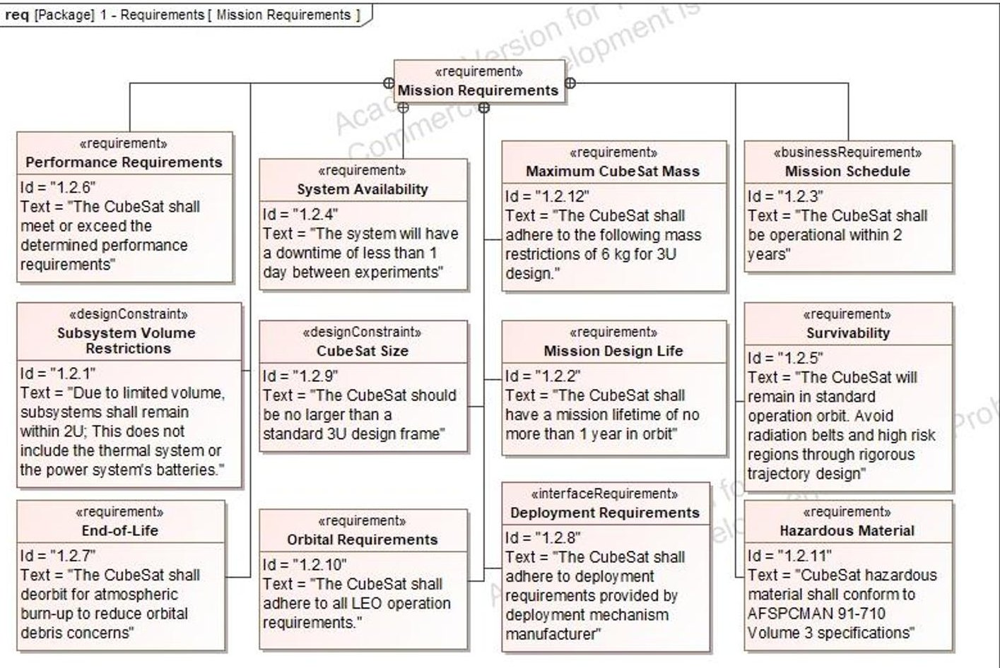

Figure 8 CubeSTEP Mission Requirements

Table 2 CubeSTEP Mission Requirements

<table border="1"><tr><td>Req. Type and Ref. #</td><td>Description</td></tr><tr><td>T-1.2.1</td><td>Due to limited volume, subsystems shall remain within 2U of the CubeSat; This does not include the scientific or technological demonstration systems</td></tr><tr><td>T-1.2.2</td><td>The CubeSat shall have a mission lifetime of no more than 1 year in orbit</td></tr><tr><td>T-1.2.3</td><td>The CubeSat shall be operational within 2 years</td></tr><tr><td>T-1.2.4</td><td>The system will have a downtime of less than 1 day between experiments</td></tr><tr><td>T-1.2.5</td><td>The CubeSat will remain in standard operational orbit, avoiding hazardous regions for the satellite components and other satellites</td></tr><tr><td>T-1.2.6</td><td>The CubeSat shall meet or exceed the determined performance requirements of subsystems</td></tr><tr><td>T-1.2.7</td><td>The CubeSat shall deorbit for atmospheric burn-up to reduce orbital debris concerns</td></tr><tr><td>T-1.2.8</td><td>The CubeSat shall adhere to deployment requirements provided by deployment mechanisms</td></tr><tr><td>T-1.2.9</td><td>The CubeSat should be no larger than a standard 3U design frame</td></tr><tr><td>T-1.2.10</td><td>The CubeSat shall adhere to all LEO operation requirements</td></tr><tr><td>T-1.2.11</td><td>CubeSat hazardous materials shall conform to AFSPCMAN 91-710 Volume 3 specifications</td></tr><tr><td>T-1.2.12</td><td>The CubeSat shall adhere to the mass restriction of 6 kg for a 3U design</td></tr></table>

<!-- PDF_PAGE: 28 -->

After developing the life cycle and mission level requirements as well as the subsystem design requirements for the CubeSTEP, a requirements table was generated in SysML for ease of tracking, verifications, and control. The table provides users with the ability to direct requirements to specific design parameters and analyses within the system model. A short snippet of the table is provided in Figure 9, the right most column of the table is where system modelers may associate the corresponding requirement throughout the system model. A full version of the SysML requirements table is provided in APPENDIX A Figure 34.

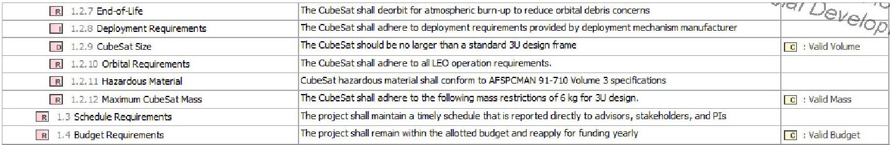

Figure 9 CubeSTEP SysML Requirements Table Section Cut

With the intention of the CubeSat model being used beyond just the CubeSTEP missions, the subsystem general requirements were compiled from CubeSat Design Specifications, CubeSat 101, and the NASA Systems Engineering Handbook into the respective subsystem requirements diagrams (Lan; Chin et al.; Hirshorn). Figure 10 CubeSTEP Structure and Mechanism Requirements provides clear descriptions of standardized CubeSat requirements.

<!-- PDF_PAGE: 29 -->

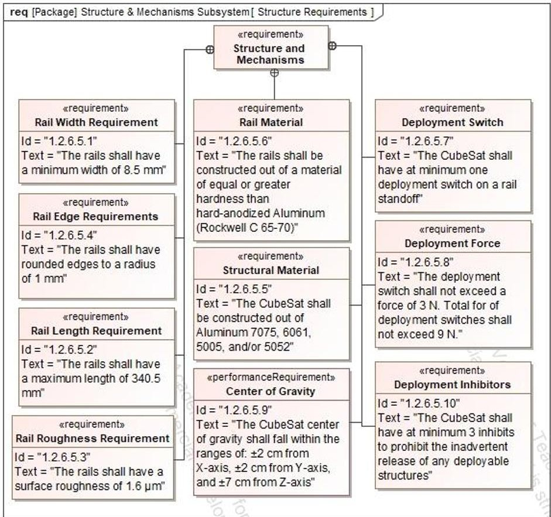

Figure 10 CubeSTEP Structure and Mechanism Requirements

Similarly, the remaining requirements of the CubeSat model were developed with general form and standardized requirements in the documents listed previously. Several subsystem requirements were adjusted to address the needs and goals of the CubeSTEP project. One example is the modification of the CubeSTEP Attitude Control System Requirements correlating it to the pointing accuracy needed for the CubeSat's power and communication systems, shown below.

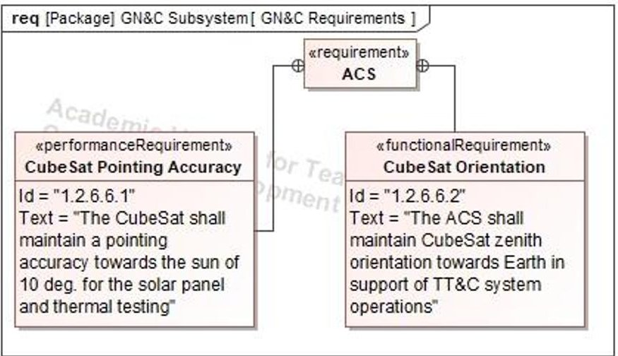

Figure 11 CubeSTEP Attitude Control System Requirements

<!-- PDF_PAGE: 30 -->

## CubeSat Structural Modeling

After the CubeSat's requirements development was completed and thoroughly modeled within the SysML software, the design for the various subsystem component diagrams were begun. Describing the necessary components of a satellite is difficult when there are thousands of parts involved, as such SysML allows modelers to succinctly define the number of components involved in each subsystem. Using Block Definition Diagrams (BDDs), construction of a CubeSat's flight structure and all major components are displayed in the simple diagram form of Figure 12. Each item displayed has associated values next to them denoting the number of required elements per system. As an example, the Solar Array in the Power Subsystem block shows a $ [1\dots^{*}]$ next to it, this tells the modeler and engineers that the system requires a minimum of 1 solar array panel but can have any larger number onboard shown by the asterisk.

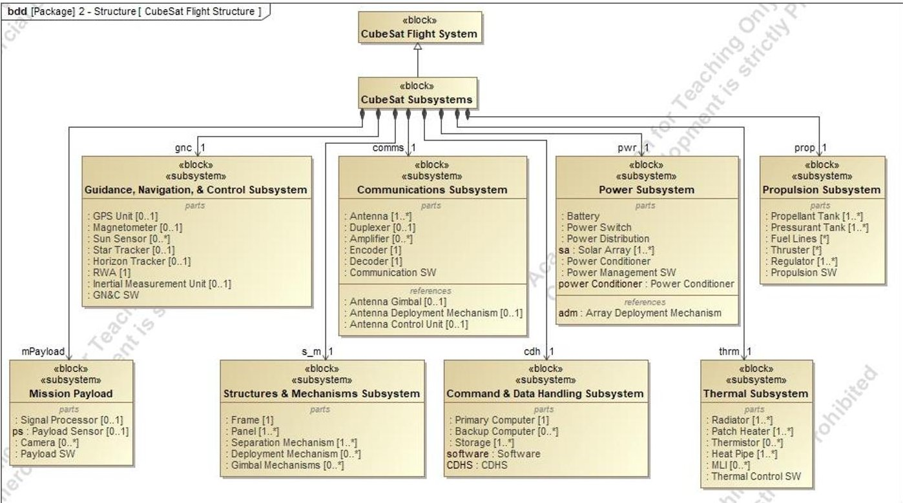

Figure 12 CubeSTEP Flight Structure Subsystems and Components

Each subsystem was further explored and defined in similar a similar manner to the CubeSat's flight structure, apart from focusing more on the individual subsystem's

<!-- PDF_PAGE: 31 -->

specific components and characteristics. Figure 13 below displays the information from the Command and Data Handling Subsystem block in Figure 34 in greater detail showing the components characteristics such as hardware or software as well as the associated cost and mass of the system. In other subsystem BDDs, like Figure 13, the complexity can become near overwhelming as the individual parts may require specific conditions or values associated with them. It is also noteworthy that the model is capable of showing alternative design decisions in the same diagram, such as Figure 14's optional component pathways of the body-mounted and two-axis gimbled solar panel configurations. This allowed for the model to accommodate both design choices while still providing the engineering team with alternative architectures to develop with.

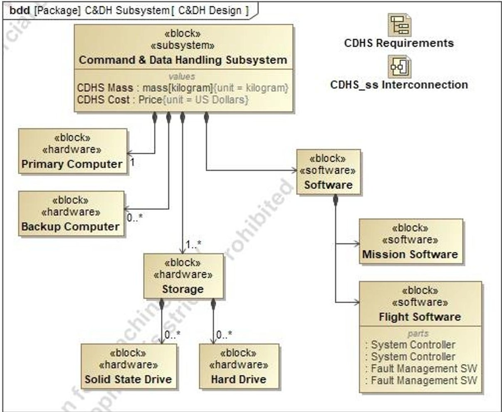

Figure 13 CubeSTEP Command & Data Handling Components and Characteristics

<!-- PDF_PAGE: 32 -->

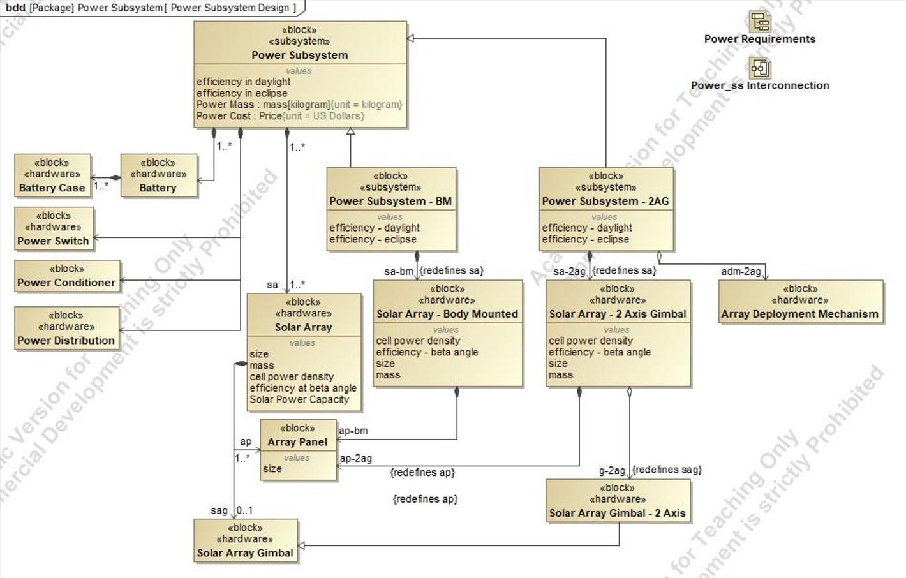

Figure 14 CubeSTEP Power System Components and Characteristics

Mentioned within Figure 14, the array deployment and gimbaling mechanisms are also prevalent in other diagrams of the model. Within Figure 15 the gimbaling and deployment mechanisms are shown again, rather than duplicating the block these are connected block in the model that reference to each other between the diagrams enabling swift modifications when necessary. The block instances created in BDDs are consistently used through a model, drawing upon values and criterion set for each individual one when called for. This is further discussed in the Internal Block and Parametric Diagrams discussed later.

<!-- PDF_PAGE: 33 -->

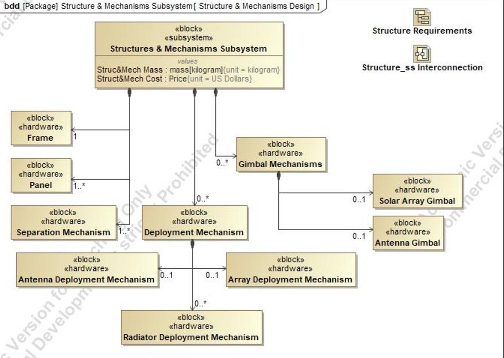

Figure 15 CubeSTEP Structures & Mechanisms Components and Characteristics

In the above figures, multiple component block show values associated with them. These values are either set by the modeler through design considerations or system requirements. It is also possible for the values to be determined through analyses within the CubeSat model conducted in Parametric diagrams, these diagrams are discussed in the next section. To increase the accessibility and ease of use of the model for non systems engineers, diagram hyperlinks were implements into the subsystem BDDs connecting them to their respective requirements diagrams as well as their Internal Block Diagram.

Internal Block Diagrams (IBD) enable the modelers to display the interconnections that the various elements of the satellite utilize. However, the complexity of the diagram does increase with IBDs and all future model elements

<!-- PDF_PAGE: 34 -->

discussed due to the numerous diagram elements involved in them. Specifically, when developing the IBD of a subsystem the information flow is the critical component of the diagram that is being conveyed to the users and engineering teams. Using the previously design BDDs of the CubeSTEP's subsystems allows modelers to reduce the time needed to create an IBD by automatically generating the predefined information from their BDD, providing the bare-bone structure of an IBD leaving the modeler to create the connection and data flow lines in the diagram. For example, Figure 14 describes the power systems components while Figure 16 reveals the connections and information flow that occurs with the subsystem. The power system's IBD below shows the component ports in each block as well as the relative information or data flow to and from the port. Some flow ports are one-way connections, shown by the green arrows within them, while the general blank ports allow users to denote a connection must be made with this resource yet does not limit the system on how it interacts.

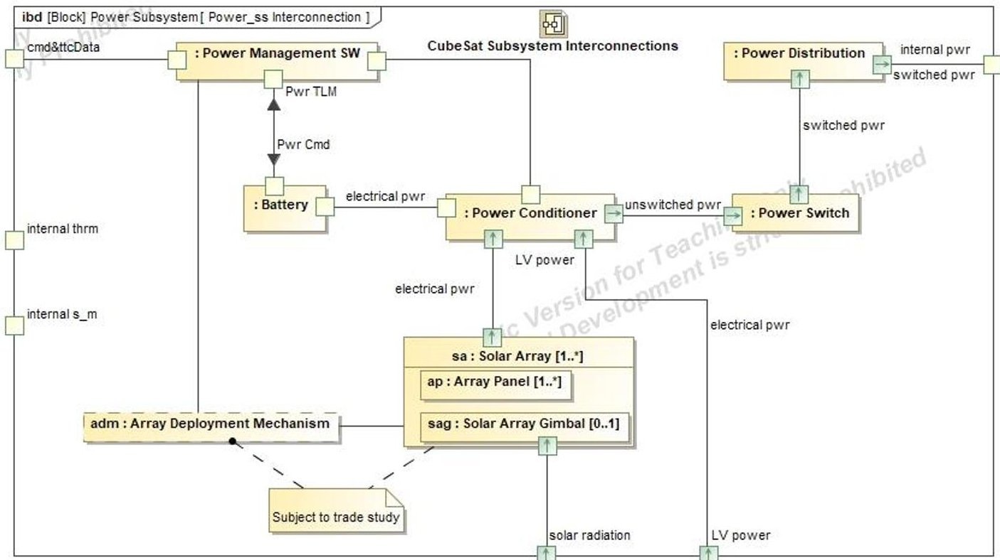

Figure 16 CubeSTEP Power System Internal Connections and Information Flow

<!-- PDF_PAGE: 35 -->

Like other structural model diagrams, BDD, Req, and Use Case; the IBDs can display blocks within each other. Figure 17's primary and secondary computer blocks are prime examples of imbedded information as they contain the software elements of the CubeSat. These blocks can be referenced in other diagrams throughout the model, as shown by the dashed outline in the diagram. The final major IBD developed for the CubeSTEP was its high-level subsystem interconnection and information flow diagram. In Figure 18, all major connections both externally and internally that influence the CubeSTEP's behavior are displayed. These include the power, thermal, and command data information, structural mounting and launch vehicle connections, and even environmental information from the various sensors onboard. Items such as the propulsion's thrust information line is added to the model to enable future users the capability of implementing and using a propulsion system on a CubeSat and any design considerations needed for it.

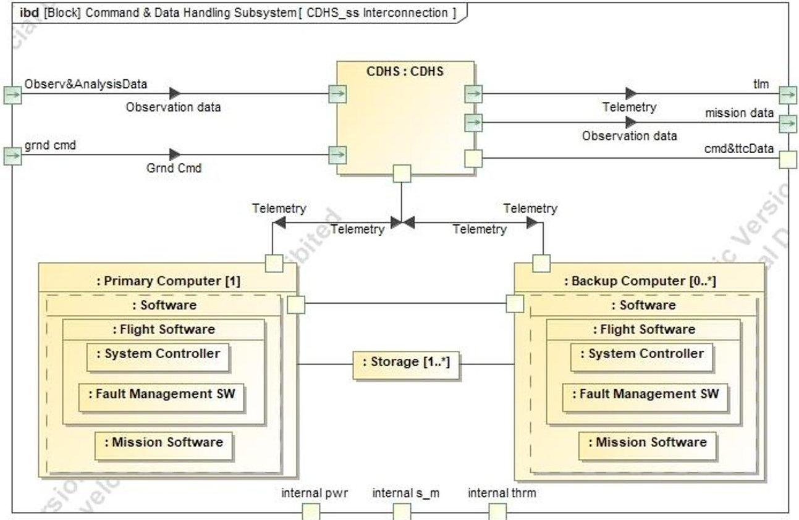

Figure 17 CubeSTEP Command & Data Handling Connections and Information Flow

<!-- PDF_PAGE: 36 -->

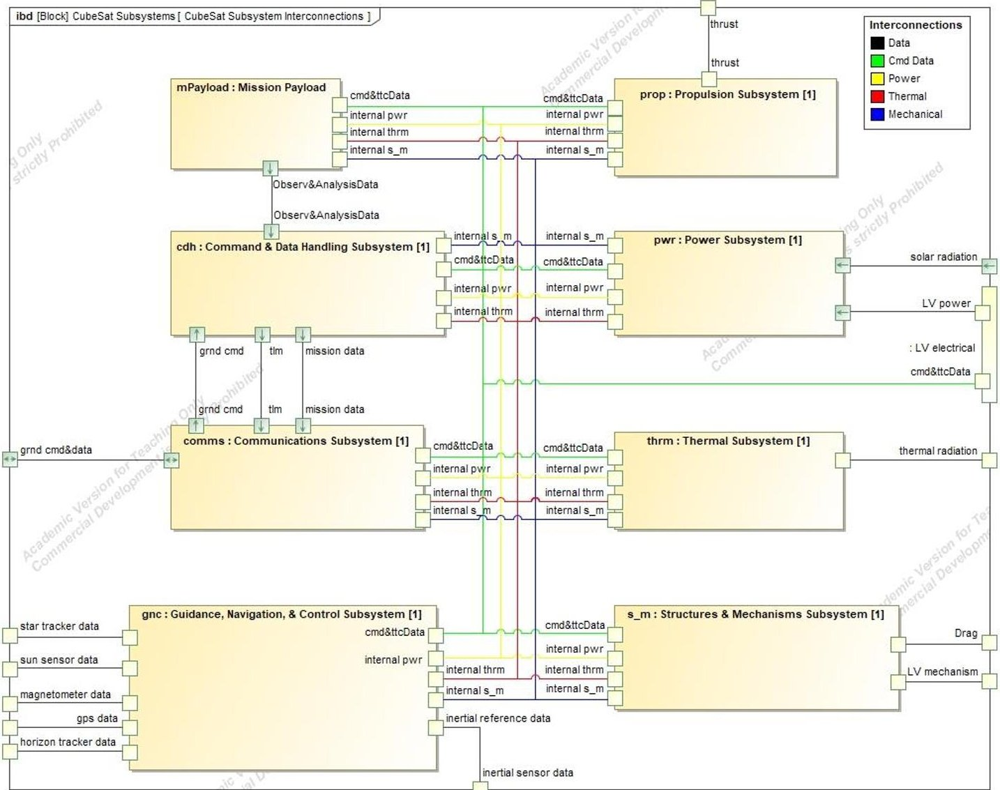

Figure 18 CubeSTEP Subsystem Interconnection and Information Flow

Combining the requirements, use cases, block definition, and internal block diagrams discussed in this section, the generalized CubeSat architecture model is formed. These diagrams enable future CubeSat model users the ability to quickly modify, determine, and distribute structural information of the satellite within the model and to the engineering teams designing the hardware and bus segments of the CubeSat.

To compliment the CubeSat's structural modeling discussed in the previous section, the behavioral side of the model is elaborated upon here. The behavioral modeling contrasts the structural modeling which holds static views of the system, by focusing on the information, behavior, and event occurrences over time. The most

<!-- PDF_PAGE: 37 -->

common behavioral diagram is the Activity diagram which expresses the flow of matter, energy, or data through an operation that can be accessed and modified in sequential execution. Figure 7 CubeSat Use Case Diagram for Satellite Operations shows the structural form of the satellite operations while Figure 19 describes the same information but in the behavioral sequencing of the satellite.

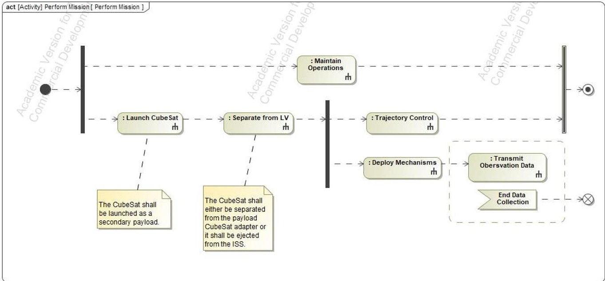

Figure 19 CubeSTEP Satellite Operation Actions

The diagram above shows the relative event occurrences and their simultaneous operations. Figure 19 is relatively simple for activity diagrams as it operates with a defined initial node, the solid black dot on the left, and ends with either the flow final node, the circled X which ends a singular action, and the activity final node denoted by the circled black dot which ends the entire Activity diagram. The complexity of activity diagrams varies significantly, as Figure 20 below introduces many more elements. Some of which include information pins that the diagram calls from elsewhere in the model and even an absolute time event node, the hourglass, which dictates when the activity would proceed beyond it.

<!-- PDF_PAGE: 38 -->

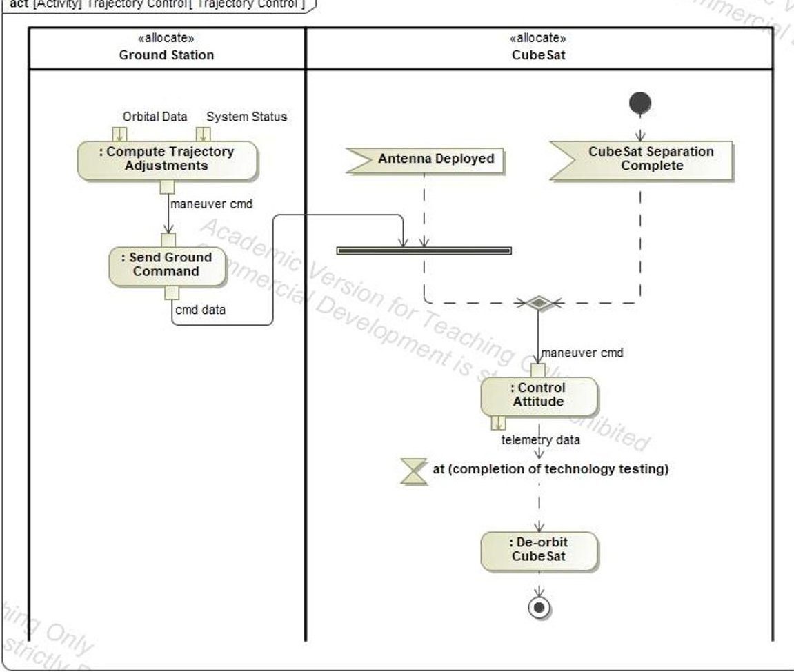

Figure 20 CubeSTEP Trajectory Control Actions

As mentioned before the blocks and elements of the diagrams are interconnected with each other, providing the model with rapid simulation, analysis, and control when designing the satellite. Activity diagrams are no different, Figure 20's signal receiving elements Antenna Deployed and CubeSat Separation Complete are sent from Figure 21 and Figure 22, respectively.

<!-- PDF_PAGE: 39 -->

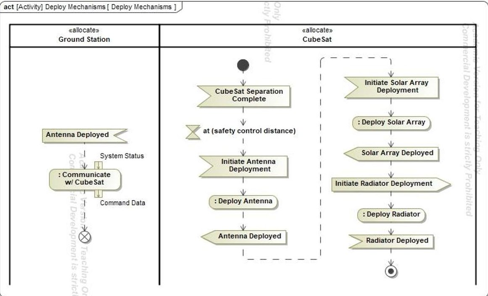

Figure 21 CubeSTEP Mechanism Deployment Actions

**act** [Activity] Separate from LV [ Separate from LV ]

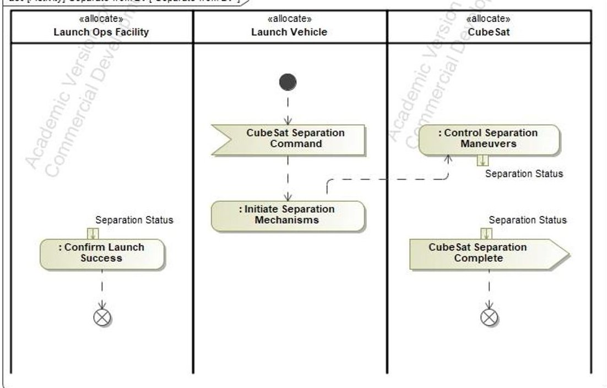

Figure 22 CubeSTEP Launch Vehicle Separation Actions

For the CubeSTEP mission the major sequencing of mission events and experimentation were conducted through the usage of SysML's Sequence diagram which provides more control over which components operate at various times. Sequence diagrams like Figure 23 below, seem daunting but are rather simple to understand. The behavioral flow of operations flows a set pathway of required steps for the system to

<!-- PDF_PAGE: 40 -->

function as intended. Each vertical line is the influencing component of the system that controls the operations along it. For example, the CubeSat Flight System begins in an off state but after going through the prior steps switches to its on state. The boxes surrounding various elements in the diagram, like Strict show the user what the items inside it should do. Strict, consider, and critical are just some of the optional confinements that are provided to the modeler in SysML.

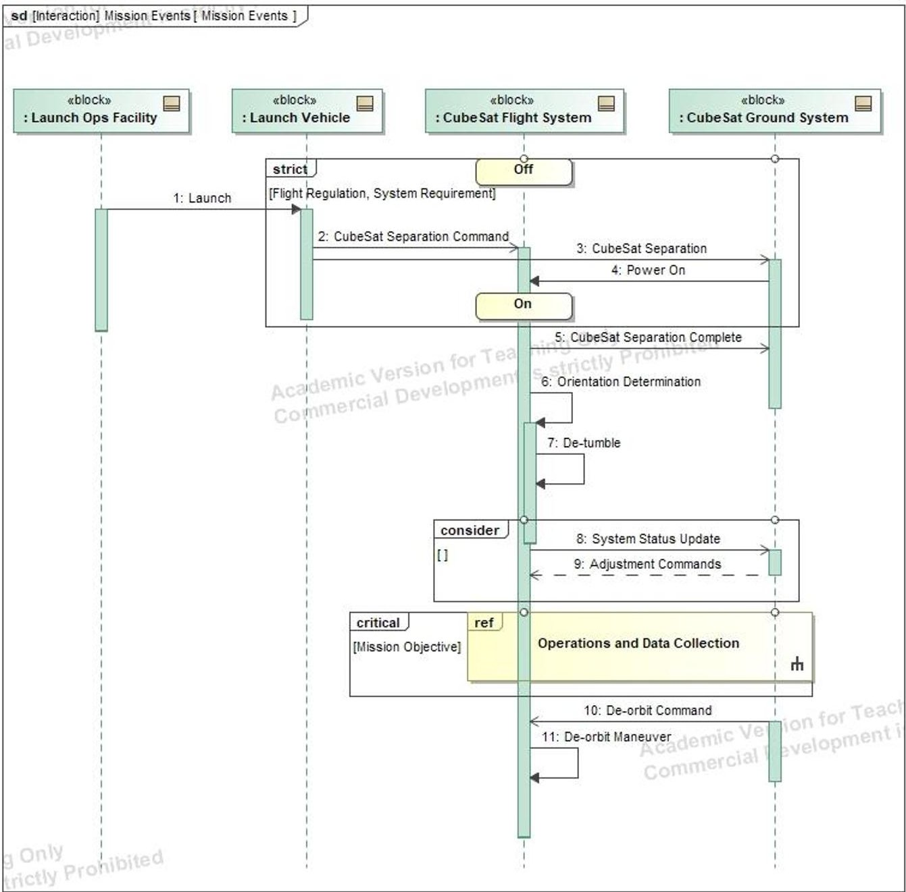

Figure 23 CubeSTEP Mission Events Sequence

Within the figure above, the reference block "Operations and Data Collection" is a nested sequence diagram for the model. Nested blocks and references provide the user

<!-- PDF_PAGE: 41 -->

with quick access to any other diagram or information in the model, as necessary. Figure 24 below is the nested diagram from Figure 23; here it describes the operational timeline that the CubeSTEP will undergo after entering its orbit. The flight demonstration and observation of the novel technology onboard is looped continuously until the testing sequence is completed. Within the loop the system battery charging, specific test at a loop, and the processing and transmission of data is conducted.

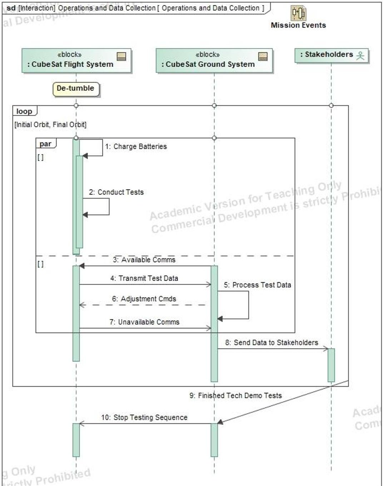

Figure 24 CubeSTEP Operations and Data Collection Sequence

<!-- PDF_PAGE: 42 -->

The various modes that the CubeSat transitions through and the operations carried out within them are best envisioned in the SysML State Machine diagram (STM). Figure 25 below fully describes the states of the CubeSTEP for its operational life cycle. As one of the two most complex diagrams in SysML, the STM dictates the system conditions needed to be met for the next to occur. Within each mode, Powered Off and Powered On, multiple actions are stipulated with internal operations that happen within them. These are constructed through guard statements that control the flow of the system modes being modeled, including entry, do, and exit controls. The complexity for STMs further increases as nested blocks are further elaborated upon to provide users and software engineers with further information to design the system controls with.

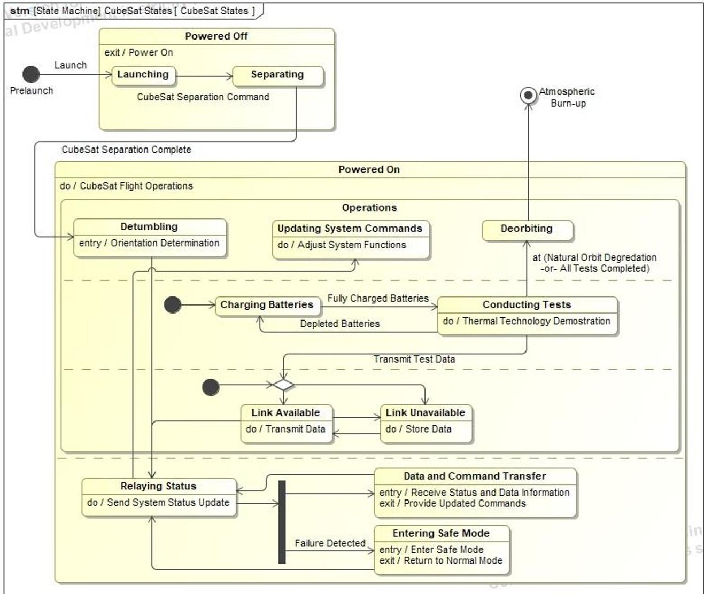

Figure 25 CubeSTEP Operational States

<!-- PDF_PAGE: 43 -->

CubeSat Model Analysis and External Integration

One of the strongest capabilities of MBSE is being able to conduct mathematical analysis within the software or call upon external software for analysis results and reports. SysML offers these features through external software integration features as well as the Parametric diagrams. The parametric diagrams allow the software to conduct analysis on any constraint that is denoted within a block. Figure 26 shows a simplified mass budget analysis for CubeSTEP. Within the CubeSat Total Mass block an equation is stated for the mass calculation. Each variable in the equation is then provided a port which is then connected with called subsystem properties from elsewhere in the model.

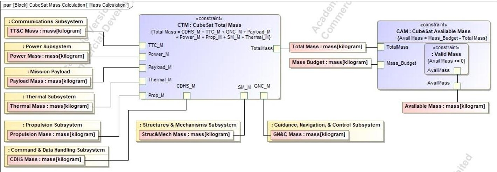

Figure 26 CubeSTEP Mass Budget Analysis

Along with the analysis above, Figure 27 CubeSTEP Power and Solar Array Analysis shows the complexity of the parametric diagram increases quickly with the relative complexity of the analysis. Here the parametric diagram calls the results from another diagram, Figure 60 CubeSTEP Orbital Analysis, and uses them to complete the calculations. SysML provides the users with optional parametric features to conduct iterative analysis based on a set of values given. As an example, if Figure 60 is provided its necessary information as well as a list of orbital altitudes, it will run the calculations for each instance.

<!-- PDF_PAGE: 44 -->

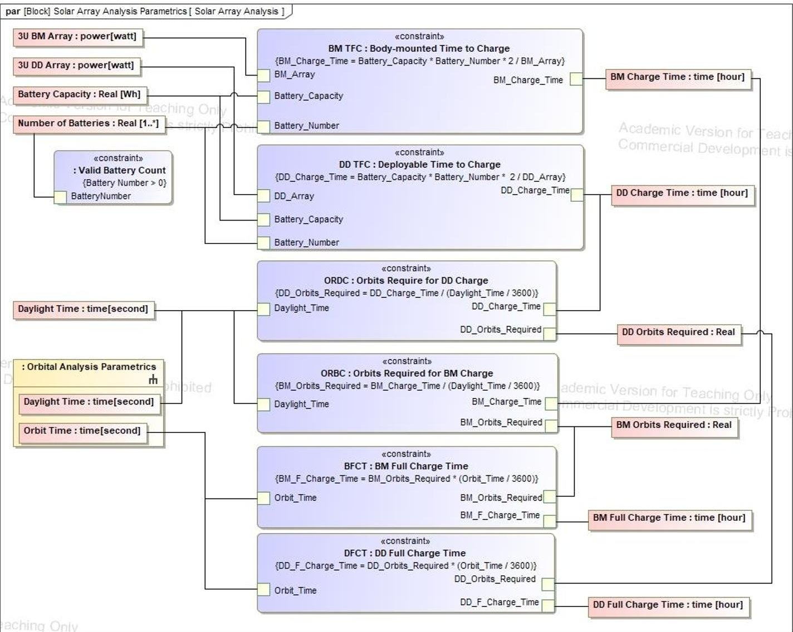

Figure 27 CubeSTEP Power and Solar Array Analysis

However, the drawbacks of conducting analyses within SysML is the lack of complex mathematical formulas since constraints are limited to basic mathematical symbols. SysML makes up for this with its capability of integration with external software, such as MATLAB, STK, Python, and more. The ability to call functions and simulations from these more robust analytical software and use the resulting information in SysML enables the modelers and engineering teams to conduct larger scale simulations of a CubeSat's performance as well as tracking for data validation and requirements compliance.

<!-- PDF_PAGE: 45 -->

## CHAPTER 4-RELIABILITY

Addressing the low reliability of CubeSat missions, specifically ones from academia, is of key concern to this project. Due to the lack of systems engineering practices and reliability assessment and analyses seen in academic projects, the quality assurance of the mission and its success rates have suffered. As such, initialize the failure determination and analysis within the model is investigated below.

CubeSat Failure Modes

Applying the block definition diagrams, failure modes of a satellite are created by displaying the failure constraints causing a mission failure. As shown in Figure 28, each failure mode is then correlated to a respective activity block, linked to one of the activity diagrams discussed earlier. These failure modes violate the connected activity thus causing either partial or total mission failure state for the CubeSat. The failure state is then connected to Figure 25 CubeSTEP Operational States Powered On block's failure detection block.

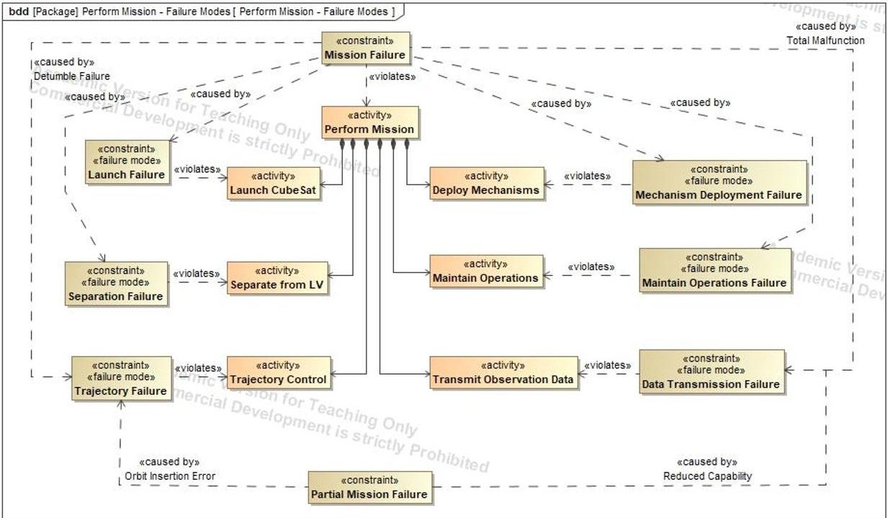

Figure 28 CubeSat Mission Failure Modes

<!-- PDF_PAGE: 46 -->

The creation of the constraints above allows for the user to generate parametric diagrams for each of the failures to conduct the analyses necessary for determining the system reliability. Using additional features of SysML Parametric diagrams enables the automatic generation of Failure Mode and Effects Analysis (FMEA) tables as needed. The failure rate values determined through FMEA are then used in the failure analyses used to determine the most at-risk components and where to focus efforts on risk reduction.

## CubeSat Fault Trees and Analysis

Determination of the optimal components to address for risk mitigation and reliability improvement are conducted through the usage of fault trees. Each major subsystem, such as Figure 31 and Figure 32, and the overarching CubeSat, Figure 30,

have modeled in fault trees in preparation for the analysis of the subsystems and overall architecture. In each of the fault trees, color coordinated and shaped objects fill the diagram describing varying aspects of it, shown in Figure 29. Top events are the primary event that would occur if all or some of the elements below occur. This connection is

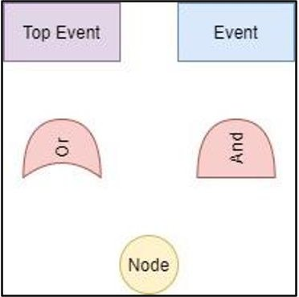

Figure 29 Fault Tree Object Nomenclature

done through the usage of "or" and "and" gates that change the equations necessary for calculations, while "Nodes" are the basic failure events of the associated parts or events above.

<!-- PDF_PAGE: 47 -->

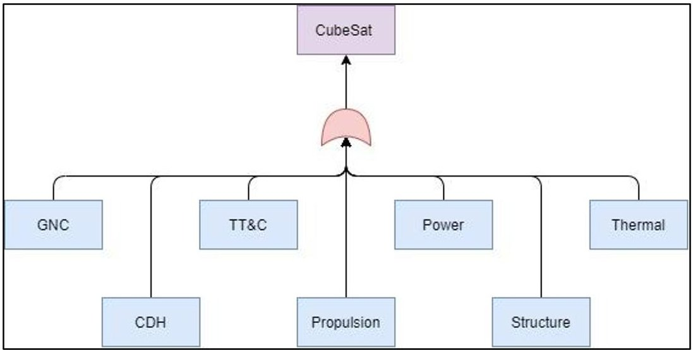

Figure 30 CubeSat Fault Tree

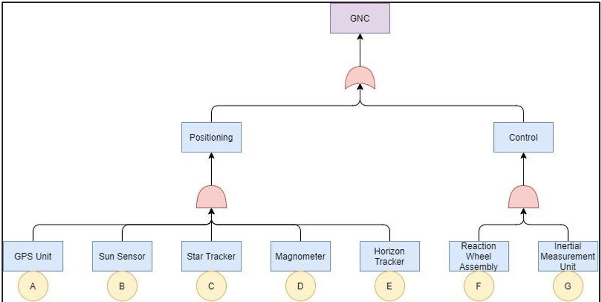

Figure 31 CubeSat Guidance, Navigation, and Control Fault Tree

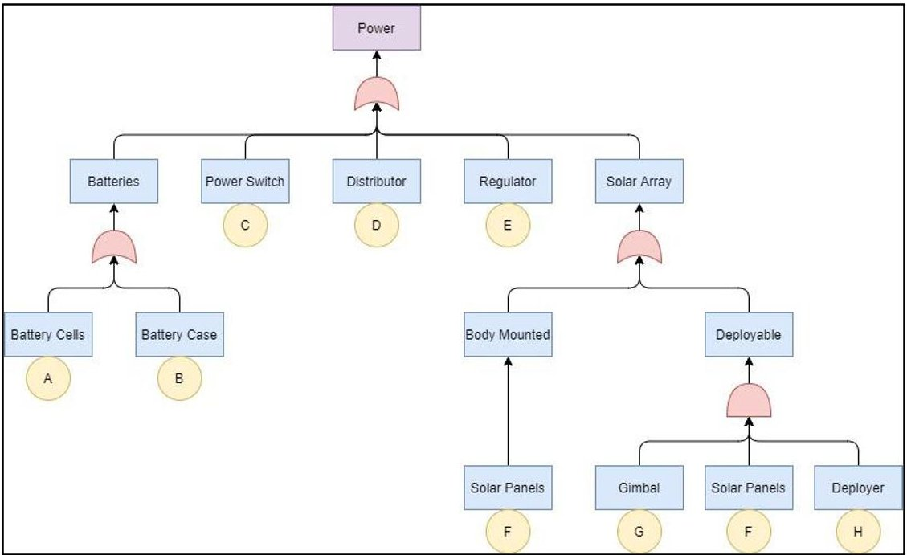

Figure 32 CubeSat Power System Fault Tree

<!-- PDF_PAGE: 48 -->

Each fault tree must then be run through a cut set minimization, where a cut set is a set of occurrences that would cause a system failure. The minimum cut set removes the redundant cuts from the fault tree reducing the necessary work for reliability analysis while keeping its integrity. As such Figure 33 and Table 3 below show the determination of the minimum cut set for a given fault tree diagram.

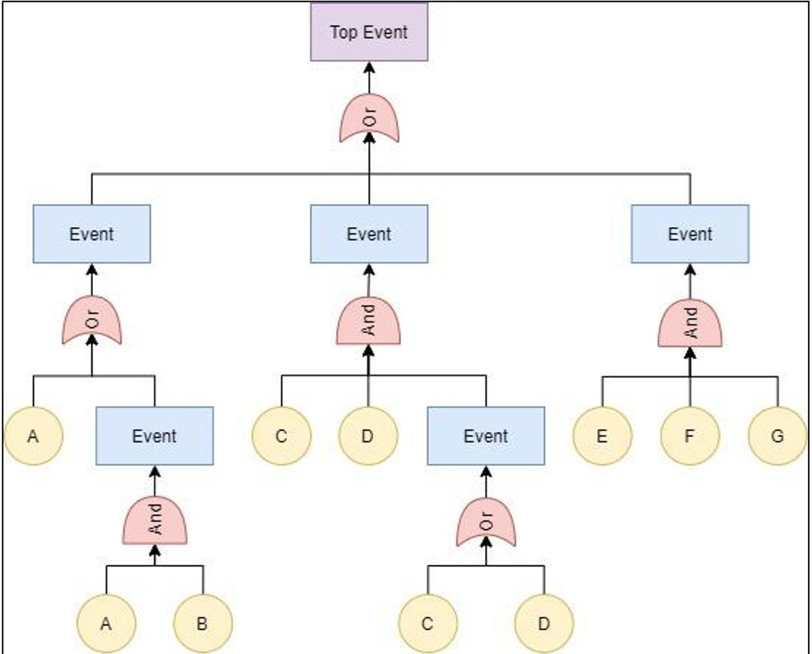

Figure 33 Example Fault Tree for Cut Set Determination

Table 3 Example Fault Tree Cut Set Minimization

<table border="1"><tr><td>Combinations</td><td>Cut Set</td><td>Reduced Set</td><td>Min Cut Set</td></tr><tr><td>A,A</td><td>A</td><td>A</td><td>A</td></tr><tr><td>A,B</td><td>A,B</td><td>A,B</td><td>C,D</td></tr><tr><td>C,D,C</td><td>C,D</td><td>C,D</td><td>E,F,G</td></tr><tr><td>C,D,D</td><td>C,D</td><td>E,F,G</td><td></td></tr><tr><td>E,F,G</td><td>E,F,G</td><td></td><td></td></tr></table>

<!-- PDF_PAGE: 49 -->

Using the minimum cut set found above, several methods of risk management are to be used. These include the following methods:

- Fussell-Vesely Indexing - which shows the relative fraction of total risk that an associated failure event analyzed may cause.

- Risk Reduction Worth - the amount that the system reliability improves if the analyzed failure event is perfect, where the failure rate is zero.

- Risk Achievement Worth - the amount that the system reliability decreases from the analyzed failure event if it is guaranteed to fail, where failure rate is equal to one.

- Birnbaum Importance - the relative difference between the Risk Reduction and the Risk Achievement methods resulting in the contribution that an event has to the mission failure.

These failure analysis methods provide the engineers and development team with insightful information on the high-risk areas of a design and where to focus efforts to improve the system reliability before operations.

<!-- PDF_PAGE: 50 -->

## CHAPTER 5-SUMMARY

This paper presents the design approach of a CubeSat using model-based systems engineering methods and software. The generalized form of a CubeSat's system modeling is elaborated on to provide future CubeSat developers with a basis to begin their work from. Having a standardized formulation for the design and development of CubeSats, specifically through the generalized model designed here, will lead to greater reliability and performance of the satellites in the future of all form factors.

The implementation of the CubeSat model described above to CPP's CubeSTEP, adds to the viability of the model's usage in CubeSat design. Having the CubeSTEP design team use portions of the model, such as the requirements listing, behavioral sequences, and preliminary calculations used by the structures, thermal, and systems engineering teams reveals the importance of having a system model capable of providing team members with information when necessary. Beyond the design team's usage of the model, our stakeholders from NASA JPL and US AFRL were able to convey the mission objectives and correlate any specific requirements needed. The verification and satisfaction of their needs was presented to them through the requirements tables and listings described within this paper.

To further increase the viability and capability of the CubeSat model, a larger team of model-based systems engineers and satellite design team members will be required to increase the fidelity of the models presented in this paper. It is recommended that future teams focus on the interconnections between system models, the integration of analytical and simulation software, the analysis diagram development of reliability

<!-- PDF_PAGE: 51 -->

analyses, and the simulation of behavioral components within the CubeSat model using SysML's diagram simulation capabilities. The future developers to the generalized model should continually reference and contact the SSWG group at INCOSE because of the incredible work they are doing. Even if the information gleamed from them is aimed at theoretical missions the information displayed in their models helped me understand the innerworkings of both the software itself and some subsystems that I did not know much about. However, the team should not be focused on their work too much because of the theoretical design methods. Specifications of the mission at hand must always take precedent and should be the first things considered when using the generalized model.

There are several resources for future teams to research to aid in the development of the CubeSat model. These include NoMagic's SysML documentation, INCOSE's SysML workshops and lectures, as well as INCOSE's SSWG team who continually provide yearly or bi-yearly updates on their efforts in theoretical CubeSat modeling.

<!-- PDF_PAGE: 52 -->

## REFERENCES

Ancheta, Justin. Nanosatellite Design with Design of Experiments, Optimizatin and Model Based Engineering. San Jose State University, May 2018, https://www.sjsu.edu/ae/docs/project-thesis/Justin.Ancheta.Sp18.pdf.

Asmar, Sami W., and Steven Matousek. "Mars Cube One (MarCO) Shifting the Paradigm in Relay Deep Space Operation." SpaceOps 2016 Conference, American Institute of Aeronautics and Astronautics, 2016. DOI.org (Crossref), doi:10.2514/6.2016-2483.

Asundi, S. A., and N. G. Fitz-Coy. "CubeSat Mission Design Based on a Systems Engineering Approach." 2013 IEEE Aerospace Conference, 2013, pp. 1-9. IEEE Xplore, doi:10.1109/AERO.2013.6496900.

Bajaj, M., et al. "SLIM: Collaborative Model-Based Systems Engineering Workspace for next-Generation Complex Systems." 2011 Aerospace Conference, 2011, pp. 115. IEEE Xplore, doi:10.1109/AERO.2011.5747539.

Chin, Jamie, et al. CubeSat 101: Basic Concepts and Processes for First-Time CubeSat Developers. Edited by Maxine Aldred et al., Oct. 2017. Zotero. https://www.nasa.gov/sites/default/files/atoms/files/nasa_csli_cubesat_101_508.pdf.

Forsberg, Kevin, et al. Visualizing Project Management: Models and Frameworks for Mastering Complex Systems. John Wiley & Sons, 2005.

Fortescue, Peter, et al. Spacecraft Systems Engineering. John Wiley & Sons, 2011. Friedenthal, Sanford, et al. A Practical Guide to SysML The Systems Modeling Language. 2nd ed., The MK/OMG Press, San Francisco, CA, 2008.

<!-- PDF_PAGE: 53 -->

Helvajian, H., and S. Janson. Small Satellites: Past, Present, and Future. 2009. www.semanticscholar.org, https://arc.aiaa.org/doi/book/10.2514/4.989223.

Hirshorn, Steven R. NASA Systems Engineering Handbook. Edited by Garrett Shea, Jan. 2020, p. 297.

Honoré-Livermore, Evelyn. "CubeSats in University: Using Systems Engineering Tools to Improve Reviews and Knowledge Management." Procedia Computer Science, vol. 153, Elsevier, Jan. 2019, pp. 63-70. www-sciencedirectcom.proxy.library.cpp.edu, doi:10.1016/j.procs.2019.05.056.

Kaslow, D., et al. "A Model-Based Systems Engineering (MBSE) Approach for Defining the Behaviors of CubeSats." 2017 IEEE Aerospace Conference, 2017, pp. 1-14. IEEE Xplore, doi:10.1109/AERO.2017.7943865.

Lan, Wenschel. CubeSat Design Specification (1U - 12U) REV 14. July 2020, p. 34.

Larson, W. J., and J. R. Wertz. Space Mission Analysis and Design. 3rd ed., Microcosm Press, Hawthorne, CA and Springer, New York, NY, 2008.

Nieto-Peroy, Cristóbal, and M. Reza Emami. "CubeSat Mission: From Design to Operation." Applied Sciences, vol. 9, no. 15, 15, Multidisciplinary Digital Publishing Institute, Jan. 2019, p. 3110. www.mdpi.com, doi:10.3390/app9153110.

Peral, Eva, et al. RainCube, a Ka-Band Precipitation Radar in a 6U CubeSat. Pasadena CA: Jet Propulsion Laboratory, National Aeronautics and Space Administration 2017, Sept. 2017. trs.jpl.nasa.gov, https://trs.jpl.nasa.gov/handle/2014/47528.

Schultz, Richard, et al. "Spacecraft Systems Engineering The Initiation Of A Multidisciplinary Design Project At The University Of North Dakota." 2001

<!-- PDF_PAGE: 54 -->

Annual Conference Proceedings, ASEE Conferences, 2001, p. 6.889.1-6.889.15. DOI.org (Crossref), doi:10.18260/1-2--9792.

Spangelo, S. C., et al. "Applying Model Based Systems Engineering (MBSE) to a Standard CubeSat." 2012 IEEE Aerospace Conference, 2012, pp. 1-20. IEEE Xplore, doi:10.1109/AERO.2012.6187339.

Toorian, A., et al. "The CubeSat Approach to Space Access." 2008 IEEE Aerospace Conference, 2008, pp. 1-14. IEEE Xplore, doi:10.1109/AERO.2008.4526293.

Tzinis, Irene. "Technology Readiness Level." NASA, Brian Dunbar, 6 May 2015 http://www.nasa.gov/directorates/heo/scan/engineering/technology/technology_readiness_level.

Venturini, Catherine, et al. "Improving Mission Success of CubeSats." Small Satellite Conference, Aug. 2018, p. 11.

Villela, Thyrso, et al. "Towards the Thousandth CubeSat: A Statistical Overview." International Journal of Aerospace Engineering, vol. 2019, Hindawi, 10 Jan. 2019, doi:10.1155/2019/5063145.

<!-- PDF_PAGE: 55 -->

## APPENDIX A - CubeSat Requirement Diagrams

<table><thead><tr><th>#</th><th>△ Id</th><th>Name</th><th>Text</th><th>Satisfied By</th></tr></thead><tbody><tr><td>1</td><td>1</td><td>☐ R 1 Project Requirements</td><td></td><td></td></tr><tr><td>2</td><td>1.1</td><td>☐ R 1.1 Stakeholder Concerns</td><td>The project shall address all concerns and stipulations provided by stakeholders and investors</td><td></td></tr><tr><td>3</td><td>1.2</td><td>☐ R 1.2 Mission Requirements</td><td>The project shall be addressed on a per mission basis to determine the optimal design of the CubeSat</td><td></td></tr><tr><td>4</td><td>1.2.1</td><td>Subsystem Volume Restrictions</td><td>Due to limited volume, subsystems shall remain within 2U; This does not include the thermal system or the power system&#x27;s batteries.</td><td></td></tr><tr><td>5</td><td>1.2.1.2</td><td>Mission Design Life</td><td>The CubeSat shall have a mission lifetime of no more than 1 year in orbit</td><td></td></tr><tr><td>6</td><td>1.2.3</td><td>Mission Schedule</td><td>The CubeSat shall be operational within 2 years</td><td></td></tr><tr><td>7</td><td>1.2.4</td><td>R 1.2.4 System Availability</td><td>The system will have a downtime of less than 1 day between experiments</td><td></td></tr><tr><td>8</td><td>1.2.5</td><td>R 1.2.5 Survivability</td><td>The CubeSat will remain in standard operation orbit. Avoid radiation belts and high risk regions through rigorous trajectory design</td><td></td></tr><tr><td>9</td><td>1.2.6</td><td>☐ R 1.2.6 Performance Requirements</td><td>The CubeSat shall meet or exceed the determined performance requirements</td><td></td></tr><tr><td>10</td><td>1.2.6.1</td><td>☐ R 1.2.6.1 Thermal</td><td></td><td></td></tr><tr><td>11</td><td>1.2.6.1.1</td><td>☐ R 1.2.6.1.1 Thermal System Testing</td><td>The CubeSat thermal system shall run 50 tests in accordance to JPL requests.</td><td></td></tr><tr><td>12</td><td>1.2.6.1.2</td><td>☐ R 1.2.6.1.2 Long Duration Power Availability</td><td>The CubeSat thermal system will need an available 50 W of power during any tests conducted.</td><td></td></tr><tr><td>13</td><td>1.2.6.1.3</td><td>☐ R 1.2.6.1.3 AM OHP Isothermalization</td><td>The AM OHP battery case shall be demonstrated to isothermalize the entire case to 50 degrees Celsius during a 3C discharge rate.</td><td></td></tr><tr><td>14</td><td>1.2.6.1.4</td><td>☐ R 1.2.6.1.4 Isolated Radiator Design</td><td>The isolated radiator shall be designed such that the 3C electrical discharge will not cause more than 20 degrees Celsius increases to surrounding COTS systems.</td><td></td></tr><tr><td>15</td><td>1.2.6.1.5</td><td>☐ U 1.2.6.1.5 Heat Transfer Method</td><td>The Thermal system shall transfer heat from the 50 W patch heaters to the radiator sinks using thermopipes.</td><td></td></tr><tr><td>16</td><td>1.2.6.1.6</td><td>☐ R 1.2.6.1.6 Thermal Testing Specifications</td><td>The Thermal system shall conduct tests at 4 cell 1C discharge and 2 cell 3C discharge without cells exceeding 10 degrees Celsius.</td><td></td></tr><tr><td>17</td><td>1.2.6.2</td><td>☐ R 1.2.6.2 CDHS</td><td></td><td></td></tr><tr><td>18</td><td>1.2.6.2.1</td><td>☐ R 1.2.6.2.1 Data Storage Capacity</td><td>The CDHS must be capable of storing over 500 Mb of engineering data from Thermal system tests</td><td></td></tr><tr><td>19</td><td>1.2.6.2.2</td><td>☐ R 1.2.6.2.2 Data Channels</td><td>The CDHS must have a minimum of 8 channels for data collection and standard operations</td><td></td></tr><tr><td>20</td><td>1.2.6.3</td><td>☐ R 1.2.6.3 Power</td><td></td><td></td></tr><tr><td>21</td><td>1.2.6.3.1</td><td>☐ R 1.2.6.3.1 Launch Stored Power</td><td>The CubeSat shall have no more than 100 W-hrs of chemical energy stored on-board during launch.</td><td></td></tr><tr><td>22</td><td>1.2.6.3.2</td><td>☐ R 1.2.6.3.2 Solar Array Power Generation</td><td>The CubeSat solar panels shall provide for a minimum of TBD W of power</td><td></td></tr><tr><td>23</td><td>1.2.6.3.3</td><td>☐ R 1.2.6.3.3 Varied Voltage Limits</td><td>The power system shall be capable of providing a secondary voltage line to the thermal system for test operations.</td><td></td></tr><tr><td>24</td><td>1.2.6.3.4</td><td>☐ R 1.2.6.3.4 System Power State</td><td>The CubeSat will remain in the powered-off state through to on-orbit deployment.</td><td></td></tr><tr><td>25</td><td>1.2.6.4</td><td>☐ R 1.2.6.4 TT&amp;C</td><td></td><td></td></tr><tr><td>26</td><td>1.2.6.4.1</td><td>☐ R 1.2.6.4.1 CubeSat RF Transmissions</td><td>The CubeSat shall be designed to meet at least one of the following requirements to prohibit inadvertent radio frequency (RF) transmission.</td><td></td></tr><tr><td>27</td><td>1.2.6.4.1.1</td><td>☐ R 1.2.6.4.1.1 RF Transmission - Method 1</td><td>The CubeSat will have one RF inhibit and RF power output of no greater than 1.5 W at the transmitting antenna&#x27;s RF input.</td><td></td></tr><tr><td>28</td><td>1.2.6.4.1.2</td><td>☐ R 1.2.6.4.1.2 RF Transmission - Method 2</td><td>The CubeSat will have two independent RF inhibits.</td><td></td></tr><tr><td>29</td><td>1.2.6.4.2</td><td>☐ R 1.2.6.4.2 Communication Accuracy</td><td>The Communications system must be capable of transmitting all engineering and telemetry data per test cycle during testing downtime</td><td></td></tr><tr><td>30</td><td>1.2.6.4.3</td><td>☐ R 1.2.6.4.3 RF Inhibitors</td><td>The CubeSat shall have at minimum 3 RF inhibits to prevent inadvertent RF transmission</td><td></td></tr><tr><td>31</td><td>1.2.6.5</td><td>☐ R 1.2.6.5 Structure and Mechanisms</td><td></td><td></td></tr><tr><td>32</td><td>1.2.6.5.1</td><td>☐ R 1.2.6.5.1 Rail Width Requirement</td><td>The rails shall have a minimum width of 8.5 mm</td><td></td></tr><tr><td>33</td><td>1.2.6.5.2</td><td>☐ R 1.2.6.5.2 Rail Length Requirement</td><td>The rails shall have a maximum length of 340.5 mm</td><td></td></tr><tr><td>34</td><td>1.2.6.5.3</td><td>☐ R 1.2.6.5.3 Rail Roughness Requirement</td><td>The rails shall have a surface roughness of 1.6 μm</td><td></td></tr><tr><td>35</td><td>1.2.6.5.4</td><td>☐ R 1.2.6.5.4 Rail Edge Requirements</td><td>The rails shall have rounded edges to a radius of 1 mm</td><td></td></tr><tr><td>36</td><td>1.2.6.5.5</td><td>☐ R 1.2.6.5.5 Structural Material</td><td>The CubeSat shall be constructed out of Aluminum 7075, 6061, 5005, and/or 5052</td><td></td></tr><tr><td>37</td><td>1.2.6.5.6</td><td>☐ R 1.2.6.5.6 Rail Material</td><td>The rails shall be constructed out of a material of equal or greater hardness than hard-anodized Aluminum (Rockwell C 65-70)</td><td></td></tr><tr><td>38</td><td>1.2.6.5.7</td><td>☐ R 1.2.6.5.7 Deployment Switch</td><td>The CubeSat shall have at minimum one deployment switch on a rail standoff</td><td></td></tr><tr><td>39</td><td>1.2.6.5.8</td><td>☐ R 1.2.6.5.8 Deployment Force</td><td>The deployment switch shall not exceed a force of 3 N. Total for of deployment switches shall not exceed 9 N.</td><td></td></tr><tr><td>40</td><td>1.2.6.5.9</td><td>☐ P 1.2.6.9 Center of Gravity</td><td>The CubeSat center to shall fall within the ranges of: ±2 cm from X-axis, ±2 cm from Y-axis, and ±7 cm from Z-axis</td><td></td></tr><tr><td>41</td><td>1.2.6.5.10</td><td>☐ R 1.2.6.5.10 Deployment Inhibitors</td><td>The CubeSat shall have at minimum 3 inhibits to prohibit the inadvertent release of any deployable structures</td><td></td></tr><tr><td>42</td><td>1.2.6.6</td><td>☐ R 1.2.6.6 ACS</td><td></td><td></td></tr><tr><td>43</td><td>1.2.6.6.1</td><td>☐ P 1.2.6.6.1 CubeSat Pointing Accuracy</td><td>The CubeSat shall maintain a pointing accuracy towards the sun of 10 deg. for the solar panel and thermal testing</td><td></td></tr><tr><td>44</td><td>1.2.6.6.2</td><td>☐ F 1.2.6.6.2 CubeSat Orientation</td><td>The ACS shall maintain CubeSat zenith orientation towards Earth in support of TT&amp;C system operations</td><td></td></tr><tr><td>45</td><td>1.2.6.7</td><td>☐ R 1.2.6.7 Propulsion</td><td></td><td></td></tr><tr><td>46</td><td>1.2.6.7.1</td><td>☐ R 1.2.6.7.1 Propulsion Compliance</td><td>The CubeSat shall be designed, integrated, and tested in accordance with AFSPCMAN 91-710 Volume 3</td><td></td></tr><tr><td>47</td><td>1.2.6.7.2</td><td>☐ R 1.2.6.7.2 Propulsion Inhibitors</td><td>The CubeSat propulsion system shall have at minimum 3 inhibits to activation</td><td></td></tr><tr><td>4.1</td><td>1.2.7</td><td>☐ R 1.2.7 End-of-Life</td><td>The CubeSat debrief for atmospheric burn-up to reduce orbital debris concerns</td><td></td></tr><tr><td>4.9</td><td>1.2.8</td><td>☐ R 1.2.8 Deployment Requirements</td><td>The CubeSat shall adhere to deployment requirements provided by deployment mechanism manufacturer</td><td></td></tr><tr><td>50</td><td>1.2.9</td><td>☐ R 1.2.9 CubeSat Size</td><td>The CubeSat should be no larger than a standard 3U design frame</td><td></td></tr><tr><td>51</td><td>1.2.10</td><td>☐ R 1.2.10 Orbital Requirements</td><td>The CubeSat shall adhere to all LEO operation requirements.</td><td></td></tr><tr><td>52</td><td>1.2.10.3</td><td>☐ R 1.2.10.3 Transfer Orbit</td><td></td><td></td></tr><tr><td>53</td><td>1.2.10.4</td><td>☐ R 1.2.10.4 De-Orbit</td><td></td><td></td></tr><tr><td>54</td><td>1.2.10.5</td><td>☐ R 1.2.10.5 Operation Orbit</td><td>The CubeSat propulsion system shall have at minimum 3 inhibits to activation</td><td></td></tr><tr><td>55</td><td>1.2.10.5.1</td><td>☐ R 1.2.10.5.1 Orbital Plane</td><td></td><td></td></tr><tr><td>56</td><td>1.2.10.5.2</td><td>☐ R 1.2.10.5.2 Orbital Altitude</td><td></td><td></td></tr><tr><td>57</td><td>1.2.11</td><td>☐ R 1.2.11 Hazardous Material</td><td>CubeSat hazardous material shall contain no AFSPCMAN 91-710 Volume 3 specifications</td><td></td></tr><tr><td>58</td><td>1.2.12</td><td>☐ R 1.2.12 Maximum CubeSat Mass</td><td>The CubeSat shall adhere to the following mass restoring goals of 6 kg for 3U design.</td><td>☐ Valid Mass</td></tr><tr><td>59</td><td>1.3</td><td>☐ R 1.3 Schedule Requirements</td><td>The project shall maintain a timely schedule that is reported directly to advisors, stakeholders, and PIs</td><td>☐ Valid Budget</td></tr><tr><td>60</td><td>1.4</td><td>☐ R 1.4 Budget Requirements</td><td>The project shall remain within the allotted budget and reapply for funding yearly</td><td>☐ Valid Budget</td></tr></tbody></table>

Figure 34 CubeSTEP SysML Requirements Table

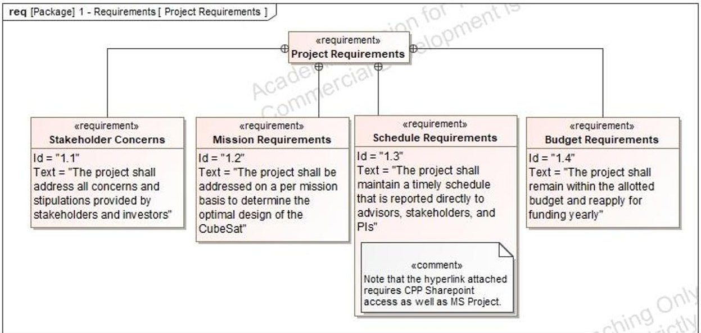

Figure 35 CubeSTEP Project Requirements

<!-- PDF_PAGE: 56 -->

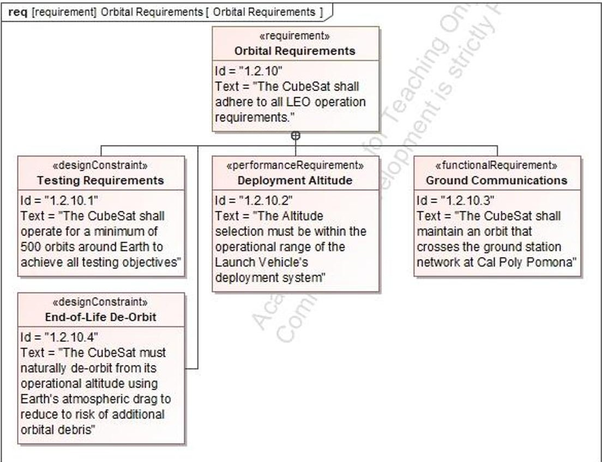

Figure 36 CubeSTEP Orbital Requirements

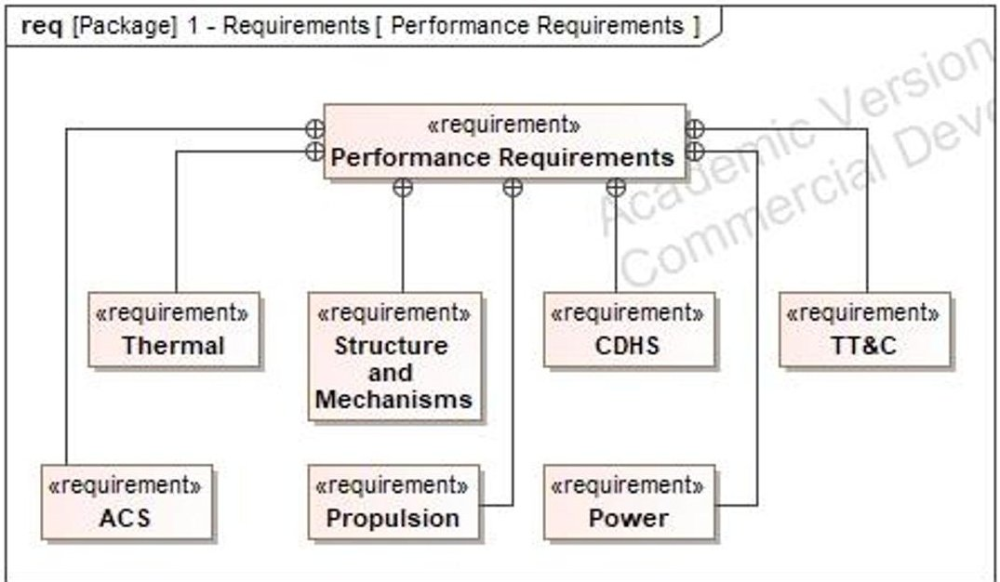

Figure 37 CubeSTEP Performance Requirements for Hierarchy Control

<!-- PDF_PAGE: 57 -->

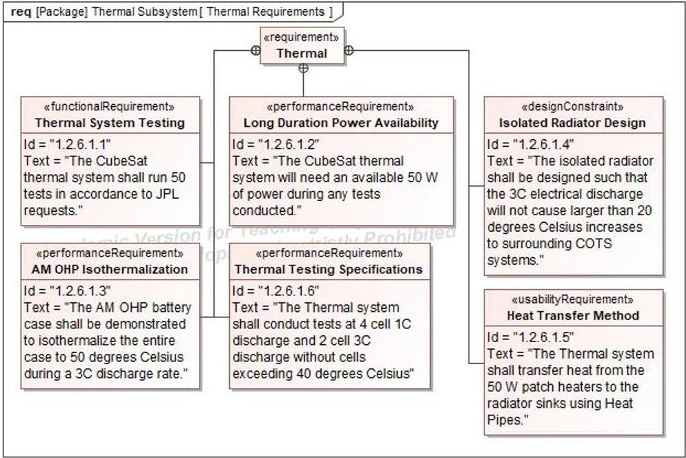

Figure 38 CubeSTEP Thermal System Requirements

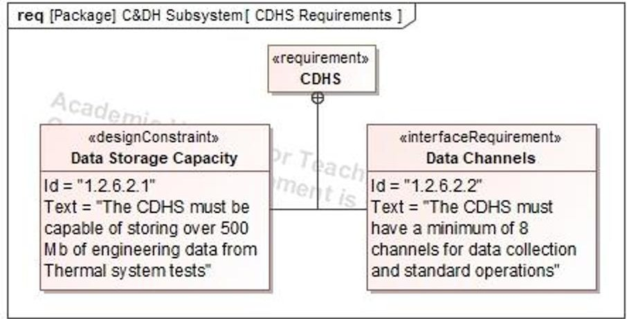

Figure 39 CubeSTEP Command & Data Handling System Requirements

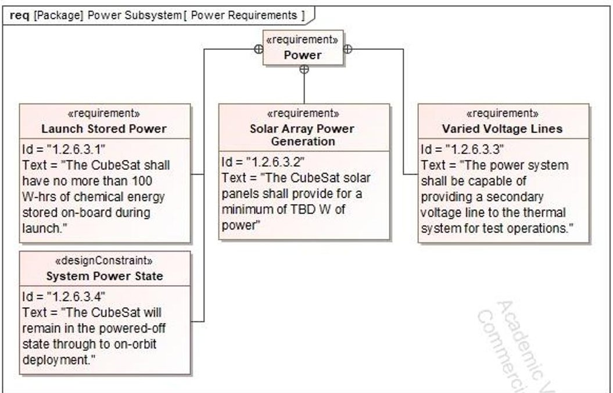

Figure 40 CubeSTEP Power System Requirements

<!-- PDF_PAGE: 58 -->

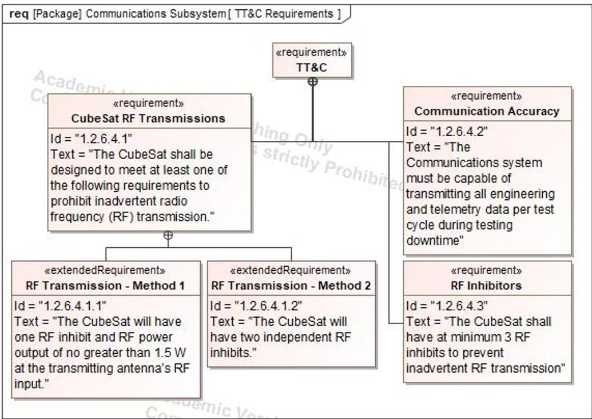

Figure 41 CubeSTEP Communication System Requirements

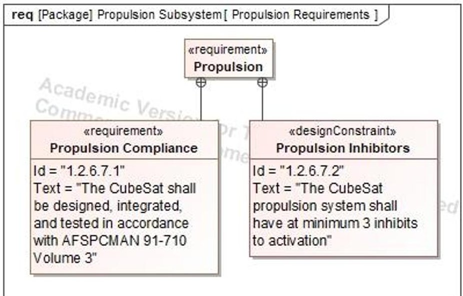

Figure 42 CubeSTEP Propulsion System Requirements

<!-- PDF_PAGE: 59 -->

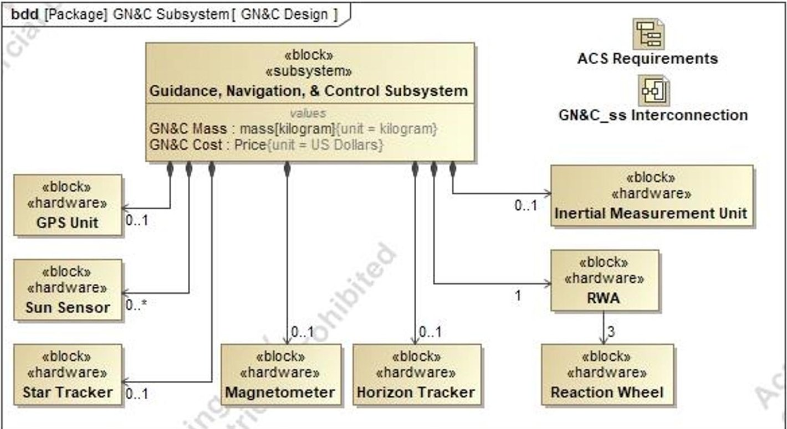

Figure 43 CubeSTEP Attitude Control Components and Characteristics

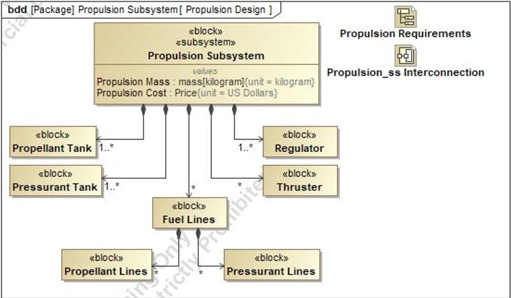

Figure 44 CubeSTEP Propulsion System Components and Characteristics

<!-- PDF_PAGE: 60 -->

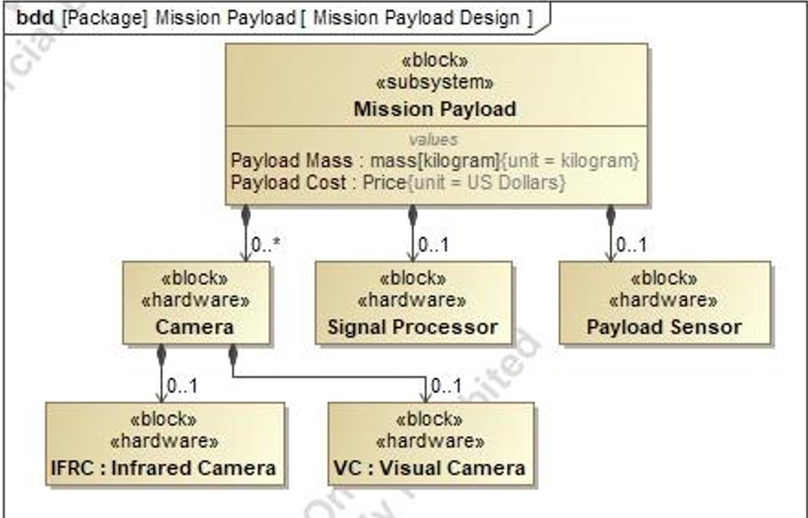

Figure 45 CubeSTEP Mission Payload Components and Characteristics

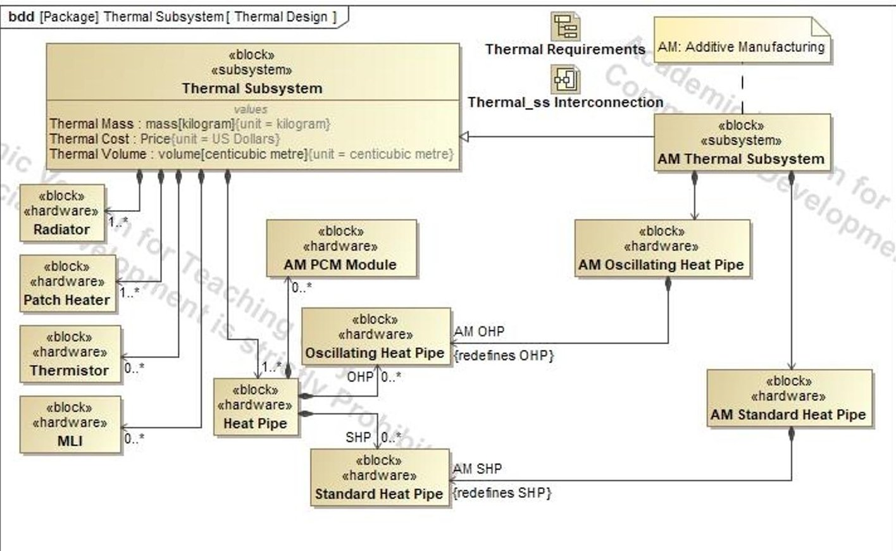

Figure 46 CubeSTEP Thermal System Components and Characteristics

<!-- PDF_PAGE: 61 -->

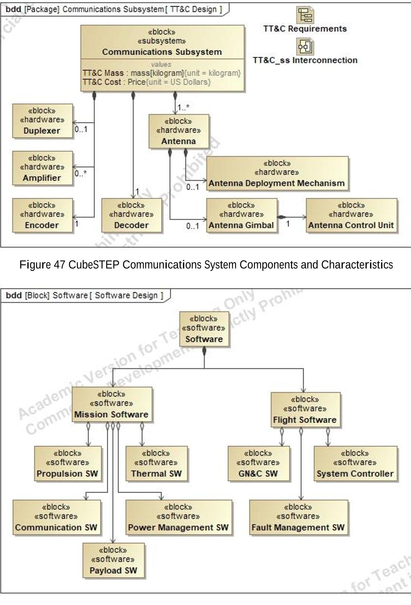

Figure 48 CubeSTEP Required Software Command Chain and Overview

<!-- PDF_PAGE: 62 -->

## APPENDIX C - CubeSat Internal Block Diagrams

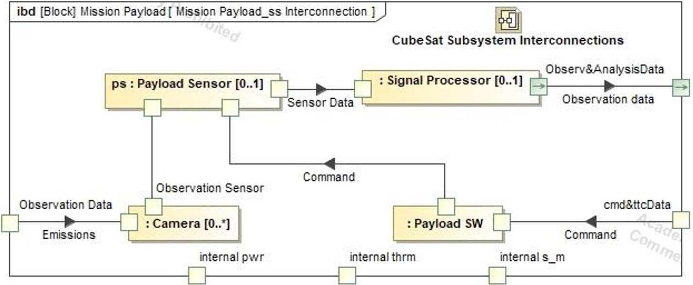

Figure 49 CubeSTEP Mission Payload Connections and Information Flow

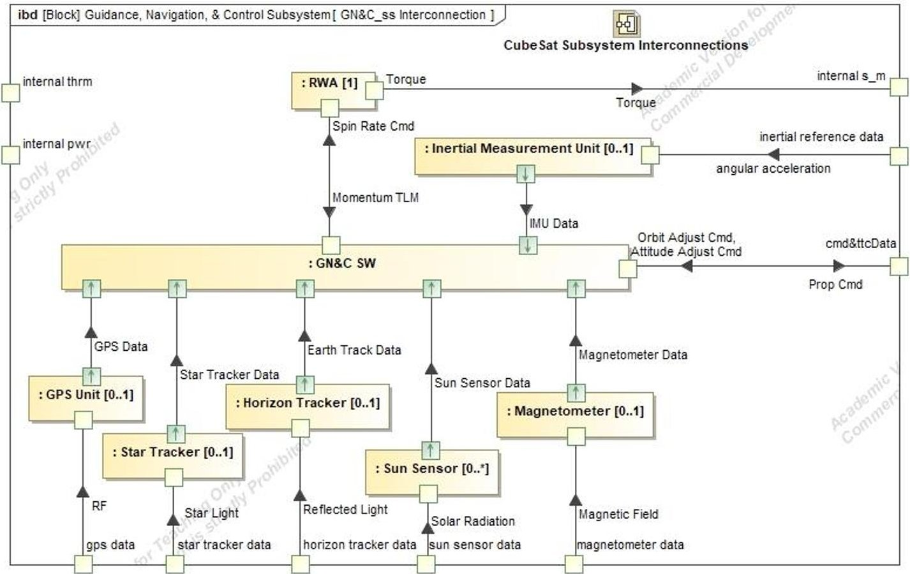

Figure 50 CubeSTEP Attitude Control Connections and Information Flow

<!-- PDF_PAGE: 63 -->

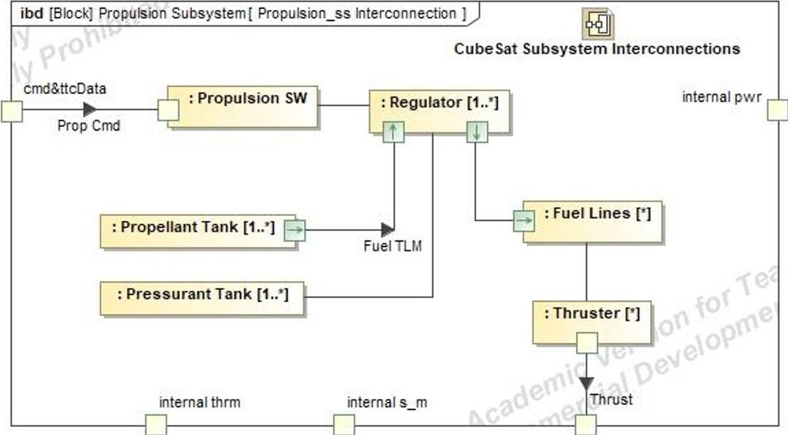

Figure 51 CubeSTEP Propulsion Connections and Information Flow

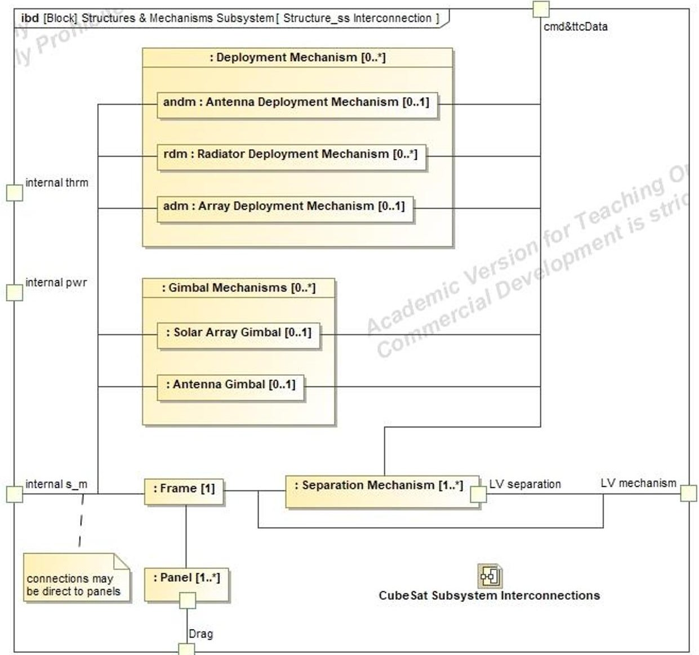

Figure 52 CubeSTEP Structures & Mechanisms Connections and Information Flow

<!-- PDF_PAGE: 64 -->

Figure 53 CubeSTEP Communications Connections and Information Flow

Figure 54 CubeSTEP Thermal System Connections and Information Flow

<!-- PDF_PAGE: 65 -->

Figure 55 CubeSTEP Launch Actions

Figure 56 CubeSTEP Maintaining System Operation Actions

<!-- PDF_PAGE: 66 -->

act [Activity] Transmit Observation Data [ Transmit Observation Data ]

Figure 57 CubeSTEP Actions for Transmission of Observational Data

<!-- PDF_PAGE: 67 -->

Figure 58 CubeSTEP Cost Estimation Analysis

Figure 59 CubeSTEP Volume Budget Analysis

Figure 60 CubeSTEP Orbital Analysis

<!-- PDF_PAGE: 68 -->

Figure 61 CubeSat Command and Data Handling Fault Tree

Figure 62 CubeSat Propulsion System Fault Tree

<!-- PDF_PAGE: 69 -->

Figure 63 CubeSat Structure and Mechanism Fault Tree

Figure 64 CubeSat Thermal System Fault Tree

Figure 65 CubeSat Telemetry, Tracking, and Communications Fault Tree

