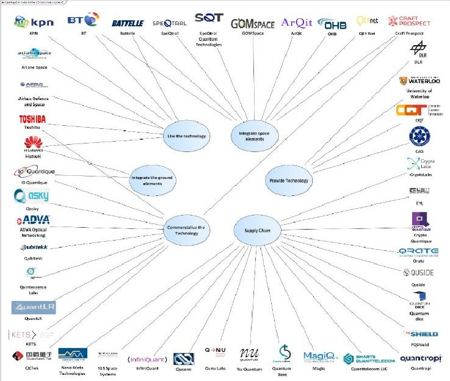
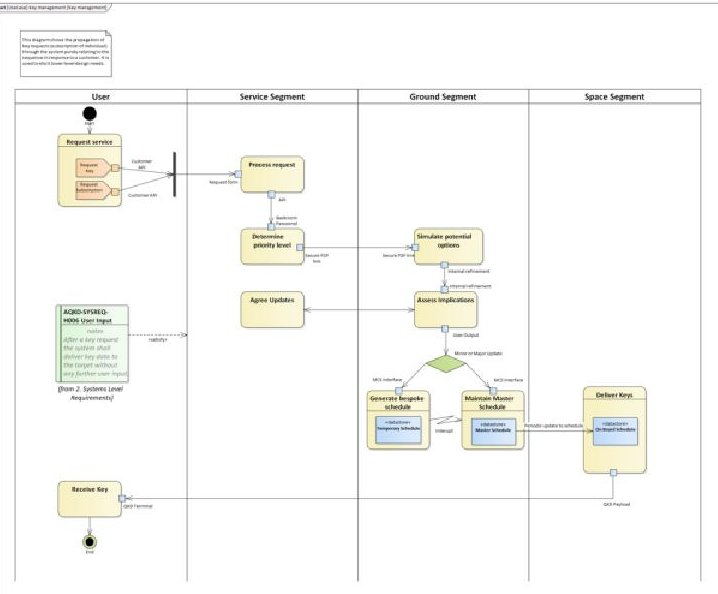
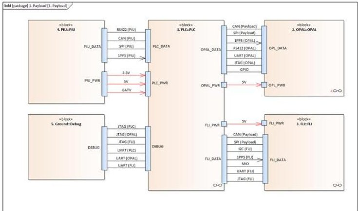
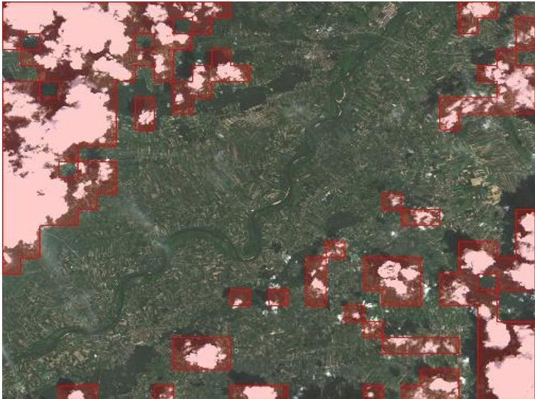
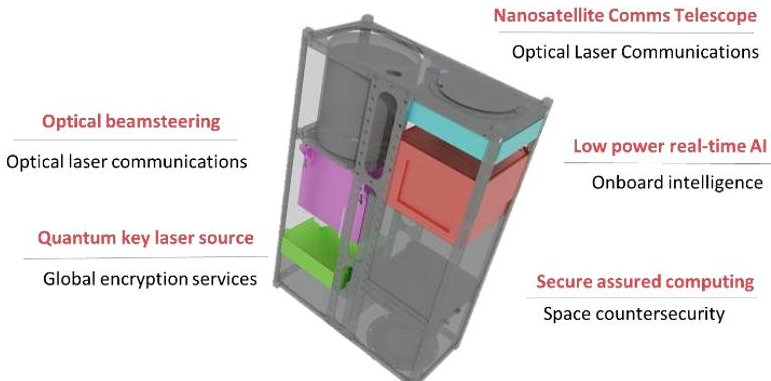

<!-- PDF_PAGE: 1 -->

$ 72^{\mathrm{nd}} $ International Astronautical Congress (IAC), Dubai, United Arab Emirates, 25-29 October 2021. Copyright $ \textcircled{2} $ 2021 by the International Astronautical Federation (IAF). All rights reserved.

IAC-21,D5,4,6,x64288

From complex to complicated: development of a Model Based Systems Engineering and cyber security approach for a quantum key distribution nanosatellite.

Douglas McNeil $ ^{a} $ , Colin Aitken $ ^{a} $ , Cassandra Mercury $ ^{a} $ , Sonali Mohapatra $ ^{a} $ , Hazel Jeffrey $ ^{a} $ , Daniel Oi $ ^{a} $

$ ^{a} $ Craft Prospect Ltd, Suite 12, Fairfield, 1048 Govan Road, Glasgow, UK, G51 4XS, Email: info@craftprospect.com $ ^{b} $ University of Strathclyde, 16 Richmond Street, Glasgow G1 1XQ, Email: daniel.oi@strath.ac.uk

## Abstract

Current global security systems are built on the premise that mathematical complexity and limitations of processing power are sufficient to protect data. With the emergence of quantum computing these assumptions are now being challenged. Space based Quantum Key Distribution (QKD) is a method of encryption key delivery offering significant benefits over ground-based counterparts in terms of range and coverage. Additionally, the emergence of Artificial Intelligence (AI) offers increases in efficiency through cloud avoidance. For an AI enabled nanosatellite for QKD, design engineers must trade the often-conflicting requirements of space, cybersecurity, AI and quantum to progress the design from the complex to the merely complicated. The Responsive Operations for Key Services (ROKS) mission aims to provide QKD services which augment larger scale QKD efforts. The onboarding of AI to detect and avoid cloud has a significant impact on the concept of operations, moving to significant levels of autonomy. In systems engineering terms, added to the design burden of implementing an emerging technology such as QKD, the established principles of operation are also being challenged. Additionally, as nanosatellites have rarely been deployed as nodes in a secure network to date, the project requires the synthesising of different security standards and approaches into a coherent framework. For the programme significant consideration is given to project lifecycle. In the initial phases agile principles are employed, allowing for experimentation in design. With increasing knowledge of the problem space, there is a reduction in the uncertainty in design elements, leading to a transition from an agile based lifecycle to the waterfall-based methods more suitable for Flight Model implementation. Underpinning the project is a Model Based Systems Engineering (MBSE) approach. Enterprise Architect was selected as the MBSE tool of choice during blue sky design stages, allowing a smooth transition from capability level considerations to systems and subsystems design. The Zachman framework offers a consistent, but potentially over flexible, approach to model development. MBSE offers a clear methodology for integrating the model with external simulation tools to provide on ground verification of platform behaviours and porting design effort to support new mission concepts. The application of flexibility in lifecycle management, sound security principles and a model-based approach to technical development has proven to be a highly effective approach in increasing our understanding of complex systems allowing for complicated, but mature, designs to be defined.

Keywords: nanosatellite, quantum, QKD, Artificial Intelligence, MBSE

## Acronyms/Abbreviations

Quantum Key Distribution (QKD)

Model Based Systems Engineering (MBSE)

Artificial Intelligence (AI)

Responsive Operations for Key Services (ROKS)

Augmented Quantum Key Distribution (AQKD)

Systems Modelling Language (SysML)

On Board Computer (OBC)

High Altitude Pseudo Satellites (HAPS)

Commercial Off the Shelf (COTS)

Consultative Committee for Space Data Systems (CCSDS)

The Open Group Architecture Framework (TOGAF)

## 1. Introduction

Quantum Key Distribution (QKD) is an emerging field within cyber security which can serve to supplement increased assured demand or as a replacement for existing public key infrastructure. In traditional methodologies encryption is managed by the sharing of keys which with a powerful enough processing capability can be compromised. This is particularly relevant with the emergence of quantum computers, offering the potential to solve complex mathematical functions far more efficiently than existing computing methods. QKD exchanges keys in a way which protects key transfer using fundamental laws of physics, and therefore would be impervious to direct quantum computer enabled brute force attack. QKD distributes secret keys in a way that cannot be effectively intercepted, copied or measured, without leaving obvious signs of observation. Such

<!-- PDF_PAGE: 2 -->

systems provide the security of knowing that any eavesdropping on the key transfer stage of communications can be immediately detected and addressed.

Due to the losses experienced in optical fibres in ground based QKD networks and line of sight limitations (50-100km before another node is required), space represents an excellent, global, and highly scalable mechanism for the distribution of secure keys. Nowadays, nations are engaged in a Quantum Space Race determined to be the first to industrialise QKD using satellites [1].

The 'Augmented Quantum Key Distribution (AQKD) satellite service uses nanosatellites (particularly CubeSats) to deliver cryptographic keys and related services for fractions of the cost of traditional satellite constellations. The initial service implementation is based on a technology demonstration through the 'Responsive Operations for Key Services' (ROKS) satellite to be launched in 2022. This AQKD service, rather than compete with large service providers, will aim to augment these larger networks. The service will support the emergence of terrestrial and satellite-based quantum key security systems. The use of nanosatellites provides rapid deployment and smoothens the demand, enabling low-cost and reliable services for consumers, investors, and partners alike. These small satellites have the potential to serve in establishing strategic nodes for global communications across countries, continents, and isolated regions.

This paper discussed the design of the ROKS demonstration mission. This mission operates at the intersection of Artificial Intelligence (AI), quantum technologies, space and cyber security and as such presents a unique and complex case with regards to systems engineering. To address this focus was placed on a structured approached based on Model Based Systems Engineering. This allows the translation of the design from 'blue sky' concept to implemented subsystems. These subsystems represent a departure from current design principles within the space sector, and as such can be used as a yardstick for other emerging capabilities.

## 2. Applications and Use Cases

Currently secure data transfer is managed using techniques such as Public Key Infrastructure. While this has been a useful technology to this point, it is at risk of becoming obsolete based on the processing power afforded by quantum computers. Compounding this is the problem of forwards security. Data which retains value into the future (e.g. health records) are vulnerable to attacks where information is recorded and unencrypted

when processing power allows. The above issue leads to problems in sectors which are heavily reliant secure data.

Based on the above there are a number of sectors which need to be considering the challenges of quantum supremacy now, so as to be prepared for obsolescence. Sectors which may be vulnerable are:

- Security and Defence

- Oil and Gas

- Healthcare

- Governmental communications

- Telecoms

- Cloud Computing

- Utilities and critical infrastructure

- Internet of Things

- Aviation and maritime

- Finance

## 3. The Role of Nanosatellites

There are few examples of the role out of genuinely novel capabilities since nanosatellites have reached the maturity levels required to support the deployment of emerging technologies. QKD is uniquely suitable given requirements around global coverage, rapid revisit, Service Level Agreement based delivery and limitation in fibre-based delivery. As such nanosatellites offer several niche benefits when considered as an augmentation strategy for larger space or ground based networks, namely:

- Smoothing of demand where networks experience elevated key requests.

- Gap filling capacity where infrastructure is unavailable or not yet deployed.

- Alternate key channels where customers have bespoke security requirements.

- Key delivery to locations outside of existing infrastructure.

- Additional delivery opportunities to overcome cloud cover constraints.

- Redundancy in case of failure/attack of standard network.

- Highly miniaturised systems capable of integration of secure nodes onto space assets.

If the engineering challenges of miniaturisation, trust, security and operational efficiency can be solved there is a significant opportunity for nanosatellite delivered QKD. These challenges have impacted considerably on the architectural design of the ROKS mission.

<!-- PDF_PAGE: 3 -->

## 4. Model Based Systems Engineering

Model Based Systems Engineering (MBSE) facilitates model driven, as opposed to document driven projects. For the ROKS project the Enterprise Architect MBSE tool was selected due to it extension packages for Enterprise Architecture alongside SysML functions. In order to support the Model Based approach the Zachman Framework for Enterprise Architecture was selected to structure development. This allowed for the project to begin by answering high level questions around the business case for QKD as a nascent market, before flowing business considerations into the systems design itself through various levels of instantiation.

Through the tool traceability is managed, ensuring requirement flow down from capability level to subsystem level. An example of business level activity is given in Fig. 1. where the tool has been used to map stakeholders within the QKD domain and segment these into 'types' such as end users.

Fig. 1. Stakeholder mapping in Enterprise Architect

The use of Enterprise Architect supports design decomposition. The models' behavioural views enforce an approach which considers the structural and behavioural architectural elements in parallel. This ensures equal focus is placed on the functional (e.g. software) as well as physical (e.g. hardware) design.

Fig. 2. Sequencing User Key Requests

Fig. 3. High Level Payload Architecture

Through the use of MBSE approaches the complexity associated with the development of a multifaceted satellite-based service was managed and the effort associated with doing so was reduced.

## 5. Architectural Considerations

The fundamental architectural design for the design of the Quantum Systems was where to draw the 'red / black' boundary. This essentially defines which system elements are treated as trusted systems and which are untrusted, a concept particularly acute in the context of QKD. While the temptation may be to draw this boundary somewhere within the ground segment, essentially treating the entire space-based system as trusted, the boundary for the ROKS system was defined between the platform and payload. This allows the use of untrusted 3rd party avionics (e.g. an 'Off The Shelf' satellite bus) but also means that the payload itself can be deployed on platforms such as High Altitude Pseudo Satellites (HAPS) and also as a secondary payload on a separate satellite platform. To implement this, significant consideration was given to the Payload Computer subsystem, which acts as a gatekeeper between the secure payload elements and the untrusted platform avionics.

<!-- PDF_PAGE: 4 -->

Critical to this unit is the selection of hardware to ensure standard attack vectors through the platform can be addressed. Further to this key management principles common to existing infrastructure must be replicated (e.g. isolated key storage).

A second key architectural consideration regards the hosting of autonomous functions. These functions, at their most basic, allow for target selection on orbit (e.g. if target A is cloud covered, task the platform to point to the lower priority target B). Here neural networks are deployed on standard space-based hardware which can detect and geolocate cloud using a low performance imager. Due to the decision to develop the payload in isolation from the platform this functionality must be payload hosted. This creates a situation where a payload must task the platform avionics (i.e. the main On Board Computer - OBC). This is a significant deviation from traditional operational concepts where a primary schedule is followed and is hosted on the main OBC.

Fig. 4. Cloud Detection Using the Craft Prospect Forwards Looking Imager.

## 6. A Framework for Security

Any system is only as secure as its least secure element. This means that to deliver a space based cyber security service, best practice must be always maintained. Early work revealed that there was no one size fits all' open set of standards for space based cyber security services. Based on significant desk-based research and work with security orientated partners an approach which combined a number of separate standards into a bespoke framework was defined. Examples of standards which were incorporated includes ISO:27001 [2] for general company system and facility security, CCSDS [3] for space specific considerations, ETSI developments towards a standard suite for QKD [4] systems and even British Standards around Automotive and Control Systems for device level considerations [5].

This consolidation of requirements ensures that security concepts are flown into the design at all levels and a comprehensive approach is taken.

## 7. The ROKS Satellite

The above concepts have all informed the design of a satellite for demonstration of AI enabled QKD for nanosatellite. This platform is based on the purchase of a Commercial Off The Shelf (COTS) nanosatellite platform, with a payload consisting of a number of key subsystems. These subsystems are:

- A bespoke CubeSat compliant telescope designed specifically for optical communications applications (in partnership with Fraunhofer UK).

- An optical beam steering subsystem capable of correcting the beam direction beyond the limitation of the CubeSat Attitude Control subsystem.

- A QKD source capable of supporting a number of Weak Coherent Pulse protocols (in this case BB84) [6].

- Low power real time AI, implemented on the Craft Prospect Forwards Looking Imager product. This hosts cloud detection algorithms for informing satellite operations.

- Secure Assured Computing, managing the red / black interface and hosting assured autonomous computing.

At the time of authorship, the Flight Model platform is in development, with launch set for late 2022.

Fig. 5. Cartoon Showing the ROKS Platform Subsystems

## 8. Discussion

This paper proposes high-level approaches for the model-based design and implementation of a secure AI enabled satellite for the provision of QKD. While the approach has shown considerable value in progressing the design to flight model implementation there are some

<!-- PDF_PAGE: 5 -->

core lessons learned. While the use of Model Based Systems Engineering has been a significant success, the implementation of the Zachman Framework was noted to create a number of arbitrary tasks which did not influence the design process. Here more flexibility in deployment, or potentially consideration of more widely used frameworks (such as TOGAF [7]) may have improved design efficiency.

In terms of the approach to security, engagement with partner organisations early in the programme has aided with knowledge transfer and ensure a comprehensive framework has been defined. This has informed not only system requirements, but also company operations and general cyber security approaches. This approach could be further refined towards a baseline for future space based cyber security services.

In terms of autonomy, the complexity of autonomous operations is aided by a MBSE approach which focused on the function of the system. By focusing on the functional architecture early in the project the operation of autonomous elements could be understood, and its impact on other subsystems defined. This has allowed the definition and implementation of a novel approach to cloud detection which allows for targeted downlink of optical communications data based on local weather conditions.

The above has facilitated the development of a mission concept and requisite subsystems for QKD demonstration from nanosatellite.

## List of references

[1] T. Jennewein and E. Choi, "Quantum Cryptography, A Market study and business opportunities assessment." Institute for Quantum Computing, University of Waterloo, Jul-2014.

[2] ISO/IEC 27001 - Information Security Management https://www.iso.org/isoiec-27001-information security.html, (accessed October 2021).

[3] CCSDS Security Guide for Mission Planners CCSDS 350.7-G-2, April 2019, https://public.ccsds.org/Pubs/350x7g2.pdf, (accessed October 2021)

[4] ETSI Quantum Key Distribution (QKD): QKD Module Security Sepcificaiton, 2010, https://www.etsi.org/deliver/etsi_gs/QKD/001_099/ 008/01.01.01_60/gs_qkd008v010101p.pdf, (accessed October 2021)

[5] BSI Security for industrial and control systems BS EN IEC 62443, April 2018, (accessed October 2021).

[6] Charles Bennet, Giles Brassard, Quantum Cryptograhy: Public Key Distribution and Coin T\ossing, International Conference on Computers, Systems and Signal Processing, Bangalore, 1984

[7] The Open Group, The TOGAF Standard, Version 9.2, https://www.opengroup.org/togaf, (accessed October 2021).