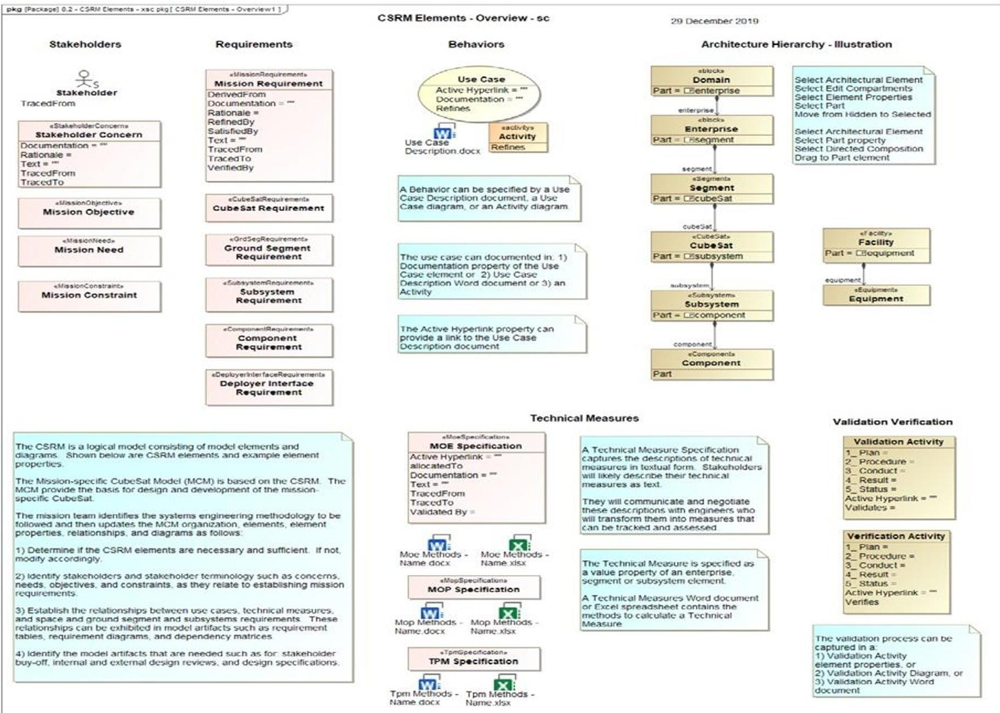
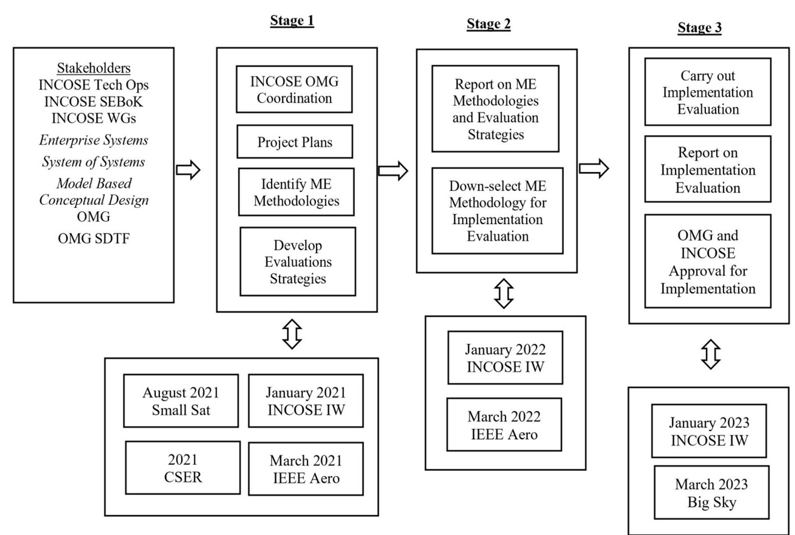
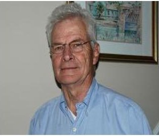

<!-- PDF_PAGE: 1 -->

# Mission Engineering and the CubeSat System Reference Model

David Kaslow

DEKaslow Consulting

Newtown Square, PA 19073

610-405-6685

david.kaslow@gmail.com

Alejandro Levi INCOSE Space Systems Working Group Alejandro.G.Levi@ieee.org orcid.org: 0000-0001-8450-8597

Bradley Ayres

Air Force Institute of

Technology

2950 Hobson Way

Wright-Patterson AFB, OH

45433

937-255-3636 x3422

bradley.ayres@afit.edu

David Hurst Orbital Transports, Inc 965 W Chicago Ave, Chicago, IL 60642 773-218-6151 dhurst@orbitaltransports.com

Philip T Cahill Consultant

Bryn Mawr, PA 19010

610 787-0283

navyred@msn.com

Chuck Croney Consultant,

Fort Washington, PA 19034

215 880-4422

chuck.croney@gmail.com

Abstract—The International Council on Systems Engineering (INCOSE) Space System Working Group (SSWG) has created the CubeSat System Reference Model (CSRM), a representation of the logical architecture of a CubeSat system, intended to be used by system architects and engineers as a starting point as they develop the physical architecture of the Space and Ground segments of the CubeSat mission of interest to them.

The CSRM is based on Model-Based System Engineering (MBSE) principles, is System Modeling Language (SysML) compliant, is hosted in a graphical modeling tool, and is intended to foster completeness and economies of scale associated with reusability. The CSRM has been vetted by System Engineering professionals and has been introduced to the CubeSat mission development team community with favorable results. The CSRM has been submitted to the Object Management Group (OMG) as a CubeSat specification, and is being evaluated for that role.

Mission Engineering, a concept where the mission itself is looked at as a system is being explored as a means to maintain balance between the spacecraft system, operations (including ground systems), and the mission (the integration of needed capabilities). Now opportunities exist to extend the already-developed CSRM to enable the application of Mission Engineering to modeling a complete CubeSat mission. This paper presents the challenges and approach that the INCOSE SSWG will address, including a path for extension of the CRSM for use in exploring its applicability to the Mission Engineering concept, and capturing the Mission as a Model to create a unifying environment for universities to build on each other's successes as they learn to design for Space.

## TABLE OF CONTENTS

1. INTRODUCTION...1

2. OVERVIEW OF THE CUBESAT SYSTEM

REFERENCE MODEL...2

3. DEFINING MISSION ENGINEERING...3

4. CSRM AS A TOOL FOR MISSION ENGINEERING ..4

5. OUR APPROACH TO EXTENDING THE CSRM IN SUPPORT OF MISSION ENGINEERING...5

6. PATH FORWARD...5

7. SUMMARY...6

REFERENCES...6

BIOGRAPHIES...7

978-1-7281-7436-5/21/$31.00 ©2021 IEEE

## 1. INTRODUCTION

The International Council on Systems Engineering (INCOSE) Space Systems Working Group (SSWG) has been focused on the design and development of the CubeSat System Reference Model (CSRM) since 2014. [1] - [6] That effort was successfully completed in 2020. The CSRM has been submitted to the Object Management Group (OMG) as a CubeSat specification, and is being evaluated for that role. The SSWG plans on exploring how the approaches and methodologies used in the development of the CSRM can be applied to the realm of Mission Engineering. The team will identify possible follow-on capabilities for the SSWG during 2021-2022, with the goal of selecting the appropriate way ahead and presenting its results to the IEEE Aerospace Conference at Big Sky in March 2022.

The 2021 IEEE Aerospace Conference provides an ideal opportunity for the SSWG to present its ideas to the IEEE for its comments and feedback. Recommendations for further work are encouraged.

This paper provides the following:

- An overview of the CSRM

- A definition of Mission Engineering to guide the application of the CSRM

<!-- PDF_PAGE: 2 -->

- A discussion of the CSRM as a tool for Mission Engineering

- A discussion of our approach to extending the CSRM in support of Mission Engineering

- Anticipated path forward.

## 2. OVERVIEW OF THE CUBESAT SYSTEM REFERENCE MODEL

The CSRM provides a CubeSat logical space-ground architecture. The logical components are abstractions of the physical components that perform the system functionality without imposing implementation constraints. The physical architecture defines physical components of the system including hardware, software, persistent data, and operational procedures. The logical components are a starting point for a mission-specific CubeSat logical architecture, followed by the physical architecture and the CubeSat development

The CSRM integrates five overarching elements: stakeholders, technical measures, behaviors, requirements, and architecture. The CSRM provides for defining and

tracing requirements from stakeholders, to behaviors, with technical measures assigned to subsystems and components to be certified through validation and verification activities. Figure 1 provides and overview of these elements

The CSRM is a repository for systems engineering artifacts. However, it is not pre-populated with specific stakeholders, technical measures, behaviors, and requirements. That is the job of the CubeSat mission development team, specific to their needs and objectives. Development of a mission-specific CubeSat utilizing the CSRM establishes a mechanism to share and reuse components with other design activities.

A mission-specific CubeSat team downloads the CSRM specification and files from OMG for import it into their own graphical modeling tool. The mission team identifies the systems engineering methodology to be followed and populates the model, elements, relationships, and diagrams as needed.

Figure 1. Overview of CSRM Elements

<!-- PDF_PAGE: 3 -->

## 3. DEFINING MISSION ENGINEERING

The INCOSE Systems Engineering Body of Knowledge (SEBoK) defines Mission Engineering as "the application of systems engineering to the planning, analysis, and designing of missions where the mission is the system of interest" [7]. It goes on to say that Mission Engineering "analyzes the mission goals and threads, analyzes the available as well as emerging operational and system capabilities, and designs a mission architecture to achieve the mission goal." The SEBoK also identifies the main activities of Mission Engineering which are discussed below.

Mission Capability Analysis and Definition. The problem scenario is analyzed to determine what capabilities are required and to develop a Concept of Operations (ConOps) for the mission. A capability is defined as the ability to complete a task or execute a course of action under specified conditions and level of performance [8]. A ConOps covers a series of connected operations to be carried out simultaneously or in succession [7]. It is written from the operator's perspective.

Mission Thread Definition. The end-to-end set of operational activities are analyzed. This starts with modeling operational activities, their sequencing, and the information flows between them. References [9-11] provide a good discussion of mission threads.

Tradeoff Analysis. Alternatives for accomplishing the mission are developed and trade studies are conducted to determine the best alternative given resources and time available.

Mission Architecting. An operational architecture is developed describing the capabilities, operational activities, operational nodes, and other relevant elements to model the mission. Wertz et al. [12] identify elements associated with a space mission architecture to include the space segment, ground segment, mission operations, launch segment, orbit, end user, and command, control, and communications architecture.

Requirements Engineering. The functional and nonfunctional requirements are determined from the capability analysis, ConOps, and mission threads. The requirements are allocated to the operational nodes.

Interoperability Analysis. Operational interoperability describes the ability of the systems to coordinate their activities to support completion of the mission thread. Technical interoperability describes the ability of the systems to exchange data with considerations for the timeliness and quality of the data. Interoperability between systems completing the mission must occur at both the operational and technical levels. Giachetti et al. [10] provide a good discussion of interoperability analysis as it applies to mission-oriented System of Systems Engineering (SoSE).

Mission-oriented System of Systems (SoS) Implementation Mission engineering is closely associated with SoS because most missions are accomplished through the coordination and interoperability of multiple systems. The mission-oriented SoS is implemented through designing and developing new systems, modifying existing systems, and/or modifying doctrine, policies, procedures, and other nonmateriel means to help achieve the mission. Ideally the mission-oriented SoS could be rapidly conceived, assembled, and deployed to react to a rapidly changing environment. However, there are many challenges associated with the engineering of a SoS.

The INCOSE SoS Primer describes major challenges associated with a SoS [13]:

- Each constituent system is independent and makes decisions or upgrades without considering the rest of the SoS if their own goals conflict with SoS goals.

- Constituent systems may withdraw from the SoS if their own goals conflict with SoS goals.

- The SoS itself is commonly large-scale and usually highly complex. It is difficult to produce accurate predictive models of all emergent behaviors, and so global SoS performance is difficult to design.

- Testing and verifying upgrades to a SoS is difficult and expensive due to scale, complexity and constant evolution.

- The Primer characterizes a SoS as having:

- Multiple levels of stakeholders with mixed and possibly competing interests.

- Multiple and possible contradictory, objectives and purpose.

- Disparate management structure with no clear accountability.

- Multiple lifecycles with elements being implemented asynchronously.

- Multiple owners making individual resourcing decisions.

- These aspects of a SoS create challenges that cannot be met by a traditional systems engineering approach. To address this challenge, 7 core elements of SoSE have been developed [13, 14]:

- Understanding SoS capability objectives.

- Understanding constituent systems and their relationships.

- Assessing SoS performance against capability objectives.

- Developing, evolving, and maintaining a SoS architecture.

- Monitoring and assessing the impact of changes on the SoS performance.

- Addressing requirements and solution options.

- Orchestrating upgrades.

Chen and Unewisse [14] recognize that these 7 core elements represent part of what is required, but there are still a range

<!-- PDF_PAGE: 4 -->

of outstanding challenges that remain for SoSE to include managing the complexity and monitoring the well-being of a SoS.

Mission Verification and Validation. Includes verification that the system as delivered satisfies the requirements and validates that the system fulfills the mission purpose and stakeholder needs.

## 4. CSRM AS A TOOL FOR MISSION ENGINEERING

Having defined the major activities associated with Mission Engineering, a preliminary analysis can be made to get an initial assessment of where the CSRM supports these activities and where there are areas that require further research.

Mission Capability Analysis and Definition. There is no model element defined in SysML for a capability. However, SysML can be extended through the use of stereotypes. The CSRM had created unique stereotypes for other model elements. It is very conceivable that new elements could be created and added to the existing CSRM profile. High-level graphics, like an OV-1 diagram, showing the ConOps could be done through adding an Internal Block Diagram showing the mission elements and their relationships.

Mission Thread Definition. It has been demonstrated that the CSRM can be used to define and analyze mission activities such as those involved with the tasking, collection, and distribution of mission data [1].

Tradeoff Analysis. Trade studies performed early in the mission development process at the enterprise and segment can be refined as the subsystems and components are physically defined. Techniques for creating physical instances at the enterprise and segment levels, based on values derived from decomposing requirements and technical measures can be explored. Though not specifically a trade study, it has been demonstrated that the CSRM can be used to perform a similar analysis utilizing technical measures and parametrics [3].

Mission Architecting. As stated previously, the focus of the CSRM has been on defining the space and ground segments. Other elements of the space mission architecture, such as those identified by Wertz et al. [12] would have to be added.

Requirements Engineering. The CSRM currently captures requirements starting at the mission-level and continuing down to the component-level as shown in Figure 1. Allocation of these requirements to operational nodes can be easily accomplished once those nodes are added to the model, forming the basis for technical measures.

Interoperability Analysis. Beery and Paulo [15] state the following:

"Completion of system modeling (enabled by the creation of Block Definition Diagram and Internal Block Diagram)

describes a mission in terms of the participating systems. The Requirement Diagram describes a mission in terms of stakeholder satisfaction. The Activity, Sequence, Use Case, and State Machine Diagrams describe a mission in terms of operational implementation. While these products enable a complete description of a mission from multiple perspectives, they do not enable detailed analysis of the performance of that mission...Proper analysis requires definition and analysis of external mission models."

While the modification of the CSRM to support a descriptive model of the mission as described above is feasible, extending it beyond that point to incorporate a dynamic, analytical capability to assess overall mission performance would be challenging and an area that would require much further research.

Mission-oriented System of Systems (SoS) Implementation. The challenges associated with SoS and SoSE were discussed in the previous section. Applying an MBSE approach to SoSE creates even more challenges. Chen and Unewisse [14] state that incorporating MBSE into SoSE practice is shown to be a necessary, albeit challenging, step in developing practical approaches to SoSE. They go on to say it will require improvements and extensions of MBSE concepts, processes and tools in order to adequately and successfully address SoS challenges and issues. There are some examples of efforts to provide a solution to this problem. For example, Chen and Unewisse identify activity areas within SoSE that could be supported by MBSE. Williamson [16] provides a conceptual model for applying MBSE to SoS. While there is much progress being made in this area, there are still challenges to be addressed. As such, how the CSRM would address this is another area that requires much further research.

Mission Verification and Validation. As stated previously and shown in Figure 1, the current CSRM provides support for verification and validation activities. The level to which that supports Mission Engineering activities would have to be evaluated.

The above analysis is just a very preliminary assessment of where the CSRM could potentially support Mission Engineering activities while identifying which activities would require much further research. Overall, the above assessment provides support that it is feasible to extend the CSRM to capture a descriptive model of the mission. Addressing areas such as interoperability analysis and capturing the implementation of a mission-oriented SoS will require much further research but may still be achievable.

For example, in the application of the CSRM model, the transformation from Logical Architecture to Physical Design in the model starts at the enterprise level and expands down into the space segment, ground segments, subsystems, and subsystem components. Drivers for the transformation include how much data is to be collected, storage capacity aboard the satellite, how rapidly data can be transmitted to the receiver, and how much power is available to support

<!-- PDF_PAGE: 5 -->

these operations. The performance levels established, captured as technical measures, in the decomposition can be used to make mission level decisions such as the number of satellites and their orbits, the number and location of ground stations, capabilities and configuration of the observation payload, contents and size of the individual observations, quantity of onboard storage, and the speed of downlink data rates. The effectiveness of these decisions/attributes is then measured against the stakeholder needs and objectives

The various input factors above can be quantified through trade studies starting at the enterprise level. The trade studies are based on the modeling of collecting mission observations, storage, downlink, energy collection, and energy consumption. Such factors are used early in the mission process by stakeholders and mission engineers to define and negotiate a trade space.

## 5. OUR APPROACH TO EXTENDING THE CSRM IN SUPPORT OF MISSION ENGINEERING

As stated above, the CSRM acts a repository for systems engineering artifacts and provides the logical architecture of a CubeSat space and ground system. The CSRM is used to support the development of a mission-specific logical and physical CubeSat architecture. In this context, the CubeSat is the SOI and has been the primary focus up to this point.

However, the previous section demonstrated the feasibility of expanding the CSRM beyond the CubeSat to the entire CubeSat mission. Though challenging, the potential value to increase mission success across the entire community of CubeSat developers makes it worth pursuing.

To completely define what additions would be required to extend the CSRM to fully support Mission Engineering, the following activities are proposed:

- Identify Mission Engineering MBSE methodologies. The work of Beery and Paulo is a starting point.

- Identify other methods through 1) additional research of the literature and 2) existing projects as identified through conference exposure of this project.

- Identify the key elements of terminology, and map/align with the CSRM terminology for each methodology

- Create a hybrid "dictionary" to ensure effective and unambiguous communication.

- Analyze the CSRM for additional artifacts and technical measures which could be added to the containment tree for the key elements that do not map to the CSRM

- Assess the effort and benefits associated with modifying the CSRM to support the chosen methodology.

- Assess whether the CSRM is the right tool to support this aspect of the methodology.

- Provide the results of the above analysis to INCOSE and OMG with recommendations for implementation.

## 6. PATH FORWARD

Figure 2 illustrates the path forward, with a focus on the various CSRM stakeholders.

INCOSE is an international organization founded to develop, disseminate, enable, promote, and advance systems engineering and systems approaches.

OMG is an international technology standards consortium consisting of vendors, end-users, academic institutions, and government agencies.

INCOSE and OMG are both stakeholders in the CSRM with their relationship governed by a Memorandum of Understanding. More specifically the stakeholders this current effort are:

- INCOSE Tech Ops and INCOSE Space Systems Working Group (SSWG)

- INCOSE Systems Engineering Book of Knowledge (SEBoK)

- INCOSE Working Groups: Enterprise Systems, System of Systems, and Model Based Conceptual Design

- OMG Space Domain Task Force (SDTF)

Figure 2 shows that this effort will be coordinated with INCOSE and OMG and will follow a 3 Stage project plan.

Stage 1 will be initiated at the January 2021 INCOSE International Workshop (IW) and presented at the March 2021 IEEE Aerospace Conference and the August 2021 Small Satellite Conference. These presentations are an outreach for comments and participation.

Stage 2 will include reporting on mission methodologies and evaluation strategies and the down-select for implementation evaluations.

Stage 3 will consist of carrying out and reporting on implementation evaluations. Updating the OMG CSRM specification and files requires OMG and INCOSE approval.

<!-- PDF_PAGE: 6 -->

Figure 2. Project Timeline

## 7. SUMMARY

Utilizing Model-Based System Engineering, the INCOSE Space Systems Working Group created the CubeSat System Reference Model as a logical architecture that developers can use in the creation of their own mission-specific CubeSats, and to also act as a repository for system engineering artifacts. While the CSRM has tremendous utility in the development of a system, more work needs to be done in properly modelling the mission in its entirety (e.g., creation of metrics that allow for the evaluation of alternatives, mission utility, etc.). This is precisely where the methodologies used in the development of the CSRM could be applied towards system-of-systems approach to mission integration and management. The SSWG is in the early stages of a study that will explore the feasibility of extending the CSRM into the realm of Mission Engineering.

As part of this study, the SSWG is soliciting input from stakeholders on possible methodologies, conceptual frameworks, evaluation criteria, or any other strategies that we should consider during this early stage of our work. We intend to provide updates and gather further feedback per our previously described Path Forward.

## REFERENCES

[1] D. Kaslow, B. Ayres, P. Cahill, L. Hart, and R. Yntema, "A Model-Based Systems Engineering (MBSE) Approach for Defining the Behaviors of CubeSats," Proceedings of IEEE Aerospace Conference, Big Sky, MT. 2017

[2] Kaslow and A. Madni. "Validation and Verification of MBSE Compliant CubeSat Reference Model." Proceedings of 15th Annual Conference on Systems Engineering Research. 2017.

[3] D. Kaslow, B. Ayres, P. Cahill, and L. Hart, "A Model-Based Systems Engineering Approach for Technical Measurement with Application to a CubeSat," Proceedings of IEEE Aerospace Conference, Big Sky, MT. 2018.

[4] D. Kaslow, B. Ayres, P. Cahill, L. Hart, Croney, L Hart, A. Levi. "Developing a CubeSat Model-Based Systems Engineering (MBSE) Reference Model - Interim Status #4," Proceedings of AIAA Space Forum. Orlando, FL. 2018.

<!-- PDF_PAGE: 7 -->

[5] D. Kaslow, P. Cahill, and R. Frank, "Developing a CubeSat System MBSE Reference Model - Interim Status #5," Proceeding of AIAA/USU Conference on Small Satellites, Logan, UT. 2019.

[6] D. Kaslow, P. Cahill, and B. Ayres, "Development and Application of the CubeSat System Reference Model", Proceedings of IEEE Aerospace Conference, Big Sky, MT. 2020.

[7] INCOSE Guide to the Systems Engineering Body of Knowledge v. 2.3, October 2020. https://www.sebokwiki.org/

[8] DOD Dictionary of Military and Associated Terms, December 2020.

[9] G. Butler and D. Woody, "Mission Threads - Bridging Mission and Systems Engineering", Engility Corp SOECIE Webinar, June 2017.

[10] R. Giachetti, S. Wangert, R. Eldred. "Interoperability Analysis Method for Mission-Oriented System of Systems Engineering," IEEE International Systems Conference (SysCon), 2019.

[11] SEI, "Introduction to the Mission Thread Workshop," CMU/SEI-2013-TR-003, 2013.

[12] R. Wertz, D. Everett, and J. Puschell. Space Mission Engineering: The New SMAD, Space Technology Library. 2011.

[13] INCOSE Systems of Systems Primer, INCOSE-TP 2018-003-01.1, 2018.

[14] P. Chen and M. Unewisse, "Incorporating MBSE into SoS Engineering Practice," Model-Based Systems Engineering Symposium, DSTO-GD-0734, 2012.

[15] P. Beery and E. Paulo, Application of Model-Based Systems Engineering Concepts to Support Mission Engineering. Systems. 2019.

[16] R. Williamson, "INCOSE (MBSE) Model Based System Engineering (SoS) System of Systems Activity Introduction," INCOSE IW11 MBSE Workshop, 2011.

## BIOGRAPHIES

David Kaslow has thirty-four years of experience at Lockheed Martin in both the technical and management aspects of developing ground mission capabilities. He has five years of experience at Analytical Graphics including pursuing Model Based Systems Engineering. Dave is

a co-author of four chapters Cost-Effective Space Mission Operations. He is Co-Chair for the INCOSE Space Systems Working Group. Dave has participated in the Space Systems MBSE Challenge Team since its founding in 2007 and is the lead for the CubeSat System Reference Model.

Alejandro Levi has over twenty-five years of space systems experience. Most recently he worked for the USAF Space and Missile Systems Center (now part of US Space Force) providing systems engineering and enterprise architecture expertise to concept

development, prototyping, and early-lifecycle support for National Security Space Programs, including exploring the application of Model-Based Systems Engineering and System of Systems / Mission Engineering within the DoD Acquisition environment. He holds a Master of Engineering degree in Space Systems Engineering from the Stevens Institute of Technology and is completing a Master of Science degree in Astrophysics from the University of Southern Queensland, where he is also an Adjunct Research Fellow. He is Co-Chair of the INCOSE Space Systems Working Group Model Based Systems Engineering CubeSat Challenge Team.

Philip T Cahill has forty-five years of experience in the Information Technology industry, as consultant, customer, and contractor for government and commercial systems. He spent thirty of those years with the Lockheed Martin Corporation, concerned primarily

in the specification and development of defense and space systems, and retired as a Lockheed Martin Fellow. Phil's professional interests center on System Engineering, particularly for Systems of Systems, but he developed a passion for Data Center Operations late in his career and maintains an active interest in that field. He received his PhD in Physics from the University of Illinois at Urbana-Champaign.

Bradley Ayres is currently an Assistant Professor of Aerospace Engineering in the Department of Aeronautics and Astronautics, Graduate School of Engineering and Management, at the Air Force Institute of Technology. Brad has worked in the Aerospace and Defense industry for over 35 years. He holds a BS from the University of

Missouri-Columbia, an MS from the Air Force Institute of Technology, and a PhD from the Florida State University.

David Hurst is a technology innovator and entrepreneur, with over 30 years of experience in software engineering, developing complex systems, managing software development teams, and delivering products. He has performed technical due diligence and business strategy assessments

for venture capital firms and advanced technology start-ups.

<!-- PDF_PAGE: 8 -->

In 2013, Mr. Hurst founded Orbital Transports as a space logistics company to deliver commercial small satellite missions and he performs systems engineering and project management for these small satellite space missions. He has contributed to the INCOSE Space Systems Working Group CubeSat System Reference Model since 2016 and has developed MBSE practices for small satellite missions. Mr. Hurst graduated from Northwestern University with a BS in Electrical Engineering and Computer Science. He has received four patents.

Chuck Croney, Consultant for CubeSat System Engineering Master's degrees in System Engineering, Engineering Management and Electrical Engineering. 40+ years Aerospace Engineering with NASA, US Navy and Lockheed

Martin. Presently working in retirement by continuing career in system engineering to provide consulting and leadership services in requirements' development, system design and process definition addressing CubeSat projects.