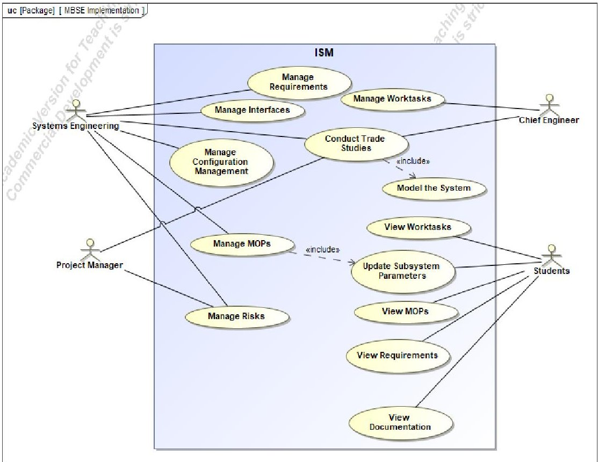
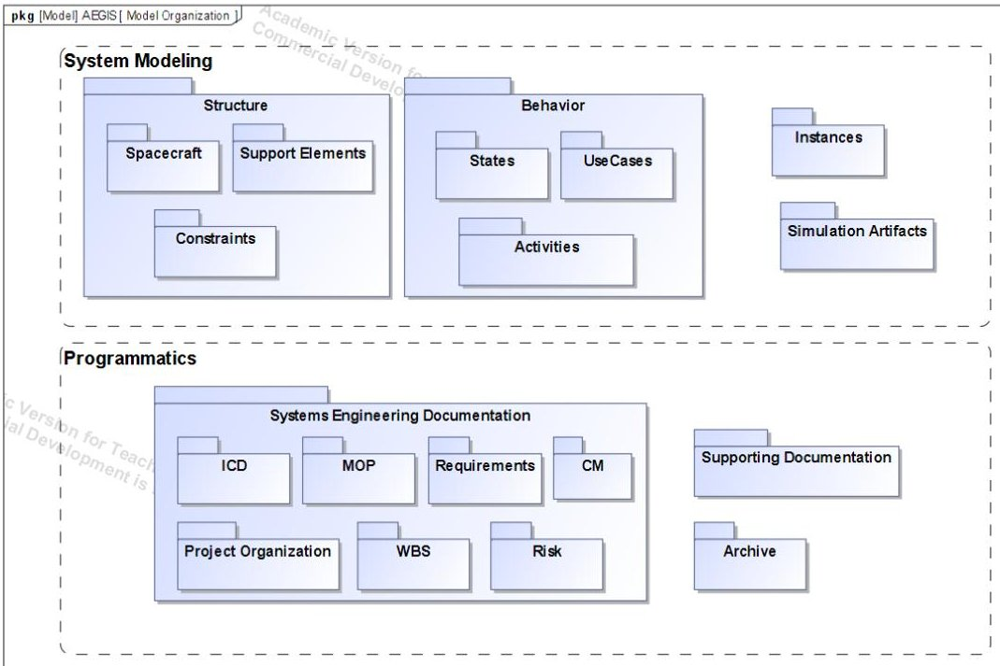
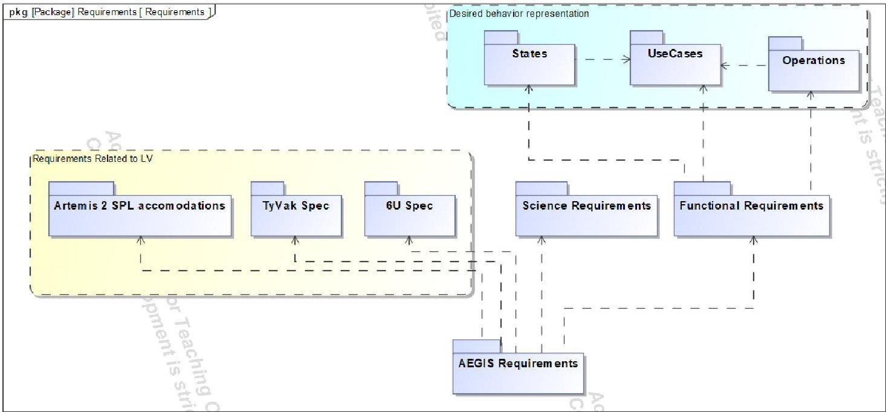
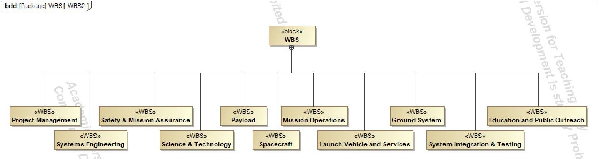
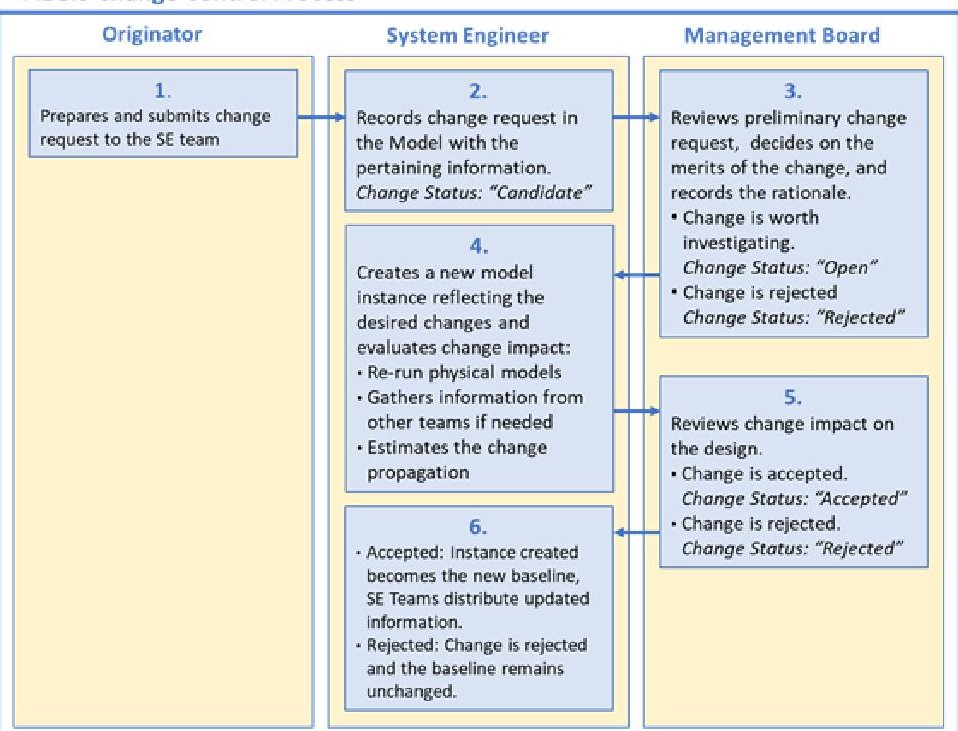
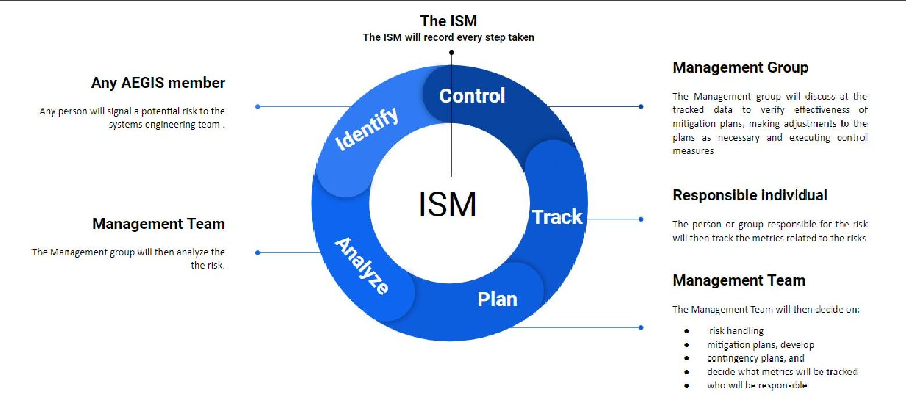
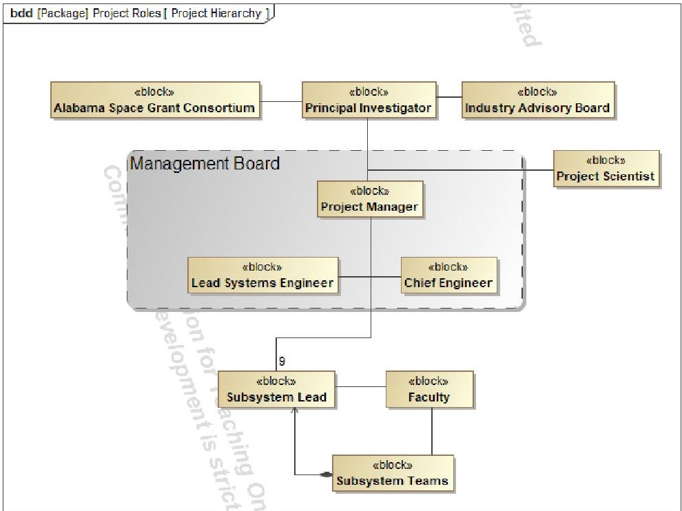

<!-- PDF_PAGE: 1 -->

# Programmatic Management for the ABEX CubeSat in a Model Based System Engineering Environment

Victor E. Lopez $ ^{1} $ , Alana Flint $ ^{2} $ and Dale Thomas $ ^{3} $ The University of Alabama in Huntsville, Huntsville, AL, 35899, USA

This paper describes how the systems engineering team has applied a Model Based Systems Engineering (MBSE) methodology to the Alabama Burst Energetics eXplorer (ABEX) project, formerly known as the Alabama Experiment for In-situ Shielding (AEGIS). The MBSE approach is based around the development of an Integrated Systems Model (ISM) that contains a model of the system and most of the programmatic information about the project. This paper details how the programmatic aspects of the projects were adapted to be recorded and tracked in the ISM.

## I. Introduction to AEGIS

Model Based Systems Engineering is a method of practicing Systems Engineering that relies on the use of a model to support system development instead of a set of documents. The model integrates both traditional elements of systems engineering such as requirements, Concept of Operations, Interface Control, Communication, and Change Management with domain specific engineering tasks such as analyses, modeling and trade studies [1]. A methodology for applying an MBSE approach to a CubeSat system development has not been formalized, although there are some notable efforts, in particular the CubeSat Reference Model[1], [2].

The Alabama Experiment for Galactic ray In-situ Shielding (AEGIS) was a project sponsored by the Alabama Space Grant Consortium (ASGC) in which multiple universities across Alabama collaboratively design, launch and operate a CubeSat Mission. The project had two main objectives, a scientific mission and an educational goal. The scientific mission consisted of launching a 6U CubeSat in cislunar space to measure the effectiveness of lunar regolithbased material as a shield of radiation in response to NASA's strategic knowledge gaps. The CubeSat was proposed for launch in October 2022 as a secondary payload of the Artemis 2 mission aboard the Space Launch System (SLS) rocket. Following NASA's decision to not manifest any secondary payloads on Artemis 2, the project was revectored and renamed the Alabama Burst Energetics eXplorer (ABEX). The science mission objectives are still being defined but consist of performing research detecting Gamma Ray Bursts (GRBs) in cislunar space while using a traditional launch vehicle to either low earth orbit (LEO) or to a Geosynchronous Transfer Orbit (GTO). The educational goal remained the same and consists of organizing the project such that most of the work is realized by undergraduate students with a few graduate students and faculty members providing guidance. The participation of undergraduate students will provide them applicable experience and should allow them to transition to industry more easily.

The novelty and complexity of the mission creates a great technical challenge which is compounded by the fact the spacecraft is designed and developed primarily by undergraduates with little to no experience in spacecraft design. Furthermore, there is an increased difficulty due to the geographical and organizational aspects of the project. The leadership board, as well as various teams are scattered throughout different universities in Alabama, creating organizational and geographical barriers. Additionally, a high turnover rate of the individuals involved is expected since the design and development work are to be accomplished by undergraduates that participate in the project voluntarily or as a curricular activity.

<!-- PDF_PAGE: 2 -->

MBSE was chosen for the ABEX (prev. AEGIS) development in response to the challenges described in the previously. This paper provides an overview of the general strategy employed to perform the systems engineering tasks in an MBSE environment and provides a more in depth look at how the programmatic elements were adapted.

## II. Systems Engineering Goals

The central concept in the application of MBSE is the use of a model that replaces most documents. The first step in the application of the MBSE methodology was to delineate what the systems engineering effort was trying to achieve and what role would the model have. The different needs were identified during the first months of the project by the management team of the project. The resulting needs are summarized in the use case diagram in Figure 1. Since the model would represent the integration of the different engineering tools and system engineering process it was named the Integrated Systems Model (ISM). The model was decided to be developed using the Systems Modeling language (SysML) implemented with CATIA|NoMagic's Cameo.

Fig. 1 Use Case for the ISM.

In Figure 1 it is possible see that there are four main types of users of the model. The Systems Engineering team uses the model for traditional systems engineering tasks as requirement management, MOP tracking, risk management, Interface management, change management, and trade studies. The project manager uses the model to manage risks and to be involved in the different trade studies. It is important to note that financial and budgetary aspects of the project are not included in the ISM but could be added in a future version of the model. The chief engineer, who is responsible for managing the activities of the different team members, will manage, assign and track the progress of the different work tasks through the model. Finally, the ISM is used by any student that is a part of the team to access the information pertaining to them. Students can see what work tasks are assigned to them, what requirements they need to satisfy, and the performance values that they should use in their design.

## III. Model Architecture

With the use cases of the model defined, the next step was to determine how to create, structure and maintain the model in order to accomplish our goals. As the program evolved, the architecture changed, the latest structure is seen

<!-- PDF_PAGE: 3 -->

in Figure 2. The model is organized in two general interdependent categories. The first is the modeling of the system and the second is the programmatic aspects needed by the project.

Fig. 2 ISM General Organization

## A. System Modeling

The modeling of the system is necessary to perform trade studies or more generally to inform a decision between two or more alternatives. MBSE aims at synchronizing the different components, or subsystem models in order to assess the impact of choosing an alternative over another. The ISM needs to model different aspects of the system. The modeling of the system is centered on a structural representation of the system and its environment. Blocks represent each component and subsystem and contain a set of values that are pertinent for that component such as mass or power consumption.

The structure will then be constrained using SysML constraints. Constraints represent the relations between the values contained in the blocks such as physical or engineering relationships. The intricacy of these relationships ranges from ensuring that the mass of a subsystem is the sum of its components to how the dimensions of a single part impact the power collection of a solar array. The more intricate relationships will use domain specific software tools such as Excel, STK or MATLAB, which are connected to the ISM through parametric diagrams. For example, when using an Excel sheet to gather constraint inputs to the model and communicate results thereof, the sheet can be directly synced to a table in the ISM. This allows for ease of data transfer flow in and out of the model to the relevant teams.

The structure will react to a modeled behavior of the system. The behavioral representation aims at simulating the system behavior, the different mission phases, and the system states. It is this behavior to which the constraints will react to. The behavior is represented by a set of diagrams and simulated within Cameo with Cameo Simulation Toolkit Plug-in.

Finally, the structure represents a system in a general manner. To represent distinct design alternatives, the use of instances is employed. Instances contain specifications of each alternative. Once an instance is created, it is possible to apply the constraints and observe how the system would react during the simulated mission

## B. Programmatic Management

The second major element in the ISM refers to the programmatic information that is usually managed and communicated using documentation. The exact nature of these tasks varies depending on organizational culture and specific program needs. Since AEGIS aimed at being launched aboard NASA's Artemis 2 mission, and due to the fact that many subject matter experts advising the student teams for the project are affiliated with NASA, it was decided to emulate NASA systems engineering practices as described in the systems engineering handbook [3]. The systems engineering handbook describes a set of technical and systems engineering processes. This description was used as the starting point for the generation of programmatic information in the ISM. Section IV explains the different processes currently identified for ABEX (prev. AEGIS) and how they were adapted to be accomplished in an MBSE environment.

<!-- PDF_PAGE: 4 -->

## IV. Programmatic management

## A. Requirements

Requirement creation and management is essential for any engineering development that utilizes requirementbased design, like ABEX. Requirements are used to capture the different needs the system must meet to accomplish its goal. These needs come from three main sources: functional, science and stakeholder requirements. Functional requirements are created based on the elements describing the behavior of the system evoked in section IV of this paper. Science Requirements are sourced from the science team of the project. Finally, the stakeholder requirements contain the requirements that NASA or the launch provider will impose on the project for launch. Since the project has not yet selected the launch vehicle, the final requirements are unknown. Despite the uncertainty, it is possible to predict what the requirements will be based on available documentation such as Cal Poly's CubeSat specification, the guidance provided by NASA for Artemis 2 secondary payload accommodations and the specifications of the TyVak dispenser which is being considered to provide the CubeSat dispenser to SLS. Since the revectoring of the project, the Artemis 2 guidance is still being tracked but will be replaced once the launch vehicle is selected.

The MBSE approach to requirements allows to generate requirement elements that can be linked through a set of relationships allowing to designate source requirements, derived requirements, and traced requirements. Each requirement document is translated into a set of requirement elements which is in turn traced to an ABEX requirement. This allows for the verification of the compliance to the different requirements documents. This allows for every ABEX requirement to have a source which is either external through a trace relationship or internal through a derived requirement relationship. The overall flow down of requirements for AEGIS can be seen in Figure 3. A change in the source requirement can be easily propagated through the system and having the source of every requirement ensures that there are no unnecessary requirements. Additionally, requirements can be verified dynamically with constraints which allow verification of the compliance of the requirements through the execution of the behavior.

Fig. 3 Requirement derivation for AEGIS

## B. Work Breakdown Structure

The work breakdown structure accounts for all work necessary to complete the ABEX mission. Primary benefits of using the work breakdown structure include work identification and responsibility assignment, ability to divide total work into manageable units, a basis for project schedule and budgeting, and a reference for all project communication across teams. [3] The WBS is created by breaking down deliverables, starting with the ABEX in its entirety, into

<!-- PDF_PAGE: 5 -->

progressively smaller levels. A level one task of "systems engineering" includes all the tasks broken down from that level one block; these tasks will continue to be broken down until the smallest task is accounted for. The higher level organization of the WBS can be seen in Figure 4.

Fig. 4 High level WBS for ABEX

The Responsibility Assignment Matrix (RAM) allows allocation of WBS items to specific owners. Each team can then see their assigned tasks plotted against physical, schedule and budget constraints in the ISM. The WBS along with the illustration of project milestones (IMP) serve as the basis for scheduling work tasks. By creating the WBS, assigning responsibility, and tracking the progress of work completed against the schedule in the ISM, all teams can easily understand their progress as well as future plans for ABEX. The WBS is linked to a set of spreadsheets that are then sent to the different teams. The teams are then able to see the ISM model without needing access to the SysML interpreter, any change made on the spreadsheet is synchronized with the model.

## C. Change Management

Changes to system design are inevitable in a dynamic environment. As the project matures, a process for evaluating alternatives by considering performance and capabilities of the system as well as cost and scheduling impacts [4] is necessary for proposed changes. NASA's traditional, document-based approach to change management involves a time-consuming process that iteratively evaluates proposed changes, moving through six parties, four of which involve multiple people and actions [4]. The traceability between requirements, design, analysis and test results is difficult to maintain as many documents spread across multiple parties contain this data [4]. The model-based approach reduces schedule impacts of the traditional by reducing the number of channels proposed changes go through, executing engineering analysis and simulation simultaneously, allowing for reuse of existing models and automating document generation [4]. The proposed model-based change control process for ABEX (prev. AEGIS) is illustrated in Figure 5.

It is to be noted that most of the model structure was general and the change of mission from AEGIS to ABEX resulted in most cases in just a change of the instances used rather than modification of the structural elements.

<!-- PDF_PAGE: 6 -->

Fig. 5 Change management process for AEGIS [4]

## D. Measures of Performance

ABEX defines a Measure of Performance (MOP) to be any metric related to the performance of the spacecraft, including Key Performance Parameters (KPP) and Technical Performance Measures (TPM). Technical measures of performance are an established set of metrics based on stakeholder expectations and requirements that are tracked throughout the program life cycle to assess overall system progress, program effectiveness and customer satisfaction [3]. KPPs represent the status of the design, where variation from these parameters would result in revaluation of project goals and design. TPMs are the MOPs which can be quantified and are necessary to calculate KPPs or realize subsystem design. A traditional system engineering approach focuses on the development of textual specifications and design documentation. This is characterized as being a "document-based" approach [2] that can be convoluted, making it more difficult to track metrics accurately. In contrast, MBSE focuses on the development of a coherent system model (ISM) that consists of requirements, design, analysis, and verification information [2]. The ISM automatically tracks and calculates all KPPs and TPMs, which solicits subsystem data from the design teams in the form of spreadsheets and communicates updated information back to teams, allowing for consistent communication and data handling.

## E. Interface control

A critical task to be performed by the systems engineering team for AEGIS is to manage the interface control for the spacecraft. This is an area currently being developed and the exact procedure on how it will be accomplished is not defined. Three main aspects of interface control are identified. The first aspect of interface control relates to the spatial congruence between the different components of the spacecraft. The dimensions and geometry of each component needs to be managed in order to assure that the spacecraft can be physically mounted together. This is likely to be performed in a Computer Aided Design (CAD) tool rather than a SysML tool. The second component of interface control is the interaction between components or subsystems. The Systems engineering team needs to ensure that power and data lines are congruent across components. This will be realized using a set of internal block diagrams. Finally, the third type of interface control relates to the software of the spacecraft where interacting components need to share data of the same type and in a specific format. Currently the software is planned to be generated through an export of a section of the model to be converted into an XML specification to then be used by F prime for software generation. Using the same structure for the modeling of the hardware and the software should minimize the integration issues.

<!-- PDF_PAGE: 7 -->

## F. Risk management

Risk management was also tailored for AEGIS and to be accomplished in a MBSE environment. The general strategy is shown in Figure 6. Each risk is recorded in an object-oriented method (OOM) the ISM with the needed information:

- ID Number - A unique identifier that allows for tracking of different Risks

- Risk Title - A concise title to represent what the risk is

- Status - It shows the current status of risk

- Impact Category - The main impact the risk will have if realized.

- Criticality - The impact to the mission if the risk was to be realized

- Likelihood: Chances of occurrence

- Description: Explanation of what the risk consists of and in what context it exists in.

- Consequence: Textual explanation of what are the consequences of the risk if it were to be realized.

- Handling: How the risk is being handled

Each risk is then assigned to a member of the project, similar to the way someone is able to see what work tasks are assigned to them. It is also possible to see what risks a team or individual is responsible for.

Fig. 6 Risk Management Strategy for ABEX

Performing risk management in the ISM allows for clear visualization of project risks,their current status and the individual or team responsible.

## G. Organizations

The project organization is also modeled. The hierarchic organization of the project and the different teams involved are modeled by creating blocks for each. These blocks will serve at the creation of viewpoints where a team will have access to a curated set of information of the project, displaying only the information pertaining to them. A team or individual can see what its assigned work tasks are, what requirements pertain to them, and the interface information about their components. The ISM still allows for any team member to access all of the public information of the other teams for context. The general hierarchy of the management of the project can be seen in Figure 7.

<!-- PDF_PAGE: 8 -->

Fig. 7 Project Organization

## V. Lessons Learned

The development of the ISM has been an iterative process where different approaches to accomplish the goals were taken. During this process there were some lessons learned:

- An issue encountered was the fact that SysML and the interpreter tool, in this case CATIA NoMagic's Cameo, is not widely available and there are not many individuals proficient in it to take advantage of all the capabilities of the tool. As such it is necessary to use an intermediary between the teams and the ISM that is easier to understand such as MS Excel. Only the Systems Engineering team and a few other individuals interact with the ISM directly, everyone else interacts with it using Excel spreadsheets which are in turn synchronized to element of the ISM.

- Although MBSE aims at the elimination of unnecessary paper documents, there are some documents that were not able to be described in the ISM. The project management plan and the systems engineering management plan are two notable examples.

- A noticeable capability deficiency of the ISM is the inability to handle spatial interfaces. Such interfaces are managed using CAD software to ensure fit.

## VI. Conclusion and Future Work

## A. Current status

AEGIS passed SRR in May 2020, at SRR the general systems engineering strategy in this paper was presented and refined. Due to the revectoring of the mission, the model underwent changes to allow for the modeling of the mission and the corresponding structural changes. The MBSE implementation allowed to reuse most of the work for AEGIS. The next milestone for ABEX is a Mission Concept Review (MCR). The model is currently being integrated with first order tools by each technical team to allow for the sizing of the spacecraft given some initial parameters.

## B. Future work

In the future investigations will be carried to study how other financial and budgetary aspects of the project can be represented in the ISM.

Since most of the information of the system resides in the ISM often in graphical form, the idea of performing design reviews using the model instead of PowerPoints will be investigated, noticeably with the use of web-based clients to view and edit the ISM.

<!-- PDF_PAGE: 9 -->

Due to the high turnover rate mentioned previously, more time needs to be spent to determine what would be the best turnover procedure for management of the ISM.

Finally, the integration of other aspects of the development such as better stakeholder need determination through the use of different elements as in Kaslow et. al[2] could be included in the model.

## References

[1] D. Kaslow et al., "Developing and distributing a CubeSat Model-Based Systems Engineering (MBSE) reference model - Status," 2016, p. 15.

[2] D. Kaslow, B. Ayres, P. T. Cahill, and L. Hart, "A model-based systems engineering approach for technical measurement with application to a CubeSat," in 2018 IEEE Aerospace Conference, Big Sky, MT, Mar. 2018, pp. 1-10, doi: 10.1109/AERO.2018.8396443.

[3] National Aeronautics and Space Administration, NASA Systems Engineering Handbook - Revision 2. 2016.

[4] I. Rountree, V. Lopez, and L. D. Thomas, "Change Management Processes in MBSE," in18th Conference on Systems Engineering Research, Redondo Beach California, Oct. 2020, p. 8.