<!-- PDF_PAGE: 1 -->

IAC-21,D1,4A,12,x66775

# Small sats lifecycle management through MBSE aided decision making tailored tool

Mr. Paolo Minacapilli $ ^{a*} $ , Prof. Michèle Lavagna $ ^{b} $

$ ^{a} $ Department of Aerospace Science & Technology, Politecnico di Milano, Via La Masa 34, Milan 20156, Italy, paolo.minacapilli@mail.polimi.it

$ ^{b} $ Department of Aerospace Science & Technology, Politecnico di Milano, Via La Masa 34, Milan 20156, Italy, michelle.lavagna@polimi.it

* Corresponding Author

## Abstract

Traditional System Engineering approaches highlight some bottlenecks whenever dealing with information exchange among stakeholders, typically producing many documents, difficult to trace and to keep harmonized. This is particularly true for space applications, which entail very complex systems conceivement, design, implementation and operation by a number of different players who grow with mission complexity. Model-Based Systems Engineering (MBSE) is intended to facilitate these activities, providing a common source of truth to the system engineering "ecosystem", improving its efficiency and quality by applying a model that evolves along the entire product lifecycle. The paper proposes a critical analysis of an MBSE approach applied to real small sat mission currently under the European Space Agency (ESA) phase A study, demonstrating its potential and its gaps. All Systems Engineering phases are explored, from the high-level mission objectives definition, through the articulated external and internal functional analysis, down to concept of operations, ending up with the Assembly, Integration and Verification/Test plan definition; every modelling step is harmonized with proper requirements generation and their role in driving the logical and physical trade-off analyzes. The study is conducted according to the ARChitecture Analysis & Design Integrated Approach (ARCADIA) and adopting the Capella tool, being very effective in mastering different engineering levels with coherence and with an iterative information refinement. Despite the clear advantage of having a unique model in which a change is inherently shared with all stakeholders, saving up time in communication, MBSE still lacks intelligent support that could strongly help in addressing the best optimal architecture in line with the system functionalities, speeding up the alternatives selection process. This would be particularly useful during the preliminary design phases, in which the almost infinite design choices are skimmed by the only systems engineers' knowledge, who may miss some solutions. A newly approach conceived to solve this issue is here presented in the form of a decision-making tool prototype, that correlates a set of functionalities with a set of available technologies, proposing one or more architectures that are coherent with what the engineers expect from the system behaviour; a first grid of requirements is also part of the tool output, in support of the previously described MBSE approach.

Keywords: Model-Based Systems Engineering, MBSE, Systems Engineering, Decision-Making, Small Satellites

## 1. Introduction

Over the last decades the space sector is experiencing a fast growth thanks to the advancements in miniaturization of electronics, that allow the development of smaller platforms if compared to traditional ones. This fits into the New Space Economy context, in which small platforms such as CubeSats are acquiring a significant importance due to their reduced mass, volume and consequently cost, the latter being one of the largest barriers to satellites development. Such revolutionary design philosophy is making small satellites a success story.

Reduced costs and miniaturization do not imply a reduced complexity; therefore, it is important to not underestimate the engineering effort required in the design of small spacecrafts, particularly challenging due to their limited resources which must cope at the same time with the inherent complexity of a space system.

From the systems engineering methodology point of view, small satellites still rely on document-based approaches inherited from the traditional space industry, which are limited in terms of waste of time in writing and in consulting documentation about a system among the engineering teams and the stakeholders in an iterative process. Some other issues are non-optimal information management and accessibility, difficult requirements traceability, slow processing of design changes.

All the listed difficulties, merged with the current wave of digitalization which asks for an improved representation of systems development to optimize the overall product life cycle, provide an interesting research thread. Moreover, without an alignment between emergent technologies and design techniques, the risk is to postpone the further advancement of small satellites. In this framework, the steadily increasing use of ModelBased Systems Engineering (MBSE) in the space

<!-- PDF_PAGE: 2 -->

community well matches the need of having a more clear and consistent way of doing systems engineering improving the overall efficiency within organizations to better ride the wave of the incoming space exploration challenges, which ask for shorter design cycles and above all the need of an excellent understanding of customers' aspirations and goals [1]. In MBSE a central system model is used to develop, manage and control relevant systems engineering information. The very first advantage of MBSE is that the information is both visual and textual since it is contained in a model, defined as "an abstraction of a system, aimed at understanding, communicating, explaining, or designing aspects of interest of that system" [2]. The information becomes unambiguous, accessible and intuitive, with a direct improved design team communication throughout the whole lifecycle and a consequent improved product quality. The price to be paid is related to the infrastructure building and training of the personnel about the modeling language, the method and the adopted tool. These are the main cultural roadblocks that still prevent from a widespread awareness of how MBSE can enhance the system engineering practices.

## 1.1 Review of MBSE applied to space missions

Several developments in the last decades have significantly pushed forward the adoption and deployment of MBSE solutions in space programs [3] to streamline their systems engineering process.

The benefits of MBSE is being demonstrated across programs, such as the NASA Europa Clipper currently in Phase C, which demonstrated higher level thinking among engineers, improved access to information for new team members, saved time, prevented errors and minimized drudge work [4]. In ESA, an MBSE approach to the e.Deorbit mission for its Phase A to Phase B1 [5] resulted effective in maintaining the system complexity providing a holistic and collaborative view of the project, despite the activity showed a limited success in performing reviews using models due to the lack of knowledge of non-practitioners who were not comfortable with the object-oriented diagrams [6].

The Euclid mission is the first ESA's attempt to apply a complete MBSE concept for a major project [7]. Among the lessons learned there is a net benefit in terms of completeness of verification by full coverage check of requirements and a successful exploitation of model for mission reviews purposes, with a simpler identification of all interfaces and a coherent view of functions and allocation [6]. Concerning CubeSats, the Space Systems Working Group (SSWG) developed the CubeSat Reference Model [13], a set of more than fifteen papers with the scope of proving the applicability of MBSE practices for designing CubeSats; the first phase of the project successfully applied MBSE to the Radio Aurora Explorer (RAX) CubeSat [8].

Other MBSE applications in support of nanosatellites have been developed by the Delft University of Technology for the DelFFi mission, in which requirements development and traceability proved to be very effective [9], and by the Aerospace Corporation of El Segundo for the AeroCube-10 mission, where the whole system life cycle has been explored using MBSE improving early detection of design errors and recovery, interfaces description and communication [10].

## 1.2 Paper objectives and organization

Downstream the presented literature research it is possible to state that almost all projects benefit from model-based approaches. However, there is still a sort of repulsion by engineers toward the object-oriented nature of diagrams, proved to be difficult to understand by nonsoftware background engineers, who require appropriate training with highly qualified personnel with a consequent steep learning curve. A newly emerging MBSE solution is the ARCADIA (ARCHitecture Analysis & Design Integrated Approach) methodology & language, a Domain Specific Modeling Language (DSML) which results more intuitive also thanks to the open-source dedicated tool, called Capella, which perfectly integrates it.

As it is recognized the need of collecting more demonstrative applications of MBSE to small satellites design, given their fast growing in the space sector, this paper provides a complete modeling of a complex CubeSat, namely the ESA e.Inspector mission, using ARCADIA and Capella to investigate which are the benefits in implementing MBSE for the whole life cycle of a space system and to address key engineering issues related to the approach. The study passes through all the design phases, from high-level mission objectives definition and requirements modeling to functional analysis, physical architecture and interface engineering, concept of operations and modes definition, ending up with a newly approach for embedding the Assembly, Integration and Verification/Test plan into the model.

MBSE represents a support to systems engineering practices which still must be practiced by engineers. When a space mission is conceived, many variables must be controlled and an elevated number of feasible architectures has to be reduced to no more than two consistent solutions. It is not so straightforward to skim the almost infinite design choices and decisions just relying on systems engineers knowledge, since such human brain-based method can miss innovative and still feasible solutions. Therefore, this paper also presents a newly approach conceived to extend the space engineers capabilities by developing a tailored decision-making tool that correlates a set of functionalities with a set of available technologies, proposing one or more architectures that are coherent with what it is expected from the system behaviour. If used as support for an

<!-- PDF_PAGE: 3 -->

MBSE methodology, such as ARCADIA, the tool can overcome one of MBSE limits, that is the lack of intelligent capabilities which can guide the modeller in the initial design phases, enhancing the overall solution.

The paper is divided into the following sections: firstly, a review of MBSE ingredients and a description of the adopted methodology is presented in Section 2; Section 3 reports a step-by-step application of the MBSE approach to a small satellite; Section 4 presents the theory behind the decision-making tool prototype and the simulations results. Lastly, the results are discussed in Section 5 followed by some conclusive thoughts in Section 6.

## 2. Methodology

## 2.1 MBSE ingredients

MBSE is not just a matter of doing diagrams to represent results, but it represents a support to systems engineering activities through modeling. Therefore, it requires a clear methodology, made of a process (logical sequences of tasks performed to achieve a particular objective defining "what" is to be done), a method (defining the "how" of each task) and a tool (an instrument that, when applied to a particular method, facilitates the accomplishment of the tasks, and contains the system model) [11]. The main purpose of an MBSE approach is then to be able to integrate all these aspects in the project environment, using a common terminology to clearly communicate what the model wants to capture. Therefore, a modeling language must also be introduced, with its own syntax and semantics.

## 2.2 ARCADIA and Capella

ARCADIA consists of iterative processes developed within four levels [1]. The first two aim at consolidating the users needs understanding: the Operational Analysis (OA) and the System Analysis (SA). Two other levels formalize the architectural design: Logical Architecture (LA) and Physical Architecture (PA). A brief description of them is here reported, while the model elements and the diagrams used will be presented within the case-study in Section 3 and their definitions can be found in [12]:

- Operational Analysis: defines the needs and objectives of future users of the system, far beyond requirements and independently of the system to be realized.

- System Analysis: also called Functional & NonFunctional Need analysis, this level introduces the concept of system and defines how it can satisfy the former operational needs. This process helps to determine the functionalities that are needed by the system, without looking for solutions, being compliant with nonfunctional properties asked for.

- Logical Architecture: the functional analysis is here articulated to understand how the system

will have to work to achieve the required performance. First architectural solutions and engineering decisions are here introduced, which are unlikely to be challenged later in the development process. Several decompositions of the system into logical components are performed and each function is allocated to one component. The output of this level is a logical solution, that is the best compromise architecture functionally described, that responds to the needs defined in the OA and SA.

- Physical Architecture: real components that will constitute the system are formalized in the PA, each one carrying its own sub-components and functions. Physical interfaces are also defined.

Such levels are perfectly implemented in the Capella tool which relies on a consistent colour scheme: all function-related elements are green, and all componentrelated elements are blue (except Node Physical Components which are yellow). For this work, the version 5.0 of Capella has been adopted.

## 3. MBSE application to a small satellite design

## 3.1 Case study: the e.Inspector mission

e.Inspector is a European Space Agency (ESA) mission which Phase A has been led by Politecnico di Milano for the systems engineering part, mission analysis and relative dynamics. Two main partners contribute: Leonardo for the payloads and Leaf Space for the ground segment and downlink/uplink support.

The high-level mission goal is to carry out a close-up visual inspection of a European space debris, with the scope of improving the understanding of its status at the time of flight, validating GNC sensors to be used for a next capture of the debris and to reduce risks of future Active Debris Removal (ADR) missions. The mission is divided into four phases: the Launch and Early Orbit Phase (LEOP), the Transfer Phase to finalize the arrival to the target orbit, the Inspect Phase in which the relative dynamics with respect to the target is done to acquire scientific data and match the mission objectives, the Dispose Phase to move the platform in total safety away from the target and passivate it.

## 3.2 Requirements management

The most widespread requirement-based engineering approach adopts textual requirements, which are traced within system functions. It is often difficult to conduct such traceability study using a document-centric approach, since jumping from a document to another increases the possibility of generating misinterpretation events, particularly true as the number of requirements increase due to the system complexity. The work done in the paper by Bonnet et al. [13] proposes the concept of model requirements, which are basically model elements

<!-- PDF_PAGE: 4 -->

encountered in all MBSE approaches defining system aspects. The here presented work also includes the more classic textual requirements, which can be linked to the mentioned model requirements to ease their traceability, completing each other. This section presents how requirements are modeled using the Capella Requirements Viewpoint add-on.

Requirements are grouped into folders according to the subsystem they belong and are defined by a unique identification code, reporting the category, the subsystem acronym and a four-digit number, and a text which explicitly states its content. Several properties further characterize it as a model element as reported in Fig. 1, compliant with the European Cooperation for Space Standardization (ECSS) [14, 15]:

Enumeration Data Types: Importance (Mandatory/Nice to have), Progress Status (Rework Necessary, To Be Reviewed, etc.). Verification Method (Test, Analysis, Review of Design, Inspection).

- Requirement Types: Functional, Mission, etc.

Lastly, two Relation Types are defined: the satisfies one is an incoming link used to assert that a model element covers an aspect of the requirement, the refines one is an outgoing link used to establish internal relationships between requirements, decomposing parents into children such that trees can be generated.

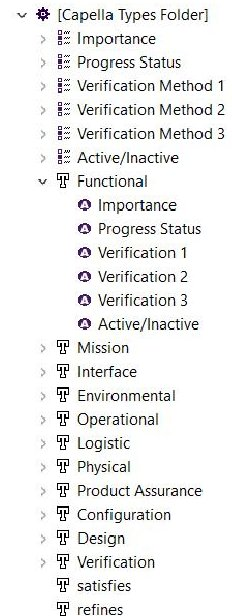

Fig. 1. Characterization of Requirements

Capella does not provide a dedicated requirements diagram to build trees; however, since they can be reported in any diagram thanks to the Capella transverse modeling, for this work some initially empty Operational Architecture Blank (OAB) diagrams have been exploited to overcome this lack. Trees are very intuitive to trace backwards low-level requirements, ensuring their consistency and completeness. An example is reported in Fig. 2; each branch is further developed into lower-level requirements reported in other diagrams.

The presented definition and organization of requirements is a first important plus provided by the MBSE approach since they are not simple sentences as in a document-based organization but represent concrete model elements.

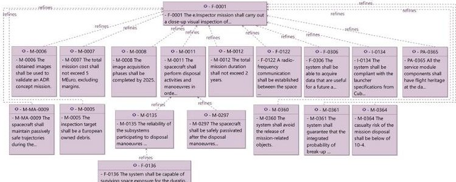

Fig. 2. Example of Requirements Tree

## 3.3 Users needs understanding

## 3.3.1 Operational Analysis

It is good practice to model the Operational Analysis to define high-level objectives and to identify the stakeholders and their responsibilities. The first diagram devoted to these tasks is called Operational Capabilities Blank (OCB), reported in Fig. 3, which simply highlights the involved multidisciplinary set of Entities/Actors and the related high-level services, called Capabilities, at this stage independent on the system that is going to be realized. They are graphically represented respectively by gray rectangles and bronze medallions.

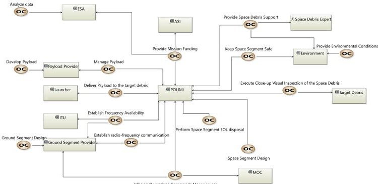

Fig. 3. Operational Capabilities Blank (OCB) diagram

Each Operational Capability is further described by several Operational Activities allocated to Entities/Actors, reported in the Operational Architecture Blank (OAB) diagram in Fig. 4. A blue-coloured line called Operational Process is used to highlight a particular logical series of Activities which contribute toward an objective. Some high-level requirements are traced in the diagrams by the model elements to which they are related. Despite it is still a very high-level representation, the OAB is useful to provide a global vision of what the main system interacting Entities must realize for the project, regardless of any technical solution. It is the main output of the Operational Analysis and the final deliverable for the next modeling phase: the System Analysis.

<!-- PDF_PAGE: 5 -->

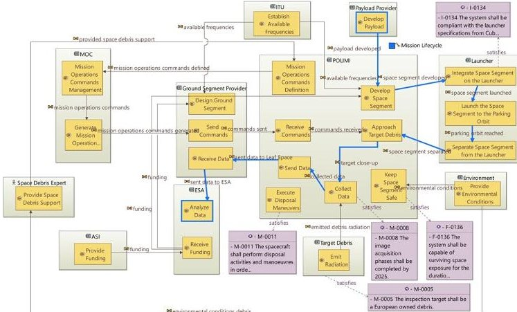

Fig. 4. Operational Architecture Blank (OAB) diagram

## 3.3.2 System Analysis

The concept of system is here introduced, and systems engineers can start asking whether the Activities reported in the Operational Analysis, now called System Functions, will be realized by the system, or left to the stakeholders. It is reminded that this level should not provide a deep description of the system but should frame its essential functioning. To accomplish this task, the Mission Capabilities Blank (MCB) diagram is firstly exploited, with the scope of accompanying the modeler toward system functions definition. As Fig. 5 shows, four Missions are introduced, each one providing an essential high-level service to be furnished by the system and described by several System Capabilities by means of the Capability Exploitation relation. Both Missions and Capabilities are linked to System Actors. These relations are called respectively Mission Involvements and Capability Involvements; for graphical reasons, the formers are indicated by light blue lines.

A little coloured icon appears in the bottom-right of almost all system Capabilities. This is a recurrent icon in Capella, indicating that the model element is further described in one or more other diagrams; in this case Capabilities are detailed with functions in dedicated System Data Flow Blank (SDFB) diagrams. An example is reported in Fig. 6 for the Provide Power Supply Capability. Some links, called Functional Exchanges, logically connect them; a green port indicates an outflow while the red one an inflow. The father functionality Provide Power Supply is also reported, carrying the same name of the Capability it describes.

Due to the not so high total number of functions, it is still possible to visualize all of them in a single diagram, called System Architecture Blank (SAB), reported in Fig. 7. This diagram shows the allocation of leaf functions to the system, in dark blue, and to the Actors that interact with it, in light blue. The SAB diagram also introduces the concept of Component Exchange, to which Functional Exchanges between two blocks are allocated.

Lastly, the concept of Functional Chains is here presented. Their aim is to provide the description of a certain behaviour, making use of the available functions,

useful to check the expected system behaviour in different contexts. In example, the blue line connects functions that describe the Data Collection and Download operation while the red one refers to the System Initialization one.

The complete set of system functions (leaves and parents) is reported in the System Function Breakdown of Fig. 8, which represents a functional tree.

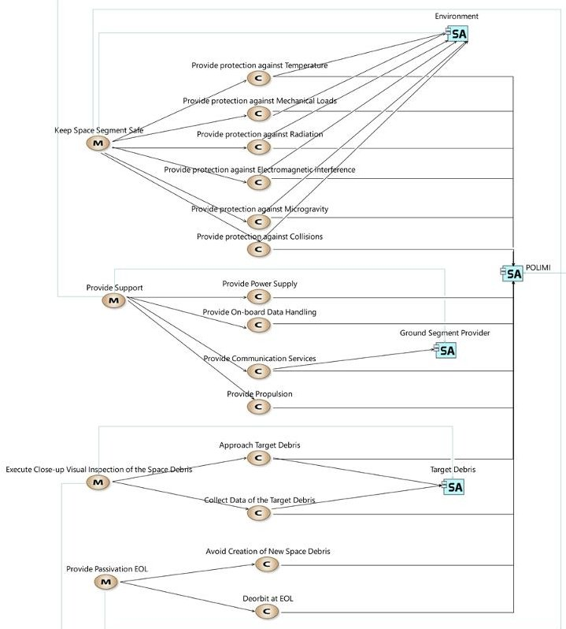

Fig. 5. Mission Capabilities Blank (MCB) diagram

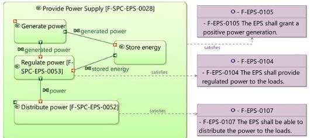

Fig. 6. System Data Flow Blank (SDFB) diagram: Provide Power Supply

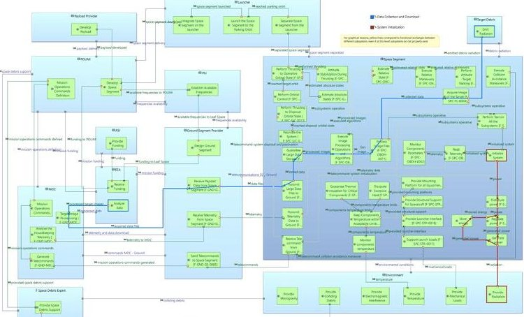

Fig. 7. System Architecture Blank (SAB) diagram: overall e.Inspector mission

<!-- PDF_PAGE: 6 -->

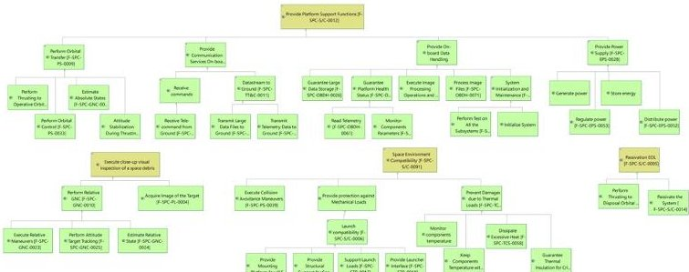

Fig. 8. Root System Functions diagram: Functional Tree

## 3.4 Solution architectural design

## 3.4.1 Logical Architecture

The System Analysis black box is here opened to set up a new functional analysis, whose foundations are inherited from the previous design level. This is a delicate step forward in the design since big decisions driving the project and influencing the future Physical Architecture are taken, being careful to leave a certain degree of freedom otherwise construction choices would be too much constrained.

In the Logical Architecture the concept of subsystem is introduced; all of them have been internally modeled for this work and their interactions defined. The results presented in the following comprehend just the Electric Power Subsystem (EPS) to discuss the MBSE approach and provide the rationale behind the modeling methodology point of view.

Fig. 9 shows the Logical Architecture Blank (LAB) diagram for the EPS, modeled as a cyan-coloured Logical Component to distinguish it from its subcomponents. Logical Functions are allocated to the latter. Recalling that in the LA the contents are defined in terms of how the system must perform the needs expressed in the SA, the first step here consists in identifying conceptual solutions and expressing them in terms of functions. As example, starting from the system function Generate Power (Fig. 6), the Solar Panels have been identified as the best primary power generation. Once the functions describing how the system will generate power are defined, a dedicated component is created, here called Power Generation. Such modeling approach adopted for the Power Generation is extended to the remaining EPS Logical Components. The various components communicate by means of the Functional Exchanges between functions, which are in turn allocated to proper Component Exchanges. Extensive use of Control Functions (Duplicate, Gather, Route, Select, Split) allows to precisely define path conditions such as power lines; their definitions can be consulted in [12]. As example, the Route one is employed to specify the selection of one among several power sources, that are the batteries and the solar panels. This is a very intuitive way of modeling since in one simple diagram a lot of information can be extracted with little effort; the only required competence is the language knowledge.

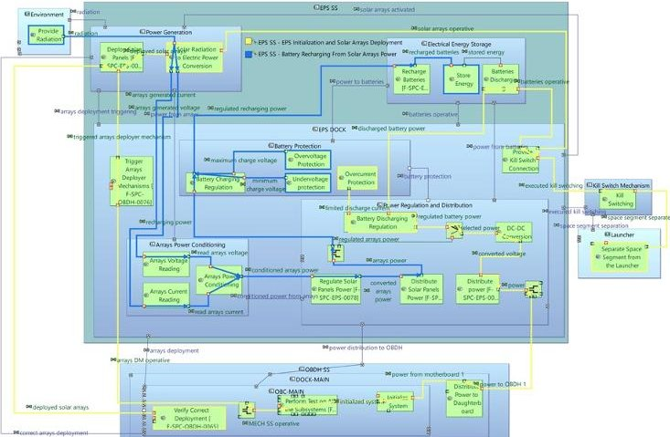

Fig. 9. Logical Architecture Blank (LAB) diagram: Electric Power Subsystem

To conclude, two Functional Chains highlight the way the EPS communicates with external blocks, respectively EPS Initialization and Solar Arrays Deployment in yellow and Battery Recharging from Solar Arrays Power in blue. A malfunction in any of the involved Exchanges means that the system is unable to deliver the overall service. Once created, they can be represented and modified in a dedicated Functional Chain Description diagram, like the one in Fig. 10.

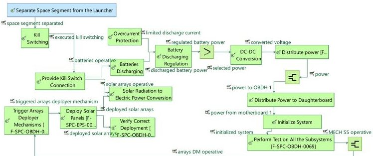

Fig. 10. Logical Functional Chain Description diagram: EPS initialization and solar arrays deployment

## 3.4.2 Physical Architecture

In this fourth level the technological choices are modeled and the focus moves toward Physical Components definition. It is recommended to develop it once the system alternatives have been narrowed down to a limited number (possibly one) and a trade-off analysis already conducted. To well understand the presented diagrams, it is important to distinguish between two types of components [12]:

- Behavior Physical Component (blue coloured): tasked with Physical Functions and carrying out part of the behavior of the system.

- Node (or Implementation) Physical Component (yellow coloured): provides the material resources needed for one or several Behavior Components. It represents a real component that will be integrated in the system.

In PA the concept of Physical Link has a central role since it allows to model the real interfaces among

<!-- PDF_PAGE: 7 -->

components. The default Capella colour for these links is red, however a customized palette is adopted for this work due to the different kind of interfaces present in a small satellite: the classical red is used for Data Interfaces (such as data exchanges between OBCs and sensors or actuators, commands distribution, etc.), the orange represents Electrical Interfaces (power lines) and the black is adopted for Mechanical Interfaces (physical interfaces, mechanical supports, etc.).

Focusing again on the EPS only, a Physical Architecture Blank (PAB) diagram is firstly presented (see Fig. 11) with the aim of introducing the internal Physical Node Components and the internal Physical Links; the cyan is used again to distinguish the EPS component, treated as a "container" for the real physical components. The solar panels are differentiated into Wings and Body-mounted, two Array Conditioning Units (ACU) and two Power Distribution Units (PDU) are chosen as baseline for allowing redundancy of power lines and limiting the stress on the component. These are implementation choices, absent in the LA where just the conceptual architecture aimed at the system functioning description was required.

Each Node Component contains several Behavior Component which carry the functions and each Component Exchange contains one or more Functional Exchanges, as in Fig. 12 where the Split function is used to model the ON/OFF switching of power lines.

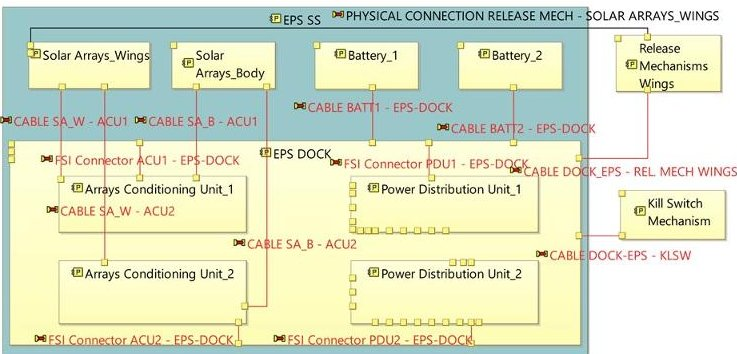

Fig. 11. Physical Architecture Blank (PAB) diagram: EPS internal physical links

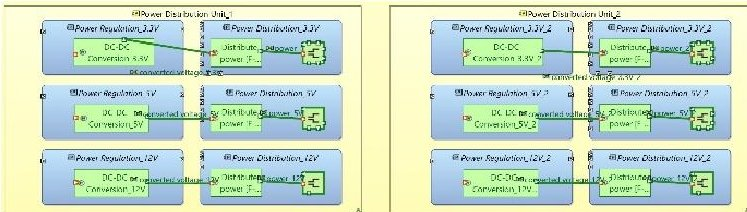

Fig. 12. Power Distribution Units modeling

The main EPS function is to distribute power to all system components; therefore, it is worth to analyze the way it interfaces with the rest of the CubeSat. Fig. 13 shows the power lines related to the Power Distribution Unit 1. To differentiate the main power lines from the backup ones, the Component Exchanges are called differently, using the words main and secondary.

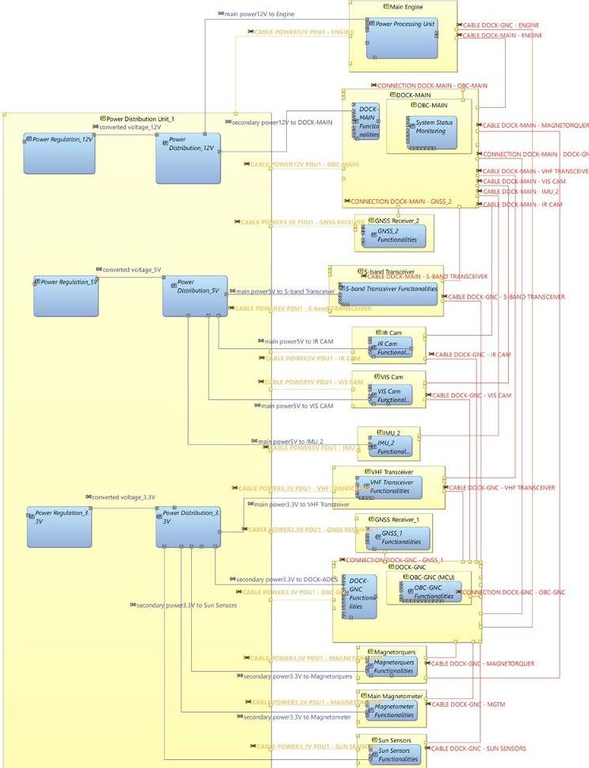

Fig. 13. Physical Architecture Blank (PAB) diagram: EPS Power Distribution Unit 1

## 3.5 Modes modeling

A space system is conceived and designed having in mind its operative life, punctuated by some phases which define the whole mission. Particular attention must be paid while defining which subsystem functionalities are needed in each phase, therefore approaching a vast topic in system engineering that is the Modes and States definition. A Mode is commonly defined as the result of a design decision, allowing to consciously switch the system from one to another, while a State is the consequence of something that happens to the system, representing an unexpected or even undesired event. Only the concept of Mode is considered for this work. The transition from one Mode to another is usually an explicit decision triggered by a functional event, such as a change in the use of the system to respond to new needs or situations. In Capella, Modes are characterized by several functions. Whenever a function is present in one Mode, the component containing it is active.

To present how the Modes are here modeled, two diagrams are shown: one related to the Guidance Navigation and Control (GNC) subsystem, particularly meaningful for the complexity of such subsystem for the e. Inspector mission, and one related to the overall system Modes activated during the Launch and Early Orbit Phase (LEOP). All functions and Functional Exchanges

<!-- PDF_PAGE: 8 -->

used to define Modes and Transitions belong to the Physical Architecture.

The GNC State Machine Diagram is reported in Fig. 14. Each grey rectangle represents a subsystem mode in which several functions are allocated, as reported in Fig. 15 for the GNC Detumbling Mode. It is interesting to provide the rationale behind some of the Transitions; Navigation Modes are distinguished from Attitude ones. GNC Absolute Navigation and GNC Absolute Attitude are the baseline GNC Modes, active for the entire mission duration until a Change Event happens. Concerning the Navigation, the switch from Absolute to Relative takes place once a well-defined distance from the target debris is met; in turn, the distance also governs the Relative Navigation Modes selection, since they involve different GNC algorithms and techniques, therefore different subsystem functions. Similar considerations are applied to the Relative Attitude Mode activation, as the transition in the diagram suggests.

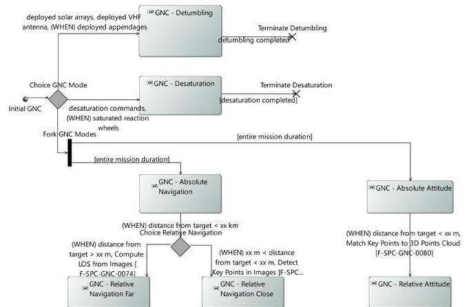

Fig. 14. State Machine diagram: Guidance Navigation and Control (GNC) subsystem Modes

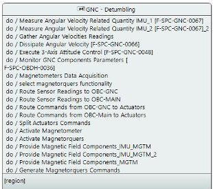

Fig. 15. Expanded view of GNC Detumbling Mode

Simple modes have been adopted for subsystems modes, described by several functions, and exempt of sub-Modes. The concept of composite modes is here introduced; they are Modes that contain one or more regions, each one having a set of subsystem Modes, called sub-Modes, as well as other functions. A region is a top-level part of a State Machine intended as a container for the other Modes. This approach is very useful in the context of a small satellite design, since it allows to easily define the system Modes starting from the subsystem ones also drastically reducing the modeling time ensuring consistency. This is shown in Fig. 16 where, as example,

the GNC - Detumbling Mode is exploited to define the SYSTEM - Detumbling one in the LEOP State Machine.

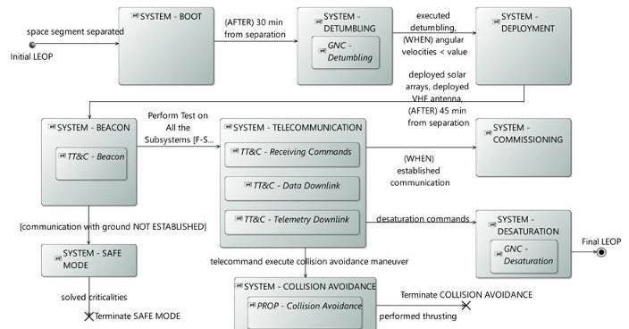

Fig. 16. State Machine: System Modes during LEOP

## 3.6 Concept of Operations (ConOps)

In this section, all the work previously done related to the system architecture and its Modes is exploited to describe how the CubeSat will be operated, with the goal of meeting the initial high-level objectives. It is important to conduct this kind of analysis since an operational perspective allows to think more deeply about system needs, leading to a check out of the architecture.

In Capella, Scenario Diagrams are adopted to model ConOps. In Fig. 17 a high-level view of the LEOP Phase in terms of operations is shown. Vertical lines are called Instance Roles, or Lifelines, and represent system components or the system itself. Functions or Modes are allocated over them in temporal sequence of activation downward, as the Duration constraint suggests. Other powerful concepts are the Combined Fragments represented by grey rectangles, used to apply some logical conditions to the contained elements [12]. As example the LOOP Operator indicates that the fragment can be executed several times with a give frequency, the OPT Operator executes the fragment only if the provided Guard Condition is true. Great use of combined fragments has been done for this work since they allow to describe logic structures in a very compact and concise manner due to their precise semantics.

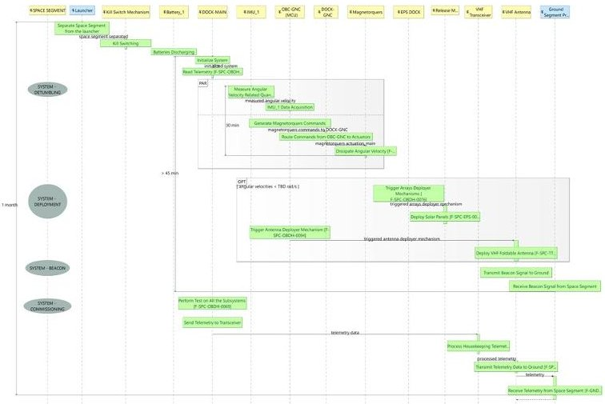

Fig. 17. Physical Exchange Scenario (PES) diagram: ConOps in LEOP Phase

<!-- PDF_PAGE: 9 -->

## 3.7 Assembly, Integration and Verification/Test

## (AIV/AIT) plan modeling

Verification and testing activities are defined since the Phase A of a space mission and continue to be refined during the entire product development. The classical approach exploits traceability links between textual requirements and tests procedures. Relying just on them to derive test campaigns results in a lack of a detailed vision of the needs, also reducing the possibility to identify problems. This is due to the inability of textual requirements to cover all system aspects. As presented in the previous sections, an articulated model has been created with the aim of defining any functional and physical aspect of the system. Such model elements provide precise basis for a test campaign definition; however, to explicitly define test activities, new ad-hoc ones are introduced. The power of the here proposed approach resides in the guidance provided by the same model elements used as source of knowledge in the definition of the AIV/AIT plan. It is reminded that the approach must be intended as a prototype proposal, since it sometimes results in contrast with some of the ARCADIA concepts. The reader is invited to focus on the gained benefits as it is recalled that ARCADIA does not propose a way for managing test activities within the architectural model.

The approach is developed within the Physical Architecture, therefore any model element here encountered is part of it. This is a decision that directly comes from the need of working with elements which represent real physical components that will constitute the system and that will be integrated and tested, respectively exploiting Physical Links and Physical Functions which describe them in the model.

The first step consists in defining a Physical Architecture Blank (PAB) diagram for the subsystem, here the EPS, such as the one in Fig. 18. The Actor in charge of executing the tests, in this case Politecnico di Milano (POLIMI), carries some Behavior Components, each one called with the subsystem name, the type of model used (i.e., Proto Flight Model (PFM)) and the name of the Physical Component to be tested. These Components have allocated several Physical Functions, expressly created, which explicitly state the activities to be performed on that Component. These high-level test blocks provide a global view of the activities to be performed on the subsystem and are connected by Functional Exchanges which indicate their logical sequencing. Some links depart from this diagram: the first one is related to the Functional Tests of SA as the icon in its bottom right suggests (the italics is automatically used by Capella whenever a function hosts sub-functions), the second one is a Functional Chain Description diagram associated to the highlighted chain.

Focusing on the first link, right clicking on the function, the tool opens the diagram of Fig. 19 which

shows the procedures needed to accomplish the upper activity. Having one or more diagrams like that for each activity allow systems engineers to have a complete view of all the procedures to be performed, all embedded in the same workspace. The Exchanges here indicate pure logical sequencing; however, it is clearly possible to report them in a Scenario Diagram to also catch the temporal dimension. Moreover, each block has a dedicated sheet in which the progress status can be set; in a team environment it allows to drastically reduce the effort spent in communicating, using these diagrams as single source of truth.

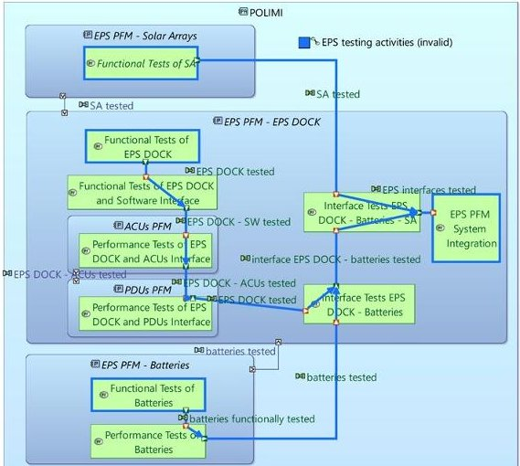

Fig. 18. Physical Architecture Blank (PAB) diagram: AIV/AIT-EPS Overall Plan

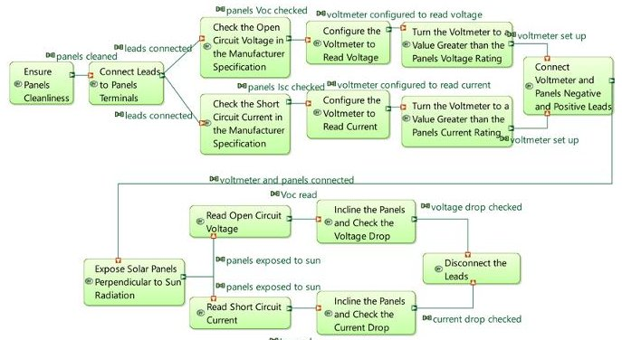

Fig. 19. Physical Data Flow Blank (PDFB) diagram: AIV/AIT Procedures - Functional Tests of Solar Arrays

Going back to Fig.18, the second link is analysed. Right clicking on the blue stamp Functional Chain EPS testing activities, it is possible to open the Physical Functional Chain Diagram in Fig.20. Two new elements can be noted: the dark green blocks with the Functional Chain icon on the top left and the yellow blocks with the {c} icon. They are respectively Functional Chains expressed in a compact form, here exploited to create a bridge between the test activities and functional model elements, and Constraint blocks. The proposed approach is simple: some Functional Chains are already defined within the model in the previous functional analysis; since all test activities necessarily refer to the system

<!-- PDF_PAGE: 10 -->

functional or interface analysis, whenever it is decided to conduct a certain test systems engineers can exploit the chains reported in dark green blocks which contain such functional aspects of the system. Any Functional Chain can be added to this diagram to cover any system aspect, assuming it was properly modeled before. This is also very useful since during test activities problems typically arise and some changes have to be applied to the system; in this case, engineers can go back to the architectural model, refine the analysis, and finally exploit the new Functional Chains for a further check. This is what the green blocks show, a compact form of Functional Chains used as reference; an expanded view of one of them is reported in Fig. 21. The Constraint element is used to explicitly "allocate" such Functional Chains to activities; this is not a formal allocation, but more a graphical one used for this preliminary version of the approach.

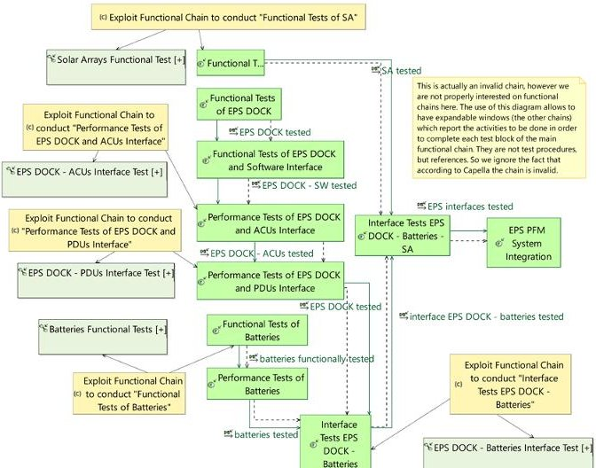

Fig. 20. Physical Functional Chain Description: AIV/AIT-EPS testing activities

Fig. 21. AIV/AIT - Functional Chain Expanded View

The advantage of dealing with AIV/AIT activities within the same environment in which the system was modeled resides in the possibility to exploit all the knowledge and information embedded in the model. So, for example, in the context of system integration, Physical Links can be consulted to check the correctness of the integration plan serving also as base for its definition. The presented approach is demonstrative and experimental and requires a formalization in terms of syntax and semantics, which can be defined in a dedicated "AIV/AIT add-on" to be implemented in Capella.

## 4. Automated Decision-Making tool for small satellites architectures generation

## 4.1 Statement of the problem

The approach starts from the definition of one or more high level functionalities describing some expected system behaviours and characterized by a list of attributes, called markers. The tool embeds several decisions at various levels, each one containing some alternatives; the latter are described by markers, while decisions are intended as level identifiers. The tool objective is to automatically select the alternatives based on their ability to satisfy the functionalities throughout a matching algorithm between the markers and rank them solving some decision-making problems.

## 4.1.1 Inputs from the user

m desired functionalities represent the main user input to the tool. Each functionality is represented by a vector of n markers, called Input Functionality Vector (IFV). The Input Functionalities Matrix (IFM) in Eq. 1 is then created placing these vectors in its columns:

$$
\mathbf {I F M} = \left[ \begin{array}{c c c} f _ {1 1} & \dots & f _ {1 m} \\ \vdots & f _ {i j} & \vdots \\ f _ {n 1} & \dots & f _ {n m} \end{array} \right]
$$

Markers can have Boolean values (1 if the functionality is characterized by that marker, 0 if not), or can be assigned a number from 2 to 4 which indicates the importance of that marker for the functionality. Higher the value, more important the marker.

Another input is called Functionalities Temporal Concurrency Matrix (FTCM). It is an $ [m\times m] $ matrix having value 1 if two functionalities are required at the same time, 0 if not. It is used by the tool to exclude those alternatives which satisfy a functionality but compromise a contemporary one.

Functionalities represent decision criteria for the selection of alternatives. The relative weights assigned to them are computed using the Analytic Hierarchy Process [16], so a pairwise matrix with functionalities relative importance is required. An algorithm has been developed for their automatic generation, allowing to save time ensuring matrices consistency. The last inputs asked to the user are then the following quantities (p.n., the user is free to opt for a manually compiled matrix):

- $ \boldsymbol{v}_{imp}= $ Vector Importance: row vector $ [1\times m] $ where the m functionalities are ordered from the most important to the least one. Value 0 is assigned if the i and the (i+1) functionalities are equally important, 1 if the i-th is more important than the (i+1). Value 0 shall be put in the last cell.

- s = Sparsity Factor: scalar (0 < s < 1) typically equal to 1. Higher s, higher differences between

<!-- PDF_PAGE: 11 -->

the criteria will be obtained once the pairwise matrix is given to the AHP.

The algorithm firstly computes a so-called jump value, defined as the minimum difference between two values in the pairwise matrix. Without the jump value, if the number of functionalities given as input is higher than 9, there would be relative importance numbers exceeding the usual scale of the AHP, which goes from 1 to 9. Fig. 22 shows the algorithm for the matrix computation.

Algorithm 1: Automatic pairwise matrix building.

Input: $ v_{imp} $ = Vector Importance, $ s $ = Sparsity Factor

Output: $ P_{fun} $ = Pairwise Matrix of Functionalities

// Begin

$ N_{fun} $ = Number of Functionalities

// Compute jump value

if $ N_{fun} \leq 9 $ then

| jump = s

else

| jump $ = \frac{8}{N_{fun}-1} \cdot s $

end

// Compute Pairwise Matrix

for $ i=1 \rightarrow N_{fun} $ do

for $ j=1 \rightarrow N_{fun} $ do

if $ i=j $ then

| $ P_{fun}(i,j) $ = 1

else if $ i<j $ then

| $ P_{fun}(i,j) $ = 1 + $ (\sum_{k=i}^{j-1} v_{imp}(k)) \cdot jump $

| $ P_{fun}(j,i) $ $ = \frac{1}{P_{fun}(i,j)} $

end

end

// End

Fig. 22. Pairwise Matrix computation algorithm

## 4.1.2 Tool-embedded decision tree

Several decisions are installed in the tool. Decisions can be hierarchically divided into different levels; an example related to the space field is to consider as first level decision the stabilization technique, while as second level nested into the upper ones the sensors and actuators selection. The current version of the tool supports two levels of decisions. l decisions belong to the first level; each decision w contains $ p_{w} $ alternatives and each alternative $ k_{w} $ is in turn described by a predetermined vector of n markers, which values are assigned following the same rules of functionalities markers (Boolean and non-Boolean). It is recalled that markers are the same for functionalities and alternatives. The array in Eq. 2 shows how a decision is stored: the number of columns $ p_{w} $ (that is the number of alternatives for that decision) is variable for each decision w, while the number of rows is the same as the elements are markers:

$$
\mathbf {D 1} _ {w} = \left[ \begin{array}{c c c} a _ {1 1 _ {w}} & \dots & a _ {1 p _ {w}} \\ \vdots & a _ {i k _ {w}} & \vdots \\ a _ {n 1 _ {w}} & \dots & a _ {n p _ {w}} \end{array} \right]
$$

The second level of decisions is nested into the first one, meaning each $ k_{w} $ first level alternative contains a set of $ d_{k_{w}} $ second level decisions, the latter having in turn their own total number of alternatives. An array like the one in Eq. 3 defines each second level decision $ h_{k_{w}} $ :

$$
\mathbf {D 2} _ {h _ {k _ {w}}} = \left[ \begin{array}{c c c} b _ {1 1 h _ {k _ {w}}} & \dots & b _ {1 q h _ {k _ {w}}} \\ \vdots & b _ {i g h _ {k _ {w}}} & \vdots \\ b _ {n 1 h _ {k _ {w}}} & \dots & b _ {n q h _ {k _ {w}}} \end{array} \right]
$$

To better clarify the adopted indexes, Table 1 reports a legend of symbols while Fig. 23 illustrates the structure of the decision tree: gray bubbles are decisions, rectangles are alternatives (yellow is used for first level alternatives, blue for second level ones).

Table 1. Indexes involved in the decision-making tool

<table border="1"><tr><td></td><td>Index</td><td>Total</td></tr><tr><td>Markers</td><td>i</td><td>n</td></tr><tr><td>Functionalities</td><td>j</td><td>m</td></tr><tr><td>First Level Decisions D1</td><td>w</td><td>l</td></tr><tr><td>First Level Alternatives A1</td><td>kw</td><td>pw</td></tr><tr><td>Second Level Decisions D2</td><td>hkw</td><td>dkw</td></tr><tr><td>Second Level Alternatives A2</td><td>ghkw</td><td>qhkw</td></tr></table>

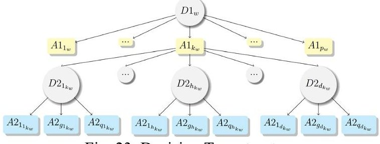

Fig. 23. Decision Tree structure

## 4.2 The algorithm

The scope of the tool is to select the set of alternatives which guarantees the maximum coverage of the markers asked by the functionalities. Firstly, all the combinations of alternatives belonging to the first level decisions are evaluated, leading to the ranking of several first level architectures. Selecting one of them, the second level architectures are then computed and ranked.

## 4.2.1 Level 1 Architectures selection

## Step 1: the Clustering technique

m functionalities with n markers must be mapped into a set of alternatives, described by the same markers, to extrapolate a quantity that tells how much each alternative is suitable for each functionality. To do that, m matrices (one for each functionality) like the one in Eq. 4, called Alternatives-Functionalities Matrices (AFM), are firstly compiled by the tool for each decision. The elements of these matrices are defined according to the rules in Eq. 5:

$$
\mathbf {A F M} _ {j} ^ {w} = \left[ \begin{array}{c c c} x _ {1 1 _ {w}} & \dots & x _ {1 p _ {w}} \\ \vdots & x _ {i k _ {w}} & \vdots \\ x _ {n 1 _ {w}} & \dots & x _ {n p _ {w}} \end{array} \right]
$$

<!-- PDF_PAGE: 12 -->

$$
x _ {i k _ {w}} = \left\{ \begin{array}{l l} 0 & \text {i f} f _ {i j} = 0 \vee a _ {i k _ {w}} = 0 \\ 1 & \text {i f} f _ {i j} = 1 \wedge a _ {i k _ {w}} = 1 \\ 1 & \text {i f} f _ {i j} - a _ {i k _ {w}} = 0 \\ 1 - \frac {\left| f _ {i j} - a _ {i k _ {w}} \right|}{3} & \text {i f} f _ {i j} - a _ {i k _ {w}} > 0 \\ \left(1 - \frac {\left| f _ {i j} - a _ {i k _ {w}} \right|}{3}\right) \cdot 1. 1 & \text {i f} f _ {i j} - a _ {i k _ {w}} < 0 \end{array} \right.
$$

In case of Boolean markers, if the functionality and the alternative are both described by a non-zero marker (equal to 1 in case of Boolean markers), the highest value of 1 assigned in the AFM. In case of non-Boolean markers, the AFM is compiled computing the difference between the i-th functionality and the i-th alternative markers. Higher this difference modulus, lower the value in the AFM. A 10% increment is assigned when the difference between the functionality and the alternative is lower than 0, meaning that the alternative satisfies the functionality more than needed. To sum up, each decision w having $ p_{w} $ alternatives will be characterized by a 3D array containing m AFM matrices of dimension $ [n\times p_{w}] $ , one for each functionality.

A second output is part of this step, a 3D array for each decision with matrices equal to the AFM in the form but compiled assigning value 1 if both the functionality and the alternative markers are different from 0 and value 0 otherwise. They are called coverage matrices.

## Step 2: Degree of satisfaction and markers coverage

The j AFM is here converted into a vector whose elements represent the degree of satisfaction of the $ k_{w} $ alternative with respect to the j functionality. To do that, a simple average on the columns is done for each AFM obtaining a vector for each functionality which $ p_{w} $ elements are computed as in Eq. 6:

$$
y _ {k _ {w} j} = \frac {\sum_ {i = 1} ^ {n} x _ {i k _ {w}}}{n}
$$

The computed vectors are reported as columns into a matrix called Output Functionality Matrix (OFM), one for each decision w, like the one in Eq. 7:

$$
\mathbf {O F M} ^ {w} = \left[ \begin{array}{c c c} y _ {1 _ {w} 1} & \dots & y _ {1 _ {w} m} \\ \vdots & y _ {k _ {w} j} & \vdots \\ y _ {p _ {w} 1} & \dots & y _ {p _ {w} m} \end{array} \right]
$$

A similar procedure is adopted to compute the CoverageAlternatives matrices, simply summing the values in the coverage rows. It may happen that in the OFM an alternative has a higher value with respect to a another one because of the higher values coming from Eq. 5 but at the same time covering a lower number of markers, therefore having a lower value in the CoverageAlternatives matrix.

If an alternative is totally wrong for a functionality (value 0 in the OFM or in the CoverageAlternative), it means that the behaviour of such functionality is compromised. If another functionality must be done at the same time of the former, a condition is activated to assign value 0 also to the cell of both the OFM and the CoverageAlternatives corresponding to the second functionality. This way, that alternative is excluded from the solution. Without such condition, that exploits the Functionalities Temporal Concurrency Matrix (FTCM), an alternative may be selected by a functionality and at the same time compromising the behaviour of a contemporary one.

## Step 3: Performance Scores of the Alternatives

The automatically computed Pairwise Matrix is furnished as input to a function which implements the Analytic Hierarchy Process [16] to compute the functionalities weights used as decision criteria for the selection of alternatives. The OFM and the CoverageAlternatives matrices are indeed decision matrices for the w decision, with alternatives as rows and weighted functionalities as columns. Each decision matrix is solved using a Multi-Criteria Decision Making (MCDM) method [17, 18]. The output of this step are two vectors for each decision, containing the Performance Scores of the alternatives computed applying the selected MCDM method respectively to the OFM and the CoverageAlternatives, telling how much an alternative is suitable for the whole set of functionalities.

## Step 4: Architectures Ranking

An architecture is built taking one alternative for each decision. The aim of this step is to evaluate all the possible architectures and rank them. This is done involving a combinatorial algorithm which gives as output for each architecture two Performance Scores (PS) computed as the product between the Performance Scores of the alternatives composing the architecture (one coming from the OFM and one from the CoverageAlternatives). An overall parameter J merges them, so that each architecture q is quantified by one single number. It is computed as in the Eq. 8, where $ w_{OFM} $ and $ w_{cov} $ are weights which can be set by the user (i.e., 0.5 each). Once J is computed for each architecture, the values are sorted decreasingly, preserving the indexes of the alternatives which constitute the q-th architecture.

$$
\begin{array}{l} J (q) = P S _ {a r c h i _ {O F M}} (q) \cdot w _ {O F M} + \\ + P S _ {a r c h i _ {c o v}} (q) \cdot w _ {c o v} \\ \end{array}
$$

## Step 5: the Final Proposed Level 1 Architecture

At this point, each architecture is distinguished by an identification number and a ranking value J. A skimming is performed here to exclude those architectures which do not satisfy all markers of all the functionalities. A new

<!-- PDF_PAGE: 13 -->

matrix is then introduced for each architecture, called CoveredMarkers, with dimensions equal to the IFM $ [n\times m] $ . It is filled assigning the value 1 to the $ (i,j) $ cell whenever at least one alternative of the architecture has value different from 0 in coverage for the i-th marker and the j-th functionality, meaning that such marker is satisfied for that functionality, otherwise the value 0 is assigned. If one architecture has at least one row in CoveredMarkers with only null values, it means that the i-th marker is not satisfied by any alternative. Therefore, the architecture is excluded (p.n., this condition is not applied if all functionalities have value 0 for a marker).

To also consider the zeroing of alternatives coming from the condition about contemporary functionalities, performed in the Step 2, if for each alternative of the architecture under cycle the value in the OFM corresponding to the j-th column (or functionality) is 0, such architecture is excluded assigning value 0 to J. The Final Proposed Architectures are those with a J value different from 0: higher the value, better the architecture for the desired functionalities.

## 4.2.2 Level 2 Architectures Selection

## Step 6: Satisfaction Degree of Level 2 Alternatives

Each first level alternative contains several second level decisions, each one with its own set of second level alternatives. The purpose of this second part of the algorithm is to select second level alternatives which ensure that all the first level alternatives of a Level 1 architecture are accomplished, and so functionalities. To ease the readability, from here on the following nomenclature is adopted:

- D1 = first level decision.

- A1 = first level alternative.

- D2 = second level decision.

- A2 = second level alternative.

Firstly, for each A2, the degree of markers coverage asked by the A1s is computed. To do that, a similar approach to the one applied for the first level clustering is here presented, introducing the satisfaction matrices $ [ n \times q_{h} ] $ , where $ q_{h} $ is the total number of A2 contained in the h-th D2 (recall indexes in Table 1). Each D2 will be characterized by several satisfaction matrices equal to the number of functionalities, therefore obtaining a 3D array. The rules for compiling these matrices are equal to those in Eq. 5 but considering the values of markers contained in the D2 (Eq. 3) instead of the IFM. Each decision h and alternative $ g_{h} $ should have the subscript $ k_{w} $ as they belong to a precise A1, however such subscript is not reported in this section to ease the readability. Eq. 9 shows a generic satisfaction matrix:

$$
\mathbf {s a t i s f a c t i o n} _ {j} ^ {h} = \left[ \begin{array}{c c c} s _ {1 1 _ {h}} & \dots & s _ {1 q _ {h}} \\ \vdots & s _ {i g _ {h}} & \vdots \\ s _ {n 1 _ {h}} & \dots & s _ {n q _ {h}} \end{array} \right]
$$

The sum on the markers and on the functionalities is done for each A2 $ g_{h} $ leading to a scalar called SatisfactionTotal (Eq.10) that tells the goodness of that alternative in satisfying the A1 it belongs:

$$
S a t i T o t _ {g _ {h}} = \sum_ {i = 1} ^ {n} \sum_ {j = 1} ^ {m} s a t i s f a c t i o n (i, g _ {h}, j)
$$

## Step 7: Feasible Level 2 Architectures Evaluation

The purpose is to find, for each A1 selected in the first level architecture, the second level architecture which guarantees the highest markers coverage. As each A1 contains several D2, a second level architecture is here intended as a set of A2 selected by the A1. Therefore, there will be a second level architecture for each A1. For each A1, all combinations of A2 are evaluated. As baseline, the code selects just one A2 for each D2 and eventually add other A2 until all the markers are covered.

This step passes through the definition of a new matrix called CoverageTot, computed for each D2 and with size $ [n\times q_{h} ] $ . It is filled with values 1 whenever all the A1 markers are covered. Their coverage is verified looking at the sum of satisfaction values for the A2s contributing to the second level architecture under cycle. This way, since the first level architecture ensures the satisfaction of functionalities markers, if all markers of such first level architecture are satisfied by the "assembly" of the second level architectures, it means that the overall architecture for sure will be suitable for the asked functionalities.

## Step 8: Final Proposed Overall Architectures

As done for the first level, all the overall architectures that passed the previous skimming algorithm are ranked. This time a different parameter is used to evaluate how much an architecture is suitable for the input functionalities. It is called ValueArchi (Eq.11) and it is computed as the sum of the SatisfactionTotal values associated to each A2 of the considered architecture:

$$
V a l u e A r c h i _ {r} = \sum_ {t = 1} ^ {n _ {A 2}} S a t i T o t (t)
$$

n $ _{A2} $ is the number of A2s belonging to the r-th architecture.

## Step 9: Back to the MBSE Environment

The last step consists in exploiting a library of modeled components, which represent all the A2s (leaves of the decision tree), in an MBSE tool such as Capella. Once the user selects the overall architecture, he/she can directly move to Capella and work with the already modeled components in terms of basic functions and requirements, as in Fig. 23. It is clarified that the input functionalities should be modeled within the System Analysis (SA), while alternatives in the Physical

<!-- PDF_PAGE: 14 -->

Architecture (PA). This way the user is forced to bridge SA and PA passing through the Logical Architecture, in which further considerations about how the system should work will surely arise. Therefore, the tool can also be used to evaluate if changes in the required behaviour of the system influence the components selection and how, suggesting the architecture which suits to the needs.

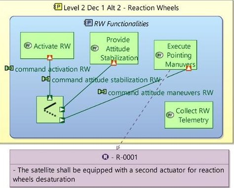

Fig. 23. Example of alternatives modeling in Capella

## 4.3 Validation and Simulation results

Several simulations have been conducted to assess the goodness of the selected architectures and their ranking. For the one here presented, the Guidance Navigation and Control (GNC), the Propulsion, the Electric Power Subsystem (EPS) and the Telemetry Tracking and Command (TT&C) subsystems have been considered, each one characterized by several decisions and alternatives which can be consulted in the decision trees in Appendix A; small satellites technologies have been explored and markers have been assigned to them. Four functionalities are used for this simulation:

- F1 = Perform continuous imaging of a debris.

- F2 = Execute relative manoeuvres.

- F3 = Transmit large data files to ground.

- F4 = Execute transfer to operative orbit.

F1 and F2 are contemporary, and more importance is assigned to them with respect to F3 and F4, therefore $ v_{imp}=[0100] $ . The Sparsity Factor is set to 1 and the Weighted Sum Method (WSM) has been used to solve the decision matrices.

The results related to the Level 1 architectures selection are reported in Fig. 24. The horizontal axis reports a four-digit number indicating the architecture: the first digit is the alternative of the first decision, the second digit is the alternative of the second decision and so on up to the fourth first level decision. The diagram reports the ranked J values of each architecture, computed as the average between the two Performance Scores values. The diagram in Fig. 25 reports the same ranking values sorted from the highest to the lowest.

The tool output after Step 5 is reported in Fig. 26 and the updated sorting in Fig. 27. Eight Final Proposed Architectures are downselected, while the remaining ones have zero values because of their inability to satisfy

all the functionalities markers. The best L1 architecture suggested by the tool is the one with indexes 1-1-2-1 composed by 3-axis stabilization, chemical propulsion, solar panels + batteries and high gain antenna; the selected Level 1 architecture is coherent with what expected by functionalities.

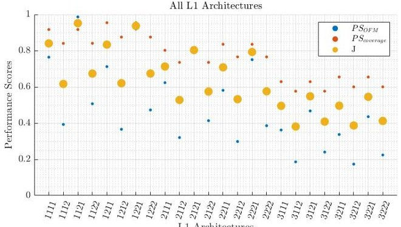

Fig. 24. Level 1 Architectures Ranking Values

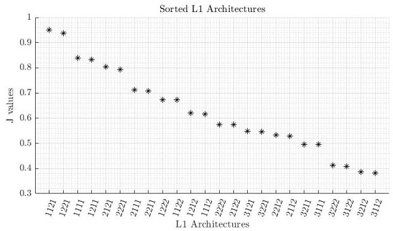

Fig. 25. Sorted Level 1 Architectures Ranking Values

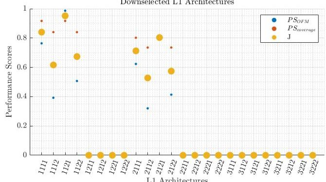

Fig. 26. Selected Level 1 Architectures Ranking Values

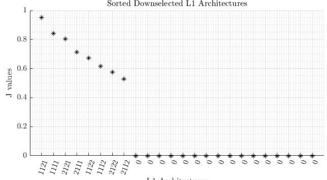

Fig. 27. Sorted Selected Level 1 Architectures Ranking Values

<!-- PDF_PAGE: 15 -->

Choosing the Level 1 architecture with the highest ranking, that is the 1-1-2-1, the output coming from the second part of the algorithm is shown in Fig. 28. Four diagrams are reported, one for each first level alternative. Each red dot represents the ValueArchi of a second level architecture related to the alternative it belongs. It is recalled that whenever the number of L2 architectures exceeds the total number of combinations, it means that the tool is selecting more than one A2 for a D2.

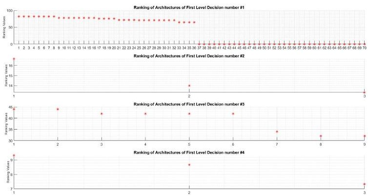

Fig. 28. Level 2 Architectures Ranking

Selecting the best Level 2 architecture for each Level 1 alternative, the overall architecture in Table 2 is obtained. Results are satisfactory, indeed as example the reaction wheels are selected due to the consistent slewing manoeuvres requirements expressed in the form of marker by input functionalities; another actuator is of course needed to desaturate it, however the tool still does not implement a marker or a step that includes such kind of finer considerations, which can be a step further for a future enhancement of the algorithm.

Table 2. Overall Architecture

<table border="1"><tr><td></td><td>L1</td><td>L2D21</td><td>L2D22#1</td><td>L2D22#2</td></tr><tr><td>D11</td><td>1=3-AXIS</td><td>2=RW</td><td>1=ST</td><td>2=SS</td></tr><tr><td>D12</td><td>1=CHEM</td><td>1=MONO</td><td>-</td><td>-</td></tr><tr><td>D13</td><td>2=SP+BATT</td><td>2=BM+WF</td><td>1=Ni-Cd</td><td>-</td></tr><tr><td>D14</td><td>1=HGA</td><td>1=PATCH</td><td>-</td><td>-</td></tr></table>

RW = Reaction Wheels, ST = Star Trackers, SS = Sun Sensors, CHEM = Chemical Propulsion, MONO = Monopropellant, SP + BATT = Solar Panels + Batteries, BM+WF = Body Mounted + Wings Fixed, Ni-Cd = Nickel-Cadmium, HGA = High Gain Antenna, PATCH = Patch Antenna

The proposed overall architecture is coherent with the requests and the tool provides reliable results, embracing a casuistry rather than a specific mission. As the number of input functionalities is increased, the tool can converge to precise needs of a particular scenario, getting a "tailored" output for it. A limit is related to the substantial solutions changing with the tool-embedded tree markers, therefore requiring a refinement to cover more system aspects associating precise meanings to them. The best

way to exploit such preliminary version of the tool is to associate it to some quantitative analysis and architecture design. The MBSE environment should also be targeted to exploit all the outputs, as it improves the system thinking providing a natural terrain to experiment with functional analysis having a set of selected components.

## 5. Results and Discussion

The research conducted for this work set out to improve small satellites design lifecycle using an MBSE solution to assess benefits and limits, associated to a decision-making tool for preliminary architecture automated selection. The precise syntax and semantics of the ARCADIA language, merged with the Capella tool, allow to express complex concepts and articulated architectures of a small satellite in a concise and intuitive way, coherently with all systems engineering practices, also providing strong basis for the on-board software development. The methodology accompanies systems engineers in their definition from the very high-level mission objectives up to the components definition, guaranteeing consistency among levels and providing a clear vision of the entire system to any involved team member and/or stakeholder. An extension of MBSE has also been discussed by introducing a decision-making algorithm for the selection of one or more preliminary architectures, intended to be used in the feasibility study of small satellites missions when it is difficult to reduce the number of design alternatives due to the highly qualitative domain. The tool has been validated and results are promising, highlighting its ability to skim the architectures basing on the inputs provided.

The work related to the MBSE approach presents some limitations that can also be interpreted as future works. Firstly, the study excluded the parameterization of the whole architecture model and a consequent interface with an analytical and numerical tool to run simulations. The nearest ARCADIA concept to such parametrization is the adoption of Class diagrams to model quantities exchanged between elements and to have a data repository too. Interfacing Capella with other engineering software could further enhance the overall system design and team working, moving toward a digital twin. In parallel, a formalization of the presented AIV/AIT plan modeling in terms of syntax, semantics and dedicated diagrams within the tool represents an open point for a research study.

The prototype version of the decision-making tool opens the road to many future developments. Firstly, the embedded decision tree can be improved increasing its details and revising the assigned markers using data mining techniques that exploit a statistical set of data built up from the literature information on past concluded space missions, addressing a more precise markers matrices filling. Also, new blocks can be introduced to the current algorithm such as a cross-relation block to

<!-- PDF_PAGE: 16 -->

evaluate how the selection of a particular component influences the others, being careful to not stiffen the tool introducing too much constraining conditions. Other interesting developments concern the introduction of sizing blocks which implement mission analysis and basic computations of subsystems parameters to get as output a preliminary quantitative sizing too. Such blocks could be used to add some more decision-making conditions expanding the components selection to an available catalogue, leading to a more complete output.

## 6. Conclusions

Although MBSE still has many social hurdles to overcome, the authors expect a gradual awareness from the space community about the benefits a system design lifecycle can gain from it, as demonstrated in this work. Interfacing MBSE solutions with intelligent tools such as the prototype one developed for this paper represents a way to overcome the stringent requirements asked by the new complex space systems and to face up the less relaxed mission development times required by the incoming New Space Economy.

Appendix A (Decision Trees)

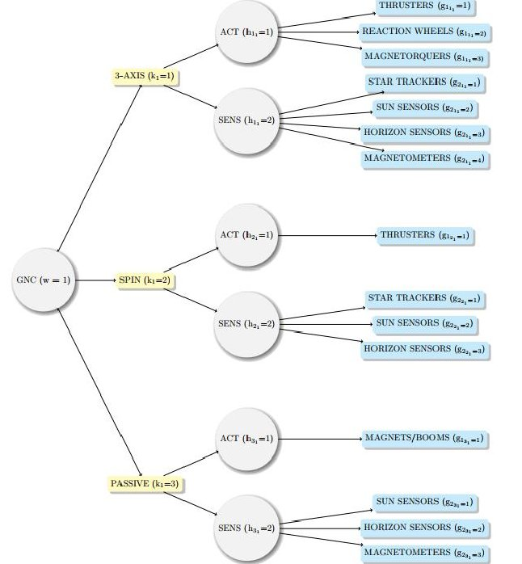

Fig. 29. Decision Tree of GNC (ACT = Actuators, SENS = Sensors)

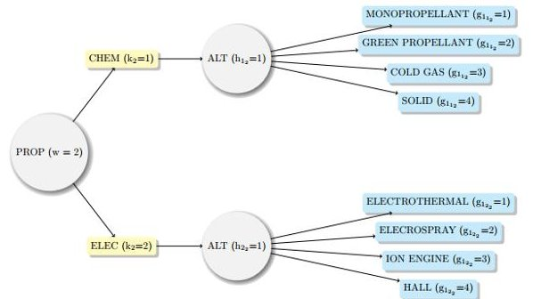

Fig. 30. Decision Tree of Propulsion Subsystem (CHEM = Chemical, ELEC = Electric, ALT = Alternatives)

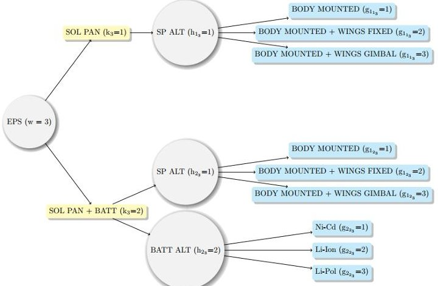

Fig. 31. Decision Tree of EPS (SOL PAN = Solar Panels, BATT = Batteries, ALT = Alternatives)

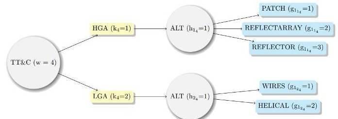

Fig. 32. Decision Tree of TT&C (HGA = High Gain Antenna, LGA = Low Gain Antenna, ALT = Alternatives)

## References

[1] Jean-Luc Voirin. Conception architecturale des systèmes basée sur les modèles avec la méthode Arcadia. Vol. 3. ISTE Group, 2018, pp. 33-34.

[2] Dov Dori. "Why significant UML change is unlikely". In: Communications of the ACM 45.11 (2002), pp. 82-85.

[3] Harald Eisenmann. "MBSE has a good start; requires more work for sufficient support of systems engineering activities through models". In: Insight 18.2 (2015), pp. 14-18.

[4] Todd Bayer. "Is MBSE helping? Measuring value on Europa Clipper". In: 2018 IEEE Aerospace Conference. IEEE. 2018, pp. 1-13.

[5] Wolahan A. Biesbroek. R. Innocenti L. Morales Serrano S. and de Koning H-P. "Model Based Systems Engineering Applied to ESA's e.Deorbit Mission". In: 2017.

[6] Jose Lorenzo Alvarez et al. "Best Practices for Model Based Systems Engineering in ESA Projects". In: 2018 AIAA SPACE and Astronautics Forum and Exposition. 2018, p. 5327.

[7] Jose Lorenzo Alvarez et al. "Model-based system engineering approach for the Euclid mission to manage scientific and technical complexity". In: Modeling, Systems Engineering, and Project Management for Astronomy VII. Vol. 9911. International Society for Optics and Photonics. 2016, p. 99110C.

<!-- PDF_PAGE: 17 -->

[8] Sara C Spangelo et al. "Model based systems engineering (MBSE) applied to Radio Aurora Explorer (RAX) CubeSat mission operational scenarios". In: 2013 IEEE Aerospace Conference. IEEE. 2013, pp. 1-18.

[9] J Guo, EKA Gill, and S Figari. "Model Based Systems Engineering to support the development of nano satellites". In: IAC. IAF. 2014, pp. 1-10.

[10] Aerospace Corporation. First Aerocubes defined using MBSE now in orbit. url: https://aerospace.org/story/first-aerocubes-defined using-mbse-noworbit, (accessed: 27.06.21).

[11] Jeff A Estefan et al. "Survey of model-based systems engineering (MBSE) methodologies". In: Incose MBSE Focus Group 25.8 (2007), pp. 1-12.

[12] Pascal Roques. Systems Architecture Modeling with the Arcadia Method: A Practical Guide to Capella. Elsevier, 2017.

[13] Stephane Bonnet, Jean-Luc Voirin, and Juan Navas. "Augmenting requirements with models to improve the articulation between system engineering levels and optimize V&V practices". In: 29.1 (2019), pp. 1018-1033.

[14] European Cooperation for Space Standardization. "ECSS-E-ST-10-06C Space engineering - Technical requirements specification". In: (2009).

[15] European Cooperation for Space Standardization. "ECSS-E-ST-10-02C Rev. 1 Space engineering - Verification". In: (2018).

[16] TL Saaty. "The analytic hierarchy process" McGraw Hill International. In: New York (1980).

[17] Javeed Kittur et al. "Comparison of different MCDM techniques used to evaluate optimal generation". In: 2015 international conference on applied and theoretical computing and communication technology (iCATccT). IEEE. 2015, pp. 172-177.

[18] Evangelos Triantaphyllou et al. "Multi-criteria decision making: an operations research approach". In: Encyclopedia of electrical and electronics engineering 15.1998 (1998), pp. 175-186.