<!-- PDF_PAGE: 1 -->

# Unified modeling for digital twin of a knowledge-based system design

, Hao Li, Xiaoyu Wen,

## View PDF

## Highlights

- Integrating digital twin (DT) with model-based systems engineering (MBSE) for the system design complexity analysis and prediction.

- A system design digital twin in 5 dimensions $ \mathrm{S D D T}_{5 \mathrm{D}} $ framework is introduced, which is able to map the actual system design process into the corresponding virtual space.

- The core concepts and relationships of $ \mathrm{S D D T}_{5 \mathrm{D}} $ are customized by a SysML profile that keeps every view of the system digital model unified.

- The system model reduces ambiguity through unifying system requirements, functions, and structures and behaviors.

## Abstract

While Model-Based Systems Engineering (MBSE) improves the ambiguity problem of the conventional document-based way, it brings management complexity. Faced with the complexity, one of the core issues that companies care about is how to effectively evaluate, predict, and manage it in the early system design stage. The inaccuracy of contemporary complexity measurement approaches still exits due to the inconsistency between the actual design process in physical space and the theoretical simulation in virtual space. Digital Twin (DT) provides a promising way to alleviate the problem by bridging the physical space and virtual space. Aiming to integrate DT with MBSE for the system design complexity analysis and prediction, based on previous work, an integration framework named System Design Digital Twin in 5 Dimensions was introduced from a knowledge perspective. The framework provides services for design complexity measurement, effort estimation, and change propagation prediction. Then, to represent the system design digital twin in a unified way, a modeling profile is constructed through SysML stereotypes. The modeling profile includes System design digital model in virtual space profile, system services profile, relationships profile and digital

<!-- PDF_PAGE: 2 -->

twin data profile. Finally, the system design of a cube-satellite space mission demonstrates the proposed unfiled modeling approach.

Keywords

Model-based systems engineering; Digital twin; System design; Unified modeling; Systems modeling language

< Previous article in this issue

Next article in this issue >

## 1. Introduction

The development of a complex product such as a vehicle, an airplane, or a satellite has evolved to employ a system engineering methodology. In the conventional Document-Based Systems Engineering (DBSE), designers share information and design intent through a set of documents, such as requirements spreadsheets, interface definition diagrams, and design specifications. However, DBSE shows limitations, where the growth in system complexity has increased the risk to unacceptable levels. Ambiguity tends to arise when designers scatter information throughout a disjointed set of documents [1]. As a result, designers from different disciplines have to spend a lot of time understanding the design intent and avoiding ambiguity.

Model-Based Systems Engineering (MBSE) improves on DBSE by formalizing the application of modeling to support requirements analysis, function analysis, and design synthesis [2]. Use of MBSE follows the traditional "Vee" model, while this paper focuses on system decomposition and definition, that is, the left part of the "Vee" model, which is the system design (SD) [3]. Researchers have proposed promising MBSE methodologies like Harmony Systems Engineering [4], Object Process Methodology (OPM) [5], Vitech MBSE [6], and System Modeling Methodology [7]. Although using unified languages, such as SysML [8] and OPL [5], the methodologies can specify the system model iteratively. It is still time-consuming for designers to implement them. In other words, MBSE brings complexity management issues while improving the ambiguity problem [2]. Because the existence of factors like uncertain design information, the coupling of design functions, and changes in design status has increased the complexity, controlling the progress of the MBSE process becomes difficult, and product development time exceeds expectations.

Faced with this complexity, one of the core issues that companies care about is how to effectively evaluate, predict, and manage it in the early SD stage. For this reason, different researchers have proposed various methods, such as information entropy theory [9],

<!-- PDF_PAGE: 3 -->

computational complexity theory [10], and axiomatic design [11], and Bashir-Zhang-Thomson (BZT) method [12]. However, these methods still have inaccurate problems. For example, the information entropy theory is suitable for unpredictable system behavior, but the ability to accurately display the complexity changes is insufficient [13]. The information axiom in the axiomatic design can evaluate design complexity through achieving functional probability, but it rarely focuses on the design process [3]. While the BZT method can simulate the academic workload of design under different scenarios, it lacks consideration of the impact of actual engineering changes on complexity [14]. The main reason for such drawbacks is that the actual design process in physical space is inconsistent with the theoretical simulation in virtual space.

The emergence of Digital Twin (DT) provides an effective way to solve the problem of inaccurate complexity prediction by bridging the physical space and the virtual space [15], [16], [17]. The concept of DT can date back to Grieves's presentation about Product Lifecycle Management (PLM) in 2003 [18], and it becomes more mature and specific until 2011. Gartner continuously lists DT as the current top strategic technology development direction in 2016, 2017, and 2018. DT is defined as a digital replica of a system and maintained as a virtual equivalent throughout the physical product's lifespan, which ensures consistency between the ideal model and the actual state by providing smart and real-time services [19], [20], [21].

Significant researches have proven the significance of the integration of DT and MBSE. For example, Bachelor etal. present how DT changes how the MBSE process is managed, overcoming the issues associated with federated IT infrastructures, and tools integration [22]. Thomas etal. propose a holistic system lifecycle engineering approach that can close the loop between system architectures and DTs [23]. Erikstad etal. propose a set of reusable design patterns for DTs, which can be applied to different classes of SD and operation problems [24]. Schluse etal. describe an experimental DT for the gap between the first systems engineering steps, and the various algorithms simulation technology can offer [25].

However, seldom researches focus on integrating DT with MBSE for the SD complexity analysis and prediction. As SD can be viewed as the supply and demand of knowledge between designers and product functions, from a knowledge perspective, this paper firstly introduces a framework for integrating DT with MBSE called System Design Digital Twin in 5 Dimensions (SDDT5D). The frame provides services for design complexity measurement, effort estimation, and change propagation prediction. Then, to represent the system design digital twin in a unified way, a modeling profile is constructed through SysML stereotypes. The system model reduces ambiguity through unifying system requirements, functions, and structures and behaviors. Finally, the SD of a Radio Aurora Explorer mission demonstrates the proposed method.

<!-- PDF_PAGE: 4 -->

## 2. A knowledge-based system design

In SD, the product can be represented by decomposed requirements and functions, which are then assigned to different designers responsible for designing detailed behaviors states, and structures to accomplish the functions, as displayed in Fig.1. Under a knowledge perspective, SD of a complex product can be viewed as a knowledge-intensive process that a product is the embodiment of knowledge, functions are the requirements of knowledge; behaviors, states and structures are the application of knowledge; designers are the providers of knowledge. As a result, the essence of SD is integrating multiple knowledge domains from corresponding designers to achieve the desired functions.

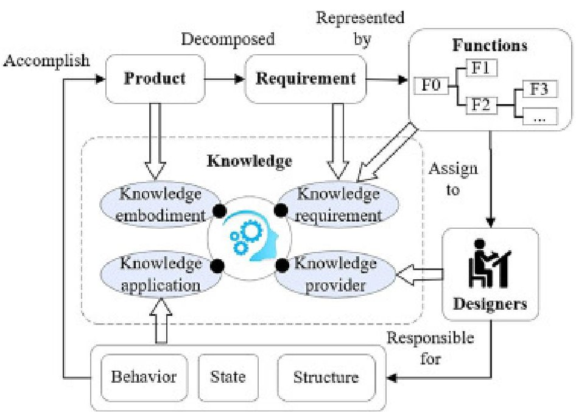

Download: Download high-res image (237KB)

Download: Download full-size image

Fig. 1. A knowledge-based system design.

According to the knowledge-based SD presented in Fig.1, functions of a product and the capability of designers should be mapped into different types of knowledge items, respectively. Achieving SD within the stipulated time relies on the matching degree between the required knowledge of decomposed functions and the level of designers' ability to master each type of knowledge domain. Decisive steps of the knowledge-based SD are functional decomposition and knowledge specification for purposes and designers.

## 2.1. Functional decomposition

Functions refer to the input-output relationships of materials, energy, and signals in the product. A function is usually expressed by "verb+noun", such as "determine the attitude", "store electrical energy", etc. A function tree diagram can be used to develop a graphical representation of the functional decomposition [26]. The decomposition starts from the most

<!-- PDF_PAGE: 5 -->

abstract function, and by answering "how to implement this function?", an abstract function expands into multiple sub-functions to form a "tree".

There are many approaches to build a function tree diagram. One of the most used methods is the Function Analysis System Technique (FAST) proposed by Bytheway [27]. Through FAST, Fig.2 shows a function tree diagram with 36 functions of SD of a Radio Aurora Explorer (RAX) mission. According to FAST's functional decomposition criteria, when a function is simple enough to map to existing or commercially available components or subsystems, the decomposition can stop. For example, "Function 3-Convert solar energy into electricity" in Fig.2 is at the end level as a solar wing can accomplish it. The benefit of utilizing a function tree diagram is that a function is independent of the product structure to represent the essence of a product before the embodiment of a design concept is achieved, which allows one to get an estimate of the design effort earlier in SD.

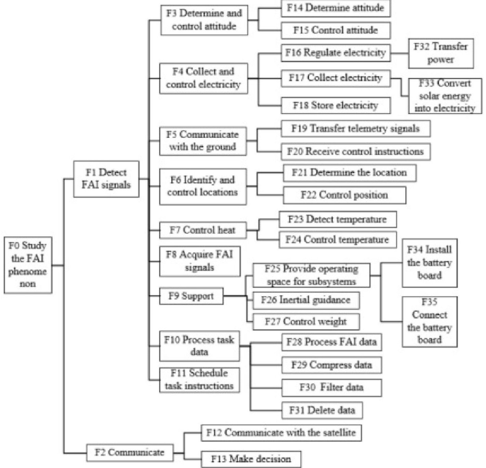

Download: Download high-res image (485KB)

Download: Download full-size image

Fig. 2. Functional decomposition model of a RAX system design [28].

<!-- PDF_PAGE: 6 -->

## 2.2. Mapping functions to knowledge space

In knowledge-based SD, knowledge is the link between product functions and the design team. The decomposed functions and their integration are achieved through the expertise of designers. Zhang defines technical knowledge as the professional skills used by designers in design activities that can be acquired through professional learning or actual product development. Technical knowledge is divided into general knowledge (GK) and product knowledge (PK) [29].

(1) GK is defined as the skills in a particular domain, which can be acquired through formal education, structured study, or systematic training. It determines the capability of a designer to be component at certain functions.

(2) PK is defined as the comprehension of the specific product to be designed, which is mostly developed from prior experience in similar projects. Designers with good PK are aware of interdependent activities besides their tasks and can accomplish integration from functions to the parent function.

Accordingly, a function is developed by GK, and sub-functions are integrated by PK. We use a scale to map a function into knowledge space to evaluate the required knowledge items in designing a specific function. Based on the study by Zhang and Thomson [26], we use knowledge magnitude to indicate the importance of a certain knowledge item to the function development, where a higher value indicates a severer requirement. All knowledge items should be limited to the same scale range, expressed by $ [0,r] $ $ (r\in N+) $ . The most common situation is that $ r=2 $ , where a higher value typically means less uncertainty and higher knowledge requirement; on the contrary, if the magnitude of a knowledge item is 0, it is not important for the development of the function. Correspondingly, a designer's capability for applying GK is defined with the magnitude: novice (numerical value=0), ordinary (numerical value=1) and expert (numerical value=2). Table1 shows the ten types of knowledge and their magnitudes required for the SD of the RAX mission.

<!-- PDF_PAGE: 7 -->

<table border="1"><tr><td rowspan="2">#</td><td rowspan="2">Knowledge item</td><td colspan="3">Magnitude</td></tr><tr><td>Not Important</td><td>Important</td><td>Very important</td></tr><tr><td>K1</td><td>Software engineering</td><td>0</td><td>1</td><td>2</td></tr><tr><td>K2</td><td>Heat transfer</td><td>0</td><td>1</td><td>2</td></tr><tr><td>K3</td><td>Electric heat generation</td><td>0</td><td>1</td><td>2</td></tr><tr><td>K4</td><td>Control</td><td>0</td><td>1</td><td>2</td></tr><tr><td>K5</td><td>Mechanical Engineering</td><td>0</td><td>1</td><td>2</td></tr><tr><td>K6</td><td>Sensor technology</td><td>0</td><td>1</td><td>2</td></tr><tr><td>K7</td><td>Physics</td><td>0</td><td>1</td><td>2</td></tr><tr><td>K8</td><td>Electrical engineering</td><td>0</td><td>1</td><td>2</td></tr><tr><td>K9</td><td>Management</td><td>0</td><td>1</td><td>2</td></tr><tr><td>K10</td><td>Communication</td><td>0</td><td>1</td><td>2</td></tr></table>

If the development of a function involves n knowledge items, they can form an n-dimensional space, called knowledge vector $ F=(k_{1}, k_{2}, \dots k_{i}\dots, k_{n}) $ , where $ k_{i} $ is the magnitude value of knowledge item i. Fig.3 shows the mapping from functions of the RAX mission into knowledge vectors. Table2 lists the knowledge vector for each of the 36 functions for the SD (Fig.1).

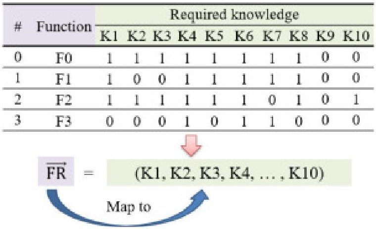

Download: Download high-res image (126KB)

Download: Download full-size image

Fig. 3. Mapping from functions to knowledge vectors [28].

Table 2. List of knowledge vectors for the SD of a RAX mission [28].

<!-- PDF_PAGE: 8 -->

<table border="1"><tr><td>#</td><td colspan="10">Knowledge vectors</td></tr><tr><td></td><td>K1</td><td>K2</td><td>K3</td><td>K4</td><td>K5</td><td>K6</td><td>K7</td><td>K8</td><td>K9</td><td>K10</td></tr><tr><td>F0</td><td>1</td><td>1</td><td>1</td><td>1</td><td>1</td><td>1</td><td>1</td><td>1</td><td>0</td><td>0</td></tr><tr><td>F1</td><td>1</td><td>0</td><td>0</td><td>1</td><td>1</td><td>1</td><td>1</td><td>1</td><td>0</td><td>0</td></tr><tr><td>F2</td><td>1</td><td>1</td><td>1</td><td>1</td><td>1</td><td>1</td><td>0</td><td>1</td><td>0</td><td>1</td></tr><tr><td>F3</td><td>0</td><td>0</td><td>0</td><td>1</td><td>0</td><td>1</td><td>1</td><td>0</td><td>0</td><td>0</td></tr><tr><td>F4</td><td>0</td><td>0</td><td>0</td><td>0</td><td>1</td><td>1</td><td>0</td><td>1</td><td>0</td><td>0</td></tr><tr><td>F5</td><td>1</td><td>0</td><td>0</td><td>0</td><td>0</td><td>1</td><td>1</td><td>1</td><td>0</td><td>1</td></tr><tr><td>F6</td><td>0</td><td>0</td><td>0</td><td>0</td><td>0</td><td>1</td><td>1</td><td>1</td><td>0</td><td>0</td></tr><tr><td>F7</td><td>1</td><td>1</td><td>1</td><td>1</td><td>1</td><td>1</td><td>0</td><td>0</td><td>0</td><td>0</td></tr><tr><td>F8</td><td>1</td><td>0</td><td>0</td><td>0</td><td>1</td><td>1</td><td>0</td><td>0</td><td>0</td><td>0</td></tr><tr><td>F9</td><td>0</td><td>0</td><td>0</td><td>0</td><td>1</td><td>0</td><td>1</td><td>0</td><td>0</td><td>0</td></tr><tr><td>F10</td><td>1</td><td>0</td><td>0</td><td>1</td><td>0</td><td>0</td><td>0</td><td>0</td><td>0</td><td>0</td></tr><tr><td>F11</td><td>1</td><td>0</td><td>0</td><td>1</td><td>0</td><td>0</td><td>0</td><td>0</td><td>1</td><td>0</td></tr><tr><td>F12</td><td>1</td><td>0</td><td>0</td><td>0</td><td>0</td><td>1</td><td>1</td><td>1</td><td>0</td><td>1</td></tr><tr><td>F13</td><td>1</td><td>0</td><td>0</td><td>1</td><td>0</td><td>0</td><td>0</td><td>0</td><td>1</td><td>0</td></tr><tr><td>F14</td><td>1</td><td>0</td><td>0</td><td>1</td><td>1</td><td>1</td><td>0</td><td>1</td><td>0</td><td>0</td></tr><tr><td>F15</td><td>1</td><td>0</td><td>0</td><td>1</td><td>1</td><td>1</td><td>0</td><td>1</td><td>0</td><td>0</td></tr><tr><td>F16</td><td>0</td><td>0</td><td>1</td><td>0</td><td>0</td><td>0</td><td>0</td><td>1</td><td>0</td><td>0</td></tr><tr><td>F17</td><td>0</td><td>0</td><td>0</td><td>1</td><td>1</td><td>0</td><td>0</td><td>1</td><td>0</td><td>0</td></tr><tr><td>F18</td><td>0</td><td>0</td><td>0</td><td>0</td><td>1</td><td>0</td><td>1</td><td>1</td><td>0</td><td>0</td></tr><tr><td>F19</td><td>1</td><td>0</td><td>0</td><td>0</td><td>0</td><td>0</td><td>0</td><td>1</td><td>0</td><td>1</td></tr><tr><td>F20</td><td>1</td><td>0</td><td>0</td><td>0</td><td>0</td><td>0</td><td>0</td><td>1</td><td>0</td><td>0</td></tr><tr><td>F21</td><td>1</td><td>0</td><td>0</td><td>1</td><td>0</td><td>0</td><td>0</td><td>0</td><td>0</td><td>0</td></tr><tr><td>F22</td><td>1</td><td>0</td><td>0</td><td>1</td><td>1</td><td>0</td><td>0</td><td>0</td><td>0</td><td>0</td></tr><tr><td>F23</td><td>0</td><td>1</td><td>1</td><td>0</td><td>1</td><td>1</td><td>0</td><td>0</td><td>0</td><td>0</td></tr><tr><td>F24</td><td>1</td><td>1</td><td>0</td><td>1</td><td>0</td><td>1</td><td>0</td><td>0</td><td>0</td><td>0</td></tr><tr><td>F25</td><td>0</td><td>0</td><td>0</td><td>0</td><td>1</td><td>0</td><td>0</td><td>1</td><td>0</td><td>0</td></tr></table>

<!-- PDF_PAGE: 9 -->

<table border="1"><tr><td rowspan="2">#</td><td colspan="10">Knowledge vectors</td></tr><tr><td>K1</td><td>K2</td><td>K3</td><td>K4</td><td>K5</td><td>K6</td><td>K7</td><td>K8</td><td>K9</td><td>K10</td></tr><tr><td>F26</td><td>0</td><td>0</td><td>0</td><td>1</td><td>1</td><td>1</td><td>0</td><td>1</td><td>0</td><td>0</td></tr><tr><td>F27</td><td>1</td><td>0</td><td>0</td><td>1</td><td>0</td><td>1</td><td>0</td><td>0</td><td>0</td><td>0</td></tr><tr><td>F28</td><td>1</td><td>0</td><td>0</td><td>0</td><td>0</td><td>0</td><td>0</td><td>0</td><td>0</td><td>0</td></tr><tr><td>F29</td><td>1</td><td>0</td><td>0</td><td>0</td><td>0</td><td>0</td><td>0</td><td>0</td><td>0</td><td>0</td></tr><tr><td>F30</td><td>1</td><td>0</td><td>0</td><td>0</td><td>0</td><td>0</td><td>0</td><td>0</td><td>0</td><td>0</td></tr><tr><td>F31</td><td>1</td><td>0</td><td>0</td><td>0</td><td>0</td><td>0</td><td>0</td><td>0</td><td>0</td><td>0</td></tr><tr><td>F32</td><td>0</td><td>0</td><td>1</td><td>1</td><td>0</td><td>0</td><td>0</td><td>1</td><td>0</td><td>0</td></tr><tr><td>F33</td><td>0</td><td>1</td><td>0</td><td>1</td><td>1</td><td>1</td><td>0</td><td>1</td><td>0</td><td>0</td></tr><tr><td>F34</td><td>0</td><td>0</td><td>0</td><td>0</td><td>1</td><td>0</td><td>0</td><td>1</td><td>0</td><td>0</td></tr><tr><td>F35</td><td>0</td><td>0</td><td>0</td><td>0</td><td>1</td><td>0</td><td>0</td><td>1</td><td>0</td><td>0</td></tr></table>

## 3. System design digital twin framework

The knowledge-based SD in Section2 establishes a theoretical basis for the operation of a system design digital twin. According to the research from Tao, a complete digital twin framework should include five components: the physical entity in physical space, the virtual entity in virtual space, services for analyzing the entity, digital twin data from the entity, and connections between them [30]. Following the same structure, for a knowledge-based SD, the corresponding digital twin framework, named System Design Digital Twin in 5 Dimensions $ \mathrm{(SDDT_{5D})} $ , is consists of five similar components, as illustrated in Fig.4.

<!-- PDF_PAGE: 10 -->

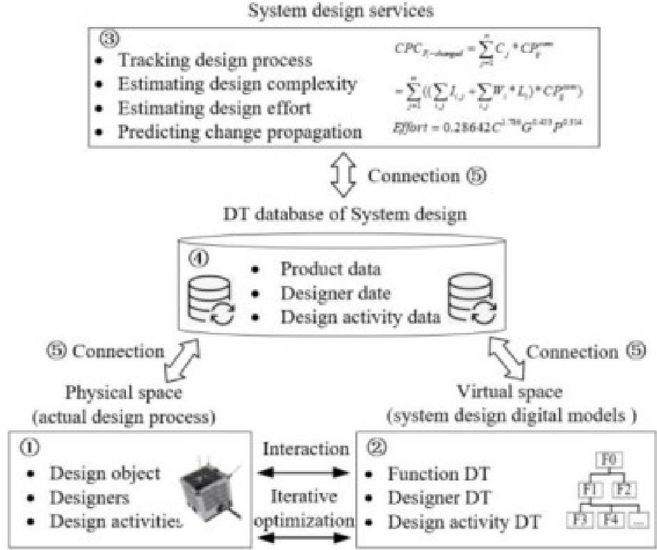

Download: Download high-res image (256KB)

Download: Download full-size image

Fig. 4. System design digital twin framework [28].

## 3.1. System design in physical space $ \mathrm{SD}_{\mathrm{PS}} $

$ \mathrm{S D}_{\mathrm{P S}} $ is the actual SD process of a product itself. In physical space, decomposed functions of the specific design object are assigned to designers. Designers with technical knowledge can develop the assigned function through sequential design tasks in a design activity. Therefore, main components of $ \mathrm{S D}_{\mathrm{P S}} $ are the design object, designers, and design activities.

## 3.2. System design digital model in virtual space (SDDM $ _{VS} $ )

As digital twin (DT) is defined as a real mapping of an entity in real word in the product life cycle, an $ \mathrm{S D D M_{V S}} $ is a digital twin of $ \mathrm{S D_{P S}} $ , which mirrors the life of an actual SD process and its characteristics. Therefore, an $ \mathrm{S D D M_{V S}} $ includes digital models of the design object (i.e., the function DT), designers (i.e., the designer DT), and design activities (i.e., the design activity DT).

The function DT represents the required knowledge; the designer DT reflects the capability of designers for possessing specific knowledge; the design activity DT connects designers and functions by knowledge application activities, such as technical development and information transfer, and consultation, etc. Fig.5 shows the composition of the function DT, designer DT, and design activity DT and their relationships, which are illustrated in detail in [28].

<!-- PDF_PAGE: 11 -->

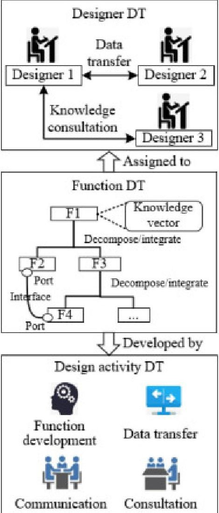

Download: Download high-res image (210KB)

Download: Download full-size image

Fig. 5. Three types of digital models of system design.

## 3.3. System design services (SDS)

SDS is the core enabler in $ \mathrm{S D D T}_{5 \mathrm{D}} $ , which can provide intelligent execution, precise estimation, and reliable control for the SD. The services are necessarily a series of mathematical models that integrate tracking, evaluation, optimization, and estimate algorithms. Analysis approaches in virtual space can be performed by specific services using real data from physical space. As illustrated in Table3, three kinds of services are discussed in detail in Section4.

<!-- PDF_PAGE: 12 -->

<table border="1"><tr><td>SDS name</td><td>Introduction</td></tr><tr><td>Design complexity measurement</td><td>A knowledge-based complexity metric is used to measure the system design complexity.</td></tr><tr><td>Design effort estimation</td><td>The effort for technical development, information transfer, consolation on knowledge, and design change propagation are considered.</td></tr><tr><td>Design change propagation prediction</td><td>Change propagation paths in the function tree are identified, and change propagation probabilities are predicted.</td></tr></table>

## 3.4. Digital twin database (DTD)

DTD acts as the driving force of $ \mathrm{S D D T}_{5 \mathrm{D}} $ , including data from physical entities, virtual models, and services, and the data regularly update with changes in real-time status. Because both $ \mathrm{S D}_{P S} $ and $ \mathrm{S D D M}_{V S} $ come down to the design object (i.e., the product), designers, and design activities, data in DTD can be classified into the product data, the designer data, and the design activity data, as listed in Table4.

Table 4. Data type in DTD.

<table border="1"><tr><td>Data type</td><td>Content</td></tr><tr><td>Product data</td><td>This refers to the functional requirements and their relationships, such as the decomposition, interaction, and integration of functions, which reflects the complexity of the design process.</td></tr><tr><td>Designer data</td><td>This refers to the design capabilities possessed by designers, which can be quantified by knowledge vectors.</td></tr><tr><td>Design activity data</td><td>This includes data from technical development, consultation between designers, and data exchange between functions.</td></tr></table>

The role of DTD has two aspects. It provides data for early-stage predetermination of design states, such as the complexity measurement of the design, the estimation of required design effort, and the prediction of the change propagation. For another, it provides data for real-time tracking of design states, such as completed design tasks, designer workload, and rest effort of the design.

## 3.5. Connection (CN)

<!-- PDF_PAGE: 13 -->

CN plays as an intermedium for connecting the above four components so that the digital twin can carry out real-time and efficient information transmission, and thereby ensuring the interaction and iterative optimization between the physical space and virtual space.

$$
\mathrm {S D D T} _ {5 \mathrm {D}} = \left\{\mathrm {S D} _ {\mathrm {P S}}, \mathrm {S D D M} _ {\mathrm {V S}}, \mathrm {S D S}, \mathrm {D T D}, \mathrm {C N} \right\}
$$

In summary, Formula (1) expresses $ \mathrm{S D D T}_{5 \mathrm{D}} $ $ \mathrm{S D}_{\mathrm{P S}} $ and CN are out of the scope of the research as $ \mathrm{S D}_{\mathrm{P S}} $ is an objective reality, and CN mostly relies on the quality of the hardware, so the focus of this article is $ \mathrm{S D D M}_{\mathrm{V S}} $ , SDS, DTD, and the unified modeling approach for them [28].

System design in the framework (Fig.4) is an iterative optimization process. The system design digital model represents information of design objects, designers, and design activities from the design team. With the development of the system, the digital model information becomes complete. Moreover, through system services, the actual system design process can be optimized. For example, managers can more accurately identify the knowledge requirement of functions and designate more capable designers on crucial functions. Details of System Design Digital Model in Virtual Space, Designer DT, Design activity DT, System Design Services and their relationships are illustrated in [28].

## 4. Unified modeling by SysML

SysML is used for modeling the unified model of $ \mathrm{S D D M_{V S}} $ , SDS, and DTD, because it has been designed to enable extensions that support specialized concepts by its extension mechanism, called stereotyping [8]. Stereotypes are organized into a profile. SysML itself is defined as a UML profile.

Stereotypes are used for customizing core concepts of System Design Digital Twin in 5 Dimensions (SDDT $ _{5D} $ ). A $ SDDT_{5D} $ modeling profile is constructed, as displayed in Fig.6, where mappings and decomposition relationships, etc. constitute the relationship profile; the function DT, designer DT, and design activity DT profiles form the $ SDDM_{VS} $ profile. The product data, designer data, and design activity data profiles constitute the DTD profile. The design complexity measurement, effort estimation, and change propagation prediction profiles constitute the SDS profile.

<!-- PDF_PAGE: 14 -->

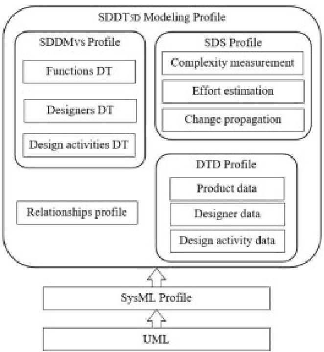

Download: Download high-res image (154KB)

Download: Download full-size image

Fig. 6. $ \mathrm{S D D T}_{5 \mathrm{D}} $ modeling profile.

Fig.7 shows an $ \mathrm{S D D T}_{5 \mathrm{D}} $ modeling profile that is defined by importing a SysML model that references a UML profile (i.e., UML4SysML) to reuse their classes such as «block», «property», and relationships such as «dependency».

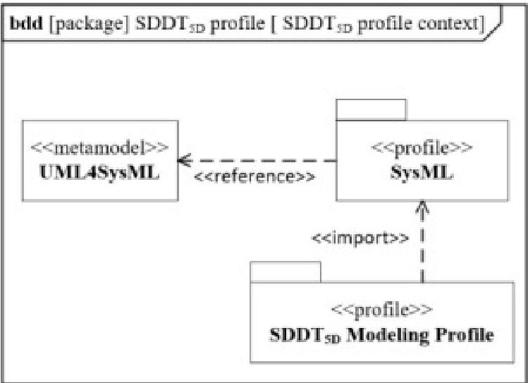

Download: Download high-res image (103KB)

Download: Download full-size image

Fig. 7. Definition of $ \mathrm{P D D T}_{5 \mathrm{D}} $ modeling profile.

## 4.1. Relationship profile

The definition of a relationship profile is described in Fig.8. Two kinds of mapping relationships: (a) mapping at the same level and (b) mapping between two different levels, are named as H mapping and V mapping, respectively, by extending the "dependency" relationship.

<!-- PDF_PAGE: 15 -->

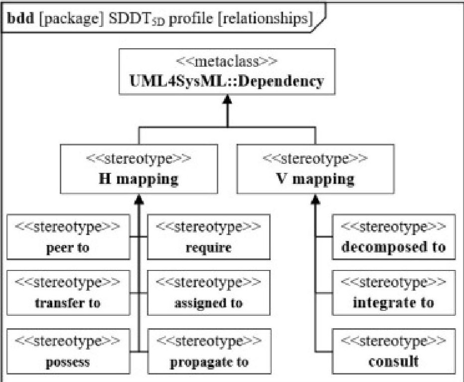

Download: Download high-res image (234KB)

Download: Download full-size image

Fig. 8. Definition of the relationship profile.

Subclasses of the two mappings are defined in Table5, in which the H mapping includes «peer to», «interact with», «require», «assigned to», «possess» and «propagate to». The V mapping includes «decomposed to», «integrate to» and «consult».

Table 5. Subclasses of the two mappings.

<table border="1"><tr><td>Name/Type</td><td>Introduction</td></tr><tr><td>peer to/H</td><td>Sub-functions have the same parent function</td></tr><tr><td>require/H</td><td>A function requires certain knowledge items</td></tr><tr><td>transfer to/H</td><td>A function transfers information to another</td></tr><tr><td>assigned to/H</td><td>A function is assigned to a specific designer</td></tr><tr><td>possess/H</td><td>A designer possesses technical knowledge</td></tr><tr><td>propagate to/H</td><td>A change propagates from a function to another</td></tr><tr><td>decomposed to/V</td><td>A function is decomposed to sub-functions</td></tr><tr><td>integrate to/V</td><td>Sub-functions are integrated to the parent function</td></tr><tr><td>consult/V</td><td>A designer consults another on knowledge</td></tr></table>

<!-- PDF_PAGE: 16 -->

## 4.2. SDDM $ _{VS} $ profile

The $ \mathrm{SDDM_{V S}} $ profile includes definitions of functions, interfaces, designers, and design activities. As illustrated in Fig.9, a function stereotype is generated from a Block. It contains attributes and parameters, such as the decomposition level, required knowledge vector, development complexity, consumed effort, and change probability. A function can be a child function, a parent function, or a peer function; their relationships are specified by «decomposed to», «integrate to» and «peer to». Additionally, an interface consists of a connector (named Interface_connector) and two ports (named Interface_Port). An Interface_connector extends from the Connector and inherits from the Block; an Interface_Port inherits from the ProxyPort.

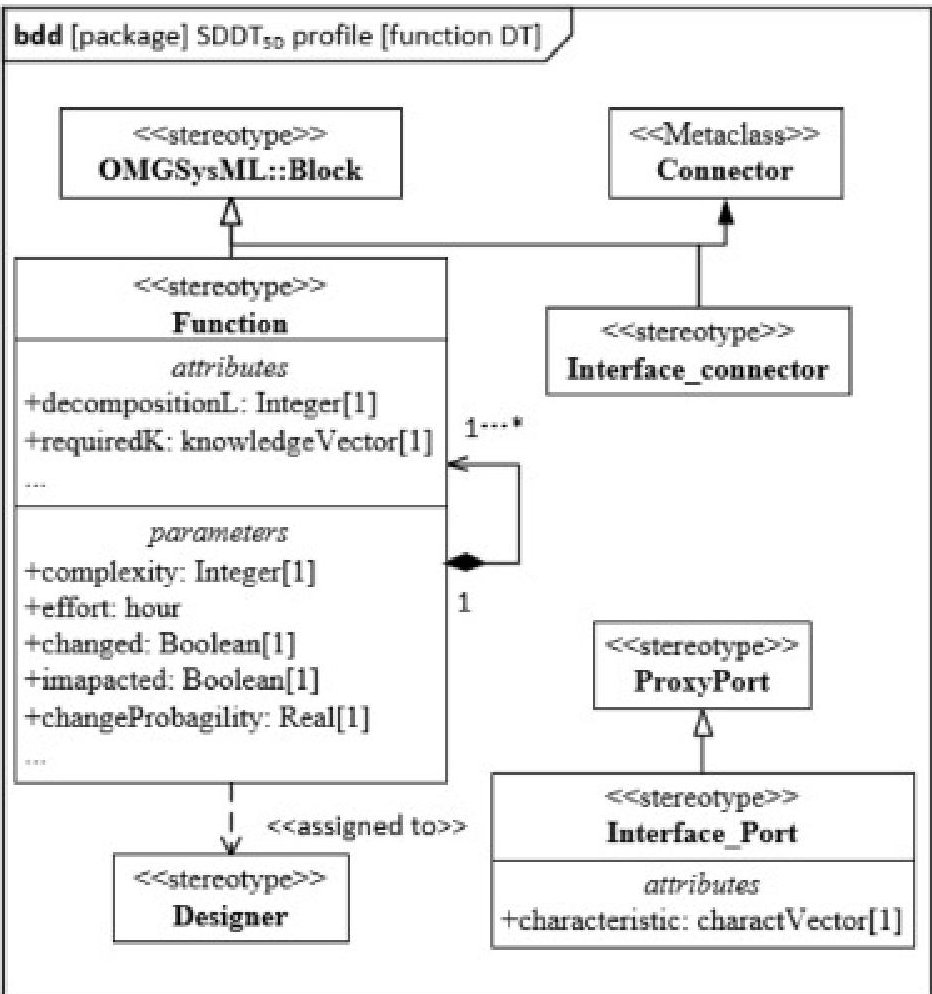

Download: Download high-res image (287KB)

Download: Download full-size image

Fig. 9. Definition of the function DT profile.

A designer stereotype is defined by inheriting from the Block. Two attributes of a designer stereotype are provided, the ability_GK represents the designer's ability of general knowledge, and the ability_PK refers to the designer's ability of product knowledge. Moreover, a designer is classified into a junior designer, an intermediate designer, or a senior designer based on the ability_GK and ability_PK, as illustrated in Fig.10.

<!-- PDF_PAGE: 17 -->

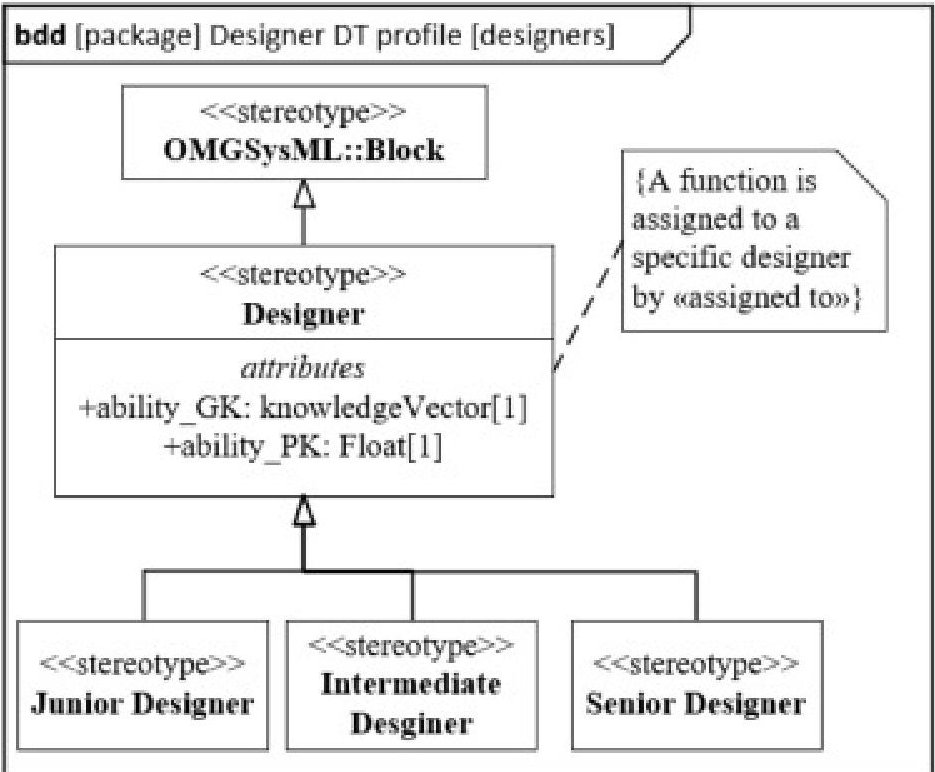

Download: Download high-res image (212KB)

Download: Download full-size image

Fig. 10. Definition of the designer DT profile.

In Fig.11, a design activity stereotype is defined by extending a use case, activity and interaction, and can be classified into function development, information transfer, and knowledge consulting. Furthermore, values and parameters are defined, such as the effort, interface quality, and preparation effort.

<!-- PDF_PAGE: 18 -->

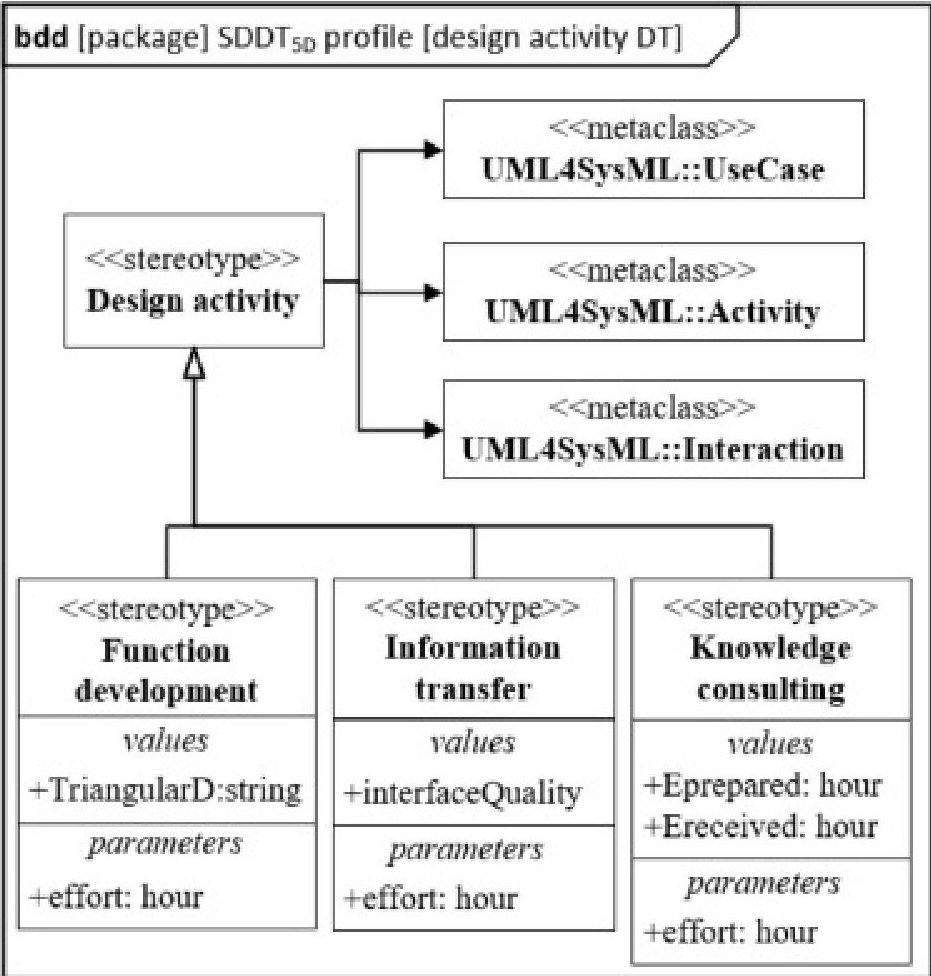

Download: Download high-res image (299KB)

Download: Download full-size image

Fig. 11. Definition of the design activity DT profile.

## 4.3. Digital twin database profile

A DTD profile includes the product data stereotype, designer data stereotype, and design activity data stereotype. These are defined by inheriting from the Block, specifying values and parameters, and creating new data types. For example, in Fig.12, ProductData is a kind of Block, and it has attributes like required knowledge vectors mapped from functions, total complexity (C_Total), total effort (E_Total), number of designers (NoD) and information quality (IQ), etc. In a similar approach, DesignerData, like the ability of function development (AFD) and functional integration (AFI) and the DesignActivityData, can be defined.

<!-- PDF_PAGE: 19 -->

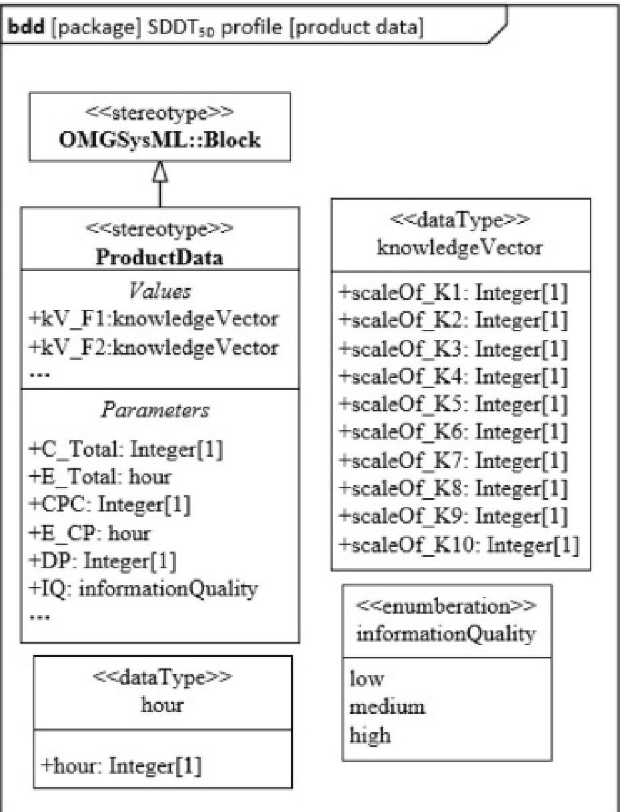

Download: Download high-res image (394KB)

Download: Download full-size image

Fig. 12. Definition of product data.

## 4.4. System design services profile

SysML supports different types of engineering analyses using parametric models, which capture constraints on the properties of a system and can then be evaluated by an appropriate analysis tool. Fig.13 shows the constraint block of total design complexity calculated by Eq. (6). Fig.14 illustrates a parametric diagram for the constraint block of overall design complexity. The parameters of the constraint properties rK_F and decompositionL are bound the corresponding parameters of the block Function, the constraint properties c_Total and n_Interface are bound the parameters of block Product Data. Equations related to design effort estimation and design change propagation prediction can be modeled in the same way.

<!-- PDF_PAGE: 20 -->

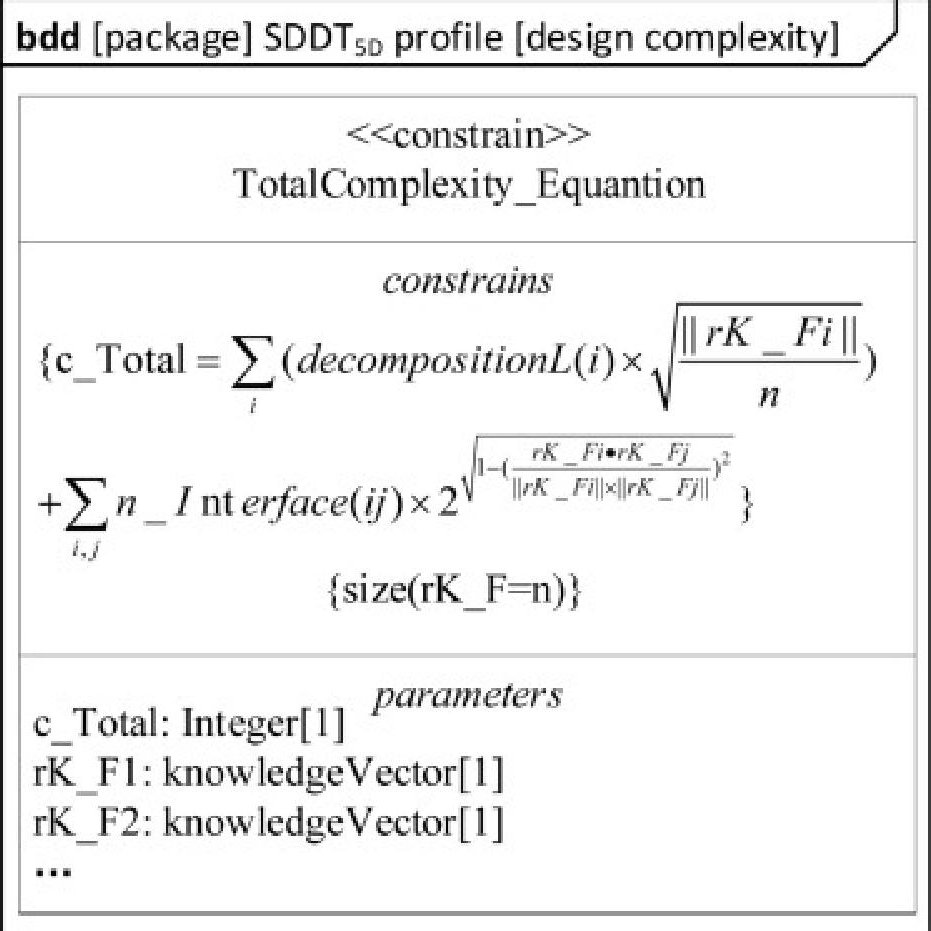

Download: Download high-res image (257KB)

Download: Download full-size image

Fig. 13. Definition of design complexity constrain.

<!-- PDF_PAGE: 21 -->

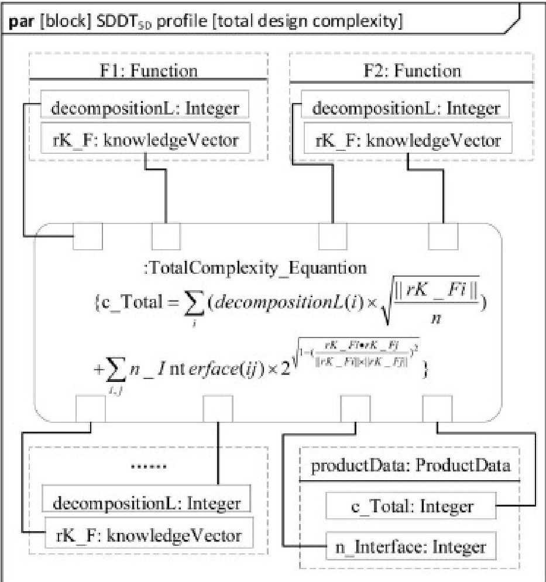

Download: Download high-res image (312KB)

Download: Download full-size image

Fig. 14. Parameter diagram of total design complexity.

## 5. Case study and discussion

System design of space mission is challenging as functions are coupled and constrained by the limited available commodities. Furthermore, additional complexities arise because designers describe the system in a document-based way. Radio Aurora Explorer (RAX) is a standard mission in the aerospace field. The primary objective of the mission is to study the formation of magnetic field-aligned plasma irregularities (FAI). Based on a RAX CubeSat project, in 2012, the SSWG (Space Systems Working Group) of INCOSE demonstrated the feasibility of the MBSD approach in reality, where SysML could formally specify every aspect of a system [31]. Accordingly, in the following section, the modeling approach proposed in this paper is applied to the system design of a virtual RAX CubeSat mission.

Necessary information has been given, for example, the decomposed functions are revealed in Fig.2, the required knowledge is provided in Table2, and the interfaces among functions are shown in Fig.11 in [28]. Besides, the quantitative aspects of designers and design activities are required, which are shown in Table6. To model the amount of effort needed, we make the following assumptions: the AFD value in the designer data based on the ratio of junior, intermediate, and senior designers is 2:5:3. Each designer is assigned a function development

<!-- PDF_PAGE: 22 -->

task, so the NoD value is 1 for 36. TriangularD (40,64,50) is selected as the triangle distribution in the design activity data, and the information receiving and preparation time are set to 2h, respectively. Furthermore, function 16 $ \left( \mathrm{F}_{1 6} \right) $ is the key function because it has the most interfaces, and function 17 $ \left( \mathrm{F}_{1 7} \right) $ is selected as the changed function.

<table border="1"><tr><td>Data Type</td><td>Content</td><td>Values</td></tr><tr><td rowspan="6">Product</td><td>Functional decomposition</td><td>Fig.2</td></tr><tr><td>Interfaces</td><td>Fig.11 in[28]</td></tr><tr><td>Knowledge vectors</td><td>Table2</td></tr><tr><td>NoD</td><td>1</td></tr><tr><td>IQ</td><td>Medium(2)</td></tr><tr><td>Changed function</td><td>F17</td></tr><tr><td rowspan="2">Designers</td><td>AFD</td><td>2:5:3</td></tr><tr><td>AFI</td><td>50%</td></tr><tr><td rowspan="4">Design activities</td><td>TriangularD</td><td>(40,64,50)</td></tr><tr><td>Eprepared</td><td>2</td></tr><tr><td>Ereceive</td><td>2</td></tr><tr><td>InterfaceQ</td><td>2</td></tr></table>

The first step is to specify models and organize them initially. An overall package structure based on the $ \mathrm{SDDT}_{5 \mathrm{D}} $ is used to establish the model organization, as displayed in Fig.15. Thus, different models are organized into specific packages according to the aim of them.

<!-- PDF_PAGE: 23 -->

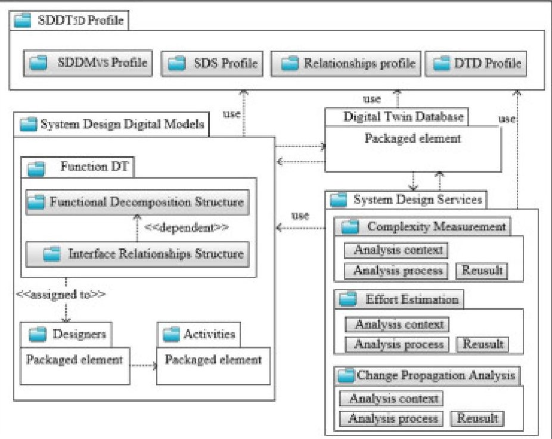

Download: Download high-res image (288KB)

Download: Download full-size image

Fig. 15. The model organization.

Details of each package are modeled. For example, decomposition of the functions is described by the SysML Block Definition Diagram (BDD) because functions are treated as components that can be "assembled", as illustrated in Fig.16. In the BDD, "children, parent, and peer" relationships among them are represented by the profile of the relationship. For the RAX CubeSat, there are 36 functions, and the top function is "study the FAI phenomenon", which is on 0 decomposition level.

<!-- PDF_PAGE: 24 -->

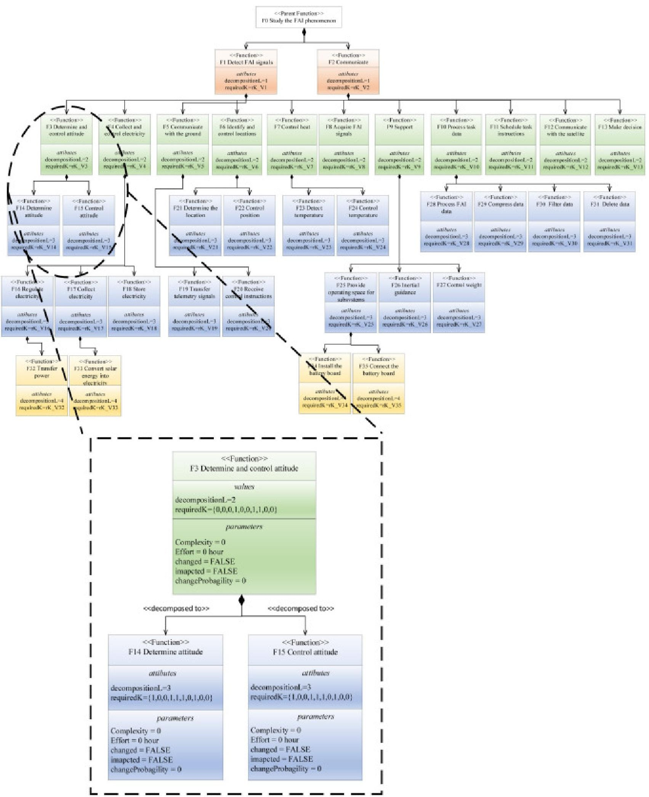

Download: Download high-res image (1MB)

Download: Download full-size image

Fig. 16. Functional decomposition of the RAX CubeSate system design.

<!-- PDF_PAGE: 25 -->

Interfaces of the functions are then described by the SysML Internal Block Diagram (IBD), as exhibited in Fig.17.

<!-- PDF_PAGE: 26 -->

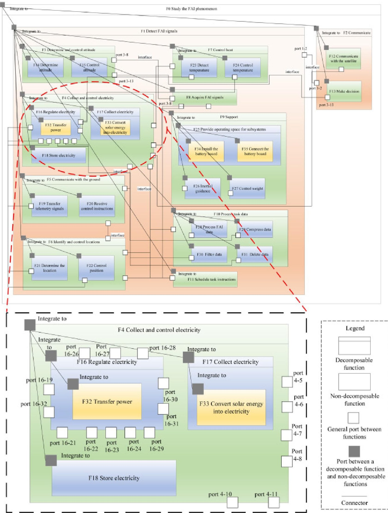

Download: Download high-res image (1MB)

Download: Download full-size image

Fig. 17. Interface relationships among functions.

<!-- PDF_PAGE: 27 -->

One function is assigned to one designer and different design activities, as illustrated in Fig.18. Then, design activities are elaborated to show the behavior of every designer by the SysML Sequence Diagram or Activity Diagram using the design activity DT profile.

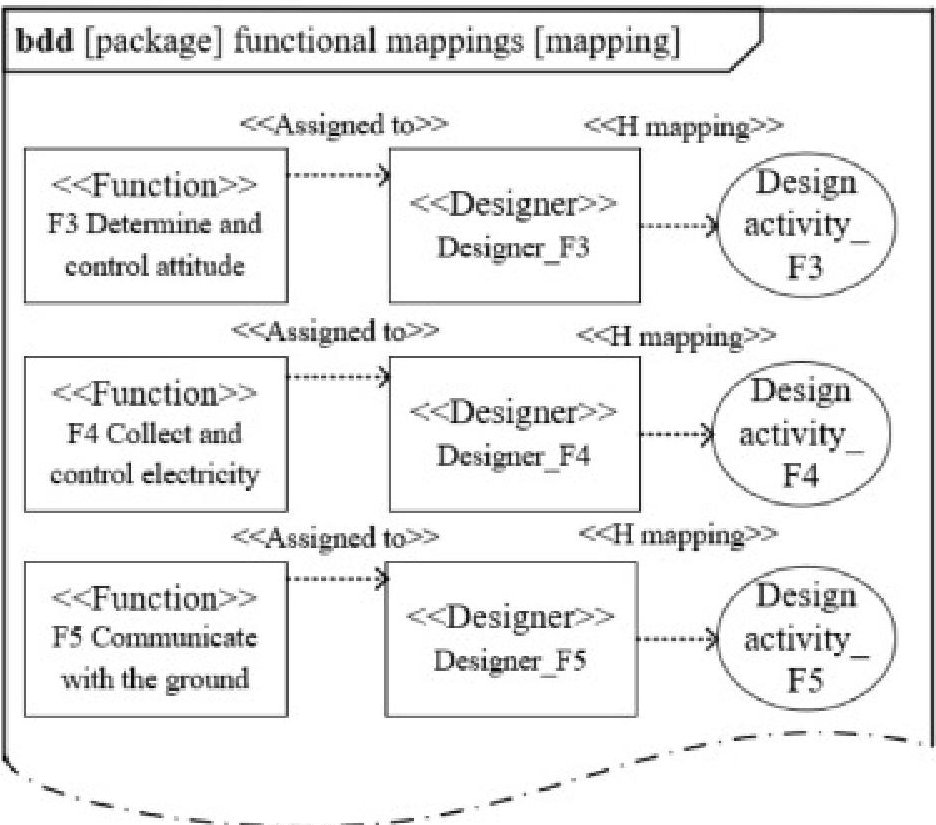

Download: Download high-res image (265KB)

Download: Download full-size image

Fig. 18. Functions are assigned to designers and activities.

Based on the assumption and through the system services modeled by the parametric models, values of parameters in equations on design complexity assessment, workload estimation, and function change analysis are specified by linking to corresponding data. Finally, properties of the system design, such as design complexity and effort, can be evaluated by appropriate analysis tools like MATLAB. The output data of the analysis is listed in Table 7.

<!-- PDF_PAGE: 28 -->

<table border="1"><tr><td>Type</td><td>Name</td><td>Value</td></tr><tr><td>Complexity</td><td>C_Total</td><td>195</td></tr><tr><td rowspan="4">Effort</td><td>E_Total</td><td>4819</td></tr><tr><td>E_{F16}$</td><td>303</td></tr><tr><td>E_{Transfer-F16}$</td><td>60</td></tr><tr><td>E_{Consult-F16}$</td><td>29</td></tr><tr><td rowspan="2">Change propagation</td><td>E_{CP-F17}$</td><td>419</td></tr><tr><td>Table 8</td><td></td></tr></table>

It can be seen from Table7 that the total complexity (C_Total) is 195, and the total effort (E_Total) is approximately 4819h. Based on the estimated design effort, managers can use the trade-off analysis by setting SysML models' different values to optimize the design progress. For example, based on the result, managers can more accurately identify the knowledge requirement of functions and designate more capable designers on key functions.

To assess the proposed method's practical usability, two students (Group A) and two experienced managers (Group B) were asked to participate in an experiment about estimating the total effort of the RAX CubeSate system design. The two students having the SysML knowledge background used the proposed unified models to represnt the system design, while the two managers in Group B used a traditional document-based approach, such as the requirements specification by Microsoft Word and the interface definition document by Microsoft Excel, to specify the system design. The student group spent about 48h in modeling the system model by the $ \mathrm{SDDT}_{5 \mathrm{D}} $ modeling profile and spend 4 more hours in getting the correct total effort. Compared with students, managers in Group B spend less time in specifying the systems, about 24h. However, the two managers used more time, about 10h, in getting the correct total effort as they wasted more time in understanding the ambiguity issues. Although the students spent more time in modeling the system model, they saved more time in analyzing the design complexity. Moreover, the unified model can be reused in a more detailed stage to avoid the ambiguity between the understandings of different designers.

Additionally, the effort required to develop the key function $ F_{1 6} $ is about 303h, accounting for 6.29% of the total effort, which can prove that this function is one of the core functions. The information transfer effort $ ( E_{tansfer-F16} ) $ required during the development of $ F_{1 6} $ is 60h, and the knowledge consultation effort of it $ ( E_{Consult-F16} ) $ is about 29h.

<!-- PDF_PAGE: 29 -->

Table8 presents the impact of the change propagation of $ F_{1 7} $ . The most affected functions are $ F_{1 8} $ store electricity (88%) $ F_{1 5} $ control attitude (81%) and $ F_{2 1} $ determined the location (81%). According to the prediction, the manager can decide whether to change the corresponding design parameters. Moreover, in Table8, the additional effort for changing $ F_{1 7} $ $ (E_{CP-F17}) $ is approximately 419h, which significantly delays the design cycle.

Table 8. Change propagation analysis of $ \mathrm{F}_{1 7} $ [28].

<table border="1"><tr><td>Changed</td><td>Impacted</td><td>Change probability</td></tr><tr><td rowspan="4">F17</td><td>F33</td><td>51%</td></tr><tr><td>F18</td><td>43%</td></tr><tr><td>F4</td><td>88%</td></tr><tr><td>F1</td><td>71%</td></tr></table>

A significant function of the established unified model is that it can simulate different scenarios by conveniently changing different parameters in the SysML parameter diagram, thereby helping the designer to determine critical functions and interfaces in the early design stage. For example, Table9 lists ten different scenarios for simulating the change of RAX system design. The simulation case includes all 36 functions, ten kinds of knowledge, and multiple interfaces of all RAX system designs, assuming that function 17 has been changed. Among them, scenario 1 is the basic scenario; for scenario 2, only the affected functions are simulated; then, two new random functions are added to the list of changed functions (scenario 3); then, with different knowledge vectors 1 and 2 random interfaces for simulation (scenario 4 to 10). The primary purpose of these scenarios is to cover many possible examples of function change propagation: addition/deletion of functions, addition/removal of knowledge items, and modification of interfaces. Simulation results show that additional work is required if there are any changes in the design, as shown in Fig.19.

Table 9. Scenarios for simulating the change of RAX system design.

<!-- PDF_PAGE: 30 -->

<table border="1"><tr><td>Scenario</td><td>Changed functions</td><td>Changed interfaces</td><td>Changed knowledge</td></tr><tr><td>#1</td><td>F17+Impacted functions</td><td>No change</td><td>Mechanical</td></tr><tr><td>#2</td><td>F17+Impacted functions</td><td>No change</td><td>All</td></tr><tr><td>#3</td><td>Two new functions are added,F23,F31</td><td>Basic parent-child interfaces</td><td>All</td></tr><tr><td>#4</td><td>Two new functions are added,F23,F31</td><td>One extra interface,F25-F34</td><td>All</td></tr><tr><td>#5</td><td>Two new functions are added,F23,F31</td><td>Two extra interfaces,F25-F34,F25-F35</td><td>All</td></tr><tr><td>#6</td><td>Two new functions are added,F23,F31</td><td>Basic parent-child interfaces</td><td>Mechanical</td></tr><tr><td>#7</td><td>Two new functions are added,F23,F31</td><td>One extra interface,F25-F34</td><td>Mechanical</td></tr><tr><td>#8</td><td>Two new functions are added,F23,F31</td><td>Two extra interfaces,F25-F34,F25-F35</td><td>Mechanical</td></tr><tr><td>#9</td><td>F17+Impacted functions</td><td>No change</td><td>Mechanical and control</td></tr><tr><td>#10</td><td>Two new functions are added,F23,F31</td><td>One extra interface,F25-F34</td><td>Mechanical and control</td></tr></table>

<!-- PDF_PAGE: 31 -->

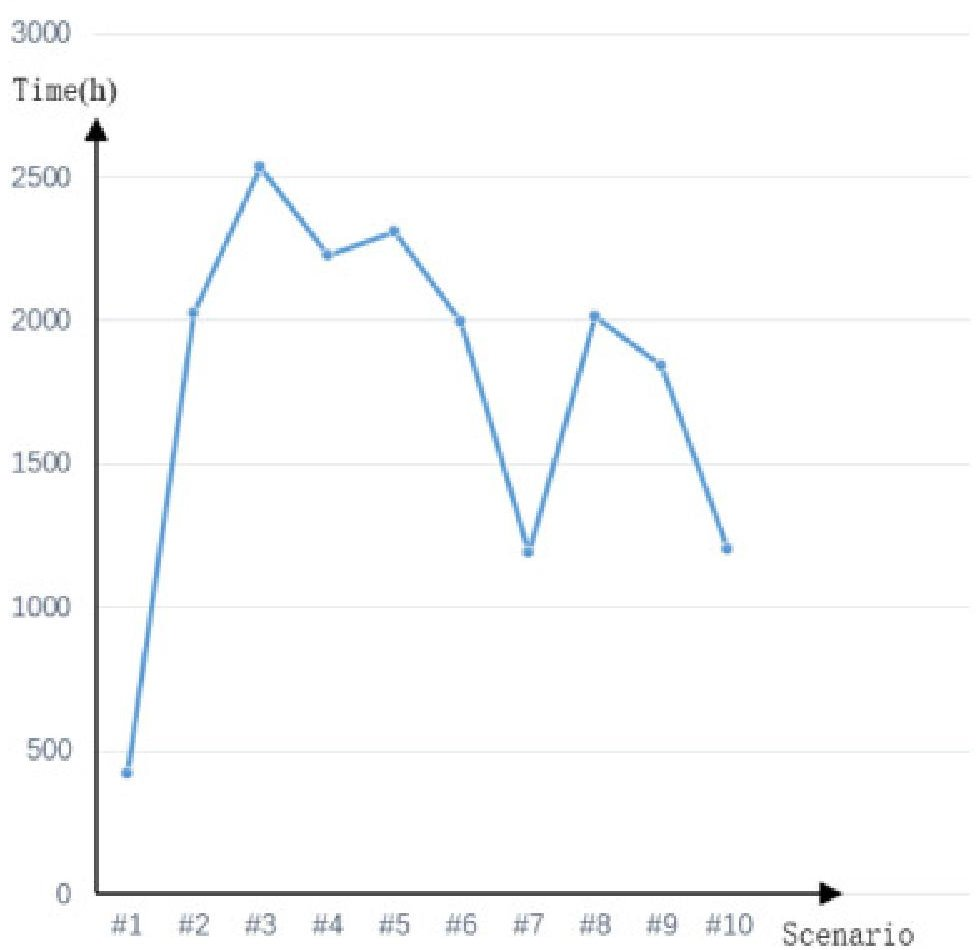

Download: Download high-res image (135KB)

Download: Download full-size image

Fig. 19. Simulation results of the 10 scenarios.

However, designers criticized the intensive manual work required for building a model. In reality, designers were unwilling to spend so much time in creating SysML diagrams. More importantly, an experienced manager said that they preferred making decisions by referencing similar cases of a previous design or believing their experience. They suggested a few improvement ideas for future work, such as linking the model to available information databases, and building ontologies for common cases to reuse or reference them rather than creating new ones.

## 6. Conclusion and future work

Leading MBSE methodologies like Harmony SE, OOSEM, SA, etc., improve upon traditional DBSE by formalizing the application of modeling to support requirements analysis, function analysis, and design synthesis. However, one of the core issues that companies care about is how to effectively evaluate, predict, and manage the complexity of a complex project in the early SD stage. The existing methods still have the problem of inaccuracy. The main reason is that the actual SD in a physical space is inconsistent with the theoretical simulation of the virtual space. The emergence of digital twins (DT) has provided an effective way to provide intelligent, efficient, and real-time services for SD to ensure the consistency between the virtual model and

<!-- PDF_PAGE: 32 -->

the physical state. In order to integrate DT with MBSE to help project managers understand the design complexity in early stage:

(1) According to a knowledge-based SD theory, a System Design Digital Twin in 5 Dimensions （ $ \mathrm{SDDT}_{5\mathrm{D}} $ ）framework is introduced, which can map the actual SD process into the corresponding virtual space.

(2) The core concepts and relationships of $ \mathrm{SDDT}_{5 \mathrm{D}} $ are customized by a SysML profile that keeps every view of the digital system model unified.

Although SysML modeling tools, such as Magicdraw, enable designers to create and document a system model, many designers in China find it unacceptable to spend too much time in learning such a graphical modeling language without appropriate patterns. Besides, it is difficult for the machine to understand the semantics of the SysML diagrams. In the future, we will carry out in-depth research on:

(1) Linking available information databases to create reusable cases and appropriate pattern, and

(2) Represent systems design information to be both user-understandable and machine-readable.

## Author statement

We have made substantial contributions to the conception or design of the work or the acquisition, analysis, or interpretation of data for the work named Unified Modeling for Digital Twin of a Knowledge-Based System Design. We have drafted the work and revised it critically for relevant intellectual content. We have approved the final version to be published. We agree to be accountable for all aspects of the work in ensuring that questions related to the accuracy or integrity of any part of the work are appropriately investigated and resolved.

All organizations that have made substantial contributions to the work reported in the manuscript, including those who provided editing and writing assistance but are not authors, are named in the manuscript's Acknowledgments section.

## Declaration of Competing Interest

The authors declare that they have no known competing financial interests or personal relationships that could have appeared to influence the work reported in this paper.

<!-- PDF_PAGE: 33 -->

## Acknowledgment

This work was funded by the National Natural Science Foundation of China (No. 51905493, and No. 51775517), the Shanghai Key Lab of Advanced Manufacturing Environment (No. KT20190603).

## References

[1] A.M. Madni, et al. M. Model-based systems engineering: motivation, current status, and research opportunities Syst. Eng., 21 (3) (2018), pp. 172-190 Crossref View in Scopus Google Scholar

[2] T. Huldt, I. Stenius State-of-practice survey of model-based systems engineering Syst. Eng., 22 (2) (2019), pp. 134-145 Crossref View in Scopus Google Scholar

[3] A.M. Madni, et al. Leveraging digital twin technology in model-based systems engineering Systems, 7 (1) (2019), Article 7, 10.3390/systems7010007 View in Scopus Google Scholar

[4] H.P. Hoffmann Deploying model-based systems engineering with IBM $ ^{\circledR} $ rational $ ^{\circledR} $ solutions for systems and software engineering 2012 IEEE/AIAA 31st Digital Avionics Systems Conference (DASC), IEEE (2012), pp. 1-8 Crossref Google Scholar

[5] D. Dori Model-based Systems Engineering With OPM and SysML Springer, New York (2016), pp. 2-15 Google Scholar

[6] S. Friedenthal, et al.

A Practical Guide to SysML: the Systems Modeling Language

Morgan Kaufmann (2014), pp. 3-10

Google Scholar

[7] T. Weilkiens SYSMOD-The Systems Modeling Toolbox-Pragmatic MBSE With SysML

<!-- PDF_PAGE: 34 -->

Lulu.com (2016), pp. 10-19 Google Scholar

[8] S. Friedenthal, et al. OMG systems modeling language (OMG SysML) tutorial INCOSE Intl. Symp., 9 (2006), pp. 65-67 Google Scholar $ \rangle $

[9] K. Efthymiou, et al. Manufacturing systems complexity review: challenges and outlook Procedia CIRP, 3 (2012), pp. 644-649 View PDF View article View in Scopus Google Scholar

[10] P. Bossaerts, C. Murawski Computational complexity and human decision-making Trends Cogn. Sci. (Regul. Ed.), 21 (12) (2017), pp. 917-929 View PDF View article View in Scopus Google Scholar

[11] O. Kulak

Applications of axiomatic design principles: a literature review

Expert. Syst. Appl., 37 (9) (2010), pp. 6705-6717

View PDF View article View in Scopus Google Scholar

[12] X. Zhang, V. Thomson A knowledge-based measure of product complexity Comput. Ind. Eng., 115 (2018), pp. 80-87 View PDF View article Google Scholar

[13] J.J. Shah, G. Runger Misuse of information-theoretic dispersion measures as design complexity metrics ASME 2011 IDETC/CIE Conference, ASME (2011), pp. 395-404 View in Scopus Google Scholar

[14] I. Ullah, et al. Engineering product and process design changes: a literature overview Procedia CIRP, 56 (2016), pp. 25-33 View PDF View article View in Scopus Google Scholar

[15] Y. Lu, et al. Digital Twin-driven smart manufacturing: connotation, reference model, applications and research issues

<!-- PDF_PAGE: 35 -->

Robot. Comput. Integr. Manuf., 61 (2020), Article 101837

View PDF View article View in Scopus Google Scholar

[16] K. Zhang, et al. Digital twin-based opti-state control method for a synchronized production operation system Robot. Comput. Integr. Manuf., 63 (2020), Article 101892 View PDF View article View in Scopus Google Scholar

[17] P. Aivaliotis, et al. The use of Digital Twin for predictive maintenance in manufacturing Int. J. Comput. Integr. Manuf., 32 (11) (2019), pp. 1067-1080 Crossref View in Scopus Google Scholar

[18] M. Grieves

Virtually Perfect: Driving Innovative and Lean Products Through Product Lifecycle Management

Space Coast Press, Cocoa Beach (2011), pp. 15-32

Google Scholar

[19] C. Qian, et al. A real-time data-driven collaborative mechanism in fixed-position assembly systems for smart manufacturing Robot. Comput. Integr. Manuf., 61 (2020), Article 101841 View PDF View article View in Scopus Google Scholar

[20] J. Cheng, et al. DT-II: digital twin enhanced Industrial Internet reference framework towards smart manufacturing Robot. Comput. Integr. Manuf., 62 (2020), Article 101881 View PDF View article View in Scopus Google Scholar

[21] P. Aivaliotis, et al. Methodology for enabling Digital Twin using advanced physics-based modelling in predictive maintenance Procedia CIRP (2019), pp. 417-422 View PDF View article View in Scopus Google Scholar

[22] G. Bachelor, et al. Model-based design of complex aeronautical systems through digital twin and thread concepts

<!-- PDF_PAGE: 36 -->

IEEE Syst. J. (2019), pp. 1-12 Google Scholar

[23] D. Thomas, et al. A holistic system lifecycle engineering approach-closing the loop between system architecture and digital twins Procedia CIRP, 84 (2019), pp. 538-544 View PDF View article View in Scopus Google Scholar

[24] S.O. Erikstad Design patterns for digital twin solutions in marine systems design and operations The 7th International Conference on Computer Applications and Information Technology in the Maritime Industries, COMPIT 2018 (2018), pp. 1-15 Google Scholar

[25] M. Schluse, et al. Experimentable digital twins for model-based systems engineering and simulation-based development 2017 Annual IEEE International Systems Conference (SysCon), IEEE (2017), pp. 1-8 Crossref Google Scholar

[26] H.A. Bashir, V. Thomson Estimating design effort for GE hydro projects Comput. Ind. Eng., 46 (2) (2004), pp. 195-204 View PDF View article View in Scopus Google Scholar

[27] W. Bytheway Fast Creativity and Innovation: Rapidly Improving Processes, Product Development and Solving Complex Problems J. Ross Publishing (2007), pp. 6-18 Google Scholar

[28] H.Q. Wang, et al.

Digital twin-based product design process and the design effort prediction method

Comput. Integr. Manuf. Syst. (2020), pp. 1-15

5-25

http://kns.cnki.net/kcms/detail/11.5946.TP.20200506.1719.008.html

Google Scholar

<!-- PDF_PAGE: 37 -->

[29] X. Zhang, V. Thomson Modelling the development of complex products using a knowledge perspective Res. Eng. Des., 30 (2) (2019), pp. 203-226 View in Scopus Google Scholar

[30] F. Tao, et al. Five-dimension digital twin model and its ten applications Comput. Integr. Manuf. Syst., 25 (1) (2019), pp. 1-18 View in Scopus Google Scholar

[31] S.C. Spangelo, et al. Applying model based systems engineering (MBSE) to a standard CubeSat 2012 IEEE Aerospace Conference, IEEE (2012), pp. 1-20 Crossref Google Scholar

View Abstract