<!-- PDF_PAGE: 1 -->


<div align="center">

# A Standard Methodology Enabling Execution of Models Described in Sysml Demonstrated in a Model Based Systems Engineering Approach Toward Developing a Space Situational Awareness System Implemented in Cubesats

</div>

<table border="1"><tr><td>Item Type</td><td>text; Electronic Thesis</td></tr><tr><td>Authors</td><td>Lutfi, Mostafa</td></tr><tr><td>Citation</td><td>Lutfi, Mostafa. (2020). A Standard Methodology Enabling Execution of Models Described in Sysml Demonstrated in a Model Based Systems Engineering Approach Toward Developing a Space Situational Awareness System Implemented in Cubesats (Master&#x27;s thesis, University of Arizona, Tucson, USA).</td></tr><tr><td>Publisher</td><td>The University of Arizona.</td></tr><tr><td>Rights</td><td>Copyright © is held by the author. Digital access to this material is made possible by the University Libraries, University of Arizona. Further transmission, reproduction, presentation (such as public display or performance) of protected items is prohibited except with permission of the author.</td></tr><tr><td>Download date</td><td>05/09/2026 18:07:44</td></tr><tr><td>Link to Item</td><td>http://hdl.handle.net/10150/648677</td></tr></table>

<!-- PDF_PAGE: 2 -->

<div align="center">

# A STANDARD METHODOLOGY ENABLING EXECUTION OF MODELS DESCRIBED IN SYSML DEMONSTRATED IN A MODEL BASED SYSTEMS ENGINEERING APPROACH TOWARD DEVELOPING A SPACE SITUATIONAL AWARENESS SYSTEM IMPLEMENTED IN CUBESATS

</div>

by

Mostafa Lutfi

## Copyright $ \textcircled{C} $ Mostafa Lutfi 2020

<div align="center">

# A Thesis Submitted to the Faculty of the

</div>

<div align="center">

# DEPARTMENT OF SYSTEMS AND INDUSTRIAL ENGINEERING

</div>

<div align="center">

# In Partial Fulfillment of the Requirements For the Degree of

</div>

MASTER OF SCIENCE

In the Graduate College

THE UNIVERSITY OF ARIZONA

2020

<!-- PDF_PAGE: 3 -->

## THE UNIVERSITY OF ARIZONA GRADUATE COLLEGE

As members of the Master's Committee, we certify that we have read the thesis prepared by Mostafa Lutfi, titled "A Standard Methodology Enabling Execution Of Models Described In Sysml Demonstrated In A Model Based Systems Engineering Approach Toward Developing A Space Situational Awareness System Implemented In Cubesats" and recommend that it be accepted as fulfilling the dissertation requirement for the Master's Degree.

Prionbo Valenti

Ricardo Valerdi

Date: 10/15/2020

Date: 10/15/2020

Robert Lepore

Date: 10/15/2020

Final approval and acceptance of this thesis is contingent upon the candidate's submission of the final copies of the thesis to the Graduate College.

I hereby certify that I have read this thesis prepared under my direction and recommend that it be accepted as fulfilling the Master's requirement.

Priori Valori

Ricardo Valerdi

Date: 10/15/2020

Master's Thesis Committee Chair

Systems & Industrial Engineering

<!-- PDF_PAGE: 4 -->

<div align="center">

# ACKNOWLEDGEMENTS

</div>

This thesis has been made successful through constant advice and guidance of my advisor Dr. Ricardo Valerdi, Professor in Systems and Industrial Engineering Department, The University of Arizona.

In this regard, I would like to pay my heartfelt gratitude to him for his time and constant encouragement throughout my work. His words of wisdom and humor shall be remembered in my heart forever.

I want to thank my previous faculty supervisor Dr. David C. Gross, for his initial guidance and comments on the development of the thesis paper.

I would like to thank Austin Roberts, Systems Engineer, LSST for his continuous guidance on learning different features of SysML.

I would also like to thank INCOSE Space Systems Working Group for providing the draft CubeSat Reference Model that certainly helped to develop the thesis.

I would also like to thank my colleagues Aman Chandra, Mitchell Kirshner and Sara Hohenstein for their support.

Thank you, All.

<!-- PDF_PAGE: 5 -->

## DEDICATION

I dedicate this thesis to Dr. Albert Wayne Wymore who was one of the pioneers of Model Based Systems Engineering. Moreover, he was the founder and first Chairman of the SIE Department of the University of Arizona. His great works motivated me to conduct impactful research in Model Based Systems Engineering.

<!-- PDF_PAGE: 6 -->

## TABLE OF CONTENTS

LIST OF FIGURES ...7

LIST OF TABLES ...9

LIST OF ABBREVIATIONS ...10

ABSTRACT ...11

CHAPTER 1: INTRODUCTION ...12

1.1 Background ...12

1.2 Problem Statement ...13

1.3 Thesis Objectives ...15

1.4 Thesis Outline ...15

1.5 Assumptions/Limitations ...16

CHAPTER 2: LITERATURE REVIEW ...17

2.1 Systems Modeling Language (SysML) ...17

2.2 Recent research on SysML Executable Modeling ...18

2.3 Space Situational Awareness ...21

2.3.1 What is Space Situational Awareness? ...21

2.3.2 Introduction to CubeSats and their usage for SSA ...21

CHAPTER 3: METHODOLOGY ...23

3.1 SysML Executable Modeling Methodology (SEMM) ...23

3.1.1 Methodology Overview ...23

3.1.2 SysML Diagrams ...26

3.2 Modeling and Simulation Tools ...28

3.2.1 Cameo Systems Modeler (CSM) ...28

3.2.3 MATLAB ...31

3.2.4 Systems Took Kit (STK) ...31

3.3 CubeSat-SSA system model by SEMM ...32

CHAPTER 4: RESULTS AND DISCUSSIONS ...48

4.1 Results ...48

4.2 Illustrative Example Scenarios ...56

4.3 Discussions ...69

CHAPTER 5: CONCLUSION AND FUTURE WORK ...71

5.1 Conclusion ...71

5.2 Future Works ...72

APPENDIX: MATLAB CODE SNIPPETS ...73

<!-- PDF_PAGE: 7 -->

REFERENCES...78

<!-- PDF_PAGE: 8 -->

## LIST OF FIGURES

FIGURE 2.1: RELATION OF SYSML DIALECT TO UML...17

FIGURE 2.2: SYSML DIAGRAM TAXONOMY...18

FIGURE 2.3: BUILDING BLOCKS OF AN SSA SYSTEM BASED ON CUBESATS (CHANDRA ET AL., 2018)

...22

FIGURE 3.1: CURRENT SE PRACTICE TO FUTURE SE PRACTICE...23

FIGURE 3.2: SYSML EXECUTABLE MODEL ECOSYSTEM...24

FIGURE 3.3: LAYOUT OF THE CSM USER INTERFACE (UI)...29

FIGURE 3.4: SESSIONS TAB IN CST...30

FIGURE 3.5: DIFFERENT COLORS DENOTING ACTIVE, VISITED AND LAST VISITED ELEMENTS...30

FIGURE 3.6: RUNTIME INFORMATION OF CST...31

FIGURE 3.7: A STK 3D MODEL SHOWING DEBRIS CLOUD...32

FIGURE 3.8: SYSML DIAGRAM SPECIFICATION WINDOW...35

FIGURE 3.9: REQUIREMENTS DIAGRAM PALETTE IN CSM...36

FIGURE 3.10: ASSOCIATION PATH FROM AN ACTOR (YELLOW MARKED)...36

FIGURE 3.11: USE CASE DIAGRAM PALETTE IN CSM...37

FIGURE 3.12: STATE MACHINE DIAGRAM PALETTE IN CSM...38

FIGURE 3.13: SIGNALS USED TO TRIGGER TRANSITIONS IN THE STATE MACHINE DIAGRAM FOR CONOPS...38

FIGURE 3.14: BLOCK DEFINITION DIAGRAM PALETTE IN CSM...39

FIGURE 3.15: MULTIPLICITY DEFINED FOR CUBESAT BLOCK...40

FIGURE 3.16: ITEM FLOW ADD DIALOGUE BOX...40

FIGURE 3.17: INTERNAL BLOCK DIAGRAM PALETTE IN CSM...41

FIGURE 3.18: SYSTEM CONTEXT FOR EACH OF THE SCENARIO DEFINED IN THE MODEL...42

FIGURE 3.19: CLASSIFIER AND OWNED BEHAVIORS OF ACCESS_SPACE_OBJECTS CONTEXT...42

FIGURE 3.20: CLASSIFIER AND OWNED BEHAVIORS OF CLOSE_APPROACH CONTEXT...42

FIGURE 3.21: CLASSIFIER AND OWNED BEHAVIOR OF SSA_RELEVANCE CONTEXT...42

FIGURE 3.22: VALUE PROPERTIES OF THE SSA_RELEVANCE SYSTEM CONTEXT...43

FIGURE 3.23: ACTIVITY DIAGRAM PALETTE IN CSM...44

FIGURE 3.24: SELECT ACTION METACLASS...44

FIGURE 3.25: ADVCAT SCRIPT DEFINED IN THE OPAQUE ACTION FOR CLOSE APPROACH...45

FIGURE 3.26: RANGE BETWEEN THREAT VOLUMES OF ORBITING BODIES...45

FIGURE 3.27: SIMULATION SETUP IN CSM...47

FIGURE 3.28: VARIABLE PALETTE FOR SSA RELEVANCE SCENARIO...47

FIGURE 4.1: MODEL CONTAINMENT TREE SHOWING PACKAGES...49

FIGURE 4.2: OPERATIONAL REQUIREMENTS FOR CUBESAT-SSA SYSTEM...50

FIGURE 4.3: CUBESAT-SSA SYSTEM USE CASES...51

FIGURE 4.4: CUBESAT CONCEPT OF OPERATIONS (CONOPS)...52

FIGURE 4.5: SSA DOMAIN...53

FIGURE 4.6: CUBESAT SSA SYSTEM ARCHITECTURE...53

FIGURE 4.7: SPACE SEGMENT...54

FIGURE 4.8: SSA MISSION PAYLOAD...54

FIGURE 4.9: ATTITUDE DETERMINATION AND CONTROL SUBSYSTEM...55

FIGURE 4.10: SSA COMMAND AND DATA CENTER (SCDC)...55

FIGURE 4.11: SIMPLE COMMUNICATION BETWEEN THE SUBSYSTEMS...56

FIGURE 4.12: INTERACTION BETWEEN CSM AND STK FOR SCENARIO 1...58

FIGURE 4.14: SYNCHRONIZATION OF SYSML STATE MACHINE DIAGRAM WITH STK...62

<!-- PDF_PAGE: 9 -->

FIGURE 4.15: INTERACTION BETWEEN CSM, STK AND EXCEL FOR SCENARIO 2...63

FIGURE 4.16: CLOSE APPROACH SCENARIO IN STK RUN FROM CSM (RED-COLLISION, YELLOW- ABOUT TO COLLIDE, GREEN- SAFE DISTANCE)...64

FIGURE 4.17: SYSML STATE MACHINE DIAGRAM FOR CLOSE APPROACH...64

FIGURE 4.18: INTERACTION BETWEEN CSM AND MATLAB FOR SCENARIO 3 ...67

FIGURE 4.19: SCENARIO 3 RUN THROUGH SYSML ACTIVITY DIAGRAM ...68

FIGURE 4.20: CONSOLE PANEL SHOWING REQUIREMENTS NOT SATISFIED...68

FIGURE 4.21: RED COLOR INDICATING REQUIREMENT WAS NOT SATISFIED...69

<!-- PDF_PAGE: 10 -->

## LIST OF TABLES

TABLE 1.1: MBSE METHODS, LANGUAGE AND TOOLS ...12

TABLE 3.1: SEMM FRAMEWORK ...24

TABLE 4.1: SEMM FRAMEWORK FOR CUBESAT-SSA SYSTEM MODEL...48

TABLE 4.2: SUMMARY OF THE THREE EXECUTABLE SCENARIOS...56

TABLE 4.3: ACCESS DATA FOR UNKNOWNOBJECT-1...59

TABLE 4.4: SAMPLE CLOSE APPROACH BY MINIMUM RANGE REPORT...65

TABLE 4.5: SAMPLE ENCOUNTER WARNINGS REPORT BETWEEN ADSLSAT AND TLE 22451...66

<!-- PDF_PAGE: 11 -->

## LIST OF ABBREVIATIONS

<table border="1"><tr><td>MBSE</td><td>Model Based Systems Engineering</td></tr><tr><td>SSA</td><td>Space Situational Awareness</td></tr><tr><td>SysML</td><td>Systems Modeling Language</td></tr><tr><td>OPM</td><td>Object-Process Methodology</td></tr><tr><td>OPL</td><td>Object-Process Language</td></tr><tr><td>COTS</td><td>Commercial off the Self</td></tr><tr><td>CSM</td><td>Cameo Systems Modeler</td></tr><tr><td>CST</td><td>Cameo Simulation Toolkit</td></tr><tr><td>SEMM</td><td>SysML Executable Modeling Methodology</td></tr><tr><td>fUML</td><td>Foundational UML</td></tr><tr><td>STK</td><td>Systems Tool Kit</td></tr><tr><td>UML</td><td>Unified Modeling Language</td></tr><tr><td>MDE</td><td>Model Driven Engineering</td></tr><tr><td>DEVS</td><td>Discrete Event System Specification</td></tr><tr><td>FMU</td><td>Functional Mockup Unit</td></tr><tr><td>TLE</td><td>Two-line element</td></tr><tr><td>BDD</td><td>Block Definition Diagram</td></tr><tr><td>IBD</td><td>Internal Block Diagram</td></tr><tr><td>ConOps</td><td>Concept of Operations</td></tr></table>

<!-- PDF_PAGE: 12 -->

## ABSTRACT

As systems grow in complexity, Systems Engineers have embraced Model-Based Systems Engineering (MBSE) to tackle this complexity. The Systems Modeling Language (SysML) is the most commonly used language by the Systems Engineers to implement MBSE. SysML can highly express conceptual models, but struggles to demonstrate executable models. In order to perform requirements/behavior verifications, systems engineers/designers mostly use separate simulation tools. Hence, the efficiency of the systems engineering process is often reduced due to the isolated and consecutive use of both SysML modeling tool and other simulation tools, for example defining simulation inputs to each simulation tool separately. Hence, Executable SysML is the next logical step towards achieving true MBSE support for all Systems Engineering activities in the life cycle phases- system requirements, analysis, design, implementation, integration, verification, transition, validation, acceptance testing, training and maintenance. Therefore, various research efforts are being conducted to develop executable SysML Modeling approaches. This thesis paper develops a SysML Executable Modeling Methodology (SEMM), which is demonstrated by modeling a CubeSat based Space Situational Awareness (SSA) system in SysML. The SysML SSA-CubeSat System model is made executable by integrating with Commercial-Off-The-Shelf (COTS) simulation software, namely - Systems Tool Kit (STK) and MATLAB, following the approaches defined in the SEMM.

<!-- PDF_PAGE: 13 -->

## CHAPTER 1: INTRODUCTION

## 1.1 Background

Model Based Systems Engineering (MBSE) focuses on formalized application of modeling to support systems engineering artifacts development from the conceptual design phase throughout the end of the system of interest (SOI) lifecycle(Hart, 2015). The term MBSE was first Introduced by Dr. Wayne Wymore at the University of Arizona in his book Model Based Systems Engineering in 1993 (Wymore, 1993). Systems engineers are in an era of increasing complexity of modern systems (Calvano & John, 2004). In order to manage the complexity, Model Based Systems Engineering is the proposed solution by the researchers(French, 2015; Alvarez, 2016).

Table 1.1 lists different methodology, language and tools being used by the engineers in order to implement MBSE(Estefan, 2008; Roques, 2016; Wagner et al., 2012).

<div align="center">

Table 1.1: MBSE Methods, Languages and Tools

</div>

<table border="1"><tr><td>Methodologies</td><td>Languages</td><td>Tools</td></tr><tr><td>IBM Telelogic Harmony-SE</td><td>SysML</td><td>IBM Rational TAU, IBM Rational Rhapsody</td></tr><tr><td>INCOSE Object-Oriented Systems Engineering Method (OOSEM)</td><td>SysML,UML</td><td>Enterprise Architect,MagicDraw,Cameo Systems Modeler,UModel,Astah,Visual Paradigm,IBM Rational Rhapsody,Artisan Studio,Modelio,Papyrus(MBSE Tools-Model Based Systems Engineering,n.d.)</td></tr><tr><td>IBM Rational Unified Process for Systems</td><td>UML</td><td>IBM Rational Rhapsody</td></tr></table>

<!-- PDF_PAGE: 14 -->

<table border="1"><tr><td>Engineering (RUP SE) For Model Driven Systems Development (MDSD)</td><td></td><td></td></tr><tr><td>Vitech Model-Based System Engineering (MBSE) Methodology</td><td>System Definition Language (SDL)</td><td>CORE</td></tr><tr><td>JPL State Analysis (SA)</td><td></td><td>MDS State Database Tool</td></tr><tr><td>Object-Process Methodology (OPM)</td><td>Object Process Language (OPL)</td><td>OPCloud</td></tr><tr><td>Arcadia, a model-based engineering method</td><td></td><td>Capella</td></tr></table>

From the Table 1.1, it is apparent that, OOSEM/SysML have the more tool support than any other MBSE methodologies developed. SysML has emerged as the de facto standard system modeling language for MBSE (Delligatti, 2014).

MBSE is advancing in a way that intends to combine modeling with its natural next step simulation, to support the definition of system requirements, system design, system analysis, and system verification and validation. Therefore, SysML needs to be an executable language in order to directly support system system's lifecycle activities (Nikolaidou et al., 2010). Model is the physical, mathematical or logical illustration of a system, process or phenomenon (DoD Modeling and Simulation (MCS) Glossary, 1998). For example, a static model of a car. On the other hand, Simulation is the execution of a model over time. For example, simulating movement of a car. So, a SysML model can be made executable by enabling simulation capability into it.

## 1.2 Problem Statement

Various schemes have been proposed to make SysML executable. Kaslow et al. used ModelCenter (a COTS software from Phoenix Integration) to integrate the analytical

<!-- PDF_PAGE: 15 -->

(MATLAB) and simulation (STK) models with the CubeSat Reference Model(CRM)(D. Kaslow et al., 2014). Kapos et al. demonstrated how to develop executable SysML Models with Query/View/Transformation Language(Kapos et al., 2014). Discrete Event System Specification(DEVS) formalism was used to integrate simulation capabilities into SysML models(Nikolaidou et al., 2010). Maheshwari et al. created executable agent based models using SysML. The simulation for the generated SysML models was translated and executed in MATLAB by a custom framework called Discrete Agent Framework (DAF)(Maheshwari et al., 2015). Batarseh et al. used Atlas Transformation Language to translate SysML model into Arena models to enable execution (Batarseh & McGinnis, 2012). Aforementioned papers were able to make the SysML model executable with the aid of either transformation languages namely QVT, ATLAS, DEVS, DAF or separate software suites i.e. ModelCenter.

Karban et al. proposed a new Executable System Engineering Method(ESEM) for SysML Modeling using Cameo Simulation Tookit (CST) by Nomagic Inc(Karban, Jankevičius, et al., 2016).CST uses foundational UML(fUML) as a foundation to plug additional standard engines(Ciccozzi et al., 2019). Amissah et al. presented an executable language that re-factors the SysML language schema and introduced an equivalent textual syntax for model specification in conjunction with the existing graphical syntax(Amissah et al., 2018).

All the attempts described above in order to develop Executable SysML model have gaps in their methodology. Most of the approaches require substantial transformation of the SysML model to fit within an execution environment. Some of the approaches use another commercial software in order to integrate SysML model to other analytical/simulation tools. Apart from Karban's paper, none of the above executable SysML approaches developed a

<!-- PDF_PAGE: 16 -->

reusable, standard methodology/framework for executable modeling. Although Karban at el. presented a well-formed 8-step methodology for executable modeling, it lacks the integration capability with other COTS analytical/simulation software (e.g. STK/MATLAB). Therefore, there exists a need for a developing a SysML Executable Modeling Methodology which can mitigate above mentioned challenges.

## 1.3 Thesis Objectives

The objectives of this thesis paper are as follows.

I. Developing a theoretical approach for enabling execution of models described in SysML.

II. Modeling of a CubeSat based Space Situational Awareness system in SysML by incorporating the systems engineering artifacts.

III. Applying the developed SysML executable modeling methodology to integrate system analysis/simulation and requirements verification into the model.

Hence, a six step System Executable Modeling Methodology (SEMM) was developed. Then, a CubeSat-SSA SysML Model was built in Cameo Systems Modeler (N. M. Inc, n.d.). Finally, the model was integrated with MATLAB and Systems Tool Kit (A. G. Inc, 2013) to incorporate simulation and requirements verification capability into the model.

## 1.4 Thesis Outline

CHAPTER I provides background and problem statement of the thesis paper. CHAPTER II contains literature review on SysML, related research and space situational awareness. CHAPTER III describes the SysML Executable Modeling Methodology (SEMM) and its implementation. CHAPTER IV shows the SysML CubeSat-SSA system model built by applying the SEMM. CHAPTER IV also showed three illustrative examples to demonstrate

<!-- PDF_PAGE: 17 -->

the integration of COTS simulation tools with the SysML Model. CHAPTER V includes the overall summary of the thesis work and future research expansions.

## 1.5 Assumptions/Limitations

The assumptions/Limitations of this research include:

1) The only MBSE model language considered is SysML,

2) The software implementing this approach is not verified or validated for general application,

3) The only sensor platform considered for this SSA system is a CubeSat

4) The only sensor considered for this SSA System is optical sensor

5) The SSA System architectures considered are homogeneous

6) The only system analysis performed is effectiveness analysis, which evaluates three Measures of Effectiveness-SSA Relevance, Access and Conjunction Analysis. The MOEs are selected based on the frequently used parameters defined in the recently developed SSA research papers.

<!-- PDF_PAGE: 18 -->

## CHAPTER 2: LITERATURE REVIEW

## 2.1 Systems Modeling Language (SysML)

In recent years, Systems Modeling Language has emerged as the most popular tool for implementing systems engineering process(Peak et al., 2007; Sage & Lynch, 1998). According to Friedenthal, Moore, and Steiner(2009), "SysML is a general-purpose graphical modeling language that supports the analysis, specification, design, verification, and validation for complex systems" (Friedenthal et al., n.d.). Figure 2.1 shows, SysML originated its root from Unified Modeling Language (UML) (Hampson, 2015).


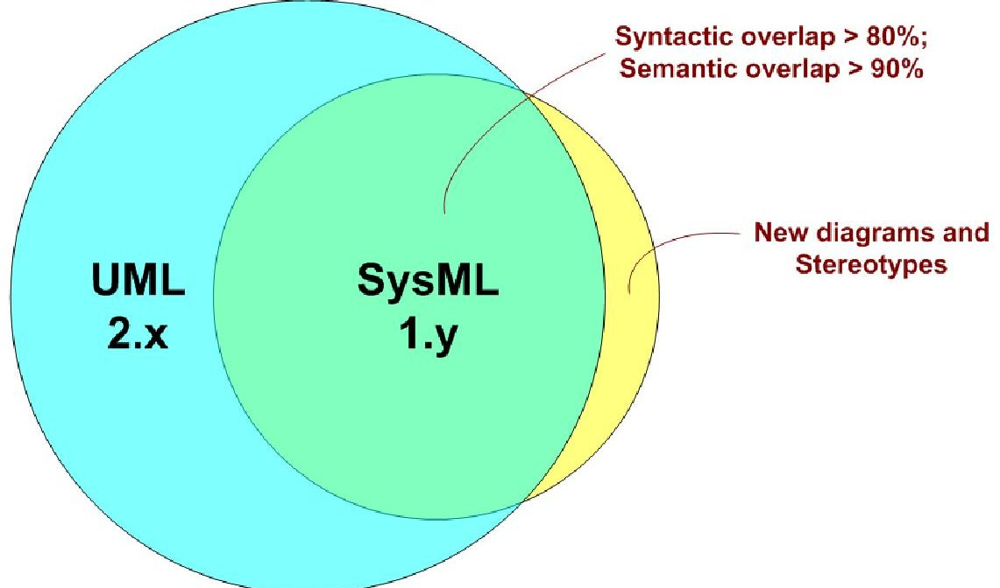


Common diagrams: Activity, Block Definition (UML2::Class), Internal Block (UML2::Composite Structure), Sequence, State Machine, Use Case

New SysML diagrams: Requirement, Parametric

<div align="center">

Figure 2.1: Relation of SysML Dialect to UML

</div>

SysML consists of nine diagram types distributed over four pillars, namely Structure, Behavior, Parametrics and Requirements. Figure 2.2 shows the SysML diagram taxonomy. Detailed description of the all the diagrams are presented in the methodology chapter.

<!-- PDF_PAGE: 19 -->


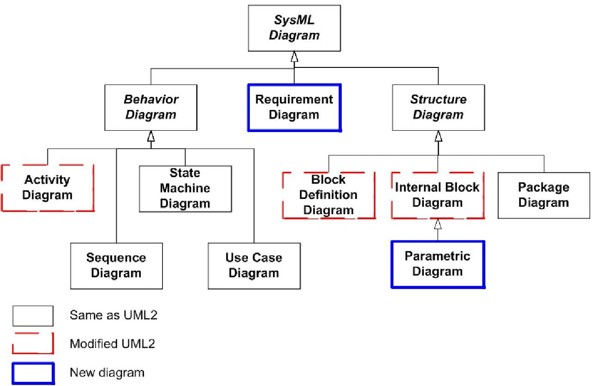


<div align="center">

Figure 2.2: SysML Diagram Taxonomy

</div>

## 2.2 Recent research on SysML Executable Modeling

Tsadimas et al. presented the transformation procedure of Enterprise Information System (EIS) SysML models to executable simulation code(Tsadimas et al., 2016). The author used QVT as the transformation tool. The paper also demonstrated how simulation results can be incorporated into the source SysML model using Model Driven Architecture (MDA).

Robinson et al. introduced a new analysis framework to develop executable and objectoriented SysML models through python programming interface(Balestrini-Robinson et al., 2015). The analysis framework demonstrated a new procedure to enable rapid prototyping through the integration of SysML model and existing diagramming languages. In order to lower the financial implications, the framework used following Open Source Software (OSS)

<!-- PDF_PAGE: 20 -->

- python, MongoDB, Django, MongoEngine, OpenMDAO,RDFLib, BerkelyDB and Django Rest Framework.

Chabibi et al. presented a taxonomy of links between SysML and various simulation environments(Chabibi et al., 2015). The paper studied an integration approach of several simulation environments into a common platform and enable two-way transformation between those environments and SysML. Chabibi et al. in another paper proposed an integration of SysML and Simulink utilizing modern techniques of Model Driven Engineering (MDE)(Chabibi et al., 2016). The proposed integration approach consists of the following steps- SysML modeling of a system using SysML4Simulink profile, executable MATLAB code generation from SysML source diagrams and conducting simulation in order to verify system behavior through Simulink.

Kotronis et al. developed a framework that supports continuous performance assessment of Railway Transportation System (RTS) SysML Model(Kotronis et al., 2016). The authors used QVT for generation of executable simulation models from the RTS SysML Model. The executable simulation models are simulated in Discrete Event System Specification (DEVS) simulators and the simulation results are incorporated into the RTS SysML Model.

Cawasji and Baras studied different methods to perform integration of SysML and other simulation tools(Cawasji & Baras, 2018). Then, they proposed a new method by constructing a SysML executable model of a two-room house. They used the Functional Mock-up interface (FMI) standard to integrate the SysML model with a Modelica model. The authors exported the Modelica model as a Functional Mock-up Unit (FMU). Then, they used Simulink as an

<!-- PDF_PAGE: 21 -->

interface between the FMU and the SysML model. Finally, a trade-off analysis was run through SysML, in MATLAB, to demonstrate the decision-making capability of the proposed approach for SysML Executable Modeling.

In order to reduce the gap between high-level modeling and evaluation of system performance through simulation, Gauthier et al. proposed a Model-Driven Engineering (MDE) tooled approach for automatic system requirements validation(Gauthier et al., 2015). The OMG SysML-Modelica working group has officially adopted this integration approach as the "SysML4Modelica" profile.

Karban et al. proposed a new Executable Systems Engineering Method (ESEM) for automatic requirements verification(Karban, Jankevičius, et al., 2016). ESEM is based on executable SysML modeling patterns and consists of structural, behavioral and parametric diagrams. The authors used Magicdraw as the SysML modeling tool and Cameo Simulation Toolkit (CST) as the simulation engine. The authors developed an 8-steps method to follow for executable SysML modeling - formalizing requirements, specify design, characterize components, specify analysis context, specify operational scenarios, and specify configurations, run analysis and Evaluate Requirement Satisfaction.

Karban et al. leveraged the above mentioned ESEM in conjunction with Open source Model Based Engineering Environment (OpenMBEE) to generate systems engineering artifacts(e.g. operational concept document)(Karban, Dekens, et al., 2016). The proposed approach was applied to the Alignment Phasing System (APS) within the Thirty Meter Telescope (TMT) project (TMT International Observatory, n.d.).

<!-- PDF_PAGE: 22 -->

## 2.3 Space Situational Awareness

## 2.3.1 What is Space Situational Awareness?

Space Situational Awareness is the ability to observe, understand and predict the physical location and behavior of natural and manmade objects in orbit around the earth (Space Situational Awareness, n.d.). Space traffic (both physical and informational) are increasing at an exponential rate. Since the start of space exploration in 1957, about 5500 rockets have been launched into earth orbit, resulting in approximately 5000 satellites and 23000 debris still in space(esa, n.d.). SSA can deliver knowledge of potential threats posed to both space assets and Earth by adversaries and environments, including space weather, space debris, uncontrolled space-crafts and space weapons(Gasparini & Miranda, 2010; Kennewell & Vo, 2013). To alleviate the threats posed by these space hazards, SSA systems could detect potential collisions in advance and avoid potential accidents by enacting effective maneuver protocols(Jayaweera et al., 2011; National Research on Space Debris, Safety of Space Objects with Nuclear Power Sources on Board and Problems Relating to Their Collision with Space Debris, 2009; Neff, 2016).

## 2.3.2 Introduction to CubeSats and their usage for SSA

Small satellites generally refer to a class of spacecraft that are also termed as nanosatellites or CubeSats. CubeSats have shown promise as potentially reliable and low cost means of conducting space research. This is facilitated due to a defined and standardized spacecraft envelope which also allows commercial off the shelf (COTS) components and instruments to be assembled onto the CubeSat (Swartwout, 2013).

In addition to the aforementioned benefits offered by CubeSats, advances in sensor and guidance technology have made it possible to launch and control multiple such CubeSats cooperatively in 'swarms' in order to achieve the complex functionality of much larger spacecraft

<!-- PDF_PAGE: 23 -->

at much lower risk due to high redundancy and at relatively low costs(Puig-Suari et al., 2001). Therefore, when it comes to SSA CubeSats potentially offer two principle advantages. The first is an order of magnitude reduction in launch costs and development time and the second is an order of magnitude enhancement in coverage area. At costs similar to a conventional satellite, a swarm of tens and even hundreds of CubeSats can be launched into a large network with each CubeSat carrying sensors thus creating a very large distributed sensor system (Figure 2.3).


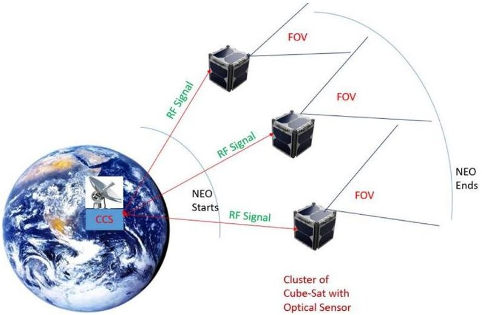


<div align="center">

Figure 2.3: Building blocks of an SSA system based on CubeSats (Chandra et al., 2018)

</div>

<!-- PDF_PAGE: 24 -->

## CHAPTER 3: METHODOLOGY

## 3.1 SysML Executable Modeling Methodology (SEMM)

Systems engineering practices involve structural, behavioral, physics and simulation-based models throughout the system life cycle in order to evaluate technical designs, support trade studies and system V&V. MBSE envisioned a shared system model with different discipline-specific models communicating information with it. Hence, the shared system model(Figure 3.1) acts as single source of truth and all disciplines "view" a consistent system model(Mbse], n.d.).


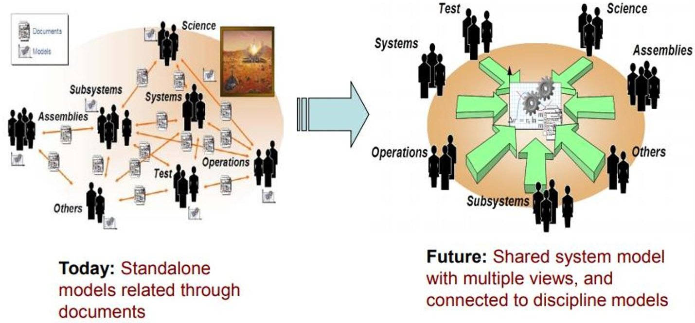


<div align="center">

Figure 3.1: Current SE Practice to Future SE Practice

</div>

In order to achieve the above-mentioned goal, instead of modeling for communication, modeling for execution is the next step towards a truly integrated system model. The following subsections describe the SysML Executable Modeling Methodology (SEMM) developed in this thesis paper.

## 3.1.1 Methodology Overview

SEMM consists of Model Ecosystem (Figure 3.2), Modeling Framework and Steps for executable Modeling. Ecosystem comprised of a System Model implemented in SysML through a COTS

<!-- PDF_PAGE: 25 -->

tool namely Cameo Systems Modeler (CSM), Analysis and simulation supporting tool namely Cameo Simulation Toolkit (CST), Supported Scripting Languages and integration with External COTS analysis and simulation tools.


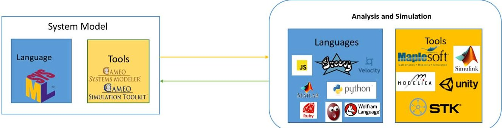


<div align="center">

Figure 3.2: SysML Executable Model Ecosystem

</div>

Table 3.1 summarises the role of different SysML diagram types for executable modeling. Details of each diagram type is presented in the next section.

<div align="center">

Table 3.1: SEMM Framework

</div>

<table border="1"><tr><td rowspan="2" colspan="2"></td><td colspan="4">Pillars</td><td rowspan="2">Executable</td></tr><tr><td>Requirements</td><td>Behavior</td><td>Structure</td><td>Parametrics</td></tr><tr><td rowspan="6"></td><td>System Requirements</td><td>Requirement Diagram, Requirement Table</td><td></td><td></td><td></td><td>Yes</td></tr><tr><td>Use Cases</td><td></td><td>Use Case Diagram</td><td></td><td></td><td>No</td></tr><tr><td>MOEs</td><td></td><td></td><td></td><td>Parametric Diagram</td><td>Yes</td></tr><tr><td>Concept of Operations</td><td></td><td>State Machine Diagram</td><td></td><td></td><td>Yes</td></tr><tr><td>System Architecture</td><td></td><td></td><td>Block Definition Diagram</td><td></td><td>No</td></tr></table>

<!-- PDF_PAGE: 26 -->

<table border="1"><tr><td rowspan="4">System Model Elements</td><td>Internal Structure</td><td></td><td></td><td>Internal Block Diagram</td><td></td><td>No</td></tr><tr><td>Subsystem Communication</td><td></td><td>Sequence Diagram</td><td>Internal Block Diagram</td><td></td><td>Yes</td></tr><tr><td>System Behavior Modeling and Analysis</td><td></td><td>Activity Diagram, State Machine Diagram</td><td></td><td>Parametric Diagram</td><td>Yes</td></tr><tr><td>Constraints</td><td></td><td></td><td></td><td>Parametric Diagram</td><td>Yes</td></tr><tr><td>Model Organization</td><td></td><td></td><td>Package Diagram</td><td></td><td>No</td></tr></table>

The following steps describe the procedure to implement the SEMM for any system of interest (SOI). For this thesis paper, a CubeSat-SSA system has been chosen as the SOI.

1. Step 1: Model Organization

2. Step 2: Defining Stakeholder Needs/System Requirements/Use Cases/Concept of Operations(ConOps)/MOEs

3. Step 3: Modeling System Architecture (Physical/Logical)/Internal Structure/Subsystem Communication

4. Step 4: Specify System Behavior Modeling and Analysis Context

5. Step 5: Integration with the COTS Analysis/ Simulation tools

6. Step 6: Run Analysis/Simulation

<!-- PDF_PAGE: 27 -->

## 3.1.2 SysML Diagrams

I. SysML Requirement Diagram: A requirement diagram represents text-based requirements and their relationships with other requirements and/or model elements, and test cases to support requirements traceability. Relationship types between requirements to requirements or other elements are containment, derive, refine, satisfy, verify and trace. Requirements table is another form of requirement diagram, which can import or export the requirements to and from an Excel sheet.

II. SysML Block Definition Diagram: Block Definition Diagram (BDD) characterizes structural elements called blocks. BDD is principally useful for representing hierarchical compositions, relationships, behavior features and classifications. A block can have different stereotypes depending on the usage. For example, System Context stereotype is frequently used for defining context of a simulation to be executed.

III. SysML Internal Block Diagram: Internal Block Diagram (IBD) represents interconnection, interfaces and ports between the parts of a block. Signals can be sent from one port to another port through connectors to depict the transfer of data between the parts.

IV. SysML Use Case Diagram: Use Case Diagram describes the relationship between the system functions and actors to visualize the use case scenarios and/or operations concepts.

V. SysML Activity Diagram: An activity diagram is used to model different types of system/component behavior with the aid of flow of inputs, outputs and control. An activity diagram also shows how the actions transform the inputs to outputs. It can be drawn using actions, controls, data flows and swim lanes. Different types of action

<!-- PDF_PAGE: 28 -->

performs different functions. For example, opaque action supports different scripting languages in order to implement the defined behavior.

VI. SysML Sequence Diagram: Sequence Diagram shows interactions through the sequence of messages exchanged between systems, parts or components. Sequence diagram can be generated automatically by making the model executable. Most commonly used diagram elements are lifelines, gate, synchronous message, asynchronous message, return message and activation options.

VII. SysML State Machine Diagram: State Machine Diagram represents behavior of a model entity through its transitions between states triggered by events/signals/values. States can have defined Behaviors for any Activities: Entry, Exit, or Do Activity. Transition between states can be triggered through guards too.

VIII. SysML Parametric Diagram: Parametric diagram represents constraints or equations to support engineering analysis, evaluation of mathematical expressions (for example, $ \mathrm{F=m^{*}a} $ ) and binding equivalent parameters. A Parametric diagram includes the usage of a constraint block to constrain the properties of another block. Constrained properties normally have simple value types that can also convey units, quantity kinds, and probability distributions.

IX. SysML Package Diagram: Package Diagram represents the organization of a system model in terms of packages that also serve as containers/folders that contain model elements. Package Diagram also help in systematic model navigation. It is a good practice to organize the model elements according to the four pillars of SysML - Requirements, Structure, Behavior and Parametric.

<!-- PDF_PAGE: 29 -->

## 3.2 Modeling and Simulation Tools

From the previous section, it is possible to integrate various COTS tools with the system model. For the scope of this thesis paper, Cameo Systems Modeler (CSM) with Cameo Simulation Toolkit (CST) plugin from Nomagic was used to create the system model(Cameo Systems Modeler, n.d.). Moreover, MATLAB and Systems Tool Kit (STK) were two other COTS simulation tools being integrated with the system model to make it executable(A. G. Inc, 2013).

## 3.2.1 Cameo Systems Modeler (CSM)

CSM is a COTS multi-platform collaborative MBSE environment, which delivers intelligence, robustness and creativity to define, track and visualize all aspects of systems in the most standard-compliant SysML models and diagrams (Cameo Systems Modeler, n.d.). In this thesis paper, the version for the CSM is 19.0 SP1 enterprise edition and operating system is Windows 10. The reasons for choosing CSM are as follows- most widely used SysML tool in the industry, ADSL lab have the commercial license for CSM and CSM comes with Cameo Simulation Toolkit (CST) plugin. CSM's User Interface (UI) consists of Main Menu, Main Toolbars, Model Browser, Diagram Pane, Diagram Palette and Quick Properties Panel (Figure 3.3). The main menu located at the top of the modeling tool window contains the following elements: File, Edit, View, Layout, Diagrams, Options, Tools, Analyze, Collaborate, Window and Help. CSM has two types of toolbars- Main toolbars and Diagram toolbars. Model Browser provides a visual representation of the hierarchy of modeled elements in a hierarchy and they can be compressed and/or expanded.

<!-- PDF_PAGE: 30 -->


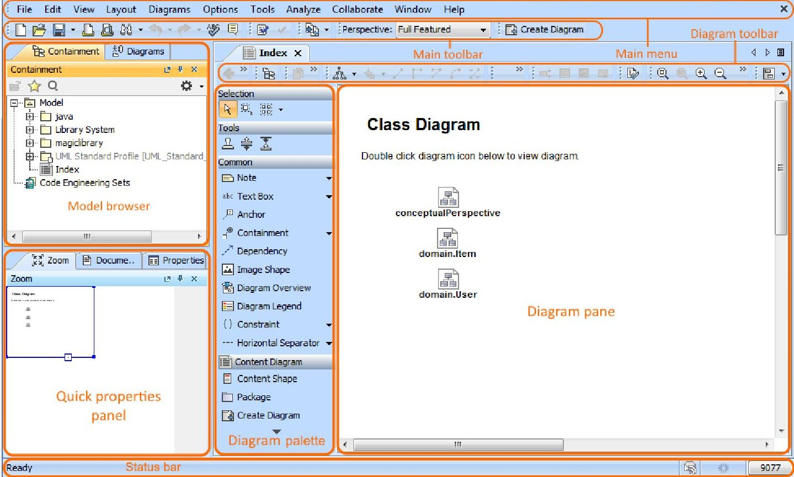


<div align="center">

Figure 3.3: Layout of the CSM User Interface (UI)

</div>

Diagram palette contains different model/diagram elements. User can drag and drop these palette elements to the diagram pane. CST is a plugin attached to the CSM in order to provide extendable model execution framework based on OMG fUML standards. fUML stands for Foundational Subset for Executable UML Models(Seidewitz & Tatibouet, 2015). fUML designates a basic virtual machine for the Unified Modeling Language, and the specific abstractions supported, facilitating acquiescent models to be transformed into various executable forms for verification, integration and deployment. CST plugin is helpful for validating system behavior and model checking by executing, animating and debugging SysML diagrams, which are made executable. CST is capable of performing activity execution, state machine execution, parametric execution, multiple action language support, model debugging, UI prototyping etc. Figure 3.4 shows the CST sessions tab.

<!-- PDF_PAGE: 31 -->


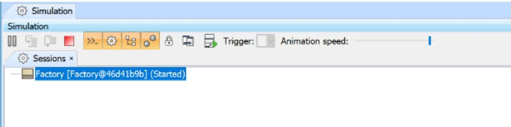


<div align="center">

Figure 3.4: Sessions Tab in CST

</div>

CST creates simulation sessions when the model is being simulated. Active elements are the elements a simulation session is currently executing (denoted by red by default). Once active elements has been simulated, they are called visited element (denoted by green by default). Orange color denotes last visited element by default. An example is shown in the Figure 3.5.


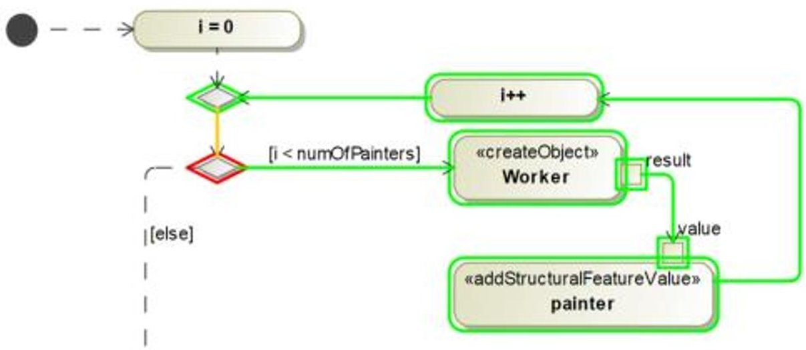


<div align="center">

Figure 3.5: Different colors denoting active, visited and last visited elements

</div>

CST also has a simulation console pane, which shows simulation information during a model simulation (Figure 3.6). Simulation console can be used to take input from the user and display the simulation results.

<!-- PDF_PAGE: 32 -->


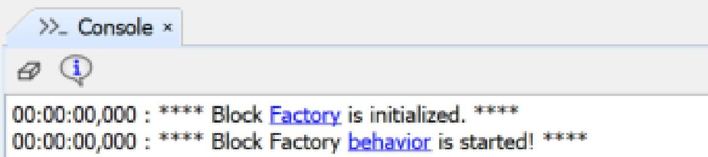


<div align="center">

Figure 3.6: Runtime Information of CST

</div>

The Variables pane shows the structure of an executing model and the runtime values during the model simulation. The pane consists of two columns - name and value. The name column depicts the context and structural features of the simulated model whereas value column represents the runtime values of those elements in the name column. Runtime values are editable if they are of the following types- Boolean, Integer, Real and String.

## 3.2.3 MATLAB

MATLAB is a multi-paradigm computing environment and programming language developed by Mathworks. With the aid of MATLAB, a user can analyze data, develop algorithms and construct models and applications. Moreover, MATLAB is one of the supported scripting languages by CSM. MATLAB supports interface to various COTS simulation tools such as STK to serve as a communication bridge between analytical and visualization engines.

## 3.2.4 Systems Took Kit (STK)

STK is a physics based 3D modeling, simulation and visualization tool used by engineers, space mission analysts, space operators and decision makers in order to model and simulate complex land, sea, air or space systems. STK supports a wide variety of environments, objects, sensors, constraints, utilities and tools, visualization, reports and graphs and other extended capabilities. STK also provides supports for modeling Space Situational Awareness (SSA) capabilities and scenarios through AdvCat analysis, access calculations software suite etc. STK also comes with STK integration plugin, which can be used to provide interface with other

<!-- PDF_PAGE: 33 -->

applications such as MATLAB and Excel. For this thesis paper, STK 11.2 was used to simulate a simple SSA scenario. An example debris cloud generated by STK is shown in Figure 3.7.


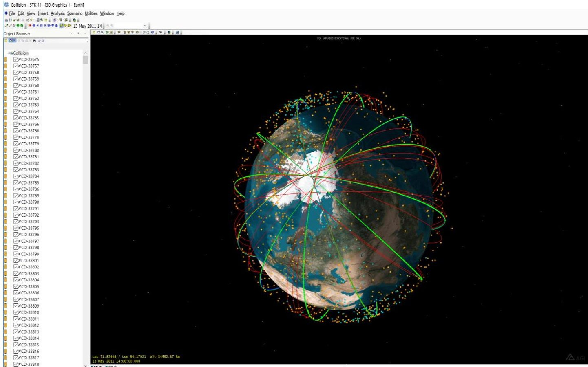


<div align="center">

Figure 3.7: A STK 3D model showing debris cloud

</div>

## 3.3 CubeSat-SSA system model by SEMM

In this section, a detail description about the SEMM steps will be discussed by constructing the CubeSat-SSA system model. In this thesis, paper, Parametric and sequence diagrams were not used hence excluded from the framework.

## Step 1: Model Organization:

The Model is organized by the package names according to the four pillars of SysML (Requirements, Structure, Behavior and Parametric). For this thesis paper, the Parametrics package was excluded, as there was no use of Parametric diagram in this particular model.

<!-- PDF_PAGE: 34 -->

SysML Requirements diagram falls under Requirements package. SysML Block Definition Diagram and SysML Internal Block Diagram reside inside Structure Package. All the behavior diagrams (SysML Activity Diagram and SysML State Machine Diagram) used in the model being placed inside Behavior Package. Further package decomposition was used for organization of the model elements inside these three major packages (Requirements, Structure and Behavior). A package groups blocks, packages and other model elements together. The packages can have dependency, generalization, realize, containment, and association relationships. Following procedures were used in CSM to add a new package in the model- Right click in the Model under containment tree, Select Create Element and Select Package as the element type.

## Step 2: Defining System Requirements/Use Cases/Concept of Operations (ConOps)

System Requirements: This thesis paper assumed preliminary stakeholder analysis and customer requirements identification already being conducted to produce the following operational requirements for the CubeSat-SSA system. The green indicated requirement has been tested for automatic verification.

OpReq01: the SSA system shall be available 24/7,365 days a year.

OpReq02: the SSA system shall continue to operate regardless of component failure but may degrade performance.

OpReq03: the SSA system shall provide equal or greater than 99 percent SSA Relevance

OpReq04: the SSA system shall meet threshold measures of effectiveness with up to 20% of sensors failed/not available.

OpReq05: the SSA system shall operate autonomously.

OpReq06: Human operator input shall always override SSA system autonomous operations.

<!-- PDF_PAGE: 35 -->

OpReq07: the SSA system shall track all objects greater than 25 cubic centimeters within 36,000 kilometers of the earth's surface.

OpReq08: the SSA system shall continuously project forward the paths of all tracked space objects 24 hours and notify of any projected collisions or near misses within that period.

OpReq09: the SSA system shall project forward the results of each projected collision and a projected near miss as if it was a collision, individually, collectively, and upon operator request any proper subset for three (3) months.

OpReq10: the SSA system shall provide an interpretation of any action taken including recommended course of action within 30 seconds of said action.

OpReq11: the SSA system shall continuously provide three (3) estimates of the situation designated 1) most likely, 2) possible, and 3) least likely including likelihood of occurrence, likelihood of aggressive action, and actions predicted for every space faring nation in the next four (4) hours for each estimate.

A SysML requirement diagram was created with the following procedures- Right Click in the Requirements package located in the contained tree, select create diagram and choose the SysML Requirement Diagram as the diagram type. Requirements table can be also selected instead of requirements diagram. Diagram specification window was used to rename the diagram as shown in Figure 3.8.

<!-- PDF_PAGE: 36 -->

## Specification of Diagram properties

Specify properties of the selected Diagram in the properties specification table. Choose the Expert or All options from the Properties drop-down list to see more properties.


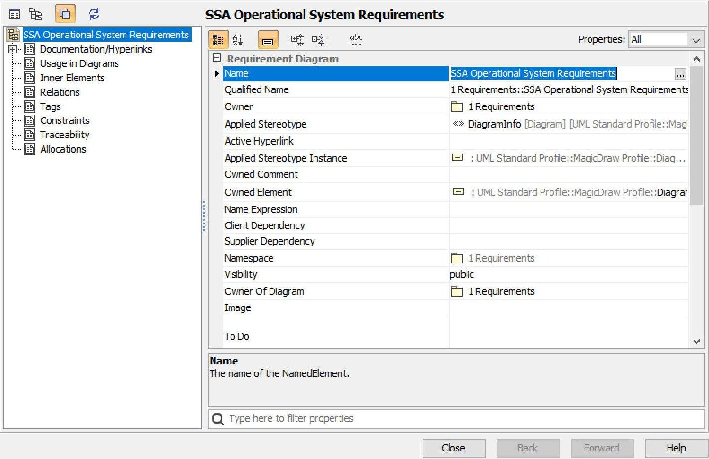


<div align="center">

Figure 3.8: SysML diagram specification window

</div>

Note, specification window is used for specifying properties of the selected diagram or element. The 11 OpReqs were created in the requirement diagram by the following steps Select a Requirement button from the diagram palette, Click on the diagram pane, type name, ID and description in the requirement shape, and repeat the steps for all the requirements. Requirements were reorganized using the containment relationship between the requirements.

<!-- PDF_PAGE: 37 -->


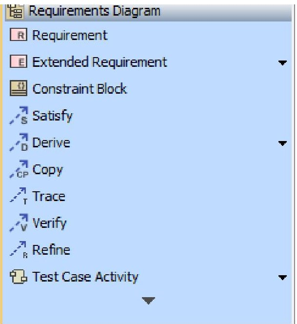


<div align="center">

Figure 3.9: Requirements Diagram Palette in CSM

</div>

Use Cases: SysML use case diagram can captures the usage of a system. Use case diagram can be added following the same procedure as other types of diagram. In this thesis paper, use cases are placed under behavior package as use case diagram falls under behavior pillar. Use case diagram consists of use cases, actors and relationships. There are four use case relationships- communication, include, extend and generalization. This thesis paper used the communication relationship to connect actors to use cases. A communication path represents an association between two entities (Figure 3.10).


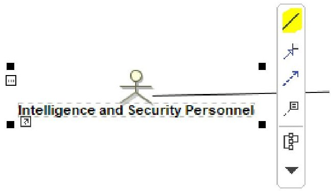


<div align="center">

Figure 3.10: Association Path from an actor (Yellow Marked)

</div>

This thesis paper used the following steps to create the use case diagram- drag & drop actors, and use cases to the diagram pane from the diagram palette, rename the actors and use cases,

<!-- PDF_PAGE: 38 -->

and connect them through association path(Figure 3.11). Association path can be shown by left click in the use case diagram elements.


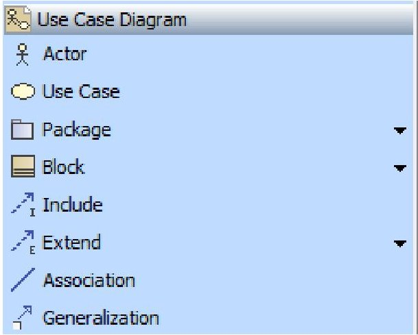


<div align="center">

Figure 3.11: Use Case Diagram Palette in CSM

</div>

Concept of Operations (ConOps): This thesis paper used SysML State machine diagram to describe the CubeSat-SSA system mission Concept of Operations (ConOps). The diagram consisted of states, nested states, transitions and signals. The states are represented by the State symbols, while arrows connecting the state symbols represent the Transitions.

Following procedures were followed to draw the SysML state machine diagram in this thesis paper- drag & drop initial state, final state and states from diagram palette to the diagram pane, renaming the states, adding transitions between the states, and adding the signals to the transitions in order to trigger the transitions. The state machine diagram palette is shown in Figure 3.12. Figure 3.13 shows the signals used to trigger transitions.

<!-- PDF_PAGE: 39 -->


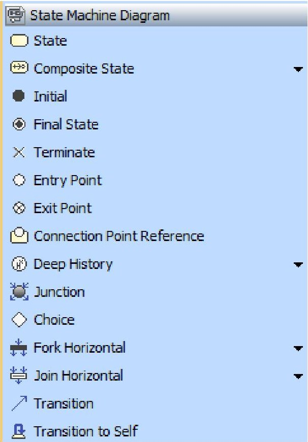


<div align="center">

Figure 3.12: State Machine Diagram Palette in CSM

</div>


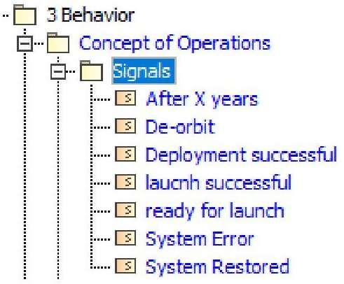


<div align="center">

Figure 3.13: Signals used to trigger transitions in the State Machine Diagram for ConOps

</div>

## Step 3: Modeling System Architecture (Physical)/Internal Structure/Subsystem Communication

SysML Block Definition Diagram was used to model Physical Architecture of the CubeSat SSA System. Moreover, the physical architecture leveraged INCOSE's CubeSat Reference Model to represent standard CubeSat components and subsystems (David Kaslow et al., 2018). SSA Domain, Mission Payload and SSA Command Data Center (SCDC) model

<!-- PDF_PAGE: 40 -->

elements were created in SysML Block Definition Diagram (BDD) to complete the CubeSat SSA systems' physical architecture. Blocks represents the system hierarchy in terms of systems and subsystems and also known as elements of definition. Figure 3.14 shows the BDD palette in CSM. Procedures to Create Block using Diagram Palette in CSM-

- If the diagram is not created, create a new SysML Block Definition Diagram. Otherwise, open the existing diagram.

- Select the Block in the diagram palette or press B.

- Select the diagram pane and type the name of the block.

- The newly created block will be also created in the containment tree of the model.


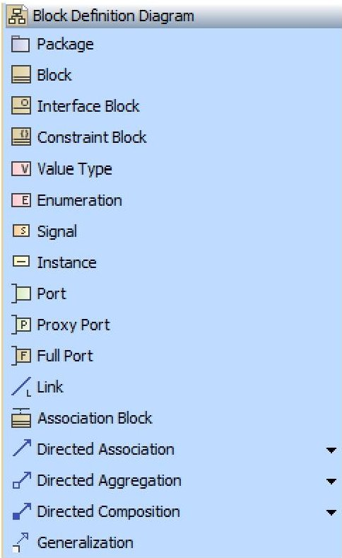


<div align="center">

Figure 3.14: Block Definition Diagram Palette in CSM

</div>

In this thesis paper, Directed composition relationship was used to convey a structural decomposition of blocks. Diagram pane was used to add the relationship between the blocks. Moreover, multiplicity can be defined in relationship properties (Figure 3.15).

<!-- PDF_PAGE: 41 -->


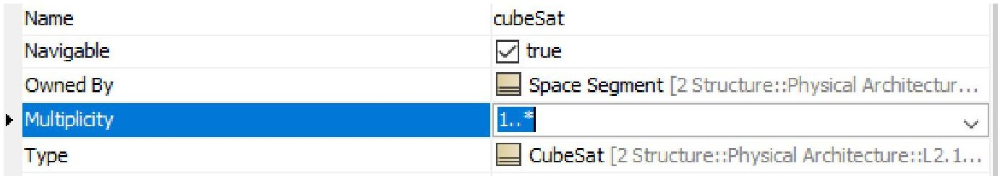


<div align="center">

Figure 3.15: Multiplicity defined for CubeSat Block

</div>

SysML Internal Block Definition (IBD) Diagram presented internal structure and subsystem communication in this thesis paper. IBD displays inner elements namely parts, ports and connectors of a block or similar classifier (Figure 3.17). Procedures to Create IBD in CSM-

- Right click on the block under which the IBD will be created,

- Select create diagram and select SysML IBD as diagram type from the options,

- A selection box will appear to choose which inner elements to show inside the IBD(Figure 3.16),

- Connectors and Ports from Diagram palette are used to convey communication between the parts displayed in the IBD,

- Blocks or signals can be used to convey item flow between the ports through connectors,

- A port can be a normal port, proxy port, full port, flow port or nested port.


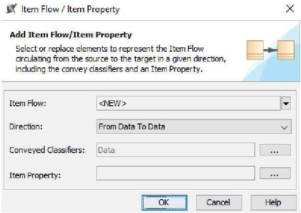


<div align="center">

Figure 3.16: Item flow add dialogue box

</div>

<!-- PDF_PAGE: 42 -->


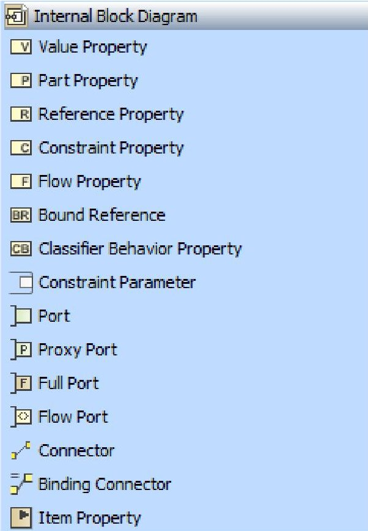


<div align="center">

Figure 3.17: Internal Block Diagram Palette in CSM

</div>

## Step 4: Specify System Behavior Modeling and Analysis Context

In order to model system behavior and perform analysis, this thesis paper specified context. System context, which is a special type of block, defined those context of each of the three scenario defined in the CubeSat-SSA system model. System context blocks have a classifier behavior and owned behaviors. Classifier behavior specifies the primary behavior of the system context. Owned behaviors include classifier behavior and all other behaviors being called by or connected to the classifier behavior itself. System context are added following the same procedures as block. Classifier Behavior is set by going to the "System Context element" properties. In this thesis paper, activity and state machine diagrams were used to define system behavior for analysis/simulation purpose. Figure 3.18 through 3.21 show the system contexts defined in the CubeSat-SSA Model.

<!-- PDF_PAGE: 43 -->

Close Approach

Close_Approach

Close_Approach(classifier behavior)

Scenario 3

CubeSat-SSA Architecture Evaluation

Relations

SSA Relevance

SSA_Relevance_Calculator

<div align="center">

Figure 3.18: System Context for each of the scenario defined in the Model

</div>


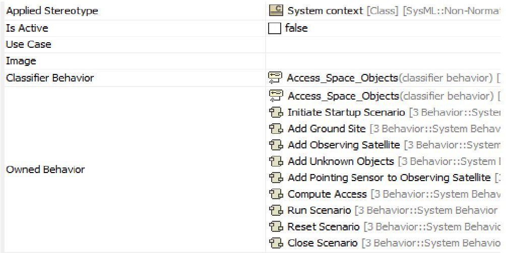


<div align="center">

Figure 3.19: Classifier and Owned Behaviors of Access_Space_Objects Context

</div>

<table border="1"><tr><td>Applied Stereotype</td><td>System context [Class] [SysML::Non-Normative Exter</td></tr><tr><td>Is Active</td><td>false</td></tr><tr><td>Use Case</td><td></td></tr><tr><td>Image</td><td></td></tr><tr><td>Classifier Behavior</td><td>Close_Approach(classifier behavior)[3 Behavior::S...</td></tr><tr><td>Owned Behavior</td><td>Close_Approach(classifier behavior)[3 Behavior::Syst
Run Close Approach Scenario[3 Behavior::System Be</td></tr></table>

<div align="center">

Figure 3.20: Classifier and Owned Behaviors of Close Approach Context

</div>

<table border="1"><tr><td>Applied Stereotype</td><td>System context [Class] [SysML::Non-Normative Extent]</td></tr><tr><td>Is Active</td><td>false</td></tr><tr><td>Use Case</td><td></td></tr><tr><td>Image</td><td></td></tr><tr><td>Classifier Behavior</td><td>SSA_Relevance_Calculator [3 Behavior::System Be...</td></tr><tr><td>Owned Behavior</td><td>SSA_Relevance_Calculator [3 Behavior::System Behavi</td></tr></table>

<div align="center">

Figure 3.21: Classifier and Owned Behavior of SSA_Relevance Context

</div>

Value properties were added to the System Context in order to provide input and accept output from the external Analysis/Simulation tools.

<!-- PDF_PAGE: 44 -->


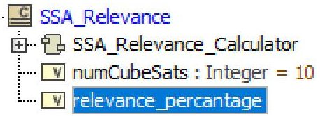


<div align="center">

Figure 3.22: Value Properties of the SSA_Relevance system context

</div>

In the Figure 3.22, relevance_percantage value was not populated initially because it would be populated by the simulation result of an external MATLAB script.

## Step 5: Integration with the COTS Analysis/Simulation tools

After defining the System context and corresponding behaviors for each of the scenarios to be simulated, the next step was to integrate the COTS tools (MATLAB and STK) with those behaviors. An activity diagram consists of different types of action elements(Figure 3.23). Following are the ones used in this thesis paper to facilitate the integration process.

Opaque Action- Opaque action have an additional property namely "Body and Language" in the specification window. This property supports a wide variety of programming languages including MATLAB, Javascript and Python.

Read Structural Feature Action- This is a type of action that retrieves the values of a structural feature including value properties.

Read Self Action- This is a type of Action that retrieves the context object of the behavior execution within which the Read Self Action execution is taking place.

<!-- PDF_PAGE: 45 -->


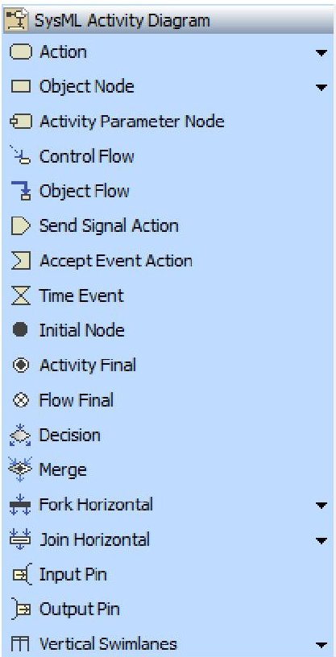


<div align="center">

Figure 3.23: Activity Diagram Palette in CSM

</div>

Opaque actions were added to the activity diagram pane by right-click in the Action button and selecting Opaque Action. By selecting the Any Action command, "Select Action Metaclass dialog" was opened and both the "read structural feature" and "read self" actions were selected from that list. Figure 3.24 shows the action selection process in CSM.


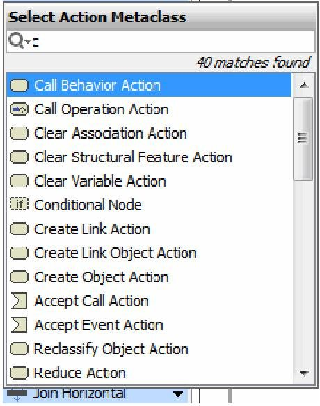


<div align="center">

Figure 3.24: Select Action Metaclass

</div>

<!-- PDF_PAGE: 46 -->

By specifying the MATLAB script name in the Opaque action's Body field, in can be run from CSM instead of opening the MATLAB application separately (Figure 3.25).


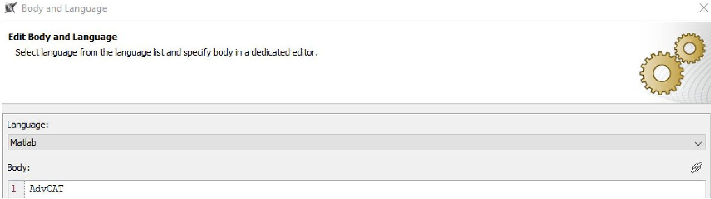


<div align="center">

Figure 3.25: AdvCAT script defined in the Opaque action for Close Approach

</div>

Input pin, output pin and object flow were used to flow the value property between actions in an activity diagram. CSM does not allow integration of Systems Tool Kit (STK), which is a widely used space mission analysis tool. STK was run from CSM via MATLAB scripts. STK and MATLAB interoperate with each other through STK's COM interface. This thesis performed close approach analysis by automating STK's AdvCAT object in MATLAB and called that script from the CubeSat-SSA system Model. In order to analyze the close approach between primary (a satellite of interest) and secondary objects (Objects that present a threat of collision),


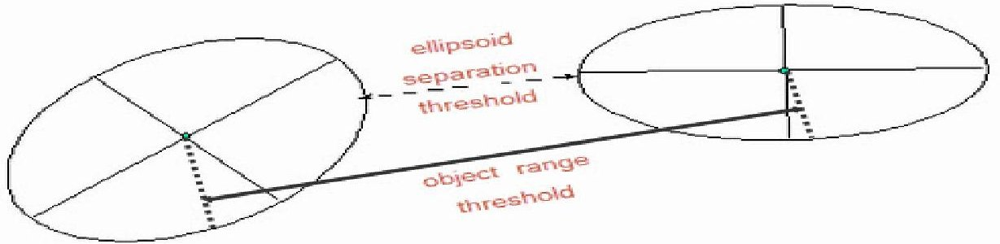


<div align="center">

Figure 3.26: Range between threat volumes of orbiting bodies

</div>

STK's AdvCAT assign a threat volume for each of the objects under consideration. AdvCAT calculates the range between the threat volumes of the two objects and zero or negative range

<!-- PDF_PAGE: 47 -->

means a collision event has occurred(Advanced CAT, n.d.). STK_Relevance's classifier behavior used a MATLAB function script, which automated and modified the SSA relevance function defined in a previous research. In that research work, authors used SSA relevance measures of effectiveness for comparing SSA system architectures using a network of CubeSats(Chandra et al., 2018). However, the authors were forced to run the MATLAB script independently due to the non-executable nature of the model they defined.

## Step 6: Run Analysis/Simulation

The final step of the SEMM was to run Analysis/Simulation from the CubeSat-SSA system Model. Each of the three scenarios defined using system context and associated behavior diagrams were run using Cameo Simulation Toolkit. An important note to consider before running the scenario was to make sure the simulation was run with context. The following procedures were followed to run with system context-

- Selecting the System context of interest

- Right clicking and selecting simulation

- After that clicking the run(Figure 3.27)

<!-- PDF_PAGE: 48 -->


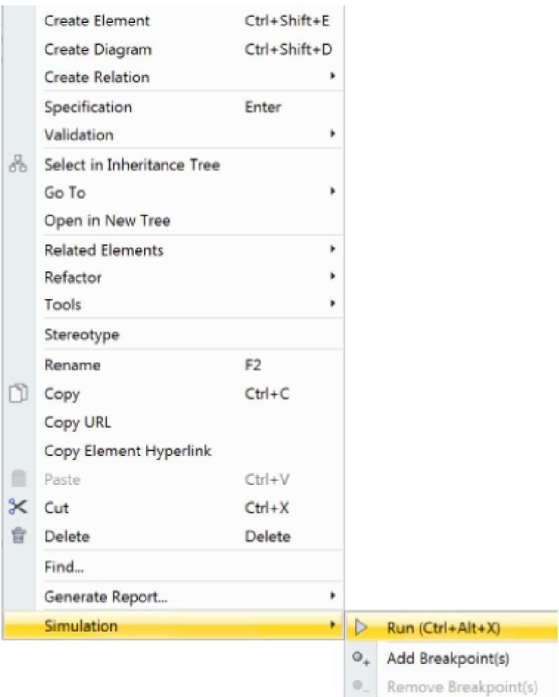


<div align="center">

Figure 3.27: Simulation setup in CSM

</div>

As the system was run with system context, all the value properties attached to the system context showed up in the variables palette, as shown in Figure 3.28.


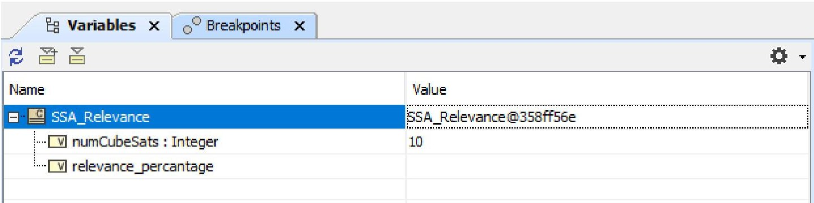


<div align="center">

Figure 3.28: Variable Palette for SSA Relevance Scenario

</div>

<!-- PDF_PAGE: 49 -->

## CHAPTER 4: RESULTS AND DISCUSSIONS

## 4.1 Results

This section presents the Executable CubeSat-SSA SysML Model being developed following the SysML Executable Modeling Methodology (SEMM) described in the previous chapter. Table 4.1 summarizes the SEMM Framework for CubeSat-SSA system Model.

<div align="center">

Table 4.1: SEMM framework for CubeSat-SSA system model

</div>

<table border="1"><tr><td rowspan="2" colspan="2"></td><td colspan="4">Pillars</td><td rowspan="2">Executable</td></tr><tr><td>Requirements</td><td>Behavior</td><td>Structure</td><td>Parametrics</td></tr><tr><td rowspan="6">System Model Elements</td><td>System Requirements</td><td>Requirement Diagram</td><td></td><td></td><td></td><td>Yes</td></tr><tr><td>Use Cases</td><td></td><td>Use Case Diagram</td><td></td><td></td><td>No</td></tr><tr><td>Concept of Operations</td><td></td><td>State Machine Diagram</td><td></td><td></td><td>Yes</td></tr><tr><td>System Architecture</td><td></td><td></td><td>Block Definition Diagram</td><td></td><td>No</td></tr><tr><td>Internal Structure</td><td></td><td></td><td>Internal Block Diagram</td><td></td><td>No</td></tr><tr><td>Subsystem Communication</td><td></td><td></td><td>Internal Block Diagram</td><td></td><td>No</td></tr><tr><td></td><td>System Behavior Modeling and Analysis</td><td></td><td>Activity Diagram, State Machine Diagram</td><td></td><td></td><td>Yes</td></tr></table>

<!-- PDF_PAGE: 50 -->

<table border="1"><tr><td></td><td>Model Organization</td><td></td><td>Package Diagram</td><td></td><td>No</td></tr></table>

The model did not use SysML Parametric diagram hence the parametric package was excluded and all the model elements were organized in the containment tree using packages (Figure 4.1).


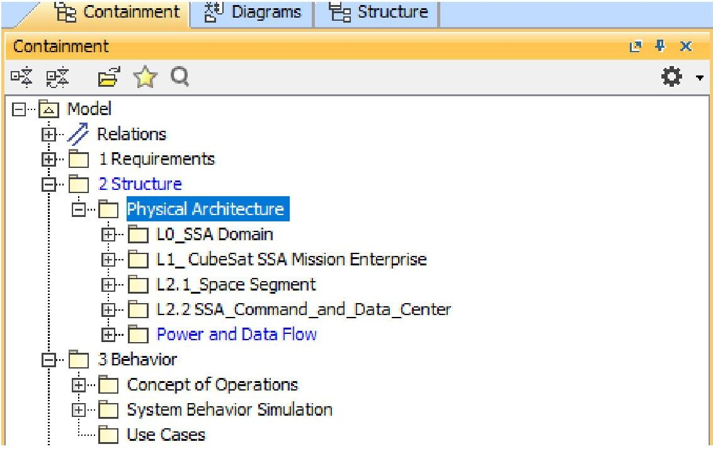


<div align="center">

Figure 4.1: Model Containment Tree showing Packages

</div>

SysML Requirement Diagram represented the operational requirements for CubeSat-SSA system (Figure 4.2). One of the requirements had satisfy relationship with a parameter namely coverage percentage. Later in the modeling work, executable modeling approach facilitated automatic requirements verification in order to verify that particular requirement.

<!-- PDF_PAGE: 51 -->


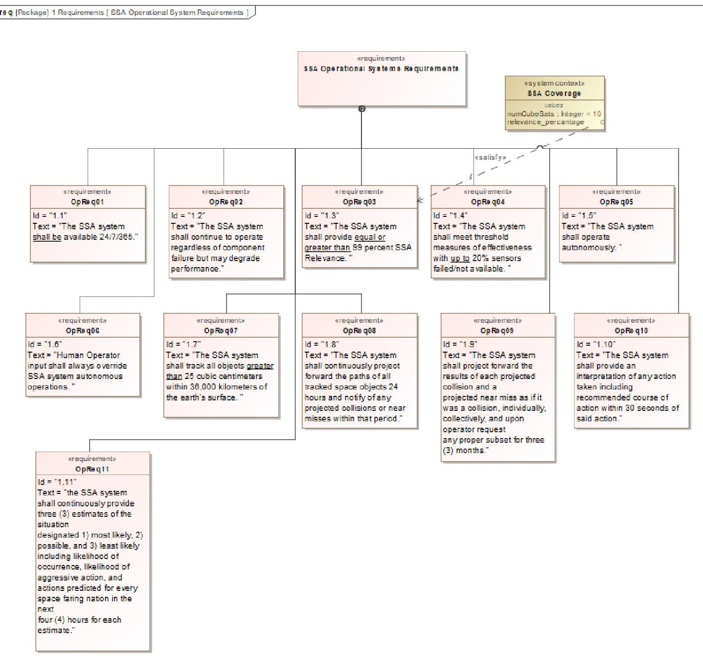


<div align="center">

Figure 4.2: Operational Requirements for CubeSat-SSA System

</div>

The model also contain concept of operations for CubeSats and use cases for CubeSat-SSA system under behavior package. SysML state machine diagram pictured the Concept of Operations and use cases were captured using SysML use case diagram. The CubeSat-SSA use case for this thesis is shown in Figure 4.3 and the ConOps is shown in Figure 4.4.

<!-- PDF_PAGE: 52 -->


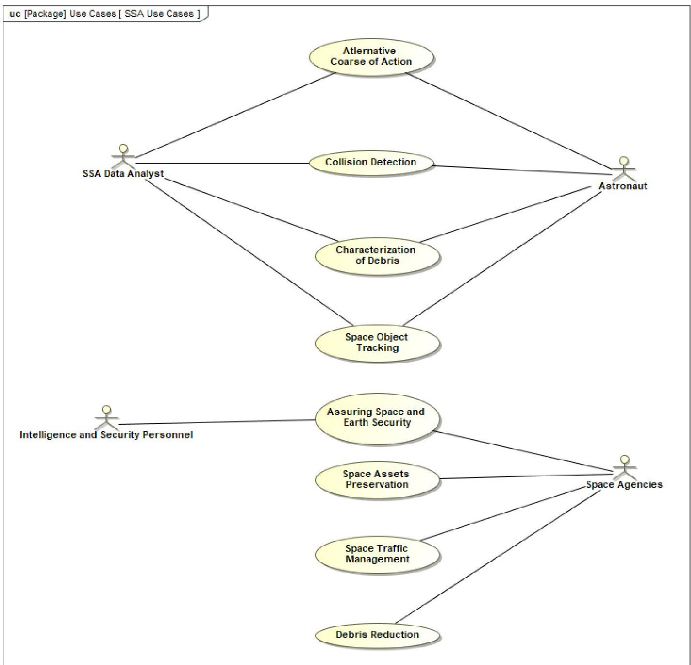


<div align="center">

Figure 4.3: CubeSat-SSA system use cases

</div>

<!-- PDF_PAGE: 53 -->


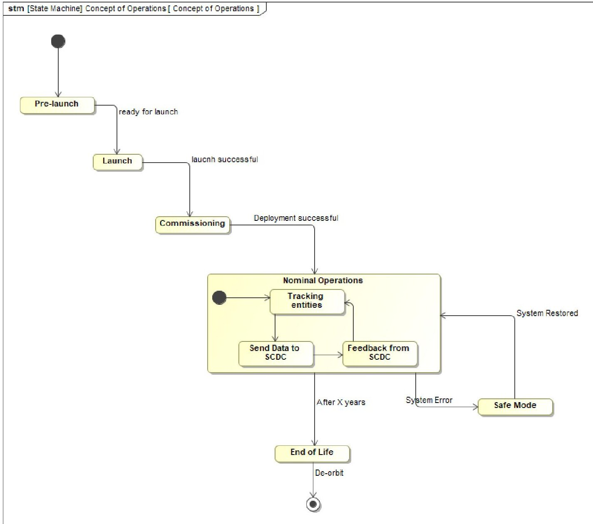


<div align="center">

Figure 4.4: CubeSat Concept of Operations (ConOps)

</div>

SysML Block Definition Diagrams represented the physical architecture of the model. SSA Domain comprises of Artificial Space Objects, Natural Space Objects, Orbital Debris and Space Weather. CubeSat SSA System Architecture falls under Artificial Space Objects. CubeSat-SSA System Architecture consists of Space Segment, SSA Command and Data Centre, Command and Data Centre Sevices, Transport, Launch and Deployment Services and GPS. Space segment and SSA Command and Data Centre were further decomposed into subsystems. CubeSats alongside their orbits have one to many relationships with the space

<!-- PDF_PAGE: 54 -->

segment (1...*), which indicates multiplicity. Figure 4.5 through 4.11 shows the CubeSat-SSA system architecture.


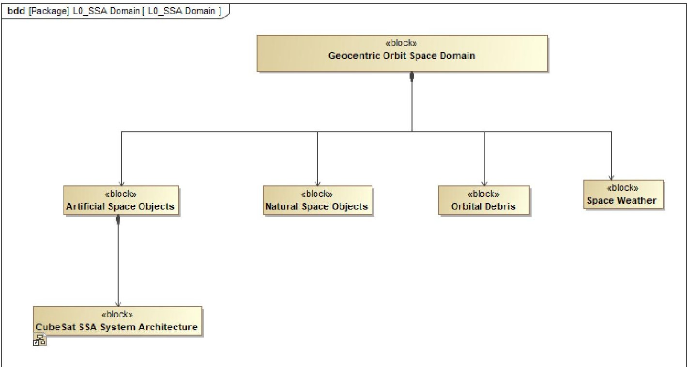


<div align="center">

Figure 4.5: SSA Domain

</div>


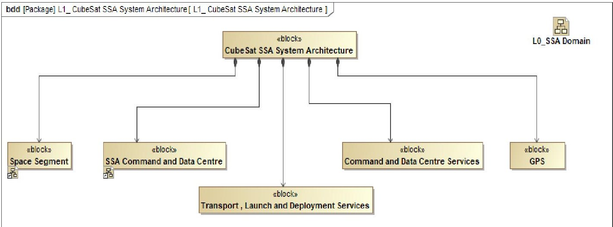


<div align="center">

Figure 4.6: CubeSat SSA System Architecture

</div>

A CubeSat includes SSA Mission Payload, Communication Subsystem, Power Subsystem, Propulsion Subsystem, Command and Data Handling Subsystem, Attitude Determination and

<!-- PDF_PAGE: 55 -->

Control Subsystem, and Structures and Mechanisms Subsystem. Optical sensor, Camera. Image processor and GPS Receiver and Antenna are part of SSA Mission Payload.


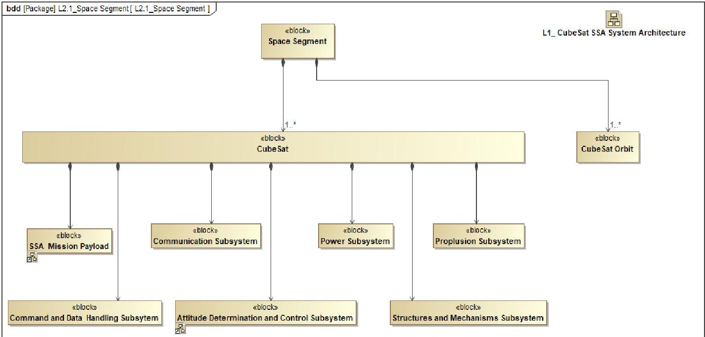


<div align="center">

Figure 4.7: Space Segment

</div>


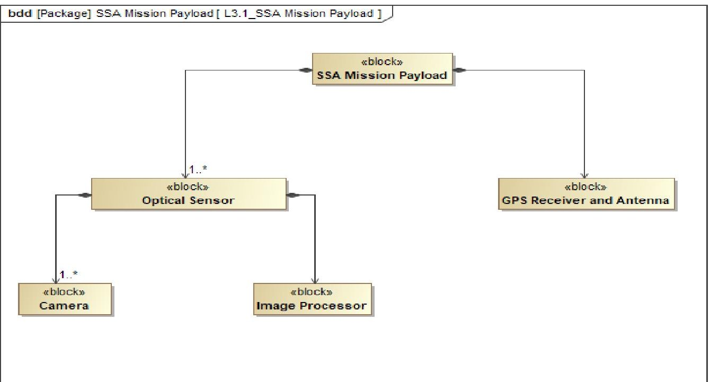


<div align="center">

Figure 4.8: SSA Mission Payload

</div>

Attitude Determination and Control Subsystem consists of Software, Actuator, Sensor and Shared Processor/Memory. SSA Command and Data Center comprises of Plan and Schedule

<!-- PDF_PAGE: 56 -->

Subsystem, CubeSat Command Subsystem, Space-Ground Communication Subsystem, Ground Equipment Control Subsystem, Network Subsystem, Facilities Subsystem, SSA Data Processing Subsystem and SSA Data Dissemination Subsystem.


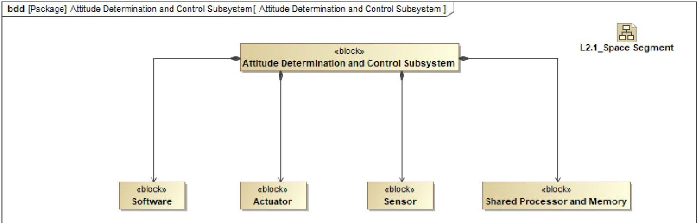


<div align="center">

Figure 4.9: Attitude Determination and Control Subsystem

</div>


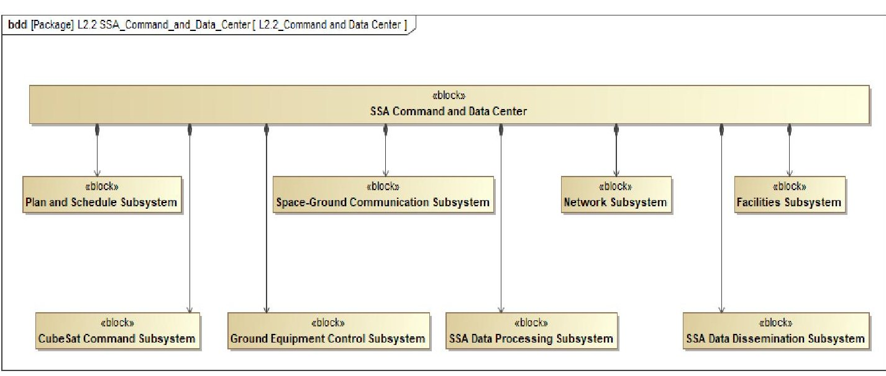


<div align="center">

Figure 4.10: SSA Command and Data Center (SCDC)

</div>

SysML Internal Block Definition Diagram in Figure 4.11 shows the simple representation of the command, data and power flowing between various CubeSat Subsystems and SCDC. Commands are sent from SCDC to the CubeSats in the space. CubeSats track objects, collect SSA data through SSA mission payload, and send information back to the SCDC for analysis.

<!-- PDF_PAGE: 57 -->


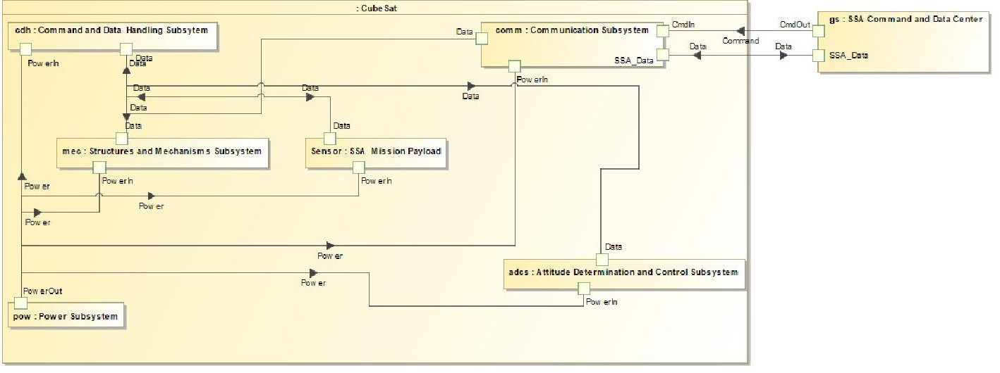


<div align="center">

Figure 4.11: Simple Communication between the subsystems

</div>

## 4.2 Illustrative Example Scenarios

The CubeSat-SSA system model is made executable through facilitating co-simulation of three different scenarios for system behavior evaluation and requirement verification. Following table summarizes the input and output flowing between the tools.

<div align="center">

Table 4.2: Summary of the three executable Scenarios

</div>

<table border="1"><tr><td>Scenario No.</td><td>Input (SysML tool to Simulation tool)</td><td>Simulation Tool Used</td><td>Feedback to SysML/Result</td></tr><tr><td>1</td><td>Satellite Parameters, Number of Unknown Objects, Orbit Parameters</td><td>MATLAB, STK</td><td>Access times for the unknown objects returned to SysML Model</td></tr><tr><td>2</td><td>TLE Database Parameters, Satellite Parameters</td><td>MATLAB, STK</td><td>Collusion Warnings write to a Excel file</td></tr></table>

<!-- PDF_PAGE: 58 -->

<table border="1"><tr><td>3</td><td>Number of CubeSats</td><td>MATLAB</td><td>Relevance Percentage is returned to the SysML Model for automatic requirements verification</td></tr></table>

## Scenario 1: Access to Space Objects

The scenario utilizes co-simulation in STK to visualize the scenario and calculate the results. In this scenario, an observation satellite (CubeSat) tracks 10 unknown objects. A pointing sensor is attached to the observation satellite, namely ADSLSat. Random creation of the unknown objects is based on the following assumptions- radius of earth is 6371 km, low earth orbit range from 100 to 2000 km, minimum semi major axis is 6471 km and maximum semi major axis is 8371 km. The scenario return the access values (access start times and access stop times) for each of the unknown object. When the scenario is simulated, the pointing sensor points to the closest unknown object it has access. The scenario can be run/reset/closed solely from SysML model without opening the STK application. Moreover, STK returns access values to the SysML model through CST console via MATLAB programming interface (Figure 4.12). Code snippets for scenario 1 is attached in the Appendix section. Scenario start time and stop time were chosen arbitrarily.

<!-- PDF_PAGE: 59 -->


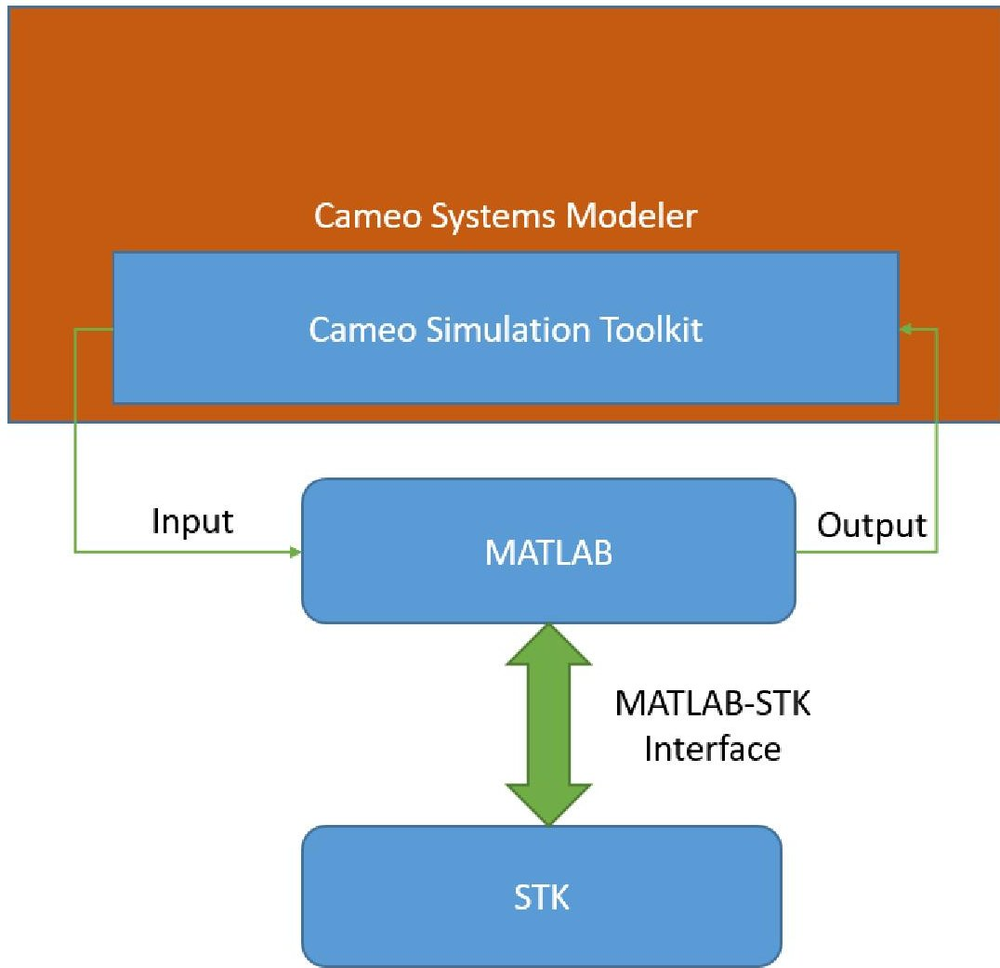


<div align="center">

Figure 4.12: Interaction between CSM and STK for Scenario 1

</div>

<!-- PDF_PAGE: 60 -->


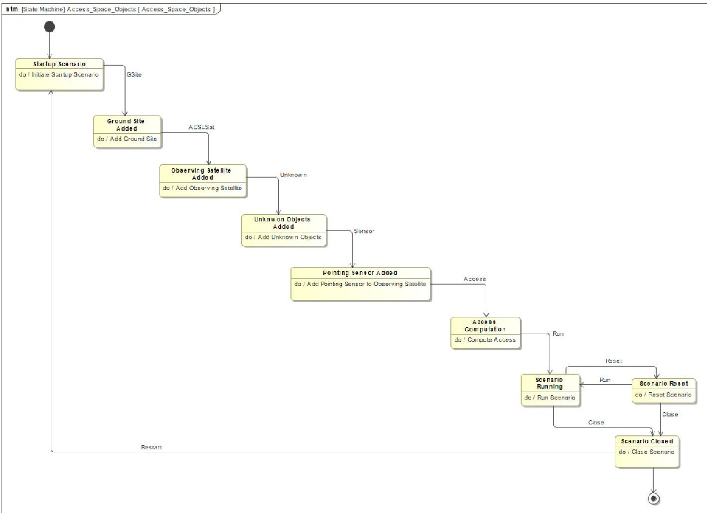


<div align="center">

Figure 4.13: State Machine Diagram to Control the STK Simulation

</div>

SysML state machine diagram worked perfectly to create the scenario in STK by a systematic process with signals and triggers (Figure 4.13). For example, when the "Access Computation" state is running in CST, STK 3D model send all the access data to the CST console in real time (Figure 4.14).

Sample Access data send back from STK to the model (Table 4.3):

Scenario Start Time and Stop Time= '01 Jan 2020 12:00:00.000','02 Jan 2020 12:00:00.000'

<div align="center">

Table 4.3: Access Data for UnknownObject-1

</div>

<!-- PDF_PAGE: 61 -->

<table border="1"><tr><td>accessStartTimes=</td><td>accessStopTimes=</td></tr><tr><td>'1 Jan 2020 12:00:00.000000000'</td><td></td></tr><tr><td>'1 Jan 2020 12:11:58.357663784'</td><td>'1 Jan 2020 12:02:41.758433638'</td></tr><tr><td>'1 Jan 2020 13:18:58.119675616'</td><td>'1 Jan 2020 12:15:47.351137812'</td></tr><tr><td>'1 Jan 2020 13:39:03.419620728'</td><td>'1 Jan 2020 13:32:13.300570010'</td></tr><tr><td>'1 Jan 2020 13:50:32.936879314'</td><td>'1 Jan 2020 13:49:44.926113598'</td></tr><tr><td>'1 Jan 2020 15:12:49.620110263'</td><td>'1 Jan 2020 14:04:21.668180498'</td></tr><tr><td>'1 Jan 2020 16:43:16.273089819'</td><td>'1 Jan 2020 15:47:32.110270365'</td></tr><tr><td>'1 Jan 2020 16:52:01.809782109'</td><td>'1 Jan 2020 16:45:27.863318879'</td></tr><tr><td>'1 Jan 2020 18:13:14.811933913'</td><td>'1 Jan 2020 17:29:13.674747901'</td></tr><tr><td>'1 Jan 2020 18:26:46.624616367'</td><td>'1 Jan 2020 18:13:39.897328628'</td></tr><tr><td>'1 Jan 2020 19:43:35.326831050'</td><td>'1 Jan 2020 19:10:05.430975336'</td></tr><tr><td>'1 Jan 2020 20:04:34.552219114'</td><td>'1 Jan 2020 19:44:05.932690028'</td></tr><tr><td>'1 Jan 2020 21:14:00.358736222'</td><td>'1 Jan 2020 20:49:56.678525785'</td></tr><tr><td>'1 Jan 2020 21:44:09.941093870'</td><td>'1 Jan 2020 21:14:31.628248084'</td></tr><tr><td>'1 Jan 2020 22:44:28.515324492'</td><td>'1 Jan 2020 22:28:06.848430790'</td></tr><tr><td>'1 Jan 2020 23:24:45.558168426'</td><td>'1 Jan 2020 22:44:57.117575478'</td></tr><tr><td>'2 Jan 2020 01:06:07.792854439'</td><td>'2 Jan 2020 00:03:38.529963003'</td></tr><tr><td>'2 Jan 2020 01:45:49.743925715'</td><td>'2 Jan 2020 01:36:19.754670492'</td></tr><tr><td>'2 Jan 2020 02:48:42.025180287'</td><td>'2 Jan 2020 01:48:34.179855748'</td></tr><tr><td>'2 Jan 2020 03:12:45.721605825'</td><td>'2 Jan 2020 03:06:43.494597009'</td></tr><tr><td>'2 Jan 2020 03:16:15.132396023'</td><td>'2 Jan 2020 03:15:05.406456251'</td></tr></table>

<!-- PDF_PAGE: 62 -->

'2 Jan 2020 03:25:17.110204432'

'2 Jan 2020 04:46:40.815624282'

'2 Jan 2020 06:17:06.879424037'

'2 Jan 2020 06:25:20.072392071'

'2 Jan 2020 07:47:10.533856809'

'2 Jan 2020 09:17:27.343980124'

'2 Jan 2020 03:22:38.885501700'

'2 Jan 2020 07:59:00.366233024'

'2 Jan 2020 09:36:02.785285789'

'2 Jan 2020 10:47:51.507040176'

'2 Jan 2020 03:33:30.201263784'

'2 Jan 2020 11:15:13.549155926'

'2 Jan 2020 05:17:54.492905607'

'2 Jan 2020 06:22:33.684029970'

'2 Jan 2020 06:59:53.537567630'

'2 Jan 2020 07:47:30.609830242'

'2 Jan 2020 08:40:59.590010660'

'2 Jan 2020 09:17:57.122459887'

'2 Jan 2020 10:21:11.273617915'

'2 Jan 2020 10:48:22.874491437'

'2 Jan 2020 11:59:56.804967151'


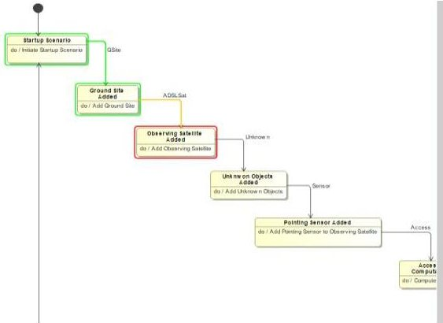


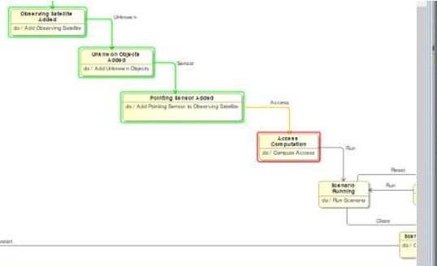


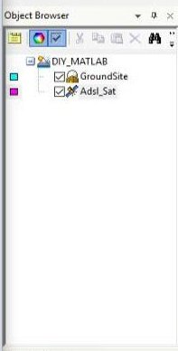


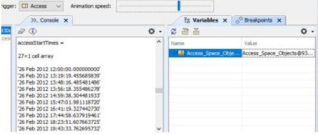


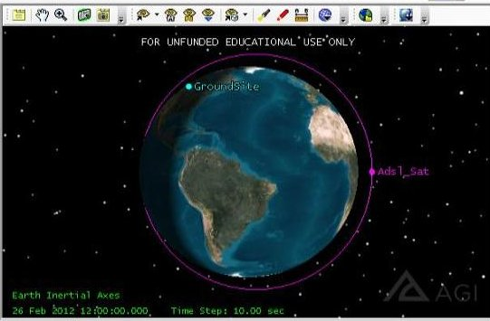


3D Graphic... 2D Graphic...


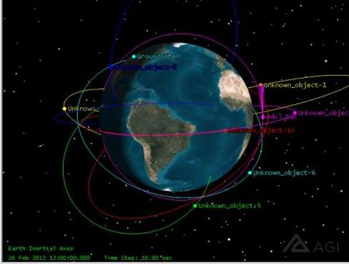


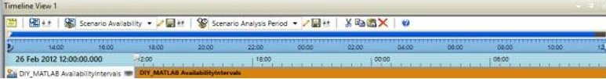


<!-- PDF_PAGE: 63 -->

## Scenario 2: Close Approach

In this scenario, a CubeSat namely "ADSLSat" is created using classical coordinates. By utilizing the AdvCAT object of STK, potential close proximity and encounters between "ADSLSat" and other two-line element (TLE) sets have been calculated. The scenario resides under Behavior->System Behavior Simulation package in the CubeSat-SSA system model and can be run through an executable SysML state machine diagram. System context for this scenario is "Close Approach". The scenario automatically produces two reports namely "Close Approach By Min Range" and "Encounter Warnings". The reports are also saved in separate Excel files which can be reincorporated into the model through excel sync capability of cameo simulation toolkit. Figure 4.15 shows the interaction between CSM, STK and Excel for Scenario 2.

<!-- PDF_PAGE: 64 -->


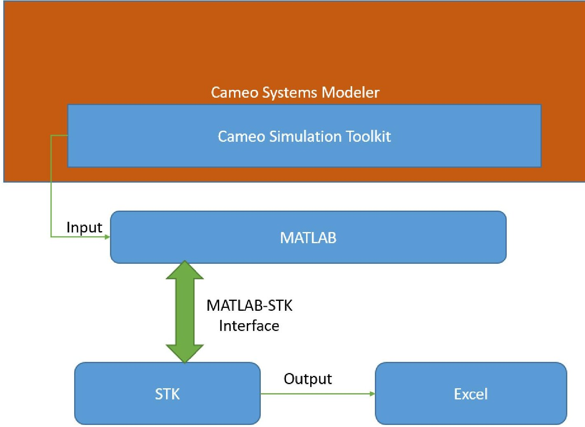


<div align="center">

Figure 4.15: Interaction between CSM, STK and Excel for scenario 2

</div>

It is possible to import the Excel file into CubeSat-SSA system model through CSV import plugin. All the detailed code snippets for this scenario are listed in the appendix section. Figure 4.16 shows the Scenario 3 in STK and Figure 4.17 shows the SysML state machine diagram to generate the Scenario.

<!-- PDF_PAGE: 65 -->


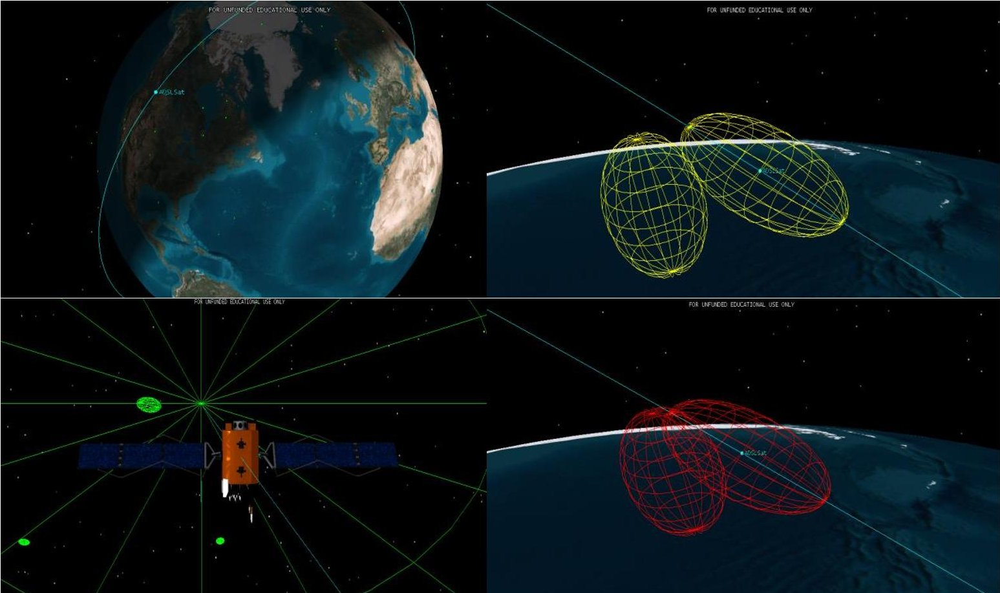


<div align="center">

Figure 4.16: Close Approach Scenario in STK run from CSM (Red-Collision, Yellow-About to Collide, Green-Safe Distance)

</div>


<div align="center">

Figure 4.17: SysML state machine diagram for close approach

</div>

<!-- PDF_PAGE: 66 -->

<div align="center">

Table 4.4 shows the sample close approach by minimum range report and Table 4.5 shows the sample encounter warnings between ADSLSat and tle 22451.

</div>

Sample Generated Reports:

Advanced CAT object: MyAdvCat

Close Approach Threshold: 10.000000 (km)

Close Approach Time Interval: 26 Dec 2019 12:00:00.000 to 27 Dec 2019 12:00:00.000

Secondaries whose SSC number match the primary SSC number have been ignored.

<div align="center">

Table 4.4: Sample Close Approach by Minimum Range Report

</div>

<table border="1"><tr><td>Object Name</td><td>Time in(UTCG)</td><td>Time Out(UTCG)</td><td>Min Sep(km)</td><td>Min Range(Km)</td></tr><tr><td>tle 38790</td><td>26 Dec 201923:21:04.826</td><td>26 Dec 201923:21:14.232</td><td>Intersect</td><td>1.529328</td></tr><tr><td>tle 29980</td><td>26 Dec 201914:59:52.204</td><td>26 Dec 201914:59:59.538</td><td>Intersect</td><td>1.554329</td></tr><tr><td>tle 15950</td><td>26 Dec 201922:33:10.785</td><td>26 Dec 201922:33:22.986</td><td>2.572370</td><td>14.237147</td></tr></table>

<!-- PDF_PAGE: 67 -->

<div align="center">

Table 4.5: Sample Encounter Warnings Report between ADSLSat and tle 22451

</div>

<table border="1"><tr><td colspan="3">CLOSE APPROACH ENCOUNTER WARNINGS</td></tr><tr><td colspan="3">-------------------------</td></tr><tr><td colspan="3">Date/Time Span of Run</td></tr><tr><td colspan="3">Start:26 Dec201912:00:00.000</td></tr><tr><td colspan="3">End:27 Dec201912:00:00.000</td></tr><tr><td colspan="3">Uncertainty Ellipsoid Surface-to-Surface Separation Distance</td></tr><tr><td colspan="3">Screening Threshold=10.0km</td></tr><tr><td colspan="3">NOTE:Relative Geometry Nomenclature:e.g.SAT#2w.r.t.SAT#1</td></tr><tr><td colspan="3">Normal:+U=SAT#2ABOVE SAT#1</td></tr><tr><td colspan="3">Tangential:+V=SAT#2AHEAD of SAT#1</td></tr><tr><td colspan="3">Cross-Track:+W=SAT#2LEFT of SAT#1</td></tr><tr><td colspan="3">Approach Angle:0deg=Overtaking</td></tr><tr><td colspan="3">180deg=Head-On</td></tr><tr><td colspan="3">Yaw locates projection of major axis onto UV plane from V</td></tr><tr><td colspan="3">Pitch locates major axis from UV plane</td></tr><tr><td colspan="3">Roll locates minor axis from W</td></tr><tr><td colspan="3">**************************</td></tr><tr><td colspan="3">Satellite #1:99999Satellite/ADSLSat</td></tr><tr><td colspan="3">Satellite #2:22451tle22451</td></tr><tr><td colspan="3">Range(km)DateTime</td></tr><tr><td colspan="3">43.0626Dec201912:16:22.103THRESHOLD ENTRY</td></tr><tr><td colspan="3">18.2526Dec201912:16:24.864CLOSEST APPROACH</td></tr><tr><td colspan="3">43.1026Dec201912:16:27.628THRESHOLD EXIT</td></tr><tr><td colspan="3">Relative POSITION at Time of Closest Approach:(18.25km)</td></tr><tr><td colspan="3">SAT#2w.r.t.SAT#1SAT#1w.r.t.SAT#2</td></tr><tr><td colspan="3">Normal[U]:-5.48km5.42km</td></tr><tr><td colspan="3">Tangential[V]:-5.68km5.64km</td></tr><tr><td colspan="3">Cross-Track[W]:16.46km16.49km</td></tr><tr><td colspan="3">Relative VELOCITY at Time of Closest Approach:(14.12km/s)</td></tr><tr><td colspan="3">Approach Angle=142.13deg</td></tr><tr><td colspan="3">SAT#2w.r.t.SAT#1SAT#1w.r.t.SAT#2</td></tr><tr><td colspan="3">Normal[U]:0.03km/s0.01km/s</td></tr><tr><td colspan="3">Tangential[V]:-13.35km/s-13.36km/s</td></tr><tr><td colspan="3">Cross-Track[W]:-4.60km/s4.57km/s</td></tr></table>

<!-- PDF_PAGE: 68 -->

## Scenario 3: CubeSat-SSA Architecture Evaluation and Automatic Requirements Verification

In this scenario, SSA Relevance function is simulated in MATLAB taking "number of CubeSats" as input from the CubeSat-SSA System Model. Note, detail about the Relevance function is discussed in the methodology section. Moreover, for simplicity number of mesh layers(3), mesh resolution(5 Degrees), analysis period(30 days),Orbit period(1 days) and time step(1 days) for analysis were kept as constant. Moreover, inertial angle, altitude, camera line of sight and camera FOV were generated randomly (details in the code snippets for the scenario). After the simulation finishes, a MATLAB plot showing SSA relevance is generated and SSA relevance percentage is returned to the CubeSat-SSA system model (Figure 4.18, 4.19).


<div align="center">

Figure 4.18: Interaction between CSM and MATLAB for Scenario 3

</div>

<!-- PDF_PAGE: 69 -->


<div align="center">

Figure 4.19: Scenario 3 run through SysML Activity Diagram

</div>

As the output value of the MATALB function i.e. relevance percentage used as input to the CubeSat-SSA System Model owned value property relevance_percentage, Operational Requirements-03 can be checked for verification. This is because OpReq03 has a satisfy relationship with the "relevance_percantage". When the "relevance_percantage" value property automatically populated, it checks whether it satisfies the requirement specified value or not. If it satisfy the linked requirement, it shows green color in the variable section of CST. If it does not satisfy the requirement, it shows red color (Figure 4.21) and a message (Figure 4.20) in the CST's console panel.


<div align="center">

Figure 4.20: Console panel showing requirements not satisfied

</div>

<!-- PDF_PAGE: 70 -->


<div align="center">

Figure 4.21: Red color indicating requirement was not satisfied

</div>

## 4.3 Discussions

Scenario 1 demonstrated how to create/run/reset a scenario from inside the SysML CubeSatSSA system model. Moreover, Access values from a known satellite to a number of unknown objects were returned to the system model automatically. Scenario 2 run the close approach (determines the potential for close proximity between a satellite and other objects in space) simulation of a defined CubeSat namely ADSLSat in STK from SysML CubeSat-SSA system model and stored the simulation results in a excel file. In the scenario 3, number of CubeSats were fed into MATLAB simulation from the SysML CubeSat-SSA system model and simulation result i.e. relevance percentage was returned to the model in order to verify a requirement. So, different CubeSat-SSA Architecture based on number of CubeSats network can be evaluated from the SysML CubeSat-SSA system model.

It was apparent that some of the SysML diagrams were not executable in nature that may change when SysML v2 will be implemented. There were some lag between the CST simulation and STK/MATLAB simulation scenario. Moreover, CSM does not support all data types as input. That was why it was not possible to return close approach report directly back

<!-- PDF_PAGE: 71 -->

to the System Model. CSV files can be uploaded into the SysML model manually using some specific steps. The process will get more convenient when CSV files can be imported via script. The SysML CubeSat-SSA system model developed in this thesis paper followed a black box approach. The purpose of the SysML model was to demonstrate how executable modeling could incorporate system design analysis/simulation and requirements verification into the model itself. Hence, the user do not need to create separate simulation parameters into a separate software as that software can be run from SysML model with the capability of defining/exchanging all the simulation parameters. Hence, SysML models alone will be sufficient for system behavior verifications. Further work needs to be done to make the integration of different COTS tools from a variety of domains with the SysML models to achieve the true purpose of MBSE.

<!-- PDF_PAGE: 72 -->

## CHAPTER 5: CONCLUSION AND FUTURE WORK

## 5.1 Conclusion

In order to achieve true Model Based Systems Engineering (MBSE), executable modeling is the next logical step. This thesis paper developed SysML Executable Modeling Methodology (SEMM). The SEMM is different from other executable modeling approaches in the following ways- does not need meta-modeling approach, use of free scripting language instead of costly COTS integration tools (e.g. Model Center) and ease of build. A CubeSat based Space Situational Awareness system model namely SysML CubeSat-SSA system Model was developed by applying the steps and framework of SEMM. The CubeSat-SSA system model consisted of three packages in the containment tree- Requirements, Structure and Behavior. Requirements package housed all the operational requirements for CubeSat-SSA system. Structure Package consisted of Physical Architecture of the CubeSat-SSA system in a leveled organization. There were three scenarios inside the Behavior Package - Access to Space Objects, Close Approach and CubeSat-SSA Architecture Evaluation and Automatic Requirements Verification. No magic's Cameo Systems Modeler (CSM) and Cameo Simulation Toolkit (CST) were used to develop the SysML CubeSat-SSA system Model. MATLAB and STK were two COTS Analysis/Simulation software packages integrated with the SysML model for running the scenarios. The interaction procedure between CSM/CST and MATLAB/STK for each scenario were also presented in this thesis paper. All three scenarios were run from SysML CubeSat-SSA system model and there were data exchange between the SysML CubeSat-SSA system model and COTS tools (STK/MATLAB).

<!-- PDF_PAGE: 73 -->

Thus, the overall thesis paper demonstrated how to make a SysML model executable in order to support design, analysis and verification activities in the early phases of the system lifecycle through enabling co-simulation.

## 5.2 Future Works

The thesis paper demonstrated SEMM through integration with MATLAB and STK only. The work will be expanded to include a variety of COTS analysis/simulation tools (including the ones showed in the SEMM ecosystem) for integration with the SysML model. In particular, Virtual Reality can play a bigger role on creating truly model centric systems engineering approaches. The core application of a MBSE approach implies utilization of a single system model, which will act as "source of truth" to all embedded system analyzing tools. Thus, the system model can communicate back and forth with a Virtual Reality (VR) environment to analyze the system performance.

<!-- PDF_PAGE: 74 -->

<div align="center">

# APPENDIX: MATLAB CODE SNIPPETS

</div>

Scenario 1:

app = actxserver ('STK11.Application');

% app.UserControl = 1;

root = app.Personality2;

Scenario = root.Children.New ('eScenario','DIY_MATLAB');

%% Scenario Time

Scenario.SetTimePeriod ('01 Jan 2020 12:00:00.000', '02 Jan 2020 12:00:00.000'); %% Set

detection time for 1 day

```javascript

root.ExecuteCommand ('Window3D * Maximize');

```

```javascript

root.ExecuteCommand ('Animate * Reset');

```

Facility = Scenario.Children.New ('eFacility', 'GroundSite');

Facility.Position.AssignGeodetic(50,-100,0);

%% Create Observation sateillite

Satellite = Scenario.Children.New('eSatellite','Adsl_Sat');

root.ExecuteCommand(['SetState */Satellite/Adsl_Sat Classical TwoBody "",

Scenario.StartTime,'' ''',Scenario.StopTime,'' 2 ICRF '', Scenario.StartTime,'' 7200000 0 90

000']); % Propagate every 2 seconds

%% Unknown objects

% Assume radius of Earth = 6371 Km

% Low Earth Orbits range from: 100 Km to 2000Km

% Min: sem-maj axis = 6471 Km, Max sem-maj axis = 8371 Km

global count;

<!-- PDF_PAGE: 75 -->

count=10;

min_a = 6471000;

max_a = 8371000;

for j = 1: count %

a_u(j) = (max_a-min_a)*rand + min_a; %[uniformly distributed semi major axis]

e_u(j) = rand; %[eccentricities in [0 to 1]

i_u(j) = 180*rand; % Uniformly distributed (UD) inclination in 0 to 180

wp_u(j) = 360*rand; % UD argument of perigee

RAAN_u(j) = 360*rand; % UD RAAN

TA_u(j) = 360*rand; % UD true anomaly

sat_name = ['Unknown_object-',num2str(j)];

Sat(j) = Scenario.Children.New('eSatellite', sat_name);

crea_com_1 = ['SetState */Satellite/',sat_name,' Classical TwoBody ''];

crea_com_2 = [Scenario.StartTime, """ "",Scenario.StopTime,"" 2 ICRF "",

Scenario.StartTime];

crea_com_3= ['" ',num2str(a_u(j)),' ',num2str(e_u(j)),' ',num2str(i_u(j))),'

',num2str(wp_u(j)),' ',num2str(RAAN_u(j)),' ',num2str(TA_u(j))];

com_test = [crea_com_1 crea_com_2 crea_com_3];

disp(com_test)

root.ExecuteCommand(com_test);

end

%Add a sensor to the Observation Satellite

<!-- PDF_PAGE: 76 -->

sensor = Satellite.Children.New('eSensor', 'Targeted');

pattern1 = sensor.Pattern;

pattern1.ConeAngle = 5;

sensor.SetPointingType('eSnPtTargeted');

pointing1 = sensor.Pointing;

for t = 1:count

    access = Satellite.GetAccessToObject( Sat(t));

    access.ComputeAccess;

    pointing1.Targets.AddObject(Sat(t));

    accessDP = access.DataProviders.Item('Access Data').Exec('01 Jan 2020 12:00:00.000','02 Jan 2020 12:00:00.000');

    fprintf('UnknownObject-%d\n',t);

    accessStartTimes = accessDP.DataSets.GetDataSetByName('Start Time').GetValues

    accessStopTimes = accessDP.DataSets.GetDataSetByName('Stop Time').GetValues

end

animation = Scenario.Animation;

animation.AnimStepValue = 7;

root.ExecuteCommand('Window3D * Maximize');

root.ExecuteCommand('Animate * Start End');

root.ExecuteCommand('Animate * Reset');

%Close Scenario

<!-- PDF_PAGE: 77 -->

uiapp.Quit;

clear uiApplication root

Scenario 2:

Scenario 2:

app = actxserver('STK11.Application');

% app.UserControl = 1;

root = app.Personality2;

Scenario = root.Children.New('eScenario','Close_Approach');

%% Scenario Time

Scenario.SetTimePeriod('26 Dec 2019 12:00:00.000','27 Dec 2019 12:00:00.000');

root.ExecuteCommand('Animate * Reset');

advCAT = Scenario.Children.New('eAdvCAT','MyAdvCat');

satellite = Scenario.Children.New('eSatellite','ADSLSat');

root.ExecuteCommand(['SetState */Satellite/ADSLSat Classical TwoBody ''',

Scenario.StartTime, "" "",Scenario.StopTime,"" 2 ICRF "", Scenario.StartTime, "" 7200000 0 90 0 0 0']);

root.ExecuteCommand('ACat */AdvCAT/MyAdvCat Primary Add "Satellite/ADSLSat''');

root.ExecuteCommand('ACat */AdvCAT/MyAdvCat Secondary Add "stkSatDbAll.tce''');

root.ExecuteCommand('ACat */AdvCAT/MyAdvCat Compute ShowProgress On');

root.ExecuteCommand('ACat */AdvCAT/MyAdvCat MsgAlertOnHit On');

animation = Scenario.Animation;

animation.AnimStepValue = 7;

root.ExecuteCommand('Animate * Start End');

<!-- PDF_PAGE: 78 -->

root.ExecuteCommand('ReportCreate */AdvCAT/MyAdvCat Type Display Style "Close

Approach By Min Range"");

root.ExecuteCommand('ReportCreate */AdvCAT/MyAdvCat Type Save Style "Close

Approach By Min Range" File "C:\Users\mostafalutfi\Desktop\Thesis Files\Close

Approach By Minimum Range.csv"");

root.ExecuteCommand('ReportCreate */AdvCAT/MyAdvCat Type Display Style

"Encounter Warnings"");

root.ExecuteCommand('ReportCreate */AdvCAT/MyAdvCat Type Save Style "Encounter

Warnings"File "C:\Users\mostafalutfi\Desktop\Thesis Files\Encounter Warnings.csv"");

<!-- PDF_PAGE: 79 -->

## REFERENCES

Advanced CAT. (n.d.). Retrieved January 13, 2020, from

http://help.agi.com/stk/index.htm#cat/Cat03.htm%3FTocPath%3DGetting%2520Started%7CPerform%2520Analysis%7CConjunction%2520Analysis%2520Tools%2520(CAT)%7CAdvanced%2520CAT%7C___0

Amissah, M., Toba, A.-L., Handley, H. A. H., & Seck, M. (2018). Towards a Framework for Executable Systems Modeling: An Executable Systems Modeling Language (ESysML). Proceedings of the Model-Driven Approaches for Simulation Engineering Symposium, 9:1-9:12. http://dl.acm.org/citation.cfm?id=3213214.3213223

Balestrini-Robinson, S., Freeman, D. F., & Browne, D. C. (2015). An Object-oriented and Executable SysML Framework for Rapid Model Development. Procedia Computer Science, 44, 423-432. https://doi.org/10.1016/j.procs.2015.03.062

Batarseh, O., & McGinnis, L. F. (2012). System modeling in SYsML and system analysis in Arena. Proceedings of the 2012 Winter Simulation Conference (WSC), 1-12. https://doi.org/10.1109/WSC.2012.6465139

Cameo Systems Modeler. (n.d.). Retrieved December 22, 2019, from

https://www.nomagic.com/products/cameo-systems-modeler

Cawasji, K. A., & Baras, J. S. (2018). SysML Executable Model of an Energy-Efficient House and Trade-Off Analysis. 2018 IEEE International Systems Engineering Symposium (ISSE), 1-8. https://doi.org/10.1109/SysEng.2018.8544402

<!-- PDF_PAGE: 80 -->

Chabibi, B., Anwar, A., & Nassar, M. (2015). Towards an alignment of SysML and simulation tools. 2015 IEEE/ACS 12th International Conference of Computer Systems and Applications (AICCSA), 1-6.

https://doi.org/10.1109/AICCSA.2015.7507216

Chabibi, B., Douche, A., Anwar, A., & Nassar, M. (2016). Integrating SysML with Simulation Environments (Simulink) by Model Transformation Approach. 2016 IEEE 25th International Conference on Enabling Technologies: Infrastructure for Collaborative Enterprises (WETICE), 148-150. https://doi.org/10.1109/WETICE.2016.39

https://doi.org/10.1109/WETICE.2016.39

Chandra, A., Lutfi, M., & Gross, D. C. (2018). Leveraging the Emerging CubeSat Reference Model for Space Situational Awareness.

Ciccozzi, F., Malavolta, I., & Selic, B. (2019). Execution of UML models: A systematic review of research and practice. Software & Systems Modeling, 18(3), 23132360. https://doi.org/10.1007/s10270-018-0675-4

DoD Modeling and Simulation (M&S) Glossary. (n.d.). Retrieved January 13, 2020, from https://apps.dtic.mil/docs/citations/ADA349800

esa. (n.d.). Space debris by the numbers. European Space Agency. Retrieved August 3, 2019, from

https://www.esa.int/Our_Activities/Space_Safety/Space_Debris/Space_debris_by_the_numbers

Estefan, J. A. (2008). Survey of Model-Based Systems Engineering (MBSE) Methodologies. 70.

<!-- PDF_PAGE: 81 -->

French, M. O. (2015, January 5). Extending Model Based Systems Engineering for

Complex Systems. 53rd AIAA Aerospace Sciences Meeting. 53rd AIAA Aerospace

Sciences Meeting, Kissimmee, Florida. https://doi.org/10.2514/6.2015-1639

Friedenthal, S., Moore, A., & Steiner, R. (n.d.). OMG Systems Modeling Language (OMG

SysML $ ^{TM} $ ) Tutorial September, 2009.132.

Gasparini, G., & Miranda, V. (2010). Space situational awareness: An overview. In W.

Rathgeber, K.-U. Schrogl, & R. A. Williamson (Eds.), The Fair and Responsible Use

of Space: An International Perspective (pp. 73-87). Springer Vienna.

https://doi.org/10.1007/978-3-211-99653-9_7

Gauthier, J.-M., Bouquet, F., Hammad, A., & Peureux, F. (2015). Tooled Process for Early

Validation of SysML Models Using Modelica Simulation. FSEN.

https://doi.org/10.1007/978-3-319-24644-4_16

Hampson, K. (2015). Technical Evaluation of the Systems Modeling Language (SysML).

Procedia Computer Science, 44, 403-412.

https://doi.org/10.1016/j.procs.2015.03.054

Hart, L. (n.d.). Introduction To Model-Based System Engineering (MBSE) and SysML. 43.

Inc, A. G. (2013, July 24). Bringing in External Data to Model Space Objects in STK.

https://vimeo.com/70964608

Inc, N. M. (n.d.). Cameo Systems Modeler. Retrieved June 19, 2020, from

https://www.nomagic.com/products/cameo-systems-modeler

Jayaweera, S. K., Erwin, R. S., & Carty, J. (2011). Distributed Space Situational Awareness

(D-SSA) with a Satellite-assisted Collaborative Space Surveillance Network. IFAC

<!-- PDF_PAGE: 82 -->

Proceedings Volumes, 44(1), 8792-8798. https://doi.org/10.3182/20110828-6- IT-1002.00258

Kapos, G., Dalakas, V., Tsadimas, A., Nikolaidou, M., & Anagnostopoulos, D. (2014). Model-based system engineering using SysML: Deriving executable simulation models with QVT. 2014 IEEE International Systems Conference Proceedings, 531538. https://doi.org/10.1109/SysCon.2014.6819307

Karban, R., Dekens, F. G., Herzig, S., Elaasar, M., & Jankevicius, N. (2016). Creating systems engineering products with executable models in a model-based engineering environment. https://trs.jpl.nasa.gov/handle/2014/46148

Karban, R., Jankevičius, N., & Elaasar, M. (2016). ESEM: Automated Systems Analysis using Executable SysML Modeling Patterns. INCOSE International Symposium, 26(1), 1-24. https://doi.org/10.1002/j.2334-5837.2016.00142.x

Kaslow, D., Soremekun, G., Kim, H., & Spangelo, S. (2014). Integrated model-based systems engineering (MBSE) applied to the Simulation of a CubeSat mission. 2014 IEEE Aerospace Conference, 1-14. https://doi.org/10.1109/AERO.2014.6836317

Kaslow, David, Ayres, B., Cahill, P. T., Hart, L., Levi, A. G., & Croney, C. (2018, September 17). Developing an MBSE CubeSat Reference Model - Interim Status #4. 2018 AIAA SPACE and Astronautics Forum and Exposition. 2018 AIAA SPACE and Astronautics Forum and Exposition, Orlando, FL. https://doi.org/10.2514/6.2018-5328

<!-- PDF_PAGE: 83 -->

Kennewell, J. A., & Vo, B. (2013). An overview of space situational awareness. Proceedings of the 16th International Conference on Information Fusion, 10291036.

Kotronis, C., Tsadimas, A., Kapos, G.-D., Dalakas, V., Nikolaidou, M., & Anagnostopoulos, D. (2016). Simulating SysML transportation models. 2016 IEEE International Conference on Systems, Man, and Cybernetics (SMC), 001674-001679. https://doi.org/10.1109/SMC.2016.7844478

Maheshwari, A., Kenley, C. R., & DeLaurentis, D. A. (2015). Creating Executable Agent Based Models Using SysML. INCOSE International Symposium, 25(1), 1263-1277. https://doi.org/10.1002/j.2334-5837.2015.00128.x

MBSE Tools-Model Based Systems Engineering. (n.d.). Retrieved January 13, 2020 from https://mbse4u.com/sysml-tools/

Mbse:breakout_session_mbse_101 [MBSE Wiki]. (n.d.). Retrieved January 5, 2020, from http://www.omgwiki.org/MBSE/doku.php?id=mbse:breakout_session_mbse_101

Model-based system engineering approach for the Euclid mission to manage scientific and technical complexity. (n.d.). Retrieved January 13, 2020, from https://www.spiedigitallibrary.org/conference-proceedings-of- spie/9911/99110C/Model-based-system-engineering-approach-for-the-Euclid mission-to/10.1117/12.2231373.full

<!-- PDF_PAGE: 84 -->

National research on space debris, safety of space objects with nuclear power sources on

board and problems relating to their collision with space debris :(2009).

http://digitallibrary.un.org/record/662743

Neff, T. (2016). Radar Based System for Space Situational Awareness. 13(4), 13.

Nikolaidou, M., Dalakas, V., & Anagnostopoulos, D. (2010). Integrating Simulation

Capabilities in SysML using DEVS.

Peak, R. S., Burkhart, R., Friedenthal, S., Wilson, M. W., Bajaj, M., & Kim, I. (2007).

Simulation-Based Design Using SysML Part 1: A Parametrics Primer.

https://doi.org/10.1002/j.2334-5837.2007.tb02964.x

Puig-Suari, J., Turner, C., & Ahlgren, W. L. (2001). Development of the standard CubeSat deployer and a CubeSat class PicoSatellite. 2001 IEEE Aerospace Conference Proceedings (Cat. No.01TH8542), 1, 1-1. https://doi.org/10.1109/AERO.2001.931726

Roques, P. (2016). MBSE with the ARCADIA Method and the Capella Tool.

Sage, A. P., & Lynch, C. L. (1998). Systems integration and architecting: An overview of principles, practices, and perspectives. Systems Engineering, 1(3), 176-227.

https://doi.org/10.1002/(SICI)1520-6858(1998)1:3<176::AID-SYS3>3.0.CO;2-L

Seidewitz, E., & Tatibouet, J. (2015). Tool Paper: Combining Alf and UML in Modeling

Tools - An Example with Papyrus -. OCL@MoDELS.

Space Situational Awareness. (n.d.). Retrieved August 4, 2019, from

https://www.spaceacademy.net.au/intell/ssa.htm

<!-- PDF_PAGE: 85 -->

Swartwout, M. A. (2013). The Long-Threatened Flood of University-Class Spacecraft (and CubeSats) Has Come: Analyzing the Numbers.

TMT International Observatory. (n.d.). TIO. Retrieved December 1, 2019, from https://www.tmt.org/

Tsadimas, A., Kapos, G.-D., Dalakas, V., Nikolaidou, M., & Anagnostopoulos, D. (2016) Simulating simulation-agnostic SysML models for enterprise information systems via DEVS. Simulation Modelling Practice and Theory, 66, 243-259. https://doi.org/10.1016/j.simpat.2016.04.001

Wagner, D. A., Bennett, M. B., Karban, R., Rouquette, N., Jenkins, S., & Ingham, M. (2012). An ontology for State Analysis: Formalizing the mapping to SysML. 2012 IEEE Aerospace Conference, 1-16. https://doi.org/10.1109/AERO.2012.6187335