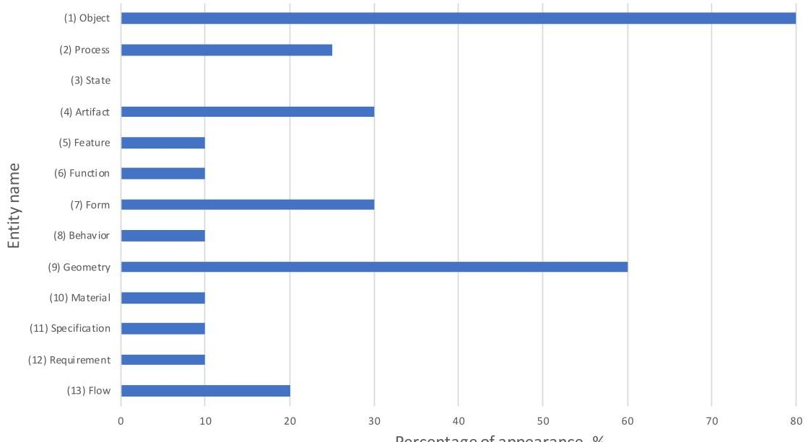
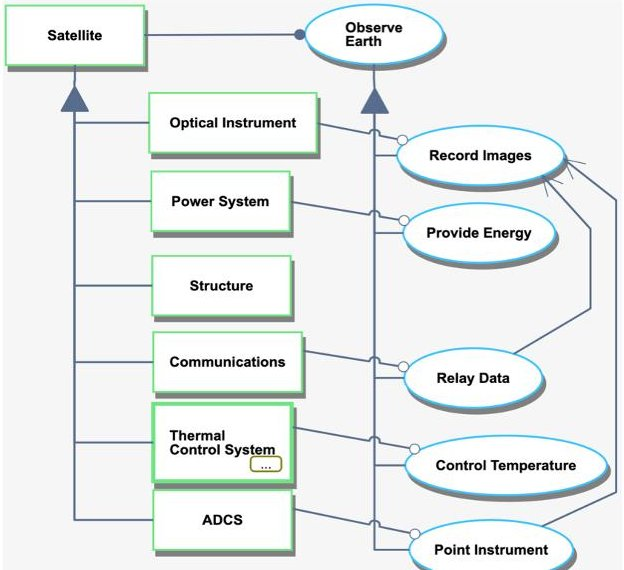
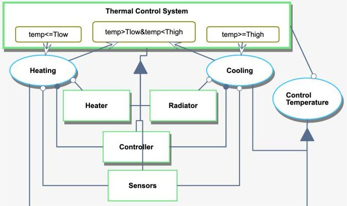
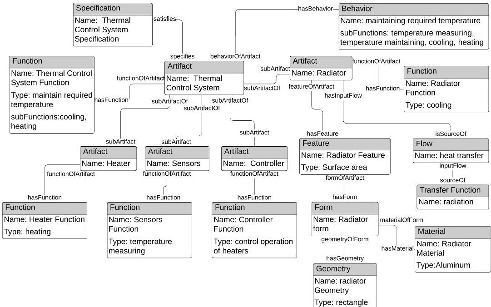

<!-- PDF_PAGE: 1 -->

# Analysis of MBSE/PLM Integration: From Conceptual Design to Detailed Design

Yaroslav Menshenin, Dominik Knoll, Yana Brovar, Clement Fortin

## To cite this version:

Yaroslav Menshenin, Dominik Knoll, Yana Brovar, Clement Fortin. Analysis of MBSE/PLM Integration: From Conceptual Design to Detailed Design. 17th IFIP International Conference on Product Lifecycle Management (PLM), Jul 2020, Rapperswil, Switzerland. pp.593-603, $ \langle 1 0. 1 0 0 7 / 9 7 8 - 3 - 0 3 0 - 6 2 8 0 7 - 9 _ 4 7 \rangle $ . $ \langle $hal-03753120 $ \rangle $

HAL Id: hal-03753120

https://inria.hal.science/hal-03753120v1

Submitted on 17 Aug 2022

HAL is a multi-disciplinary open access archive for the deposit and dissemination of scientific research documents, whether they are published or not. The documents may come from teaching and research institutions in France or abroad, or from public or private research centers.

L'archive ouverte pluridisciplinaire HAL, est destinée au dépôt et à la diffusion de documents scientifiques de niveau recherche, publiés ou non, émanant des établissements d'enseignement et de recherche français ou étrangers, des laboratoires publics ou privés.

<!-- PDF_PAGE: 2 -->

## ifip International Federation for Information Processing

This document is the original author manuscript of a paper submitted to an IFIP conference proceedings or other IFIP publication by Springer Nature. As such, there may be some differences in the official published version of the paper. Such differences, if any, are usually due to reformatting during preparation for publication or minor corrections made by the author(s) during final proofreading of the publication manuscript.

<!-- PDF_PAGE: 3 -->

# Analysis of MBSE/PLM Integration: From Conceptual Design to Detailed Design

Yaroslav Menshenin $ ^{1} $ $ ^{*} $ , Dominik Knoll $ ^{1} $ , Yana Brovar $ ^{1} $ , Clement Fortin $ ^{1} $

$ ^{1} $ Skolkovo Institute of Science and Technology, Bolshoy Boulevard 30, bld. 1, Moscow, Russia 121205

y.menshenin@skoltech.ru*

{d.knoll, yana.brovar, c.fortin}@skoltech.ru

* Corresponding Author

Abstract. Model-Based Systems Engineering (MBSE) approaches guide complex system/product design and development from the very early stages of the product development process. Its full-scale integration into the Product Lifecycle Management (PLM) would allow to facilitate a better data flow from conceptual design to detailed design. In this paper we discuss such data flow focusing on three core models: Object-Process Methodology (OPM), Core product model (CPM), and STEP. We describe core artefacts of these models and those entities in which they overlap, thus we define which data is critical throughout the entire system/product development. We demonstrate that the fundamental problem associated with the integration of MBSE and PLM is due to the fundamental essence of systems, which needs both explicit representations of time and space to represent completely the system form and behavior throughout the product/system life cycle. An analysis for a CubeSat mission is also presented to illustrate the data correspondences between the various models.

Keywords: MBSE, PLM, conceptual design, ontology, data flow

## 1 Introduction

A "Vision for the European industry for 2030" [1] makes a special emphasis on how industry will be transformed through the digitization of manufacturing, products, and data-driven services. While the Product Life cycle Management (PLM) approach is core to support such transformation, one of the key issues arising is a need to integrate conceptual information from a very early stage of the product development process with the data at later stages of design. In [2] authors highlighted a difficulty associated with "...the necessity to operate not only with different terminologies but also with different formalisms..." while building a multi-aspect PLM ontology to engage interoperability support across PLM processes. Data integration is also required with the early phases of conceptual design, with Model-Based Systems Engineering (MBSE) [3], [4] which supports the development of complex systems and products. The integration of MBSE with PLM solutions is still very limited in practice and major barriers remain between these two worlds of the digital chain.

<!-- PDF_PAGE: 4 -->

In this paper we analyze three important components of the digital chain from conceptual to detail design in order to clearly identify the misfits which prevent a proper integration between MBSE and PLM.

MBSE is an evolution of the Systems Engineering approach, which is a well-established discipline for the development of complex systems in the space industry in the later part of the 20th century. MBSE core idea is to shift a paradigm of system/product design from a document-centric to a model-centric approach. For this, conceptual modelling languages are used - to allow the representation of both - space and time - explicitly in a model. Thus, the MBSE approach allows modeling not only of a static reality, but also of system/product behavior and functions.

To analyze the MBSE to PLM data integration, we propose to use the Design Structure Matrix (DSM). DSM has been developed by Steward [5] and over time proved its effectiveness as a tool to manage interconnections within a complex system or product [6]. Hereby, the system designers can determine the relationships between the various systems elements [7], [8]. DSM has such capabilities that make it a universal approach to not only analyze the architecture, but also the data integration between different models. In our work we use DSM to map the core entities from conceptual to detail design. Doing this, we identify the overlaps and gaps in the digital engineering information exchange [9].

In the following section 2, we discuss MBSE and PLM Data Modeling strategies based on three models - OPM (sub-section 2.1), CPM (sub-section 2.2), and STEP (sub-section 2.3). In section 3, we present an analysis of digital constructs between MBSE and PLM, mapping the entities of conceptual design with entities of detailed design. After this, in section 4, we demonstrate how the proposed approach could be applied to a CubeSat's Earth Observation Mission to represent the digital engineering information from conceptual design to detailed design. We discuss the results of our work and conclude in section 5.

## 2 MBSE and PLM Data Modeling

A well-integrated chain between MBSE and PLM is essential to facilitate the data flow from the conceptual design to the detailed design. Such a chain would allow a product design team to store the design heritage and keep track of how the systems architecture transforms through the design process.

There are a number of different conceptual modeling languages and semantics that could be used to represent conceptual design. The system modeling language (SysML) has a grammar of 9 types of diagrams that support specification, analysis, design, verification, and validation of systems [10]. SysML which has been derived from the Unified Modeling Language (UML) for computer programming applications is currently widely used in industry. However, it has clear weaknesses, including those related with the correspondence between these 9 types of diagrams, that can be divided into Structure and Behavior categories, and there is currently a substantial effort to develop a new version called SysML 2.0. Another solution, is to use the Object-Process Methodology (OPM) [11], which is based on solid fundamental knowledge of systems and is now

<!-- PDF_PAGE: 5 -->

standardized in ISO 19450 [12]. Since OPM is able to represent the essence of systems well, we take this standard as a basis for the analysis at the conceptual design phase and study its integration with the later stages mainly supported by PLM systems. We will discuss OPM in sub-section 2.1.

For the PLM data structure, we used the CPM data model (sub-section 2.2), which was developed by NIST; and the STEP standard (sub-section 2.3), which is used extensively in current PLM systems. CPM has been proposed as an advanced PLM framework, which includes behavioral and functional information, as well as geometry.

## 2.1 Object-Process Methodology (OPM)

OPM specifies the core elements of a system as the objects and processes, and related states. OPM provides both graphical (Object-Process Diagram) and linguistic (Object-Process Language) representations that allow documenting and modeling the core information about a system. The key data that is contained at the conceptual design phase in OPM includes the information about objects, represented by rectangles, processes, denoted as ovals and states, represented as rounded corner rectangles; OPM also includes a number of specific relationships between these objects, processes and states, which provide a powerful representation language of complex cyber-physical systems and all complex systems. The idea behind OPM is that the combination of these entities and relationships allow a systems designer to effectively represent a complex system of any nature, its function and behavior particularly at the conceptual design level.

## 2.2 Core Product Model (CPM)

The Core Product Model (CPM) was developed through the synthesis of various related artifacts to create a representation of the design information [13], [14]. CPM is a model allowing to describe key characteristics of PLM information by using generic semantics, that is based on two principles. First, the key entity in the core model is the artifact and not the geometric model as in STEP. Second, the focal point is the representation are artifacts that includes form, corresponding function and product behavior.

The core model is aimed to be applied as the informational support mechanism to create reliable representations of all data that are relevant to the continuous design process covering the whole range of PLM activities. Consequently, for the early conceptual design stage reasoning on the requirements of the product could be supported by the entity "function", and the product behavior in the post-design stages can be modeled by the behavior entity.

## 2.3 STEP

The STEP format, based on the widely used ISO 10303-STandard for Exchange of Product model data, aims to provide a representation of product information and to exchange and interoperate product data between Computer-Aided Design, Manufacturing, Analysis, and Inspection software, independent from any particular system [15], [16].

STEP consists of several Application Protocols that satisfy the scope and informational requirements for many industry specific applications and use the same terminology. In

<!-- PDF_PAGE: 6 -->

the aerospace and automotive industries, ISO 10303 AP 214 and ISO 10303 AP 203 are widely implemented to support the exchange of CAD and PDM information with suppliers and other PLM applications. To support subsequent stages of product development, STEP AP 224 has been adopted for product data exchange for process planning. It contains all the necessary information to enable modern Computer Aided Manufacturing Planning systems including materials definition, parts geometry, dimensions and tolerances.

To achieve greater benefits, these AP 214 and AP 203 were combined into a single convergent information model that was formulated in AP 242, that covers all main technical requirements contained in AP 203 and AP 214 and extended them with some of the needed complementary capabilities. It defines a single integrated ISO standard that covers product information interoperability capabilities for: Product Data Management, 3D Model-based design with Product Manufacturing Information (PMI), Mechanical, Composite, Electrical harness design, 3D parametric and geometric constraints design, tessellation and kinematics [17]. A new version of AP 242 was recently published in April 2020.

## 3 Analysis of Digital Constructs Between MBSE and PLM

The following approach was selected to represent the data flow from conceptual design to detailed design. We start this process by extracting key entities associated with OPM, CPM, and STEP models. Following the models' descriptions in the corresponding literature, we list the selected entities in the DSM matrix presented in Fig. 1. In total, 23 entities have been chosen: 3 for the OPM model, 10 for the CPM model, and 10 for the STEP model. The key entities are then mapped to each other through the DSM-based methods. The cells at the intersection of different rows and columns indicate that two entities are corresponding fully (denoted by F) or partially (denoted by P).

It is also important to note that in our work we only consider the transfer from conceptual design to detailed design, therefore only these downstream correspondences are included in Fig. 1 and relate to those below the diagonal. The DSM presented in Fig. 1 should be read "from column to row". For example, we have taken the first column " (1) object" and have checked the presence of this entity in other models, starting from entity " (4) artifact" to the entity " (23) process plan".

Fig. 1 contains important information about the digital engineering model integration from conceptual design to detailed design. It is also important to note that we have not mapped entities within each model, shown as grey blocks in Fig. 1 in order to highlight the correspondences and misfits between the models.

In OPM, the essential entities of a system are summarized as "object" (entity No1 in Fig. 1), "process" (entity No2), and "state" (entity No3). As defined by Dori [11], any system can be represented by a combination of these entities, plus their relationships. A "state" links an entity "object" (space representation) and an entity "process" (time representation). Thus, time is explicit in OPM models and "objects" can be defined as stateful objects, as described by Dori [11] and Crawley et al [19], meaning that they carry both space and time in their essence. This is thus a very important characteristic of systems and thus of MBSE by extension. This integrated space and time domains,

<!-- PDF_PAGE: 7 -->

allow proper modeling of behavior and functions that are critical to represent requirements and also product/systems architectures.

However, CPM and STEP models are geometry-centric; they are PLM representations that are very much focused in the space domain, so time is generally implicit in PLM data structures. CPM proposes to include the time domain explicitly in its data model by inserting the entities "function" (entity No6) and "behavior" (entity No8) as shown in Fig. 1.

<table border="1"><tr><td rowspan="2" colspan="2"></td><td colspan="3">OPM</td><td colspan="9">CPM</td><td colspan="9">STEP AP 242</td></tr><tr><td>(1) Object</td><td>(2) Process</td><td>(3) State</td><td>(4) Artifact</td><td>(5) Feature</td><td>(6) Function</td><td>(7) Form</td><td>(8) Behavior</td><td>(9) Geometry</td><td>(10) Material</td><td>(11) Specification</td><td>(12) Requirement</td><td>(13) Flow</td><td>(14) Product</td><td>(15) Assembly</td><td>(16) Shape</td><td>(17) Feature</td><td>(18) Material</td><td>(19) Product specification</td><td>(20) Geometry</td><td>(21) Action</td><td>(22) Process plan</td></tr><tr><td rowspan="3">OPM</td><td>(1) Object</td><td></td><td>

Fig. 1. A DSM-based information representation of important MBSE and PLM entities.

To better illustrate the importance of these entities in terms of frequency of their appearance we summarized the information in Fig. 2. From this Figure, we may conclude that largely there are three categories of entities. The first category contains the physical and informational entities. The entities of this category are the most frequently appearing ones in Fig. 2. Among these entities are "object", "artifact", "feature", "form", "geometry", and "material". This result has some rationale, as the physical/informational entities are the universal entities that all product developers are working on, since these entities are tangible and are dealing with space representation. The second category of entities are the time-related entities: "process", "function", "behavior", "specification", "requirement", "flow". These entities appear less frequently, dealing with time representation, which is generally implicit in PLM systems. Finally, the third category is represented by one entity - "state". We have not found any correspondence of this entity with other entities in Fig. 1. This result has some rationale. "State" links both - space and time - together. Since we have a frequent representation of space, a less frequent representation of time, it is logical that a space to time relationship is even

<!-- PDF_PAGE: 8 -->

less frequently considered by engineers in PLM systems. We argue that this is one of the core results of our analysis of the problem in integration of MBSE and PLM approaches, since there is clearly a major gap in representations between these domains.

Fig. 2. A frequency of OPM entities appearance in CPM and STEP models; and CPM entities appearance in STEP model.

Note that in Fig. 2, because we analyzed the frequency of appearance of OPM entities in CPM and STEP, and the frequency of appearance of CPM entities in STEP, we only listed the first 13 entities related to OPM and CPM models. This is due to the underlying idea of our analysis: to analyze the unidirectional data flow from conceptual design to detailed design.

## 4 Earth Observation Mission Representations

To illustrate the information flow from conceptual to detailed design, we chose to represent a technical system by various modeling approaches typical for the different phases of development. As an example of a technical system, we chose a small satellite. The mission to be fulfilled by the satellite is to observe the earth surface and transmit the recorded images to the ground, where the data will be processed in order to generate meaningful information. The concept of the satellite mission can be described with an OPM diagram. As shown in Fig. 3, the satellite mission is described with objects and processes. The satellite consists of a number of subsystems, namely an Optical Instrument, a Power System, a Structure, a Communications System, a Thermal Control System, and an Attitude Determination and Control System (ADCS). The satellite system handles the process of observing the earth. The process of observing the earth can be broken down into subprocesses, each of them requiring a subsystem. The process "recording images" is supported by "relaying data" and "pointing instrument". Following

<!-- PDF_PAGE: 9 -->

the OPM approach, we can zoom-in on the thermal control system, to represent and design its structure and behavior.

Fig. 3. OPM representation of CubeSat mission.

Fig. 4 shows the details of the object "Thermal Control System", that is required for the process "Control Temperature". This subsystem is made of a heater, sensors, a radiator and a controller. The controller handles the two processes "heating" and "cooling", and they require the heater, sensors, and the radiator. The Thermal Control System can be in one of the three possible states depending on the measured temperatures. The heating process will change the state from "temp <= Tlow" to "temp > Tlow and temp < Thigh", whereas the cooling process, does the opposite.

Fig. 4. OPM representation of simple CubeSat mission's thermal system

To present an understandable representation of CPM entities and clear comparison with the OPM approach, Fig. 5 shows the structure of the CubeSat's Thermal Control System as an instance of the "Artifact" class, which matches the "object" entity in the OPM representation. This instance is linked through "subArtifact" relationships to a set of other instances representing subartifacts of the Thermal Control System. The figure

<!-- PDF_PAGE: 10 -->

also shows instances of the "feature", "function", "form", "behavior", "flow", "geometry" and "material" entities.

The entity function combines object modeling and process modeling, as it describes what the artifact is supposed to do, so it has a strong relation with the entity "process" in the OPM diagram. For example, the "process" of Temperature control, that is described as a "process" in OPM corresponds to the Thermal Control System "function" in CPM.

The entities "feature", "flow" and "form", which consists of "geometry" and "material", are shown in the example of the Radiator. As it could be seen by comparing Fig. 4 and Fig. 5, there is no complete conformity of these CPM entities with OPM entities, but there is partial association with the "object" entity. The "Flow" entity, as well, could be partially compliant with the "process" entity. However, CPM does not allow the description of "states", due to the fact that this approach was created from the purpose of geometry representation and is less focused on the representation of artifacts throughout their life cycle.

Fig. 5. CPM representation of simple CubeSat mission's thermal system

To analyze the information of the CubeSat representation in AP 242, a spreadsheet of all entity and attribute information was created in the STEP analyzer and viewer (SFA) tool [18] developed by NIST. Table 1 shows key entities and their count in the corresponding STEP file, based on the SFA tool. Information related to "process plan" and "action" entities are specified in parts of ISO that are related to manufacturing information, so there are absent in AP 242 representation.

All information related to the entities "specification", "features", and "materials" are absent in this simplified assembly; however, their presence depends on the chosen 3D model construction.

<!-- PDF_PAGE: 11 -->

The "product" count represents the number of components of the simple CubeSat 3D model. All entities that are related to geometry of those components were counted, and due to the fact that main capability of AP 242 is geometry representation, the number of those entities is the greatest.

Table 1. CubeSat entity information of STEP 242 file

<table border="1"><tr><td>Entity</td><td>Count</td></tr><tr><td>Product/part</td><td>69</td></tr><tr><td>Assembly definition</td><td>13</td></tr><tr><td>Product definition shape</td><td>354</td></tr><tr><td>Feature definition</td><td>0</td></tr><tr><td>Material</td><td>0</td></tr><tr><td>Product specification</td><td>0</td></tr><tr><td>Geometry</td><td>86229</td></tr><tr><td>Action</td><td>0</td></tr><tr><td>Process plan</td><td>0</td></tr></table>

## 5 Discussion and Conclusion

In this paper, we presented the results of an analysis of MBSE to PLM systems integration, focusing on the integration associated with a unidirectional data flow from conceptual design to detailed design.

We extracted the core entities and some relationships that are present in OPM, CPM, and STEP models. Through a DSM-based approach, we mapped these entities to each other in order to identify their presence at different stages of product development. Additionally, we analyzed the frequency of appearance of OPM entities in CPM and STEP models; as well as the frequency of appearance of CPM entities in STEP model.

From the data presented in Fig. 1 we realized that the fundamental problem associated with the integration of MBSE and PLM is due to the fundamental essence of systems. This difficulty arises from the need to explicitly represent time and space to completely define the system form and behavior throughout the product/system life cycle. Current PLM systems explicitly represent space in great detail but leave the time domain mostly as an implicit dimension, except in particular modules like kinematics, simulation and manufacturing systems, making it difficult to properly integrate the digital chain from conceptual to detail design and further along the product life cycle. Future work will further explore the relationships within and between these models with a potential engagement of additional models, such as SysML [10].

Another specific result of our analysis is that there are essentially three categories of entities associated with the data flow from conceptual design to detailed design. The first category deals with space representation and is extensively present in PLM systems; the second category represents time, and is less frequently appearing in digital integration but is strongly present in MBSE; the third category, namely "state" is very present in all systems representations but is essentially not present in PLM systems.

<!-- PDF_PAGE: 12 -->

The limited but revealing analysis is only a first step to better understand the fundamental principles and current flaws of the digital chain integration. For future work, we see the extension to other product development and lifecycle phases, the inclusion of other types of entities and also an analysis of the relationships between the entities of each domain.

## References

1. Vision for the European industry until 2030, European Commission.

2. Smirnov, A., Shilov, N., Parfenov, N.: Building a multi-aspect ontology for semantic interoperability in PLM. In IFIP $ 16^{\mathrm{th}} $ International Conference on Product Lifecycle (2019).

3. Walden, D.D., Roedler, G.J, Forsberg, K.: INCOSE Systems Engineering Handbook, Version 4 (2016).

4. Spangelo, S.C., Kaslow, D., Delp, C., Cole, B., Anderson, L., Fosse, E., Gilbert, B.S., Hartman, L., Kahn, T., Cutler, J.: Applying model based systems engineering (MBSE) to a standard CubeSat. In IEEE Aerospace Conference, 1-20 (2012).

5. Steward, D.V.: The design structure system: A method for managing the design of complex systems. In IEEE transactions on Engineering Management (3), 71-74 (1981).

6. Eppinger, S.D., Browning, T.R.: Design structure matrix methods and applications. MIT press (2012).

7. Browning, T.R.: Applying the Design Structure Matrix to System Decomposition and Integration Problems: a Review and New Directions. In IEEE Transactions on Engineering management, 48, 292-306 (2001).

8. Menshenin, Y., Crawley, E.: DSM-Based Methods to Represent Specialization Relationships in a Concept Framework. In 20th International DSM Conference, 151-157, (2018).

9. INCOSE webpage: Digital Engineering Information Exchange. Accessed 10.02.2020. https://www.incose.org/incose-member-resources/working-groups/transformational/digital-engineering-information-exchange

10. Friedenthal, S., Moore, A., Steiner, R.: A practical guide to SysML: the systems modeling language. Morgan Kaufmann (2014).

11. Dori, D.: Object-Process Methodology: A Holistic System Paradigm. Springer, Berlin (2002). http://dx.doi.org/10.1007/978-3-642-56209-9

12. ISO 19450, Automation systems and integration - Object-Process Methodology.

13. Szykman, S., Fenves, S.J., Keirouz, W.T., Shooter, S.: A foundation for interoperability in next-generation product development systems. Computer-Aided Design 33(7), 545-559 (2001).

14. Fenves, S.J.: A Core Product Model For Representing Design Information. National Institute of Standards and Technology, NISTIR 6736, Gaithersburg, MD 20899, USA (2001).

15. Kemmerer, S.J.: STEP: The Grand Experience. NIST Special Publication 939 (1999).

16. ISO 10303-1 Industrial automation systems and integration Product data representation and exchange Part 1: Overview and fundamental principles.

17. White Paper "Development of STEP AP 242 ed2 - Managed Model Based 3D Engineering", Version 1.0, 2014-03-30.

18. https://www.nist.gov/services-resources/software/step-file-analyzer-and-viewer

19. Crawley, E., Cameron, B. Selva, D.: System architecture: strategy and product development for complex systems. Prentice Hall Press (2015).