<!-- PDF_PAGE: 1 -->

# Applying a Model-Based Approach to Develop a Standardized Template for CubeSat-class Satellites

John M. Gregory United States Naval Academy and Colorado State University 590 Holloway Rd., MS 11B Annapolis, MD 21402 410-293-6416 jgregory@usna.edu

David Kaslow Consultant

Berwyn, PA 19312

610-405-6685

david.kaslow@gmail.com

Jin S. Kang and Robert Bruninga United States Naval Academy 590 Holloway Rd., MS 11B Annapolis, MD 21402 410-293-6411 kang@usna.edu

Ronald M. Sega and John M. Borky Colorado State University 2545 Research Blvd. Fort Collins, CO 80526 970-491-7067 ron.sega@colostate.edu

George H. Downey University of Maryland 2405 A V Williams Building College Park, MD 20742 ghd@umd.edu

Abstract—CubeSats have most commonly been used by students and researchers as a cost effective means of accessing space. As demand grows for more complex space systems, however, the complexity and capability of CubeSat systems must also increase. One drawback of increased complexity is the increase in obscurity of how a change in one area of the design propagates through the rest of the system. Dealing with this added complexity takes away from student education experiences while also increasing the design cycle time, taking CubeSats further away from the key characteristic advantages that define them. One solution to this is to apply Model-Based Systems Engineering (MBSE) methodology to CubeSats, providing a standardized template that the developers can use to make the design cycle more efficient. Lately, the practice of MBSE has become increasingly nuanced and advances have focused on the application of tools and practices to aid in the development of space systems. This includes efforts concerned with the development and description of CubeSats. Most recently, the development of the CubeSat System Reference Model (CSRM) by the International Council on Systems Engineering (INCOSE) Space Systems Working Group (SSWG) has better enabled the description of CubeSat systems using common modelling language.

At the U.S. Naval Academy (USNA), the Small Satellite Program has been developing and launching student-built project satellites since 2001 and CubeSats since 2012. Given the time constraints and minimal funding of an undergraduate education program, the need for a simple build template for CubeSats was recognized and the PSAT1U system was conceived. PSAT1U is a 1U CubeSat designed to be utilized as a modular architecture with easily accessible parts allowing students to focus on designing and implementing their on-board payload and mission systems without spending more time carrying out trade studies on well understood subsystems and components. The USNA has used the CSRM along with documentation from the development of PSAT1U to create a Model-Based representation of the PSAT1U system. The aim of this model is to aid in the education of undergraduate engineering students in their capstone design course as well as to reduce design and development times for future CubeSat

U. S. Government work not protected by U. S. copyright

systems. This paper will present an overview and description of the PSAT1U model, outline the design of the physical system as well as the development of the MBSE model and discuss its implementation in a classroom setting as well its potential role in the development of future systems. Finally, the propagation of system changes through the model will be demonstrated to illustrate the utility of describing a CubeSat system this way.

## TABLE OF CONTENTS

1. INTRODUCTION ...1

2. PSAT1U CUBESAT DESCRIPTION ...2

3. CUBESAT SYSTEM REFERENCE MODEL ...6

4. PSAT1U BASELINE MODEL...6

5. APPLICATION AND USE OF THE MODEL...8

6. CONCLUSION ...10

REFERENCES ...10

BIOGRAPHY ...10

## 1. INTRODUCTION

The subset of nanosatellites known as CubeSats can be optimized for use in education and research and can provide inexpensive access to space. These satellites are distinguished by their uniform structure, typically coming in multiples of 10 $ cm^{3} $ and mass no greater than 1.33 kg [1]. At the U.S. Naval Academy (USNA), the Small Satellite Program has been developing, testing and launching studentbuilt project satellites since 2001 with the first CubeSat class satellite launched in 2012.

As the need for a simple build template for CubeSats was identified, the Parkinson Sat 1U (PSAT1U) system, named for the inventor of the Global Positioning System (GPS) was developed. Its purpose is to serve as a modular architecture with easily accessible parts allowing students to focus on

<!-- PDF_PAGE: 2 -->

designing and implementing their preferred on-board payload and mission systems without spending undue time carrying out trade studies on well understood subsystems and components. Figure 1 below displays a Computer Aided Design (CAD) render of the outer structure and a photograph of the inner components of PSAT1U.

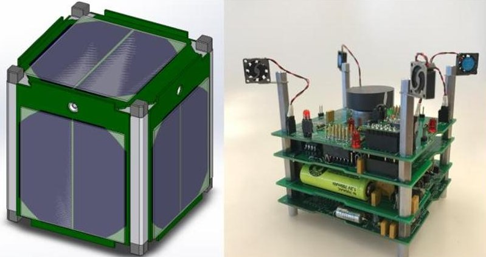

Figure 1. The PSAT1U CubeSat

In order to enhance the capability of the PSAT1U design as both a tool for teaching undergraduate engineering students and as a capable platform for flying mission payloads, the technique of Model Based Systems Engineering (MBSE) will be utilized. MBSE is defined as "the formalized application of modeling to support system requirements, design, analysis, verification and validation activities beginning in the conceptual design phase and continuing throughout development and later life cycle phases." [2]

Specifically, the CubeSat System Reference Model (CSRM), an initiative developed by the International Council on Systems Engineering (INCOSE) Space Systems Working Group (SSWG), was chosen as a CubeSat specific template providing the "logical elements [which] can be reused as a starting point for a mission-specific CubeSat logical architecture." [3] As such, the CSRM is itself a modular architecture enabling the design of a mission-oriented CubeSat. In combination, the PSAT1U described in MBSE terms through the lens of the CSRM will serve as a standardized template enabling development of future CubeSat class satellites at USNA.

## 2. PSAT1U CUBESAT DESCRIPTION

The mission of the PSAT1U project is to develop a 1U CubeSat educational satellite to expand on the launch opportunities and mission capabilities of previous midshipmen-built 1.5U satellites. The design reduces total cost through innovative engineering solutions without sacrificing overall performance and capabilities. PSAT1U provides an engineering model for future midshipman use as well as a standard design to be replicated by other academic institutions and their various payloads.

PSAT1U's satellite design specifications are in Figure 2. As seen in the figure, the satellite is designed for a maximum mass of 1500 g within the 1U frame. The specific dimensions

of the structure itself, as well as the satellite's board organization, are shown in Figure 3. PSAT1U retains the capability to host a variety of payloads on its top payload board. The Electrical Power System (EPS) and physical layout of the satellite are designed with the goal of remaining flexible and providing all necessary power to whatever payload might be placed on board for flight.

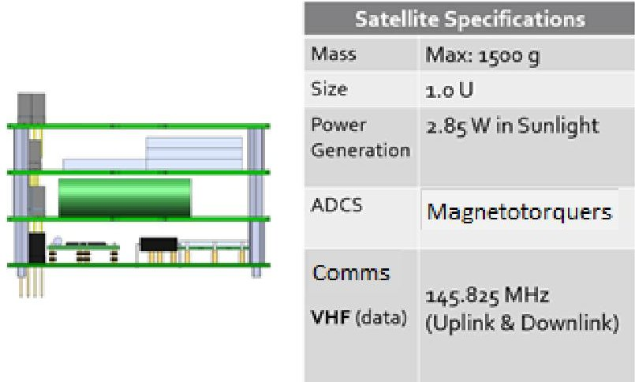

Figure 2. PSAT1U Satellite Design Specifications

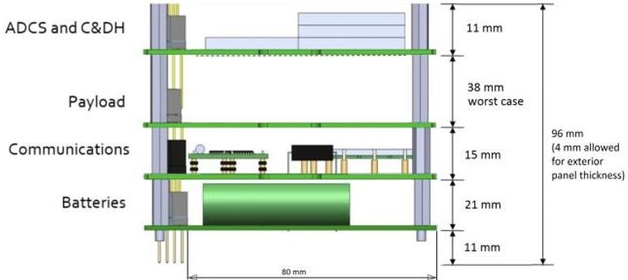

Figure 3. PSAT1U Board Organization Dimensions

## 2.1 Electrical Power System (EPS)

Utilizing a 1U footprint, the PSAT1U spacecraft must make efficient use of its small volume without sacrificing overall performance and capabilities. The largest impact in using this small footprint when compared to larger CubeSat class satellites is a reduction in the potential solar panel collection area. In order to address this challenge, the EPS design is based on only two Sol Aero ZTJ solar cells per side, as shown in Figure 4 below.

PSAT1U utilized ZTJ solar cells, rather than the very expensive UTJ solar cells used in other CubeSats built at USNA. While the UTJ cells offer predictable performance due to their high cost and quality control, the ZTJ cells offer similar performance at one-tenth of the cost. The ZTJ cells are factory-seconds that do not include coverglass. Instead, the design calls for the thicker microscope coverglass at 1% of the cost and the added mass is insignificant.

<!-- PDF_PAGE: 3 -->

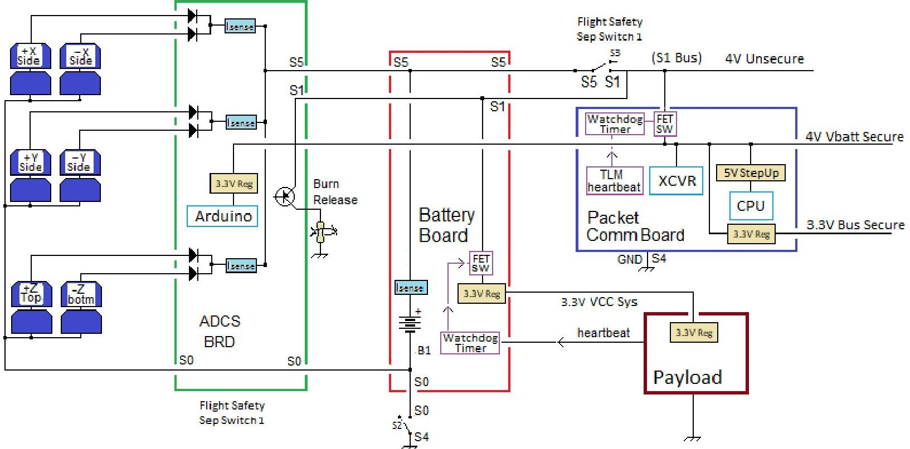

Figure 4. PSAT1U Electrical Power System Design Diagram

Nickel Cadmium (NiCd) batteries have over 50 years of space heritage and survivability and offer the best lifetime survivability and reliability compared to Lithium-ion batteries. Lithium-ions offer more power in a smaller battery cell, but are much less forgiving of abuse and require complex battery management systems per cell to prevent hazards and failures. Single errors in charging or discharge can destroy the cell permanently. On the other hand, NiCd's can survive occasional overcharge and complete discharge without damage. NiCd batteries are also traditionally used in USNA CubeSats due to their reliability and low cost. PSAT1U's battery board design is shown in Figure 5.

Radiation-induced upsets and glitches can cause errors in spacecraft processors. In order to combat this, PSAT1U has two secure power circuits and watchdog timers. One is on the communications board that will reset the communications Central Processing Unit (CPU) and cycle power in the event of any lockup that stops its routine as shown in Figure 6 below.

The main power bus for critical optional payload boards is the 5 V secure line. It is made secure by the second watchdog timer on the battery board that can cycle power off and back on if there is a payload processor failure. A processor failure is assured if the optional payload CPU fails to toggle the heartbeat periodically. This secure payload bus supplies critical voltage to the other boards and is independent from the power to the communications board, named the SATT4.

Additionally, a 4 V unsecure bus will also stem from the battery board to deliver unregulated and unsecure power to

the Attitude Determination Control System (ADCS) board and communications board circuits that only need raw power or that do not need the reset possibility.

The overall power budget for PSAT1U is displayed in Figure 7.

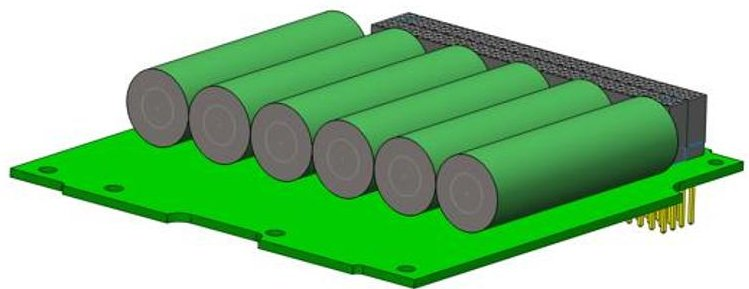

Figure 5. PSAT1U Battery Board Design

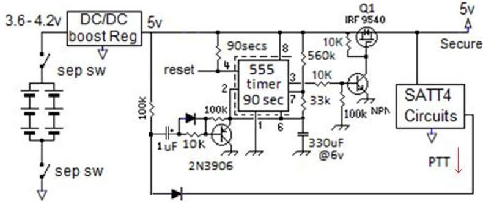

Figure 6. Watchdog Timer Circuit Diagram

<!-- PDF_PAGE: 4 -->

<table border="1"><tr><td>Load</td><td>Voltage</td><td>Ipk</td><td>Duty Cycle</td><td>Normal(mA)</td><td>StdBy(mA)</td><td>ALL ON(mA)</td></tr><tr><td>SATT4 RX(StdBy)</td><td>5</td><td>60</td><td>90%</td><td>54</td><td>54</td><td>OFF</td></tr><tr><td>SATT4 RX</td><td>3.3</td><td>120</td><td>10%</td><td>12</td><td>OFF</td><td>120</td></tr><tr><td>SATT4 TX Tlm</td><td>4</td><td>750</td><td>2%</td><td>15</td><td>15</td><td>750</td></tr><tr><td>SATT4 TX users</td><td>4</td><td>750</td><td>4%</td><td>30</td><td>OFF</td><td>OFF</td></tr><tr><td>Arduino CPU On</td><td>3.3</td><td>5</td><td>10%</td><td>1</td><td>OFF</td><td>5</td></tr><tr><td>Arduino CPU Sleep</td><td>3.3</td><td>2</td><td>90%</td><td>2</td><td>2</td><td>OFF</td></tr><tr><td>Payload StdBy</td><td>3.3</td><td>-</td><td>-</td><td>-</td><td>-</td><td>-</td></tr><tr><td>Payload OP</td><td>3.3</td><td>-</td><td>-</td><td>-</td><td>-</td><td>-</td></tr><tr><td>Totals</td><td></td><td></td><td></td><td>113</td><td>71</td><td>946</td></tr></table>

<table border="1"><tr><td>Solar Current per Panel =</td><td>503.085</td><td>mA</td></tr><tr><td>Average Current from geometry =</td><td>712.55</td><td>mA</td></tr><tr><td>Current Margin StdBy)*=</td><td>432.085</td><td>mA</td></tr><tr><td>Current Margin (Normal)*=</td><td>390.085</td><td>mA</td></tr></table>

*Margin Calculated Assuming Single Panel Power Production (minimum)

Figure 7. PSAT1U Power Budget

## 2.2 Attitude Determination Control System (ADCS)

The ADCS depends on sun vector inputs from all solar panels and the ADCS CPU is also used to read solar panel current from each panel. Therefore, the ADCS board serves as the central connection point for the solar side panel connectors which contain all of these signals and power. To facilitate these requirements, the ADCS board was placed at the top of the stack so that the connections to all of the side panels can be made last during assembly. Serving as the connection point between the ZTJ solar cells and the battery board, the ADCS board sums the current from all the solar panels to power the rest of the EPS system.

Figure 8 shows the side panel for PSAT1U and highlights the embedded torquer coils. The coils are present on both sides of the panel, and each face of the satellite is populated with a panel. Each torquer coil is designed to provide a maximum of $ 1.43 \times10^{-7} $ Nm of torque. With four coils in total, the maximum torque available for the spacecraft is $ 5.74 \times10^{-7} $ Nm. All attitude control will be performed by these coils.

Magnetometers and sun sensors fulfill all attitude determination roles on PSAT1U. These standard components are the same ones used on previous USNA CubeSats. The ADCS board is shown below in Figure 9.

## 2.3 Communications System

PSAT1U has a communications board with a 1.5-Watt Automatic Packet Reporting System (APRS) transceiver capable of operating in the 2-meter amateur radio band. The board can be programmed with two separate operating configurations with the goal of enabling or disabling user digipeating (packet relay) and switching the uplink receiver to a separate frequency if needed for a payload experiment. The SATT4 communications board is displayed in Figure 10.

Operating with the SATT4 communications board, uplink and downlink will occur at a frequency of 145.825 MHz. A Very High Frequency (VHF) wire antenna was designed to facilitate communication at this frequency and achieve a

Standing Wave Ratio (SWR) as close to ideal as possible. The antenna design is 724.5 mm in length. A model of PSAT1U's antenna design created using EZNEC software is shown in Figure 11. The downlink and uplink link budgets for PSAT1U are included in Table 1 and 2.

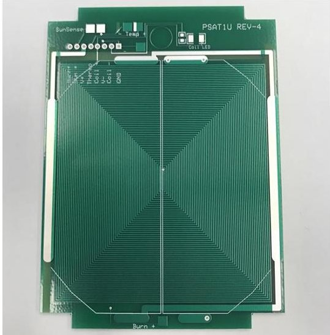

Figure 8. PSAT1U Side Panel with Torquer Coils

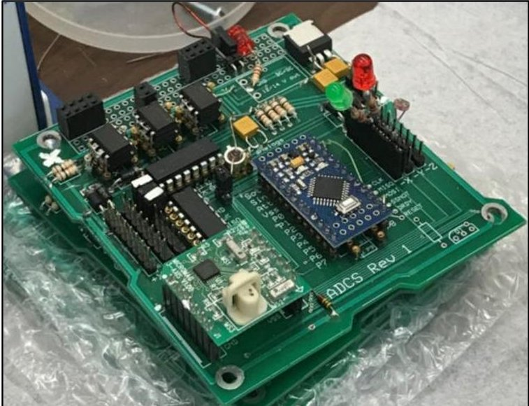

Figure 9. ADCS Board Model

<!-- PDF_PAGE: 5 -->

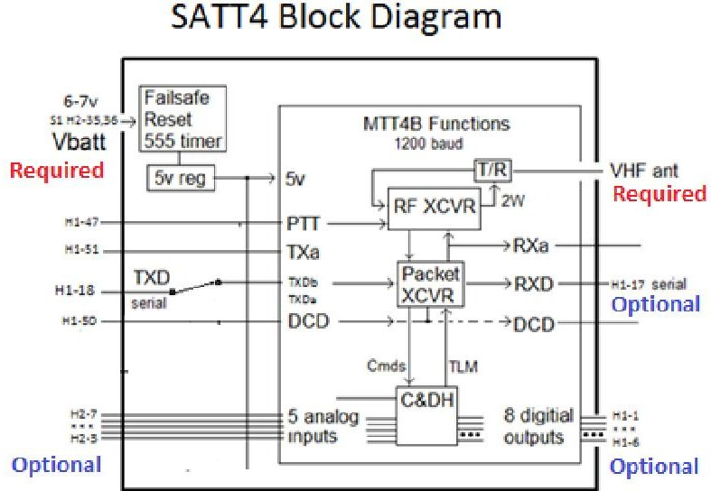

Figure 10. Communications Board Block Diagram

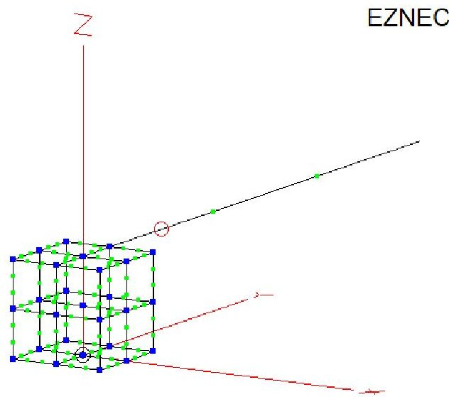

Figure 11. PSAT1U Antenna Design

Table 1. PSAT1U Link Budget Downlink

PSAT1U VHF Downlink

<table border="1"><tr><td colspan="2">Overhead Scenario(30°El)</td><td colspan="2">Horizon Scenario(10°El)</td></tr><tr><td>Frequency(MHz)</td><td>145.825</td><td>Frequency(MHz)</td><td>145.825</td></tr><tr><td>Altitude(km)</td><td>600.00</td><td>Altitude(km)</td><td>600.00</td></tr><tr><td>Elevation(deg)</td><td>30.00</td><td>Elevation(deg)</td><td>10.00</td></tr><tr><td>Range(km)</td><td>1075.19</td><td>Range(km)</td><td>1932.24</td></tr><tr><td>Space Loss(dB)</td><td>-136.35</td><td>Space Loss(dB)</td><td>-141.44</td></tr><tr><td>PowerTransmitter of Satellite(dBW)</td><td>1.76</td><td>PowerTransmitter of Satellite(dBW)</td><td>1.76</td></tr><tr><td>GainTransmitter Antenna(omni)(dB)</td><td>0.00</td><td>GainTransmitter Antenna(omni)(dB)</td><td>0.00</td></tr><tr><td>GainReceiver Antenna(dB)(Mobile Users)</td><td>5.00</td><td>GainReceiver Antenna(dB)(Mobile Users)</td><td>5.00</td></tr><tr><td>Incidental Losses(dB)</td><td>3.00</td><td>Incidental Losses(dB)</td><td>3.00</td></tr><tr><td>Pr(dBW)</td><td>-132.59</td><td>Pr(dBW)</td><td>-137.68</td></tr><tr><td>Pr(dBm)</td><td>-102.59</td><td>Pr(dBm)</td><td>-107.68</td></tr><tr><td>Rx Threshold USNA &amp; Users(dBm)</td><td>-116.00</td><td>Rx Threshold USNA &amp; Users(dBm)</td><td>-116.00</td></tr><tr><td>Margin for User(dBm)</td><td>13.41</td><td>Margin for User(dBm)</td><td>8.32</td></tr><tr><td>Rx Command Link Antenna Gain(dBi)</td><td>15.00</td><td>Rx Command Link Antenna Gain(dBi)</td><td>15.00</td></tr><tr><td>Margin Command Link(dBm)</td><td>28.41</td><td>Margin Command Link(dBm)</td><td>23.32</td></tr></table>

Table 2. PSAT1U Link Budget Uplink

PSAT1U VHF Uplink

<table border="1"><tr><td colspan="2">Overhead Scenario(30°EI)</td><td colspan="2">Horizon Scenario(10°EI)</td></tr><tr><td>Frequency(MHz)</td><td>145.825</td><td>Frequency(MHz)</td><td>145.825</td></tr><tr><td>Altitude(km)</td><td>600.00</td><td>Altitude(km)</td><td>600.00</td></tr><tr><td>Elevation(deg)</td><td>30.00</td><td>Elevation(deg)</td><td>10.00</td></tr><tr><td>Range(km)</td><td>1075.19</td><td>Range(km)</td><td>1932.24</td></tr><tr><td>Space Loss(dB)</td><td>-136.35</td><td>Space Loss(dB)</td><td>-141.44</td></tr><tr><td>PowerTransmitter of User(dBW)</td><td>7.00</td><td>PowerTransmitter of User(dBW)</td><td>7.00</td></tr><tr><td>GainTransmitter Antenna(dB)(Mobile Users)</td><td>5.00</td><td>GainTransmitter Antenna(dB)(Mobile Users)</td><td>5.00</td></tr><tr><td>GainReceiver Antenna(dB)</td><td>0.00</td><td>GainReceiver Antenna(dB)</td><td>0.00</td></tr><tr><td>Incidental Losses(dB)</td><td>3.00</td><td>Incidental Losses(dB)</td><td>3.00</td></tr><tr><td>Pr(dBW)</td><td>-127.35</td><td>Pr(dBW)</td><td>-132.44</td></tr><tr><td>Pr(dBm)</td><td>-97.35</td><td>Pr(dBm)</td><td>-102.44</td></tr><tr><td>Rx Threshold Satellite(dBm)</td><td>-110.00</td><td>Rx Threshold Satellite(dBm)</td><td>-110.00</td></tr><tr><td>Margin Users(dBm)</td><td>12.65</td><td>Margin Users(dBm)</td><td>7.56</td></tr><tr><td>Rx Command Link Antenna Gain(dBi)</td><td>15.00</td><td>Rx Command Link Antenna Gain(dBi)</td><td>15.00</td></tr><tr><td>Margin Command Link(dBm)</td><td>22.65</td><td>Margin Command Link(dBm)</td><td>17.56</td></tr></table>

<!-- PDF_PAGE: 6 -->

As seen in the budgets, the link margins are favorable in both the downlink and uplink scenarios. In the horizon scenarios for VHF downlink and uplink, users are predicted to experience 8.32 dB and 7.56 dB margins respectively.

## 2.4 Payload

PSAT1U possesses the ability to host a variety of different payloads, depending on the mission objective. In this way, the CubeSat was specifically designed to be a modular architecture with well understood interfaces to allow practitioners to concentrate on payload design for their particular application. The payload board resides at the top of PSAT 1U's structure, as displayed in Figure 3.

PSAT1U is able to host payloads within certain physical and electrical specifications. Payloads must have a mass less than 567 g. Any payload must have a maximum volume of 247 $ cm^{3} $ . Specifically, payloads are allowed a maximum height of 4.0 cm, maximum width of 8.0 cm, and maximum depth of 7.7 cm. Payloads should operate within the available on-orbit average power of 1.92 W, operating at a voltage of 5 V during daylight.

## 3. CUBESAT SYSTEM REFERENCE MODEL

The INCOSE Systems Engineering Vision 2020 [2], included efforts in numerous engineering disciplines to demonstrate applications of MBSE and Systems Modeling Language (SysML) [4]. One of the focus areas of this effort, undertaken by the SSWG, was to utilize these tools to model space systems. Finally, starting in 2011, the SSWG began investigating the applicability of MBSE specifically for CubeSats [4].

Under the above referenced effort, the SSWG have been developing the CSRM, which serves as an MBSE template for modeling the space system, ground system, and each of the subsystems and components of a CubeSat System [4]. Specifically the CSRM aims to be a starting point for any mission-specific CubeSat development [5].

In order to develop a mission specific CubeSat model utilizing the CSRM as a starting point, users can combine their own requirements, mission specific stakeholder use cases and viewpoints with the existing CSRM model elements and diagram templates as well as the library of system components to be utilized as needed. This process is described graphically in Figure 12. The present effort is aimed at utilizing the CSRM to describe the PSAT1U Mission Specific model.

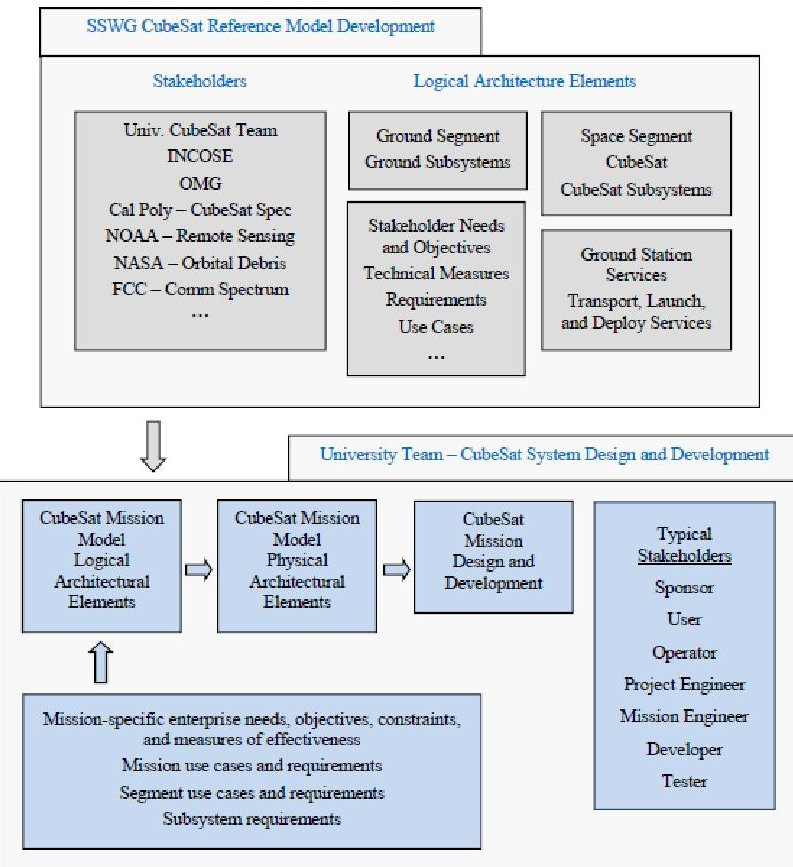

Figure 12. CubeSat System Reference Model as the Foundation for the Mission-Specific CubeSat Model [3]

## 4. PSAT1U BASELINE MODEL

The PSAT1U Baseline Model is an MBSE representation of the satellite developed using the CSRM as a starting point. The baseline model is unique in that it defines all of the important subsystems, components, and interfaces of the PSAT1U, but leaves the payload and mission specific modules undefined. This allows a user to understand the payload design space in clear terms. In this way, a practitioner can apply their mission application and the components associated with it to the baseline model to create their own mission specific model.

The CSRM was obtained and accessed using CAMEO Systems Modeler MBSE Software V19.0. Each predefined package or template in the CSRM was reviewed and the architecture was appended to include specific information describing PSAT1U. As an example, Section 10, the overall Architecture Hierarchy of the PSAT1U Baseline Model is depicted in Figure 13.

The Architecture Hierarchy encompasses all of the subsystems, subsystem components and ground system components along with the domain, enterprise and segment packages.

<!-- PDF_PAGE: 7 -->

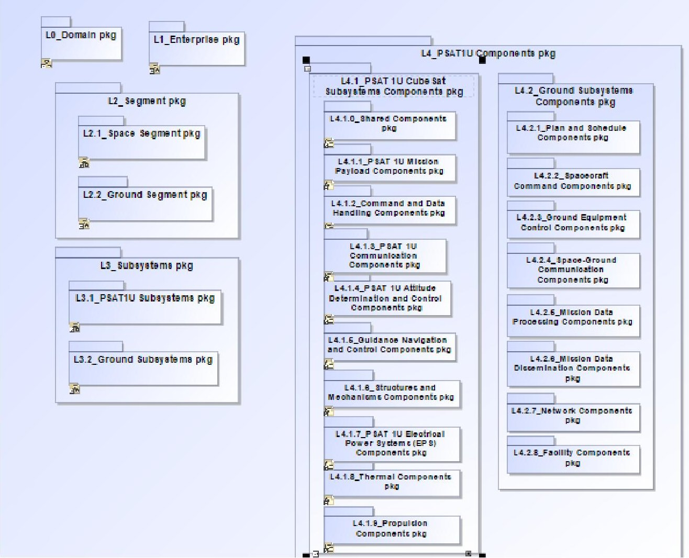

Figure 13. PSAT1U Baseline Model Architecture Hierarchy

From within the Architecture Hierarchy, any of the Subsystem Structures Packages can be accessed and critical information and interfaces can be reviewed and understood. Figure 14, for example, represents the ADCS Subsystem Block Definition Diagram and its relationships with other parts of the structures package and shared components. In turn, more information and relationships are contained within each instance of a subsystem or component.

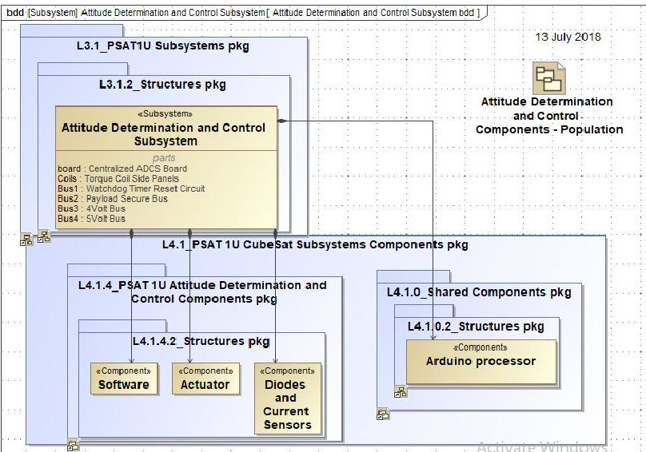

Figure 14. ADCS Subsystem Block Definition Diagram

Figure 15 is the package diagram describing the EPS for the spacecraft. In it, each of the main component parts are described and further details and specifications of those parts are also available. Within the specification for the EPS, pertinent information such as the as-designed power budget (Figure 16) is also available.

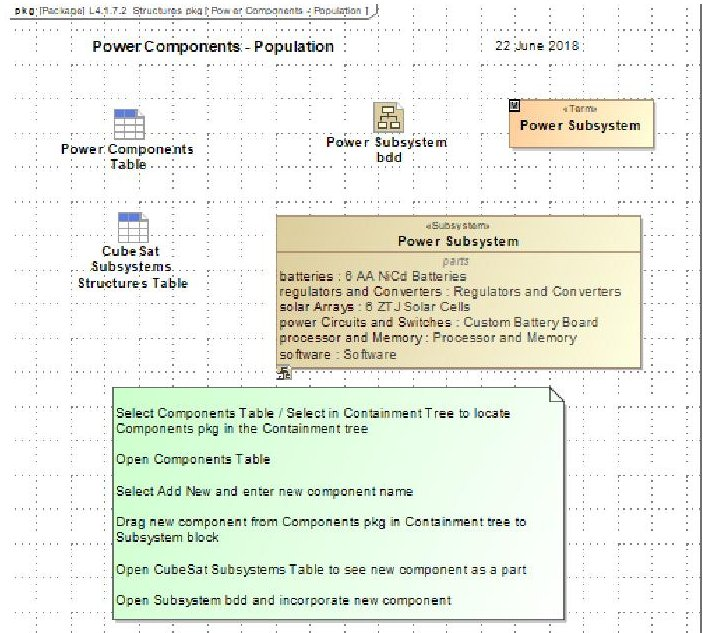

Figure 15. Electrical Power System Package Diagram

<!-- PDF_PAGE: 8 -->

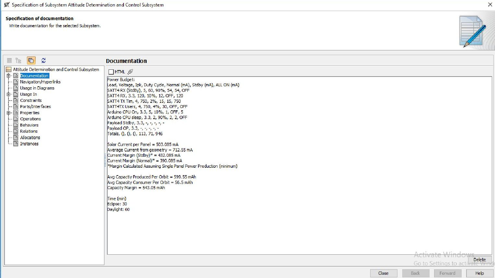

Figure 16. Specification for Electrical Power System including Power Budget Information

## 5. APPLICATION AND USE OF THE MODEL

## 5.1 Propagating Changes

One of the advantages of utilizing an MBSE tool to define a baseline CubeSat like the PSAT1U is the ease with which system changes are propagated through the model. As an example, the ADCS subsystem from Figure 14 above is revisited. In this system the Watchdog Timer Reset Circuit is defined as a part within this subsystem. If the Watchdog Timer were redesigned or more information added to its specification, the specification could simply be opened up and the appropriate changes made as displayed in Figure 17.

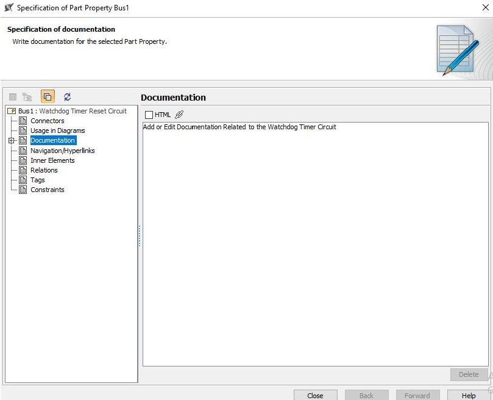

Although the Watchdog Timer resides in the ADCS subsystem of the architecture package, a relationship has been defined that ties this circuit to the overall power subsystem. That relationship can be seen highlighted in blue in Figure 18. As a result, any changes made to the Watchdog Timer specification are automatically propagated to the Power subsystem and to any other subsystems or components with a relationship to the Watchdog Timer. The user does not need to manually propagate this change. For a complex system that might be changing frequently, this procedure can add efficiency to the design cycle time and allow a user to spend more time concentrating on the important decisions and trades required to create their optimal system.

Figure 17. Watchdog Timer Specification

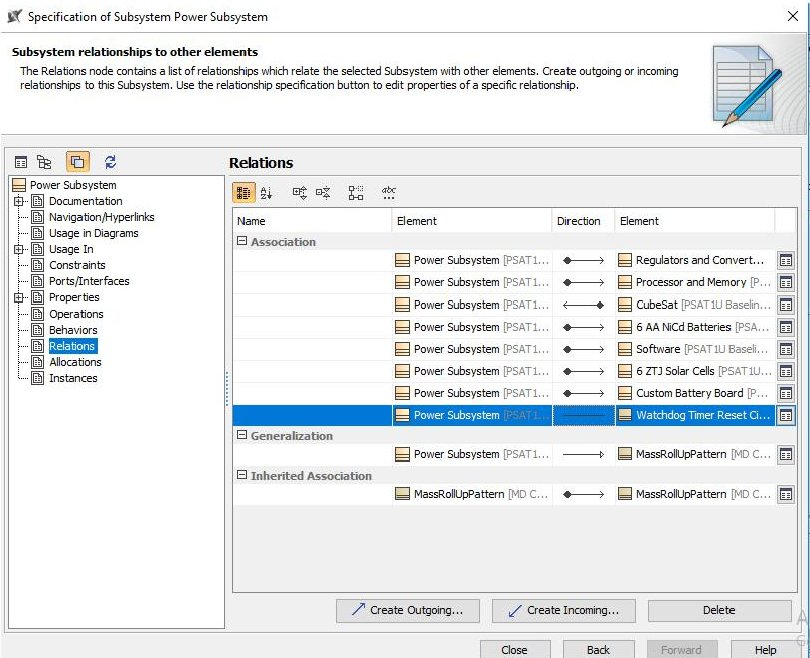

Figure 18. The Relationship between the Watchdog Timer and the Power Subsystem

<!-- PDF_PAGE: 9 -->

The model stores design specifics of the PSAT1U as text data within the documentation tab of the appropriate subsystem or component specification. In this way, critical design information is stored in the model and can be viewed or edited as needed by practitioners.

## 5.2 Payload Design Template

An additional benefit of the standardized MBSE template for PSAT1U stems from the fact that the CubeSat is, itself, a physical template of a kind. That is, it is a satellite system with much of the design work complete but its mission specification and payload definition are left intentionally blank. The intent is to have multiple undergraduate teams approach the PSAT1U design and tailor their physical instance of the spacecraft for their own application. The standardized MBSE template is well suited for this purpose because it allows the user to quickly survey and understand the payload design space without wasting precious time on well understood or defined subsystems and components.

This is illustrated by a closer look at the Mission Payload subsystem, displayed in a Block Definition Diagram in Figure 19.

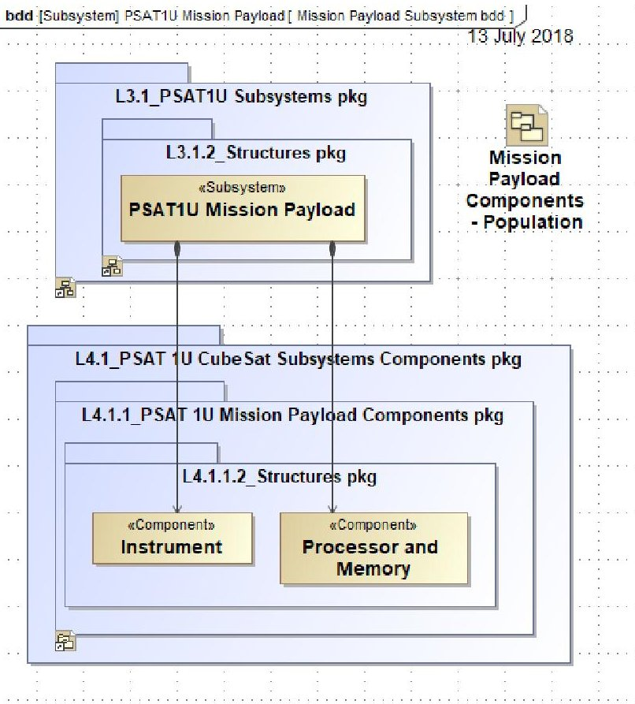

Figure 19. Mission Payload Block Definition Diagram

If the user opens the design specification for the Mission Payload subsystem in the template, all they will see is some generic information defining the design space and the envelope with which the payload can be housed. Figure 20 displays this generic specification.

If, once their design is underway and they understand their mission objectives, the user wants to add information to this specification describing their payload, they can do so as is exemplified by Figure 21.

Ultimately, by adding the appropriate payload and mission details and making any other appropriate changes to the standardized MBSE template, the user will create a model of their mission specific instance of the PSAT1U.

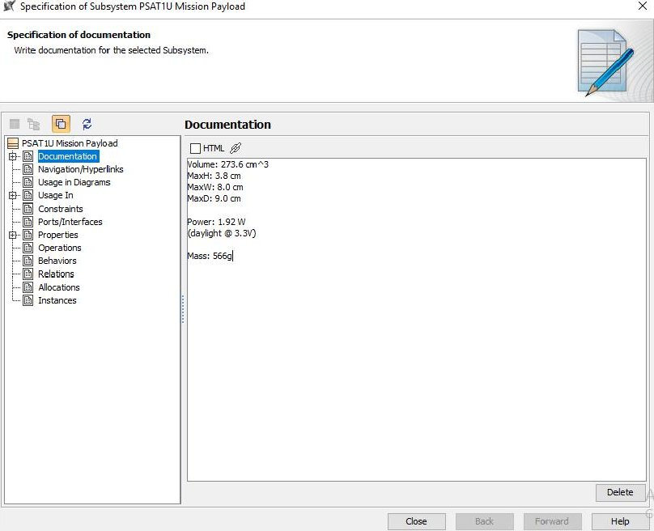

Figure 20. Generic Mission Payload Specification

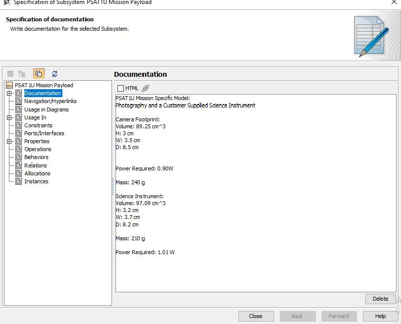

Figure 21. A Defined Mission Payload Specification

## 5.3 Classroom Implementation

The standardized MBSE template for PSAT1U is intended to be utilized by undergraduate engineering students in their year-long senior capstone class at USNA. It is beyond the scope of this course to teach these students all there is to know about MBSE and how to utilize its tools. Therefore, the approach with this model was for the department faculty to gain an understanding of these systems engineering tools and, based on their own engineering experience and intuition, make design decisions about many of the subsystems and components in order to constrain the design space.

Given the short cycle time, this allows students to remain focused on the analysis, testing and making decisions that

<!-- PDF_PAGE: 10 -->

will be critical to their mission success. Then, they will become familiar with the standardized MBSE template so that they can clearly understand that design space, appreciate the value of MBSE in the design of complex systems, but will not be expected to learn how to create their own model from scratch.

This approach, mimicking the original intent of the CSRM, which itself was a less defined standardized template, will also allow subject matter experts in aerospace engineering and other specific disciplines to gain the benefit of these powerful systems engineering tools without becoming expert MBSE users.

## 6. CONCLUSION

CubeSats are being used as an undergraduate teaching tool for year-long senior capstone design students in aerospace engineering. In order to deal with the increasing complexity of these systems and still allowing the students to benefit from their first real design challenge, a standardized Model Based Systems Engineering template for the PSAT1U CubeSat was developed. This template in turn was built from the CubeSat System Reference Model developed by the INCOSE Space Systems Working Group.

The PSAT1U model described is itself a template without payload or mission definition and can be designed for any mission as long as the payload is operated within the envelope defined by the model. The model aids in the design process by ensuring the design space is easily understood and by propagating system changes automatically and seamlessly.

Ultimately, the benefit of the standardized MBSE template described here, like the CSRM it is based off of, will also allow discipline specific engineering experts to benefit from advanced system tools without themselves becoming systems engineering experts.

## REFERENCES

[1] CubeSat Design Specification, rev. 13, The CubeSat Program, Cal Poly SLO, April 2015

[2] Systems Engineering Vision 2020, INCOSE - TP_2004-004-02, ver. 2/03, September 2007. [Online]. Available: http://www.incose.org/ProductsPubs/pdf/SEVision2020_200 71003_v2_03.pdf

[3] D. Kaslow, B. Ayres, P. Cahill, L. Hart, R. Yntema, "Developing a CubeSat Model-Based Systems Engineering (MBSE) Reference Model - Interim Status #3," Proceedings of IEEE Aerospace Conference, Big Sky, MT, March 2017.

[4] D. Kaslow, L. Anderson, S. Asundi, B. Ayres, C. Iwata, B. Shiotani, R. Thompson, "Developing a CubeSat Model-Based Systems Engineering (MBSE) Reference Model - Interim Status", Proceedings of IEEE Aerospace Conference, Big Sky, MT, March 2015.

[5] D. Kaslow, B. Ayres, M. Chonoles, S. Gasster, L. Hart, C. Massa, R. Yntema, B. Shiotani, "Developing a CubeSat

Reference Model-Based Systems Engineering (MBSE) Reference Model - Interim Status #2", Proceedings of IEEE Aerospace Conference, Big Sky, MT, March 2016.

## BIOGRAPHY

Lieutenant John M. Gregory, USNR is currently an instructor in the Aerospace Engineering Department at the US Naval Academy in Annapolis, MD. John is also a PhD candidate in the Systems Engineering Department at Colorado State University. His research interests include Space Systems, Model Based Systems Engineering, and Additive Manufacturing. John

received his Bachelor of Science in Aerospace Engineering from Syracuse University in 2007, his Master of Science in Aerospace Engineering from Old Dominion University in 2013, and a graduate certificate in Systems Engineering from Colorado State University in 2014. His most recent civilian position was as the lead systems engineer for the Eastern Region of the Defense Contract Management Agency in Boston, MA.

Jin S. Kang (Suk Jin Kang) received his B.S. from the University of Michigan, M.S. from Stanford University, and Ph.D. from Korea Aerospace University. All degrees are in aerospace engineering. After working for General Electric for two years, Kang served at the Korea Air Force Academy as a professor while holding a rank of 1st LT. His

main research area is in space systems engineering and was involved in development of four micro-satellites and numerous CubeSat satellites. He is currently an Associate Professor (civilian) in the Aerospace Engineering Department at the United States Naval Academy, and serves as the Director of the Naval Academy Small Satellite Program.

Dr. Ronald M. Sega is the Chief Technical Officer, U.S. Army Futures Command. Previously he served as Director, Systems Engineering Programs and Special Assistant to the Chancellor for Strategic Initiatives at Colorado State University and as Vice President and Enterprise Executive for Energy and the Environment at both Colorado State University and The Ohio

State University (OSU). He holds a B.S. in math and physics from the U.S. Air Force Academy (USAFA), an M.S. in physics from OSU and a Ph.D. in electrical engineering from the University of Colorado. He is a fellow of AIAA and IEEE. Dr. Sega was a faculty member in the College of Engineering and Applied Science at the University of Colorado at Colorado Springs, and dean from 1996-2001. He was Director of Defense Research and Engineering, chief technology officer for the Department of Defense (DoD), from 2001-2005. He retired from the Air Force Reserve in 2005 a major general as the reserve assistant to the chairman of the Joint Chiefs of Staff after 31 years in the Air Force. He was the Under Secretary of the Air Force from 2005- 2007, serving as the DoD Executive Agent for Space and leading the Air Force team that won the Presidential Award for Leadership in Federal Energy Management for 2006. A former astronaut, he flew aboard Space Shuttles Discovery (1994) and Atlantis (1996).

<!-- PDF_PAGE: 11 -->

David Kaslow has thirty-four years of experience at Lockheed Martin in both the technical and management aspects of developing ground mission capabilities. He has five years of experience at Analytical Graphics including pursuing Model-Based Systems Engineering. Dave is a co-author of

four chapters in Cost-Effective Space Mission Operations. He is Co-Chair for the INCOSE Space Systems Working Group. Dave has participated in the Space Systems MBSE Challenge Team since its founding in 2007 and is the lead for the CubeSat System Reference Model.

John M. Borky (PdD'77) has been a practicing engineer in government and private industry for 50 years. He received degrees from The Catholic University of America, MIT, and the University of Michigan. During a 25-year Air Force career, he held a variety of assignments in technology development, maintenance and logistics, program management, and education. Subsequently, he worked for five

companies in the Aerospace and Defense community, with emphasis on Systems Engineering and, especially, Model-Based Systems Engineering. His areas of work in industry have included directed energy weapons, integrated modular avionics, and command and control systems. He served for seven years on the Air Force Scientific Advisory Board. He is a Regular Individual Member of INCOSE, a Life Senior Member of IEEE, and an Associate Fellow of AIAA. He is currently a Professor of Systems Engineering at Colorado State University.

Bob Bruninga, PE has been the Senior Research Engineer at the US Naval Academy small satellite lab for 29 years. During this time, he has mentored students through 7 successful small satellite projects to orbit, PCSAT-1, PCSAT2, ANDE-MAA, RAFT/MARScom, PSAT, QIKCOM1, and PSAT2 These satellites have flown on the Space shuttle, Space station, Athena launch from Kodiak Alaska and other DoD launches. Although these

satellites have had a variety of experiments, they have each also carried an Amateur Radio APRS packet radio transponder to support communications experiments by other schools and universities around the world. This APRS (Automatic Packet Reporting System) mission began with a paper in 1992 and developed over the years into a global system of over 50,000 users worldwide and dozens of satellites (8 currently active). The evolution of these transponders has gone from 10" cube 12 kg satellites down to the current 1U CubeSat (1kg) and has formed the basis for not only student satellite projects but are also used in the student labs for hands on experience. He is a life member of the AMSAT organization and is a member of IEEE National Committee on Transportation and Aerospace Policy. He authored the chapter on the US Naval Academy Satellites for the AIAA book, Small Satellites, Past, Present and Future and is the author of dozens of additional technical papers and articles in a variety of publications and magazines on communications topics. Most recently he authored the book Energy Choices for the American Radio Relay League (ARRL).

George Downey is an undergraduate Electrical Engineering student at the University of Maryland, College Park. His main field interest is Space Communications Systems. In Summer 2019, George interned as a CubeSat Development Engineer for the USNA Satellite Lab, working specifically on the PSAT1U Project in revising the design

and preparing it for student builds.