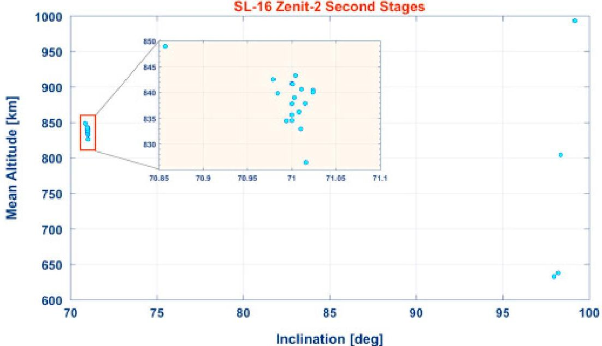
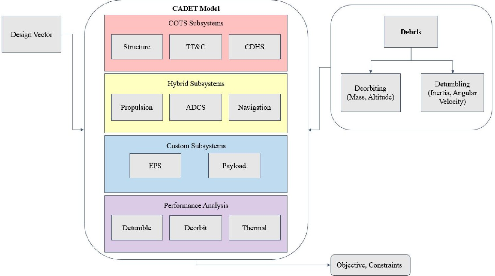
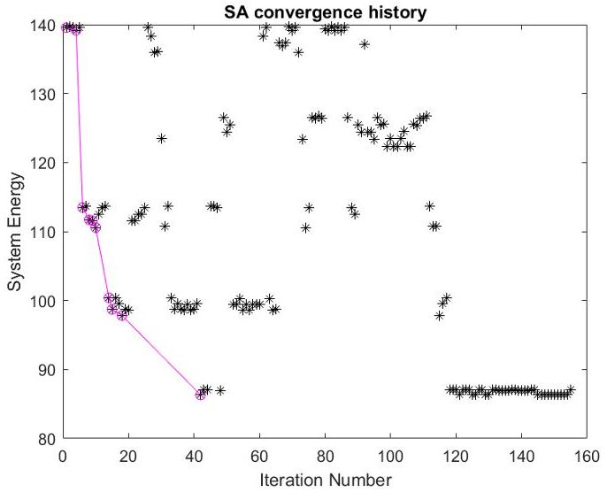
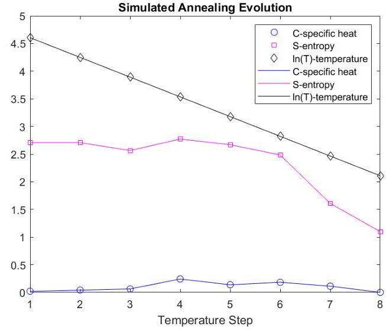
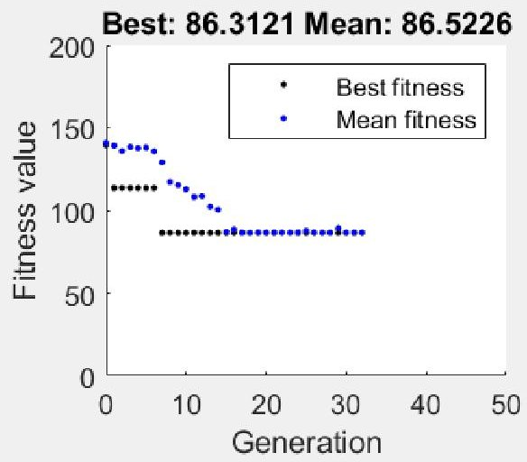
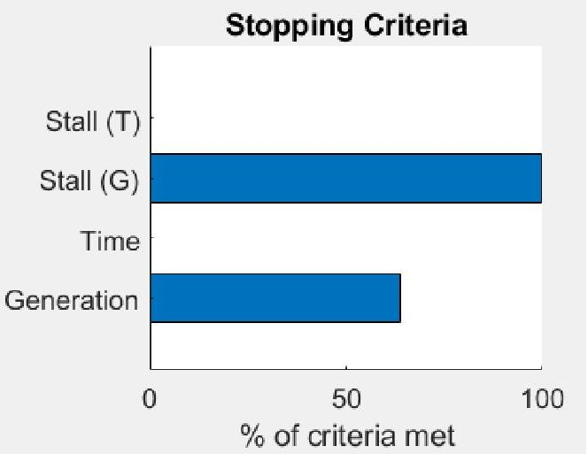
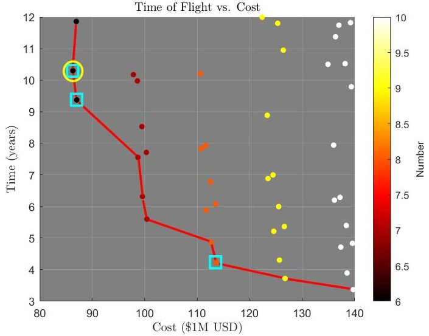
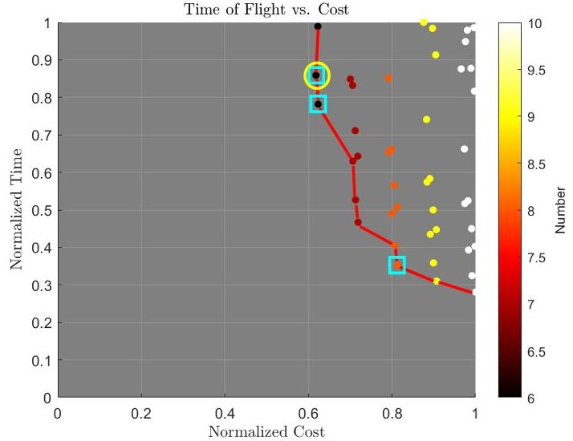

<!-- PDF_PAGE: 1 -->

# Effectiveness of CubeSat-Based Architectures for Active Removal of On-Orbit Rocket Bodies

Christopher P. Clark $ ^{*} $

The Charles Stark Draper Laboratory, Inc., Cambridge, MA 02139 Massachusetts Institute of Technology, Cambridge, MA, 02139

Dun Y. Tan' Imperial College London, London, SW7 2BU, United Kingdom

Patricia Arnal Luna $ ^{\ddagger} $ Massachusetts Institute of Technology, Cambridge, MA 02139

Daniel E. Hastings $ ^{\S} $ and Rebecca A. Masterson $ ^{\#} $ Massachusetts Institute of Technology, Cambridge, MA, 02139

Michael J. Ricard $ ^{\parallel} $ The Charles Stark Draper Laboratory, Inc., Cambridge, MA 02139

Recent events such as the 2009 Iridium-Cosmos collision and multiple anti-satellite weapon (ASAT) tests have propelled the increasingly urgent topic of space debris management to the forefront of current engineering inquiry. Simultaneously, the so-called "CubeSat Revolution" has significantly reduced barriers to entry for commercial and scientific space missions. CubeSats have demonstrated an ever-increasing potential to offer useful capabilities for a fraction of the size, mass, and power of their larger counterparts. This paper explores the relevance and effectiveness of CubeSat architectures in active space debris removal by propulsive methods. The chosen target of interest is the Zenit-2 second-stage rocket body, representative of a particularly large and prevalent family of debris objects. The debris removal mission design problem is approached from a fundamental level. First, the CubeSat architecture design tradespace is defined and outlined, including the proposed design vector, constraints, and objective function. Next, a system model and optimization methods are presented and implemented in MatLab. Given a set of mission requirements, the algorithm arrives at an optimal or near-optimal architecture design by iterating through combinations of commercially available CubeSat components stored in a database. Results are examined for various sizes and numbers of deorbiter CubeSats, and key tradeoffs between architecture options are identified and explored. Finally, considering the optimized results, a discussion of the most effective propulsive solutions for Zenit-2 rocket body removal using CubeSat clusters is presented.

## Nomenclature

$ \# SA^{\prime}s $ = number of solar arrays per satellite

$ \# Sats $ = total number of satellites

$ \# U^{\prime}s $ = individual CubeSat bus size (1U, 2U, 3U, 6U, 8U, 12U, 16U, or 27U)

$ \rho_{fuel} $ = propellant density $ (kg/m^{3}) $

$ \tau_{max} $ = maximum reaction wheel torque $ (N*m) $

<!-- PDF_PAGE: 2 -->

$ \omega $ = angular velocity (rad/s)

A = area $ ( m^{2} ) $

$ c_{mission} $ = mission cost ($ USD)

$ D_{mag} $ = magnetorquer magnetic dipole $ ( A * m^{2} ) $

$ H $ = angular momentum $ ( k g * m^{2} / s ) $

$ H_{stor} $ = reaction wheel angular momentum storage capacity $ ( N * m * s ) $

$ I $ = moment of inertia $ ( k g * m^{2} ) $

$ I_{sp} $ = specific impulse (s)

$ I_{t} $ = total impulse $ ( N * s ) $

$ In_{ADCS} $ = Attitude Determination and Control System (ADCS) index option

$ In_{prop} $ = propulsion index option

$ J(x) $ = multiobjective cost function with design vector x as input

$ M_{n} $ = mass for quantity “n” (subsystem, total, limit, etc.)

n = mean motion (rad/s)

$ P_{n} $ = power needed for subsystem or mission phase “n”

$ T_{prop} $ = propulsion system thrust (N)

$ t_{mission} $ = mission time (years)

$ w_{c} $ = cost weighting factor

$ w_{t} $ = time weighting factor

## I. Introduction

The growing problem of space debris has been recognized as an ever-expanding threat to the global space community ever since the 1970's [1]. Human spaceflight missions, high-value imaging satellites, and even small, low-budget CubeSat projects are facing increasing risk from the debris cloud forming in Low-Earth Orbit (LEO). Carroll [2] notes that for each tracked debris object 10 cm or larger, there could exist ~100 untrackable objects that are still capable of disabling a satellite. One major way these small, invisible, and lethal objects form is through collisions between larger objects such as used rocket bodies or intact spacecraft. Due to their significant cross-sectional area, these types of space debris objects typically have an increased probability of collision in populated orbits.

According to a recent study by Anselmo and Pardini [3], Ukrainian-made Zenit-2 rocket bodies represent the top 20 most dangerous objects currently in LEO. In addition to representing a large number of the most dangerous LEO debris, the 8900 kg Zenit-2 second stage is also the most massive single debris currently catalogued on orbit [4]. Therefore, using CubeSats to remove these objects from orbit not only represents an ideal target choice from a space safety perspective, but could also prove that CubeSats have feasibility for a wide variety of smaller, less massive targets.

Although the debris problem has gained considerable interest from the international community, little has been attempted thus far in the realm of active debris removal (ADR). This inaction is largely due to a general lack of enforceable, international debris mitigation regulations coupled with a lack of perceived economic incentives for space operators to responsibly deorbit their assets following mission completion. Due to their low cost, simplicity, and ease of launch, CubeSat deorbiters represent a promising, yet untested, category of debris removal missions that have the potential to significantly ameliorate the financial outlay associated with debris removal. Moreover, CubeSat deorbiters could be more readily constructed by a number of private operators (including universities) than larger spacecraft, potentially opening the door for increased innovation and decreased expense on the part of national governments. The current landscape of space missions suggests that debris deorbiting could be just around the corner. In early 2020, Northrop Grumman's MEV-1 successfully performed the first on-orbit servicing rendezvous between two private satellites [5]. However, the servicer spacecraft was quite large, on the order of 3000 kg. Astroscale's ELSA-d servicer concept is considerably smaller (180 kg) [6], yet still well outside standard CubeSat dimensions. An even smaller design is the University of Surrey's RemoveDebris mission [7]. While not intended to remove existing debris, the mission successfully demonstrated two debris capture methods by firing a harpoon at a boom-mounted target and deploying a net [8]. Work by Hakima et al. [9] suggests that an 8U CubeSat could be successfully employed to deorbit a large debris object with a mass of hundreds of kilograms. In this study, feasibility analysis is extended further in order to assess whether CubeSat-based propulsive debris removal is possible for the largest of all space debris objects, the Zenit-2 rocket body. Propulsive debris removal relies on one or more thrusters aboard deorbiter spacecraft to impart a retrograde impulse and degrade the target object's orbit. While multiple other deorbiting techniques may also be viable and are certainly worth considering, this paper specifically examines the propulsive case as it pertains to CubeSats.

<!-- PDF_PAGE: 3 -->

A report by NASA's Orbital Debris Program Office [10] lists the Zenit-2 as having a length of 12 m, diameter of 4 m, and dry mass of 8900 kg. While the 22 Zenit-2 second stages remaining in LEO have varying semimajor axes and inclinations, 18 are closely bunched at the $ 7 1^{\circ} $ inclination, with only a $ 0. 0 4^{\circ} $ standard deviation [3]. The same study indicates that among these 18 objects, the average semimajor axis is 7207.4 km (standard deviation of 4.8 km) and the average eccentricity is 0.0093 (standard deviation of 0.005). Figure 1 illustrates the orbital similarities among this family of objects, particularly highlighting inclination and altitude. In fact, the similarity is so significant that a feasible deorbit mission for one of the objects would quite possibly be feasible for many other targets in the group as well.

Fig.1 Zenit-2 Rocket Body Distribution, Figure from Ref. [11]

For the purposes of this study, one particular object is examined as a representative example of the on-orbit population of Zenit-2 rocket bodies. This object, 1990-46B, has a semimajor axis of 7211.5 km, an eccentricity of 0.012, and an inclination of $ 7 1. 0 0^{\circ} $ [12]. As such, it falls well within one standard deviation of the mean in both altitude and inclination. Unlike the other Zenit-2 rocket bodies, though, the rotational properties of this object have also been observed and characterized. In a 2012 study, Yanagisawa and Kurosaki used photometric light flashes to determine that the object possesses a rotational period of 41.00 seconds, corresponding to an angular rate of $ \omega=0. 1 5 3 \, \mathrm{r a d / s} $ about the major axis [12]. The effects of eddy current damping, as described by Efimov et al. [13], Praly et al. [14], and Williams and Meadows [15], are likely to have considerably reduced the spin rate of the object during the eight years since the photometric observations took place. However, since no future studies have taken place on the same object, this study makes the assumption that the spin rate is still unchanged.

Since the Zenit's angular momentum is concentrated around a single axis, a basic equation allows for an approximation of the total momentum change needed in order to detumble the object. The rocket body's total angular momentum is calculated as:

$$
H = I \omega
$$

Where H indicates angular momentum, I represents the moment of inertia, and $ \omega $ is the angular velocity. Here, I corresponds to the moment of inertia about the major (lateral) axis. Work by Mayorova et al. determined this number to be approximately 107819 $ kg\cdot m^{2} $ [16], which means the total angular momentum H is therefore 16496.31 $ kg\cdot m^{2}/s $ Any deorbit mission must first be capable of imparting this quantity of angular momentum to the rocket body in order to successfully stabilize the target.

A report by the Australian Government Bureau of Meteorology suggests that an object orbiting at 200 km should remain on orbit for a maximum of 3-4 days [17], so a continuous-thrust transfer to 200 km represents an adequate estimation for a deorbit trajectory. The Inter-Agency Space Debris Coordination Committee (IADC) recommends that the lifetime of any orbital object not exceed 25 years after the completion of mission operations [18]. Normally, the 25-year limit would serve as an upper constraint on mission duration; however, LEO satellites are likely to experience component failures before enduring 25 years on orbit. In particular, the most advanced modern lithium batteries have a maximum lifetime of approximately 12 years in LEO [19]. While it is certainly possible that other subsystems could

<!-- PDF_PAGE: 4 -->

also experience failures prior to mission completion, the battery limitation is of particular importance given that a 2016 study found EPS issues to be the leading known cause for CubeSat failure [20]. It is therefore assumed in this analysis that a deorbiter CubeSat mission targeting the Zenit-2 rocket body must be capable both of imparting an angular momentum change of 16496.31 $ kg \cdot m^{2} $ and moving the debris object to a 200 km orbit within 12 years in order to qualify as successful.

## II. Problem Formulation

The fundamental goal of this study is to identify an optimal CubeSat architecture-components, number of satellites, and size per satellite-to minimize the value of a given objective function while successfully deorbiting the target debris object. Since one of the major objectives of interest is minimizing cost, deorbiter CubeSats are designed to implement commercial off-the-shelf (COTS) components whenever feasible and custom-designed components when necessary. The design challenge is to identify the most optimal configuration utilizing a specific combination of commercial and custom parts to compose the satellite's subsystems.

It is worth noting that the ADR mission payload refers to the docking system (harpoon, adhesive, net, etc.), the selection of which is not explored within this paper. Selection and evaluation of different capture methods is an area of ongoing research [21] [22], and a number of methods have been proposed and even tested [8]. Unlike the other components, though, the payload requires an additional design consideration: probability of successful capture. Even assuming perfect system operation with no component failures, certain payloads may inherently posses a higher degree of robustness in off-nominal conditions, a difficult consideration to incorporate into a high-level, feasibility-based problem framework. Since the goal of this work is to introduce a modular design and optimization method rather than weigh one docking mechanism against another, the payload is not considered a design variable for the purposes of this study.

Key design decisions for a high-level deorbit mission design using CubeSats include number of U's (satellite size, in standard CubeSat bus dimensions such as 1U, 2U, etc.), number of satellites, and number of solar arrays per satellite, in addition to the propulsion system and ADCS system selections. Consequently, the default problem formulation deals completely with discrete design variables. The design vector consists of five quantities: size of the CubeSat in U's, total number of satellites, propulsion index, ADCS index, and number of solar arrays.

$$
X = \left[ \left(\# U ^ {\prime} s\right) \quad \left(\# S a t s\right) \quad \left(I n _ {p r o p}\right) \quad \left(I n _ {A D C S}\right) \quad \left(\# S A ^ {\prime} s\right) \right]
$$

The design variables are assembled into a satellite concept using a design model, and the resulting design is checked for feasibility. For a design to be considered feasible, four constraints must be met:

1) The sum of component volumes must be less than or equal to the available bus volume.

2) The mass of all components must be less than the maximum allowable mass for a CubeSat of the given size.

3) The power needed to sustain vital subsystems must be less than or equal to the power generated by the solar arrays at end-of-life.

4) The mission duration, including docking, detumble and deorbit phases, must be less than or equal to the maximum allowable limit time (12 years by default).

In light of these four constraints, the design goal is to minimize a desired objective function. A reasonable choice of objective function is cost, but a weighted sum approach including mission time might also be desirable, as discussed later in the paper. Given the objective function J(x), the optimization problem can be formulated as:

$$
\begin{array}{l} \min J \left(X _ {d}\right) \\ s t. \Sigma V _ {c o m p o n e n t s} - V _ {b u s} \leq 0 \\ \Sigma M _ {c o m p o n e n t s} - M _ {b u s} \leq 0 \\ P _ {\min p w r} - P _ {S A} \leq 0 \\ t _ {m i s s i o n} - t _ {l i m i t} \leq 0 \\ \end{array}
$$

Boundaries on the design variables are defined as follows:

1) Satellite Size (number of U's): Eight discrete sizes are possible, corresponding to standard CubeSat form factors: 1U, 2U, 3U, 6U, 8U, 12U, 16U, and 27U. One "U" is a cube shape measuring $ 10\times10\times10 $ cm; multi-U CubeSats have a shape equivalent to stacking the requisite number of U's in the most compact arrangement. For example, a 16U CubeSat measures $ 4\times3\times2 $ U's in size.

2) Satellite Number: Number is allowed to vary from one to 10 for the purposes of this study.

<!-- PDF_PAGE: 5 -->

3) Propulsion Index: The index number corresponds to a specific row number in the thruster data table. As such, it is limited by the number of thrusters included in the table, currently 10.

4) ADCS Index: Similar to the propulsion index, ADCS index is also limited by the number of ADCS included in the data table, currently equal to five.

5) Number of Solar Arrays: A large set of possibilities exists for the number of solar arrays included on a deorbit mission. The satellite could have one body-mounted array, or multiple deployable arrays. In this study, the number of solar arrays is limited to an integer between one and eight.

## III. Satellite Design Model

The sheer number of commercially available CubeSat components, coupled with the quantity of design decisions that must be made, renders the question of architecture selection incredibly difficult. Not only must a feasible design be selected, but the chosen design should also represent an optimal solution such that cost, mission duration, or another objective function is minimized. As a starting point, the objective is set equal to cost, enabling single-objective optimization.

A key step in creating this optimization framework involves constructing a coarse, high-level design model to allow rapid iteration through different design options. Given the vast design space, this model must balance fidelity with computational efficiency and rapidly identify which design choices yield potentially feasible solutions for the deorbit mission, as well as their corresponding costs and mission durations. Once an optimal solution has been identified, higher-fidelity simulation can be incorporated as the design process progresses.

One of the key objectives of this paper is introducing the desired high-level architecture design model and exploring its results and usefulness. The model, referred to as the CubeSat Architecture Design and Evaluation Tool (CADET), is examined holistically with an emphasis on the overall structure. For brevity, a complete set of governing equations for each code section is not presented. The model is structure into two stages: design and evaluation. In the design phase, a set of code modules is employed to represent the high-level design decisions that must be made for a particular architecture concept. Once a preliminary design has been constructed, analysis modules evaluate the architecture's performance and determine whether constraints are satisfied. Objective function values are also calculated during this stage.

The overall process is shown in Figure 2. The design vector, as described above, is one input to the model. Another major system input is the target debris object, herein fixed as the Zenit-2 rocket body. This combined set of inputs is processed through the CADET model.

In the first phase of the model (represented by the top three boxes in the "CADET Model" block), the design vector is used to select and design satellite components and subsystems. A few of the subsystems consist only of COTS components; these include the the CubeSat structure itself as well as the systems for Telemetry, Tracking, and Command (TT&C) and Communication and Data Handling (CDHS). Others involve custom configurations of COTS hardware or a combination of COTS and custom-designed components; for example, a COTS thruster that utilizes a custom fuel storage tank. Collectively, these systems are referred to as "hybrid" subsystems and include propulsion, CDHS, and navigation. Finally, a few subsystems will presumably need to be designed specifically for the mission and cannot therefore be readily purchased in COTS form, for example, the EPS and payload. Certain of the subsystems, including TT&C, CDHS, payload, and navigation, are referred to in this paper as "static" since they are not regarded as primary design drivers and are therefore not included as changeable quantities within the design vector. Together, the COTS, hybrid, and custom subsystems make up a preliminary CubeSat concept which can be analyzed against mission constraints.

In the second phase of the model, the chosen design is evaluated in terms of its ability to detumble and deorbit the target debris object. Thermal analysis may also be performed if desired. The evaluation segment of the model concludes by indicating whether constraints are satisfied and the design possesses preliminary feasibility. Objective function values such as cost or probability of collision may also be output according to user preference.

While Figure 2 illustrates the general flow of the model, the dependencies between modules are better visualized using an $ N^{2} $ diagram. An $ N^{2} $ diagram for CADET is shown below in Figure 3. In this diagram, feed-forward relationships are shown in the upper triangle of the matrix. Feedback relationships are shown in the lower triangle. For example, the propulsion system module provides thruster power as an input to the battery module, which in turn provides the required battery volume as an input to the propulsion module when determining how much extra fuel can be carried. (In practice, this and other feedback loops are handled in the code by executing one or more discrete subfunctions after the framework of the design has been established.)

<!-- PDF_PAGE: 6 -->

Fig. 2 CADET Model Block Diagram

The output of the model is the total cost, calculated using the 2010 Aerospace Corp. Small Satellite Cost Model (SSCM10) as described on p.301 of [23]. Additionally, the model evaluates design constraints and outputs the results. The commercially available options for propulsion, ADCS, structure, and static subsystems are shown in Tables 1,2,3, and 4. These components are all intended to be representative of actual COTS subsystems/components currently available. As such, the performance specifications are taken almost entirely from manufacturer data sheets of representative components.

Table 1 lists the ten different thruster options used as the propulsion database within this study. The propulsion index number contained within the design vector assigns to each architecture one of the ten thrusters listed in the table. Currently, it is assumed that each satellite carries exactly one thruster, although multiple-thruster configurations represent a possible area of future work. Note that thrusters with zero total impulse require extra fuel to be carried aboard the satellite(s); the thruster design itself has no built-in propellant storage capacity and relies on an external feed system instead.

Table 1 Commercially Available Thruster Options

<table border="1"><tr><td>Number</td><td>Name</td><td>TRL</td><td>$I_{sp}(s)$</td><td>$I_{t}(N*s)$</td><td>$T_{prop}(N)$</td><td>$V_{prop}(U&#x27;s)$</td><td>$M_{prop,wet}(kg)$</td><td>$P_{prop}(W)$</td><td>Modifiable</td><td>$\rho_{fuel}(kg/m^{3})$</td></tr><tr><td>1</td><td>Electrospray Thruster</td><td>8</td><td>1800</td><td>3600</td><td>0.00040</td><td>2.0</td><td>1.3</td><td>20.0</td><td>N</td><td>N/A</td></tr><tr><td>2</td><td>FEEP Thruster</td><td>6</td><td>2000</td><td>5000</td><td>0.00035</td><td>1.0</td><td>1.0</td><td>40</td><td>N</td><td>N/A</td></tr><tr><td>3</td><td>Green Thruster</td><td>9</td><td>213</td><td>400</td><td>0.61000</td><td>1.3</td><td>1.2</td><td>9.6</td><td>N</td><td>N/A</td></tr><tr><td>4</td><td>Hydrazine Thruster #1</td><td>8</td><td>217</td><td>2000</td><td>1.25000</td><td>2.0</td><td>2.4</td><td>11.0</td><td>N</td><td>N/A</td></tr><tr><td>5</td><td>Hydrazine Thruster #2</td><td>7</td><td>206</td><td>19360</td><td>4.00000</td><td>8.0</td><td>14.7</td><td>39.0</td><td>N</td><td>N/A</td></tr><tr><td>6</td><td>Iodine Ion Thruster #1</td><td>5</td><td>2100</td><td>0</td><td>0.00115</td><td>3.0</td><td>1.3</td><td>75.0</td><td>Y</td><td>4930</td></tr><tr><td>7</td><td>Iodine Ion Thruster #2</td><td>8</td><td>1400</td><td>0</td><td>0.01300</td><td>3.0</td><td>1.1</td><td>200.0</td><td>Y</td><td>4930</td></tr><tr><td>8</td><td>Water-Powered Thruster</td><td>9</td><td>185</td><td>8348</td><td>0.01700</td><td>23.8</td><td>6.7</td><td>55.0</td><td>Y</td><td>997</td></tr><tr><td>9</td><td>Xenon Hall Thruster</td><td>6</td><td>1210</td><td>0</td><td>0.01430</td><td>2.0</td><td>1.5</td><td>300.0</td><td>Y</td><td>1650</td></tr><tr><td>10</td><td>Xenon RF Thruster</td><td>5</td><td>988</td><td>9686</td><td>0.00930</td><td>4.9</td><td>8.4</td><td>500.0</td><td>N</td><td>N/A</td></tr></table>

A similar table can be constructed for the various ADCS options available for design implementation. In each case, attitude actuation is accomplished using magnetorquers and reaction wheels of differing sizes. Again, the five generic choices used as the database within this study are based primarily on actual representative COTS systems and

<!-- PDF_PAGE: 7 -->

<table border="1"><tr><td></td><td>Design Vector</td><td>Debris</td><td>Static subsystems(incl. payload,TT&amp;C,CDHS,Navigation subsystems)</td><td>Propulsion</td><td>Structure</td><td>ADCS</td><td>Battery</td><td>Solar</td><td>Thermal</td><td>Deorbit</td><td>Cost Estimate</td><td>Constraints</td></tr><tr><td>Design Vector</td><td>Input(design variables)</td><td></td><td>#Sats</td><td>Index</td><td>Size inU&#x27;s</td><td>Index,#Sats</td><td></td><td>#Arrays</td><td>#Arrays</td><td>#Sats</td><td>#Sats</td><td></td></tr><tr><td>Debris</td><td></td><td>Input(target object)</td><td></td><td></td><td></td><td>Rotational parameters,EarthB field</td><td>Rotational and orbital period</td><td>Rotational and orbital period</td><td></td><td>Semimajor axis,drag coefficient,area,mass,inclination</td><td></td><td></td></tr><tr><td>Static subsystems(incl. payload,TT&amp;C,CDHS,Navigation subsystems)</td><td></td><td></td><td>Subsystem design</td><td>Volume</td><td></td><td></td><td>Power</td><td>Power</td><td>Power</td><td>Mass</td><td>Mass</td><td>Power,volume,mass</td></tr><tr><td>Propulsion</td><td></td><td></td><td></td><td>Subsystem design</td><td></td><td></td><td>Power</td><td>Power</td><td>Power,operating fraction</td><td>Total impulse,thrust,operating fraction,mass,rendezvous time</td><td>Mass</td><td>Volume,mass</td></tr><tr><td>Structure</td><td></td><td></td><td></td><td>Volume envelope,occupied volume</td><td>Subsystem design</td><td></td><td></td><td></td><td>Side area</td><td>Mass</td><td>Mass</td><td>Volume envelope,occupied volume,mass</td></tr><tr><td>ADCS</td><td></td><td></td><td></td><td>Volume</td><td></td><td>Subsystem design</td><td>Power</td><td>Power</td><td>Power,operating fraction</td><td>Mass,operating fraction,detumble time</td><td>Mass</td><td>Volume,mass</td></tr><tr><td>Battery</td><td></td><td></td><td></td><td>Volume</td><td></td><td></td><td>Subsystem design</td><td>Capacity</td><td></td><td>Mass</td><td>Mass</td><td>Volume,mass</td></tr><tr><td>Solar</td><td></td><td></td><td></td><td>Volume,area</td><td></td><td>Area</td><td></td><td>Subsystem design</td><td>Area</td><td>Mass,effective area</td><td>Mass</td><td>Volume,mass,effective area</td></tr><tr><td>Thermal</td><td></td><td></td><td></td><td></td><td></td><td></td><td></td><td></td><td>Design Analysis</td><td></td><td></td><td></td></tr><tr><td>Deorbit</td><td></td><td></td><td></td><td></td><td></td><td></td><td></td><td>Degradation time</td><td></td><td>Design Analysis</td><td></td><td>Mission time</td></tr><tr><td>Cost Estimate</td><td></td><td></td><td></td><td></td><td></td><td></td><td></td><td></td><td></td><td></td><td>Output(cost)</td><td></td></tr><tr><td>Constraints</td><td></td><td></td><td></td><td></td><td></td><td></td><td></td><td></td><td></td><td></td><td></td><td>Output(feasibility)</td></tr></table>

Fig. 3 CADET Model $ N^{2} $ Diagram

components, although some custom construction may also be necessary (depending on the option chosen) given the ADCS' status as a hybrid subsystem.

Table 2 Commercially Available ADCS Options

<table border="1"><tr><td>Number</td><td>Name</td><td>TRL</td><td>Hstor(Nms)</td><td>τmax(Nm)</td><td>Dmag(Am2)</td><td>Ptorquer(W)</td><td>VADCS(U&#x27;s)</td><td>MADCS(kg)</td><td>PADCS(W)</td></tr><tr><td>1</td><td>Extra Small</td><td>7</td><td>0.0040</td><td>0.00050</td><td>0.24</td><td>0.9</td><td>0.4</td><td>0.7</td><td>1.4</td></tr><tr><td>2</td><td>Small</td><td>9</td><td>0.0017</td><td>0.00023</td><td>0.48</td><td>2.3</td><td>0.8</td><td>0.6</td><td>2.7</td></tr><tr><td>3</td><td>Medium</td><td>9</td><td>0.0108</td><td>0.00100</td><td>0.61</td><td>2.3</td><td>0.8</td><td>0.9</td><td>9.2</td></tr><tr><td>4</td><td>Large</td><td>9</td><td>0.0300</td><td>0.00230</td><td>1.88</td><td>2.3</td><td>0.9</td><td>1.2</td><td>15.8</td></tr><tr><td>5</td><td>Extra Large</td><td>6</td><td>0.18</td><td>0.02000</td><td>5.00</td><td>11.5</td><td>1.2</td><td>1.4</td><td>81.7</td></tr></table>

Table 3 lists the structures available for selection by CADET. Note that the structure volume, $ V_{struct} $ , represents the volume occupied by the components of the CubeSat frame and not the total capacity of the bus. The majority of these structures represent currently-available COTS components. Due to a lack of commercially available 27U buses, however, the 27U CubeSat structure parameters were instead estimated using a linear least squares fit from the other structures. Discovery of a COTS 27U structure would allow this entry to be updated.

The static subsystem parameters are shown in Table 4 and represent actual COTS components and subsystems. The specifications, therefore, were determined from manufacturer data sheets to the maximum extent possible.

Very few previous studies have been performed with the goal of designing and analyzing the performance of specific CubeSat configurations for the purpose of large-debris ADR. Perhaps the best "test case" available in the literature is outlined by Hakima et al. [9], who explore the use of a CubeSat deorbiter satellite to target large debris objects. The authors do not frame their work as an optimization problem-instead, they begin by proposing a CubeSat design and then ascertain its utility to different debris objects. Nevertheless, their methodology bears many similarities to CADET and can serve as a test case to help establish CADET's reliability.

In their work, Hakima et al. [9] assess the performance of an 8U CubeSat in detumbling and deorbiting two sizable debris objects. One of these objects lies in an elliptical orbit and cannot be analyzed accurately by CADET, which requires circular orbits due to the propagation algorithm used (a reasonable limitation given that most large LEO debris

<!-- PDF_PAGE: 8 -->

Table 3 Commercially Available Structure Options

<table border="1"><tr><td>Number</td><td>Name</td><td>TRL</td><td>Size(U&#x27;s)</td><td>Mstruct(kg)</td><td>Vstruct(U&#x27;s)</td></tr><tr><td>1</td><td>1U Structure</td><td>9</td><td>1</td><td>0.20</td><td>0.047</td></tr><tr><td>2</td><td>2U Structure</td><td>9</td><td>2</td><td>0.39</td><td>0.094</td></tr><tr><td>3</td><td>3U Structure</td><td>9</td><td>3</td><td>0.30</td><td>0.142</td></tr><tr><td>4</td><td>6U Structure</td><td>9</td><td>6</td><td>1.10</td><td>1.057</td></tr><tr><td>5</td><td>8U Structure</td><td>8</td><td>8</td><td>1.87</td><td>0.378</td></tr><tr><td>6</td><td>12U Structure</td><td>8</td><td>12</td><td>2.00</td><td>0.567</td></tr><tr><td>7</td><td>16U Structure</td><td>8</td><td>16</td><td>2.25</td><td>0.756</td></tr><tr><td>8</td><td>27U Structure</td><td>6</td><td>27</td><td>4.19</td><td>1.315</td></tr></table>

Table 4 Miscellaneous Subsystems

<table border="1"><tr><td>Subsystem</td><td>M(kg)</td><td>V(U's)</td><td>P(W)</td></tr><tr><td>TT&amp;C</td><td>0.075</td><td>0.1296</td><td>4.0</td></tr><tr><td>GPS</td><td>0.031</td><td>0.0359</td><td>1.8</td></tr><tr><td>Payload</td><td>1.300</td><td>1.0000</td><td>3.0</td></tr><tr><td>CDHS</td><td>0.100</td><td>0.1070</td><td>0.4</td></tr><tr><td>Visual Navigation</td><td>0.170</td><td>0.4668</td><td>1.7</td></tr></table>

are in nearly circular orbits). The other object, KOMPSAT-1, is determined by the authors to require 596 days for orbit degradation given a single 8U CubeSat deorbiter. When CADET is adjusted to closely reflect Hakima's assumptions regarding mass margin, battery size, lack of power limitation, and constant solar array performance, it predicts an orbit degradation time of exactly 600 days: less than a 0.01% error relative to Hakima's prediction. Moreover, the satellite designed by CADET (with the appropriate design vector) is very similar to the one proposed by Hakima. Both predict a wet mass of approximately 14.75 kg, although CADET calculates a slightly higher dry mass (8.39 kg vs. 7.75 kg). This difference is likely due to variations in the individual components used throughout the subsystems, which is expected given that there is no attempt to make the designs physically identical in all aspects. Rather, the similarities in output lend credibility to the methodology of CADET, which uses an automated process to nevertheless generate similar results and orbit degradation predictions.

## IV. Single-Objective Optimization

Having established the framework of CADET, a logical next step is optimizing for various quantities of interest. A starting point for optimization efforts is minimizing cost while still meeting the 12-year constraint on time of flight. Because of the discrete design space, heuristic algorithms are the optimization tools of choice. In this study, two different algorithms are used: simulated annealing and a genetic algorithm. In both cases, the algorithm is provided a single experimentally determined feasible solution as a starting point. Further details on both methods are provided in the Appendix.

## A. Simulated Annealing

Simulated annealing (SA) was implemented on the discrete model using the MatLab SA toolbox. A custom perturbation function altered one component at a time within the design vector. The objective function was cost, as calculated by the SSCM10 parametric cost model. Below are shown the results of one of the SA trials, which led to the discovery of the optimal solution [27,6,7,5,7] with a cost of $86.3M. This result was replicated through multiple other SA trials. In this case, the simulated annealing parameters were $ T_{0}=100 $ , exponential cooling, $ d T=0.7 $ , $ N_{e q}=5 $ and $ N_{f r o z e n}=3 $

<!-- PDF_PAGE: 9 -->

(a) SA Convergence, Optimal Solutions Highlighted

(b) Simulated Annealing Cooling, Entropy, and Specific Heat

Fig. 4 Simulated Annealing Results, J = $86.3 M, X = [27, 6, 7, 5, 7] (Extra Large ADCS, Iodine Ion Thruster #2, 7 solar arrays)

## B. Genetic Algorithm

The genetic algorithm (GA) was implemented in Matlab using the Global Optimization toolbox. Genetic algorithm results were shown to match the results obtained using simulated annealing. Note that in this case, the GA was stopped by reaching the maximum stall generation count. In practice, the stopping factor was observed to be either the max generation count or the max stall generations, depending on how quickly the GA converged and the max number of generations allowed.

Fig. 5 Genetic Algorithm Results, X = [27, 6, 7, 5, 7], Population = 20, Max Generation = 50, Max Stall Generation = 25, Crossover Fraction = 0.8

## V. Multi-Objective Optimization

The single-objective genetic algorithm can be extended to perform multi-objective optimization on the same problem. Specifically, the mission time is reformulated as an objective rather than a constraint. The multi-objective optimization is carried out using a weighted sum objective function as follows:

$$
\min J = w _ {t} \times t _ {m i s s i o n} + w _ {c} \times c _ {m i s s i o n}
$$

where $ w_{t} $ and $ w_{c} $ are the weights for the mission time $ t_{mission} $ and cost $ c_{mission} $ objectives respectively. Since the mission time is calculated in years and cost in $1M, both quantities have similar magnitudes, and therefore no further

<!-- PDF_PAGE: 10 -->

scaling beyond the weights is required.

Different weights for the different objectives encourages the optimization to explore designs biased towards the higher-weighted objective. Three different multi-objective optimizations are performed, all using the weighted sum objective approach and a multi-objective genetic algorithm (MOGA) as the solver. The first optimization uses equal weighting for cost and time, which represents an attempt to find a solution near the "knee" of the Pareto curve. The second biases time, and the third biases cost. A summary of the three optimization results is presented in Table 5.

Table 5 Multi-Objective Genetic Algorithm Optimization Results

<table border="1"><tr><td>$w_{c}$</td><td>$w_{t}$</td><td>Optimal Design Vector</td><td>$c_{mission}(\$1M)$</td><td>$t_{mission}(yrs)$</td></tr><tr><td>1</td><td>1</td><td>[27,6,7,5,8]</td><td>87.05</td><td>9.37</td></tr><tr><td>1</td><td>10</td><td>[27,8,7,5,8]</td><td>113.62</td><td>4.22</td></tr><tr><td>10</td><td>1</td><td>[27,6,7,5,7]</td><td>86.31</td><td>10.30</td></tr></table>

From the results of the MOGA, it is clear that using different weights causes the algorithm to exploit slightly different design parameters to achieve a lower value for the biased objective. Perhaps most notable, however, are the similarities between the design vectors. In these three MOGA optimizations, the selections for bus size (27U), thruster option (Iodine Ion Thruster #2), and ADCS (Extra Large) all remain unchanged. These elements, therefore, serve as constraining elements for the design. In the case of the first element, a 27U satellite (which is the largest satellite possible in the discrete formulation) is the most effective for the optimization since in all cases its comparatively larger volume and mass budget allow for more fuel and fewer restrictions than any of the other size options. The third and fourth variables of the design vector indicate the index numbers for the optimal propulsion system and ADCS. In this case, one option from each data table proves superior to the rest in meeting mission demands, due to specific impulse, thrust, and propellant density (thruster) and torquing capability (ADCS). A larger number of options within each database, and/or greater mass differences between the options (that in turn drive greater cost differences via the SSCM10) could help to differentiate the components' comparative advantages and thereby increase diversity among the solutions. The constant number of solar arrays in the first two trials illustrates the MOGA's tendency to utilize each satellite as efficiently as possible. A greater number of solar arrays increases the power production of the design and decreases the operating limitations on the mission subsystems. Moreover, according to the cost model, it is cheaper to add additional solar arrays to all the satellites in the ADR constellation than it is to add a single additional satellite, suggesting the MOGA will seek to add more solar arrays before adding additional satellites. However, in the one case where cost is weighted much higher than mission time, the number of arrays is reduced by one to reduce cost even at the expense of a longer mission. It can also be observed that the cost-biased MOGA results match those determined using single-objective, cost-optimized SA and GA algorithms.

The differences in objective function weightings manifest themselves primarily in the number of satellites selected. The time-biased solution selected a greater number of satellites, increasing cost substantially but driving down mission time by a factor of two. The cost-biased and equally-biased solutions are in fact fairly similar: both select six satellites, reflecting a comparatively higher priority to reduce cost. The only difference is that the cost-biased solution reduces the number of solar arrays as well, sacrificing some mission efficiency in exchange for a lower cost.

These three optimization trials give insights as to how different designs can be selected for different purposes. For example, designs under time constraints versus designs under budget constraints can have different optimal systems while still fulfilling the same set of mission requirements. The weighting factors determine how far up or down the Pareto front the optimal solution lies. A full factorial expansion of the tradespace is instructive in further visualizing the results of the MOGA as well as the distribution of feasible design points in general.

## VI. Full Factorial Evaluation

If reasonable boundaries are applied to the design vector, the full design space remains comparatively small and permits a full factorial explanation. Using the component databases outlined earlier, 32,000 architectures are possible if the total number of satellites is constrained to 10 and the maximum number of solar arrays is constrained to 8. The results of a full factorial evaluation are shown in Figure 6, plotted against the axes of mission time and cost, and color-coded with the number of satellites in the mission. The line plotted in red which extends from the top left to

<!-- PDF_PAGE: 11 -->

bottom right of Figure 6 is the Pareto frontier identified for the full design space. The Pareto frontier is defined as the set of Pareto optimal designs, where any design x (and the corresponding outcome J(x)) is called Pareto optimal. Pareto optimal designs can be regarded as the set of designs among which it is possible either to reduce cost at the expense of time, or reduce time at the expense of cost, but it is impossible to further improve both simultaneously.

Figure 6a illustrates the actual cost and time of flight for each feasible solution, whereas Figure 6b shows the same results normalized by maximum cost and maximum time of flight such that both axes possess the same scale. In this case, the design space is relatively sparse, containing only 43 feasible solutions. Perhaps even more noteworthy is the fact that nearly all of these points correspond to a single thruster, Iodine Ion Thruster #2. The only exception is a single solution utilizing Iodine Ion Thruster #1, which lies near the top right corner of the tradespace and is therefore barely feasible. This trend strongly suggests that the high specific impulses and propellant densities of iodine thrusters are well-suited for mass- and volume-constrained CubeSats that must nevertheless be capable of large total impulses. The ADCS and solar array options are better represented: all ADCS larger than Extra Small and all solar array numbers greater than three are contained among the feasible solutions. The total size of the feasible tradespace, while small, could be expanded by adding more thrusters, especially those with high specific impulses, thrust values, and propellant densities. Increasing the allowable number of spacecraft beyond 10, the number of arrays beyond eight, or the number of ADCS options also represent strategies for discovering additional feasible design solutions. In this study, though, the tradespace was deliberately constrained to a small size in order to facilitate a comprehensive full-factorial analysis.

The minimum cost solution matches the one determined experimentally with simulated annealing and the genetic algorithm; this point is circled on the Pareto front near the top left corner. Results from the multi-objective GA also lie along the Pareto front and are highlighted with squares (one of which overlaps with the single-objective design point). The Pareto efficiency of all optimization results further validates the utility of single- and multi-objective optimization in determining Pareto optimal satellite designs, even in cases when a full factorial expansion is not possible.

(a) Pareto Front, Actual Cost and Time of Flight

(b) Pareto Front, Normalized by Cost and Time of Flight

Fig. 6 Full Factorial Tradespace Expansion

## VII. Recommendations and Conclusion

This study suggests that one of a few different designs could be considered "optimal" for removing the Zenit-2 rocket body, depending on stakeholder priorities. Furthermore, the high-level model used in this analysis can easily be optimized for a wide range of other weighted objective functions and debris target objects. A multi-objective optimization using heuristic techniques is effective in searching for designs suited for particular mission objectives, and could yield important insights even if a full factorial search were not feasible. In this case, though, the design space is sufficiently small to enable a full factorial exploration within reasonable constraints. The resulting Pareto front shows the tradeoff between cost and time of flight, and matches exactly with the single- and multi-objective optimization results.

The existence of a feasible CubeSat-based debris removal solution for the massive Zenit-2 rocket body suggests that CubeSat deorbit missions may also be feasible for numerous other, smaller space debris. A major concern is the time to failure of the components, since CubeSats are typically designed with much shorter design lifetimes than may be

<!-- PDF_PAGE: 12 -->

required for ADR missions. Furthermore, the debris capture problem, while not explored in this study, is another critical consideration that could dictate whether CubeSats can be used successfully. Future work will attempt to allow for more mission design flexibility, consider additional target debris objects, and further validate CADET's performance.

## Appendix: Heuristic Optimization Techniques

## A. Simulated Annealing (SA)

Key parameters of the SA approach are as follows:

1) $ T_{0} $ : Initial temperature-the system should ordinarily be "melted" such that $ P=e^{\frac{v}{T_{0}}}\geq 0.99 $ . Lower $ T_{0} $ make the system less susceptible to randomness and decrease the likelihood of accepting inferior configurations, which can be detrimental if it results in under-exploring the design space. For the trials in this paper, a lower value of $ T_{0} $ was selected $ (P=0.891) $ since the initial guess is considered relatively good and the system is therefore assumed to already be near an optimal solution.

2) Cooling schedule: Exponential and linear cooling schedules may both be used. In this case, exponential cooling was used to decrease computation time while allowing for more function evaluations later in the annealing process (when the solution was more convergent and improvement more gradual).

3) dT: The temperature increment describes how fast the cooling process occurs. For exponential cooling, this value must always be between 0 and 1. Higher values denote slower cooling, while near-zero values indicate rapid freezing. In this simulation, dT was set equal to 0.7.

4) $ N_{eq} $ : The equilibrium condition denotes the number of function evaluations that must be attempted for equilibrium to be reached at a given temperature. If this value is too high, the algorithm may "stall" and iterate without converging or improving significantly. If it is too low, cooling may occur too quickly. Here, $ N_{eq} $ was set equal to 5, which was discovered to be a good intermediate value.

5) $ N_{frozen} $ : The freezing condition indicates how many successive temperatures must fail to reach an improved solution for the problem to be considered "frozen" and the algorithm to terminate. Similar to $ N_{eq} $ , $ N_{frozen} $ appears to have an optimal point such that the algorithm will not iterate unproductively but also not freeze too quickly. This value was set equal to 3.

## B. Genetic Algorithm (GA)

The following parameters are used in the GA:

1) Initial population: The initial population is seeded with an experimentally determined feasible point. If the initial population is near optimal, the algorithm will take a shorter time to find the optimal solution, meaning an educated initial guess can reduce the computational time.

2) Population size: Generally speaking, the larger the population size, the fewer generations needed to meet the termination criterion (change in objective value is less than the stopping tolerance). A larger population size also implies the mean objective value across generations is less scattered. With larger populations, there is a possibility of a slower run time, but too small of a population may also result in under-exploring the design space.

3) Max Generation and Max Stall Generation: Max Generation refers to the maximum generation number the algorithm will run before it terminates. Stalling is a behavior in which the best result remains the same across multiple generations. An overly small max generation number may restrict the algorithm's ability to explore, especially if the crossover parameter is set to a low probability.

4) Crossover fraction: This value specifies the fraction of each population, other than elite children, that are made up of crossover children. A crossover fraction of 1 means that all children other than elite individuals are crossover children, while a crossover fraction of 0 means that all children are mutation children. A high crossover fraction means there is little exploration, and the algorithm is prone to stall more quickly and become stuck in a local minimum. A low crossover fraction means too much exploration will occur, and the desirable "traits" will be insufficiently exploited.

## Acknowledgments

Many thanks to Dr. Michael Curry for his indispensable advice on model formulation during the early stages of this project. Prof. Olivier de Weck from MIT's Engineering Systems Laboratory was especially helpful with his

<!-- PDF_PAGE: 13 -->

encouragement, kind mentorship, and willingness to share his expertise. Christopher Clark's work on this project was funded through a Draper Fellowship. Patricia Arnal Luna was funded by the Mexican government through the Consejo Nacional de Ciencia y Tecnologia (CONACYT) and the Secretaría de Energía (SENER); The National Council of Science and Technology and The Ministry of Energy of Mexico, respectively.

## References

[1] Kessler, D. J., and Cour-Palais, B. G., "Collision frequency of artificial satellites: The creation of a debris belt," Journal of Geophysical Research: Space Physics, Vol. 83, No. A6, 1978, pp. 2637-2646. https://doi.org/10.1029/JA083iA06p02637 URL http://agupubs.onlinelibrary.wiley.com/doi/abs/10.1029/JA083iA06p02637, number: A6.

[2] Carroll, J. A., "A Clearer View of Orbital Debris," Proceedings of the First International Orbital Debris Conference, 2019, p.10.

[3] Anselmo, L., and Pardini, C., "AN INDEX FOR RANKING ACTIVE DEBRIS REMOVAL TARGETS IN LEO," Proceedings of the 7th European Conference on Space Debris, 2017, p. 7.

[4] Lucken, R., Hubert, N., and Giolito, D., "Systematic space debris collection using Cubesat constellation," Proceedings of the 7th European Conference for Aeronautics and Aerospace Sciences (EUCASS), 2017, p. 13.

[5] Crane, L., "Satellites dock together for historic repair mission," New Scientist, Vol. 245, No. 3272, 2020, pp. 13-13. URL http://libproxy.mit.edu/login?url=https://search.ebscohost.com/login.aspx?direct=true&db=a9h&AN=142061520&site= ehost-live&scope=site, number: 3272 Publisher: New Scientist Ltd.

[6] "SSTL Ships Target Satellite to Tokyo for Astroscale's ELSA-d Mission," Nov. 2019. URL https://astroscale.com/sstl-shipstarget-satellite-to-tokyo-for-astroscales-elsa-d-mission/, library Catalog: astroscale.com.

[7] Forshaw, J. L., Aglietti, G. S., Salmon, T., Retat, I., Roe, M., Burgess, C., Chabot, T., Pisseloup, A., Phipps, A., Bernal, C., Chaumette, F., Pollini, A., and Steyn, W. H., "Final payload test results for the RemoveDebris active debris removal mission," Acta Astronautica, Vol. 138, 2017, pp. 326-342. https://doi.org/10.1016/j.actaastro.2017.06.003, URL http://www.sciencedirect.com/science/article/pii/S0094576516310840.

[8] Aglietti, G. S., Taylor, B., Fellowes, S., Salmon, T., Retat, I., Hall, A., Chabot, T., Pisseloup, A., Cox, C., Zarkesh, A., Mafficini, A., Vinkoff, N., Bashford, K., Bernal, C., Chaumette, F., Pollini, A., and Steyn, W. H., "The active space debris removal mission RemoveDebris. Part 2: In orbit operations," Acta Astronautica, Vol. 168, 2020, pp. 310-322. https://doi.org/10.1016/j.actaastro.2019.09.001, URL http://www.sciencedirect.com/science/article/pii/S0094576519312500.

[9] Hakima, H., Bazzocchi, M. C., and Emami, M. R., "A deorbiter CubeSat for active orbital debris removal," Advances in Space Research, Vol. 61, No. 9, 2018, pp. 2377-2392. https://doi.org/10.1016/j.asr.2018.02.021, URL https://linkinghub.elsevier com/retrieve/pii/S0273117718301613, number: 9.

[10] "Orbital Debris Quarterly News," NASA Orbital Debris Program Office, Vol. 15, No. 2, 2011, p. 10. URL https://orbitaldebris jsc.nasa.gov/quarterly-news/pdfs/odqnv15i2.pdf, number: 2.

[11] Anselmo, L., and Pardini, C., "Ranking upper stages in low Earth orbit for active removal," Acta Astronautica, Vol. 122, 2016, pp. 19-27. https://doi.org/10.1016/j.actaastro.2016.01.019, URL http://www.sciencedirect.com/science/article/pii/S0094576516000291.

[12] Yanagisawa, T., and Kurosaki, H., "Shape and motion estimate of LEO debris using light curves," Advances in Space Research, Vol. 50, No. 1, 2012, pp. 136-145. https://doi.org/10.1016/j.asr.2012.03.021, URL http://www.sciencedirect.com/science/article/pii/S0273117712002013, number: 1.

[13] Efimov, S., Pritykin, D., and Sidorenko, V., "Long-term Attitude Dynamics of Space Debris in Sun-synchronous Orbits: Cassini Cycles and Chaotic Stabilization," Celestial Mechanics and Dynamical Astronomy, Vol. 130, No. 10, 2018, p. 62. https://doi.org/10.1007/s10569-018-9854-4, URL http://arxiv.org/abs/1712.08596, number: 10 arXiv: 1712.08596.

[14] Praly, N., Hillion, M., Bonnal, C., Laurent-Varin, J., and Petit, N., "Study on the eddy current damping of the spin dynamics of space debris from the Ariane launcher upper stages," Acta Astronautica, Vol. 76, 2012, pp. 145-153. https://doi.org/10.1016/j.actaastro.2012.03.004, URL https://linkinghub.elsevier.com/retrieve/pii/S0094576512000756.

[15] Williams, V., and Meadows, A., "Eddy current torques, air torques, and the spin decay of cylindrical rocket bodies in orbit," Planetary and Space Science, Vol. 26, No. 8, 1978, pp. 721-726. https://doi.org/10.1016/0032-0633(78)90003-X, URL https://linkinghub.elsevier.com/retrieve/pii/003206337890003X, number: 8.

<!-- PDF_PAGE: 14 -->

[16] Mayorova, V. I., Grishko, D. A., Zherebtsova, E. O., and Derusheva, L. A., "Evaluation of the inertia matrix and angular motion control for Zenit-2 launch vehicle's second stage in the framework of space debris de-orbiting," AIP Conference Proceedings 2171, Moscow, Russia, 2019, p. 130004. https://doi.org/10.1063/1.5133271, URL http://aip.scitation.org/doi/abs/10.1063/1.5133271.

[17] Kennewell, J., "Satellite Orbital Decay Calculations," Tech. rep., Australian Government Bureau of Meteorology, Sydney, Australia, 1999. URL http://www.sws.bom.gov.au/Category/Educational/Space%20Weather/Space%20Weather%20Effects/ SatelliteOrbitalDecayCalculations.pdf.

[18] "IADC Space Debris Mitigation Guidelines," Tech. rep., Inter-Agency Space Debris Coordination Committee, Sep. 2007. URL https://orbitaldebris.jsc.nasa.gov/library/iadc_mitigation_guidelines_rev_1_sep07.pdf.

[19] Remy, S., Lawson, S., Lefeuvre, S., Mosset, E., and Nestoridi, M., "Qualification and Life Testing of Li-Ion Ves16 Batteries," Proceedings of the 11th European Space Power Conference, Vol. 16, edited by A. Fernandez, 2017, p. 17009. https://doi.org/10.1051/e3sconf/20171617009, URL http://www.e3s-conferences.org/10.1051/e3sconf/20171617009.

[20] Langer, M., and Bouwmeester, J., "Reliability of CubeSats - Statistical Data, Developers' Beliefs and the Way Forward," Small Satellite Conference, 2016. URL https://digitalcommons.usu.edu/smallsat/2016/TS10AdvTech2/4.

[21] Shan, M., Guo, J., and Gill, E., "Review and comparison of active space debris capturing and removal methods," Progress in Aerospace Sciences, Vol. 80, 2016, pp. 18-32. https://doi.org/10.1016/j.paerosci.2015.11.001, URL https://linkinghub.elsevier com/retrieve/pii/S0376042115300221.

[22] Chiesa, A., Fossati, F., Gambacciani, G., and Pensavalle, E., "Enabling Technologies for Active Space Debris Removal: The Cadet Project," Space Safety is No Accident, edited by T. Sgobba and I. Rongier, Springer International Publishing, 2015, pp. 29-38.

[23] Wertz, J. R., Everett, D. F., and Puschell, J. J., Space Mission Engineering: The New SMAD, Microcosm Press, Hawthorne, CA, 2011.