<!-- PDF_PAGE: 1 -->

<div align="center">

# INVESTIGATING THE EFFECTIVENESS OF A CAUSAL MBSE SOFTWARE TOOL IN MODELLING CONCEPTUAL CUBESAT DATA

</div>

<div align="center">

# A Thesis Submitted to the Graduate Faculty in Partial Fulfillment of the Requirements for the Degree of Master of Science in Sustainable Design Engineering

</div>

Faculty of Sustainable Design Engineering University of Prince Edward Island

Stephen Emmanuel Peters

Charlottetown Prince Edward Island

October 2020

$ \textcircled{c} $ 2020. Stephen Peters

<!-- PDF_PAGE: 2 -->

## THESIS/DISSERTATION NON-EXCLUSIVE LICENSE

<table border="1"><tr><td>Family Name:Peters</td><td>Given Name,Middle Name(if applicable):Stephen,Emmanuel</td></tr><tr><td colspan="2">Full Name of University:University of Prince Edward Island</td></tr><tr><td colspan="2">Faculty,Department,School:Faculty of ScienceFaculty of Sustainable Design Engineering</td></tr><tr><td>Degree for which thesis/dissertation was presented:26 October 2020</td><td>Date Degree Awarded:</td></tr><tr><td colspan="2">Thesis/dissertation Title:Investigating the Effectiveness of a Causal MBSE Software Tool in Modelling Conceptual CubeSat Data</td></tr><tr><td colspan="2">Date of Birth.It is optional to supply your date of birth.If you choose to do so please note that the information will be included in the bibliographic record for your thesis/dissertation.30 July 1996</td></tr></table>

In consideration of my University making my thesis/dissertation available to interested persons, I, Stephen Emmanuel Peters

hereby grant a non-exclusive, for the full term of copyright protection, license to my University, The university of Prince Edward Island:

(a) to archive, preserve, produce, reproduce, publish, communicate, convert into any format, and to make available in print or online by telecommunication to the public for non-commercial purposes;

(b) to sub-license to Library and Archives Canada any of the acts mentioned in paragraph (a).

I undertake to submit my thesis/dissertation, through my University, to Library and Archives Canada. Any abstract submitted with the thesis/dissertation will be considered to form part of the thesis/dissertation.

I represent that my thesis/dissertation is my original work, does not infringe any rights of others, including privacy rights, and that I have the right to make the grant conferred by this non-exclusive license.

If third party copyrighted material was included in my thesis/dissertation for which, under the terms of the Copyright Act, written permission from the copyright owners is required I have obtained such permission from the copyright owners to do the acts mentioned in paragraph (a) above for the full term of copyright protection

I retain copyright ownership and moral rights in my thesis/dissertation, and may deal with the copyright in my thesis/dissertation, in any way consistent with rights granted by me to my University in this non-exclusive license.

I further promise to inform any person to whom I may hereafter assign or license my copyright in my thesis/dissertation of the rights granted by me to my University in this non-exclusive license.

<table border="1"><tr><td>Signature</td><td></td><td>Date
26 November 2020</td></tr></table>

<!-- PDF_PAGE: 3 -->

<div align="center">

# University of Prince Edward Island Faculty of Sustainable Design Engineering Charlottetown

</div>

## CERTIFICATION OF THESIS WORK

We, the undersigned, certify that Stephen Peters, candidate for the degree of Master of Science in Sustainable Design Engineering has presented a thesis with the following title: "INVESTIGATING THE EFFECTIVNESS OF A CAUSAL MBSE SOFTWARE TOOL IN MODELLING CONCEPTUAL CUBESAT DATA", that the thesis is acceptable in form and content, and that a satisfactory knowledge of the field covered by the thesis was demonstrated by the candidate through an oral examination held on October 26.2020

Examiners: Dr. Grant McSorley

Dr. Clement Fortin

Dr. Nicholas Krouglicof


Dr. Nadja Bressan

Dr. Dominik Knoll

Dr. Wayne Peters - Chair

Date October 26,2020

<!-- PDF_PAGE: 4 -->

## Abstract

The ongoing societal need for more complex electromechanical products has resulted in a parallel increase in challenges with managing product lifecycle data. Product Lifecycle Management and Systems Engineering are fields that were created to address these issues, but they are constantly needing to adapt to rapidly evolving engineering practices. To address these issues, this research explores the concept of using the SAPPhIRE Model of causality as a potential framework for structuring conceptual design product data. Previous literature had found the Model effective in representing the information of in-service and testing phases of the product lifecycle; however this work was limited to abstract textual descriptions of data with no consideration of the types and nature of the files. To expand on this literature, it was decided to tailor this research towards the conceptual design process, as it offered large cost impact on the product lifecycle, and would serve as a useful benchmark and reference for future work within the product development process. The objective of this research was to evaluate the effectiveness of the SAPPhIRE Model in supporting the conceptual design of CubeSat nanosatellites. The UPEI CubeSat design project offered access to a database that included all the product data, allowing for preliminary SAPPhIRE Models to be created and evaluated for their ability to both represent critical product data, and to maintain the rich depiction of causality. It was found that the models were able to effectively portray the product data without the need for extensive alteration of either SAPPhIRE, or the raw design files. A software tool, OPAL, was then created based on these models to allow for an empirical study to further investigate the utility of the SAPPhIRE Model. It allows users to view and access their design data using a GUI based on SAPPhIRE. To evaluate the research question,

<!-- PDF_PAGE: 5 -->

engineering students participated in a study where they would carry out typical conceptual design activities using OPAL and provide feedback regarding its effectiveness. The three major activities were the retrieval of design data, the use of subsystem domains and semantics, and the management of iterations. Results showed strong evidence of the effectiveness of OPAL; Students found that the consistent layout of SAPPhIRE for all of the subsystems in tandem with the GUI, streamlined the retrieval and tracking of design data. Qualitative feedback suggested modifying SAPPhIRE elements to aid understanding, and implementing functions such as a search feature. It was concluded that the SAPPhIRE Model has high potential for success in conceptual design, and should be further explored. Future work in this line of SAPPhIRE research should expand on the functionalities of OPAL, perform case studies concurrently with the design process, and explore the rest of the product development process.

<!-- PDF_PAGE: 6 -->

## Contributions

This research is part of a broader project that seeks to incorporate the SAPPhIRE Model of causality as a support data structure for managing product data across the lifecycle. The focus of this thesis is on the conceptual design process, with a case study using nanosatellite design data. The SAPPhIRE Models presented in Appendix A were the result of the work in Section 3, and are derived directly from the satellite design files. Previous examples in literature were only idealistic representations of a system, and did not take into full consideration the methods used by engineers to arrive at a particular design. This work also includes the first example of design files being embedded into the SAPPhIRE Model. It discusses the discrepancies encountered whilst adapting the Model to a software environment, and how they were addressed during the creation of the software tool. One of the novel insights from the work in Chapter 3 was the inconsistency between the Change of States in literature in comparison to the ones found in the CubeSat design data. In Chapter 3 it was concluded that SAPPhIRE was still viable for representing design data, but to fully evaluate its effectiveness, a software tool had to be created and tested. OPAL (cOnceptual suPport cAusality tooL) was developed to address this, and is the first program written specifically for representing the SAPPhIRE Model embedded with design files. Previous work was limited to modifying pre-existing MBSE tools to conform to the SAPPhIRE Model. OPAL offers valuable insight into how the Model may be represented in future software iterations. Students participants used OPAL to carry out typical conceptual design activities; locating information, tracking the causality of interface data, and managing product iteration. The results show that the participating students were able to quickly understand the design structure of OPAL, and furthermore harness these features

<!-- PDF_PAGE: 7 -->

to complete common data management activities. The consistency of the SAPPhIRE Model in representing any subsystem, in tandem with the model based graphical user interface, allowed for the user to find data in a more efficient manner. Subjects also provided advice for improving OPAL, such us standardizing the format of one of the SAPPhIRE elements and offering a more clear portrayal of causality. This Study, carried out in Chapter 5, is one of the very few examples of external participants using SAPPhIRE within an engineering design scenario. The participants provided valuable feedback regarding OPAL's design, and consequently the effectiveness of SAPPhIRE Model. Future research may reference both the quantitative and qualitative results for guiding their own projects involving SAPPHIRE. This thesis concludes that the SAPPhIRE Model is a viable choice for representing product data across the lifecycle, and thus future researchers should continue to explore its application. This study has provided both the first SAPPhIRE based tool, and feedback from external designers regarding its use in conceptual design. The results and discussion presented should provide ample guidance for future work in adapting the SAPPhIRE Model to support data management across the product lifecycle.

<!-- PDF_PAGE: 8 -->

## Acknowledgements and Dedication

Being an extremely privileged individual, its difficult to do an adequate job acknowledging all of the wonderful people who've provided, and continue to provide, support for me in all of my life endeavours. For this project, the first person that comes to mind is my research supervisor, Dr. Grant McSorley. It is unlikely that I would have finished this work if not for both his outstanding work as my masters advisor, and his extraordinary ability to act as a source of consistent, and considerate support throughout the entire degree. I would also like to acknowledge and thank many of the faculty that I have had the pleasure of working with during the past two years, especially my co-supervisor Dr. Clément Fortin, my supervisory committee, and Dr. Dominik Knoll. All the students who participated in the CubeSat project and the OPAL study were crucial for the work presented here, and I am lucky to say that many of the friends I've made at UPEI were from this group. Thank you for your hard work; you're all extremely talented individuals, and I'm sure you're going to have brilliant careers. Cheers to the CSA for allowing me the opportunity to work on the CCP, and providing the funding for my research. Lastly, I would not be the person I am today without my family, and my friends from Antigonish; their inspiring influence on me both as an academic and a person cannot be understated. Who knows what the future holds?

Think on.

<!-- PDF_PAGE: 9 -->

## Table of Contents

Abstract...ii

Contributions...iv

Acknowledgements and Dedication...vi

Table of Contents...vii

List of Figures...x

List of Tables...xi

List of Abbreviations...xii

Introduction...1

1 Research Background...3

1.1 Contemporary Product Lifecycle systems and practices...3

    1.1.1. Modern State of the Product Lifecycle...3

    1.1.2. Systems Engineering: Origins and developments...5

    1.1.3. Systems Engineering: Managing a design lifecycle...6

    1.1.4. Product Lifecycle Management...12

1.2 Conceptual Design...16

    1.2.1. Context of Conceptual Design within the Product Development Process...16

    1.2.2. The Nature of Conceptual Design Data...18

    1.2.3. Conceptual Design Activities and Methods...20

1.3 Modern tools and practices for supporting conceptual design collaboration...23

    1.3.1. Model Based Systems Engineering...23

    1.3.2. Concurrent Engineering in Aerospace...28

    1.3.3. CEDESK: An aerospace collaboration software...31

    1.3.4. The SAPPhIRE Model: A proposal for consolidating engineering design during the Product Lifecycle...35

1.4 Conclusion...42

2 Methodology...46

2.1 Introduction...46

2.2 Design Research Methodology...46

2.3 Research Clarification...49

2.4 Descriptive Study I...50

2.5 Prescriptive Study...50

2.6 Descriptive Study II...51

<!-- PDF_PAGE: 10 -->

2.7. Conclusion ... 52

3 Survey of Conceptual Design Files ... 54

3.1. Objective and Justification ... 54

3.2. Survey Context ... 56

3.3. Survey Procedure ... 59

3.4. Results of Survey ... 62

3.5. Implications of Descriptive Study I Survey ... 69

4 OPAL: A SAPPhIRE Model based Support Tool ... 73

4.1. Objectives and Rationale ... 73

4.2. Requirements and Scope ... 75

4.3. Software Construction ... 76

4.4. System Model Elements and Interface ... 77

4.5. SubSystem Model Development ... 82

4.6. Modelling of Spreadsheet data ... 86

4.7. Integration of CAD and Simulation Software ... 88

4.7.1. Key Features and Benefits of OPAL ... 89

5 Empirical Study of OPAL ... 93

5.1. Objectives and Hypothesis ... 93

5.2. Study Group ... 95

5.3. Limitations of Study ... 97

5.4. Testing Methodology ... 98

5.4.1. Segment 1: Testing the user’s ability to locate information ... 99

5.4.2. Segment 2: Evaluating the user’s comprehension of system interfaces and semantics ... 99

5.4.3. Segment 3: Assessing the ability of the user to manage design iterations ... 100

5.5. Testing Procedure ... 101

5.6. Results of OPAL testing ... 102

5.7. Discussion ... 105

5.7.1. Segment 1 Results ... 107

5.7.2. Segment 2 Results ... 108

5.7.3. Segment 3 Results ... 110

5.8. Recommendations for future software work ... 111

6 Conclusions, Implications and Future Work ... 114

6.1. Summary ... 114

6.2. Limitations and Assumptions ... 115

6.3. Discussion of Relevant Findings ... 116

6.4. Recommendation for Future Work ... 120

References ... 122

<!-- PDF_PAGE: 11 -->

Appendix A: Chapter 3 SAPPhIRE Models...132

Appendix B: Power Analysis...134

Appendix C: OPAL Quantitative Results ...135

Appendix D: Pearson Product Moment Correlation Coefficient...136

Appendix E: Software Resources ...137

Appendix F: OPAL Questionnaire Form ...138

Appendix G: OPAL SubSystem GUIs ...145

<!-- PDF_PAGE: 12 -->

## List of Figures

Figure 1: The Generic Engineering Product Lifecycle ... 3

Figure 2: The Waterfall Method ... 7

Figure 3: The Vee Model, adapted from [12]. ... 8

Figure 4: An example BOM seen in CAD software. ... 15

Figure 5: Committed Costs during the product lifecycle adapted from [10]. ... 17

Figure 6: Classification of Conceptual Phase Data, adapted from [41]. ... 19

Figure 7: Document and Model based comparison, based on figure from [51]. ... 24

Figure 8: SysML Diagram adapted from [48] ... 27

Figure 9: Core Product Model Diagram [32]. ... 28

Figure 10: CEDESK Graphical User Interface ... 32

Figure 11: A central repository for the consolidation of design data [49]. ... 34

Figure 12: The original SAPPhIRE Model [68]. ... 36

Figure 13: The Sym-SAPPhIRE Model, adapted from [30]. ... 40

Figure 14: Sym-SAPPhIRE example, adapted from [30]. ... 41

Figure 15: Overview of DRM as applied for this project ... 48

Figure 16: Conceptual CAD Render of SpudNik-1 ... 57

Figure 17: Simplified Work Breakdown Structure ... 58

Figure 18: SAPPhIRE Model of the EPS ... 62

Figure 19: Results of Chapter 3 Survey. ... 64

Figure 20: The preliminary N Squared Chart ... 79

Figure 21: A system model excerpt showing three subsystem interfaces in relation to SAPPhIRE ... 83

Figure 22: UML Class Diagram of OPAL ... 85

Figure 23: Code sample excerpt that allows for the output of a range of .xlsx cells ... 87

Figure 24: The Raw Excel™ data for the power budget, and the Power Allocated to the Control Subsystem displayed to the user using Apache POI ... 88

Figure 25: A relatively simple Java™ function for opening a file using its default program.

... 89

Figure 26: The Control Subsystem with the ‘Power Input’ displayed in the text area... 90

Figure 27: OPAL’s System model scene, using colour for visual aid... 91

Figure 28: Questionnaire Results... 102

<!-- PDF_PAGE: 13 -->

## List of Tables

Table 1: SysML Language Units...26

Table 2: Subteam functions...60

Table 3: Behaviour and analysis files...61

Table 4: Referenced files for Figure 18...62

Table 5: OPAL Requirements...76

Table 6: Subsystem Interfaces...78

Table 7: Relevant statistics regarding Questionnaire...103

Table 8: Relevant quantitative results for Segment 1...107

Table 9: Relevant quantitative results for Segment 2...108

Table 10: Relevant quantitative results for Segment 3...110

<!-- PDF_PAGE: 14 -->

<div align="center">

# List of Abbreviations

</div>

ADCS - Attitude Determination and Control System

BOM-Bill of Materials

CAD - Computer Aided Design

CAM - Computer Aided Manufacturing

CEDESK - Concurrent Engineering Data Exchange Skoltech

COTS - Commercial Off The Shelf

CPM - Core Product Model

CSA - Canadian Space Agency

DS-1 - Descriptive Study I

DS-II - Descriptive Study II

ERP - Enterprise Resource Planning

ESA - European Space Agency

FSDE - Faculty of Sustainable Design Engineering

INCOSE - International Council on Systems Engineering

MBSE - Model Based Systems Engineering

MCDA - Multi Criteria Design Aid

MPM - Manufacturing Process Management

NASA - National Aeronautics and Space Administration

<!-- PDF_PAGE: 15 -->

OMG - Object Modelling Group

OPAL - Conceputal Support Causality Tool

PDE - Product Design Elements

PEI - Prince Edward Island

POI - Apache Poor Obfuscation Implementation

PLM - Product Lifecycle Management

PS - Prescriptive Study

RC - Research Clarification

SAPPhIRE - change of State, Action, Part, Phenomenon, Inputs, oRgans and physical Effects

SMAD - Space Mission Engineering Analysis and Design

SysML - System Modelling Language

TRIZ - Theory of Inventive Problem Solving

UML - Unified Modelling Language

<!-- PDF_PAGE: 16 -->


<!-- PDF_PAGE: 17 -->

## Introduction

Introduction

As a global society, human beings are increasingly reliant on complex products and services to satisfy their everyday needs. Contemporary examples include research in precision agriculture to optimize crop yields, and the developments of the internet of things to streamline communication between electronic devices. The demands for advances, and ensuing adoption, of these modern technologies is a continuing trend in the first quarter turn of the 21st century. Engineering has been arguably the most important field in addressing societal needs stemming from issues on a global scale, such as the depletion of natural resources, increasing human populations, and ongoing global warming.

The development and application of complex products is essential for addressing these issues, yet said development is also experiencing novel challenges. One of the major issues stems from the management of data during a product’s lifecycle. The design, manufacture, distribution and disposal of a product can require a vast amount of time and resources. Each phase of the lifecycle has a set of unique processes and demands that in turn require a diverse group of specialists and tools to properly manage. The various types of data, different roles and responsibilities of companies, and the sheer amount of information, makes it difficult for multiple companies to collaborate effectively. The creation of fields such as Product Lifecycle Management (PLM) and Systems Engineering is relatively recent, prioritizing the support of the collaboration and management of information for engineering products.

The product development phase of the lifecycle, and in particular conceptual design,

The product development phase of the lifecycle, and in particular conceptual design involves the generation, evaluation, and selection of different proposals. These activities

<!-- PDF_PAGE: 18 -->

require a wide array of tools, including the use of simulation software and domain models in tandem to create virtual design mock-ups. Consequently, these tools utilize a diverse range of data types that may not be present in other lifecycle stages. The discrepancy between the types of activities and information between lifecycle phases can become quickly apparent during these collaborative activities.

Unifying the entire product lifecycle using a single domain model focusing on causality is the goal of this line of research. This requires a systematic evaluation of each of the product lifecycle phases; adopting a holistic approach taking into consideration the unique nature of each phase to consequently allow for better integration across the lifecycle. This paper focuses on the conceptual design process of CubeSat nanosatellites. It uses data taken from the local university design project to evaluate different methods of supporting the conceptual design process. Following this, a software tool is developed as a proof of concept, and local engineering students would be asked to provide feedback regarding its effectiveness. The initial research question is to investigate the ability of the SAPPhIRE Model (Section 1.3.4) to effectively represent conceptual product data, without losing its rich depiction of causality. Chapter 1 focuses on providing both evidence regarding the issues facing conceptual design knowledge management, and the key factors of success for addressing the research question.

<!-- PDF_PAGE: 19 -->

## 1 Research Background

## 1.1. Contemporary Product Lifecycle systems and practices

## 1.1.1. Modern State of the Product Lifecycle

The stages of a product's life, collectively known as its lifecycle, have become subject of increased interest in recent decades within the engineering community, and its associated stakeholders, in an attempt to better distribute and utilize resources [1], [2], [3]. Figure 1 summarizes the typical stages of a product's lifecycle.


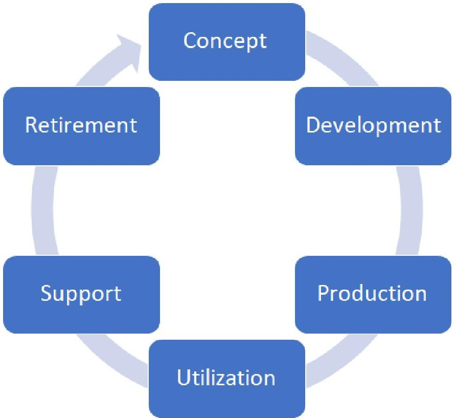


<div align="center">

Figure 1: The Generic Engineering Product Lifecycle

</div>

<!-- PDF_PAGE: 20 -->

There is substantial information generated during a product's lifecycle, spread across various organisations, who each have distinct roles and responsibilities to carry out, such as manufacturing or maintenance personnel [3]. Extensive organizational, cultural, political, and language boundaries between these parties can hamper their ability to exchange crucial knowledge, and therefore increase the likelihood of discrepancies and misunderstandings [4]. Efforts are ongoing by researchers to develop more effective strategies to share this information both across the different lifecycle stages, and between these organisations. For instance, information regarding the in-service and maintenance period of a vehicle could be useful for the conceptual design of the next model. However, it is difficult to develop and implement a strategy on collaboration and integration that satisfies the unique needs and operating characteristics of each individual company and lifecycle stage.

Coupled with the difficulties of sharing information, there has also been a significant increase in complexity and challenges for engineering product development. These stem from a variety of factors such as in the proliferation of more stringent expectations from customers, market competition due to globalization, and the rapid advancement of technological research and its implementation [5]. Unsurprisingly, these circumstances have put significant strain on resources and personnel. A modern aircraft for instance can be composed of over 700,000 parts, each with unique design files, manufacturing methods, and product structure, which all must be accessible during its ~50 year lifecycle [3]. Additionally, there is also data generated during other lifecycle stages, such as in-service maintenance, which may be essential for a future generation's design [6].

<!-- PDF_PAGE: 21 -->

The substantial amount of information available has led to engineering designers spending upwards of 60% of their time simply searching for the relevant information [7]. Engineering companies have thus become obligated to search for solutions to these data management challenges that span the entirety of the product's lifecycle. Two commonly utilized fields for addressing product complexity are systems engineering and Product Lifecycle Management (PLM). Both are relatively recent developments that prioritize collaboration and integration of people, processes, and information across the product lifecycle.

## 1.1.2. Systems Engineering: Origins and developments

Systems engineering has undergone substantial development in response to the aforementioned increase in engineering project complexity. Its streamlining of the collaboration activities between designers and the stakeholders enables a more efficient design process, and helps address the problems stemming from managing data. A holistic approach to the development and realization of these systems is essential for product development [8]. One of the most comprehensive and widely cited sources for this field is the NASA Systems Engineering Handbook which states "Systems engineering is a methodical, disciplined approach for the design, realization, technical management, operations, and retirement of a system" [9]. A systems engineer adopts a broad view of a design project, and is responsible for making system level design trade-offs and decisions. The handbook defines a system as "A construct or collection of different elements that together produce results not obtainable by the elements alone." [9].

<!-- PDF_PAGE: 22 -->

There are two primary challenges of systems engineering. The first is supporting the ability of engineers from different disciplines to work concurrently. Secondly, is balancing the need to iterate with the need to progress through the development phase due to schedule and resource constraints. A few example tasks carried out by systems engineers are verifying requirements, balancing design trade-offs, and developing the concept of operations. Systems engineering is distinct from other types of engineering; it is not rooted in the study of natural phenomena. Instead, systems engineering is an optimization problem, wherein the variables are client requirements, schedule and budget constraints, compatibility between two subsystems etc. Furthermore, said variables are not weighed equally, and thus an often-difficult decision must be made regarding trade-offs.

The International Council on Systems Engineering (INCOSE) Systems Engineering Handbook lists three aspects to satisfy for each lifecycle phase: the technical (product), budget (funding), and business (business case) aspects [10]. The systems engineer focuses on creating technical solutions that adhere to all three aspects. These types of unique features of the field have led to a slow recognition of its worth, with only relatively recent acknowledgement of its existence as an engineering field during the 1950s and 1960s [11].

## 1.1.3. Systems Engineering: Managing a design lifecycle

Although not always an expert in any traditional engineering discipline, systems engineers are considered multidisciplinary. They must have a working knowledge of the subsystems within their jurisdiction that allows them to manage collaboration between subsystems. These subsystems have their domain specific requirements to satisfy, but there are also requirements that are heavily dependent on external subsystems, or ones independent of

<!-- PDF_PAGE: 23 -->

any. In the aerospace sector, additional emphasis is put on designing in parallel and improving collaboration, resulting in the field of Concurrent Engineering (Section 1.3.2).

Systems engineering encompasses the entire lifecycle for the system of interest [10]. Consequently there are several different approaches they can utilize for managing complex systems via models representing the development process [11]. The following discussed models are ordered chronologically in respect to their development. There is a clear progression from a basic, linear interpretation of the lifecycle, to a more interconnective representation.


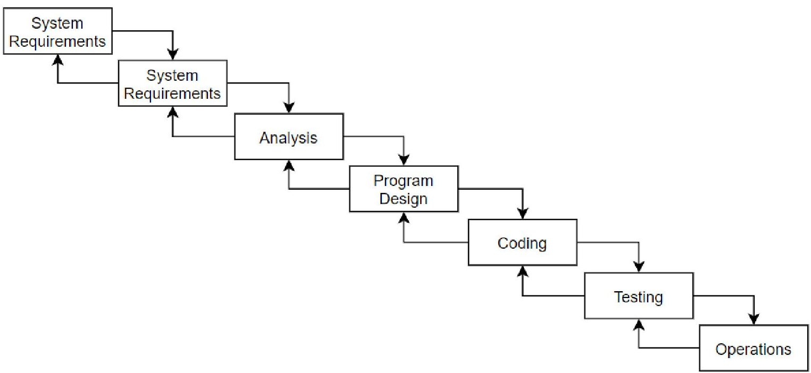


<div align="center">

Figure 2: The Waterfall Method

</div>

<!-- PDF_PAGE: 24 -->


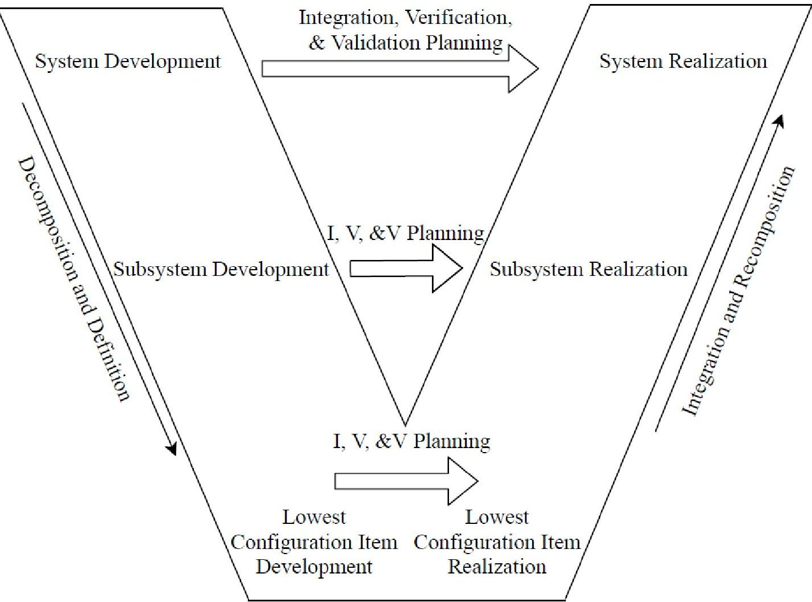


<div align="center">

Figure 3: The Vee Model, adapted from [12].

</div>

The Waterfall Method is one of the oldest system development models, and is perhaps best explored by Winston Royce [13]. The model emphasizes the proper documentation and awareness of requirements before beginning subsequent phases [12]. It also became a reference for defining these steps in the product development process, particularly in software design. Royce also emphasized the need for iteration during designing to accommodate inevitable fluctuations in requirements. The model has seen design process application outside software engineering, such as with the US Food and Drug Administration's Center for Devices and Radiological Health [14]. Despite these insights into the iterative nature of design, The Waterfall method oversimplifies the development

<!-- PDF_PAGE: 25 -->

process by adhering to a linear progression and a vague presentation of the iteration process. This sequential nature also lacks both inherent flexibility and acknowledgement of contributions from external disciplines, such as manufacturing [12].

A variation of the Waterfall Method, the Stage Gate approach, is designed using stages and gates [15]. Stages represent recommended activities performed in parallel, with each subsequent stage increasing in cost [16]. Between each stage is a gate, which serve as quality checkpoints where a deliverable is judged against a predetermined criteria, and a decision is made based on the results [16]. It is not a rigid process, as some of the gates and stages can be omitted, and activities can be shifted if there are long lead times [16]. One major advantage are the narrow iterations that reviews specifications early to help mitigate downstream issues [15]. However, this makes the method susceptible to cross phase risks as it is often difficult to incorporate feedback from later phases [15].

Created in response to outdated software development practices, the Spiral Model replaces the document-driven approach for software development with a risk-driven approach, with some projects seeing an increase of 50% in productivity when fully adopted [17]. The previous approach of creating code and fixing code as the two primary steps created a number of issues regarding usability, poor structuring, and overall time consumption [17]. The Spiral Model seeks to address these issues by first evaluating the risks for each step in the development process, assigning an appropriate amount of time and resources to address uncertainties, and emphasizing maximum collaboration between developers, users, and clients. The model promotes resolving issues regarding operational risks, requirements, and feasibility before proceeding through to the next stage of product development [12]. The graphical layout of the model aids in conveying its interpretation of the product

<!-- PDF_PAGE: 26 -->

lifecycle to a user. The radial dimensions of the spiral represent the cumulative costs of each step, whilst the angular quantities represent the progress in finishing each cycle of the Model. The spiral emphasizes how each phase of a development cycle utilizes the same process sequence. Its adoption has been within a wide variety of fields outside of software development, such as ship design [14]. The shortcomings of this model are its lack of development and management of architecture, as well as the lack of concurrency regarding risk and opportunity assessment [12].

The Vee Model was proposed after the Spiral Model, due to issues stemming from the lack of ability to manage complex systems and Concurrent Engineering (CE) processes, and the ignorance of systems engineering as a whole [18]. Before the introduction of the Vee Model, previous models generally presented an incomplete and obscure representation of systems engineering and the design process, and were rejected by numerous project teams [18].

The Vee Model emphasizes the relationships between tasks and their accompanying verification processes. It visualizes the systems engineering practices, with particular emphasis on the product concept and development stages [10]. The left side of the model represents the definition of the system in increasing levels of detail. The right side portrays the testing, integration and validation of the product from the lowest sub assembly level to the full product assembly. After each phase, validation, verification and testing plans are made on the left side and executed on the right at a later stage. Iterations during conceptual design are modelled by proceeding 'up and down' the model. The Vee Model takes into consideration the product's manufacturing, design iterations, details variation, and task sequencing. Each result of the risk reduction step, if approved by the customer, becomes

<!-- PDF_PAGE: 27 -->

baselined [18]. This model more accurately represents the design process, and thus it better supports the systems engineer in designing, managing and integrating complex engineering projects. The Vee Model is more suited for product development capabilities than the previous models, but provides less guidance for later lifecycle phases.

A more recent concept, Agile manufacturing is a dynamic process that prioritizes the efficient production of a wide range of products to meet challenging customer expectations [19]. Its intent is to maximizing profits and market shares within a highly competitive setting [19]. Agile breaks up large sections of the product development process into smaller phases known as sprints. This allows for a better structure and tracking of the product during its design, all within a collaborative setting [20]. Recently, the introduction of the Agile process in product development has become more prevalent in an attempt to improve upon the classic Vee Model [20].

Though their approaches differ, the ultimate objective of these models and methods remains the same. They are used primarily by systems engineers and project managers to structure the development process and track the design progression. Systems engineers can use them to manage the activities of the development and design teams, and ensure that they are properly integrated with one another, as well as the requirements stemming from later stages, such as manufacturing and testing. An example of this being how the testing of a prototype can be more efficient and effective if appropriate testing plans for each part are created earlier during the design process. This awareness and implementation of considerations from other lifecycle stages and organizations is critical for managing complex product lifecycles.

<!-- PDF_PAGE: 28 -->

## 1.1.4. Product Lifecycle Management

The effort to better integrate all the stages of the product's lifecycle resulted in the development of Product Lifecycle Management (PLM) systems. PLM systems' primary objective is to capture and share product lifecycle data in order to make relevant information available to companies and stakeholders when required, and in a form suitable for their function [21]. It allows for the global assignment of development, manufacturing, distribution, maintenance and disposal activities. The concept of PLM began after the introduction of systems engineering, both are intended to manage complex products. As previously discussed, systems engineering is primarily concerned with creating and overseeing various engineering requirements, as well as defining system interfaces and artifacts. PLM differentiates itself via its product-centric perspective based on physical properties that is less influenced by a particular functional area, such as design, manufacturing, or maintenance [22].

Grieves defines PLM as "An information management system that can integrate data, processes, business systems and, ultimately, people in an extended enterprise. PLM software allows you to manage this information throughout the entire lifecycle of a product efficiently and cost-effectively from ideation, design and manufacture through service and disposal." [23]. PLM tools are widely used by companies to manage product development and service processes from cradle to grave [24]. The primary incentives for adopting PLM are the reduction of both the product development cost, and its time to market, as well as an improvement in overall quality of the product [25].

<!-- PDF_PAGE: 29 -->

As it encompasses the entire product lifecycle, PLM adopts a holistic approach; this principle is important for any future tool developments in the field. For any phase of the product lifecycle, these tools will need to accommodate the method by which the PLM system stores and structures information. Due to the advantages and wide use of PLM, it is generally prudent for a systems engineering tools to effectively integrate with PLM software.

PLM originally evolved from Product Data Management (PDM) systems. These were mostly used to support the burgeoning Computer Aided Design (CAD) centric workflows and databases in the mid 1980s [26]. CAD and Computer Aided Manufacturing (CAM) companies, such as EDMVault from Computervision and Metaphase from SDRC, were the pioneers of this technology that would eventually become PLM [3]. While useful within these settings, they had issues properly integrating with other departments, and outside the organisation due to the exclusive focus on CAD files and the complex nature of the software [26]. They also suffer from a lack of function, behaviour and structure representation, and limited support of knowledge reuse [27].

One of the earliest instances of PLM came during the 1990s with the automotive industry via the deployment of supplier's networks for manufacturers [24]. The integration of suppliers and manufacturers during the product's development phase allowed for improved communication of requirements and feasibility. During the 1990s, Airbus Group's PLM efforts yielded improved integration of geometric formats, better support of workflows and engineering processes, as well as more effective collaboration software [3].

<!-- PDF_PAGE: 30 -->

More recent PLM developments have explored the relationship between manufacturing and operations phases, such as suppliers shifting towards providing a service, rather than a complex product [28]. There has also been an accompanying shift of the nature of design information from product to service based [29]. Suppliers and manufacturers are taking more of an active role in the operation and service phases of the product. In the global market of air transport, the integration of products and services is now seen as being necessary for the long-term success of engine manufacturers [30].

In order to provide a more consistent service, PLM seeks to integrate all the various data management software and practices used during a product's lifecycle, including CAD, CAM, Manufacturing Process Management (MPM), and Enterprise Resource Planning (ERP), amongst many others [31]. However, there are persistent issues in achieving this even with modern technology. One ongoing challenge associated with this endeavour is the variety of data types used by each company. The Bill of Materials (BOM) is a common document in engineering whereby each component is given a part number, and all relevant product data associated with it is included in a product structure format. They can be used extensively by PDM and PLM systems to view the geometric arrangement and configuration of the assemblies by their parts. Figure 4 shows an example BOM:

<!-- PDF_PAGE: 31 -->


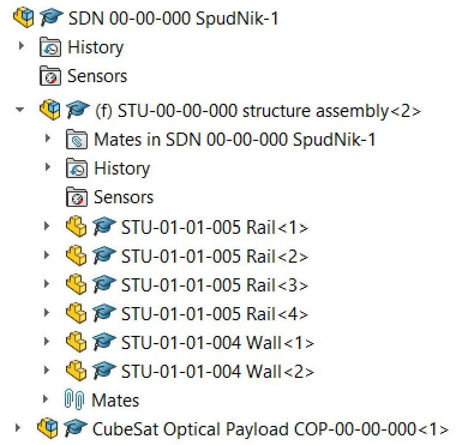


<div align="center">

Figure 4: An example BOM seen in CAD software.

</div>

The arrangement of the BOM varies across departments, and thus the data framework changes as well. The Engineering BOM is organised to the as-designed structure, whilst the Manufacturing BOM is arranged as-planned by manufacturing strategies [31]. Thus, an assembly's BOM can be accessed by both manufacturing and design departments, but the method by which the components are arranged is different for both.

The notion of a single PLM system incorporating all the information of the product over its entire lifecycle has still not been realised for the aerospace industry [3]. One of the difficulties in implementing a new PLM solution is the sheer scope of the endeavour. Due to pre-existing methodologies, software, and personnel training, the notion of creating an effective PLM tool that will seamlessly integrate with a project can be daunting. PLM systems can still delegate the handling of product description to PDM systems, and of these instances, many are solely reliant on the CAD model for geometric information [32]. A

<!-- PDF_PAGE: 32 -->

more effective strategy could be to perform isolated trials on the different lifecycle phases to assess the effectiveness of a new tool. Studies have shown that when considering all of the processes of a product's lifecycle, the most influential in determining a company's success is the product development process, specifically the conceptual design phase [33].

## 1.2. Conceptual Design

## 1.2.1. Context of Conceptual Design within the Product Development Process

The engineering design process involves a wide variety of personnel, requirements, information, and products. The amount of information available to engineers has never been higher, yet the product design process is often ill defined and the expectations are always increasing in scope and complexity [27], [30]. Modern designers must accommodate faster turnaround time, lower margin for error, greater efficiency in managing product and design processes, and a greater need to collaborate in multi-disciplinary teams [34]. Consequently, the most technically complex projects are often the ones that are most susceptible to these issues [35]. Product development capabilities in tandem with the effective management of critical processes are vital to meet modern expectations [36].

In the aerospace industry, the design process can be divided into 4 sections, these being Concept Studies (Conceptual Design), Concept and Technology Development, Preliminary Design and Technology Completion, and Final Design and Fabrication [9]. Conceptual design is the earliest of the design phases, and is the first step once a project proposal has been approved. During this process there is a fine balance that needs to be maintained

<!-- PDF_PAGE: 33 -->

between the freedom to iterate, and the need to track the design process and control changes. Chakrabarti and Bligh define conceptual design as "The activity of transforming the functional requirements of a design problem into a solution concept or concepts for fulfilling the requirements" [37].

Although there is a relatively small amount of expended resources during conceptual design, relative to later development stages, it still has a substantial impact on the business and budget aspects. Committed costs are decisions made early in the process which determine costs coming later in the lifecycle. Conceptual design has the largest impact on total lifecycle costs [34]. As shown in Figure 5, it can encompass 70% of committed costs [10].


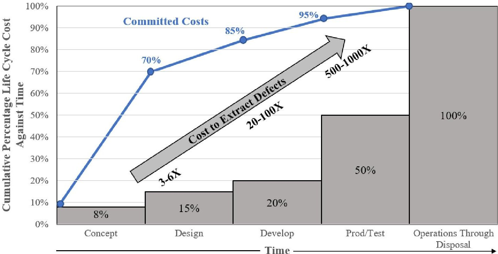


<div align="center">

Figure 5: Committed Costs during the product lifecycle adapted from [10]

</div>

Costs to extract defects also increase exponentially during the PDP. Rehman and Yan consider the conceptual design phase to be the most important lifecycle phase due to these

<!-- PDF_PAGE: 34 -->

effects on downstream stages [38]. It is thus prudent to allocate significant attention in attempting to optimize the conceptual design process due to its high impact on the rest of the PDP.

The transition from conceptual design to concept and technology development involves the generation of system and subsystem level requirements, and the proposed plans for satisfying them. These objectives provide a higher-level structure that guides the more detailed design work in later stages. Engineers should be aware during conceptual design that their work will need to be integrated into later lifecycle phases [38]. Despite its substantial influence on the PDP, the availability of fully developed of conceptual design support tools remains limited [34], [27], [39], [14].

## 1.2.2. The Nature of Conceptual Design Data

It is necessary to explore the types and usages of conceptual design data in an attempt to facilitate both the support for collaborative activities, and improve the ability to access information. The conceptual design phase has both the most options for design direction, and the least amount of total product data present [37]. Compared to later stages, conceptual design has an abundant amount of uncertainty and vagueness [34]. The conceptual design phase is especially iterative in nature, thus the product definition is in a constant state of flux [39]. This allows conceptual design to more readily accommodate and implement novel proposals, and it is thus unique in its status as an intrinsically creative process [40].

The precise type of information present during the conceptual design of space systems has become of interest to researchers seeking to promote modern CE strategies (Section 1.3.3).

<!-- PDF_PAGE: 35 -->

Facilitating the exchange of this information between design teams during the iteration process can lead to a more efficient conceptual design phase. Recent studies have shown that at the conceptual design stage there is a relative lack of data referring to the physical dimensions of a system (geometric data) being exchanged between subsystem design teams [41].


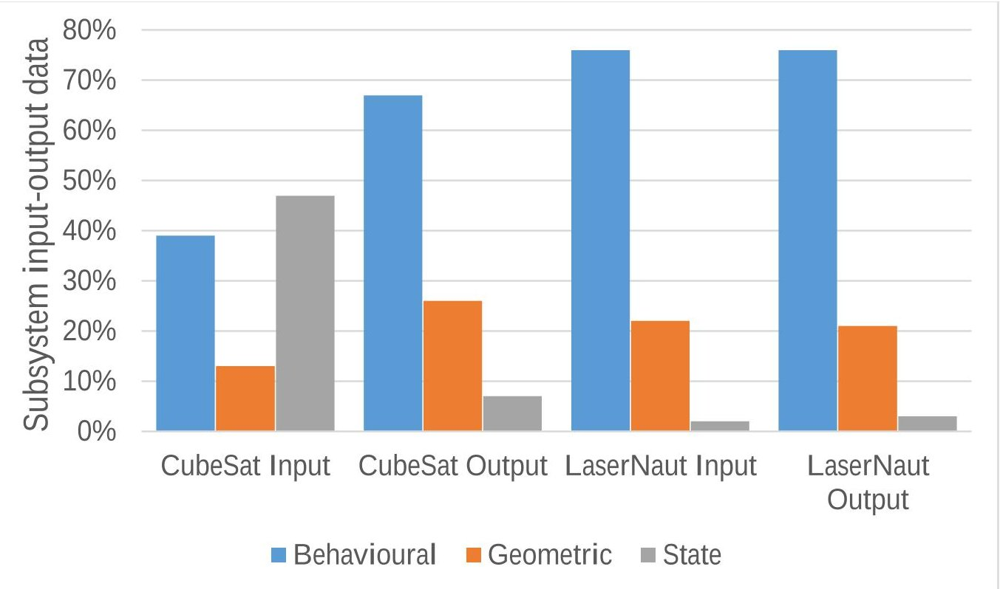


<div align="center">

Figure 6: Classification of Conceptual Phase Data, adapted from [41].

</div>

As seen in Figure 6, the study also concluded that behavioural data was significantly more prevalent. Behavioural data refers to information describing physical phenomena and its underlying equations. A product at the conceptual design stage can go through substantial iterations. Thus, a subsystem's intended behaviour is less likely to change during the design process than its physical definition. As the physical architecture of the product becomes realised in later stages, the presence of geometric data may increase. Ulman considers a concept to be "An idea that is sufficiently developed to evaluate the physical principles that

<!-- PDF_PAGE: 36 -->

govern its behavior” [42]. This accentuates how conceptual designers should focus on behaviour to satisfy functional requirements, before the geometric layout of a design becomes too restrictive.

As discussed in Section 1.1.4, PLM evolved from CAD tools, with a data management system commonly based on product structure. Although modern tools have incorporated functionalities such as change and configuration management, PLM systems are still largely reliant on these geometric model focused databases [1]. This implies a discrepancy arising from using geometry-based PLM tools in a design phase where behaviour is crucial. Despite the substantial impact the conceptual design process has, the associated numbers of dedicated support tools remains small [43]. Additionally, the software lacks the ability to draw conclusions from the relatively less defined data available during conceptual design. [43]. There is therefore a need for a tool that does not substantially rely on geometry for structuring its data, and is capable of carrying out typical data management functionalities such as creating subsystem model interfaces.

## 1.2.3. Conceptual Design Activities and Methods

According to the NASA Systems Engineering Handbook, the objective of conceptual design is "to produce a broad spectrum of ideas and alternatives for missions from which new missions/programs can be selected" [9]. Decisions during this period are unique in that, instead of primarily optimizing design variables as seen in later design phases, choices must also be made between various design concepts [34]. There can be an extensive number of design proposals, with studies showing a positive correlation between the amount of proposals and the eventual design quality [30]. Unsurprisingly, the process of

<!-- PDF_PAGE: 37 -->

generating and selecting a proposal is substantial, and therefore there has been significant research conducted in an attempt to optimize the process.

Multi Criteria Design Aid (MCDA) methods were created to aid engineers in making these crucial decisions. Kim & Lin [44] propose a mathematically rigorous, and systemically well-defined process via which 'Desirability Functions' are plotted based on experimental variables. Following this, the algorithm would optimize the variables to produce an array with the most desirable input variables for the design.

Fernandez et. al discuss another mathematically grounded method, the utility-based selection decision support problem (u-sDSP) construct for supporting decision making [45]. The DSP attempts to assign numerically derived variables to design attributes in order to systematically analyse their effects. The u-sDSP is shown to effectively support the decision process of a rapid prototype design example, and shifts reliance on product structure towards product behaviour and functionality. However, there is inherent subjectivity with u-sDSP when quantifying design variables, and its lack of models for representing systems and their interfaces limits its application within contemporary systems engineering practices (Section 1.3).

Rizzi and Regazzoni discuss the 'Theory of Inventive Problem Solving', or TRIZ, method for the extraction and formalization of knowledge [36]. TRIZ adopts a less direct approach to solution generation by intentionally increasing abstraction level and proposing a general solution. The specific problem can then be addressed via discarding the non-essential details and extracting a distinct solution.

<!-- PDF_PAGE: 38 -->

Rehman and Yan discuss the 'Function to Means Mapping Model' to support decision making that emphasizes the need to access design knowledge [38]. The four stage process involves transforming functional requirements into Product Design Elements that are used to reference similar models via a product library. This allows for the identification of the needed Product Design Element alterations, which in turn can be evaluated using the Analytic Hierarchy Process. While the implications of this method are interesting, the reliance on a complex product library limits its implementation in a generic design situation.

There have been a wide variety of methods proposed to support the development and selection of conceptual design proposals. In an attempt to better categorize the issues encountered during this activity, Chakrabarti et al identified three reasons as to why designers do not consider a concept as a potential solution during proposal evaluation [37].

1 - Their bias towards specific solutions.

2 - Their lack of awareness of other solutions.

3 - The impossibility of manually considering more than a few solution alternatives within the given time constraint.

These factors are indicative of a more holistic approach to conceptual design that attempts to utilize the substantial amount of information available to a modern engineer. The ability to retrieve and incorporate relevant data from similar projects can accelerate the concept development phase considerably. Thus the ability to access, and understand the lifecycle data of a similar design can be crucial in meeting the substantial requirements of modern

<!-- PDF_PAGE: 39 -->

engineering projects. As previously discussed, integration of information from previous projects is one of the primary factors for reducing required product development time [7]. The ability to understand knowledge regarding the design context is essential for a successful design proposal [38]. Designers will often tend to base a design of off previous successful products instead of searching for alternative solutions [27]. While catalogues of existing designs are available, they often only provide the end state of the product. Information regarding processes and decisions leading up to the end state are limited, if present at all [37]. Studies have shown that engineers have significant challenges simply both knowing where to look for information, as well as accommodating information overload [46].

## 1.3. Modern tools and practices for supporting conceptual design collaboration

## 1.3.1. Model Based Systems Engineering

Systems engineering has had a profound impact on complex engineering projects, yet the process of managing and representing the accompanying data files has become increasingly difficult to perform. There is still substantial documentation used to represent complex systems, with examples including interface control, test plans, and requirements documents. Approximately 90% of organisational memory exists as text-based documentation [7]. A product's documentation may have incomplete information, and thus additional verification phases are required to assure adherence [47]. Documents are also liable to ambiguity due to misinterpretations of the author's terms. Traditionally, complex projects exchanged crucial data such as requirements and design information via these

<!-- PDF_PAGE: 40 -->

documents, which must be continuously reviewed to ensure validity and compliance [48]. There are issues regarding completeness, consistency, and relationships in the design data as the information is typically spread across several, or more, documents. This makes it difficult to manage requirement, product, analysis, and testing information for a complex product [49].

There has been a significant effort to transition towards the use of models which are simplified representations of a domain of interest tailored to a specific point of view [8]. There is substantial literature attesting to the effectiveness of models in supporting a designer's ability to understand and manage complex systems [8]. One of the most effective and widely used system engineering approaches is Model Based Systems Engineering (MBSE), which focuses on the collaboration of personnel via domain models. MBSE seeks to integrate discipline-specific models and tools into a model based software that represents relevant information, and is consistent across the product lifecycle [50].


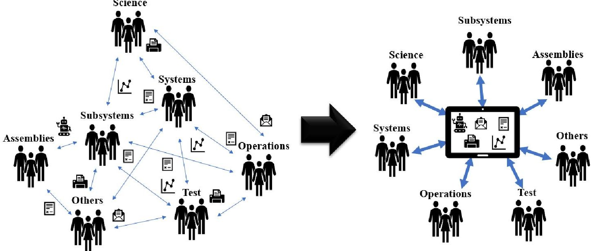


<div align="center">

Figure 7: Document and Model based comparison, based on figure from [51].

</div>

<!-- PDF_PAGE: 41 -->

INCOSE defines MBSE as "The formalized application of modeling to support system requirements, design, analysis, verification and validation activities beginning in the conceptual design phase and continuing throughout development and later life cycle phases" [52]. The recognition of the benefits of MBSE, and its ensuing implementation into systems engineering is becoming increasingly more prevalent [50]. These benefits include "Enhanced communications between the stakeholders and team members as well as a true shared understanding of the domain, improved knowledge capture, design precision and integrity without disconnections among the representations of data, better information traceability, enhanced reuse of artifacts, and reduced development risk" [8]. In an effort to better utilize MBSE, companies have begun a transition from static documents to model based data [52]. With the shift away from document-based systems engineering, the importance of software to consolidate and share these models has never been more critical.

The use of models within engineering design typically consists of two types. The first are abstract, semantic models which enable conceptual design framework generation. The second are numerical based and are relatively well defined allowing for parametric equation implementation [53]. MBSE has a variety of graphical languages that each have distinct ontologies that allow for effective collaboration without excessive misinterpretations or failure to represent relevant data. What the constructs represent, the types of relations between them, and the domain of the models i.e. the semantics, syntax, and ontology, can vary between languages. Modern MBSE efforts seek to integrate the models from a wide variety of engineering domains including structural, behavioural, performance, and cost models, to name a few. One of the most prominent languages in

<!-- PDF_PAGE: 42 -->

MBSE is the Unified Modelling Language (UML), managed by the Object Management Group (OMG). UML evolved as a graphical modelling language in software engineering, and its use spread into systems engineering. However, issues persisted with its limited ability to represent non-software constructs, and thus it struggled to support parametric equations and requirements modelling, as well as physical interconnections [54], [8].

Ongoing efforts to improve upon UML resulted in the development of the System Modelling Language (SysML). SysML was developed specifically for MBSE to represent the system model across the lifecycle [55]. SysML provides more capability for describing systems compared to UML, able to represent structure, behaviour, requirements and parametric models [10]. It organizes its language into the following units [48], and is based on the sequence diagram shown in Figure 8.

<div align="center">

Table 1: SysML Language Units.

</div>

<table border="1"><tr><td>Requirements</td><td>Text based requirements with their relationships to each other, and to other models.</td></tr><tr><td>Blocks</td><td>System properties and structure.</td></tr><tr><td>Activities</td><td>Extensions to support continuous behaviour.</td></tr><tr><td>Constraints Blocks</td><td>Parametric models.</td></tr><tr><td>Parts and Flows</td><td>Extensions to model to support the flow of information matter, and energy between the system elements.</td></tr></table>

<!-- PDF_PAGE: 43 -->


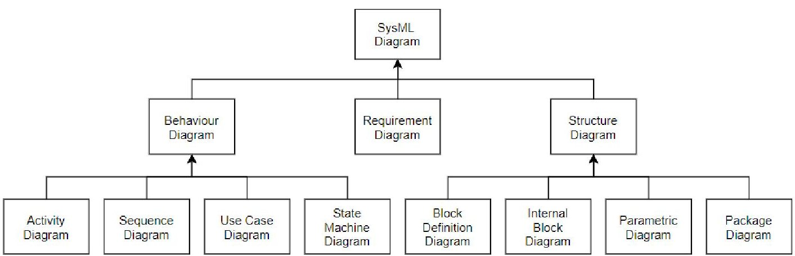


<div align="center">

Figure 8: SysML Diagram adapted from [48]

</div>

SysML is significantly more effective in representing the various design artifacts that may compromise modern complex products. The SysML System Model has been shown to be able to integrate effectively with a systems development environment [48]. This allows it to act as a central repository hub via which users can more easily track and manage design data. Ongoing developments by INCOSE include the development of SysML 2.0. SysML 2.0 seeks to improve upon previous iterations by allowing for increased analysis integration, a geometric view of the product, and improved integration between behaviour and structure, to name a few [56]. To further explore their uses, a variety of models based on UML and SysML have been proposed in literature. Rachuri et al discuss the NIST Core Product Model (CPM), for representing products [32]. Figure 9 shows the UML entities for CPM:

<!-- PDF_PAGE: 44 -->


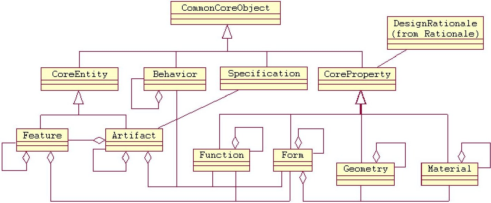


<div align="center">

Figure 9: Core Product Model Diagram [32].

</div>

The CPM is a generic representation of the product, and is not primarily reliant on geometric data, but rather incorporates behaviour and functionality into its structure as well.

Mhenni et al propose a SysML based methodology for supporting mechatronics system design [57]. The study illustrates how SysML can effectively represent a variety of different systems such as requirements, behaviour, physical structure etc. Moreover, the study shows the potential for MBSE to integrate multidisciplinary specialists to support the design of complex electromechanical products.

## 1.3.2. Concurrent Engineering in Aerospace

Bandecchi, Melton, Gardini et al. define Concurrent Engineering (CE) as "A systematic approach to integrated product development that emphasises the response to customer expectations. It embodies team values of co-operation, trust and sharing in such a manner

<!-- PDF_PAGE: 45 -->

that decision making is by consensus, involving all perspectives in parallel, from the beginning of the product life-cycle” [49]. Space agencies that have adopted CE strategies have experienced a compression of the conceptual design analysis from six to nine months down to just three to six weeks [58]. CE methodologies have been adopted by both the European Space Agency (ESA) and NASA, and it has been recommended by one of the most widely referenced aerospace design handbooks [59]. Concurrent design of products and processes has thus been highly recommended in the aerospace industry, and successful companies today are those that are able to manage concurrent activities in an intra- or inter- organisational network whilst delivering value to the marketplace.

Insights into the nature of CE have been known for several decades, with similar conclusions regarding its implementation as today, despite a far less digital based design environment. The Institute for Defense Analysis stated in an investigation from 1988 that "Concurrent engineering is a systematic approach to the integrated, concurrent design of products and their related processes, including, manufacture and support" [60]. This approach encourages developers to consider all elements of the product life cycle from conception through disposal, including quality, cost, schedule, and user requirements [60]. CE emphasizes parallelization of the designing and developing stages of a product. It relies on a set of operating principles that encourage the incorporation of downstream concerns into upstream phases of a product's lifecycle [61]. Upstream issues that may prevent the realization of a design such as cost constraints and procurement challenges need to be addressed as early as possible. Thus, the incorporation of support disciplines such as cost engineering and manufacturing are imperative to CE [62].

<!-- PDF_PAGE: 46 -->

Two key aspects of CE are the integration of resources (people, tools and processes) and a real time and simultaneous exchange of product data [62]. The scope of the method involves more than just tools and facilities, it emphasizes the importance of teamwork within a design setting [53]. Collocating teams of design experts, either physically or virtually allows for rapid design iterations due to improved quality and rapidness of communication.

The capability for users to access a data repository continues to improve, with the past decade projected to more than double the number of employees working outside of an office [2]. The ability of CE to not only utilize, but also thrive off the advances of modern information technology has substantially augmented its effectiveness [49]. Most of the analysis required for a conceptual design, or pre-Phase A, study can be accomplished remotely via computers, utilizing MBSE [63].

In their survey of CE in the space sector, Knoll et al found that human factors were a vital component of success, including traits such as leadership, teamwork, and personal relationships [63]. These factors are difficult to study and address, as many of the aspects fall out of the scope of systems engineering. The ability of concurrent engineering tools to allow for simultaneous editing and integration with analytical tools was still regarded as lacking by the aerospace participants.

The variety of concurrent engineering tools is continuously being expanded. The ESA's Open Concurrent Design Tool (OCDT) is an Excel $ ^{\mathrm{TM}} $ based software that uses parametric models to streamline the creation of a fully integrated space system model [64]. It supports basic simulation and analysis, and allows for more than 20 concurrent users, all

<!-- PDF_PAGE: 47 -->

synchronized via a PostgreSQL database system. Valispace is another recent software tool that offers similar features, but on a web based user interface instead [65]. Both tools emphasize supporting the concurrent design of satellite system, using behaviour as the focus of their parametric models [66].

## 1.3.3. CEDESK: An aerospace collaboration software

CEDESK (Concurrent Engineering Data Exchange Skoltech) is an open sourced collaboration tool developed by Dominik Knoll and Nikolay Groshkov at Skolkovo Institute of Technology. It is primarily a data exchange software to allow for the implementation of CE practices in a complex engineering project, with a focus on the conceptual design of satellites [66]. CEDESK model entities are representations of the system structure, parameters with their links, units of measure, users, and roles [67]. Figure 10 shows the layout of the graphical user interface.

<!-- PDF_PAGE: 48 -->


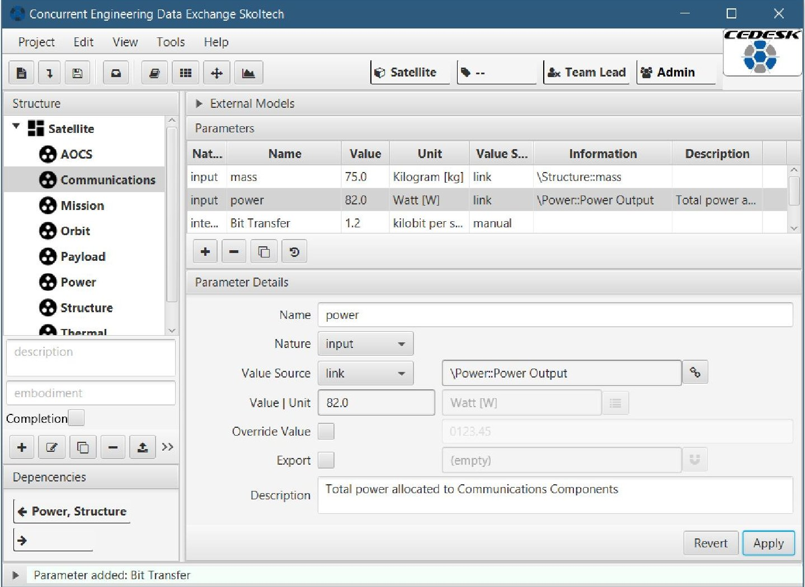


<div align="center">

Figure 10: CEDESK Graphical User Interface

</div>

CEDESK incorporates many of the previously discussed methodologies and strategies related to MBSE and concurrent engineering. Specifically, it outlines the properties of a system, as well as the roles, disciplines, and architecture involved in space system design. The software is well constructed, and there is significant information available regarding its design rationale and the implications regarding its usage in various studies.

Based on previous experience in CE, the fundamental requirements for CEDESK were "User friendliness, easy synchronization, data compatibility and integration with third party engineering tools" [67]. Pilot studies using CEDESK as a data exchange tool for

<!-- PDF_PAGE: 49 -->

students tasked with designing a constellation of communication and observation satellites. Some of the relevant observations made these trials were:

1 - The interface definition of the subsystem and the satellites, would change during the study, and were difficult to define properly.

2 - Participants were inclined to explore advanced technical solutions, rather than existing spacecraft.

3 - The procedures of both CEDESK and concurrent engineering, as well as a sound understanding, need to be emphasized for effective use.

The most essential resource for successful implementation are the people involved in the project, engineers, scientists and consultants [63]. While software improves the feasibility and effectiveness of such strategies, their usefulness is severely lessened without proper application and training of the users. User traits such as discipline expertise, software training, and ability to work in a team environment are essential for an efficient product development process.

CEDESK clearly lays out the subsystems and their relevant parameters within the GUI. Input-output dependencies are incorporated to allow for inter subsystem data tracking. It incorporates an N Square Chart that clearly shows these interdependencies in a graphical view. CEDESK can also link parameters to third party tools like Microsoft Excel $ ^{\mathrm{TM}} $ to integrate with external parametric models. A well constructed software tool being able to seamlessly access external data without the need to manually search and open it is reminiscent of the central repository hub shown in Figure 11Figure 11. Lastly, a Design

<!-- PDF_PAGE: 50 -->

Structure Matrix is incorporated to show an optimal route in which to complete certain tasks based on their dependencies.


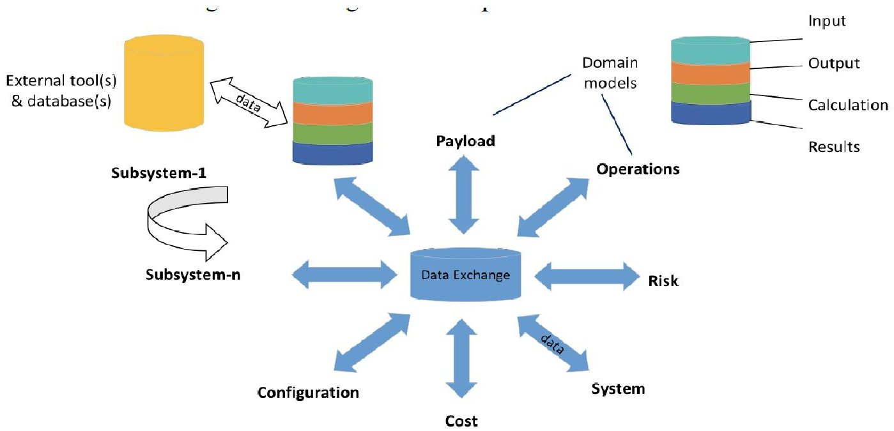


<div align="center">

Figure 11: A central repository for the consolidation of design data [49].

</div>

Recently, CEDESK has been used to evaluate the premise of the Extended SAPPhIRE Model (discussed in Section 1.3.4) as a data structure to support conceptual design activities [41]. The results of this study have warranted additional research into developing a software tool for supporting conceptual design with a system architecture based on the SAPPhIRE Model. While CEDESK's elements served as adequate approximations, the potential of SAPPhIRE would require a customized software tool to allow for a true representation, and ensuing evaluation (Chapter 4).

<!-- PDF_PAGE: 51 -->

## 1.3.4. The SAPPhIRE Model: A proposal for consolidating engineering design during the Product Lifecycle

Chakrabarti and Bligh introduced an approach for the synthesis of mechanical solutions that focuses on a systematic process [37]. Concisely, the procedure focuses on identifying the primary functional elements of a system and creating possible configuration rules for them. These elements can thus be synthesized in accordance with these configurations to generate a possible solution to the given functional requirement(s). The common language approach to this design synthesis is rooted in a fundamental sequence whereby inputs are transformed by a function into outputs. This approach can be validated by using previously accepted designs. If the solution, Z, can be obtained by manipulating the design constructs, X, according to the configurations, Y, then the knowledge can be considered validated. Ideally, this approach of extracting and manipulating design knowledge would also produce novel proposals.

This idea of representing complex design knowledge focusing on its function would lead to the development of the SAPPhIRE Model. SAPPhIRE (change of State, Action, Part, Phenomenon, Inputs, oRgans and physical Effects) is the result of research into developing an engineering tool for stimulating the generation of innovative designs. The model was first proposed as a functional representation of biomimetic and artificial systems [68]. It is designed based on a Function-Behaviour-Structure (FBS) model. The original SAPPhIRE is shown in Figure 12.

<!-- PDF_PAGE: 52 -->


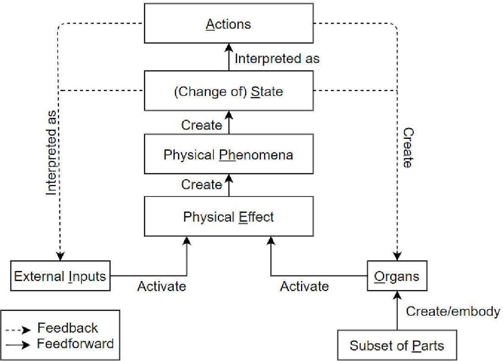


<div align="center">

Figure 12: The original SAPPhIRE Model [68].

</div>

The primary drivers of the model are the Physical Effect and Physical Phenomena, which are both descriptions of the underlying behaviour of the system. If one were to model a convective heat transfer system, the 'Physical Effect' would be the convective heat transfer equation, and the 'Physical Phenomena' would be a textual description of the phenomena, such as 'The hot air flows across the solid body, causing a transfer of heat energy from the air to the body'. In the model, there are two prerequisites in order to activate this behaviour. The first is the 'Input', which takes the form of a signal, energy, or material that flows through the system. From the previous example, the input could be the temperature gradient between the fluid and the body. The second prerequisite is the 'Organ', which is the physical context necessary for the behaviour to occur, for example the Nusselt number, or the shape of the body. The Organs are derived from the 'Subset of Parts', which represent the physical constructs of the system e.g. the body itself. The 'State' is the value(s) of the system that define its properties at a given time e.g. the measure of the body's temperature

<!-- PDF_PAGE: 53 -->

as determined by the Physical Effect. Lastly, the 'Action' is an abstract description of the interaction between the system and its environment i.e. the increase in temperature is interpreted as 'the body heats up due to convective heat transfer'.

The objective of the original SAPPhIRE Model is to support biomimetic practices and implement it into mechanical product design. Incorporating the design structure of natural entities has potential for creating inspiration in a systematic way, and thus can more consistently introduce novel proposals to ongoing design challenges. Inspiration is a difficult term to describe, yet its importance for innovation and the continued advancement in scientific research is substantial. During their investigation of computer aided conceptual design, Vuletic et al concluded that "Creative problem solving makes unexpected connections between seemingly unrelated concepts" [39]. To address this, Chakrabarti et al proposed exploring the means of analogy, whereby the comparison of two or more entities can lead to inspiration. A fundamental aspect of analogy is that typically there is an inverse relationship between the similarities of two entities, and the potential for novel insights. For engineering innovation, an example of this is the current lack of consideration of entities from the natural domain as sources of inspiration for most complex projects [68].

Chakrabarti et al provide an example for drawing parallels between natural and artificial beings. Functionality proves to be a consistent link between biological and artificial entities, and thus an ideal common denominator via which effective analogies can be made [68]. The example case study within the paper of a Dionaea muscipula (Venus Flytrap) and a Variable Speed Driver highlights their functional similarities, despite the extensive physical differences between them [68]. The proof of concept is demonstrated by these artificial and natural systems being catalogued with equivalent categories.

<!-- PDF_PAGE: 54 -->

One advantage of the SAPPhIRE Model is its ability to convey a product's functionality in various ways. Deng (2002) identifies 2 methods of viewing a function [69]:

Semantic views: The functional definition of an entity is derived from its inputs and outputs. For instance, via observing the transformation of a satellite's orientation from tumbling to detumbling, one could surmise the purpose of reaction wheels without prior experience. The semantic view is captured by the Inputs and State elements.

Syntactic view: Abstract and formal descriptions of a component are used in conjunction to convey function. Abstract descriptions are tailored to be understood by 3rd party clients with limited knowledge in a verb-object format. The formal description typically takes the form of a mathematical transformation. These abstract and formal descriptions are inherent to the Action, Physical Phenomena, and Physical Effect elements.

SAPPhIRE utilizes both behaviour and functionality in its description that allow for a richer depiction of abstraction. In essence, functionality describes the intention of the behaviour, but at a higher level of abstraction that does not require substantial expertise to understand. This supports non-familiar personnel in acquiring a basic understanding of a design even with limited prior research or knowledge e.g. the purpose of an image sensor can be derived based on its transformation rays of light into image files. For the purposes of this paper, the interpretations of function, behaviour and structure are as follows, derived from [68]. The function is an abstract description of the intended action of the entity. The behaviour refers to the underlying scientific laws governing the action of the entity. Lastly, structure refers to the entities and their interfaces that constitute the system as defined by its system boundaries.

<!-- PDF_PAGE: 55 -->

While FBS models had already been proposed by various authors [69], [70], with some success, Chakrabarti et al identified the lack of representation of causality within these models [68]. For the purposes of this research, a rich depiction of causality allows a user to envision and understand how changes to an interface or entity would propagate and affect the design domain. Existing proposals considered causality to be implicit and synonymous with every specific FBS model. SAPPhIRE offers a richer description of causality by considering it to be separate from the FBS model and allowing it to be portrayed via different levels of abstraction. This manifests in Input/Outputs, the function that transforms an input to an output, and the Change of State. Thus, the SAPPhIRE Model enables flexible representation at different layers of abstraction.

Since its introduction, multiple individual modifications of the SAPPhIRE Model have been developed for various applications. In an effort to better understand the use of in-service product performance data for redesigning, Jagtap and Johnson found that this data was mainly composed of physical actions, akin to behaviour [6]. The study of the designers concluded that information provided by the in-service phase, such as deterioration effects, were identified and targeted by the designers to mitigate future occurrences. The SAPPhIRE Model proved to be effective in understanding the causal chains that underlined this behaviour.

These research efforts culminated in the introduction of the Sym-SAPPhIRE Model. It introduces an additional element, the 'stimuli', which is defined as "input context necessary for a physical effect to be activated in the presence of the relevant organs" [30]. The effectiveness of the model at facilitating the design of future products using in-service information was then evaluated by using Sym-SAPPhIRE. Jagtap et al studied its support

<!-- PDF_PAGE: 56 -->

in clarifying tasks, generating design proposals, searching for similar components, identifying deteriorations, and linking in-service experience to design rationale [30]. The Sym-SAPPhIRE Model, along with an example, are shown in Figure 13 and Figure 14.


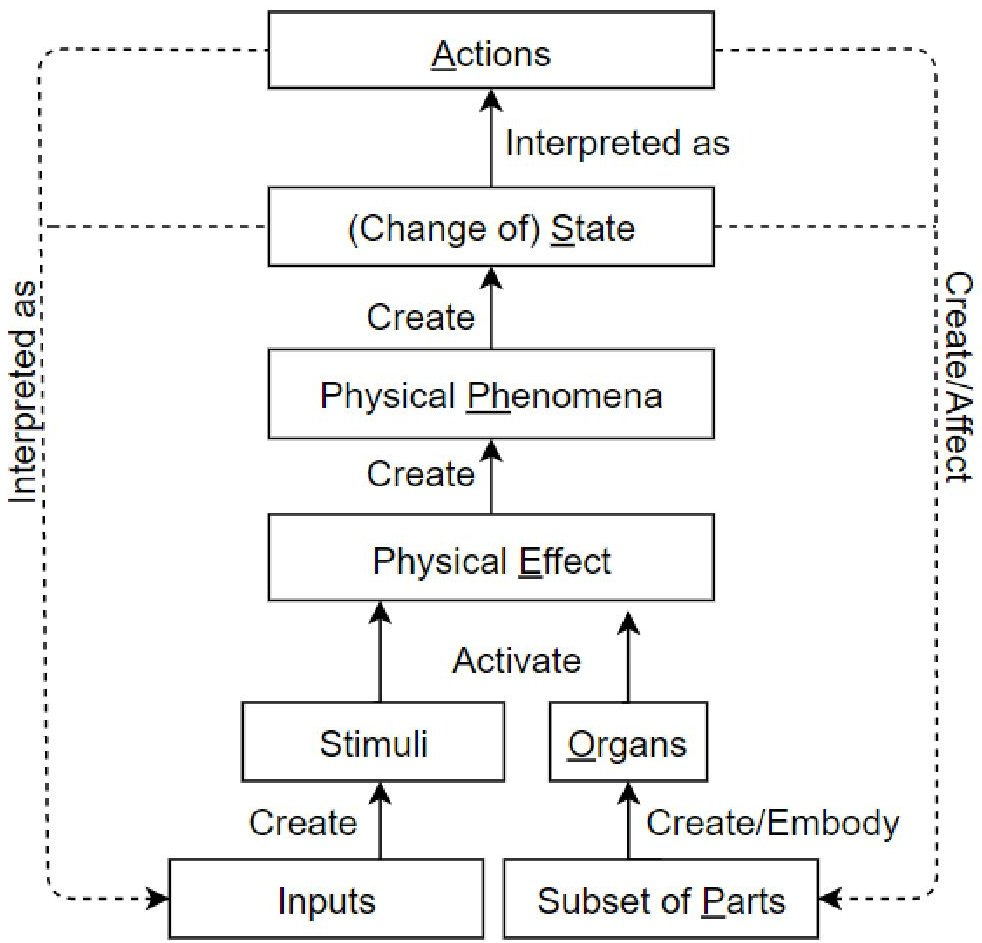


<div align="center">

Figure 13: The Sym-SAPPhIRE Model, adapted from [30].

</div>

<!-- PDF_PAGE: 57 -->


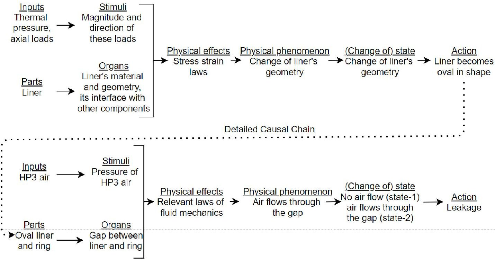


<div align="center">

Figure 14: Sym-SAPPhIRE example, adapted from [30].

</div>

The work with Sym-SAPPhIRE also raises an interesting notion regarding a consolidated data repository for the lifecycles of multiple products. If the storage of previous designs is structured using the Sym-SAPPhIRE, then the process of accessing the information could be more efficient. In searching for a replacement material for a component a designer could access in-service information of similar products, filter their search by Organs, and thus not have to search through extensive data sheets or CAD model databases.

McSorley, Fortin, and Huet proposed the Extended SAPPhIRE Model to represent the inservice, design and assembly phases of a product within the context of PLM [21]. The extended version implements a series of elements that can implement a design change based on the change of state. This extension represents an engineering design process, rather than the strict modelling of a physical system. It is thus likely suited for implementation in a design environment. The majority of elements are very similar

<!-- PDF_PAGE: 58 -->

between the in-service and design lifecycle stages; the in-service phase replaces simulations with the resultant physical effects i.e. redesigning a seal instead of replacing it.

The work of Siddharth, Chakrabarti, and Venkataraman has considered the relationships between SAPPhIRE Models for multiple systems [71]. This inter-system perspective is perhaps the richest example of causality, explicitly representing the cause and effect relationships between and within subsystems. Their multi-instance SAPPhIRE Model of an Electric Buzzer assembly, including the switch and oscillator, shows a hierarchical relationship between system boundaries [71]. The layout shows the basic assembly hierarchy, whilst the links between the assembly and its components provides a rich depiction of causality. The use of clear visual models and symbols aids in comprehension for both designer, and external stakeholders. This representation of multiple systems, along with their inputs and outputs, has the potential to be useful for tracking system level requirements and design progress.

## 1.4. Conclusion

The practices and challenges associated with managing the product lifecycle and supporting conceptual design have been introduced and discussed. This section summarizes the justification for adopting a causality-focused model as a template to create a conceptual design support tool. Chapter 1 has demonstrated a clear lack of support tools tailored for the needs of conceptual design. It also investigates the important factors and challenges that need to be addressed for a solution to be realized. The initial research question is whether the SAPPhIRE Model is capable of representing conceptual product

<!-- PDF_PAGE: 59 -->

data whilst retaining its rich representation of causality. Based on the provided research, it is hypothesized that SAPPhIRE will be able to model critical subsystem information whilst providing useful insight into how the causal relationships influence design activities and data.

Section 1.1 illustrates the need for a holistic perspective on product development, how the phases of the lifecycle are all interconnected in a parallel manner both with each other, and the lifecycle of other products. Thus, while the focus of this research is on conceptual design, the development of a tool without the consideration of other lifecycle phases would not address these substantial challenges regarding information sharing. The Sym- SAPPhIRE and Extended SAPPhIRE Models, in addition to the original model, were later introduced to provide evidence of the potential of the SAPPhIRE Model to effectively model product data from different phases of the lifecycle. Thus, the design of an eventual tool will have an improved capability of integrating with other lifecycle stages.

The unique aspects of conceptual design are the focus of Section 1.2. The large impact on lifecycle costs, in tandem with the relatively lack of dedicated support tools, provides one of the primary justifications for the focus of this project on a conceptual design software tool. Additionally, its nature of low product definition and potential for implementation of novel design proposals, complements the original purpose of the SAPPhIRE Model. Lastly, many PLM tools originate from PDM software and thus their reliance on geometric CAD data and the product structure limits their ability to maintain a coherent product definition. Due both to its prevalence and more stable nature of behavioural data, it is recommended that adopting a more behaviour focused framework such as the SAPPhIRE Model, would allow for a more effective medium for exchanging and storing information.

<!-- PDF_PAGE: 60 -->

Section 1.3 provides an overview of modern practices used primarily by systems engineers. The origins and benefits of MBSE and CE, as well as examples of their application are discussed. CEDESK is explored more thoroughly as it incorporates many of these factors, and it involves a similar scope to this research of aerospace conceptual design. Its nature as a user friendly software tool outlining the system architecture of the project, its ability to act as an access point for analytical design data, and finally its incorporation of systems engineering practices such as N Squared and the Design Structure Matrix are considered critical factors for its effectiveness. The methodology and conclusions of studies CEDESK are also discussed, as they are used as a reference for the development of the OPAL (cOnceptual suPport cAusality tooL) software tool in Chapter 4. Finally, the origins, usage, and example applications of the SAPPhIRE Model of causality are discussed in detail.

Chapter 1 provides an overview of the relevant fields. highlights key factors to be addressed in later Chapters and provides guidance in the survey and study performed in Chapters 3 and 5 respectively. Sufficient literature was found regarding the product lifecycle, the nature of conceptual design, and relevant software tools to allow for a comprehensive investigation to be undertaken. However, there was no evidence of research specifically into a causality-based design tool. It is thus difficult to find an example reference from literature for formulating a method to satisfy the research question. After integrating the SAPPhIRE Model into OPAL, Chapter 5 provides an empirical study to address the research question. Chapter 1 was crucial for formulating both the activities to be performed by the participants and the feedback questions of Chapter 5 (Section 5.1 and 5.4). The activities are all relevant to conceptual design process, and the user feedback after performing these tasks is both qualitative and quantitative. This allows for an initial

<!-- PDF_PAGE: 61 -->

evaluation of OPAL, and furthermore a novel contribution towards the field of lifecycle and design engineering.

<!-- PDF_PAGE: 62 -->

## 2 Methodology

## 2.1. Introduction

The previous chapter outlined and discussed relevant literature for this project. The objective of this chapter is to outline the reasoning for adopting Blessing and Chakrabarti's Design Research Methodology (DRM), and how it was utilized during the course of this project. The scope of design research can encompass many different fields that all have a unique influence on the product development process. This can explain the more holistic perspective modern lifecycle researchers have adopted, and this approach has been effective in improving the product development process. Blessing and Chakrabarti state that a methodology for design research "Should guide the selection and application of a suitable approach and appropriate methods, and encourage reflection on the approach and methods to be used." [72]. This is primarily achieved through the use of models to improve a design aspect, and consequently the evaluation of the effectiveness of said model. Ultimately, the DRM seeks to provide instruction in creating and presenting useful knowledge that is beneficial for the design engineering discipline.

## 2.2. Design Research Methodology

Design research is still not well defined, and interpretations regarding the proper procedure for such an endeavour are abundant [72]. Several reasons for this include the relative youth of the field, the diverse engineering backgrounds involved, and the lack of a clear inheritance relationship with past disciplines [73]. While proposals for supporting design

<!-- PDF_PAGE: 63 -->

are sufficient, they often do not progress to an implementation stage [73]. This lack of application quickly became apparent during the Research Clarification stage, wherein it was found that related work to this research that included an implementation, testing, and results section was rare. Furthermore, there were no sources found that was focused on a causal framework built using behaviour-structure-function constructs to support conceptual design. This relative lack of reference material, in tandem with the subjective nature of design research, leaves an abundance of directional freedom. Narrowing the scope of both the research and the ensuing tool implementation was necessary throughout the process to avoid unnecessary complications.

Blessing and Chakrabarti's DRM seeks to address the disagreements between researchers on accepted terminology and ontology by proposing a systematic procedure for carrying out design research. The four stages of the methodology have clear objectives, but they are not over-defined and thus are suitable for use in a variety of design projects. Similarly to conceptual design, it is also not a strictly linear progression; iterations are expected during the project. The authors do not consider it necessary to proceed through all the stages of the DRM, as there are different paths and combinations that can be used during a project. Lastly, DRM has seen success in previous similar projects involving the implementation of the SAPPhIRE Model in a product's lifecycle [74]. The DRM has also been effectively used in literature regarding both supporting design decision making [75], and discussing the nature of Digital Twins [76].

<!-- PDF_PAGE: 64 -->


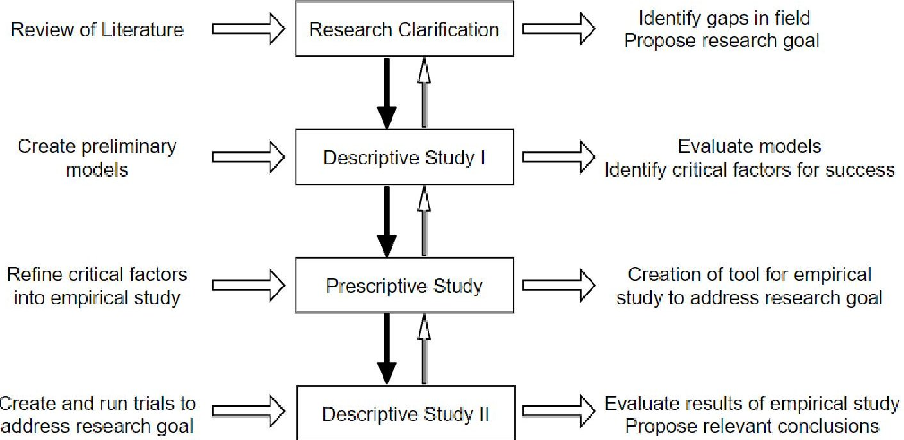


<div align="center">

Figure 15: Overview of DRM as applied for this project

</div>

The objectives of the four DRM stages are as follows:

Research Clarification: Identify research objectives, summarize state of existing solutions, and propose a success criteria for evaluation.

Descriptive Study I: Obtain a more thorough understanding of current solutions, identify the key factors of success for the Prescriptive Study stage, develop a complete success criteria for evaluation.

Prescriptive Study: To develop an Impact Model describing the desired situation based on the Key Factors, begin development of the intended support concept (a software tool), and a preliminary evaluation of the support concept.

<!-- PDF_PAGE: 65 -->

Descriptive Study II: Investigate the impact of the software tool via its applicability and usefulness, and perform impact analysis that shows the usefulness is less than expected and that there were unexpected results and thus further investigation is required.

## 2.3. Research Clarification

The Research Clarification stage (RC) asks the researcher to find evidence that supports their assumptions regarding the subject area. This will allow them to formulate a vindicated and clear research objective. The primary outputs of the RC stage are an overall research plan, and to demonstrate current understanding and expectations.

Chapter 1 explores the relevant research areas of systems and concurrent engineering, as well as conceptual design. It also identifies the issues facing modern engineering design such as difficulty managing information across the product lifecycle, and the lack of appropriate conceptual design support software. Existing methodological and software solutions, such as the TRIZ and CEDESK, are discussed. The Literature Review thus summarized the state of existing solutions, and provided the necessary literature to begin formulating an approach to address the research questions. The objective of this project was deemed to evaluate the capability of the SAPPhIRE Model of causality to support the conceptual design of CubeSats. It is hypothesized that the SAPPhIRE Model will provide an effective method in which to represent subsystem data, and consequently users will find it facilitates conceptual design activities. The ideal solution would be a software based on SAPPhIRE, which is than evaluated via an empirical study with engineering participants.

<!-- PDF_PAGE: 66 -->

## 2.4. Descriptive Study I

The Descriptive Study I (DS-I) focuses on the current situation of the field, and the key factors to address later. The primary goal of the DS-I was to study the transition of data from engineering conceptual design databases to the SAPPhIRE Model elements, something that has not been seen in literature. For this project a Comprehensive DS-I, which includes an empirical study, as opposed to a Review-based DS-I, was selected to expand on existing SAPPhIRE studies.

The empirical study of the Comprehensive DS-I was composed of two sections. The first task was to identify analytical files essential to the design progress of the subsystems. There were no restrictions accessing data for the survey. Additionally, the author had a close working relationship with the designers which was crucial for finding the relevant data. Secondly, the elements of the SAPPhIRE Model were then associated with these files. These models were evaluated on whether they maintained the essential subsystem design content and the causal nature of the SAPPhIRE Model. They addressed the gaps seen in the SAPPhIRE literature by conforming the model to represent engineering design data and served as references for the later stages of the DRM.

## 2.5. Prescriptive Study

The Prescriptive Study (PS) stage involves the researcher using their increased understanding of the existing situation to propose and develop a new method of addressing the research goal. The DS-I models were further evolved to incorporate the raw file contents of the survey, rather than textual descriptions present in literature. This culminated

<!-- PDF_PAGE: 67 -->

in the proposal and creation of a software tool, OPAL, that was constructed using the survey files as its elements. The proposal of a SAPPhIRE tool incorporating the survey files would be best evaluated by putting it into practice with engineer study participants.

A more precise impact model had to be devised during the development of the tool. Ultimately, the objective was to evaluate the ability of the SAPPhIRE Model to support the conceptual design of CubeSats. However, 'support' is a vague term, and it had to be analysed to allow for an empirical method of evaluation. Similarly to [30], the evaluation of the tool focused on three metrics based on the capabilities of the software, each with its own set of questions:

1 - Testing the user's ability to locate information.

2 - Evaluating the user's comprehension of system interfaces and semantics.

3 - Assessing the ability of the user to manage design iterations and changes.

The RC stage guided the proposal of these metrics, and provided references validating their prevalence in conceptual design. Thus, effectively supporting these functions would in turn support the conceptual design of CubeSats. These metrics provided a more grounded empirical model for the software development and trials to reference.

## 2.6. Descriptive Study II

The purpose of the DS-II (Descriptive Study II) is to investigate the impacts of the support developed, and whether it had the intended effects. The metrics identified in the PS were used to guide the formulation of the questionnaire, both the tasks asked of the participant,

<!-- PDF_PAGE: 68 -->

and the feedback questions prompted after each set of tasks. To most effectively capture user feedback, a mixture of quantitative and qualitative data was used. The former was used to perform relevant statistical analysis and to help gauge overall effectiveness. The qualitative allowed for detailed and thorough responses from the participants, and allowed them to provide unique suggestions. These in tandem were essential for providing useful contributions to the field of design engineering.

Ideally, a DS-II would involve a concurrent study with an ongoing conceptual design project. However, this evaluation of the support tool was not feasible as the work was done post conceptual design. Additionally, OPAL is a proof of concept tool that does not offer comprehensive product support features such as configuration management or an online database for users to collaborate from. Thus, this study is considered an Initial DS-II as it does not represent a full evaluation due to the support not being realised to an extent in which it can be applied by future users as intended. However, it still provides at least some indication of applicability and usability of OPAL, as well as how it may be more thoroughly evaluated in an eventual Comprehensive DS-II.

## 2.7. Conclusion

All four of the major stages of the DRM were conducted during the course of the project. The DRM provided a path to undertake for design research, but the authors did not emphasize the need to follow every outlined step. It is difficult to adhere to every suggestion in the DRM, and while the overall outline was followed, there are some steps that were deemed to be outside of the scope. This is perhaps most evident in the design of the software tool, where the considerations of other lifecycle phases external to conceptual

<!-- PDF_PAGE: 69 -->

design were minimal. However, these shortcomings are the result of a finely focused scope, which allowed for a clear objective and results.

The ultimate goal of DRM is to support the creation of useful knowledge that contributes to design research. While it is possible that the project could have satisfied this goal without the tool development and trials, the author was committed to the creation and testing of software from the onset of the project. The lack of empirical study data to support proposed models and methodologies was identified from the onset of the project. As was experienced during the DS-I, the differences between the proposal and implementation of a model in design research are substantial and should never be underestimated. The proposal and implementation of a method to support conceptual design will provide insight for future SAPPhIRE research.

<!-- PDF_PAGE: 70 -->

## 3 Survey of Conceptual Design Files

## 3.1. Objective and Justification

The objective of Chapter 3 is to carry out an investigation into the SAPPhIRE Model's ability to represent critical product data, whilst maintaining its rich representation of causality. Whilst the SAPPhIRE Model's versatility in representing various systems was demonstrated in Chapter 1, the process of adapting it for use as a product model for conceptual design introduced additional considerations. Chakrabarti (2005) presents a concise and rich representation of a natural and artificial system, but the models are idealized and too abstract from an engineering perspective, lacking any consideration for the design artifacts or files that are responsible for said information [68]. This may have been effective for supporting biomimetic design but adapting it for use as a product data model would require both a review of the SAPPhIRE elements and the types of information used by engineers. Following this, preliminary SAPPhIRE Models representing the surveyed design information would be created and evaluated. Of particular interest is these models ability to both encompass the design data, and to maintain the rich causality of the SAPPhIRE Model.

The original work trended towards creating a knowledge database based on SAPPhIRE to allow the user to understand and track the causality inherent to natural and artificial system(s). The latest research has proposed multiple SAPPhIRE Models with their physical interfaces to illustrate causality, but these are also abstract and idealized [71]. The representation of this causality is evident, yet the links offer no indication of their quantitative state. These instances were also of a fully realised system, whilst conceptual

<!-- PDF_PAGE: 71 -->

design involves the process of creating these systems. There are a variety of software and methods used by engineers that are essential for ensuring full system realization. The files both created and used by these tools can often be unique in their type and format, studying these aspects is essential for a prospective systems engineering tool. These simulation files can often constitute a significant portion of engineering conceptual design databases. Connecting these discipline specific tools to a shared domain model can be effective for implementing concurrent engineering strategies. It is thus evident that there is significant work required to bridge the gap between the SAPPhIRE Model and modern systems engineering.

Exploring the application of SAPPhIRE in a systems engineering environment warranted an empirical Descriptive Study, with an emphasis on creating system models derived from pre existing engineering data. To eventually allow for a rigorous and well defined study of SAPPhIRE's ability to support conceptual design, a more grounded empirical framework was needed via which a software tool could eventually be referenced from. Thus, a survey of conceptual design files occurred during this Descriptive Study to review the types of files that were considered to be essential from a CubeSat conceptual design perspective, and subsequently create preliminary SAPPhIRE Models based on this information. This is the first attempt in literature to manipulate SAPPhIRE to conform to pre-existing design information. Adhering to design process suggestions, and prioritizing seamless integration to the pre-existing databases were the central guidelines for carrying out this study.

The first step in this process was to explore the interpretation of each of the SAPPhIRE elements from a conceptual design data standpoint. Their implementation in an engineering conceptual design environment is where the majority of distinctions are made compared to

<!-- PDF_PAGE: 72 -->

previous work, and thus it was necessary to conduct a review of fundamental SAPPhIRE concepts to adapt them for eventual categorization. The following is a list of the original definitions of the SAPPhIRE elements, Section 3.4 discusses how their interpretation changed due to the survey [77].

Subset of Parts A set of physical components and interfaces constituting the system and its environment of interaction. Input The energy, information or material requirements for a physical effect to be activated.

Physical Effect The law of nature governing a change.

Action An abstract description or high level interpretation of a change of state, a changed state, or creation of an input.

State The attributes and values of attributes that define the properties of a given system at a given instant of time during its operation.

Organ The structural context necessary for a physical effect to be activated.

Physical phenomenon A set of potential changes associated with a given physical effect for a given organ and inputs.

## 3.2. Survey Context

All work took place at the local University of Prince Edward Island (UPEI). The UPEI Faculty of Sustainable Design Engineering (FSDE) was one of 15 Canadian institutions to participate in the Canadian CubeSat Project (CCP). The CCP is an initiative by the Canadian Space Agency (CSA) in an effort to introduce engineering students to the aerospace industry by having them design, build, and operate a CubeSat nanosatellite.

<!-- PDF_PAGE: 73 -->

CubeSats are primarily for scientific research and are composed of 10cmx10cmx10cm modules. The CubeSat's, named 'SpudNik-1', objective is to capture 2-10 metre optical resolution images of the Canadian province of Prince Edward Island (PEI) and relay it back to a ground station for use in local precision agriculture research. The FSDE conceptual design project was composed of two 4th year engineering and two 3rd year engineering student teams, as well as a master's student, for a total of 18 students. Figure 16 shows the conceptual CAD, whilst Figure 17 shows the design team structure:


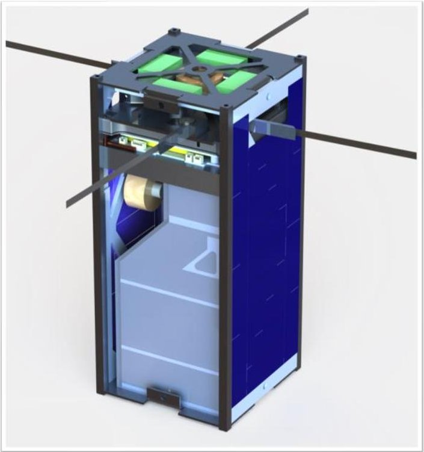


<div align="center">

Figure 16: Conceptual CAD Render of SpudNik-1

</div>

<!-- PDF_PAGE: 74 -->


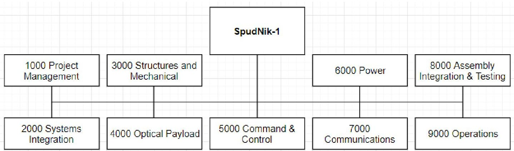


<div align="center">

Figure 17: Simplified Work Breakdown Structure

</div>

The CubeSat development process was divided into four stages: Mission Concept Development; Preliminary Design; Detail Design; Assembly, Integration and Testing. Due to the project nature, the conceptual design phase is more difficult to define as the engineers are inexperienced students, and are lacking in many support systems and personnel that would be present in commercial complex space missions. For the purposes of this study, the conceptual design phase encapsulates all work up until the Mission Concept Review (MCR). The optical payload, being a novel design, required significant scientific development prior to progressing into conceptual design, thus it can incorporate post MCR data.

Not capturing the relevant information could jeopardize the survey's validity, thus ensuring the thoroughness of the survey was crucial. To address this, one of the project's stated guidelines was for each team of designers to store all of their information on BaseCamp and GrabCAD. BaseCamp is an online project management website primarily used for file storage, whilst GrabCAD manages CAD data. Thus, there were no hindrances regarding the access of files. Additionally, the author has a close working relationship with the designers and collaborated with them frequently. This allowed the capturing of the relevant

<!-- PDF_PAGE: 75 -->

data as dictated by these personnel who are responsible for creating and using it. Lastly, being involved with the design and system integration activities, the author was already familiar with the design process. These factors were instrumental in allowing for the relevant information to be captured. The scope of the survey was limited to analysis data. Thus project management information, such as the schedule and budget, were omitted. As the On Board Computer (OBC) and similar components are of a software nature, and were not given a design team, they are also not included in the scope of this project.

## 3.3. Survey Procedure

To help integrate into the team structure, the SpudNik-1 models were proposed based on the six pre-existing subsystems. Conceptual design typically commences with documenting of the functional requirements, which was summarized for each subsystem as seen in Table 2.

<!-- PDF_PAGE: 76 -->

<div align="center">

Table 2: Subteam functions

</div>

<table border="1"><tr><td>Subsystem</td><td>Team Responsible</td><td>Primary Function</td></tr><tr><td>Optical Payload</td><td>Structure &amp; Payload</td><td>Create 2-10 metre resolution image files of PEI.</td></tr><tr><td>Electrical Power System</td><td>Power</td><td>Provide specified power as needed to every component.</td></tr><tr><td>Attitude Determination and Control System(ADCS)</td><td>Control</td><td>Regulate the angular position and velocity of the CubeSat according to Communication and Payload requirements.</td></tr><tr><td>Thermal</td><td>Structure &amp; Payload</td><td>Maintain the required thermal temperature ranges for all components.</td></tr><tr><td>Structure</td><td>Structure &amp; Payload</td><td>Maintain centre of gravity, volume, weight, and mechanical constraints.</td></tr><tr><td>Telemetry Tracking and Command</td><td>Communications</td><td>Transfer data between satellite and ground station adhering to payload and telemetry down/uplink data and orbital considerations.</td></tr></table>

Subsequently, if function is an abstract description of the intended action of the entity, then the product behaviour is inherent to said action. Engineering analysis simulates behaviour, and thus would embody the Physical Effect element. The behaviour and accompanying file embodying it are shown in Table 3.

<!-- PDF_PAGE: 77 -->

<div align="center">

Table 3: Behaviour and analysis files

</div>

<table border="1"><tr><td>Behaviour</td><td>Primary Analysis File(s)</td><td>File Type(s)</td></tr><tr><td>Snell&#x27;s Law, Fresnel Equations</td><td>OSLO(Optics Software for Layout and Optimization)Lens Mirror Configuration</td><td>CAD(.stl)</td></tr><tr><td>Buckling</td><td>Rail Analysis, Structure Simulation</td><td>ExcelTM(.xlsx) Solidworks, CAD Simulation(.CWR)</td></tr><tr><td>Data Transceiving</td><td>SpudNik-1 Link Budget</td><td>ExcelTM(.xlsx)</td></tr><tr><td>Radiation and Conductive Heat Transfer</td><td>Hand calculations,Thermal Study</td><td>ExcelTM(.xlsx)</td></tr><tr><td>Power Generation and Distribution</td><td>Power Budget</td><td>ExcelTM(xlsx)</td></tr><tr><td>Torque via reaction wheels and magnetometer</td><td>Reaction wheel&amp;Magnetometer simulations</td><td>MATLAB®(.mat)</td></tr></table>

As seen in Table 3, each subsystem was assigned a functional objective, as well as an accompanying behaviour. These were fairly generic initially to encompass the specific method for simulating behaviour used by the subsystem, similarly to the TRIZ method discussed in Section 1.2.3. Each behaviour was associated with an analysis file(s). Subsequently, the required information to perform this analysis was identified both by studying the design files, and consulting the relevant personnel. The contents of the files were analysed, and each was mapped onto a certain SAPPhIRE element. The interpretations of the SAPPhIRE elements had to be adjusted to conform to the nature of the design data.

<!-- PDF_PAGE: 78 -->

## 3.4. Results of Survey

Figure 18 shows one of the models created after the survey, Table 4 shows the files used to create it. The rest of the models can be viewed in Appendix A. The results are based on one of the author's previous works [78].


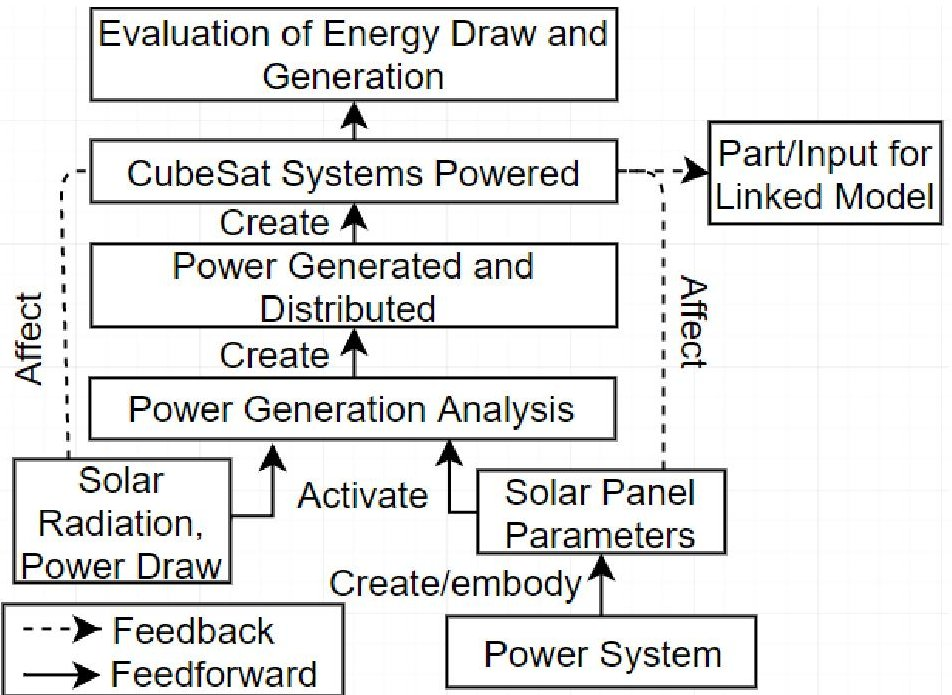


<div align="center">

Figure 18: SAPPhIRE Model of the EPS

</div>

<div align="center">

Table 4: Referenced files for Figure 18

</div>

<table border="1"><tr><td>SAPPhIRE Element</td><td>EPS Representative File</td></tr><tr><td>Action</td><td>SpudNik-1 Requirements(.xlsx)</td></tr><tr><td>Input</td><td>Parametric Orbital Power Generation(.xlsx)</td></tr><tr><td>Organ</td><td>Solar Panel Data Sheet(.pdf)</td></tr><tr><td>Subset of Parts</td><td>Power Subsystem Assembly(.sldasm)</td></tr><tr><td>Physical Phenomena</td><td>No appropriate file</td></tr><tr><td>Physical Effect</td><td>Parametric Orbital Power Generation(.xlsx)</td></tr><tr><td>(Change of) State</td><td>Parametric Orbital Power Generation(.xlsx)</td></tr></table>

<!-- PDF_PAGE: 79 -->

Nearly every SAPPhIRE element in Table 4: Referenced files for Figure 18Table 4 is shown to have an accompanying file. The Action is an abstract interpretation of the Change of State; it is adequately represented by the requirements spreadsheet containing the descriptions of the desired functions of the Subsystem. The Input(s) is contained within the Parametric Orbital Power Generation spreadsheet, which contains the orbital values needed for calculating solar array production. The Solar Panel Data Sheet includes all of the relevant data for the solar cells, including geometry and efficiencies. The Subset of Parts is the solar panel assembly, configured to conform to the strict CubeSat envelope. There was no appropriate file to associated with the Physical Phenomena; the implications of this are discussed in Section 3.5. The Physical Effect was simulated using the Parametric Orbital Power Generation. Finally, the (Change of) State was also outputted by the Parametric Orbital Power Generation spreadsheet.

The models are representations of the design files collected during the survey. They utilize all the elements of the SAPPhIRE Model, and it is clear that they maintain the unique features of the model, while representing the conceptual design environment.

<!-- PDF_PAGE: 80 -->


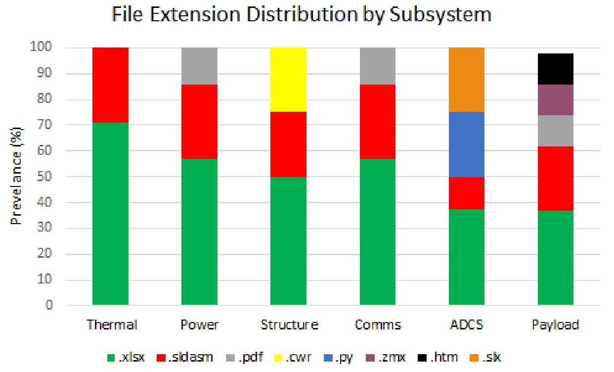


<div align="center">

File Extension Distribution by SAPPhIRE Element

</div>


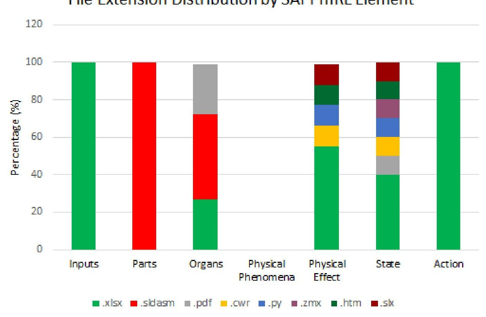


<div align="center">

Figure 19: Results of Chapter 3 Survey.

</div>

Figure 19 shows the distribution of types of design files by both subsystem and SAPPhIRE element. The prevalence of Excel $ ^{\mathrm{TM}} $ data (.xlsx) is substantial for all subsystems, and were mostly parametric models and requirements documents. CAD files formed a significant

<!-- PDF_PAGE: 81 -->

portion of both the Subset of Parts and Organs elements. The use of unique third party software is encapsulated by the .zmx, .slx, and .py file extensions. These are mostly used for simulations (Physical Effects & State) for the ADCS, Payload, and Structure subsystems.

The process of incorporating file data into the SAPPhIRE Model required new interpretations of its elements. The abstract nature of the SAPPhIRE literature has allowed for flexibility in representing these design files, but there has also been significant deviation from the original interpretation of SAPPhIRE as a result of this survey. Referring back to the definitions provided in Section 3.1, the following is a summary of how the interpretations of the SAPPhIRE Model have been adapted in reference to its elements.

## Parts

The Subset of Parts was almost solely composed of CAD data. As they represent the physical components, these files were in line with the original definition. The Optical Payload, being a novel design, did rely more on sketches than other subsystems during its design, but eventually a CAD model was produced.

The SpudNik-1 CAD assembly file was found to be one of the most important pieces of data for conceptual design. While sketches were used by the designers (especially the Structure & Payload team), their aptitude with CAD software allowed them to quickly create CAD files to better evaluate proposals. Additionally, many of the COTS (Commercial Of The Shelf) components came with a downloadable .stl file, which could be quickly integrated into the existing assembly. CAD files were thus common for all the

<!-- PDF_PAGE: 82 -->

teams. The Subset of Parts element, which represents the physical components of the system under consideration, was deemed to be encapsulated by these files.

Input, Physical Effect, State. These elements were found to often be found in the same analysis file during the survey. Due to their use as self contained simulations, they were the primary file for modifying inputs, running an analysis, and outputting results. Thus some of the parametric models, such as the power budget parametric models, were the best source of the Physical Effect, Inputs, and State. Besides their tendency to be depicted by a single file, the Input and Physical Effect did not deviate considerably from the original definition.

In contrast, the State was found to vary significantly from Chakrabarti's interpretation. While most of the portrayals of State suggest a real-time varying property of a system, this is not uniformly applicable for the contexts of this project. It will not be automatically updated to conform with the current physical effect being simulated. Instead, the State would have to be manually changed by an engineer. This complements current practices well, as changes to design data are only made after a comprehensive evaluation, and not based on the current simulations being run. This is because, in the event that an analysis fails, a change would be neglected as the requirements would not be satisfied. Thus, the change of State is similar to an engineering process interpretation, where if a design change is found to be satisfactory, the State will be modified, and the affected subsystem personnel will be made aware.

Another significant discrepancy from similar work was due to the operational modes, affecting the change of state. Previous SAPPhIRE studies allowed for continuous types of

<!-- PDF_PAGE: 83 -->

inputs and outputs that reflect the various possible system states. Design protocol for certain subsystems instead only considers two discreet states of the subsystem. Initial power budget calculations are done by operational modes. These modes represent different states the CubeSat can adopt based on variables such as orbital position, battery charge level, and time of date e.g. 'Standby' and 'Communications' modes. The thermal subsystems design protocols seen in the Space Mission Engineering Analysis and Design (SMAD) manual suggest performing a 'worst case' hot and cold analysis to evaluate their adherence to requirements [59] instead of running simulations accounting for the infinite variations stemming from possible orbits. Thus the state of the thermal subsystem was deemed to be discreet, incorporating a 'Hot' and 'Cold' case scenario.

## Action

The Action is best represented by the subsystem requirements, which act as their functional and idealized objectives, and was not found to deviate significantly from the original definition.

## Organ

The general interpretation of this element does not vary significantly from Chakrabarti's. However, Organs are less clearly defined than Subset of Parts. Based on a CAD file, much of what constitutes an Organ can already be captured. This constitutes primarily geometric properties of the part. However, due to the lack of concrete geometric data during conceptual design, these properties are often undergoing constant modifications. There is a plethora of types of information unrelated to geometry that can also be considered an Organ, such as solar panel efficiency and power consumption rates. Files containing this

<!-- PDF_PAGE: 84 -->

information include data sheets, Excel $ ^{\mathrm{TM}} $ spreadsheets, figures, etc. Compared to Inputs, Organs can be much more numerous as many pieces of information can be considered an Organ based solely on the scope of the project. For instance, an engineer may omit the compressibility factor of air in a computation fluid dynamics study based on the requirements of the client. For the context of the tool, the scope will be limited to what was already present within the design database.

Organs proved to be the most difficult element to assign an existing file to. Common Organ information, such as material properties, was both found in CAD files and Excel $ ^{\mathrm{TM}} $ spreadsheets. The scope of engineering design includes many other types of information that are difficult to classify in reference to the SAPPhIRE Model. Examples include the geometry inherent to the CAD files, and finite element analysis simulation parameters (e.g. mesh density, time step etc.). Chakrabarti suggested that the Subset of Parts creates Organs, and thus the Organs should encapsulate all information needed to activate the behaviour. Ultimately, both the Subset of Parts and Organ information regarding geometric data is encapsulated CAD files. However, material information sourced from Excel $ ^{\mathrm{TM}} $ spreadsheets was considered to be specific to the Organ criteria, such as thermal properties. The original SAPPhIRE Model considers Organs to be derived exclusively from Subset of Parts; however, this survey suggests that Organ data can be sourced elsewhere e.g. spreadsheets. This refers to how conceptual design data is not strictly reliant on CAD data, and furthermore how reliance on traditional PDM software could omit crucial data.

<!-- PDF_PAGE: 85 -->

## Physical Phenomena

Physical Phenomena had no appropriate file to map it to. The SAPPhIRE Model dedicates an entire element to describing system behaviour textually. Thus a discrepancy exists between the model, and the product data in the survey. Textual descriptions of component and subsystem behaviour were present in presentation files, but only briefly and without sufficient detail. These descriptions were presented in a manner intended for a general audience, in the form of PowerPoint presentation files. This alludes to the fact that the work done by the teams is isolated, with few eternal members being actively involved in the design. Due to the subsystem design teams consisting of almost solely local experts, there was no perceived need to document product behaviour as they were already familiar with its concepts. Additionally, project constraints and deadlines meant that any process deemed unnecessary for the product design may not have been given sufficient time to be developed.

## 3.5. Implications of Descriptive Study I Survey

Before discussing the implications of the survey, it is important to first identify its assumptions and limitations. One of the limiting factors of the survey was, while thorough, it could not capture file versions or represent the evolution of the design files. The models are the end state of the conceptual design phase. Whilst the files and information needed to create them are present, there may be data lost that may have been captured if the survey was done concurrently.

<!-- PDF_PAGE: 86 -->

As the survey used engineering students for sourcing the data, there are factors affecting the results and conclusion. that must be acknowledged. The project was integrated into the design courses at UPEI, and thus there are certain deliverables that were tailored to satisfying course deliverables, rather than solely for progressing the design. While they are provided with guidance from the professors, they lack both experience in the design of complex projects, as well as support personnel and systems. Performing this study in a isolated university environment did allow for a more thorough survey, as all of the design work was done on site.

The file extension data shown in Figure 19 shows an abundance of Excel $ ^{\mathrm{TM}} $ spreadsheet, CAD, and unique third party software data. It is clear that a collaborative tool shall be able to easily access and represent this data in order to be effective. Its textual nature should be efficiently portrayed in order to minimize the work required by the user to find the relevant data. The abundance of parametric models is reminiscent of similar studies of satellite design [58]. Integrating CAD files must be included as well, and should incorporate images for easier recognition, and consistent part numbers to support the user. Lastly, the usage of third-party software is clearly essential for certain subsystems to carry out simulations. Thus, while the intricacies of these programs limit the capabilities of a tool regarding synchronization, the user should at least be able to both find and open the relevant file as efficiently as possible.

The Spudnik-1 Assembly CAD file was found to be one of the most frequently updated pieces of information, and thus served as an important design reference. The Spudnik-1 Assembly was relatively well defined, being a CAD model. Once sufficient research and analysis is accumulated, designers can begin sourcing the required COTS components

<!-- PDF_PAGE: 87 -->

immediately. Due to the increasing prevalence of CubeSat components, they were already designed to be integrated into a CubeSat BUS. Thus it is often a quick and easy process to find the exact CAD file, and implement it into the assembly.

Initially this seemed to be in contrast to [41], which largely omitted the consideration of CAD files, and concluded that the exchange of geometric information was small relative to behaviour. However, upon closer examination, it is believed that the results of this DS- I survey support these findings. The primary analysis files of the subsystems required minimal, if any, geometric data input from external subsystems. The centre of mass and mass budget properties are critical requirements, but with extremely limited confidence of the relevant values, they were significantly less impactful. For instance, the optical payload was projected to encapsulate 40% of the volume of the CubeSat, and was represented by simple geometric shapes within the CAD assembly. Eventually, the SpudNik-1 team would be granted a Request For Deviation to obtain additional space for the payload, further altering its shape. The rotational inertia value is considered so uncertain that the control system was designed from a worst case scenario, where maximum CubeSat mass was located on the furthest possible position. Thus the predesignated nature of the CubeSats geometry and its mass were sufficient for carrying out relevant analyses.

The representation of raw design information using these SAPPhIRE Models allows for a comparison to the Sym-SAPPhIRE and Extended SAPPhIRE Models seen in Section 1.3.4. This addition of the conceptual design phase representations further expands the application of the model in reference to product lifecycles. The implications of these models are composed exclusively of textual content, something that was identified in Section 3.1 as being an inhibiting characteristic of previous research. To more thoroughly

<!-- PDF_PAGE: 88 -->

investigate the SAPPhIRE Model's ability to support conceptual design, participants should be able to interact with a system model, and subsequently the design data, via a software tool. Facilitating the storage and sharing of file information is essential for effective collaboration between designers. Therefore, the design files shall be embedded in the model.

With a more comprehensive understanding of how the SAPPhIRE elements could be integrated into a conceptual design environment, this survey proved both the feasibility and direction for future work. Compared to a previous similar study [41], it included six distinct subsystems, instead of just one. It provides additional support for future work on implementing SAPPhIRE across the Product Lifecycle. The reliance on product structure by PDM, PLM, and many design support tools discussed in the Literature Review carries with it intrinsic instability as the geometric arrangement and properties are prone to constant changes. The behavioural based parametric models, mostly within Excel $ ^{\mathrm{TM}} $ spreadsheets, are capable of providing useful analyses without relying on this information. Thus the SAPPhIRE Model is projected to better suit the unique aspects of conceptual design discussed in literature and explored during this study.

<!-- PDF_PAGE: 89 -->

## 4 OPAL: A SAPPhIRE Model based Support Tool

## 4.1. Objectives and Rationale

To further investigate its capabilities, the objective of Chapter 4 is to connect the SAPPhIRE Model to raw design files by creating a new software tool, to be used as a proof of concept. Chapter 3 has provided evidence that the SAPPhIRE Model can represent essential product data whilst maintaining its description of causality, but it does not provide sufficient evidence to its utility within a conceptual design scenario. Thus, the tool will be tailored to support and facilitate conceptual design activities and collaboration. The creation of the tool will allow for a method in which to carry out an empirical study that will include extensive feedback from participants regarding the program's abilities to represent product data. Additionally, the act of producing said program will provide valuable insight into how one would represent SAPPhIRE within a Graphical User Interface (GUI); there are numerous functionalities required in a software tool that have not been considered in Chapter 3.

The literature reviewed is severely limited regarding the representation of SAPPhIRE elements, which have been depicted only via textual and numerical descriptions. Chakrabarti and Srinivasan identified the need to support designers with knowledge of physical laws and effects for the design of novel products [79], yet published depictions of the Physical Effect elements are simply mathematical descriptions of phenomena. They do not consider engineering simulations, which are prevalent in any modern engineering setting, and thus have little analytical value. The Parts elements have no CAD or drawing files associated with them. The information database tool Idea-Inspire 4.0 implements an

<!-- PDF_PAGE: 90 -->

image and video feature, but the data file variety remains severely lacking [71]. Without the ability to accommodate the wide variety of complex design files found in the DS-I survey, the capability of the model to facilitate the storage and sharing of file data is considerably lessened. These limitations are also present in the latest research regarding the application of the SAPPhIRE Model for knowledge reuse [80].

During the literature review for their study, Jagtap found that the diagrammatic representation of information and issues during conceptual design led to improved comprehension, increased efficiency and effectiveness, stimulated human innovation, and allowed information to be processed more quickly than in a textual equivalent format [30]. Vidal and Mulet [81] believe that future design support systems must be capable of carrying out the following functions:

1 - Supporting and visualizing the design as it is carried out.

2 - Stimulating creativity.

3 - Knowledge management.

4 - Allowing collaborative work.

5 - Designing interactively with the user.

There are several possible approaches to integrate these functions into a model. SysML is a very flexible modelling language that is capable of portraying many of the SAPPhIRE model's features, such as behaviour and states. However, SysML can be difficult to both learn and apply [63]. SysML's complexity would require substantial time to teach the study

<!-- PDF_PAGE: 91 -->

participants, as a lack of understanding could severely hinder collaboration. Additionally, because the objective of this research is evaluating designers' abilities to understand and use causal constructs, the use of a MBSE language is unnecessary. Incorporating PLM and MBSE capabilities such as configuration management and real time analytics is an eventual goal of this line of research but is outside the scope of this particular project.

## 4.2. Requirements and Scope

The evolution from text-based models, to a functional systems development environment involves new considerations such as the user interface, and the integration of third-party tools. Modern industry tools can incorporate extremely complex features, such as sophisticated control and configuration management. Certainly, there is almost always an additional feature that could be added to any final software tool, thus there had to be a concrete goal established to constrain the study. The tool should also not be designed to support real time analytics, as Siddharth et al stated during their research into multiple-instance SAPPhIRE Models "If two subsystems function simultaneously, the input of one subsystem cannot depend on the output of the other." [71]. Future research may involve real time functionality, but it is considered unnecessary for this thesis as the tool is intended as a proof of concept only,

Based on the literature reviewed thus far, the DS-I study, and the objective of this research, the following requirements were developed for the software tool. Some of the requirements were developed based on observations from CEDESK's development [67], most notably those concerning user friendliness and integration of third-party software.

<!-- PDF_PAGE: 92 -->

<div align="center">

Table 5: OPAL Requirements

</div>

<table border="1"><tr><td>Requirement Index</td><td>Description</td></tr><tr><td>OPAL-1</td><td>Each subsystem representation shall incorporate the original SAPPhIRE Model with all of its elements accounted for.</td></tr><tr><td>OPAL-2</td><td>The tool shall incorporate a GUI representing the SAPPhIRE Model.</td></tr><tr><td>OPAL-3</td><td>The tool shall act as a central data repository, incorporating files from all 6 subsystems of SpudNik-1 within the same program.</td></tr><tr><td>OPAL-4</td><td>The tool shall allow for integration of previously identified file types such as code, analysis, and spreadsheet data.</td></tr><tr><td>OPAL-5</td><td>The tool shall make use of figures and visuals to aid the user in understanding subsystem layouts.</td></tr><tr><td>OPAL-6</td><td>The tool shall allow for an interactive system model GUI showing the subsystems with their interdependencies.</td></tr></table>

## 4.3. Software Construction

One of the most important questions for the construction of the tool was the programming language to use. As the incorporation of a GUI is a requirement, it was decided to code the program using a combination of the object-orientated language JavaFX $ ^{\mathrm{TM}} $ and FXML [82].

JavaFX $ ^{\mathrm{TM}} $ is a software package for the development of rich client applications. It has tremendous versatility and applicability; it can be used to create internet or desktop-based applications, and the Java $ ^{\mathrm{TM}} $ Virtual Machine allows for any operating system to run the program. It is compatible with the standard Java $ ^{\mathrm{TM}} $ code, which has extensive support and libraries for a wide variety of applications. The software was coded using JavaFX $ ^{\mathrm{TM}} $ 14, based on the Java $ ^{\mathrm{TM}} $ Development Kit (JDK) 14.

<!-- PDF_PAGE: 93 -->

One of the primary reasons for adopting $ \mathrm{J a v a F X}^{\mathrm{T M}} $ was that it was also used to create CEDESK. As an open sourced program with its code on GitHUB, an online hosting service for software development, it proved to be a useful reference for implementing $ \mathrm{J a v a F X}^{\mathrm{T M}} $ libraries and its various functions. The details regarding OPAL source code and supporting files can be found in Appendix E. The versatility of the language allowed for easy integration of third-party tools, particularly Microsoft Excel. Additionally, the $ \mathrm{J a v a}^{\mathrm{T M}} $ Virtual Machine allows the software to compile on any standard operating system (Windows $ ^{\circledR} $ , MacOS $ ^{\mathrm{T M}} $ , Linux $ ^{\mathrm{T M}} $ ).

FXML was derived from XML (Extensible Markup Language), a common markup language that allows users to efficiently organise and store their data using tags. FXML was created for $ \mathrm{J a v a F X}^{\mathrm{T M}} $ , and is used to design its user interface. FXML is also not difficult to learn or use, allowing for more efficient iteration during software development. Scene Builder, a visual layout plugin for The Intellij IDEA $ ^{\mathrm{T M}} $ Integrated Developer Environment (IDE), was used for rapid generation of user interfaces without the need to manually write FXML lines of code.

## 4.4. System Model Elements and Interface

There are two JavaFX $ ^{\mathrm{TM}} $ scenes that define the OPAL GUI, these being the system and subsystem models. The system model is a high-level view of the design, and allows a user to navigate between subsystems and view the interfaces between the subsystems, allowing them to track the origin of any inter subsystem data. It provides an interface that is both easy to navigate and to track information flow between subsystems, something that has been identified as difficult to define with similar projects [67].

<!-- PDF_PAGE: 94 -->

OPAL incorporates the six subsystems identified in the DS-I survey, with their interfaces dictated by the inputs and states. The first step in the design of the system model was defining these conceptual interfaces, shown in Table 6.

<div align="center">

Table 6: Subsystem Interfaces

</div>

<table border="1"><tr><td>Subsystem Origin</td><td>Interface</td><td>Affected Subsystems</td></tr><tr><td>Optical Payload</td><td>Image Data</td><td>Communications</td></tr><tr><td>EPS</td><td>Total Power Consumption</td><td>Thermal, Optical Payload, ADCS, Communications</td></tr><tr><td>Thermal</td><td>Thermal Simulation</td><td>EPS (Battery)</td></tr><tr><td>Structure</td><td>Mass Budget</td><td>Payload, EPS, Communications, Control</td></tr><tr><td>Control</td><td>Pointing Budget</td><td>Communications</td></tr><tr><td>Environment</td><td>Environmental</td><td>All</td></tr></table>

To best represent the primary interfaces identified during conceptual design, the system model was constructed similarly to a N-Squared chart, allowing for a concise view of the system decomposition. It acts as a conceptual system model showing all subsystems and their interfaces with each other. Figure 20 shows the chart developed for use as a reference for the system scene.

<!-- PDF_PAGE: 95 -->


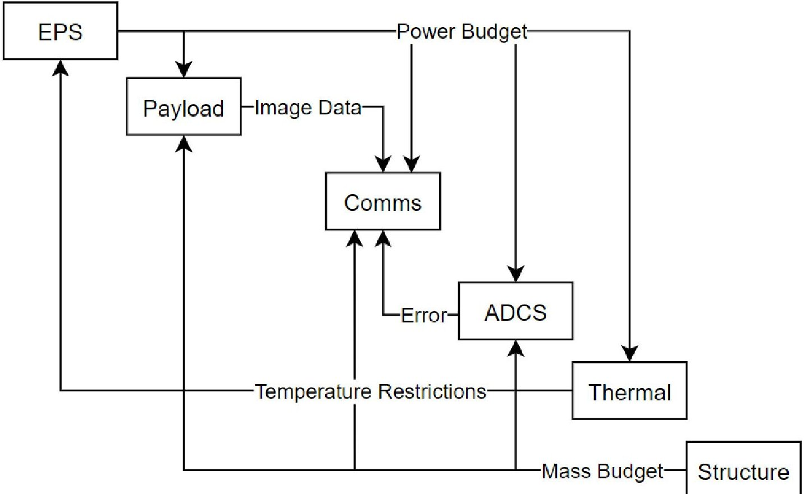


<div align="center">

Figure 20: The preliminary N Squared Chart

</div>

The layout and presentation of Figure 20 were modified to allow it to better integrate into the GUI design. This overall system view was not considered during the DS-I, and is an example of how implementing SAPPhIRE into a conceptual design environment introduces previously overlooked considerations. The final iteration of the System Model can be seen in Figure 27. The reasoning behind the interfaces for each subsystem is as follows:

## 1 - Optical Payload.

The Optical Payload is most closely associated with the primary objective of the FSDE CubeSat which is capturing images of PEI. Being of a novel design, many of the payload's parameters, especially relating to geometry, were not defined during the conceptual design stage. However, preliminary analysis did allow for an estimation of the size of the image

<!-- PDF_PAGE: 96 -->

to be transmitted. The 'Image File Size' interface was considered the payload's only output, as it provided a preliminary value for the communications subsystem personnel to base their subsystem design upon.

## 2 - Electrical Power System.

The Electrical Power System is crucial for mission success, and the eventual goal of the conceptual design work was to source a COTS battery and solar panels. The selection of these components along with their datasheets allowed for a preliminary power budget to be created by the designers based upon the CubeSat operational modes, which was the source of its output to external subsystems. The power budget was one of the most prevalent sources of data transfer between subsystems, due to the extensive number of power consuming components.

## 3 - Thermal.

The Thermal subsystem was not as prevalent in the system model. At the conceptual design stage, designers were mostly concerned with creating an orbital simulation of the CubeSat to estimate its thermal state. CubeSat thermal design best practices emphasize performing a 'worse case hot & cold' scenario [59]. These scenarios were used to define the thermal states. The thermal estimates were inputs to the EPS subsystem, as the battery operates in a relatively narrow temperature range.

## 4 - Structure.

Similar to the Thermal subsystem, the structure was not as well developed relative to the other subsystem. This was due to the lack of defined geometric and material properties of

<!-- PDF_PAGE: 97 -->

the other subsystems. Whilst some COTS components were identified, many parts were not included in the CAD assembly. Additionally, the exact placement of these parts within the CubeSat was not well defined. The Structure subsystem designers created a frame and designed rails that could tolerate the compressive forces exerted by the deployer. The output of this subsystem was the mass budget that provided a preliminary estimate of allocated mass to each subsystem and was considered the primary concern of the subsystem.

## 5-ADCS.

The ADCS system involves a novel attitude determination design that, similar to the optical payload, limits its effect on other subsystems during conceptual design. However, the recognized need for both reaction wheels and magnetorquers for control allowed for a preliminary pointing budget to be created. Whilst not considered critical for the conceptual design of other subsystems, the control parameters did affect the pointing loss of the communications subsystem. The rate of rotation would also be a factor for optical payload design, but it was not developed well enough for conceptual design to be considered a relevant interface.

## 6 - Communication.

The communication subsystem's primary objective was to design a transceiver and antenna that allowed for suitable data transfer. There are a substantial number of factors that need to be considered for this decision such as the required data transfer rates; the choice between an Ultra High Frequency and S-Band system for example have substantial

<!-- PDF_PAGE: 98 -->

differences. The subsystem was considered to be adjusting to the needs of other subsystems, and thus has no relevant conceptual output interface for OPAL.

## 7 - Environmental.

There were also environmental inputs that were introduced during the tool development. These inputs are not part of the product design, and are considered static values such as orbital velocity and incident radiation. Thus, they were not given their own subsystem, and are not visible in Figure 20. Initially, these variables were represented as Organs, as they helped defined the system e.g. the distance from the sun. However, it was decided to represent these as inputs, as they were not derived from the Subset of Parts, and they originate from a source external to the design domain.

## 4.5. SubSystem Model Development

The subsystem model structure is similar to how multiple SAPPhIRE Models were presented in [71], where the State and Inputs form the interfaces between subsystems. The SAPPhIRE Model can represent a wide variety of systems without requiring any modifications. Thus any user familiar with the model should be readily able to retrieve data from any subsystem, as the GUIs share the same SAPPhIRE design structure.

<!-- PDF_PAGE: 99 -->


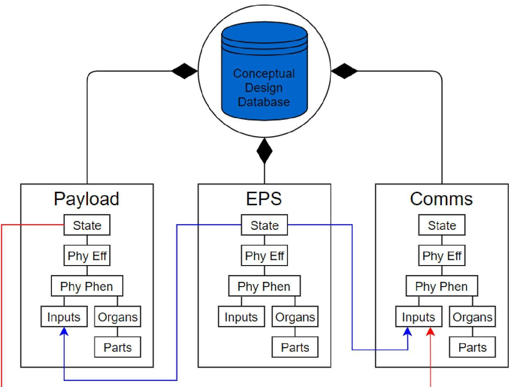


<div align="center">

Figure 21: A system model excerpt showing three subsystem interfaces in relation to SAPPhIRE

</div>

The models proposed in the DS-I were used as references for the embedding of files directly into the tool, greatly accelerating the process. However, there were several adjustments made to the SAPPhIRE elements during this development. The DS-I conclusion that multiple SAPPhIRE elements could be derived from a single file proved to be an important factor during development, and warranted the direct creation and implementation of Physical Phenomena. The Physical Phenomena was expanded upon to explain the interactions between SAPPhIRE elements, in addition to describing behaviour. For instance, an excerpt of the Physical Phenomena for the Thermal subsystem reads "...electromagnetic waves travel through the vacuum of space and provide thermal energy

<!-- PDF_PAGE: 100 -->

to the satellite, total heat transfer also depends on the surface absorptivity and emissivity. " This may seem trivial to the Thermal designers, but such straightforward explanations can be beneficial to non-experts who need to understand the subsystem. When explaining the behaviour of a subsystem, the simulations are referred to as 'Physical Effects', that rely on material properties referenced as 'Organs'.

Due to the Organs and Parts elements typically constituting multiple files, there were some intricacies that were not represented in the model. Some Parts are only associated with a single Organ and vice versa; this is not portrayed in the software. In the tool, only a single link is portrayed between elements, instead of multiple links for representing the more complex nature of the relationships between said elements. While the tool consolidates the SAPPhIRE element interfaces into a single causal chain, future work may find it feasible to create additional interfaces to better represent these intricate relationships.

<!-- PDF_PAGE: 101 -->


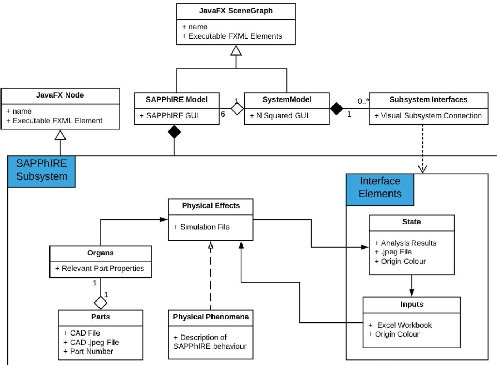


<div align="center">

Figure 22: UML Class Diagram of OPAL

</div>

Figure 22 shows the data structure of OPAL using a UML class diagram. The class relationships used were Direct Association, Aggregation, Composition, Generalization, and Realization. There are two major classes constituting OPAL: JavaFX $ ^{\mathrm{TM}} $ SceneGraphs and Nodes. SceneGraphs constitute the pages that the user interacts with, including the layout and elements. The two types of scenes that the user can switch between are the System Model and the Subsystem (SAPPhIRE) Models.

The JavaFX $ ^{\mathrm{TM}} $ Node Class includes the components that make up the Scene Graph, such as the control elements. All of the SAPPhIRE elements are Nodes in JavaFX $ ^{\mathrm{TM}} $ , and can

<!-- PDF_PAGE: 102 -->

be interacted with by the user. The Subsystem interfaces are depicted by the causal links between State and Inputs.

## 4.6. Modelling of Spreadsheet data

From the DS-I Survey, spreadsheet data, or parametric models, were found to be essential for several subsystems (Thermal, Power, Communications), all of which consisted of spreadsheet (.xlsx) files. The BOM and requirements are also spreadsheet documents, which are present in every subsystem. However, finding the relevant information within these files can be tedious as there can be an abundance of textual data to sort through. If the software is to effectively support conceptual design, streamlining this process is essential. The software incorporates a function to read and display .xlsx data directly to the user via the GUI. This function aims to expedite the process of finding information, an endeavour that has been found to take up a substantial amount of designer's time [7].

<!-- PDF_PAGE: 103 -->


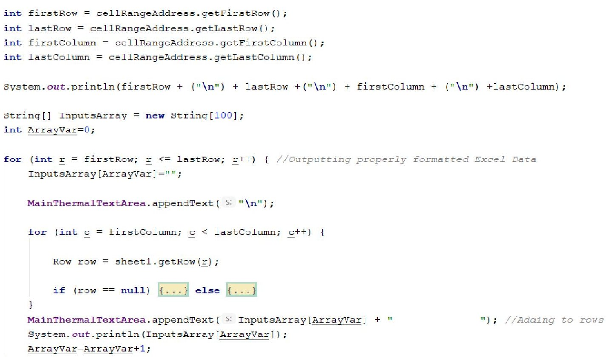


<div align="center">

Figure 23: Code sample excerpt that allows for the output of a range of .xlsx cells

</div>

JavaFX $ ^{\mathrm{TM}} $ 's functionality and support was essential for addressing this. Apache Poor Obfuscation Implementation (POI) is a collection of Java $ ^{\mathrm{TM}} $ libraries for integrating Microsoft files. These were used for inputting Excel $ ^{\mathrm{TM}} $ workbooks and sheets (Figure 23), specifying a certain cell range, and outputting it in the GUI via a Text Area. This extraction of cell data reduced time required to locate the needed information and presented it in a concise format. Parametric models are of a textual nature and can contain an extensive amount of data. Figure 24 demonstrates how linking the 'Power Input' element with a .xlsx workbook allows for quick access of the power budget when needed. Changes to the .xlsx workbook will also be reflected in the tool.

<!-- PDF_PAGE: 104 -->

<table border="1"><tr><td>Component</td><td>Safe Mode</td><td>Hibernation</td><td>Attitude Det.</td><td>Positioning</td><td>Imaging</td><td>Communication</td></tr><tr><td colspan="7">Structures and Payload</td></tr><tr><td>Image Sensor</td><td>-</td><td>-</td><td>-</td><td>-</td><td>1.5W</td><td>-</td></tr><tr><td colspan="7">Communications</td></tr><tr><td>UHF Transceiver</td><td>-</td><td>0.1W</td><td>0.1W</td><td>0.1W</td><td>0.1W</td><td>2.0W</td></tr><tr><td colspan="7">Command and Control</td></tr><tr><td rowspan="7">On-Board ComputingMicroSD CardReaction WheelsMagnetorquersSun SensorGPS</td><td>-</td><td>1.3W</td><td>1.3W</td><td>1.3W</td><td>1.3W</td><td>1.3W</td></tr><tr><td>-</td><td>-</td><td>-</td><td>-</td><td>0.3W</td><td>0.3W</td></tr><tr><td>-</td><td>-</td><td>-</td><td>1.5W</td><td>-</td><td>-</td></tr><tr><td>-</td><td>-</td><td>-</td><td>2.1W</td><td>-</td><td>-</td></tr><tr><td>-</td><td>-</td><td>0.1W</td><td>-</td><td>-</td><td>-</td></tr><tr><td>-</td><td>0.1W</td><td>0.2W</td><td>0.1W</td><td>0.1W</td><td>0.1W</td></tr><tr><td colspan="7">Power</td></tr><tr><td>Power System</td><td>0.1W</td><td>0.2W</td><td>0.2W</td><td>0.2W</td><td>0.2W</td><td>0.2W</td></tr><tr><td>Total</td><td>0.1W</td><td>1.7W</td><td>1.9W</td><td>5.3W</td><td>3.5W</td><td>3.9W</td><td>16.4W</td></tr><tr><td>ComponentUHF Transceiver</td><td>Safe Mode-</td><td>Hibernation0.1W</td><td>Attitude Det.0.1W</td><td>Positioning0.1W</td><td>Imaging0.1W</td><td></td><td></td></tr></table>

<div align="center">

Figure 24: The Raw Excel $ ^{\mathrm{TM}} $ data for the power budget, and the Power Allocated to the Control Subsystem displayed to the user using Apache POI.

</div>

## 4.7. Integration of CAD and Simulation Software

The non textual information from the DS-I survey stemmed from either a CAD software, or via a specialized program using unique file types, such as MATLAB $ ^{\circledR} $ . Due to the complex nature of these files, the ability to integrate them as seamlessly as the spreadsheet-based parametric models was not feasible for the scope of this project. Supporting the designer's ability to identify and access the required file was considered satisfactory as dictated by OPAL-4. Java $ ^{\circledR} $ includes a relatively simple desktop function that allows one to open a file with the suitable program (Figure 25). Thus users could use their knowledge of the SAPPhIRE Model to navigate the system model and open an analysis file without searching through the database manually. As discussed in Section 1.3.3, the integration of third-party tools is also important for achieving the aims of MBSE.

<!-- PDF_PAGE: 105 -->

```java

public void FlyWheelCAD(ActionEvent event) throws Exception{

    try {

        Desktop desktop = null;

        if (Desktop.isDesktopSupported()) {

            desktop = Desktop.getDesktop();

        }

        desktop.open(new File( pathname: "" + FileLocationFlyWheelCAD));

    } catch (IOException ioe) {

        ioe.printStackTrace();

    }

}

```

<div align="center">

Figure 25: A relatively simple Java $ ^{\mathrm{TM}} $ function for opening a file using its default program.

</div>

CAD files are distinct compared to the other third-party software as they are prevalent for all subsystems, and are assigned a part number that is integrated with the BOM. Thus, in addition to the aforementioned functionalities, the CAD models were assigned an image and a part number within the GUI to provide additional visual aid to the user.

## 4.7.1. Key Features and Benefits of OPAL

The OPAL tool was built specifically as a proof of concept for representing SAPPhIRE using concurrent engineering practices, and a MBSE style design. It supports collaboration between subsystem designers and can provide insight on the nature and usage of causal models. It is intended to be a high-level system representation of the conceptual design environment, and as such does not implement some sophisticated functionalities present in modern tools, such as a search feature. Every requirement proposed in Section 4.2 was satisfied, allowing it to be used to evaluate the potential of a causality-based model in conceptual design.

<!-- PDF_PAGE: 106 -->

The final iteration of OPAL is a simplified collaboration tool that provides clear visuals regarding causality, file access, and the overall structure of the system. It enables users to quickly and easily track and access the design information they require without exiting the program and manually searching through folders of data. The consistency amongst the subsystems allows a user to access other subsystem data efficiently without waiting for assistance from an expert. The simplified visuals allow a client or stakeholder to conveniently obtain an understanding of the current state of the design, and an indication of how the engineers arrived at the current iteration. Colour was implemented into both the System and Subsystem Models to provide further visual aid. Figure 26 shows the Control subsystem GUI; the rest of the subsystem GUIs are shown in Appendix G.


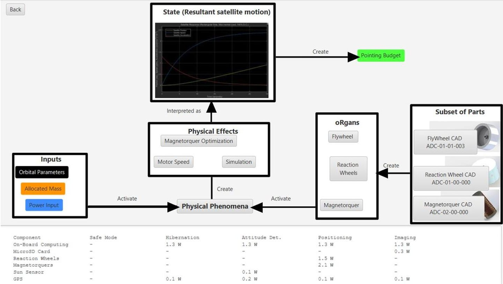


<div align="center">

Figure 26: The Control Subsystem with the 'Power Input' displayed in the text area.

</div>

<!-- PDF_PAGE: 107 -->

The State was updated to provide a visual representation of the output. OPAL represents the next step of SAPPhIRE design research, where it is embedded with raw design information that is crucial for product development. The design process is reflected in the causal chains; where Organs and Inputs are used by an analysis file to create a Change of State and an Output.


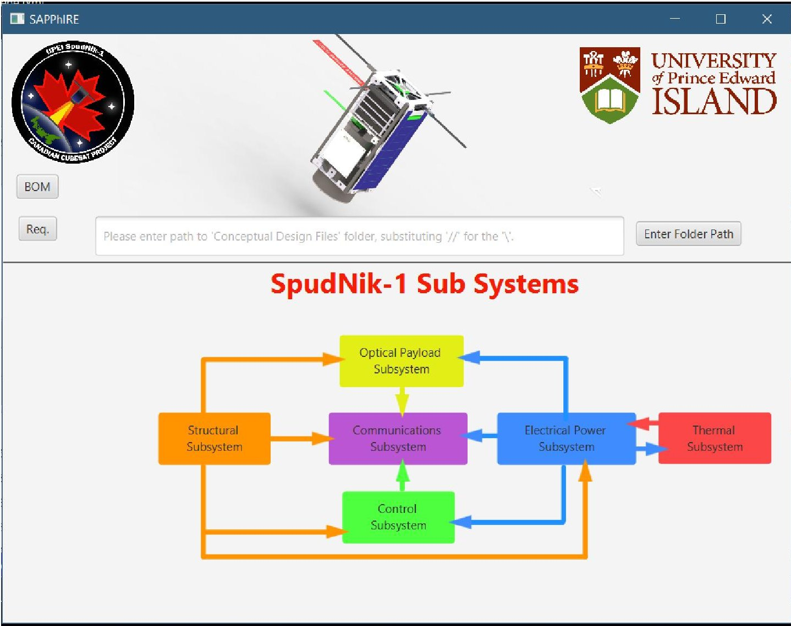


<div align="center">

Figure 27: OPAL's System model scene, using colour for visual aid.

</div>

The System model shown in Figure 27 concisely presents both the subsystems and their interfaces. Designers can use this scene to clarify and track the interfaces between subsystems.

<!-- PDF_PAGE: 108 -->

OPAL implemented a causal model into a system engineering environment that supports collaboration and the access of information. Its relatively simple design and functions allow for a focused study to evaluate the capabilities of the SAPPhIRE Model to support engineering conceptual design. All the requirements stated in Section 4.2 were satisfied. Lastly, it allows for an empirical based study to continue to investigate the capabilities of the SAPPhIRE Model in structuring product data

<!-- PDF_PAGE: 109 -->

## 5 Empirical Study of OPAL

## 5.1. Objectives and Hypothesis

The creation of OPAL allows for an empirical investigation into the effectiveness of the SAPPhIRE Model in supporting conceptual design. The objective of Chapter 5 is to further evaluate the ability of the SAPPhIRE Model to both represent product data and causality via a research study involving engineering students. Thus far, much of the exposure to SAPPhIRE has been limited to the researchers themselves. One of the most effective methods to test SAPPhIRE is via engineers evaluating OPAL in a conceptual design context. Every participant is unique in how they understand and perform design activities. Subsequently they can each provide insightful responses that can be used to both address the current deficiencies of OPAL, as well as guide future developments. The eventual goal of this line of research is to integrate the SAPPhIRE Model into a product lifecycle framework. The potential user base encompasses a wide variety of disciplines, and it is thus essential to capture their feedback on the aspects of OPAL.

Evaluating OPAL's effectiveness at supporting conceptual design in general is out of scope for this project. The term 'support' conveys the general idea of assisting engineers, but the term is too vague to properly examine. Additionally, conceptual design is an inherently creative activity with a difficult to define process. The DRM Prescriptive Study involves improving the problem definition, and elaborating on the initial description of the desired outcome of the research. Chapter 1 provided insight into relevant challenges and activities involved in conceptual design, which could be directly related to the conceptual design process. This allowed for the formulation of the following study criteria for testing OPAL.

<!-- PDF_PAGE: 110 -->

## 1 - Testing the user's ability to locate information.

The issues related to finding data stem from a variety of factors. Some are due to the user's circumstances, such as simply not knowing where to look for information, or how they may have to accommodate information overload [7], [38]. Data accessed from a different product or lifecycle may also not be in a form suitable for the user, making it more difficult to navigate and capture.

## 2 - Evaluating the user's comprehension of system interfaces and semantics

Understanding system domains and information traceability are two significant factors for success in MBSE [8]. The rich portrayal of causality in the SAPPhIRE Models is its most prominent feature. OPAL introduces a richer representation of causality via its integration of design files that has not been replicated in any literature. Navigating OPALs structure using this 'cause and effect' relationship allows for a user to track the origin of data to an element within a subsystem. It also allows the user to analyse and predict how changes to one design element will propagate across the entire system domain.

## 3 - Assessing the ability of the user to manage design iterations and changes

Conceptual design is an iteration intensive process, wherein novel solutions can be more readily produced and evaluated. The literature shows that there is a correlation between the number of proposals, and the eventual quality of the design [26]. The efficiency of implementing and evaluating new proposals can be critical to meet a project's strict constraints.

<!-- PDF_PAGE: 111 -->

These three criteria are all directly linked to activities and challenges of the conceptual design process. They are a suitable reference for creating the tasks to be performed by the participants. Thus, to investigate the ability of SAPPhIRE to support conceptual design, the objective of this empirical study is to evaluate the effectiveness of OPAL representing product data for the three previously identified design activities. The hypothesis for this particular study is that students will be able to readily adapt and utilize OPAL, and thus the SAPPhIRE Model, effectively for conceptual design knowledge management.

## 5.2. Study Group

The test subjects were recruited from the local engineering students. The students attending the FSDE were well suited as participants; as they had a variety of knowledge regarding satellites and were enthusiastic study volunteers. Most had worked on a particular subsystem and were very familiar with the CubeSat design work and rationale involved in producing the files embedded in OPAL. Their appraisal of both the representation of their subsystem in OPAL, and the ones they were not familiar with, was essential for evaluating collaboration. Additional students from outside the CubeSat project were also recruited to provide more diverse feedback.

To assure validity when discussing the results of the study, it is important to ensure that there are sufficient test subjects. Without sufficient participants, the results and implications could be skewed and not representative of a general population. Having said this, there is a limitation present in this study due to it only including students from a single university.

<!-- PDF_PAGE: 112 -->

Design research can cover a wide variety of fields, but many studies are rooted in the same objective of studying how designers perform within a certain scenario, and thus are suitable for referencing the number of participants needed to attain sufficient statistical power for the conclusions and results. Knoll and Golkar used two groups of nine students in their evaluation of CEDESK [67]. In their study of the unique knowledge needs of novice designers in aerospace, Ahmed and Wallace used a total of 11 participants to juxtapose novice and experienced personnel [83]. Chakrabarti et al used 3 participants to evaluate the IDEA-INSPIRE tool's effectiveness in supporting analogical reasoning at multiple levels of abstraction [68].

Evidently, the number of participants in design research studies can vary depending on the nature of the study. A common research approach for determining a suitable sample size is a power analysis. This was performed after the first 4 participants, based upon the question with the most response variability (Question 1, Segment 2), and yielded an output of 7, with a power factor of 95%. The power analysis can be viewed in Appendix B. Due to the availability of subjects to test, and based on the previously discussed sources, the preferred number of subjects was set as 15. This offers sufficient statistical power from which to draw validated results and conclusions. Lastly, the participants' year of study and familiarity with satellite design were deemed to be two important influencing factors for effective utilization of OPAL, and were recorded to include a more educationally diverse sample.

<!-- PDF_PAGE: 113 -->

## 5.3. Limitations of Study

Compared to professional engineers within industry, students have very little design experience, such as analytics, client interactions, and collaborative settings. They had limited exposure to the systems engineering and PLM tools discussed, as it is minimally discussed during the undergraduate degree. Thus their perspective does not allow for comparisons or critique to other pre-existing MBSE software. However, students are also not as rooted in a particular practice or software tool for information management, possibly aiding their ability to adapt to OPAL. The researcher knew many of the participants personally, so there may be additional bias in the responses. To address this, the need for honest feedback was emphasised during each test.

Each test was designed to be 45 minutes total length. Thus, thoroughly explaining the rationale and concepts of the SAPPhIRE Model to the test subjects was not feasible. This may have a negative impact on the results for questions regarding comprehension of OPAL. Data compiled during this study is indicative of someone with no prior knowledge of SAPPhIRE, and serves as a benchmark for evaluating user friendliness. There may be users at any lifecycle stage who are expected to work with a tool similar to OPAL, despite not receiving formal training.

Similar to the DS-I survey, the study took place after the conceptual design phase of the CubeSat project. The product data represented the final iteration of the conceptual design that proceeded to preliminary design. During early product development there are gaps in the data that are not addressed until later in the process. Performing this study concurrently with conceptual design activities would allow for a more valid understanding of the

<!-- PDF_PAGE: 114 -->

effectiveness of OPAL. Additionally, there was no consideration for project management or OBC data, as it was considered to be outside the scope. Lastly, this work is in a controlled environment and with a static database. Thus, it does not represent all of the variables inherent in a true conceptual design process.

## 5.4. Testing Methodology

The premise of the study was to have participants carry out conceptual design activities using OPAL, and provide feedback regarding its various aspects. As previously discussed, the term 'support' can encapsulate many different processes and activities in a conceptual design context. To evaluate the effectiveness of SAPPhIRE as a support data structure, the three study criteria presented in Section 5.1 were developed into tasks the user could carry out using OPAL.

To accommodate both detailed feedback and a visualisation of the results, the study asked for both qualitative and quantitative answers from participants. The questionnaire used in the study can be viewed in Appendix F. All documents and procedures involved in the testing were reviewed and approved by the UPEI Research Ethics Board.

The quantitative prompts are worded to allow the participant to rate their agreement, based on a 7-point scalar recommended for bipolar constructs [84]. The qualitative questions were constructed to allow for feedback on topics such as the advantages of OPAL, and recommendations for future work. Some of these questions appraised participants' interpretations of the SAPPhIRE Model, such as whether the Physical Phenomena aided their understanding of a subsystem, or whether the causal relationships were useful in

<!-- PDF_PAGE: 115 -->

tracking data. Other questions were tailored towards the tool itself, such as its ease of use and how it compares to their past experiences. The feedback allowed for conclusions on both their opinions of the SAPPhIRE Model, and how a tool like OPAL could be improved. OPAL can be used to evaluate the three study criteria from Section 5.1.

## 5.4.1. Segment 1: Testing the user's ability to locate information.

The first segment of the test is designed to be the easiest, and allow the user to become familiar with OPAL and SAPPhIRE. As discussed in Section 1.1.1, designers can spend upwards of 60% of their time searching for information [7], [38]. Section 3.4 found that there are many different types of product information that composed the SpudNik-1 database. These files are represented in different ways in OPAL. Thus, the information to be located by the user in this segment covers a wide range of file types from every subsystem, such as CAD files and parametric models. This will allow for a better evaluation of the user's understanding of both file types and subsystems.

The quantitative survey questions assess user friendliness, and whether the user views the layout as logical. Additionally, there are also qualitative questions assessing the difference in accessing different data types, and whether there was a discrepancy in difficulty between the subsystems.

## 5.4.2. Segment 2: Evaluating the user's comprehension of system interfaces and semantics

This segment focuses on the SAPPhIRE Model's unique causal relationships between elements, and how the user can effectively apply them to track the origin of a certain piece

<!-- PDF_PAGE: 116 -->

of data. The objective is to determine whether causality based interfaces can be effectively utilized by a user to trace the element(s) responsible for a certain piece of data. The user must heavily rely on the GUI to accomplish this, and the questions are more complex to stimulate the participant's problem solving capabilities. These questions involved reading the Physical Phenomena first for comprehension, and consequently identify the origin of a certain piece of information to a particular element.

The quantitative survey questions evaluate the interfaces present in OPAL, both between and within the subsystems. The former being akin to an N-squared matrix interface (Section 4.4), whilst the latter are from the SAPPhIRE Model. Both inter and intra subsystem interfaces are used in the tasks for the second segment. The associated qualitative question evaluates the usefulness of the physical phenomena in supporting the tasks.

## 5.4.3. Segment 3: Assessing the ability of the user to manage design iterations.

This segment asks the participant to demonstrate how they would replace data in the tool with reference to the SAPPhIRE elements, and consequently how this change would propagate through the subsystem. This activity builds off of segment two, and presents a common scenario where the user must theorise how they would replace information referencing the elements and interfaces of OPAL.

To determine OPAL's ability to support these tasks, the quantitative questions evaluate whether the model clearly shows how changes propagate, and whether the GUI overall is effective in controlling and tracking changes. The relevant qualitative question asks the

<!-- PDF_PAGE: 117 -->

participant to compare OPAL with their previous experiences with data management software.

## 5.5. Testing Procedure

All testing was done remotely, as provincial quarantine restrictions in PEI were in place due to the COVID-19 pandemic. A remote desktop software was used to allow the participant to access the software on the host researcher's computer. Once the consent form was filled out, the researcher provided a brief introduction to both the SAPPhIRE Model and OPAL. This was done using the introduction embedded in the questionnaire in tandem with directly referencing the SAPPhIRE elements in OPAL. Once the participant was comfortable with the software, they were asked to complete the activities in the questionnaire, and provide feedback. All participant answers were recorded directly on the questionnaire.

The researcher provided clarification to a question if required and would explain the reasoning for the correct solution. This was only done once the tester had considered and attempted the task. Enlightening questions, answers, or methods employed by the participant were documented by the researcher and included in a results report summary. Once the tasks were completed, the subjects could complete the questionnaire on their own time, this ranged from 15 minutes to more than a day and allowed for extensive feedback.

<!-- PDF_PAGE: 118 -->

## 5.6. Results of OPAL testing

This Section summarizes the results of the 15 participant study. Appendix H contains individual participant data, Appendix C can be referenced to view the complete quantitative data results and Appendix F contains the entire questionnaire. Figure 28 summarizes the quantitative responses.


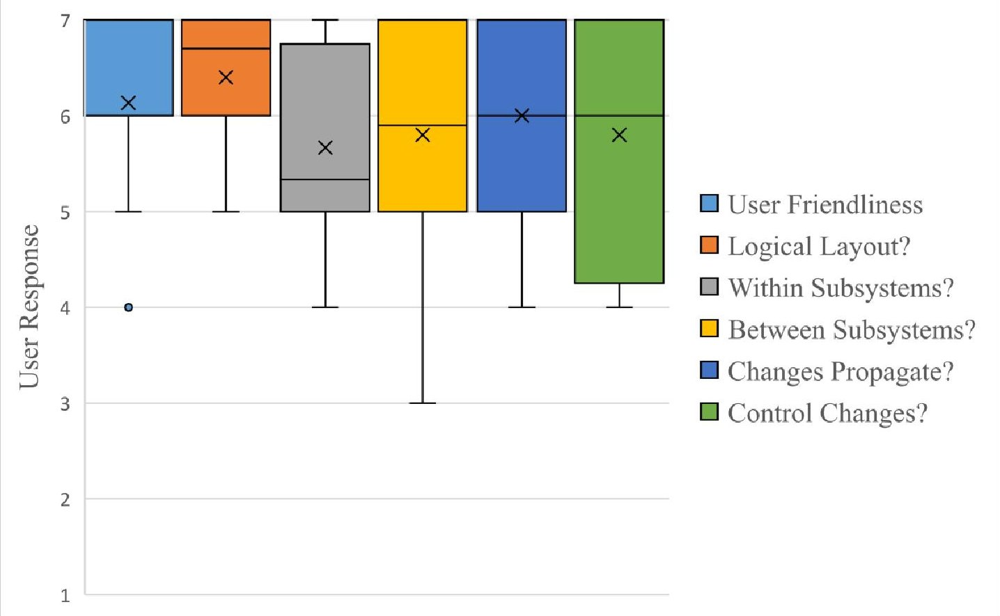


<div align="center">

Figure 28: Questionnaire Results.

</div>

Figure 28 shows high scores in all quantitative categories. Every question evaluated the user's opinions on a certain aspect of OPAL, with '7' signifying that the user strongly agreed that said criteria was clear or effective. Likewise, a score of '1' signifies that the user strongly disagreed and found that the criteria was not well understood or effective.

<!-- PDF_PAGE: 119 -->

Overall, there is a clear agreement that in general, the layout and features of OPAL were well understood by the participants.

<div align="center">

Table 7: Relevant statistics regarding Questionnaire

</div>

<table border="1"><tr><td>Question Index</td><td>Average</td><td>Range</td><td>Standard Deviation</td></tr><tr><td>1</td><td>6.13</td><td>3</td><td>0.78</td></tr><tr><td>2</td><td>6.40</td><td>2</td><td>0.69</td></tr><tr><td>3</td><td>5.67</td><td>3</td><td>0.91</td></tr><tr><td>4</td><td>5.80</td><td>4</td><td>1.13</td></tr><tr><td>5</td><td>6.00</td><td>3</td><td>0.94</td></tr><tr><td>6</td><td>5.80</td><td>3</td><td>1.18</td></tr></table>

Neither student education level nor education were correlated strongly with any of the presented questions. The Pearson Product-Moment Correlation Coefficient was calculated for each quantitative response, using the participant education level and CubeSat familiarity as dependant variables. These values can be seen in Appendix D.

As intended, the qualitative information allowed the participants to provide more diverse and detailed feedback. The interpretations to these responses are summarised as follows, and are discussed more thoroughly in Section 5.7:

1 - Were some types of information easier to find then others?

The majority (10/15) of responses found the CAD files to be relatively easy to find, whilst the spreadsheet type data was typically more difficult or tedious in comparison.

<!-- PDF_PAGE: 120 -->

2 - Did the Physical Phenomena aid in understanding the relationships between elements and subsystems?

Most responded that it did help, saying that it helped them understand dependencies and relations. Some feedback did suggest presenting the Physical Phenomena in a more standardized and consistent format.

3 - What did you find easy to do with the software?

Vast majority responded that the standardized layout helped make navigation easy, and that tracking inputs and outputs was easy.

4 - What did you find difficult to use with the software? Any recommendations for improvement?

The names of the SAPPhIRE elements were confusing for some users. Others found it difficult to navigate OPAL, as well as determining where to 'start' in the model. Recommended to add linked tabs within subsystems to aid in navigation.

5 - What are some similarities and differences of this software compared to your personal experiences with data management programs/methodologies?

Respondents were positive about the overall visuals, making it easier than Basecamp to track inputs/outputs and navigate all the subsystems.

6 - Did you find it more difficult to navigate/understand one subsystem more than the others? Which ones and why?

<!-- PDF_PAGE: 121 -->

Most said that they were all fairly easy due to the consistency of the SAPPhIRE Model in representing different subsystems.

7 - Some major objectives of conceptual design are the generation of subsystem requirements, a baseline product design, and high level system architecture. How useful would you foresee this tool being in supporting these tasks?

Most responded that it seemed that OPAL would be useful supporting the conceptual design objectives, especially the system architecture. Some discussed how requirements could be more effectively integrated into OPAL.

8 - Please write down your general feedback or suggestions for improvement.

Many responded that OPAL was easy to navigate, and in general were positive about future development. One participant wrote that "I feel it could definitely help to streamline and support project management efforts in ways that documents and spreadsheets cannot".

## 5.7. Discussion

The quantitative results show strong comprehension and effective use of OPAL's SAPPhIRE based design as a data support structure. The evidence suggests that OPAL can integrate the embedded data files to create a sufficiently detailed system model, as mentioned in Section 4.1. The two most agreed upon features of OPAL were its user friendliness and the logical layout, as seen in Table 7. The former was due in large part to the implementation of a GUI, with simple visuals that conveyed the intricacies of OPAL. One participant stated that "This system was clever in the use of visuals and was great for

<!-- PDF_PAGE: 122 -->

compiling all relevant information”. The causal flow in the SAPPhIRE Model mimics the design process; inputs drive an analysis, which consequently produces an output which can be fed into other systems.

It is believed that the ability of OPAL to maintain the consistency of the SAPPhIRE Model was crucial for representing the subsystems; it better enabled inter-subsystem data management. In comparison, the file organization methodology implemented by the students in Basecamp was not standardized. Some of the file containers had ambiguous names (e.g. 'Resources'), some did not use folders sufficiently enough to categorize their data. There was also no clear indication of how the files within said folders could influence each other. This can increase the time required for the extraction of data from a different subsystem. Consequently they may even misinterpret the layout of data, and mistakenly extract an outdated or misnamed file.

Comprehension of the relationships between subsystem elements (i.e. the SAPPhIRE Elements) received the lowest quantitative score. Understanding the layout of the SAPPhIRE Model is a significant factor in being able to effectively use OPAL. This was not surprising, as the students participating had never been exposed to the SAPPhIRE Model before, and had limited exposure to any kind of MBSE or PLM software. As presented in Section 1.3.3 Knoll and Golkar found that a thorough understanding of a concurrent engineering tool and its concepts is crucial for its successful use [63]. Considering that the students had an average of ten minutes to learn the intricacies of SAPPhIRE, the results are still remarkably high. This indicates how future SAPPhIRE based tools may not require substantial effort to train users.

<!-- PDF_PAGE: 123 -->

The qualitative responses provide direction regarding what to improve and address for future research. The integration of third-party software was helpful for finding information. However, despite the emphasis placed in integrating spreadsheet models, participants still considered it tedious to find data via a text field (Figure 24). Participants suggested a wide variety of content to add to OPAL. Examples include configuration management, configuration for web application, and a search function. As previously discussed, these additions would be considered for future development, but it was considered unnecessary for the scope of this project. The coefficient values seen in Appendix D displayed mostly weak correlations, suggesting that the education and CubeSat knowledge variables were not significant factors for the study, providing further evidence of its ease of use.

## 5.7.1. Segment 1 Results

<div align="center">

Table 8: Relevant quantitative results for Segment 1.

</div>

<table border="1"><tr><td>User Friendliness</td><td>6.13</td></tr><tr><td>Logical Layout</td><td>6.40</td></tr></table>

Testing the user's ability to locate information was the simplest segment of the questionnaire. Based on the results from Table 8, the GUI represented the SAPPhIRE Model clearly, and its overall layout was well understood by the user. The scenarios provided, whilst lacking complexity, were still representative of the basic task of extracting information completed by engineers on a regular basis. The participants were accustomed to a more inefficient process of sifting through various sublevels of folders to find a specific file. The file organization methods implemented by the teams responsible for each

<!-- PDF_PAGE: 124 -->

subsystem could vary significantly. The consistency of the SAPPhIRE Model was taken advantage of by the users; overall there was no sense of increased difficulties between subsystems. This in turn allowed for more dynamic approaches to the scenario. For instance, for sourcing the power allocated to the image sensor in question 5, participants used both the EPS and Payload Subsystems. Although not the focus of this segment, there was clear evidence that the interfaces were effectively utilized by the test subjects. The following quotation summarises this:

"This is one of the better systems that I've seen with regard to making information accessible. Typically, I would not have my own domain where I could access all the updates from other subsystems; I would normally have to visit the other subsystems domain and work through the files to find the information that I need."

## 5.7.2. Segment 2 Results

<div align="center">

Table 9: Relevant quantitative results for Segment 2

</div>

<table border="1"><tr><td>Understanding of intra-subsystem interfaces</td><td>5.67</td></tr><tr><td>Understanding of inter-subsystem interfaces</td><td>5.80</td></tr></table>

One participant responded to the question 'Did the physical phenomena help you understand the relationships between elements and subsystems?' with:

"It [Physical Phenomena] did, because it was a good place to start when you were looking at an unfamiliar section of the project and were trying to understand what affected it."

<!-- PDF_PAGE: 125 -->

This segment was focused on evaluating the user's comprehension of OPAL's interfaces and semantics. It was significantly more difficult for the participants, and there was a relatively larger range and standard deviation as shown in Table 7. The task was more complex; the approach to solving it was not well defined, and the concept of causality was generally not familiar to the participants. Additionally, the subjects had limited experience with this concept being applied via a systems engineering tool. Lastly, the purpose of the Physical Phenomena was not initially clear. The large room for interpretation of this segment scenarios was intentional, to evaluate the different approaches of the participants when using SAPPhIRE.

Resultantly, many struggled during the first question. The interfaces were generally not well understood, and the usefulness of the Physical Phenomena was unclear. The largest contributing factor to this was most likely the lack of time allocated towards explaining OPAL and SAPPhIRE. However, the second task of the segment was generally well understood by the users, after the explanation of the desired solution for the first part was explained. In particular, how to effectively utilize OPAL's interfaces, as well as how the Physical Phenomena supported the user's tasks. Considering the amount of time allocated to explaining the SAPPhIRE Model concepts through demonstration and definition, the results of this segment are encouraging in regard to the ability of a user to understand and utilise the OPAL constructs.

Causality is the underlying concept of OPAL's interfaces, which ultimately seeks to provide a comprehensive interpretation of the relationships within the system and subsystem model. As discussed previously, the process of inputs transforming into the desired outputs is inherent to the engineering design process. Viewing this phenomenon as

<!-- PDF_PAGE: 126 -->

an example of causality was not expected to be grasped by the participants, but some did express similar ideas:

“Links were new and helpful to know what domino effect you would have by changing things”

The use of simple folders in BaseCamp does not allow for the representation of these causal links between design entities. With an understanding of the design rationale of OPAL and SAPPhIRE there is a more comprehensive appreciation of the nature of the design data itself.

## 5.7.3. Segment 3 Results

<div align="center">

Table 10: Relevant quantitative results for Segment 3

</div>

<table border="1"><tr><td>Changes Propagate?</td><td>6.00</td></tr><tr><td>Ability to control changes?</td><td>5.80</td></tr></table>

The last portion of the study was to assess the ability of the user to manage design iterations. As discussed in Section 1.2.3, conceptual design is highly iterative. Streamlining this process can allow for both a more efficient expenditure of resources and a more effective design. Overall, participants were more successful in carrying out the given tasks. This was expected, as it builds off the causality implications of the previous segment. OPAL's GUI seemed to be significant for supporting segment three, as implied in the following quotation:

<!-- PDF_PAGE: 127 -->

"The visualization of all the subsystems made it easier to understand the relationship and its interactions between each subsystem. Therefore tracking how a change to one component could affect the subsystem and components was easy."

Whilst idealized to an extent, the scenarios (integrating COTS components into a design database) is common in the conceptual design of CubeSats. Besides properly sourcing the appropriate part, properly updating all design entities to reflect the changes is essential. As previously mentioned, outdated design data being mistakenly used by other engineers can be detrimental to the entire product.

A common misconception was regarding the implementation of a new COTS component within OPAL, specifically whether the Organs or the Subset of Parts would be the first element to be changed. How the SAPPhIRE is designed, typically the Organs are derived from the Subset of Parts. Some respondents proposed changing the Organs first, however SAPPhIRE's causal chains consider the Parts as the first to be affected due to a change of State. Similarly to previous discussion, this interpretation was due to the participants not being familiar with the SAPPhIRE Model. After explaining the reasoning, they understood the implications almost immediately.

## 5.8. Recommendations for future software work

This study of a SAPPhIRE based support tool represents the preliminary steps in creating and implementing a causality focused software tool for the entire product lifecycle. The shift of product definition from a product structure to a behaviour-focused causality model allows for a richer representation of the intricate causal relationships between different

<!-- PDF_PAGE: 128 -->

types of data. The results presented show strong potential for future work in this direction; Chapter 5 has provided substantial insight into achieving this.

Based upon the author's own observations, there was a subtle shift of focus away from critical environmental variables because they were not being actively studied or modified by the design teams. There may be an advantage in representing the systems by creating a mission specific model for the environmental inputs, similar to the work presented in [67]. They are important for the design of every subsystem of OPAL, yet they are only represented via the input elements. Developing an orbital model via which a power budget, ADCS and imaging simulation could be referenced is vital, and a mission subsystem could be useful for conceptual designers.

The SAPPhIRE Model element designations were found to be a source of confusion for users. The Organ in particular could be renamed to better reflect its purpose, such as 'Physical Parameters'. The 'Physical Phenomena' also created initial confusion, it could be renamed 'Subsystem Behaviour Overview', or something similar. A more efficient method of introducing and explaining the SAPPhIRE Model would significantly aid in the effectiveness of both OPAL and any future software.

The intent of the DRM Descriptive Study II is to perform an impact analysis of OPAL. Overall, the results from this survey were both encouraging and informative, and are a major milestone for SAPPhIRE research. This chapter has discussed several factors relating to SAPPhIRE and OPAL that should be considered for future work. OPAL was developed as a proof of concept, so future modifications to it may not be deemed necessary. However, it is believed that the source code and JavaFX $ ^{\mathrm{TM}} $ libraries may be useful as a

<!-- PDF_PAGE: 129 -->

reference for any eventual software. At the very least, the feedback provided from this study should be used to guide the development of future software to allow it to better support designers. Ideally, further work would include the evolution of OPAL into a PLM style tool. As discussed previously, many modern PLM tools are heavily reliant on PDM, which in turn is based on product structure. The use of a SAPPhIRE as a data framework allowed for a more intricate and rich representation of causality, which in turn guides the user in making and carrying out design decision.

<!-- PDF_PAGE: 130 -->

## 6 Conclusions, Implications and Future Work

## 6.1. Summary

The purpose of this project was to investigate the potential of the SAPPhIRE Model in supporting the conceptual design process. Chapter 1 encapsulated the Research and Clarification section of the DRM, which was to identify the research objective, create success criteria, and to evaluate similar solutions. It concludes with the justification for adopting the SAPPhIRE Model for supporting conceptual design. The reasoning and application in adopting the DRM is the focus of Chapter 2. The DRM provided a suitable guideline for both the research work, as well as the overall structure and progression of this thesis. Furthermore, it provided insight into how to create valuable conclusions based on the results of the research.

In Chapter 3, using the local CubeSat project as a reference, six distinct subsystems with their relevant product data were represented using SAPPhIRE. In Chapter 4, the software tool OPAL was constructed to allow for a user to access data using the SAPPhIRE Model's unique layout and interfaces. An empirical study was carried out in Chapter 5 that evaluated the user's ability to capture data, understand OPAL's interfaces and semantics, and manage iterations. Overall, user performance and feedback suggest a positive reception to using OPAL. Its intuitive graphical layout in tandem with the consistency representing the various subsystems, allowed the users to perform design activities with relatively few mistakes or misconceptions. Finally, Chapter 6 summarizes the work presented, and discusses the overall outcomes, limitations, and conclusions. It is suggested that work

<!-- PDF_PAGE: 131 -->

continue with both expanding the functionalities of OPAL and exploring the use of SAPPhIRE on other product lifecycle stages.

## 6.2. Limitations and Assumptions

Conceptual design involves a plethora of variables and processes that transcend engineering disciplines. Attempting to evaluate and consider all these aspects could lead to a less rigorous investigation, excessive assumptions, and unclear conclusions. Thus, there were certain aspects that had to be omitted to allow for a feasible scope and study.

One of these was studying the affect of SAPPhIRE on the generation and evaluation of novel proposals in conceptual design. Properly addressing this would warrant an entirely new study. At the time of this research, it was considered to be an objective that could not be properly addressed before creating a proof of concept tool similar to OPAL. With the insights provided in this research, it may be an option for future research.

There was little consideration of the other lifecycle stages after Chapter 1. Evaluating OPAL's ability to integrate across the product lifecycle was not the focus of this research, and was thus largely omitted. Previous literature [30], [21], has already explored the potential of SAPPhIRE to be effectively utilized in other lifecycle stages. Thus, whilst this research was focused on conceptual design, this evidence supports the goal of a holistic approach to product definition for the entire lifecycle.

Due to the nature of the conceptual design of a CubeSat, some of the states modelled by OPAL may be difficult to integrate into other stages of the lifecycle. For instance, the Thermal Subsystem's states were the extreme hot and cold case scenarios. Whilst

<!-- PDF_PAGE: 132 -->

appropriate for conceptual design, this may evolve into a more comprehensive representation in later phases to reflect the increased product detail. It is unclear what the transition would entail. The software orientated OBC subsystem was also omitted from the scope. This was done due to its lack of representation in the SpudNik-1 project at the conceptual design stage, and its absence of physical entities and phenomena to model. Software design enables subsystems to carry out their primary functions in accordance to external stimuli in the form of a signal. Incorporation of OBC data may be solved creating more elaborate SAPPhIRE Models that integrate its role as 'command and control' throughout all of the subsystems, instead of creating a new subsystem.

## 6.3. Discussion of Relevant Findings

The management of engineering data is a complex process that is addressed by various major fields, such as systems engineering and PLM. Attempting to optimize this process via a software tool is a monumental challenge, and therefore it was immensely important to finely hone the project scope from its onset.

The research and results presented in this work have overall been highly encouraging for future endeavours regarding the use of causal models. The investigation concluded that based on the results shown in Section 5, engineering students are readily able to adapt to a causal based data management tool whilst receiving limited training or experience with associated tools. The SAPPhIRE Model has been shown to be effective as a support data structure for the conceptual design of CubeSat nanosatellites.

<!-- PDF_PAGE: 133 -->

Chapter 1 reviewed the current literature that both supported and provided insight into the motivation of this research. Isolated solutions without consideration of the intricate requirements and circumstances of the entire lifecycle are more easily susceptible to integration issues. Thus, a holistic approach to studying any phase of the product lifecycle was considered to be essential. Conceptual design product data is more behaviour based, yet overall, the amount of tools that take this into consideration is limited due to their origins in PDM software. This large presence of behaviour was confirmed during the DS- I file survey in Chapter 3, mostly via spreadsheet files. The SAPPhIRE Model's representation of causality using a Function-Behaviour-Structure design was expected to more easily model conceptual product data. Lastly, its intuitive visual layout and consistency in representing any complex system was considered to have high potential for supporting the conceptual design of CubeSats. The SAPPhIRE Model of causality was thus considered a suitable candidate to address the major discussion topics of Chapter 1.

Chapter 2 introduced the research methodology that was used to carry out the project. The research methodology guides the investigator in nearly every aspect of the project, including the review of literature, formulation of research question, and the conduction of the surveys and studies. The DRM was selected due to its success with previous projects, and its flexible nature that allows for a wide variety of different approaches to design research. Ultimately, the DRM seeks to provide useful contributions to the filed of design research. The systematic approach adopted by this project in the gathering and analysis of data has provided useful information in future work regarding the SAPPhIRE Model, and the nature of causality in design research.

<!-- PDF_PAGE: 134 -->

The objective of Chapter 3 was to explore whether SAPPhIRE could represent essential product data without jeopardizing its portrayal of causality. The CubeSat conceptual design database was used to obtain an overview of the types of product data. Referencing these files, six SAPPhIRE Models were created to represent this data in a graphical format. The findings suggested that there were discrepancies between the SAPPhIRE Model and the conceptual design data regarding representing a system. The Physical Phenomena was not found to be a relevant file in the database, despite its inclusion in every SAPPhIRE instance found in the literature. Additionally, design doctrine could interpret product states differently than both what had been original defined by Chakrabarti [68], and the idealized models of previous work [68], [71]. The thermal subsystem does not attempt to model a real-time simulation of every potential temperature, rather it only considers the two states of extreme hot or cold to satisfies its design requirements. Lastly, what constituted an Organ was difficult to define, as CAD data can contain both Organ and Part data within the same file.

Chapter 4 continues the exploration of the potential of SAPPhIRE by creating a tool specifically for its application. The files used in Chapter 3 were directly mapped to a SAPPhIRE element to act as the product definition. A GUI was implemented in the likeness of SAPPhIRE to help improve ease of use; additionally, the versatility of JavaFX $ ^{\mathrm{TM}} $ allowed for seamless integration of third-party software. These were both considered as being essential for effective use of MBSE tools. The significance of behaviour data was confirmed during the construction of the tool, especially via the frequent use of spreadsheet files. Evidently there are many improvements to OPAL that could be implemented, from more advanced functional features, to using a relational database management system.

<!-- PDF_PAGE: 135 -->

Chapter 5 is an empirical study wherein participants use OPAL to carry out design activities and provide feedback regarding its effectiveness. Although OPAL was found to be satisfactory in representing both product data and causality, it needed to be evaluated by engineers to obtain a more comprehensive understanding of its effectiveness. The research question had evolved into whether designers can efficiently use OPAL to carry out conceptual design. The research question was thus was broken up into three segments that made up a questionnaire; locating data, understanding and navigating OPAL's system domain, and managing design iterations. Participants provided both quantitative and qualitative feedback regarding OPAL and SAPPhIRE. Whilst there are some aspects that were difficult to understand for first time users, the results show that participants adapted remarkably well. Many regarded the SAPPhIRE Model's consistency in representing any subsystem as being a significant factor in allowing them to carry out the variety of activities. There were also insightful recommendations for improving OPAL's effectiveness, such as standardizing the format of the Physical Phenomena, and implementing a search feature.

Chapter 6 summarizes the research work, and discusses the overall implications, limitations and assumptions. The work presented in this research has considerably advanced the current understanding of how SAPPhIRE can be used as a support data structure for conceptual design. The research question evolved from investigating SAPPhIRE's ability to represent product data, into evaluating the effectiveness of OPAL in supporting conceptual design. The development of OPAL in tandem with the results and feedback provided by the participating engineering students, has provided new insight for future researcher into SAPPhIRE. The creation of OPAL, and the empirical study in Section 5 are

<!-- PDF_PAGE: 136 -->

key contributions to the literature regarding SAPPhIRE and causal models within the lifecycle.

## 6.4. Recommendation for Future Work

There are several approaches that could be adopted for the next stage in software development. One of these is the integration of a database system to allow for cloud integration of multiple clients. MySQL $ ^{\mathrm{TM}} $ database has been used by CEDESK to great effect. As previously mentioned, $ ^{\mathrm{Java}} ^{\mathrm{TM}} $ can run on any operating system, and has a substantial library and support. Thus, inter-organisational work can be conducted with less technical challenges.

There may also be an opportunity to represent SAPPhIRE using SysML. As shown in Figure 8, SysML can represent a variety of different types of systems, including behaviour, functionality, and structure. In essence, SAPPhIRE is simply an alternative method in organising and interpreting the elements. Most likely the largest challenge would be how to model the causality effectively. Future research may be able to harness the ability of SysML to model requirements more efficiently, and better integrate them with SAPPhIRE. Ideally, future studies would be performed concurrently with the design process. Studies discussed in Section 5.2 involve creating a hypothetical design scenario with controlled variables. Whilst not a true representation of an engineering project, there may be more insight gained into the effectiveness of a SAPPhIRE based software tool on the design process.

<!-- PDF_PAGE: 137 -->

There are many observations and uses regarding SAPPhIRE presented in this research that are subject to interpretation, such as the models presented in Chapter 3. SAPPhIRE is abstract in its nature; assigning a file to a specific element was found to be challenging as seen with the Organs in Section 3.5. Compounded SAPPhIRE Models, as seen in [71], could allow for a more comprehensive representation of the hierarchal product structure. The Extended or Sym-SAPPhIRE Models may be deemed more appropriate as well. Thus for future work, especially outside of conceptual design, it is recommended to perform a process similar to the DS-I survey. This will allow for a more comprehensive product definition when integrating data files to the SAPPhIRE Model.

Comparing the different design phase models may yield valuable insight, especially regarding the consistency of the model across products and lifecycles. Once the model has been introduced across the lifecycle, these conclusions must be used to further optimize the work shown here. This iterative approach is essential to create an effective causalitybased data management tool for the entire product lifecycle.

<!-- PDF_PAGE: 138 -->

## References

[1] D. Ameri, F. and Dutta, "Product Lifecycle Management: Closing the Knowledge Loops. Computer-Aided Design and Applications," Computer-Aided Design & Applications, vol. 2, no. 5, 2005.

[2] A. Staisch, G. Peters, Stueckl T and Sergua J, "Current Trends in Product Lifecycle Management," 23rd Australasian Conference on Information Systems, 2012.

[3] F. Mas, R. Arista, M. Oliva, B. Hiebert, I. Gilkerson and J. Rios, "A Review of PLM Impact on US and EU Aerospace Industry," Procedia Engineering, 2015.

[4] V. Merminod and F. Rowe, "How does PLM technology support knowledge transfer and translation in new product development? Transparency and boundary spanners in an international context," Information and Organization, vol. 22, no. 4, 2012.

[5] J. Stark, "Product lifecycle management: 21st century paradigm for product realisation." Springer-Verlag London, 2005.

[6] S. Jagtap and A. Johnson, "Requirements and use of in-service information in an engineering redesign task: Case studies from the aerospace industry," Journal of the American Society for Information Science and Technology, vol. 61, no. 12, 2010.

[7] E. Lejon, M. Lundin, P. Jeppsson and M. Näsström, "Integrating information in product development," Re-Engineering Manufacturing for Sustainability - Proceedings of the 20th CIRP International Conference on Life Cycle Engineering, 2013.

[8] A. L. Ramos, J. V. Ferreira and J. Barcelo, "Model-based systems engineering: An emerging approach for modern systems," IEEE Transactions on Systems, Man and Cybernetics Part C: Applications and Reviews, vol. 42, no. 1, 2012.

<!-- PDF_PAGE: 139 -->

[9] S. J. Kapurch, "NASA Systems Engineering Handbook," NASA Special Publication, 2007.

[10] C. Haskins, "INCOSE - Systems Engineering Handbook, A Guide for Systems Life Cycle Processes and Activities,"Wiley, vol. 3.1, 2007.

[11] A. Kossiakoff, W. N. Sweet, S. J. Seymour and S. M. Biemer, "Systems Engineering Principles and Practice: Second Edition," Wiley, 2011.

[12] H. Mooz and K. Forsberg, "The dual vee - Illuminating the management of complexity," 16th Annual International Symposium of the International Council on Systems Engineering, INCOSE 2006, 2006.

[13] W. W. Royce, "Managing the development of large software systems: concepts and techniques," ICSE '87 Proceedings of the 9th international conference on Software Engineering, 1987.

[14] J. Clarkson and C. Eckert, "Design process improvement: A review of current practice," Springer-Verlag London, 2005.

[15] D. W. Unger and S. D. Eppinger, "Comparing product development processes and managing risk," International Journal of Product Development, vol. 8, no. 4, 2009.

[16] R. G. Cooper, "Perspective: The stage-gates $ ^{\circledR} $ idea-to-launch process - Update, what's new, and NexGen systems," Journal of Product Innovation Management, vol. 25, no. 3, 2008.

[17] B. W. Boehm, "A spiral model of software development and enhancement," Computer, vol. 21, no. 5, pp. 61-72, May 1988

[18] K. Forsberg and H. Mooz, "The Relationship of System Engineering to the Project Cycle," INCOSE International Symposium, vol. 1, no. 1, 1991.

<!-- PDF_PAGE: 140 -->

[19] A. Gunasekaran, Y. Y. Yusuf, E. O. Adeleye, T. Papadopoulos, D. Kovvuri and D. G. Geyi, "Agile manufacturing: an evolutionary review of practices," International Journal of Production Research, vol. 57, 2019, pp. 5154-5174.

[20] N. Garzaniti, C. Fortin and A. Golkar, "Toward a Hybrid Agile Product Development Process," IFIP Advances in Information and Communication Technology, 2019.

[21] G. McSorley, C. Fortin and G. Huet, "Modified SAPPhIRE Model as a framework for product lifecycle management," Proceedings of International Design Conference, DESIGN, 2014.

[22] M. W. Grieves and M. Tanniru, "PLM, process, practice and provenance: Knowledge provenance in support of business practices in product lifecycle management," International Journal of Product Lifecycle Management, vol. 3, no. 1, 2008.

[23] M. Grieves, "Product Lifecycle Management: Driving the Next Generation of Lean Thinking," McGraw-Hill, 2006.

[24] M. Messaadia, F. Belkadi, B. Eynard and A. E. K. Sahraoui, "System engineering and PLM as an integrated approach for industry collaboration management," IFAC Proceedings Volumes (IFAC-PapersOnline), vol. 45, no. 6, 2012.

[25] D. A. Guerra-Zubiaga, E. F. Rios-Soltero, E. D. Ramón-Raygoza, M. Tomovic and A. Molina, "PLM tools taxonomy to support the design process," Proceedings of International Conference on Comprehensive Product Realization, Beijing, 2007.

[26] S. Mostefai, M. Batouche and A. Bouras, "Mechanical product data exchange and integration for PLM," Proceedings of the IEEE International Conference on Industrial Technology, 2004.

<!-- PDF_PAGE: 141 -->

[27] S. K. Chandrasegaran, K. Ramani, R. D. Sriram, I. Horvath, A. Bernard, R. F. Harik and W. Gao, "The evolution, challenges, and future of knowledge representation in product design systems," CAD Computer Aided Design, vol 45, no. 2, 2013.

[28] T. Markeset and U. Kumar, "Product support strategy: Conventional versus functional products," Journal of Quality in Maintenance Engineering, vol. 11, no. 1, 2005.

[29] O. Mont, C. Dalhammar and N. Jacobsson, "A new business model for baby prams based on leasing and product remanufacturing," Journal of Cleaner Production, vol. 14, no. 17, 2006.

[30] S. Jagtap, A. Johnson and A. Larsson, "A conceptual framework to support engineering designers in using in-service information," Proceedings of International Design Conference, DESIGN, 2012.

[31] G. Huet, C. Fortin, G. McSorley and B. Toche, "The management of manufacturing processes using complementary information structures," ICED 11 - 18th International Conference on Engineering Design - Impacting Society Through Engineering Design, 2011.

[32] R. Sudarsan, S. J. Fenves, R. D. Sriram and F. Wang, "A product information modeling framework for product lifecycle management," CAD Computer Aided Design, vol. 37, no. 13, 2005.

[33] R. G. Cooper and S. J. Edgett, "The dark side of time and time metrics in product innovation," Visions, vol. XXVI, no. 22, 2002.

[34] M. El Amine, J. Pailhes and N. Perry, "Critical review of multi-criteria decision aid methods in conceptual design phases: Application to the development of a solar collector structure," Procedia CIRP, vol. 21, 2014.

<!-- PDF_PAGE: 142 -->

[35] M. Hassannezhad, M. Cantamessa, F. Montagna and P. John Clarkson, "Managing Sociotechnical Complexity in Engineering Design Projects," Journal of Mechanical Design, Transactions of the ASME, vol. 141, no. 8, 2019.

[36] C. Rizzi and D. Regazzoni, "Conceptual design knowledge management in a PLM framework," Produkt Lifecycle Mangement: Assessing the industrial relevance, Inderscience Publishers, pp. 435-444, 2007.

[37] A. Chakrabarti and T. P. Bligh, "An approach to functional synthesis of solutions in mechanical conceptual design. Part I: Introduction and knowledge representation," Research in Engineering Design, vol. 6, no. 3, 1994.

[38] F. U. Rehman and X. T. Yan, "Application of context knowledge in supporting conceptual design decision-making," International Journal of Product Development, vol. 13, no. 1, 2011.

[39] T. Vuletic, A. Duffy, L. Hay, C. McTeague, L. Pidgeon and M. Grealy, "The challenges in computer supported conceptual engineering design," Computers in Industry. pp. 22-37. vol. 95, 2018.

[40] J. Kang, K. Zhong, S. Qin, H. Wang and D. Wright, "Instant 3D design concept generation and visualization by real-time hand gesture recognition," Computers in Industry, vol. 64, no. 7, 2013.

[41] C. Fortin, G. McSorley, D. Knoll, A. Golkar and R. Tsykunova, "Study of data structures and tools for the concurrent conceptual design of complex space systems," PLM 2017: Product Lifecycle Management and the Industry of the Future, 2017.

[42] D. Ullman, "The mechanical design process", McGraw-Hill, 2010.

<!-- PDF_PAGE: 143 -->

[43] D. E. Woldemichael and F. M. Hashim, "Development of conceptual design support tool for subsea process equipment design," International Journal of Mechanical and Mechatronics Engineering, vol. 9, no. 10, 2009.

[44] K. J. Kim and D. K. Lin, "Simultaneous optimization of mechanical properties of steel by maximizing exponential desirability functions," Journal of the Royal Statistical Society. Series C: Applied Statistics, vol. 49, no. 3, 2000.

[45] M. G. Fernandez, C. Conner Seepersad, D. W. Rosen, J. K. Allen and F. Mistree, "Decision support in concurrent engineering - The utility-based selection decision support problem," Concurrent Engineering Research and Applications, vol. 13, no. 1, 2005.

[46] L. Kwasitsu, "Information-seeking behavior of design, process, and manufacturing engineers," Library and Information Science Research, vol. 25, no. 4, 2003.

[47] A. Buczacki, "An integrative Model Based Systems Engineering (MBSE) and leanbased approach for development of new complex products," Multidisciplinary Aspects of Production Engineering, vol. 2, no. 1, 2019.

[48] S. Friedenthal, A. Moore and R. Steiner, "A Practical Guide to SysML," Morgan Kaufmann Publishers Inc. 2008.

[49] M. Bandecchi, B. Melton, B. Gardini and F. Ongaro, "The ESA/ESTEC concurrent design facility," Proceedings of the EuSEC 2000, 2000.

[50] A. Fisher, M. Nolan, S. Friedenthal, M. Loeffler, M. Sampson, M. Bajaj, L. VanZandt, K. Hovey, J. Palmer and L. Hart, "3.1.1 Model Lifecycle Management for MBSE," INCOSE International Symposium, vol. 24, no. 1, 2014.

[51] E. Fosse, "Model Based Systems Engineering (MBSE) 101," Torrance, CA, USA: INCOSE, 2014.

<!-- PDF_PAGE: 144 -->

[52] Anon, "Systems Engineering Vision 2020," INCOSE, 2007.

[53] P. Iwata, Curtis & Infeld, Samantha & Bracken, Jennifer & McGuire, Melissa & McQuirck, Christina & Kisdi, Aron & Murphy, Jonathan & Cole, Bjorn & Zarifian, "Model-Based Systems Engineering in Concurrent Engineering Centers," AIAA SPACE Conference and Exposition, 2015.

[54] M. Hause, "The SysML Modelling Language," Fifth European Systems Engineering Conference, September, 2006.

[55] D. Kaslow, B. J. Ayres, P. T. Cahill, C. Croney, L. Hart and A. G. Levi, "Developing a cubesat model-based system engineering (MBSE) reference model - Interim status #4," 2018 AIAA SPACE and Astronautics Forum and Exposition, 2018.

[56] S. Friedenthal, "SysML v2 Submission Team (SST) SysML v2 Update," Annual INCOSE International Workshop, 2019.

[57] F. Mhenni, J. Y. Choley, O. Penas, R. Plateaux and M. Hammadi, "A SysML-based methodology for mechatronic systems architectural design," Advanced Engineering Informatics, vol. 28, no. 3, 2014.

[58] D. Di Domizio and P. Gaudenzi, "A model for preliminary design procedures of satellite systems," Concurrent Engineering Research and Applications, vol. 16, no. 2, 2008.

[59] D. E. a. J. P. Wertz, "Space Mission Engineering: The New SMAD," 3rd ed, Hawthorne, CA: Microcosm Press, 2011.

[60] J. P. Pennell, R. I. Winner, H. E. Bertrand and M. M. Slusarczuk, "Concurrent engineering: An overview for Autotestcon," AUTOTESTCON (Proceedings), 1989.

<!-- PDF_PAGE: 145 -->

[61] A. Yassine and D. Braha, "Complex Concurrent Engineering and the Design Structure Matrix Method," CONCURRENT ENGINEERING: Research and Applications vol. 11, 2003.

[62] R. Findlay, A. Braukhane, D. Schubert, J. F. Pedersen, H. Müller and O. Essmann, "Implementation of concurrent engineering to Phase B space system design," CEAS Space Journal, vol. 2, no. 1-4, 2011.

[63] D. Knoll, C. Fortin and A. Golkar, "Review of concurrent engineering design practice in the space sector: State of the art and future perspectives," 4th IEEE International Symposium on Systems Engineering, ISSE 2018 - Proceedings, 2018.

[64] "OCDT - Open Concurrent Design Tool," 2020. [Online]. Available: https://ocdt.esa.int/. [Accessed 13 March 2019].

[65] "VALISPACE," 2019. [Online]. Available: https://www.valispace.com/.[Accessed 10 September 2019].

[66] D. Knoll, "CEDESK About," [Online]. Available: https://cedesk.github.io/about/ [Accessed 12 February 2019].

[67] D. Knoll and A. Golkar, "A coordination method for concurrent design and a collaboration tool for parametric system models," Concurrent Engineering Research and Applications, vol. 26, no. 1, 2018.

[68] A. Chakrabarti, P. Sarkar, B. Leelavathamma and B. S. Nataraju, "A functional representation for aiding biomimetic and artificial inspiration of new ideas," Artificial Intelligence for Engineering Design, Analysis and Manufacturing: AIEDAM, vol. 19, no. 2, 2006.

<!-- PDF_PAGE: 146 -->

[69] Y.-M. DENG, "Function and behavior representation in conceptual mechanical design," Artificial Intelligence for Engineering Design, Analysis and Manufacturing, vol. 16, no. 5, pp. 343-362, 2002.

[70] A. K. Goel, "Design, analogy, and creativity," IEEE Expert-Intelligent Systems and their Applications, vol. 12, no. 3, 1997.

[71] L. Siddharth, A. Chakrabarti and S. Venkataraman, "Representing complex analogues using a function model to support conceptual design," Proceedings of the ASME Design Engineering Technical Conference, 2018.

[72] L. T. Blessing and A. Chakrabarti, "DRM, a design research methodology," Springer, 2009.

[73] M. Cantamessa, "Design research in perspective - a meta-research on ICED'97 and ICED'99," International Conference on Engineering Design (ICED'01), Vols. IMechE, Glasgow, pp. 29-36, 2001.

[74] G. McSorley, "A Novel Approach to Product Lifecycle Management and Engineering Based on Product In-Use Information," Université de Montréal, 2014.

[75] M. Kravchenko, D. C. A. Pigosso and T. C. McAloone, "Developing a Tool to Support Decisions in Sustainability-Related Trade-Off Situations: Understanding Needs and Criteria," Proceedings of the Design Society: DESIGN Conference, vol. 1, 2020.

[76] J. Trauer, S. Schweigert-Recksiek, C. Engel, K. Spreitzer and M. Zimmermann, "What is a Digital Twin? - Definitions and Insights from an Industrial Case Study in Technical Product Development," Proceedings of the Design Society: DESIGN Conference, vol. 1, 2020.

<!-- PDF_PAGE: 147 -->

[77] A. Chakrabarti and S. V, "SAPPhIRE - An Approach to Analysis and Synthesis ," INTERNATIONAL CONFERENCE ON ENGINEERING DESIGN, vol. 2, ICED'09, pp. 417-428, 2009.

[78] S. Peters, C. Fortin and G. McSorley, "A Novel Approach to Product Lifecycle Management and Engineering Using Behavioural Models for the Conceptual Design Phase," Product Lifecycle Management in the Digital Twin Era, vol. 565, IFIP, 2019.

[79] V. Srinivasan and A. Chakrabarti, "GEMS of SAPPhIRE : A Framework for Designing?," 13th National Conference on Mechanisms and Machines (NaCoMM07), 2007.

[80] L. Siddharth, A. Chakrabarti and R. Ranganath, "Modeling and structuring design rationale to enable knowledge reuse," Systems Engineering, vol. 23, no. 3, 2020.

[81] R. Vidal and E. Mulet, "Thinking about computer systems to support design synthesis," COMMUNICATIONS OF THE ACM, vol. 49, 2006.

[82] Oracle, "JavaFX," [Online]. Available: https://openjfx.io/. [Accessed October $ 1 5 ^{th} $ 2019].

[83] W. A. Dos Santos, B. B. Leonor and S. Stephany, "A knowledge-based and modeldriven requirements engineering approach to conceptual satellite design," Lecture Notes in Computer Science (including subseries Lecture Notes in Artificial Intelligence and Lecture Notes in Bioinformatics), 2009.

[84] S. Ahmed and K. M. Wallace, "Understanding the knowledge needs of novice designers in the aerospace industry," Design Studies, vol. 25, no. 2, 2004.

[85] J. a. Krosnick and S. Presser, "Question and Questionnaire Design," Standford University, 2010.

<!-- PDF_PAGE: 148 -->

## Appendix A: Chapter 3 SAPPhIRE Models


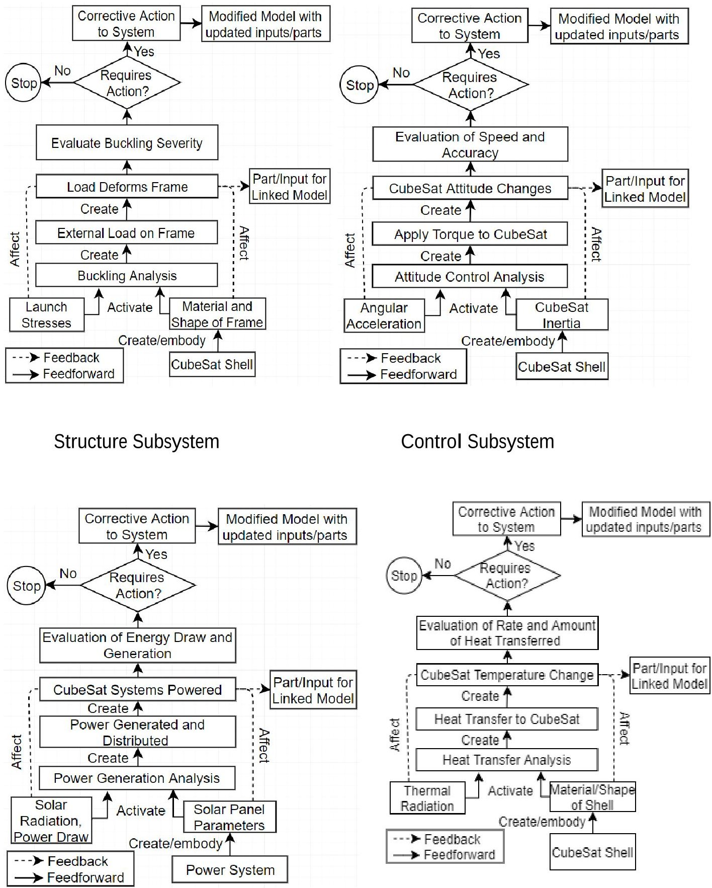


<div align="center">

Electrical Power Subsystem

</div>

<div align="center">

Thermal Subsystem

</div>

<!-- PDF_PAGE: 149 -->


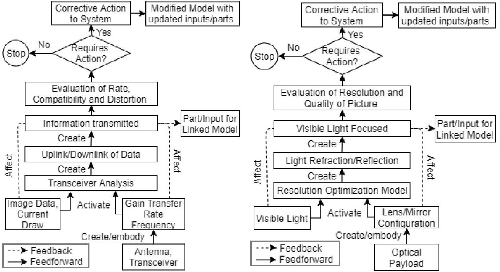


<div align="center">

Communication Subsystem

</div>

<div align="center">

Optical Payload Subsystem

</div>

<!-- PDF_PAGE: 150 -->

## Appendix B: Power Analysis

clear;clc;

% Stephen Peters; SAPPhIRE Research

% March 30th 2020

% Power Analysis

pilot_data = [7 5 6 5]; % Highest Response Variance

mean = mean(pilot_data);

std = std(pilot_data);

nout = sampsizepwr('t',[mean, std],4,0.95) % Power Analysis Function

<!-- PDF_PAGE: 151 -->

<div align="center">

Appendix C: OPAL Quantitative Results

</div>

<table border="1"><tr><td>Question Index</td><td>Question</td></tr><tr><td>1</td><td>How user friendly do you find the program?</td></tr><tr><td>2</td><td>How logical do you find the layout to be?</td></tr><tr><td>3</td><td>How would you respond to the following statement:“The software layout helps me understand the various relationships between elements within a subsystem”</td></tr><tr><td>4</td><td>How would you respond to the following statement:“The software layout helps me understand the interdependencies between subsystems”</td></tr><tr><td>5</td><td>How would you respond to the following statement:“The model structure clearly shows how changes propagate throughout the various subsystems”</td></tr><tr><td>6</td><td>How would you respond to the following statement:“Controlling and tracking design changes is easier to manage using this GUI compared to past experiences.”</td></tr></table>

<table border="1"><tr><td>Question Index</td><td colspan="14">User Responses(1-7)</td></tr><tr><td>1</td><td>7</td><td>6</td><td>7</td><td>6</td><td>7</td><td>6</td><td>7</td><td>7</td><td>4</td><td>6</td><td>6</td><td>6</td><td>5</td><td>6</td><td>6</td></tr><tr><td>2</td><td>7</td><td>6</td><td>7</td><td>7</td><td>7</td><td>5</td><td>7</td><td>7</td><td>6</td><td>5</td><td>6</td><td>7</td><td>6</td><td>7</td><td>6</td></tr><tr><td>3</td><td>7</td><td>5</td><td>6</td><td>5</td><td>7</td><td>5</td><td>7</td><td>5</td><td>4</td><td>5</td><td>5</td><td>6</td><td>5</td><td>7</td><td>6</td></tr><tr><td>4</td><td>7</td><td>5</td><td>7</td><td>5</td><td>7</td><td>3</td><td>6</td><td>7</td><td>5</td><td>7</td><td>5</td><td>6</td><td>5</td><td>7</td><td>5</td></tr><tr><td>5</td><td>7</td><td>5</td><td>7</td><td>7</td><td>6</td><td>4</td><td>7</td><td>7</td><td>6</td><td>5</td><td>6</td><td>7</td><td>6</td><td>5</td><td>5</td></tr><tr><td>6</td><td>7</td><td>7</td><td>7</td><td>7</td><td>4</td><td>6</td><td>7</td><td>4</td><td>4</td><td>5</td><td>6</td><td>7</td><td>6</td><td>6</td><td>4</td></tr></table>

<!-- PDF_PAGE: 152 -->

## Appendix D: Pearson Product Moment Correlation Coefficient

Formula:

$$
r = \frac {\Sigma (x - \bar {x}) (y - \bar {y})}{\sqrt {\Sigma (x - \bar {x}) ^ {2} \Sigma (y - \bar {y}) ^ {2}}}
$$

<table border="1"><tr><td>Question</td><td>Coefficient for CubeSat familiarity</td><td>Coefficient for Education Level</td></tr><tr><td>1</td><td>-0.109</td><td>-0.163</td></tr><tr><td>2</td><td>0.093</td><td>0.391</td></tr><tr><td>3</td><td>0.234</td><td>-0.452</td></tr><tr><td>4</td><td>-0.312</td><td>0.019</td></tr><tr><td>5</td><td>-0.171</td><td>-0.120</td></tr><tr><td>6</td><td>0.176</td><td>0.114</td></tr></table>

<!-- PDF_PAGE: 153 -->

## Appendix E: Software Resources

The Source code was published online, and can be viewed at:

https://github.com/StephenEPeters/OPAL-V1

OPAL-V1 was published using the Apache License 2.0.

The source code is compatible with the Java $ ^{\mathrm{TM}} $ 14 SDK, and was written in Intellij IDEA 2019.1.1 (Community Edition).

JRE: 1.8.0_202-release-1483-b44 amd 64.

JVM: OpenJDK 64-Bit Server VM by JetBrains s.r.o.

<!-- PDF_PAGE: 154 -->

<div align="center">

# Appendix F: OPAL Questionnaire Form

Questionnaire

SpudNik-1 SAPPhIRE Project

</div>

The following outlines the content that will be included in the questionnaire.

Please select your level of familiarity with CubeSats:

a) I have sound knowledge of CubeSats via previous work experience.

b) I am not familiar with them, but I am knowledgeable about satellites.

c) I have almost no knowledge regarding CubeSats or satellites in general. Please select your current education level:

a) $ 1^{\mathrm{st}}-2^{\mathrm{nd}} $ year engineering student.

b) $ 3^{\mathrm{rd}} $ year engineering student.

c) $ 4^{\mathrm{th}} $ year engineering student.

d) Post graduate student.

## Introduction

The objective of this tool is to support the conceptual design of CubeSats by improving participant's ability to access information, and accommodate design changes efficiently. The program has a main page screen which shows the user the 6 different subsystems: Thermal, Structural, Power, Control, Communications and Optical Payload. It also

<!-- PDF_PAGE: 155 -->

includes a Design Structure Matrix (DSM) and graphic links between each subsystem. These are both intended to show the interdependencies between these subsystems and how the output of one can be interpreted as an input to another. A simple example of this is how the power subsystem allocates a certain amount of Wattage to other subsystems. The power designers consider this an output of their design, but the communication team views this as an input that influences their hardware choices (i.e. transceiver/antenna design).

For evaluation purposes, an Open Broadcast Software (OBS) will be used to record the screen of the computer during testing. This is for time assessment and usage data, no audio will be recorded.

If you click on the system buttons you are brought directly to the main page of that individual subsystem. Here you can find analytical data. The information is grouped into 6 different categories:

<table border="1"><tr><td>Element</td><td>Description</td></tr><tr><td>Subset of Parts</td><td>This includes all CAD files and Bill of Materials components under design jurisdiction of this particular group</td></tr><tr><td>Organs</td><td>Properties derived from the Subset of Parts, i.e. material type, geometry etc.</td></tr><tr><td>Inputs</td><td>Material, information, or energy inputs from either other models or the environment</td></tr><tr><td>Physical Phenomena</td><td>A description of the physical effects taking place</td></tr><tr><td>Physical Effect</td><td>The analysis files that simulate a phenomenon e.g. Radiation Heat Transfer</td></tr><tr><td>State</td><td>A set of attributes/ characteristics of the system that change based on the design environment e.g. Operational Modes for Power determine the Wattage allotment.</td></tr></table>

<!-- PDF_PAGE: 156 -->

Each element from the table has a connection to at least one other element. These connections are known as causal links; they illustrate how the status of one element gives rise to change in connected elements. An example of this is how a change in Wattage allotment could cause the Optical Payload subsystem in ultimately choosing a less power demanding image sensor.

## Set 1: Finding information

The following questions ask you to find 6 specific pieces of information within the tool structure:

1) Locate the Battery CAD Model.

2) Find the Mass of the Control Flywheel.

3) Identify the communications path loss from the downlink budget.

4) Find the compressive external load input applied from the launch dispenser.

5) Find the power allocated to the Optical Payload Subsystem.

6) Locate the Structure 'Rails' CAD Model.

<!-- PDF_PAGE: 157 -->

## Set 1: Questions

How user friendly do you find the program? Please circle a number.

<table border="1"><tr><td>1</td><td>2</td><td>3</td><td>4</td><td>5</td><td>6</td><td>7</td></tr><tr><td colspan="6">Very Confusing Easy to use</td></tr></table>

How logical do you find the layout to be?

<table border="1"><tr><td>1</td><td>2</td><td>3</td><td>4</td><td>5</td><td>6</td><td>7</td></tr></table>

Very Confusing

Easy to use

Were some types of information (e.g. CAD vs Excel $ ^{\mathrm{TM}} $ Spreadsheet Inputs etc.) easier to find than others?

## Set 2: Utilizing Causal Relationships

The following questions ask you to use the links between elements and subsystems to trace the origin of data.

1) Read the physical phenomena for the Thermal subsystem, and then identify the most relevant input for the 'Internal Energy Generated' physical effect. Subsequently, track the subsystem responsible for said input.

2) Starting from communications, read the physical phenomena, and then identify the subsystem responsible for its 'Image Data' input. Subsequently, within this identified subsystem, determine the physical effect responsible for this information.

<!-- PDF_PAGE: 158 -->

## Set 2: Questions

How would you respond to the following statement: "The software layout helps me understand the various relationships between elements within a subsystem"

<table border="1"><tr><td>1</td><td>2</td><td>3</td><td>4</td><td>5</td><td>6</td><td>7</td></tr></table>

Strongly Disagree

Strongly Agree

How would you respond to the following statement: "The software layout helps me understand the interdependencies between subsystems"

<table border="1"><tr><td>1</td><td>2</td><td>3</td><td>4</td><td>5</td><td>6</td><td>7</td></tr><tr><td colspan="6">Strongly Disagree Strongly Agree</td></tr></table>

Did the physical phenomena help you understand the relationships between elements and subsystems? Why or why not?

## Set 3: Managing Iterations

The following questions ask you to add and replace pre-existing information.

Scenario 1:

You found a cheaper supplier for Reaction Wheels. The dimensions are slightly different, but they still satisfy the relevant requirements. Locate the most appropriate element if you were to implement the new part. Explain how incorporating the new part affects the rest of the Controls subsystem by referencing the subsystem elements.

<!-- PDF_PAGE: 159 -->

Scenario 2:

The solar panels originally sourced are found not to have any space heritage, and thus a more reliable part was found. Locate the most appropriate element to change if you were to implement the new part. Explain how incorporating the new part affects the rest of the Power subsystem by referencing the subsystem elements.

## Set 3: Questions

How would you respond to the following statement: "The model structure clearly shows how changes propagate throughout the various subsystems"

<table border="1"><tr><td>1</td><td>2</td><td>3</td><td>4</td><td>5</td><td>6</td><td>7</td></tr><tr><td colspan="6">Strongly Disagree Strongly Agree</td></tr></table>

How would you respond to the following statement: "Controlling and tracking design changes is easier to manage using this GUI compared to past experiences."

<table border="1"><tr><td>1</td><td>2</td><td>3</td><td>4</td><td>5</td><td>6</td><td>7</td></tr><tr><td colspan="6">Strongly Disagree Strongly Agree</td></tr></table>

## Final Comments

Please provide feedback to the following questions:

What did you find easy to do with the software?

<!-- PDF_PAGE: 160 -->

What did you find difficult to use with the software? Any recommendations for improvement?

What are some similarities and differences of this software compared to your personal experiences with data management programs/methodologies?

Did you find it more difficult to navigate/understand one subsystem more than the others? Which ones and why?

Some major objectives of conceptual design are the generation of subsystem requirements, a baseline product design, and high level system architecture. How useful would you foresee this tool being in supporting these tasks?

Please write down your general feedback or suggestions for improvements.

<!-- PDF_PAGE: 161 -->

## Appendix G: OPAL SubSystem GUIs

Thermal GUI


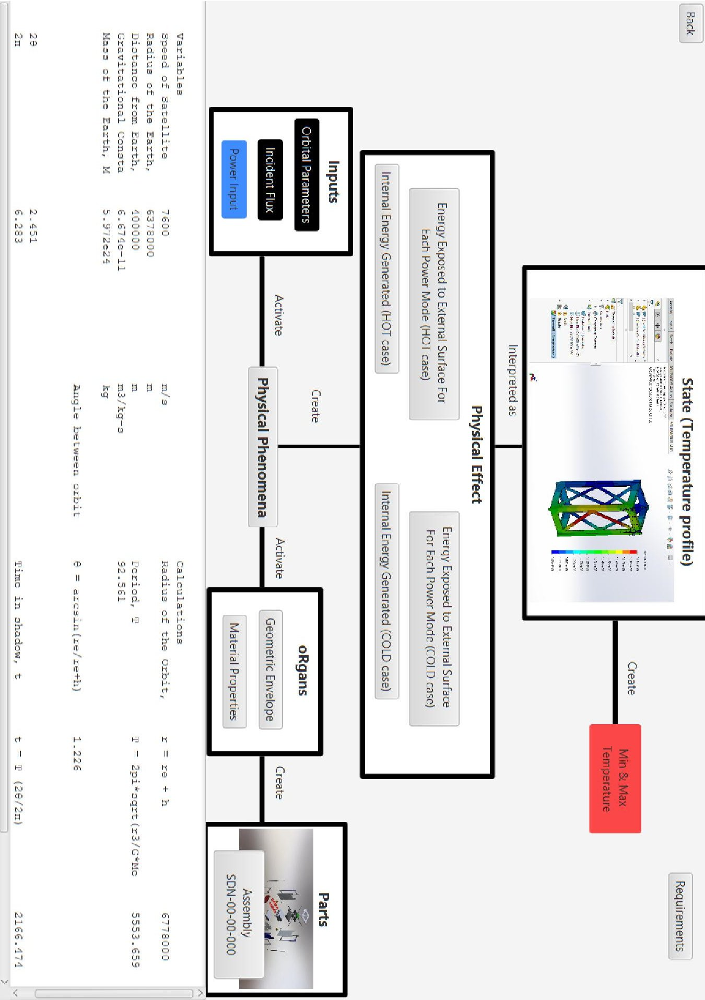


<!-- PDF_PAGE: 162 -->

<div align="center">

Optical Payload GUI

</div>


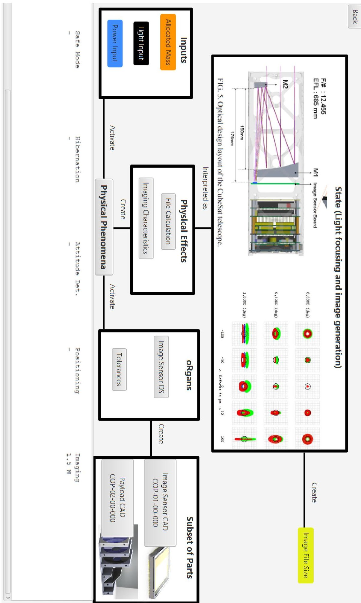


<!-- PDF_PAGE: 163 -->

<div align="center">

Communications GUI

</div>


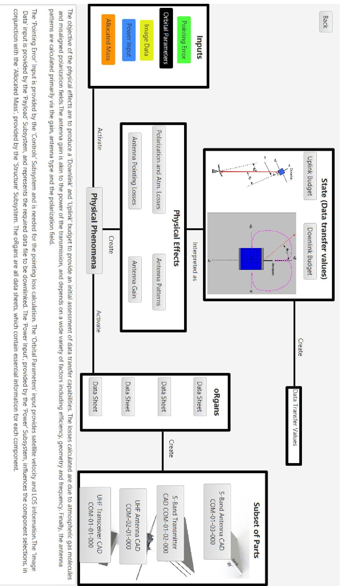


<!-- PDF_PAGE: 164 -->


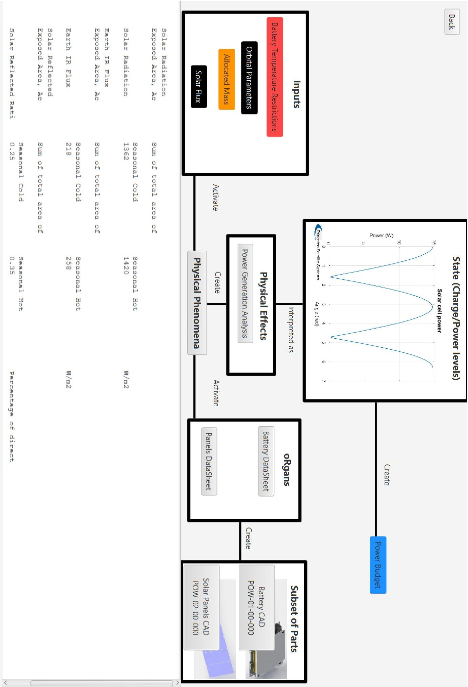


<!-- PDF_PAGE: 165 -->


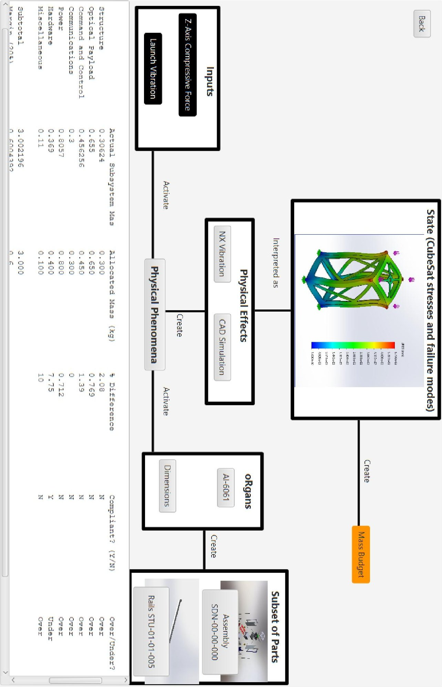


<!-- PDF_PAGE: 166 -->

## Appendix H: Participant Data

<table border="1"><tr><td>SUBJECT INDEX</td><td>1</td><td>2</td><td>3</td><td>4</td><td>5</td><td>6</td><td>7</td><td>8</td></tr><tr><td>CubeSat Familiarity(1-3)</td><td>3</td><td>3</td><td>3</td><td>3</td><td>3</td><td>3</td><td>3</td><td>1</td></tr><tr><td>Education Level(1-4)</td><td>3</td><td>3</td><td>4</td><td>3</td><td>2</td><td>3</td><td>2</td><td>3</td></tr></table>

<div align="center">

Participants 1-8.

</div>

<table border="1"><tr><td>SUBJECT INDEX</td><td>9</td><td>10</td><td>11</td><td>12</td><td>13</td><td>14</td><td>15</td><td>AVERAGE</td></tr><tr><td>CubeSat Familiarity(1-3)</td><td>3</td><td>1</td><td>2</td><td>1</td><td>3</td><td>3</td><td>3</td><td>2.53</td></tr><tr><td>Education Level(1-4)</td><td>3</td><td>4</td><td>4</td><td>3</td><td>3</td><td>3</td><td>3</td><td>3.07</td></tr></table>

Participants 9-15 with total average.