<!-- PDF_PAGE: 1 -->

# Model-Based Reliability

# Engineering A methodology to enhance reliability analysis in student-based CubeSat design projects

<!-- PDF_PAGE: 2 -->

[Title page photograph: Delfi-n3Xt]

<!-- PDF_PAGE: 3 -->

# Model-Based Reliability Engineering A methodology to enhance reliability analysis in student-based CubeSat design projects

By I. Kiselyov

# in partial fulfilment of the requirements for the degree of Master of Science in Aerospace Engineering at the Delft University of Technology, to be defended publicly on Friday December 11, 2020 at 09:30 AM.

Supervisor: Dr. J. Guo TU Delft

Thesis committee: Dr. J. Guo "Chair" TU Delft ir. J. Bouwmeester TU Delft Dr. G. la Rocca TU Delft

An electronic version of this thesis is available at http://repository.tudelft.nl/.

<!-- PDF_PAGE: 4 -->

<!-- PDF_PAGE: 5 -->

## Abstract

This thesis work proposes an approach to integrate design and reliability assessment, based on a single modeling environment by deployment of Systems Modeling Language (SysML). The main purpose of the developed approach is to help enhance reliability assessment in student-based CubeSat projects. Considering the limited project resources, that CubeSat university design teams typically have to cope with, an attempt is made to create a methodology, that allows adoption of single modeling environment for both system design and reliability analysis, thereby focusing on the main principles and advantages offered by the Model-Based Systems Engineering (MBSE) practice.

To develop the considered methodology and to demonstrate its practical application the following steps were taken:

A SysML design model is built, consisting of both functional and physical architectures, based on a hypothetical simplified spacecraft subsystem. Thereby an assessment is made to what detail a system needs to be modeled and which characteristics it should at least comprise to provide a sufficient basis for a risk model, as a choice of a certain risk assessment methodology may influence the extent to which a system must be modeled, while certain system design model characteristics influence the selection of the appropriate risk assessment methods to be implemented.

To determine how risk analysis can be performed in SysML for a given hypothetical design problem, various risk assessment methods were considered for the sake of risk assessment methodology development, based on specific criteria.

After it became clear how the implementation of both qualitative and quantitative parts of risk assessment had to be realized in SysML, the actual risk analysis was initiated; the design model was extended by a reliability model.

The evaluation on the obtained results was finally performed, and general observations from integrating risk analysis in MBSE were presented, based on the comparison with traditional methods, considering the major risk assessment aspects.

<!-- PDF_PAGE: 6 -->

<!-- PDF_PAGE: 7 -->

## Acknowledgments

First of all, I would like to thank my supervisor Jian for his contribution and valuable tips that he gave me during this research work. Having a full-time job in addition to this thesis work was pretty much of an organizational challenge. It really helped me a lot that Jian was able to understand my personal situation and adapt to it in terms of schedule and planning.

Also, I would like to thank my parents Yuri and Tatyana for their endless motivation and cheerleading.

This thesis could, however, never be finished without support of my girlfriend Arina, as I had to work a lot in my free time. Even when our sun was born, she did everything she could to unburden me, because she understood how important this work was for me. Thank you for being a real friend!

And, finally, it is my sun Artyom, who is almost eight months now, where the strongest motivation came from; as a parent you want to be the best example for your child, which helped me to stay focused despite any circumstances.

<!-- PDF_PAGE: 8 -->

<!-- PDF_PAGE: 9 -->

## Table of contents

Abstract ... 5

Acknowledgments ... 7

Table of contents ... 9

List of symbols ... 11

List of abbreviations ... 13

List of figures ... 15

List of tables ... 17

1. Introduction ... 19

    1.1 Problem statement ... 19

    1.2 Project motivation and goal ... 19

    1.3 Research question ... 20

    1.4 Research methodology ... 20

    1.5 Scope ... 20

2. System model ... 21

    2.1 Model organization ... 21

    2.2 System Context ... 22

    2.3 High-level EPS architecture ... 28

    2.4 ‘Extended’ EPS architecture ... 30

    2.5 Conditional behavior ... 35

    2.6 EPS model summary ... 38

3. Reliability modeling ... 39

    3.1 Risk assessment methodology ... 39

    3.2 Qualitative reliability model ... 40

        3.2.1 FMEA ... 42

        3.2.2 Qualitative criticality analysis ... 46

        3.2.3 Qualitative FTA ... 49

    3.3 Quantitative reliability model ... 51

        3.3.1 Common failure rate prediction models for electronic equipment ... 51

        3.3.2 Theoretical failure rate estimation ... 52

        3.3.3 Quantitative criticality analysis ... 54

        3.3.4 System reliability prediction ... 58

    3.4 Reliability model summary ... 62

4. Evaluation ... 65

    4.1 Comparison with existing reliability assessment methodologies ... 65

    4.1.1 “Application of Risk Management to University CubeSat Missions” ... 66

<!-- PDF_PAGE: 10 -->

4.1.2 “A Reliability Engineering Approach for Managing Risks in CubeSats” ... 67

4.1.3 “Reliability Prediction of Student-Built CubeSats” ... 68

4.1.4 “Risk Management of Student-Run Small Satellite Programs” ... 69

4.1.5 General observations from methodology comparison ... 70

4.2 SysML-based reliability modeling versus traditional methods ... 70

4.2.1 Traditional approach for qualitative risk model ... 71

4.2.2 General observations from comparison between traditional and MBSE approaches.. 77

5. Conclusion and recommendations ... 79

Appendix A Spacecraft failures and risk assessment ... 83

A1 Spacecraft system failures and causes ... 83

A1.1 Satellite anomalies caused by space environment ... 83

A1.2 Human factor ... 89

A1.3 Relative subsystem contribution to spacecraft failures ... 91

A2 Risk assessment methods ... 95

A2.1 General information on risk assessment ... 95

A2.2 General risk assessment methods ... 96

Appendix B FMEA PCDU – Battery Temperature Sensor ... 109

Appendix C FMEA PCDU – Data Interface Module ... 111

Appendix D FMEA PCDU – Distribution Unit ... 113

Appendix E FMEA PCDU – MPPT Supply Regulator ... 115

Appendix F FMEA PCDU – Measurement Unit ... 117

Appendix G FMEA Solar Array ... 119

Appendix H FMEA Battery ... 121

Bibliography ... 123

<!-- PDF_PAGE: 11 -->

## List of symbols

$ \alpha $ ： Failure mode ratio

$ \beta $ ： Conditional probability of final effect

$ C_{m} $ ： Failure mode criticality number

$ \lambda_{p} $ ： Part failure rate

$ M $ ： Number of components necessary

$ N $ ： Number of components available

$ P_{fe} $ ： Final effect probability class

$ P_{fm} $ ： Failure mode probability class

$ P(t) $ ： Failure probability

$ R(t) $ ： Reliability

$ S_{fe} $ ： Final effect severity class

$ t $ ： Operating time

$ t_{m} $ ： Mission duration

<!-- PDF_PAGE: 12 -->

<!-- PDF_PAGE: 13 -->

## List of abbreviations

AD&C : Attitude determination and control

BDR : Battery discharge regulator

BTS : Battery temperature sensor

C&DH : Command and data handling

COTS : Commercial of the shelf

EPS : Electric power subsystem

ESD : Electrostatic discharge

ETA : Event tree analysis

FMEA : Failure mode and effects analysis

FMECA : Failure mode and effects criticality analysis

FTA : Fault tree analysis

LEO : Low-earth orbit

M&S : Mechanisms and structure

MBSE : Model-based systems engineering

MPPT : Maximum power point tracker

PCDU : Power control and distribution unit

PL : Payload

PS : Power subsystem

RPN : Risk priority number

SADM : Solar array drive mechanism

SEE : Single-event effects

SEL : Single-event latch-ups

SEU : Single event upsets

SysML : System modeling language

TCS : Thermal control system

TID : Total ionization dose

TT&C : Telemetry, tracking and control

<!-- PDF_PAGE: 14 -->

<!-- PDF_PAGE: 15 -->

## List of figures

FIGURE 2-1. MODEL ORGANIZATION ... 22

FIGURE 2-2. SYSTEM CONTEXT ... 22

FIGURE 2-3. SPACECRAFT OPERATIONAL CONTEXT ... 23

FIGURE 2-4. SPACECRAFT COMPOSITION ... 24

FIGURE 2-5. SPACECRAFT HIGH-LEVEL FUNCTIONAL DECOMPOSITION ... 25

FIGURE 2-6. ALLOCATION OF BASIC FUNCTIONS TO SUBSYSTEMS ... 25

FIGURE 2-7. ITEM TYPES ... 26

FIGURE 2-8. SPECIFICATION OF PHYSICAL ENVIRONMENT ... 26

FIGURE 2-9. DATA IF PORT SHOWING THE FLOW PROPERTIES ... 27

FIGURE 2-10. EXTERNAL INTERFACES ... 27

FIGURE 2-11. EPS HIGH-LEVEL PHYSICAL STRUCTURE ... 28

FIGURE 2-12. EPS INTERNAL CONFIGURATION ... 29

FIGURE 2-13. EPS FLOW-BASED BEHAVIOR ... 29

FIGURE 2-14. EPS EXTENDED FUNCTIONAL DECOMPOSITION ... 30

FIGURE 2-15. EPS EXTENDED PHYSICAL STRUCTURE ... 30

FIGURE 2-16. PCDU INTERNAL CONFIGURATION ... 32

FIGURE 2-17. PCDU FLOW-BASED BEHAVIOR ... 33

FIGURE 2-18. SOLAR ARRAY INTERNAL CONFIGURATION ... 34

FIGURE 2-19. SOLAR ARRAY FLOW-BASED BEHAVIOR ... 34

FIGURE 2-20. EPS CONTROLLED BY C&DH SUBSYSTEM ... 35

FIGURE 2-21. EPS STATE TRANSITIONS ... 37

FIGURE 3-1. FAILURE ROOT CAUSES ... 41

FIGURE 3-2. FMEA PCDU – BATTERY DISCHARGE REGULATOR ... 43

FIGURE 3-3. ETA – DISCHARGE REGULATOR FAILURE* ... 44

FIGURE 3-4. FMEA SUMMARY ... 45

FIGURE 3-5. FAILURE MODE RANKING ... 46

FIGURE 3-6. PARAMETRIC DIAGRAM FOR CALCULATING RPN OF 'POWER MEASUREMENT FAILS' FAILURE MODE ... 48

FIGURE 3-7. RPN RANKING ... 48

FIGURE 3-8. EPS QUALITATIVE FAULT TREE ... 50

FIGURE 3-9. ALD MTBF CALCULATOR ... 53

FIGURE 3-10. CRITICALITY NUMBER EXAMPLE CALCULATION USING PARAMETRIC DIAGRAM ... 56

FIGURE 3-11. FAILURE MODE CRITICALITY RANKING ... 56

FIGURE 3-12. RESULT COMPARISON BETWEEN QUALITATIVE AND QUANTITATIVE CA ... 57

FIGURE 3-13. BASIC EVENT PROBABILITY ANALYSIS ... 59

FIGURE 3-14. EXAMPLE BASIC EVENT PROBABILITY CALCULATION ... 59

FIGURE 3-15. FTA ANALYSIS ... 60

FIGURE 3-16. SYSTEM RELIABILITY CALCULATION ... 61

FIGURE 4-1. EXAMPLE FAILURE SCENARIO ELABORATION “DISCHARGE REGULATION FAILS” ... 72

FIGURE 4-2. TRADITIONAL FAULT TREE ... 75

FIGURE A-1. SCHEMATIC PICTURE OF THE EARTH’S MAGNETOSPHERE WITH REGIONS WHERE SATELLITE ANOMALIES OCCUR [5] ... 84

FIGURE A-2. SCHEMATIC PICTURE OF THE SOUTH ATLANTIC ANOMALY [1] ... 84

FIGURE A-3. PROPERTIES OF THE NATURAL SPACE PLASMA [1] ... 84

FIGURE A-4. SCHEMATIC PICTURE OF SATELLITE CHARGING [1] ... 86

FIGURE A-5. RELATION BETWEEN SOLAR EVENTS (BOTTOM), INTENSITY OF GCR’S (MIDDLE) AND NUMBER OF SEUS ON TDRS-1 (UP) [10]. 87

FIGURE A-6. RELATIVE SPACE DEBRIS DISTRIBUTION [1] ... 89

FIGURE A-7. SUBSYSTEM CONTRIBUTIONS TO SATELLITE FAILURES AFTER 30 DAYS, 1 YEAR, 5 YEARS AND 10 YEARS ON-ORBIT [19] ... 93

FIGURE A-8. SUBSYSTEM CONTRIBUTIONS TO SATELLITE FAILURES AFTER 0 DAYS, 30 DAYS, 5 YEARS AND 90 DAYS YEARS IN-ORBIT [20] ... 94

FIGURE A-9. THE CONTRIBUTIONS OF THE SUBSYSTEMS TO FATAL FAILURES OF SMALL SATELLITES [21] ... 94

FIGURE A-10. EXAMPLE FMEA SPREADSHEET OF A POWER SUBSYSTEM ... 97

FIGURE A-11. EXAMPLE RBD OF A POWER SUBSYSTEM [36] ... 101

FIGURE A-12. EXAMPLE FAULT TREE OF A POWER SUBSYSTEM [38] ... 102

FIGURE A-13. EXAMPLE ETA OF A SOLAR PANEL FAILURE [24] ... 103

FIGURE A-14. EXAMPLE OF A MARKOV DIAGRAM [42] ... 104

FIGURE A-15. TWO GENERAL TYPES OF GROWTH MODELS [43] ... 105

FIGURE B-1. FMEA PCDU – BATTERY TEMPERATURE SENSOR ... 109

FIGURE B-2. ETA – BATTERY TEMPERATURE MEASUREMENT FAILURE ... 110

FIGURE C-1. FMEA PCDU - DATA INTERFACE MODULE ... 111

FIGURE C-2. ETA - COMMAND PROCESSING/MEASUREMENT DATA TRANSFER FAILUR ... 112

FIGURE D-1. FMEA PCDU - DISTRIBUTION UNIT ... 113

FIGURE D-2. ETA - LOAD SWITCHING/CIRCUIT PROTECTION FAILURE ... 114

FIGURE E-1. FMEA PCDU - MPPT SUPPLY REGULATOR ... 115

FIGURE E-2. ETA - MAXIMUM POWER TRACKING/CHARGE REGULATION FAILURE ... 116

FIGURE F-1. FMEA PCDU - MEASUREMENT UNIT ... 117

FIGURE F-2. ETA POWER MEASUREMENT FAILURE ... 118

FIGURE G-1. FMEA SOLAR ARRAY ... 119

FIGURE G-2. ETA SUNLIGHT CONVERSION/MODULE BYPASS/REVERSE CURRENT PROTECTION FAILURE ... 120

FIGURE H-1. FMEA BATTERY* ... 121

FIGURE H-2. ETA POWER STORAGE FAILURE ... 122

<!-- PDF_PAGE: 16 -->

<!-- PDF_PAGE: 17 -->

## List of tables

TABLE 3-1. ALLOCATION OF GENERIC PARTS FOR FAILURE RATE CALCULATION ... 53

TABLE 3-3. COMPUTATION OF FAILURE MODE CRITICALITY NUMBERS... 57

TABLE 4-1. FMEA INITIATION USING TRADITIONAL APPROACH... 71

TABLE 4-2. FMEA TABLE EXPANDED WITH LOCAL AND FINAL EFFECTS ... 72

TABLE 4-3. TRADITIONAL QUALITATIVE CRITICALITY ANALYSIS ... 73

TABLE 4-4. TRADITIONAL QUANTITATIVE CRITICALITY ANALYSIS ... 76

TABLE 4-5. EPS RELIABILITY CALCULATION BASED ON BOOLEAN FTA ... 76

TABLE A-1. EXAMPLES OF OPERATIONAL AND SURVIVAL TEMPERATURES OF SATELLITE COMPONENTS [11]... 88

TABLE A-2. RELATIVE SHARE OF SUBSYSTEMS TO FAILURES... 92

<!-- PDF_PAGE: 18 -->

<!-- PDF_PAGE: 19 -->

## 1. Introduction

Nowadays, satellite technology may be considered as indispensable for all our daily tasks. The satellites are being utilized by various sectors, such as civil, governments and science for various purposes: Earth observation, space exploration, hazard prevention, environmental monitoring, communication, global positioning and as a major tool to gain military advantage; it is obvious that the world has become fully dependent on space technology.

Satellite systems, however, don't always perform as required and systematically show performance deficiencies during their lifecycle. On average, this malfunctioning may often be considered as noncritical, although a small system error may sometimes also lead to a complete mission failure [1]. Potential causes of in-orbit failures and their mitigation have to be addressed prematurely during spacecraft design projects, as a severe space environment imposes high requirements on the satellite subsystems [2].

## 1.1 Problem statement

There is a significant difference between reliability analyses conducted by commercial companies and the university design teams. Because student-based projects have to cope with a limited amount of resources, no dedicated risk assessment methodologies and software risk modeling tools are typically deployed, in contrast with commercial companies, where reliability assessment is considered as a major part of the design process. For this reason, companies allocate relatively large resources to reliability assessment, which is not only expressed in manhours but also in the sophisticated reliability modeling software packages, while students are constrained by the mainstream MS Office applications.

During the literature study a review was conducted on a theory behind MBSE (Model-Based Systems Engineering), its current applications and potential benefits for the university spacecraft design teams. As mentioned in the literature study report [3], utilizing MBSE during system development can provide advantages in terms of final design consistency, time and cost savings. Although MBSE has already proven to be useful for system design, not all of its potential has yet been deployed. Gap analysis provided a number of design areas that still haven't deserved sufficient attention. One of these areas concerns (space mission) risk analysis. It was found that this important aspect of systems engineering wasn't emphasized in the existing MBSE examples, while an integral system model should ideally provide a capability to assess the potential mission risks and make it possible to design a proper mitigation plan to tackle potential reliability concerns. As no examples addressing this issue within MBSE context have been found in the existing literature it is interesting to investigate how an MBSE system design model could be enhanced by a reliability model.

## 1.2 Project motivation and goal

The main goal of this Master thesis project is to develop an MBSE-based methodology that allows to integrate both system design and reliability assessment within a single modeling environment, and to demonstrate its practical application, based on a hypothetical spacecraft subsystem design example. The basic idea behind this methodology is to help enhance risk assessment in student-based CubeSat projects. Considering restricted time frames the CubeSat university design teams typically have to cope with, the methodology framework should ideally comprise techniques that are relatively uncomplicated and widely used; it has to be flexible, easily accessible for implementation at all design levels and help to improve the overall design consistency.

<!-- PDF_PAGE: 20 -->

## 1.3 Research question

The abovementioned goal leads to the following research question: how can risk analysis be integrated in MBSE to enhance reliability assessment in student-based CubeSat projects? To address this question a number of sub-questions have to be answered:

a) Is it feasible to integrate reliability analysis and system design using SysML?

b) Which potential benefits and drawbacks are inherent to the integration of reliability analysis and system design using SysML?

c) What should a system design model at least consist of to provide a sufficient basis for reliability assessment within a single modeling environment?

d) Which level of detail should a system model possess?

e) Which risk assessment method(s) is/are mostly suitable for this purpose, and which reliability modeling approach can be best followed to perform risk assessment in SysML?

f) Finally, can the university-based CubeSat design teams benefit from the developed methodology?

These questions will be addressed throughout this report.

## 1.4 Research methodology

In order to find the answers to the above stated research questions the following methodology will be followed:

a) In Appendix A a literature survey on space mission failures and risk assessment methods will be performed to understand the physics of failures and to gain insight into reliability assessment in general;

b) A SysML design model will be created in Chapter 2, consisting of both functional and physical architectures, based on a hypothetical simplified spacecraft subsystem. An assessment will have to take place to what detail a system has to be modeled and which characteristics it should at least comprise to provide a sufficient basis for a risk model. The reason for this is the fact that a choice of a risk assessment method will probably influence the extent to which a system will have to be modeled, while certain system design model characteristics could potentially influence the selection of the appropriate risk assessment methods to be implemented;

c) To determine how risk analysis can be performed in SysML for a given design problem, in Chapter 3 various risk assessment methods will be considered for the sake of risk assessment methodology development, based on a number of criteria that will first need to be determined;

d) After it becomes clear how the implementation of both qualitative and quantitative parts of risk assessment has to be realized, the actual risk analysis will be initiated; the design model will be extended by a reliability model. The result will be presented in Chapter 3.

e) The evaluation on the obtained results will be performed in Chapter 4. General observations from integrating risk analysis in MBSE will be presented, based on the comparison with traditional methods, considering the most important aspects of risk assessment.

f) The observations and conclusions made throughout the report will be summarized in Chapter 5 and used to answer the research questions, listed in Section 1.3.

## 1.5 Scope

The process of risk analysis includes the activities such as risk identification, impact analysis, risk evaluation and risk reduction [4]. The emphasis of this project will be put on risk identification and impact analysis. Furthermore, only technical risks will be considered, expressed in hardware failures.

<!-- PDF_PAGE: 21 -->

## 2. System model

As mentioned in Section 1.1 an integral system model should provide a capability to assess the undesired system behavior, because risk assessment belongs to the most important systems engineering processes. For this reason an integral model should comprise a system model and a risk model. A risk model can only be set up when all relevant system aspects are deployed to a certain extent. A purpose of this chapter is to build a system model, that will be capable of providing a solid platform for the subsequent risk modelling in Chapter 3.

Prior to start modeling two important question have to be answered first: a) which system aspects need to be modeled?, and b) to which extent?

The first question will be comprehensively answered in the course of this chapter, but the brief summary is provided below:

- System context to identify related systems within a spacecraft domain;

- Basic operational scenarios to understand the operational context;

- Functional and physical system decomposition at different levels;

- External interfaces with context systems;

- Internal configuration at different levels;

- Flow-based, control-based and event-based behaviors, based on the physical and functional analyses.

The answer to the second question is: it depends on the stage of system design at which risk assessment is performed. In this thesis an emphasis will be put on the conceptual system design stage. The reason for this being the fact, that conceptual design stage can be considered as the most critical part of the design process; wrong decisions made at this point will potentially propagate through the rest of the system design cycle. That’s why performing risk analysis at the very beginning may provide the biggest benefits. The second reason is that at a relatively high system level the demonstration of risk analysis integration into MBSE will be more accessible; modeling to a very low level of detail won't provide any added value for the demonstration purposes, neither contribute to better clarification, due to an unnecessarily increased complexity.

## 2.1 Model organization

To bring order, the model is organized into Structure, Behavior and Risk Analysis using a Package Diagram, see Figure 2-1.

The corresponding diagrams provided in this chapter will be divided between these packages. The Risk Analysis package will be 'filled in' in Chapter 3.

<!-- PDF_PAGE: 22 -->

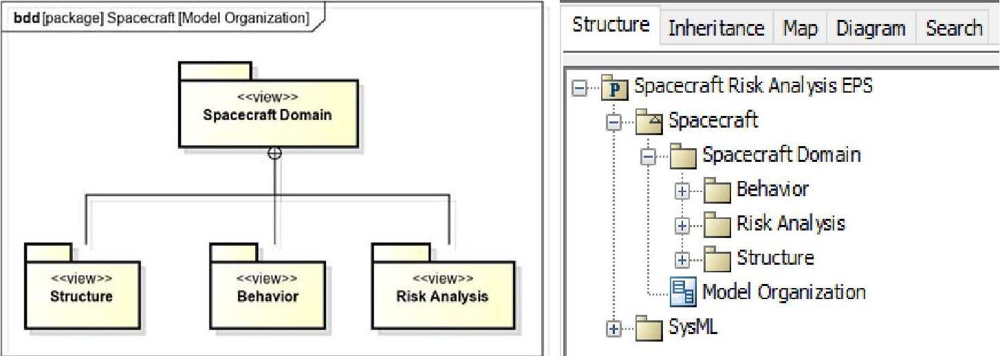

Figure 2-1. Model Organization

## 2.2 System Context

In section Appendix AA1.3 it was shown that the electric power subsystem appears to have the highest share in fatal mission failures, which makes it interesting to use as a sample subsystem for the modeling sake. Also, a comprehensive amount of available EPS failure data can be used to create an extensive failure mode specification.

However, for the sake of risk analysis it's particularly important to understand the context of a system of interest, which will later help to identify the external physical and functional interfaces with its surroundings. For this reason all relevant context objects have to be included into the model, together with a basic operational description to start with.

At this high level the entire spacecraft, not just the EPS, is considered as a system of interest, which includes systems like Physical Environment and Ground station in its domain, see Figure 2-2. The diagram only mentions the systems interacting with a Spacecraft, and doesn't yet specify the corresponding interfaces.

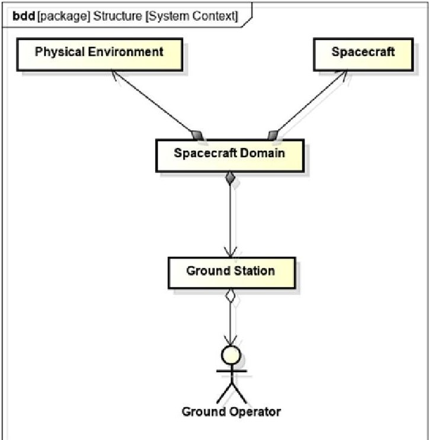

Figure 2-2. System context

<!-- PDF_PAGE: 23 -->

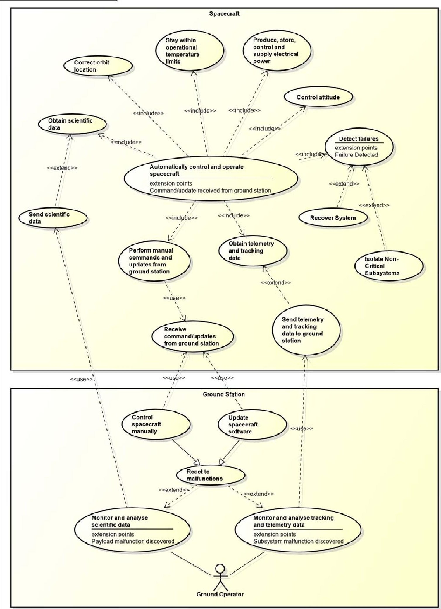

Figure 2-3. Spacecraft operational context

<!-- PDF_PAGE: 24 -->

The high-level operational context based on the Use-Case Diagram shown in Figure 2-3 depicts various basic scenarios, inherent to Spacecraft and Ground Station, and their mutual dependencies. For example, from this diagram can be derived that scientific data needs to be obtained by a spacecraft before sending it to the ground station so that it can be used by a ground operator for monitoring and analysis purposes. The same holds for telemetry and tracking data. An extension to monitoring and analysis use-case is ground operator's reaction to various malfunctions, which may result in manual subsystem control or software updates. These two operations require on spacecraft's ability to receive commands and updates from a ground station prior to their execution, which is an example of another typical operation. The spacecraft also needs to stay within specified temperature limits, supply electrical power, control attitude, etc.

This diagram has two main goals: a) to provide basis for a high-level functional decomposition, and b) to already identify elementary functional interfaces between context systems.

Although EPS has been chosen as a (sub)system of interest, it’s still important to identify its external interfaces, which can only be achieved by modeling the high-level functions a spacecraft needs to perform, together with its basic physical structure. The spacecraft breakdown into subsystems is shown in Figure 2-4. The high-level functional decomposition of the entire spacecraft is depicted in Figure 2-5.

The basic functions are 'transformed' to "actions" and allocated to subsystems in Figure 2-6, based on the Perform Space Mission function. The process presented in the corresponding diagram implies that all subsystems have to perform their function concurrently in order to accomplish a space mission.

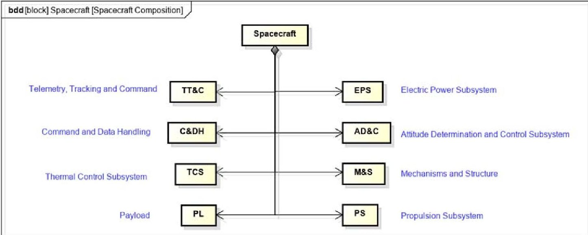

Figure 2-4. Spacecraft composition

<!-- PDF_PAGE: 25 -->

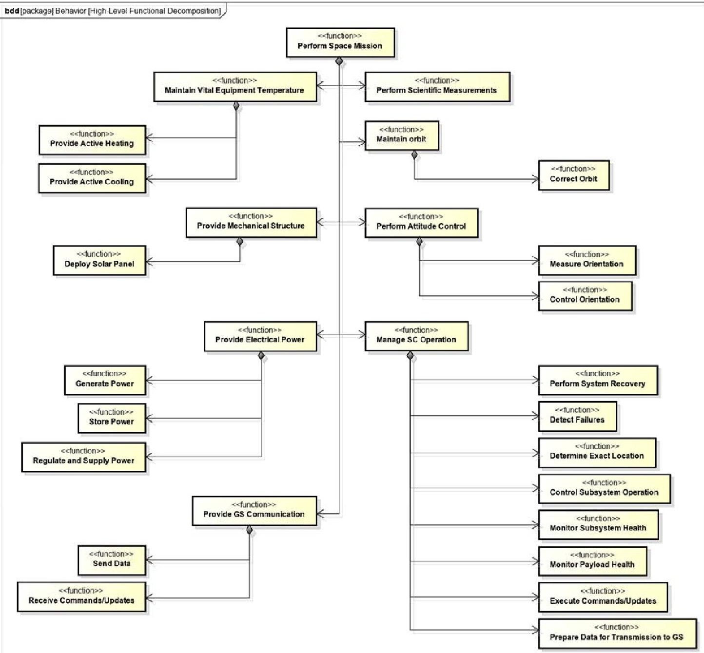

Figure 2-5. Spacecraft high-level functional decomposition

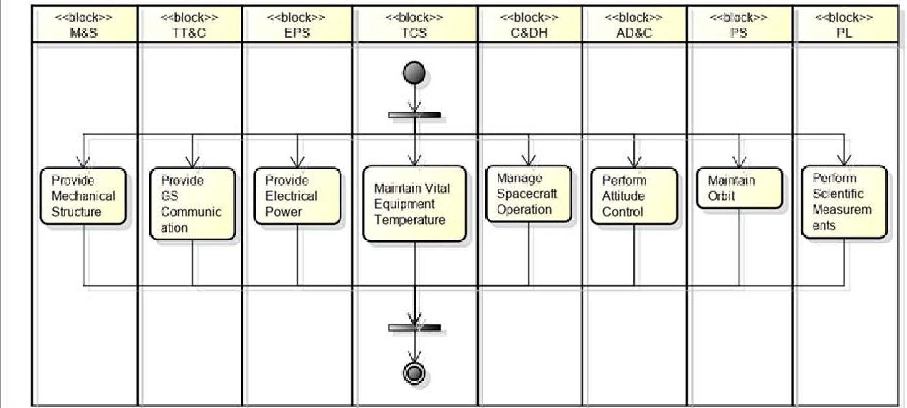

Figure 2-6. Allocation of basic functions to subsystems

<!-- PDF_PAGE: 26 -->

In SysML it is possible to specify the items that flow from one object to another through their interfaces. A part of "item types" that are going to be used throughout this and next chapter are specified in Figure 2-7.

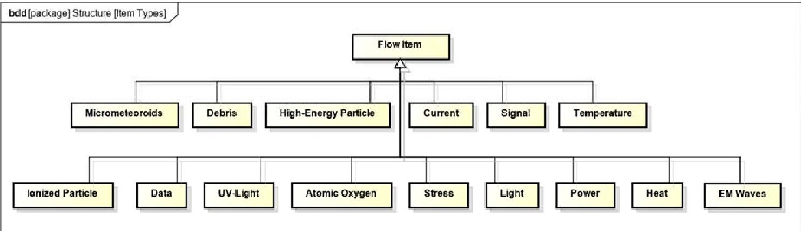

Figure 2-7. Item types

One of the context systems specified in Figure 2-2 is Physical Environment. To depict how it interacts with EPS it first needs to decomposed into its major constituents, see Figure 2-8. The corresponding "flow properties" which represent the physical particles, are also specified in this diagram.

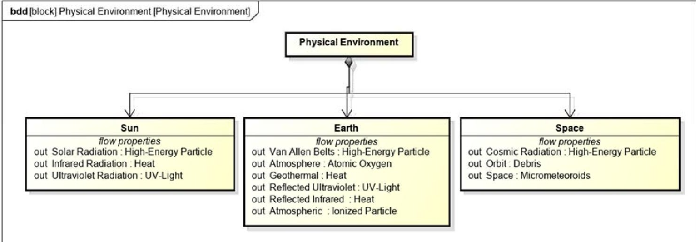

Figure 2-8. Specification of physical environment

Finally, based on the information captured until now, it becomes possible to model the external interfaces of EPS. These are depicted in Figure 2-10. In the corresponding diagram Physical Environment and Ground Station are modeled as "external parts". EPS has been 'equipped' with ports through which items are flowing. An example of port 'characteristics' is given in Figure 2-9. These are not always physical ports, which is for example the case for the interface between EPS and Physical Environment. Furthermore, there are in total six Power Supply interfaces to subsystems, one mechanical interface with M&S and one data interface with C&DH, which allows the transmission of command and status signals for control purposes. Kill Switch, SA Deployment Mechanism and Frame are included within M&S because these parts all have direct mechanical interfaces with EPS and are required for its proper functioning. The interfaces required for the communication with Ground Station are also shown here; these are derived from the operational context model in Figure 2-3.

It needs to be mentioned that in this and all other Internal Block Diagrams throughout this chapter no physical interfaces have been explicitly mentioned to avoid the information surplus; current and data from and to EPS flow through cables and wires, that are physically attached to EPS. In other words, the existence of physical interfaces is inherent to items that flow into and out EPS, except for

<!-- PDF_PAGE: 27 -->

the items that represent particles induced by the Physical Environment, temperature transfer between components and other electromagnetic waves.

<table><thead><tr><th>Provided Interface</th><th>Required Interface</th><th>TaggedValue</th><th>Hyperlink</th></tr></thead><tbody><tr><td>Base</td><td>Stereotype</td><td>Constraint</td><td>Connector</td><td>Item Flow</td><td>Dependency</td></tr><tr><td>Name</td><td colspan="5"></td></tr><tr><td>Service</td><td colspan="5">true</td></tr><tr><td>Behavior</td><td colspan="5">false</td></tr><tr><td>isConjugated</td><td colspan="5">false</td></tr><tr><td>Multiplicity</td><td colspan="5"></td></tr><tr><td>Type</td><td colspan="5">Data IF - Spacecraft.Spacecraft Domain.Structure</td></tr><tr><td></td><td>Property</td><td>FlowProperty</td><td>New</td><td></td><td></td></tr><tr><td>Port Type</td><td colspan="5">&lt;proxy&gt;</td></tr><tr><td>Definition</td><td colspan="5"></td></tr></tbody></table>

Figure 2-9. Data IF port showing the flow properties

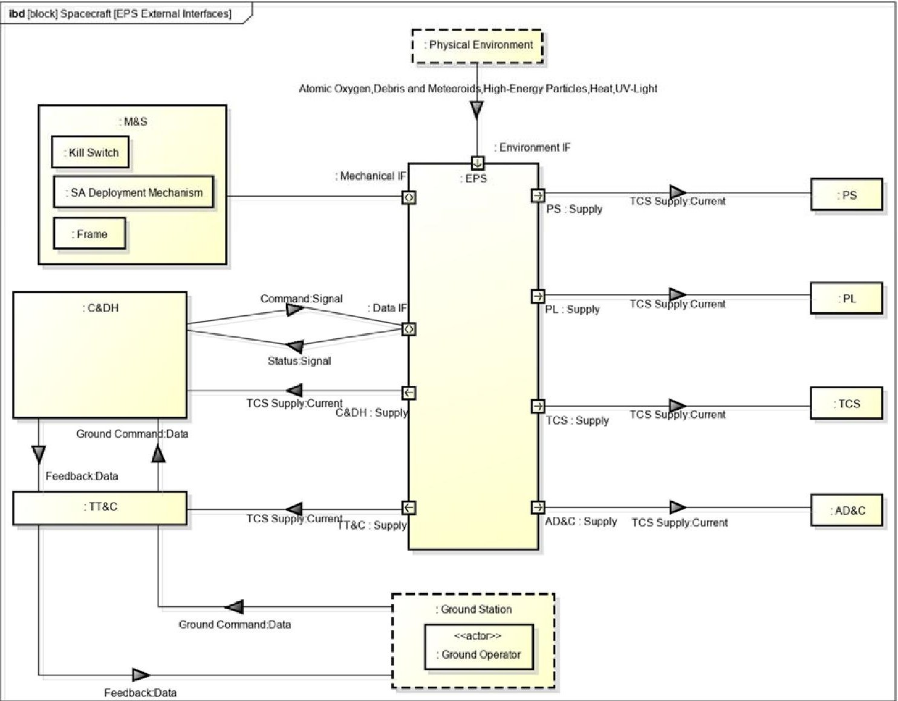

Figure 2-10. External interfaces

<!-- PDF_PAGE: 28 -->

## 2.3 High-level EPS architecture

After the system context has been modelled, the basic EPS structure and behavior can be considered. In the diagram presented in Figure 2-11, EPS is physically decomposed into its basic structural components: Solar Array, Battery and Power Control and Distribution unit. This decomposition is required to model its basic internal configuration and behavior.

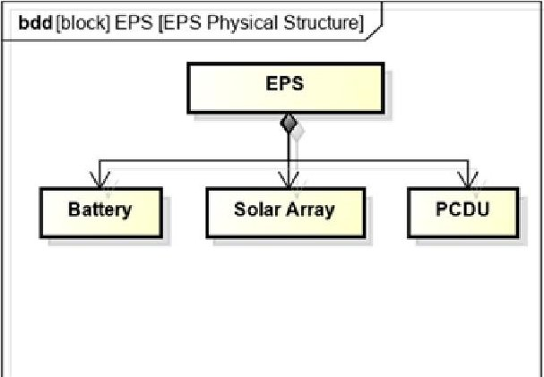

Figure 2-11. EPS High-level physical structure

The internal configuration is shown in Figure 2-12. The corresponding Internal Block Diagram shows how the basic components are interconnected, including the items that flow through their interfaces, based on the information in Figure 2-10.

The Sun Light goes into the Solar Array, and Generated Current 'produced' by the Solar Array flows into PCDU. Both mechanically interact with the Kill Switch, which is an external part together with SADM. Battery outputs Discharge Current and Battery Temperature which both flow into PCDU, while Charge Current is being transmitted from PCDU to the Battery.

To reduce the amount of information "noise" the power supply ports have been combined in this and subsequent diagrams into one single port from which supply current is being transmitted to the subsystems. Also, this diagram shows that PCDU fulfills 'communication' with C&DH by accepting Command Signal and sending Status Signal.

The Activity Diagram in Figure 2-13, shows a high-level flow-based behavior of EPS, based on the function Provide Electrical Power. In Figure 2-5 this function was decomposed in three basic subfunctions: Generate Power, Store Power and Regulate and Supply Power. These subfunctions are directly transformed into "actions" and then allocated to the basic structural components of EPS, deploying its flow-based functional behavior, based on the internal configuration presented in the previous diagram.

The "flow items" are declared here as "parameter nodes" on the diagram boundaries, which approach the "actions" on the "object nodes". Kill Switch On and Deploy Solar Panel are the "actions" inherent to the "control flows" at the start of the process.

Although Charge and Discharge functions have not yet occurred in the functional decomposition tree in Figure 2-5, these are depicted here for the clarification purposes.

<!-- PDF_PAGE: 29 -->

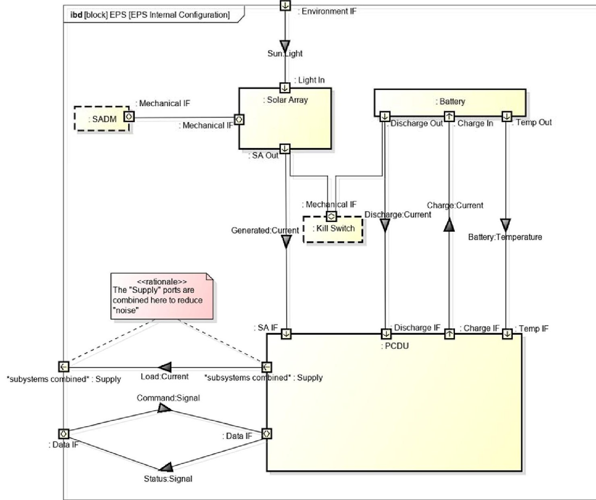

Figure 2-12. EPS internal configuration

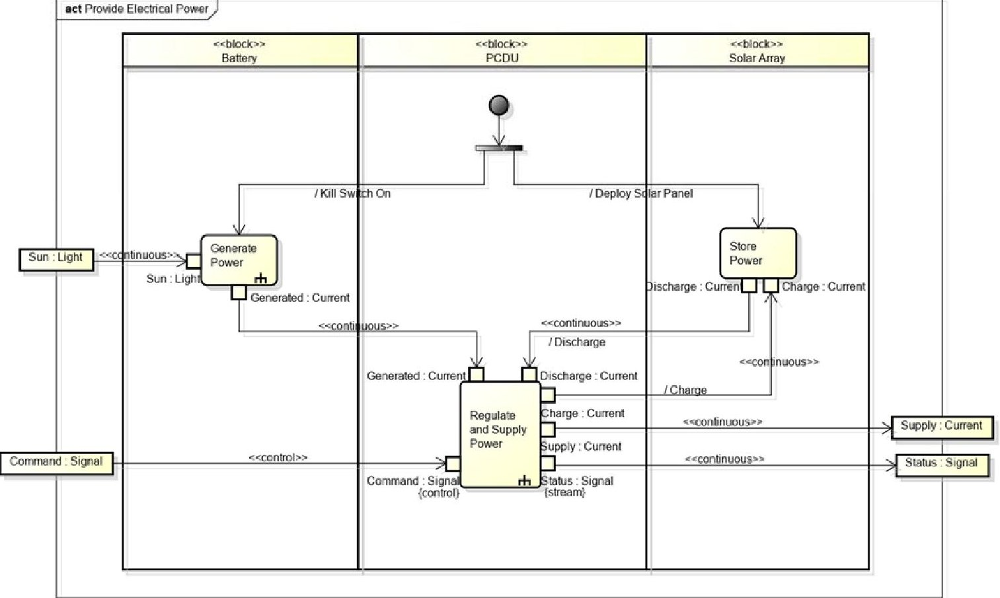

Figure 2-13. EPS flow-based behavior

<!-- PDF_PAGE: 30 -->

## 2.4 'Extended' EPS architecture

Definition 'extended' has been consciously chosen as a name for this section instead of 'low-level' for the reason mentioned in the introduction to this chapter; in this thesis an emphasis is put on the conceptual system design stage, to which a 'low-level' term isn't applicable.

In this section the EPS model will be enhanced by additional details, required for future risk analysis. First, the EPS functions and structure are further decomposed. Figure 2-14 and Figure 2-15 show the extended functional and physical decomposition of EPS.

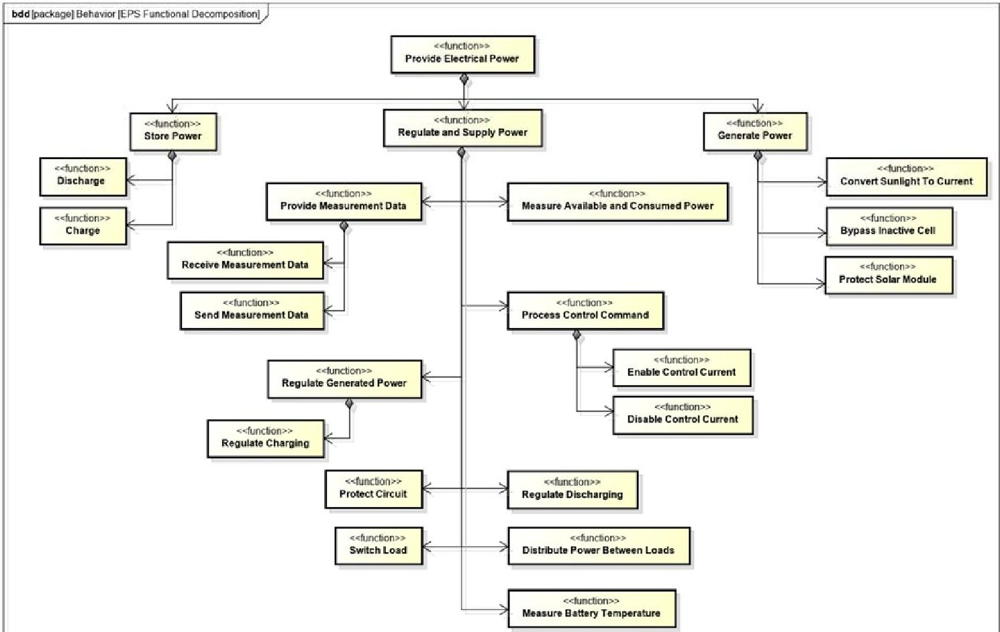

Figure 2-14. EPS extended functional decomposition

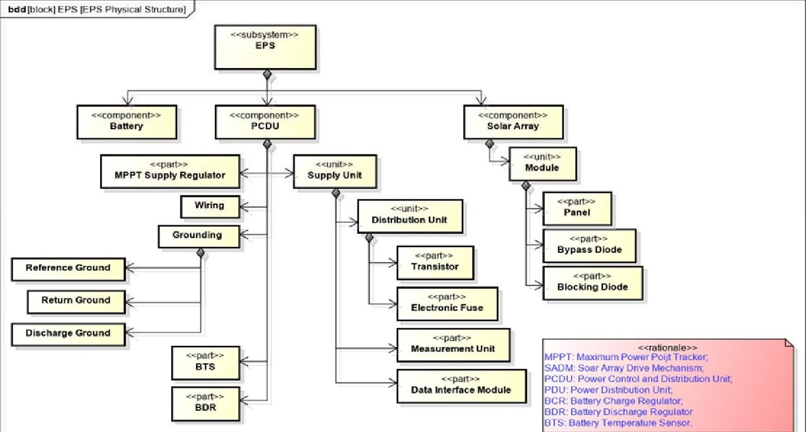

Figure 2-15. EPS extended physical structure

<!-- PDF_PAGE: 31 -->

Figure 2-12 showed the interfaces between the basic EPS components: PCDU, Solar Array and Battery, and their surroundings, including the items flowing between the interfaces, while Figure 2-13 depicted its corresponding functional flow-based behavior. Figure 2-16 and Figure 2-17 uncover the internal configuration of PCDU and its flow-based behavior respectively, based on the extended functional and physical decompositions presented in the previous figures.

Current generated by the Solar Array is being regulated by the MPPT Supply Regulator, while the BDR controls Discharge Current, supplied by the Battery. Both parts rely on the Temperature Measurement Signal provided by the BTS, which uses Battery Temperature as input. While the MPPT Supply Regulator also supplies Charge Current to the Battery (depending on the operational status), the total combined power is being transmitted to the Distribution Unit, which utilizes the Transistor to switch Main Current (for the sake of load switching) and the Electronic Fuse/Current Limiter to protect the circuit. Main Current is being switched by Control Current from the Data Interface Module, controlled by the Command Signal from C&DH subsystem. For this control operation the C&DH utilizes the Power Measurement Signal produced by the Power Measurement Unit.

<!-- PDF_PAGE: 32 -->

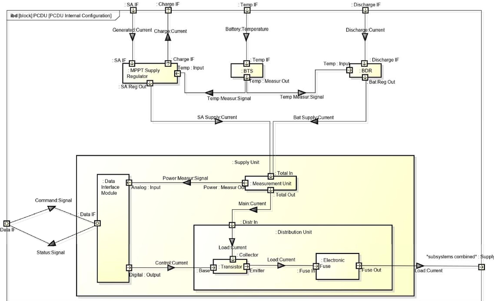

Figure 2-16. PCDU internal configuration

<!-- PDF_PAGE: 33 -->

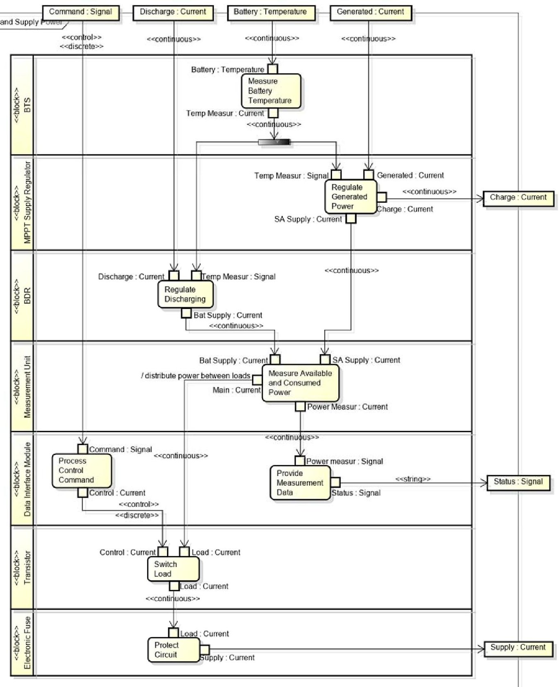

Figure 2-17. PCDU flow-based behavior

The same modeling procedure has being applied to the Solar Array: Figure 2-18 shows the internal configuration of the Solar Array, while Figure 2-19 presents the corresponding flow-based functional behavior: the Sunlight falls on the Module, which consists of the Panel, the Bypass Diode and the Blocking Diode. The Panel converts Sunlight into Generated Current, while the Bypass Diode circumvents the consequent Panel in case it's inactive (e.g., due to shadow or cell failure). Finally, the blocking diode is used to protect the Panel from the reverse current.

<!-- PDF_PAGE: 34 -->

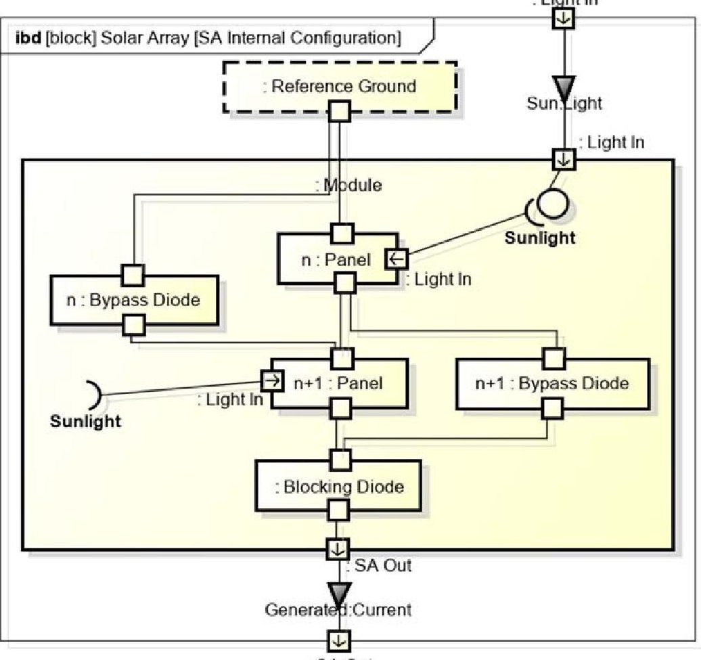

Figure 2-18. Solar Array internal configuration

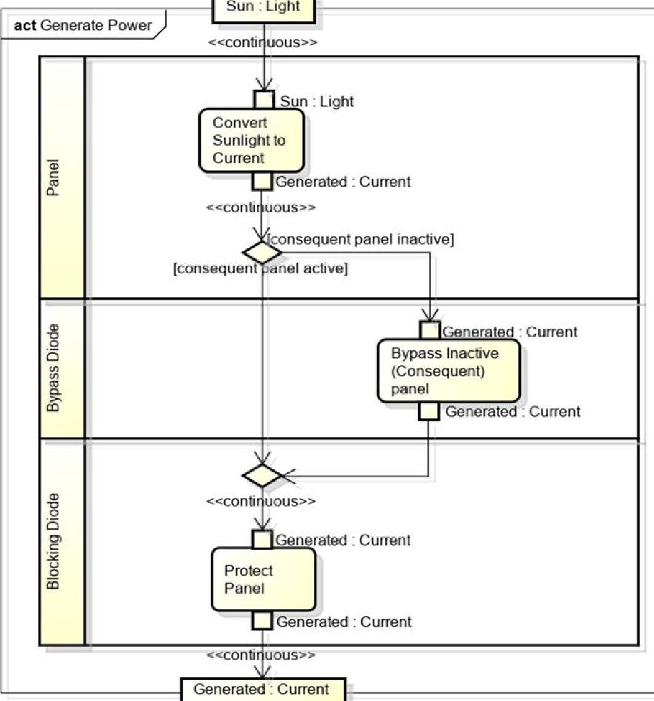

Figure 2-19. Solar Array flow-based behavior

<!-- PDF_PAGE: 35 -->

## 2.5 Conditional behavior

The aspects of EPS behavior modeled until now didn't account for any conditions or triggers; these are however required to understand the mechanisms behind its physical and functional operation, which are specified by the following parameters:

a) Its intrinsic design, i.e. the state transitions will take place naturally when certain conditions are met. For example, the Battery will only charge if the total power consumption by the loads is less then total power generated by the solar array and the battery voltage is less than its 'end of charge' voltage. In this example no external triggers or events are required to force the transition;

b) Functional triggers, e.g. a control command from C&DH subsystem to turn off a non-critical subsystem in case when EPS can't fulfill the entire power budget;

c) External events, e.g. when the Solar Array gets exposed to sunlight, it will start generating current.

In Figure 2-16 and Figure 2-17 the physical and functional interactions between Data Interface Module and C&DH subsystem have been depicted, which however doesn't uncover the corresponding logic. The diagram presented in Figure 2-20 addresses this issue by depicting the message-based behavior. In this diagram other EPS components haven't been involved, as their operation already follows from Figure 2-16 and Figure 2-17, when combined with the figure below:

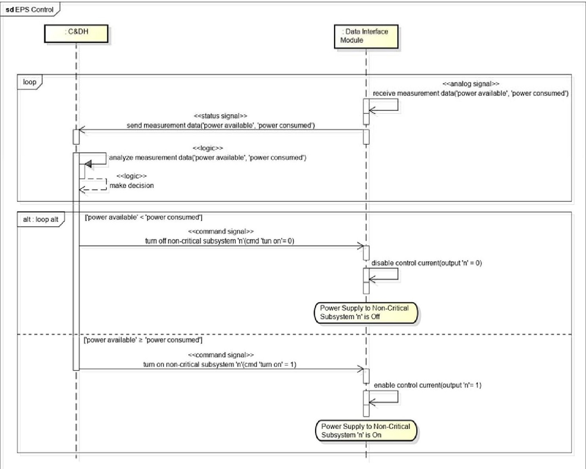

Figure 2-20. EPS controlled by C&DH subsystem

<!-- PDF_PAGE: 36 -->

In section 2.4 it was shown that the Data Interface Module receives Power Measurement Signal from the Measurement Unit. Corresponding measurement data is being further transmitted to the C&DH subsystem and analyzed, relying on C&DH's internal logic. This is a continuous process, and for this reason the SysML Combined Fragment "loop" has been applied. Based on the logical outcome, C&DH may 'ask' the Data Interface Module to turn off a non-critical subsystem by sending the related control command. In this case the Data Interface Module will disable control current at the base of the corresponding transistor, which will in turn shut off the power supply. When C&DH 'decides' to activate the same non-critical subsystem again, the opposite happens. The combined fragment "loop alt" is used here to express alternation in this continuous process.

To model the event-based behavior of EPS as function of various 'natural' conditions and triggers, a State Machine Diagram has been constructed, see Figure 2-21. This diagram shows a number of basic system states and their corresponding transitions. The EPS will reach its Electrical Power Supply sate when the following conditions apply: the Kill Switch must be activated and the solar panels deployed. Both Kill Switch and SADM are part of M&S subsystems; they however have functional and mechanical interfaces with EPS.

The Electrical Power Supply state has been divided into three concurrent regions, which means that the substates within these regions may occur simultaneously. The initial concurrent states are: Standby (Power Storage); it applies to the Battery - at the very beginning Battery doesn't discharge, No Power Generation - The Solar Array doesn't yet generate power and both power supplies to critical and non-critical subsystems are off.

The Battery will reach its Discharging state when the following conditions apply: the power output by the Solar Array must be less than total power consumed, the battery voltage is higher than its 'end of discharge' voltage and the Battery temperature must be lower than its threshold value. The Battery will start charging when the Solar Array power output becomes higher than power consumed. In addition to the just mentioned transitions more transitions exist; each state can be reached via two different 'paths' under certain conditions. For example, the transition from the Discharging state to Standby requires the following conditions to be 'true': the Solar Array power output must be lower than power consumed while the Battery voltage has reached its 'end of discharge' voltage, or the Solar Array power output must be equal to power consumed, or the Battery temperature has approached a certain threshold value.

The Solar Array will start generating power as a result of an external event: exposure to sunlight; however, before the Generating Power state will be entered the following condition must be 'true': the actual power output must be higher than zero.

Power supply to the critical subsystems will be realized when the total power output is higher than required by these subsystems. The same sort of condition applies to power supply to the non-critical subsystems with a single exception: it must be triggered by the control command from C&DH, as discussed on the basis of Figure 2-20.

<!-- PDF_PAGE: 37 -->

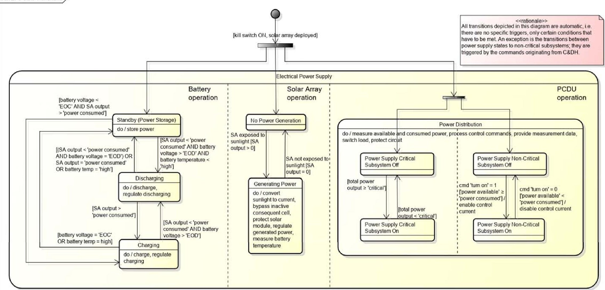

Figure 2-21. EPS state transitions

<!-- PDF_PAGE: 38 -->

## 2.6 EPS model summary

The EPS model is organized into Structure, Behavior and Risk Analysis using a Package Diagram, see Figure 2-1. The corresponding diagrams provided in this chapter have been divided between these packages.

To identify the external physical and functional interfaces with the surroundings, the physical system context has been presented in Figure 2-2, which shows the relevant context objects.

The high-level operational context based on the Use-Case Diagram is shown in Figure 2-3. It presents various basic scenarios, inherent to Spacecraft and Ground Station, and their mutual dependencies. This diagram is further used as the basis for a high-level functional decomposition, and for identification of elementary functional interfaces between context systems.

To identify the external interfaces of the system of interest, the high-level functions of a spacecraft are modeled, together with its basic physical structure. The spacecraft breakdown into subsystems is shown in Figure 2-4, while the high-level functional decomposition of the entire spacecraft is depicted in Figure 2-5.

The basic functions are 'transformed' to "actions" and allocated to subsystems in Figure 2-6, based on the Perform Space Mission function.

The items that flow from one object to another through their interfaces are specified in Figure 2-7.

The context object Physical Environment is decomposed into its major constituents in Figure 2-8, including the corresponding flow properties.

Based on the uncovered information, the external interfaces of EPS and the corresponding items that flow through them are modeled, which is shown in Figure 2-10.

Figure 2-11 depicts the elementary physical structure of EPS. This decomposition is used to model its basic internal configuration, which shows how the high-level components are interconnected (Figure 2-12), leading to the flow-based behavior (Figure 2-13), where the subfunctions are directly transformed into "actions" and then allocated to the basic structural components of EPS.

Figure 2-14 and Figure 2-15 show the 'extended' functional and physical decomposition of EPS required for modeling the 'extended' EPS physical and functional architecture.

Figure 2-16 and Figure 2-17 uncover the internal configuration of PCDU and its flow-based behavior respectively, based on the 'extended' functional and physical decompositions. The same modeling procedure has being applied to the Solar Array: Figure 2-18 shows the internal configuration of the Solar Array and Figure 2-19 shows the corresponding flow-based functional behavior. It has to mentioned, that the third basic component of EPS, the Battery, has not been decomposed any further, as it is a typical COTS product, like for example an 18650 battery.

To account for triggers, events and logical conditions behind the operation of EPS the message-based and event-based behaviors are modeled. The Sequence Diagram in Figure 2-20 shows the behavior of the Data Interface Module as a result of interaction with C&DH subsystems, while State Machine Diagram in Figure 2-21 depicts the state transitions of EPS as function of external events, functional triggers and logical conditions.

<!-- PDF_PAGE: 39 -->

## 3. Reliability modeling

In the previous chapter the conceptual system design model of EPS has been presented, unveiling system's structure, internal and external interfaces and (conditional) functional behavior. The uncovered information is used to build a risk model, which is the main purpose of this chapter.

The following activities will take place in the upcoming sections:

- Selection of the suitable risk assessment method(s), based on the information provided in Appendix AA2, including the approach on how to implement a reliability model in SysML;

- Establishing a qualitative risk model, based on the previously selected risk assessment method(s) and modeling strategy;

- Reliability quantification: a qualitative risk model will be further expanded to provide basis for calculating basic system reliability;

- Result evaluation: to estimate the added value of the presented methodology it will be compared with traditional methods.

## 3.1 Risk assessment methodology

In Appendix AA2 a number of various risk assessment methods has been listed, including the corresponding specifics such as their application areas, benefits and drawbacks.

To choose a suitable method for the sake of implementation in SysML and its integration within a system model a number of criteria are considered:

- A method should be applicable to a given system at the conceptual and lower levels of design, i.e. it should provide the ability to utilize all essential information which has been captured into the design model by incorporating all known functional and structural characteristics of the system;

- The selected technique must be uncomplicated, well understood and widely used; it has to be flexible and easily accessible for implementation at all design stages. This is especially important, considering limited time frames the CubeSat university design teams typically have to cope with;

- The proposed method must support both qualitative and quantitative reliability modeling: the qualitative part must provide a good understanding of system's undesired behavior and its impact on system performance expressed in system's inability to perform critical functions, related to the failures or the combination of failures of different components. The quantitative part should complement the qualitative analysis, i.e. it shouldn't be a totally independent method;

- Finally, a method must be suitable for implementing in SysML and integration with a design model.

According to the information provided in Appendix AA2, these considerations lead to a preliminary conclusion: there is no single risk analysis method that can match all listed criteria. For this reason a combination of methods must be examined.

One of the commonly used risk assessment methods is Failure Mode and Effect (Criticality) Analysis, FME(C)A. It provides a good basis for cause and effect analysis by considering the failures of single parts and its final effect on system performance, which is done for each part independently. To quantify the criticality of each failure mode a criticality analysis is being performed to list parts which require the most 'attention'. This quantification, however, says nothing about a reliability of the entire system. Furthermore, to estimate the final effect of each failure mode an expert judgement is

<!-- PDF_PAGE: 40 -->

typically conducted during brainstorm sessions. This approach is mostly inherent to professional design teams with dedicated experience. To compensate for the lack of experience which is typically the case for the student design teams, FME(C)A can be enhanced by scenario modeling, which has its similarities with the Event Tree Analysis (ETA) technique. This allows to take into account the initially modeled interfaces and conditional behavior. Each failure mode can be used as a starting point to model the failure propagation throughout the whole system, based on the already known/modeled information. To calculate system reliability the Fault Tree Analysis (FTA) technique can be applied after FMEA together with scenario modeling for each failure mode have been completed. Therefore, the earlier modeled failure scenarios can be rearranged and combined, making it possible to consider not only the single failure modes but also their combinations. The reason why it is chosen to combine FTA and FMEA, is the fact that while FMEA mainly focuses on analyzing the effects of a single functional or component failure and finding all possible initiating fault events, FTA, on the other hand, allows to consider the combination of failures so that total system reliability can be calculated.

Mentioned methods are all widely used and lots of information on their application is available. Furthermore, they can be modified to become complementary to each other, and combined into a single integrated risk analysis methodology, so that all available design information can be utilized. This methodology can potentially support implementation of qualitative and quantitative aspects as well. The comprehensive qualitative basis makes it usable for modeling in SysML, while the quantitative results can be assigned as values to the corresponding SysML artifacts. The calculations, though, have to be performed externally, as basic SysML specification doesn't support a full quantitative analysis.

The implementation of the risk analysis methodology will be presented in the next sections, based on the EPS model described in Chapter 2. The first step comprises building a qualitative reliability model, which is done in the following section. The quantitative part will be considered in Section 3.3.

## 3.2 Qualitative reliability model

Prior to deploying FMEA, the common failure mechanisms are described first; this is done in Figure 3-1. The analysis on failure mechanisms is essential during FMEA as this helps CubeSat design teams to account for undesired effects imposed by space environment and characteristic design deficiencies. Most of failure mechanisms are related to space environment and may suddenly occur, e.g. single-event effects (SEE) such as single-event upsets (SEU) and single-event latchups (SEL), caused by the penetration by high-energy particles. Another sudden event which can contribute to an unexpected malfunction is electrostatic discharge, which can be caused by ionized particles in LEO, but can also arise due to the specifics of design lay-out. While ESD can lead to malfunctions of sensitive parts on its own, it may also contribute to signal disruption of measurement devices. This signal disruption may also be caused by electromagnetic interference induced by the adjacent parts, which can again be provoked by system's design properties such as lay-out, lack of proper grounding, insulation and material properties.

Mentioned physical processes and phenomena may lead to a sudden failure of a specific part, while accelerated degradation as a result of thermal cycling, surface erosion, UV absorption and total ionization dosage, also needs to be taken into account. While thermal cycling and total ionization dosage (TID) may affect most electric, electronic and mechanical parts, surface erosion and UV absorption typically contribute to a gradual function loss of solar arrays.

Not only accelerated degradation caused by mentioned physical processes may contribute to part failures. Another aspect to consider is a 'normal' degradation, which is characterized by part's 'base failure rate'. This value applies to all parts and components that operate under 'normal' conditions on the ground and can be found in multiple databases.

<!-- PDF_PAGE: 41 -->

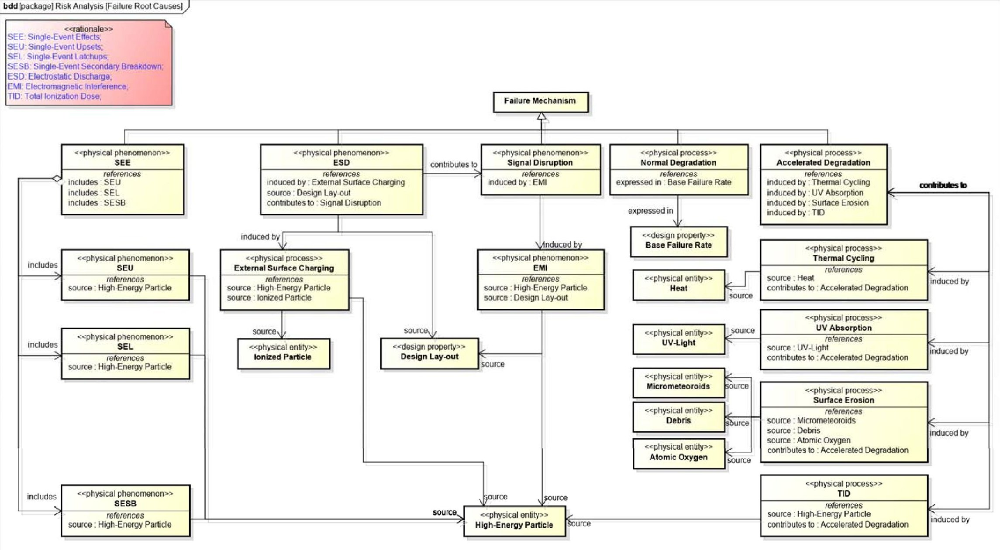

Figure 3-1. Failure root causes

<!-- PDF_PAGE: 42 -->

EPS failures caused by incorrect human operation or C&DH software errors are not covered in this diagram; these types of failures are not inherent to EPS itself. The purpose of the model is to list potential EPS failures as a result of a malfunction or a combination of malfunctions of its parts caused by a) environmental effects and b) normal degradation. Failures caused by design or assembly errors are also not mentioned here; for this reason wiring and grounding haven't been included into this analysis. The main purpose is to identify possible failure mechanisms of parts and corresponding failure scenarios. The results are supposed to serve as an input for risk mitigation measures which should provide a basis for integral system design by e.g. specifying redundancies, failure detection methods, special protective measures (insulation, coatings, layout), etc.

In the following subsection failure modes of all parts will be considered consecutively, together with the underlying failure mechanisms, local/final effects and impacted system functions, which is required to understand the relationships between part failures and their effects on a functional performance.

## 3.2.1 FMEA

In Figure 2-14 and Figure 2-15 functional and physical decompositions of EPS have been depicted respectively. Throughout Chapter 2 high-level functions have been initially allocated to basic EPS components, and later low-level functions have been allocated to the corresponding parts. Modeled functional behavior of system elements together with their internal configuration provide insight into the mutual functional and physical dependencies between system components and their parts, while modeling conditional behavior helped to identify triggers and conditions required for step transitions within a total process of power supply. All of this information is required to set up FMEA for each physical part.

Instead of executing FMEA in conventional table format, SysML Block Definition Diagram is used. In this diagram the main element is a failure mode, which is elaborated using standard relationships from the SysML library. Each failure mode is linked to a corresponding part, impacted low-level function, failure mechanisms and local/final effects. To determine local and final effects scenario modeling is applied, using the Activity Diagram, which can be considered as a modified version of ETA.

In Figure 3-2 an example FMEA for Battery Discharge Regulator has been performed, which is one of the PCDU parts (for other FMEA's see Appendix B to Appendix H). The 'Discharge Regulation Fails' is for this reason one of the PCDU failure modes, caused by a failure of its part the BDR. Failure of this device immediately impacts the low-level function 'Regulate discharging', which has been allocated to it in Chapter 2. Initially, the potential local and final effects are unknown. To determine the consequences of this failure mode scenario modeling is performed, which is shown in Figure 3-3. Failure of BDR potentially leads to two conditional local effects: 'Battery Over-discharges' or 'Battery Runs Hot'. The first (conditional) local effect arises in case when battery has reached its EOD voltage and keeps discharging, while the second (conditional) local effect will occur if the battery temperature exceeds its threshold value while battery keeps discharging (Figure 2-16 and Figure 2-17 show that BDR relies on temperature measurement from BTS). These local effects are conditional, which means that they don't arise concurrently; they, however, both lead to 'Battery Permanently Damaged' intermediate effect. Because battery is required for power supply during eclipse (which approximately covers 1/3 of the orbital period in LEO), it means that EPS won't be able to supply power during this period; the final effect is thus 'No Power Supply During Eclipse'. This information is used to complete FMEA in the figure below.

The potential failure mechanisms are derived from the diagram presented Figure 3-1; these are subjectively assigned to the failure mode, based on the expected occurrence for this part.

<!-- PDF_PAGE: 43 -->

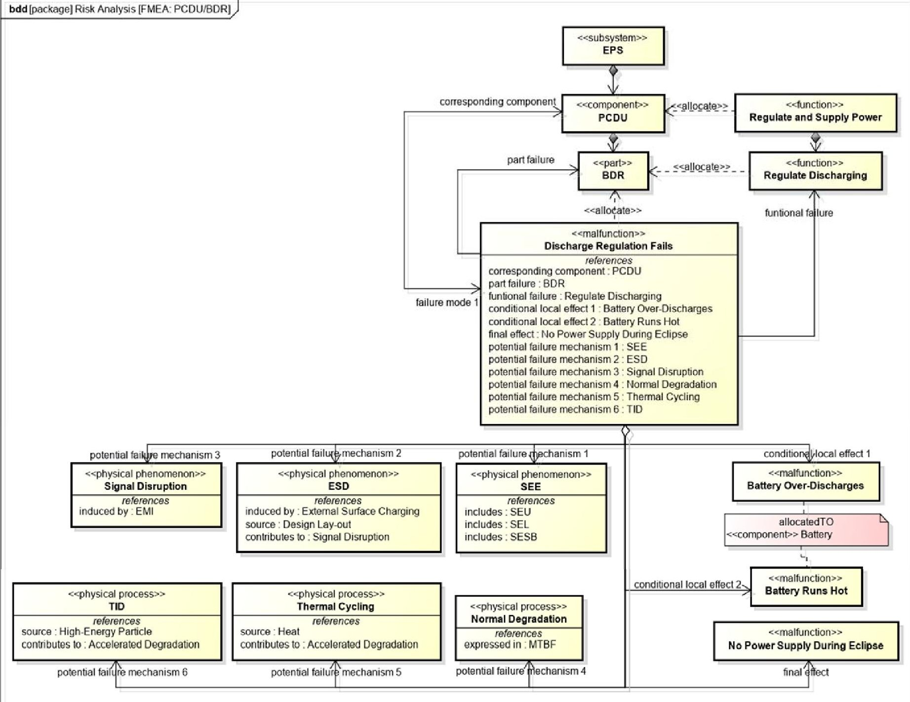

Figure 3-2. FMEA PCDU - Battery discharge regulator

<!-- PDF_PAGE: 44 -->

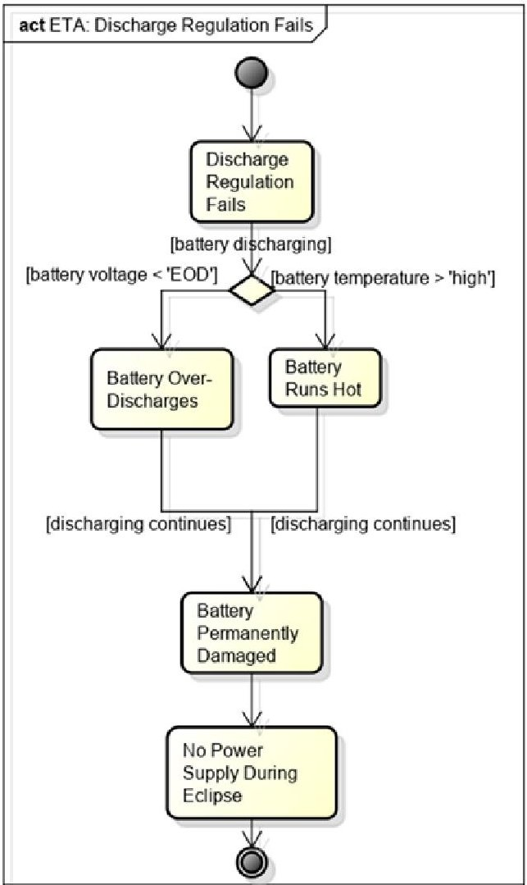

Figure 3-3. ETA - Discharge regulator failure $ ^{*} $

*The assumption made here is that maximum discharge rate of the battery is specified by system's intrinsic design and not by BDR. Otherwise, even more scenarios could occur. In case battery temperature exceeds a certain threshold value (>= 'high'), BDR would normally block discharging until normal operational temperature value (< 'high') restores.

Detailed FMEA's of the remaining PCDU parts, Solar Array and Battery (see physical decomposition in Figure 2-15) can be found throughout Appendix B to Appendix H.

The main difference between presented approach and 'standard' FMEA is that here various conditions have been taken into account that are required for a failure mode to trigger transitions to local, intermediate and final effects as in some cases failure modes don't automatically lead to described local and final effects, i.e. certain conditions must be first met, which means that when these conditions aren't met, final effect won't occur. Scenario modeling based on the already captured system design helps to identify these conditions. Another key difference compared to a 'standard' FMEA approach is the fact, that dependencies between various system elements such as structure, undesired behavior and functions are explicitly depicted here. Although the procedure presented in Figure 3-2 and Figure 3-3 requires more effort compared to performing FMEA in table format, it is developed to better utilize the already present information on system design. This may help to uncover failure effects which would normally be overlooked and provide a link with (critical) system functions that are impacted first.

To provide a complete overview of all individually considered failure modes and interrelated elements, the FMEA results are combined in Figure 3-4. Corresponding diagram summarizes analyses performed for each individual failure mode throughout Figure 3-2, Figure 3-3 and Appendix B to Appendix H. An ID has been assigned to each failure mode, which will be used during qualitative criticality analysis in the next section.

<!-- PDF_PAGE: 45 -->

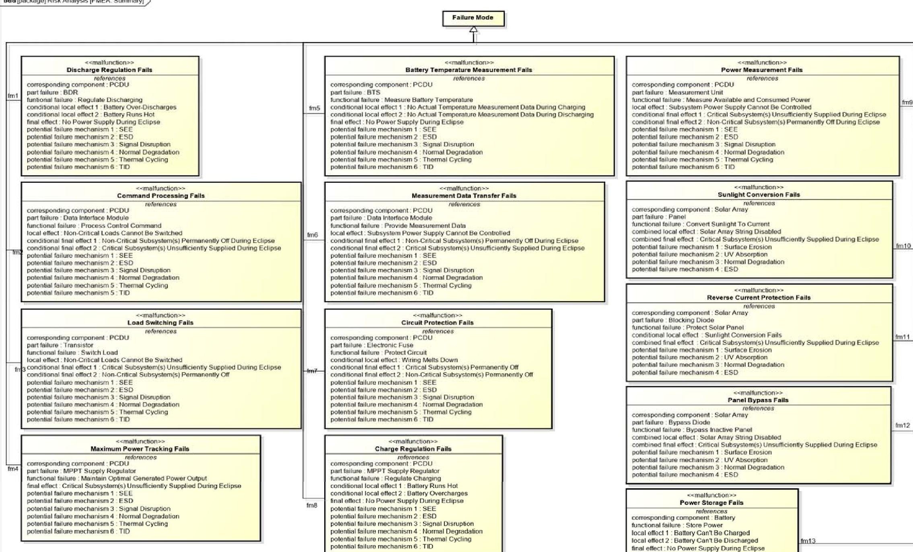

<table><thead><tr><th>references</th></tr></thead><tbody><tr><td>corresponding component : Battery</td></tr><tr><td>functional failure : Store Power</td></tr><tr><td>local effect 1 : Battery Can't Be Charged</td></tr><tr><td>local effect 2 : Battery Can't Be Discharged</td></tr><tr><td>final effect : No Power Supply During Eclipse</td></tr><tr><td>potential failure mechanism 1 : Normal Degradation</td></tr><tr><td>potential failure mechanism 2 : Thermal Cycling</td></tr></tbody></table>

Figure 3-4. FMEA Summary

<!-- PDF_PAGE: 46 -->

## 3.2.2 Qualitative criticality analysis

The FMECA is composed of two separate parts: the FMEA and the Criticality Analysis (CA), which requires the FMEA to be completed first. The purpose of CA is to identify parts which require the most 'attention' during the design by comparing the significance of their failure modes. This finally helps to prioritize and minimize the effects of critical failures early in the design.

The analysis may be whether qualitative (considered in this section) or quantitative (performed in Section 3.3). According to a qualitative approach failure mode criticalities are subjectively classified, based on the to be estimated Risk Priority Number (RPN). Th qualitative method is applied when failure rate data on low-level parts isn't readily available, which is typically the case for student CubeSat projects. For this reason a qualitative approach will be considered first.

To estimate the RPN for each failure mode a number of ranking systems must be introduced first. This is done in the Figure 3-5.

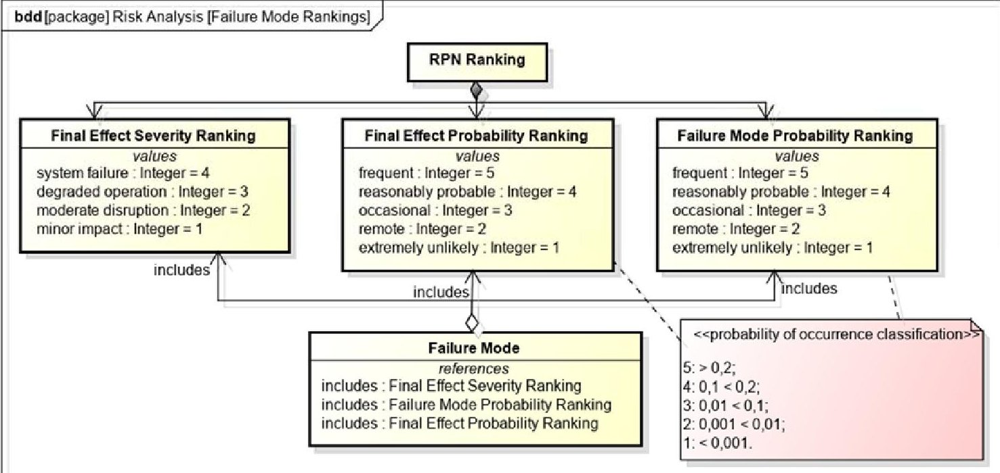

Figure 3-5. Failure mode ranking

In the corresponding diagram 'Final Effect Severity Ranking', 'Final Effect Probability Ranking' and 'Failure Mode Probability Ranking' are presented. While in typical CA 'Final Effect Probability Ranking' is not being used, in this analysis it is introduced to subjectively estimate the probability that a final effect will occur, given that a failure mode has already taken place. This is done because, as mentioned earlier, the conditional system behavior is considered for modeling the propagation of failure until its final effect is reached. For this reason, probabilities that a certain condition will be met, can be taken into account, which will help to increase the analysis accuracy.

'Final Effect Severity Ranking' is a subjective measure to express the effect on the mission for each failure mode, which is evaluated in terms of the worst potential consequences on a system level, where a higher class indicates a more severe failure effect, while 'Failure Mode Probability Ranking' is used to subjectively specify the failure rate class for each failure mode, i.e. a probability that a certain failure mode will occur.

The next step is to subjectively estimate the corresponding classes for each failure mode. Logic used for this analysis is based on the following considerations: the highest final effect severity class of 4-

<!-- PDF_PAGE: 47 -->

'system failure', is assigned to all final effects where critical subsystem(s) is/are deactivated (permanently or only during eclipse). The severity class of non-critical subsystem(s) shutdown is set to 3 - 'degraded operation', when the non-critical subsystem(s) is/are permanently off, and 2 - moderate disruption', if it/they only get(s) deactivated during eclipse period.

Failure mode probabilities for PCDU and Battery have been set to 3- 'occasional' (probability of occurrence class 0,01 < 0,1), and for solar array 5- 'frequent' (>0.2) as solar arrays are mostly prone to accelerated degradation. While these choices are subjective, they are partially based on the comparison presented in Figure A-7. Corresponding diagrams give an indication of relative component shares to fatal failures, in which electrical distribution, solar array operation and battery can be found within a range of 4-12% for first 30 days in orbit, 2-10% after 1 year, 7-10% after 5 years and 6-9% after 10 years.

Final effect probability classes are estimated using the following assumption: when no conditions have to be met for a final effect to occur, given that a failure has already developed, value 5- 'frequent' is used. Failure modes that have single conditional final effects receive value 4- 'reasonably probable', while failure modes with two conditional final effects are set to 3- 'occasional'. For all three solar array failure modes final effect probability classes have been set to 2; because multiple failures will need to take place concurrently before final effect will arise. Note: this elaboration shows how the implemented methodology differs from 'standard' FMECA, in which only single points of failure are considered and the conditional behavior is not taken into account.

The final result is shown in Figure 3-7. In the corresponding diagram all failure modes are provided with ranking values, that are required to calculate RPN's. The calculation is done using a <<constraint>> 'RPN Calculation'. The results of it are shown as values of 'RPN Ranking' <<block>>, which have been organized from highest to lowest RPN.

In Figure 3-6 an example Parametric Diagram is shown which is used to calculate the RPN for 'Power Measurement Fails' failure mode.

It must be mentioned that typical CA also considers 'Detection' and 'Redundancy' parameters because they may have a large positive impact on the RPN. To estimate the influence of 'Detection' the analysis should be performed in conjunction with C&DH design and ground operations specification; when a certain EPS malfunction is detected by C&DH or ground operator, additional measures might be taken in order to minimize the risk of final effect.

Redundancy may also highly reduce the RPN. If, for example, three batteries would be used instead of one, while only one battery is required for normal operation, the RPN would be reduced by half:

$$
P _ {f m} ^ {\prime} = P _ {f m} \times \frac {M}{N - 1}
$$

where $ P_{fm} $ - failure mode probability class, M - number of components necessary and N - number of components available. The redundancy analysis is performed after parts of highest concern have been identified (which is done is this section) and can be considered as a next step into a more detailed design phase.

The presented approach to perform qualitative Criticality Analysis in SysML is developed with maintaining the interrelations with the earlier executed FMEA in mind. By doing so, both CA and FMEA resemble an integrated approach, which helps to efficiently utilize the already obtained reliability knowledge from FMEA.

<!-- PDF_PAGE: 48 -->

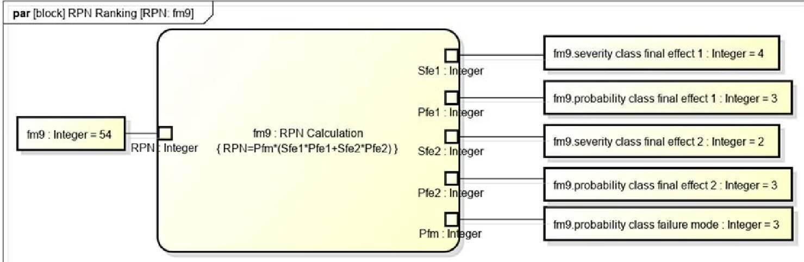

Figure 3-6. Parametric Diagram for calculating RPN of 'Power Measurement Fails' failure mode.

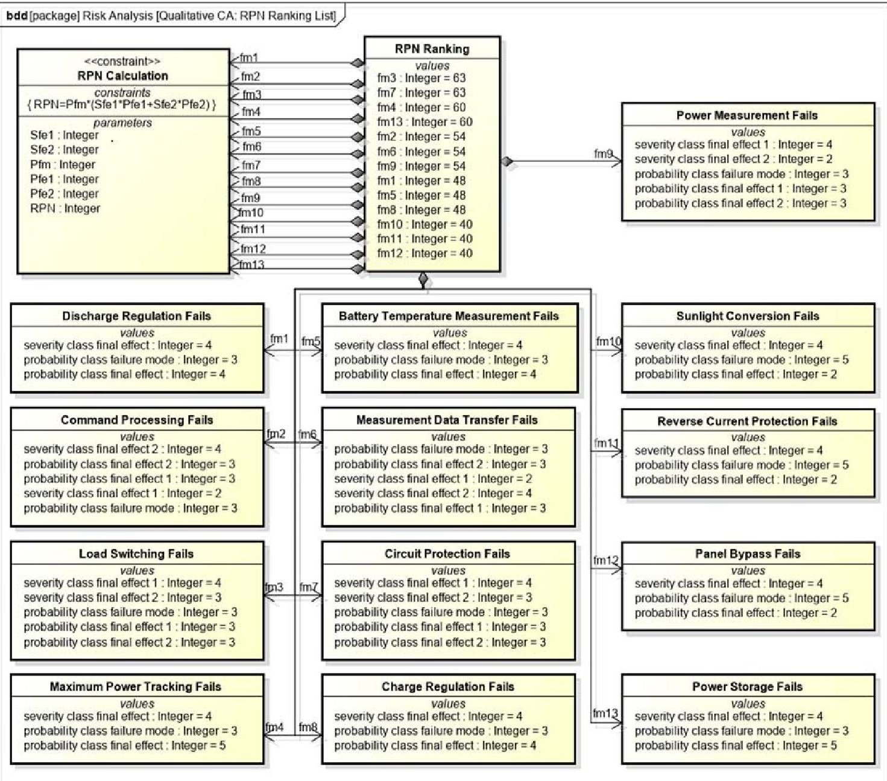

Figure 3-7. RPN ranking

<!-- PDF_PAGE: 49 -->

## 3.2.3 Qualitative FTA

To calculate system reliability the Fault Tree Analysis (FTA) technique can be applied after FMEA together with scenario modeling for each failure mode have been completed. Therefore, the earlier modeled failure scenarios can be rearranged and combined, making it possible to consider not only the single failure modes but also their combinations. FTA technique has been chosen for the reason that it can 1) efficiently utilize the results obtained from FMECA combined with scenario modeling and 2) be used to calculate theoretical system reliability during a quantitative analysis at each design stage.

After all EPS components and parts have been subjected to FMECA, the modeled failure scenarios can be used to set up a fault tree. When inspecting the FMEA results presented in Figure 3-4, it becomes obvious that some failure modes share identical final effects. This observation is essential to construct a fault tree, as it helps to reduce a total number of 'branches', leading to a lesser complexity.

The severity class ranking is typically used as one of the parameters to calculate the 'Risk Priority Number' for the sake of criticality analysis (see previous section). However, in this methodology it is also implemented to set up a fault tree, in which only the worst case effects with severity class of 4 will be examined; these are considered as fatal system failures. This is based on the following assumption: space mission isn't considered as failed when a certain EPS malfunction or a combination of malfunctions leads to deactivation of the non-critical subsystems. For example, the failure mode 'Command Processing Fails' has two conditional final effects: 'Non-Critical Subsystems Permanently Off During Eclipse' (severity class 2) and 'Critical Subsystems Insufficiently Supplied During Eclipse' (severity class 4). The first conditional final effect isn't recognized as mission threatening, while the second conditional final effect is. For this reason, only this final effect will be considered for the sake of FTA. Finally, all worst case final effects with severity class 4 are combined into a single 'EPS Failure' final effect. This is done be able to calculate the system reliability (see Section 3.3).

A typical FTA consists of the following elements: a) events （'basic'，'intermediate'，'conditioning'， 'undeveloped' and 'external') and b) gates （'OR'，'AND'，'INHIBIT'）。All of these elements have been incorporated into the fault tree; the representation, however, differs from the conventional technique: the 'Decision Node' is used to represent the OR-gate, while the 'Join Node' represents the AND-gate. Both 'nodes' are suitable for this implementation because they don't contravene with SysML logic. The INHIBIT-gate, which specifies certain enabling conditions, is replaced by the 'Join Node' combined with 'conditioning event'，which was previously expressed as a guard at the object flows during scenario modeling. This is done to be able to account for the probability of occurrence of these guards, as they may have a major influence on final outcome. The events are typed by 'actions'. The 'stereotypes' are used to distinguish between sorts of events. The result is presented in Figure 3-8. Each event is marked by means of an unique ID, to help maintain a better overview during parametric analysis. As already mentioned, all events are derived from scenario modeling, which makes the entire process more efficient: basic events represent the earlier established failure modes, intermediate events are derived from local effects, conditioning and external events represent guards.

A traditional fault tree more resembles a 'tree' because the events do often get copied within a single FTA diagram, while here single events get multiple flows/connections when applicable; cloning actions (which in this case represent events) in SysML is considered as a bad practice.

The fault tree presented below will be used in Section 3.3 to calculate system's reliability, based on the theoretical failure rate prediction model.

<!-- PDF_PAGE: 50 -->

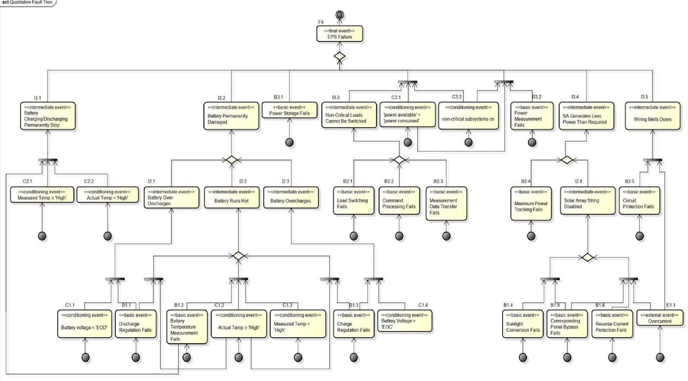

Figure 3-8. EPS qualitative fault tree

<!-- PDF_PAGE: 51 -->

## 3.3 Quantitative reliability model

In subsection Appendix AA1.3 relative contribution of subsystems to fatal mission failures has been analyzed. While data on statistical subsystem failure rates can be found in databases such as SpaceTrak, failure rates of the corresponding parts cannot be easily gathered. There, however, exist handbooks that incorporate reliability prediction models, e.g. MIL-HDBK-217, UTE C 80-810, Telcordia, etc., which can be used to theoretically approximate the failure rates of the commonly used electric, electronic and mechanical parts and components, also accounting for their operating environment and other factors. Although the failure rate predictions are theoretical, they are often based on actual field data and laboratory tests, and could thus be used for the sake of quantitative reliability analysis of the entire system. For example, a quantitative criticality analysis can be performed to evaluate the qualitatively estimated RPN values, which could provide more insight into system's deficiencies. Another benefit of using failure rate prediction models is that they can be used to calculate theoretical reliability of the entire system at each design stage, based on the actual design decisions. This can be especially beneficial at the system concept level for the sake of trade-off analysis between various design configurations.

The purpose of this section is a) to perform a quantitative criticality analysis to evaluate the qualitative analysis results (Section 3.2.2), and b) to calculate system's theoretical reliability, based on the failure rate values obtained from reliability prediction models.

Following section provides a brief overview of the common failure rate prediction models. The failure rate values for the considered sample EPS subsystem parts are estimated in Section 3.3.2, which provides basis for the quantitative CA and system's theoretical reliability prediction, performed in sections 3.3.3 and 3.3.4 respectively.

## 3.3.1 Common failure rate prediction models for electronic equipment

## MIL-HDBK-217

The Military Handbook for "Reliability Prediction of Electronic Equipment" is published by the Department of Defense, based on work done by the Reliability Analysis Center and Rome Laboratory at Griffiss AFB, NY. In the course of 40 years this handbook remains one of the most commonly referenced sources for reliability modeling [5].

The MIL-217 handbook contains failure rate models for the various part types used in commonly applied electronic systems, such as integrated circuits, transistors, diodes, resistors, capacitors, relays, switches, connectors, etc. These failure rate models are based on the field data that could be obtained for a wide variety of parts and systems. The model incorporates coefficients to account for different operating environments, quality levels, stress (electrical, mechanical and thermal) and other factors; the handbook, however, explicitly mentions that it doesn't account for total ionizing dosage and application of lithium-ion batteries.

The latest version of MIL-HDBK-217 is MIL-HDBK-217F, Notice 2 (217F2). It is also incorporated within several commercially available reliability software packages.

## FIDES and UTE C 80-811

These handbooks are developed by a consortium of French industry under supervision of French department of defense and are available since 2004. The applied failure prediction methodology is based on the analysis of test data, field returns and existing modeling.

<!-- PDF_PAGE: 52 -->

The reliability assessment accounts for operation in various severe environments, including space, and considers failures resulting from development or manufacture errors and overstress (electrical, mechanical and thermal).

The handbook incorporates two different parts: 1) a reliability prediction calculation method for main electronic component families and more complex integrated devices, and 2) process control and audit.

## Telcordia SR-332

This standard makes use of a series of models for various categories electronic, electrical and electromechanical components to predict steady-state failure rates, also accounting for environmental and stress conditions, quality levels and other parameters. It is able to provide predictions at the component level, system level or project level for COTS products. The predictions can be done using three different methods: 1) based on part count, 2) part count combined with laboratory data and 3) using field data.

## HRD5

The British Telecom Handbook of reliability data is a standard which incorporates both field performance data and laboratory derived data. Along with failure rate predictions for electronic components, it also includes reliability definitions for estimating circuit reliability from component failure information. The handbook can be used for comparing reliability of electronic equipment, identifying critical components and assessing the reliability impact design and procurement options.

## 3.3.2 Theoretical failure rate estimation

The abovementioned methods can be used to predict failure rates of single electric and electronic parts and components. While one method provides access to comprehensive statistical data, second method may excel in supporting multiple parameters such as operating mode and year of manufacturing to increase the prediction accuracy, and third method might even allow reliability prediction of complex systems. A useful advantage of UTE C 80-811 is, for example, that LEO can be specified as operating environment, while MIL-HDBK-217 incorporates multiple factors such as part quality and thermal aspects to increase the accuracy of failure rate predictions.

Failure rate calculations could be performed by hand, using specific formulas and parameters provided in mentioned handbooks for various general types of parts and components. There is, however, a free software tool - ALD MTBF Calculator, that incorporates multiple prediction models to choose from, including those mentioned in this section, and allows to automatically calculate failure rates for single parts and components after specific parameters are entered. The screenshot is provided in Figure 3-9. Because the tool provides a possibility to choose from several prediction models, the supported part range becomes much wider, compared to the utilization of a single handbook.

The high-level sample EPS design considered in this thesis, comprises parts and components that aren't specified by any kind of values or parameters, which is typical for a preliminary design. This, however, means, that in order to calculate theoretical failure rates a number of assumptions will need to be made for each considered part. Also, parts of the modeled EPS physical structure do in most cases not exactly correspond with types from the tool's selection menu. For this reason the best suitable "replacement" will have to be chosen, which requires additional assumptions to be made.

<!-- PDF_PAGE: 53 -->

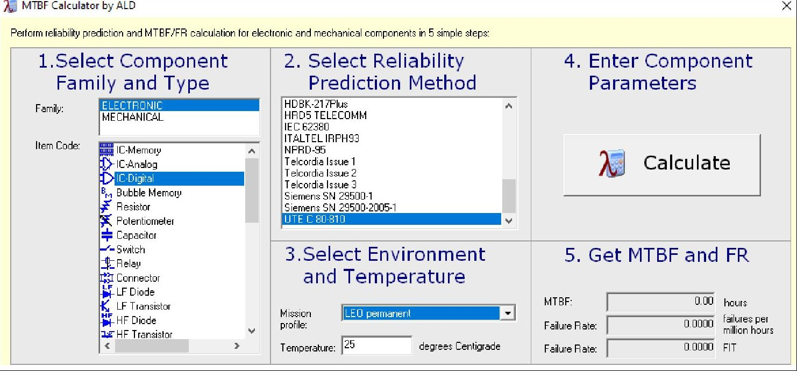

Figure 3-9. ALD MTBF Calculator

Table 3-1 shows EPS parts, that resemble modeled physical EPS structure (see Figure 2-15) versus their suggested "counterparts" from ALD MTBF Calculator, including selected reliability prediction method.

Table 3-1. Allocation of generic parts for failure rate calculation

<table border="1"><tr><td>EPS Part(Figure 2-15)</td><td>Prediction method</td><td>Component family</td><td>Type</td><td>Theoretical failure rate[failures×10-6hours]</td></tr><tr><td>Solar panel</td><td>MIL-HDBK-217</td><td>Optoelectronic</td><td>Photodiode</td><td>0,0353</td></tr><tr><td>Bypass diode</td><td>MIL-HDBK-217</td><td>HF Diode</td><td>SCHOTTKY</td><td>0,0624</td></tr><tr><td>Blocking diode</td><td>MIL-HDBK-217</td><td>HF Diode</td><td>SCHOTTKY</td><td>0,0624</td></tr><tr><td>Transistor</td><td>UTE C80-810</td><td>LF Transistor</td><td>Bipolar silicon(NPN)</td><td>0,0456</td></tr><tr><td>Electronic fuse</td><td>Telcordia SR-332</td><td>Circuit breaker</td><td>Protection only</td><td>3,0000</td></tr><tr><td>Measurement unit</td><td>MIL-HDBK-217</td><td>Meter</td><td>Direct current</td><td>0,3366</td></tr><tr><td>Data interface module</td><td>HRD5</td><td>IC-Digital</td><td>Interface</td><td>0,0033</td></tr><tr><td>Battery</td><td>UTE C80-810</td><td>Miscellaneous</td><td>Batteries:Li-Ion</td><td>0,1500</td></tr><tr><td>MPPT supply regulator</td><td>FIDES</td><td>IC-Digital</td><td>Microcontroller</td><td>0,8093</td></tr><tr><td>BTS</td><td>UTE C80-810</td><td>Resistor</td><td>Thermistors(PTC)</td><td>0,0450</td></tr><tr><td>BDR</td><td>FIDES</td><td>IC-Digital</td><td>Microcontroller</td><td>0,8093</td></tr></table>

Failure rates are calculated based on the following considerations, assumptions and simplifications:

- The reason why different prediction methods have been used for the considered parts is the fact, that a single prediction method doesn't always provide reasonable analogies for all parts that resemble the entire physical structure of the considered EPS design. While MIL- 217, for example, allows to choose additional design and operating parameters, which helps to increase the fidelity of failure rate estimation, the component list to be chosen from is

<!-- PDF_PAGE: 54 -->

rather obsolete, e.g. lithium-ion batteries are not supported. While most methods include "space flight" as operating environment, the UTE C 80-810, on the other hand, is the only method that incorporates "LEO permanent" mission profile; it, however, again can't be used as the only dedicated method, because of lacking a sufficient amount of equivalent part types. Nevertheless, UTE C 80-810 supports failure rate prediction for lithium-ion batteries, while most other methods don't.

- The analysis of the best "match" for each EPS part versus prediction method has thus to be performed prior to completing the table above. Important to mention is that simplifications are used with respect to the chosen alternatives. For example, a battery temperature sensor consists of multiple parts with a thermistor as its main operating principle. To simplify failure rate prediction of a battery temperature sensor only thermistor is thus considered.

- To reckon with operating environment, a factor "space flight" was chosen for all prediction methods, except for UTE C 80-810, as it includes a more accurate "LEO permanent" factor. To account for the environment temperature a value of 70 centigrade is selected; this is the highest possible value in MIL-217, which also leads to the worst-case failure rate results.

- Most prediction methods allow to include part quality into the calculation. Although the used terminology differs for each method, the quality factor is chosen with commercially available products in mind as student teams often incorporate COTS; for this reason military grade quality factors haven't been considered.

The estimated theoretical failure rates are going to be used for the sake of a quantitative criticality analysis in the next section and system's theoretical reliability calculation in 3.3.4.

## 3.3.3 Quantitative criticality analysis

As mentioned in Section 3.2.2 criticality analysis may whether be qualitative or quantitative. The main difference between two approaches is the utilization of failure data in a quantitative analysis, whereas a qualitative analysis implies usage of subjective rankings. While statistical data on part failures isn't readily available, in previous section the failure rates have been theoretically estimated, based on a number of commonly used prediction methods. The result will be used to calculate criticality number for each part, which can help to determine the items of highest concern in terms of reliability [6].

The equation used to calculate the criticality number is:

$$
C _ {m} = \alpha \beta \lambda_ {p} t
$$

where:

- $ C_{m} $ - failure mode criticality number: a relative measure of the failure mode frequency that indicates the importance of the corresponding failure mode.

- $ \alpha $ - failure mode ratio: the probability that a given part will fail as a result of a specific failure mode. When a certain component has multiple failure modes, the sum of their failure mode ratios will equal 1. In case of a single failure mode alpha also just equals 1. For the components with multiple failure modes, such as PCDU and Solar Array, failure mode distribution is determined, based on the theoretical failure rates of their corresponding parts. This could be done because failure modes have been derived from the functions that the corresponding parts normally fulfil, which is another advantage of the proposed approach. For example, for the PCDU nine potential failure modes have been established, based on the functions that the corresponding parts need to perform. The theoretical failure rates of these parts, which have been estimated in the previous section, finally determine

<!-- PDF_PAGE: 55 -->

the relative failure rate distribution for the corresponding failure modes.Because the number of failure modes doesn't exactly match the number of parts (some parts perform multiple functions and thus have multiple failure modes), failure modes that are related to the same part, will receive equal failure mode ratios.

- $ \beta $ - conditional probability of final effect, which is used to represent the likelihood of the final effect occurrence. If, for example, a certain failure mode has multiple conditional final effects, the sum of their probabilities will equal 1. In case of a single potential final effect, beta is 1. For the sake of this analysis only final effects with severity class of 4 will be observed. This is done because criticality number doesn't account for the severity class of failure modes, which could potentially lead to wrong interpretation of final results; it may occur that failure modes with a relatively low final effect severity class may still end up with high criticality number and provoke ambiguities. A typical quantitative criticality analysis concludes with a criticality matrix, wherein failure mode criticality numbers are depicted versus final effect severity classes. It is decided not to present final result in this format, as depicting criticality numbers related to the highest severity (4) final effects seems to make more sense because it provides a more obvious representation of parts with highest concern. Nevertheless, for failure modes with multiple conditional final effects still holds that their conditional probabilities will be less than 1, as the probability distribution must be "shared" with the non-considered low severity class final effects. Furthermore, scenario modeling has previously shown that for some final effects to occur certain conditions must be first met (see Section 3.2.2). This means that final effect may also be "no effect" when the conditions aren't met. This "no effect" final effect must be taken into account during estimation of beta, as its value will become lower, in contrast to unconditional final effects, that will definitively occur given that a failure mode occurs. For example, scenario modeling in Figure H-2 shows that in case power storage fails (battery failure) it may be confidently stated that final effect "No Power Supply During Eclipse" will occur, which makes beta equal 1. On the other hand, when discharge regulation fails (see Figure 3-3) certain conditions must be first met before this malfunction will result in final effect "no power supply during eclipse". The probability for each condition is assumed to be 0,25; combined this gives beta = 0,5. "No effect" in this scenario has been assumed to have a probability of 0,5 either.

- $ \lambda_{p} $ - part failure rate: a ratio that indicates the number of failures per unit of time, which is typically expressed in failures per million hours. In the previous section these values have been theoretically approximated for the considered EPS parts, based on dedicated failure rate prediction methods.

- t- operating time: a purpose of this parameter is to specify how long a certain part needs to operate during the entire mission. Although power delivery is a continuous process, solar panel is, for example, required to generate power during circa 2/3 of the orbital period in LEO, while the battery is supposed to supply power during eclipse, which approximately takes 1/3 of the orbital period. Assuming the entire space mission takes 6 years, duration parameter for solar panel will hence equal 4 years (= 35040 hours) and for battery 2 years (= 17520 hours). On the other hand, a transistor, which is required to switch non-critical load(s) to preserve operation of the critical systems in eclipse when total power supply might become insufficient to feed all subsystems, must be available during a much shorter period of time. The assumption made for the entire duration of its operation is 6 hours in total; this corresponds with 10 minutes for each orbital revolution, assuming an orbital period of 2 hours.

<!-- PDF_PAGE: 56 -->

Based on these elaborations, simplifications and assumptions, the failure modes, which have been established in Section 3.2, are supplied with additional quantitative "values" that resemble the parameters considered above. These are finally used to calculate the corresponding failure mode criticality numbers. The related diagrams are presented in Figure 3-10 and Figure 3-11, in which example criticality number calculation for the failure mode "power measurement fails" and final failure mode criticality ranking list are presented respectively.

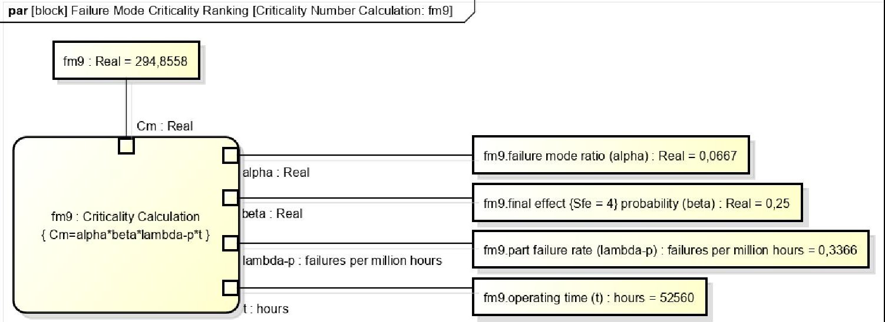

Figure 3-10. Criticality number example calculation using Parametric Diagram

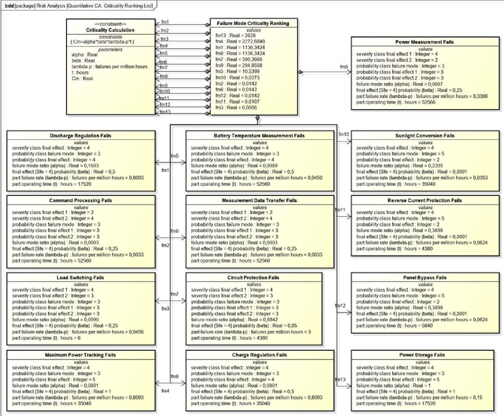

Figure 3-11. Failure mode criticality ranking

<!-- PDF_PAGE: 57 -->

Earlier it has been mentioned that a SysML modeling tool used for this thesis work only comprises a basic SysML specification, which inherently doesn't provide any computational support by means of integration with external computational software. The actual calculation is for this reason autonomously performed in Excel (see Table 3-2). This applies to all upcoming calculations, and will be not anymore acknowledged in the course of this report.

Table 3-2. Computation of failure mode criticality numbers

<table border="1"><tr><td>Component</td><td>Part</td><td>Failure mode</td><td>Final effect{severity class=4}</td><td>Operating time[h]</td><td>Failure rate[failures per million hours]</td><td>Alpha[%]</td><td>Alpha</td><td>Beta</td><td>Criticality number</td></tr><tr><td rowspan="9">PCDU</td><td>Transistor</td><td>Load Switching Fails</td><td>Critical Subsystem(s)Unsufficiently SuppliedDuring Eclipse</td><td>6</td><td>0,0456</td><td>0,903131251</td><td>0,009031</td><td>0,25</td><td>0,000617742</td></tr><tr><td>Electronic fuse</td><td>Circuit Protection Fails</td><td>Critical Subsystem(s)Permanently Off</td><td>4380</td><td>3</td><td>59,41652968</td><td>0,594165</td><td>0,05</td><td>390,3666</td></tr><tr><td>Measurement unit</td><td>Power Measurement Fails</td><td>Critical Subsystem(s)Unsufficiently SuppliedDuring Eclipse</td><td>52560</td><td>0,3366</td><td>6,66653463</td><td>0,066665</td><td>0,25</td><td>294,8557601</td></tr><tr><td rowspan="2">Data interface module</td><td>Command Processing Fails</td><td>Critical Subsystem(s)Unsufficiently SuppliedDuring Eclipse</td><td>52560</td><td>0,0033</td><td>0,032679091</td><td>0,000327</td><td>0,25</td><td>0,014170308</td></tr><tr><td>Measurement Data Transfer Fails</td><td>Critical Subsystem(s)Unsufficiently SuppliedDuring Eclipse</td><td>52560</td><td>0,0033</td><td>0,032679091</td><td>0,000327</td><td>0,25</td><td>0,014170308</td></tr><tr><td rowspan="2">MPPT supply regulator</td><td>Maximum Power Tracking Fails</td><td>Critical Subsystem(s)Unsufficiently SuppliedDuring Eclipse</td><td>35040</td><td>0,8093</td><td>8,014299578</td><td>0,080143</td><td>1</td><td>2272,684816</td></tr><tr><td>Charge Regulation Fails</td><td>No Power SupplyDuring Eclipse</td><td>35040</td><td>0,8093</td><td>8,014299578</td><td>0,080143</td><td>0,5</td><td>1136,342408</td></tr><tr><td>BTS</td><td>Battery Temperature Measurement Fails</td><td>No Power SupplyDuring Eclipse</td><td>52560</td><td>0,045</td><td>0,891247945</td><td>0,008912</td><td>0,5</td><td>10,5398982</td></tr><tr><td>BDR</td><td>Discharge Regulation Fails</td><td>No Power SupplyDuring Eclipse</td><td>17520</td><td>0,8093</td><td>16,02859916</td><td>0,160286</td><td>0,5</td><td>1136,342408</td></tr><tr><td rowspan="3">Solar Array</td><td>Solar panel</td><td>Sunlight Conversion Fails</td><td>Critical Subsystem(s)Unsufficiently SuppliedDuring Eclipse</td><td>35040</td><td>0,0353</td><td>22,04871955</td><td>0,220487</td><td>0,0001</td><td>0,027272326</td></tr><tr><td>Bypass diode</td><td>Panel Bypass Fails</td><td>Critical Subsystem(s)Unsufficiently SuppliedDuring Eclipse</td><td>5840</td><td>0,0624</td><td>38,97564022</td><td>0,389756</td><td>0,0001</td><td>0,014203347</td></tr><tr><td>Blocking diode</td><td>Reverse Current Protection Fails</td><td>Critical Subsystem(s)Unsufficiently SuppliedDuring Eclipse</td><td>4380</td><td>0,0624</td><td>38,97564022</td><td>0,389756</td><td>0,0001</td><td>0,01065251</td></tr><tr><td>Battery</td><td>N/A</td><td>Power Storage Fails</td><td>No Power SupplyDuring Eclipse</td><td>17520</td><td>0,15</td><td>100</td><td>1</td><td>1</td><td>2628</td></tr></table>

Although Although a lot of simplifications and assumptions have been made to conduct the analysis, it may still be interesting to compare the quantitative results with the results obtained from a qualitative CA in Section 3.2.2. The comparison is visualized in the figure below.

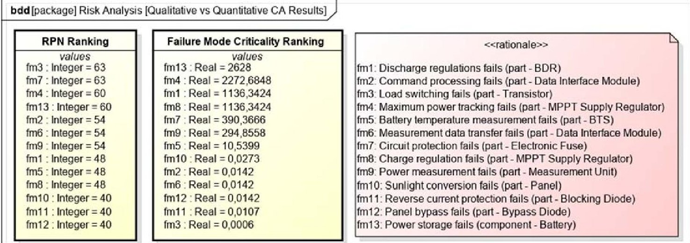

Figure 3-12. Result comparison between qualitative and quantitative CA

Considering the top 5 failure modes in both ranking lists, it can be observed that there is a relative match between failure modes 4,7 and 13 in terms of order of their significance. On the other hand,

<!-- PDF_PAGE: 58 -->

both lists are extremely contradictory with respect to fm3; the reason for this could be the fact that a transistor, which is used for turning on/off the non-critical subsystems, has a relatively low theoretical failure rate combined with short operating time. Furthermore, in qualitative analysis fm9 shares equal RPN rating with fm2 and fm6, while its criticality number differs factor 10000 relative to the same failure mode in quantitative analysis. This is mainly caused by the presumed operating time of the measurement unit, which has been set equal to the entire mission duration (52560 hours). However, the availability of this unit is of especial importance at the end of eclipse period, when the battery will likely sooner run out of power due to the degradation, and power supply might become insufficient (based on the actual power measurement C&DH can decide to turn off the non-critical subsystems). For this reason, instead of considering operation of measurement unit during the entire mission, it would be probably more correct to choose the value of equal order for its operating time as for the load-switching transistor (6 hours). In that case, both analyses would show nearly same results in terms of the comparison with fm2 and fm6. This example shows, that sometimes it might make more sense to choose the operating time value, accounting for part's actually required availability, instead of just considering its entire operational timespan.

The results of the comparison between two approaches demonstrate that performing both qualitative and quantitative analyses may increase the accuracy of failure mode significance prediction, despite being more labor intensive when compared to executing only one of two methods; the increased prediction accuracy may potentially contribute to well-advised design decisions.

## 3.3.4 System reliability prediction

In Section 3.2.3 a fault tree was established, based on the developed failure scenarios from Section 3.2.1. This fault tree is used to predict a total system's reliability using a standard FTA approach, that incorporates application of Boolean logic to calculate the probability of a top-event, which in this case is the EPS failure. Before this can be achieved probabilities of all basic events, conditional events and external events must be determined.

Probabilities of the basic events (see Figure 3-8) can be directly derived from the earlier specified part failure rates (see Table 3-1), as each basic event is essentially a failure mode. Each failure mode has been established in such a way, that it specifies a direct relation with the corresponding part (see Figure 3-4). For this reason, probabilities of basic events automatically follow from the failure rates of the considered EPS parts.

The failure probabilities of basic events are calculated using the exponential distribution reliability function:

$$
R (t) = e ^ {- \lambda_ {p} t _ {m}}
$$

Where:

R(t)-reliability;

$ \lambda_{p}-$ part failure rate;

t_m-mission time

Failure probability is calculated using:

$$
P (t) + R (t) = 1
$$

$$
P (t) = 1 - e ^ {- \lambda_ {p} t _ {m}}
$$

<!-- PDF_PAGE: 59 -->

The calculational framework is presented in Figure 3-13, and Figure 3-14 shows an example probability calculation for the basic event - "Power Measurement Fails":

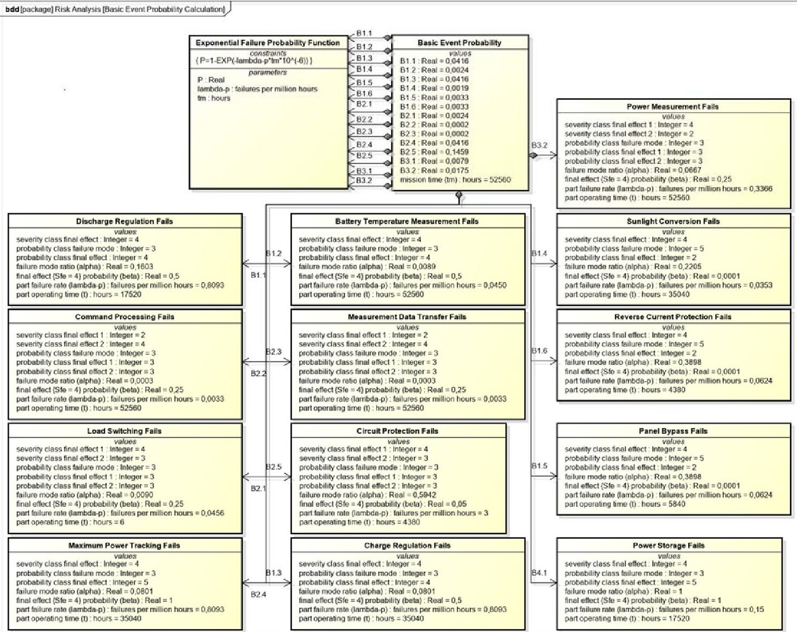

Figure 3-13. Basic event probability analysis

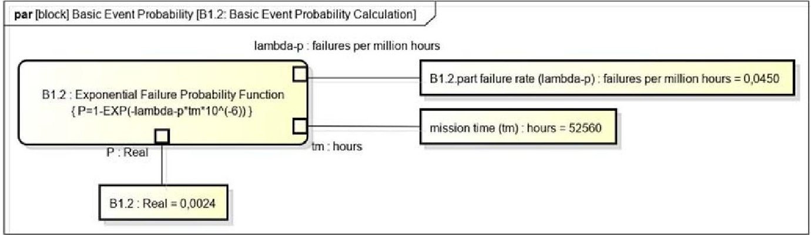

Figure 3-14. Example basic event probability calculation

After all basic event probabilities have been estimated, the conditional and external events can be considered. Contrary to the basic events, the corresponding probabilities must be assumed, based on a number of factors, as a high-level stage of system design doesn't allow for comprehensive analysis. Scenario modeling has previously shown that for some final effects to occur certain conditions must be first met, while other final effects will unconditionally take place, given that a failure mode occurs. These conditions are specified by a) system's design characteristics and b) specific to be expected external events; this is already covered in Section 3.2.2 and in Section 3.3.3 during elaboration on $ \beta $ which has resulted in assigning corresponding values to each final effect for the sake of a quantitative CA. The same logic and assumptions apply to conditional and external event probabilities.

<!-- PDF_PAGE: 60 -->

After the probabilities of all basic, conditional and external events have been captured, the entire fault tree can be quantitively analyzed. The computational framework is presented in Figure 3-15. The framework presents means to calculate the reliability of EPS, starting with estimation of the probabilities of the intermediate events (see Figure 3-8) using Boolean logic, given that basic, conditional and external event probabilities are known.

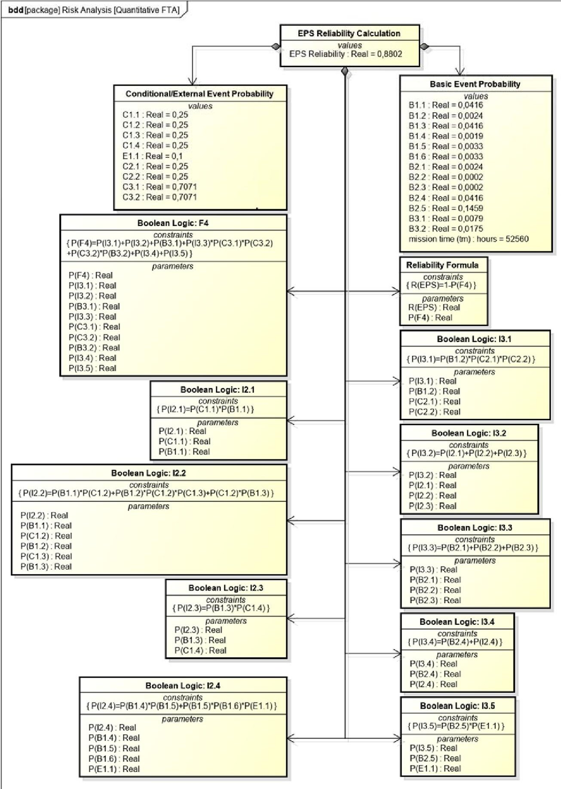

Figure 3-15. FTA analysis

The Parametric Diagram presented in Figure 3-16 shows how the calculation is performed:

<!-- PDF_PAGE: 61 -->

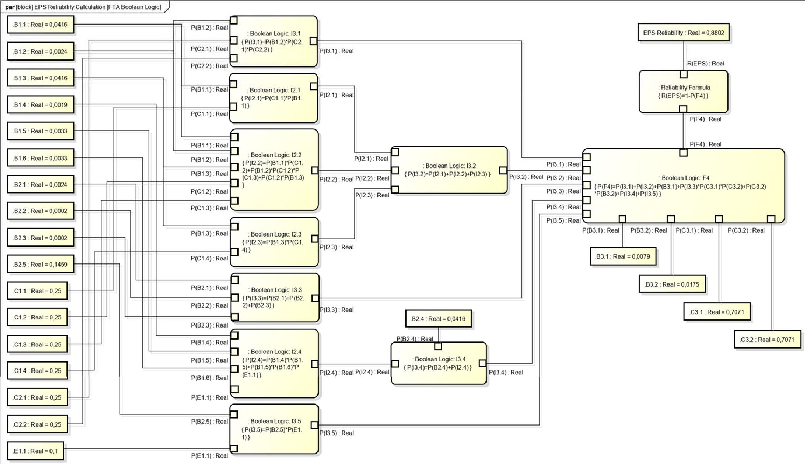

Figure 3-16. System reliability calculation

<!-- PDF_PAGE: 62 -->

The calculation finally leads to EPS reliability of 0,8802. Because this value is based on a very simplified EPS model, which implies many assumptions and uncertainties, it cannot be considered as the absolute measure of reliability prediction, but, together with the results obtained from criticality analysis, should be mainly used for comparing multiple high-level design configurations. This could help development teams to finally perform a more well-grounded trade-off between various design concepts, in which theoretical reliability should be incorporated as one of the selection criteria with a relatively high weight. It must be mentioned that considered design configurations must, of course, all be based on the same simplifications and assumptions. After a certain concept has been selected as a starting point for further development, the presented reliability modeling approach can be iteratively used throughout all design stages until the low-level details of EPS and its interfaces (such as other subsystems) are uncovered, and redundancies are well-incorporated. At that final stage the reliability prediction may be already considered as the absolute measure of system design integrity, upon which a decision can be made to whether or not a redesign to a certain extent is required. This design risk will be, however, minimized, in case the reliability modeling will be continuously making an integral part of the system design throughout all of its stages.

## 3.4 Reliability model summary

The reliability model is built, based on the in Chapter 2 presented high-level EPS design, in which physical structure and functional architecture have been developed together with system's internal and external physical and functional interfaces.

Prior to building a reliability model the analysis approach has been developed first (Section 3.1), considering a number of criteria, such as the suitability at all system design levels, relative simplicity, support for both qualitative and quantitative analysis and its full integration within system design in SysML. The method incorporates execution of Failure Modes and Effects Analysis (FMEA), Event-Tree Analysis (ETA), Criticality Analysis (CA) and Fault Tree Analysis (FTA), for the sake of both qualitative and quantitative reliability modeling.

Establishing the qualitative risk model started from working out FMEA (Section 3.2.1) to understand the relations between system's physical and functional design characteristics, possible malfunctions, failure mechanisms and their potential effects on system performance. This is done in combination with failure scenario modeling, which can be considered as a derivative of ETA. The procedure has finally led to the identification of potential failure modes, failure mechanisms, impacted system functions and culprit physical parts (Figure 3-4).

FMEA has been further extended by a qualitative CA (Section 3.2.2), whose purpose was to prioritize parts of the highest reliability concern. All failure modes were thereby subjectively classified in terms of the failure mode probability, final effect probability and final effect severity, based on the standard ranking system, with a single exception: in this work final effect probability ranking has been introduced to account for the conditional system behavior, which is not typical for a 'standard' FMECA, where conditional system response is not considered. For all failure modes these three parameters have received subjective values, based on the ranking system presented in Figure 3-5. The values were finally used to calculate Risk Priority Numbers that are required to classify the failure modes in terms of their significance (Figure 3-6 and Figure 3-7).

The qualitative reliability model has been further enhanced by a fault tree (Section 3.2.3), which has been constructed (Figure 3-8) by rearranging and combing the earlier modeled failure scenarios. This helped to efficiently identify the multi-point failures in contrast to FMEA, where only single-point failures with corresponding final effects are considered. The top event-EPS failure-has been compiled, based on the failure mode's highest final effect severity classes, which have been

<!-- PDF_PAGE: 63 -->

identified during the CA. The idea behind constructing the fault tree was its implementation for system reliability prediction in the quantitative phase of reliability analysis.

Prior to start building the quantitative risk model, various reliability prediction models have been considered in order to estimate theoretical failure rates of the EPS components (Section 3.3.1). A software tool has been selected, that incorporates multiple theoretical prediction models, that was finally used to estimate the part failure rates, based on a number of assumptions and simplifications (Section 3.3.2). After the failure rates of EPS parts have been determined a criticality analysis was performed, which purpose was to again prioritize parts of the highest reliability concern, but now based on a quantitative approach (Section 3.3.3). The criticality numbers for all failure modes were calculated based on the parameters such as failure mode ratio, conditional probability of final effect, part failure rate and operating time (Figure 3-10 and Figure 3-11). Finally, the results were compared with the results obtained from a qualitative CA (Figure 3-12). Although a number of similarities in the results were identified, there were also considerable discrepancies, that were apparently caused by inadequate parameter choices.

Finally, system reliability is predicted, based on the earlier developed fault tree (Section 3.3.4). The probabilities of basic events were derived from the previously theoretically estimated failure rates using the exponential distribution reliability function (Figure 3-13 and Figure 3-14), while probabilities of conditioning and external events were assumed utilizing the same argumentation as during final effect probability estimation in quantitative CA. To calculate the probabilities of the intermediate and top event Boolean logic was applied, finally leading to a theoretical EPS reliability estimation (Figure 3-15 and Figure 3-16).

<!-- PDF_PAGE: 64 -->

<!-- PDF_PAGE: 65 -->

## 4. Evaluation

To evaluate the reliability modeling approach presented in previous chapter, two different facets will be covered. First, the described methodology will be compared with a number of existing proposed risk assessment methods, specifically dedicated to reliability prediction of student-built small satellites and CubeSats in particular. The comparison doesn't specifically accentuate the deployment of MBSE for the sake of risk analysis, but is mostly meant to provide insight into the differences in the amount of covered reliability aspects in the proposed methods, compared to the presented approach. In contrast with the first part of the evaluation, the second part specifically aims at highlighting distinctions between conducting reliability assessment using traditional methods as opposed to reliability modeling based on MBSE and SysML in particular.

It has to be mentioned that in both parts of evaluation the comparison doesn't imply verification of the numerical result following from reliability calculation in Section 3.3.4, as it won't provide any additional insight into model consistency, because of simplifications and assumptions made throughout the entire system modeling process in Chapter 2; the main focus of comparison during the first part lies on the analysis on various characteristics that are expected to have a tangible impact on the final quality of reliability model in terms of level of insight into system's weaknesses and practical applicability, while the second part evaluates the contribution of MBSE/SysML features in reliability modeling.

## 4.1 Comparison with existing reliability assessment methodologies

In this section various risk assessment methodologies, specifically developed for university-based small satellite projects, are reviewed and compared with the approach presented in this thesis work. Because the focus of this work lies on the development of the in-orbit reliability analysis approach, other life-cycle stages such as pre-launch, launch and deployment are not considered; risk mitigation strategy and other risk types that concern safety, schedule, liability and cost are left out either.

For the sake of comparison the following aspects are considered:

- Foundation. This aspect implies in how far the essential design characteristics are deployed in a reliability model. Many risk assessment methods only focus on the spacecraft's physical structure for the sake of reliability analysis, i.e. by only considering the sum of its parts, while the elements such as (conditional) functional behavior and functional interfaces are not being taken into account. These design aspects, however, uncover the logic behind a) spacecraft operation and b) interaction with its context. Utilization of the information on functional architecture during reliability analysis may help to better identify the relationships between the malfunctions of components, resulting undesired behavior and its potential effect on system performance.

- Level of detail. While some reliability prediction methods are particularly useful at the preliminary design stage, other methods can be best deployed when all low-level system details have been specified. However, a reliability modeling methodology which supports iterative analysis in the course of the whole design process, could potentially lead to a higher design integrity, as it might help to evaluate design decisions at all development stages and uncover weaknesses and strengths of various configurations at each level of design. This can help to prevent propagation of design errors by uncovering potential deficiencies not only during the specific design phase but throughout the entire development process. The resulting revisions will in this case have a potentially smaller impact on cost and schedule.

<!-- PDF_PAGE: 66 -->

- Qualitative and quantitative approach. The proposed method should ideally support integration of both qualitative and quantitative aspects: the qualitative analysis helps to gain a sufficient understanding of system's undesired behavior and its impact on performance, expressed in system's inability to perform critical functions, related to the failures or the combination of failures of different components. A quantitative analysis is then performed to obtain numerical values, which gives the opportunity to a) evaluate the results of the qualitative analysis, using statistical and theoretical failure rate data, and b) compare theoretical reliabilities of multiple design configurations; this can contribute to a more consistent design trade-off.

- Labor intensity and complexity. Considering limited time frames the CubeSat university design teams typically have to cope with, the methodology framework should ideally comprise techniques that are relatively uncomplicated and widely used; it has to be flexible and easily accessible for implementation at all design levels. This will help to decrease the required amount of manhours and decrease a number of misinterpretations.

## 4.1.1 "Application of Risk Management to University CubeSat Missions"

The proposed reliability analysis approach in thesis work is first compared with the methodology presented in [7], that specifically aims at lowering the threshold for conducting risk analysis in university-based CubeSat design projects in terms of labor intensity, cost and schedule. The proposed method basically consists of the following steps:

1. Review the mission concept of operations. This is done to understand the operational context, which will serve as an input for the following steps.

2. Identify root causes. During this step potential risks to a spacecraft mission are analyzed together with their root causes that may finally lead to harmful events.

3. Rank likelihood (L) and consequence (C) of root cause: each root cause is ranked according to its likelihood and consequence, based upon a 1-5 scale.

4. Describe rationale for ranking, which is done to argument the assigned value.

5. Classify priority of risk. This steps implies the determining the L-C product by multiplying the likelihood and consequence values together for a given root cause. After this is done for all root cause, they get prioritized according the highest value.

6. Compute mission risk likelihood and consequence values based on a weighted average of all root cause L-C values. The author proposes a rank reciprocal method to calculate weights, which leads to weighing factors between 0 and 1. The total mission risk L-C value is finally calculated by multiplying the weighing factor with its L-C value.

7. Plot mission risks on L-C chart. This is done to provide a graphical representation of the project risk status. Final result is a 5x5 grid, in which a horizontal axis represents consequence and a vertical axis represents the likelihood, with the upper right portion of the grid colored red to represent high risk, and the lower left portion colored green to indicate the low risk. The region between green and red shows the risks that are managed and thus don't impose high threat on a mission.

The considered methodology essentially implies establishing a risk matrix, which has a number of similarities with FMECA used in this work, although being much more restricted and simplified. Risk matrix is constructed based on the spacecraft's operational concept description. A big advantage of this method is the fact that it is very well documented, simple, accessible and widely applied by a large number of industries, which makes it easily adoptable in low-budget student-based CubeSat projects. While this characteristics indeed provide a low threshold for the application in terms of complexity, schedule and cost, when compared to the approach developed in the course of this thesis work, it doesn't incorporate the utilization of more advanced design aspects (only the

<!-- PDF_PAGE: 67 -->

operational concept description as opposed to the analysis on functional and physical architecture presented in sections 2.4 and 2.5), making it irrelevant at more detailed stages of system design. Also, as the quantitative analysis is lacking, theoretical and statistical failure rate data cannot be employed to evaluate the qualitative results, as done in Section 3.3.3, while theoretical reliability calculation (presented in Section 3.3.4) can neither be achieved, which doesn't allow to perform a tradeoff study for various design concepts, based on the calculated reliability value.

In relation to the reliability modeling methodology developed in this thesis work, the approach presented in [7] may be considered as more accessible and less labor-intensive. On the other hand, as mentioned above, it lacks a number of elements, that are supposed to provide a) a deeper insight into system's weaknesses, and b) a more comprehensive base for design evaluation.

## 4.1.2 "A Reliability Engineering Approach for Managing Risks in CubeSats"

The developed methodology is further compared with [8], which basically proposes utilizing FMECA, extended by a) introducing the alpha-numeric coding system for the sake of identification and labeling of failure modes, and b) conditional probability coefficients for the sake of subjectivity reduction in terms of failure mode propagation effects. The proposed formulation especially aims at the relatively low-cost CubeSat projects and incorporates three ranking parameters: Severity, Occurrence and Detectability which are linked to the structural properties. The main difference with a traditional FMECA is the extension of Occurrence indicator, by explicitly considering the causal chain of events.

The approach is mainly focused on the early design phase and implies application of a functional FMECA, which is typical for proposals and trade studies, while still allowing iterative reliability analysis throughout the entire design. It comprises execution of the following steps:

1. To show interrelationships and interdependencies of functional elements a Functional Block Diagram is constructed. According to author, this is required to understand system's architecture and to allocate functions to equipment.

2. Next step implies identification of failure modes, also considering their effects on system performance. Author mentions that this step relies on the capability of the analysts to explore potential combinations of failure modes and requires incorporation of expert judgment. To tackle current lack in literature of a standard labeling system, it is proposed to apply a 5-parts alphanumeric code, which relates the failure modes to system components: XXX-A.B-CCC#DDDD, in which XXX represents a subsystem being analyzed, A-a failure mode of the sub-system, B-the effect on the system, CCC-the propagation of the failure mode and DDDD-the specific failure, relative to a part level.

3. During this step a qualitative criticality analysis is performed (author calls it a semiquantitative analysis). A qualitative ranking system is defined, based on 1-4 scale for Occurrence, Severity and Detectability. Failure rate prediction models are mentioned to help reduce the level of subjectivity in Occurrence estimation. The main difference with a standard FMECA approach is, however, the implementation of conditional failure propagation analysis; it specifies various conditions for a final effect to occur, assuming that a failure mode occurs. These conditions are translated into coefficients, specified by IF-THEN logic.

4. Finally, the failure modes are ranked based on their Risk Priority Numbers (RPN).

The implementation of conditional coefficients by [8] to more accurately estimate the probability of failure mode propagation throughout the entire system significantly helps reduce the level of subjectivity. The advantage of this extension, as compared to standard criticality analysis, has been also mentioned and incorporated in this work. While author suggests constructing a Functional Block

<!-- PDF_PAGE: 68 -->

Diagram in the first step of the proposed approach, this single type of diagram may still not provide a full insight into system's context and physical and functional architectures, which is required to depict all functional dependencies between system components. Incorporation of these design elements in the developed approach can be seen as an advantage, as compared to the considered method, as only when entire architecture is modeled, the conditions required for a failure mode to propagate, can be uncovered. For this reason, the MBSE system modeling approach presented in Chapters 2 could potentially amplify understanding of the physical and behavioral characteristics, when compared to constructing a single FBD only; this modeling approach is, however, much more labor-intensive, in case a system model is built as basis for reliability analysis only.

For the sake of failure mode identification author partially relies on expert analysis. In Section 3.2 it was mentioned that student-based project teams often don't possess the required level of knowledge and experience. For this reason scenario modeling was introduced in this thesis work to model the failure mode propagation until the final effect occurs, including the conditions that must be first met. Scenario modeling is expected to partially compensate the lack of experience.

A coding system was introduced to depict the relationships between all failure mode elements and corresponding system components, which helps to maintain a good overview. On the other hand, presented application of MBSE makes coding system unnecessary, as the relations between reliability model and system model elements can be clearly visualized.

Finally, as FMECA is only capable of modeling single-points of failure, the considered approach doesn't support the analysis on multi-point failure behavior, which disallows theoretical reliability evaluation of entire system, as opposed to the methodology presented in this work (Section 3.3.4).

## 4.1.3 "Reliability Prediction of Student-Built CubeSats"

The developed risk assessment methodology concept is also compared with reliability prediction method described in [9], which has been developed by matching the approaches from the automotive and aerospace sectors, considering typical requirements of low cost CubeSat projects. According to author the method doesn't require a lot of input data, with a bill of materials being considered as a the only required amount of information. The method is expected to be able to predict reliability of CubeSats in early design stages with acceptable level of confidence, while not requiring a high number of project resources.

Prior to developing this approach a number of various existing reliability assessment methods have been first analyzed in terms of their applicability to student-based CubeSat projects. Based on a number of considerations such as monetary boundaries, low level of experience, high fluctuation of participants and limited shared knowledge the following method selection criteria have been introduced: short execution time, low cost, practicable without method experience and provide quantitative reliability prediction. Considering these criteria, the analysis has led to parts count analysis as a recommended reliability assessment method. To find a suitable failure data base various prediction models have been considered. Based on a literature research author finally chose the following databases: MIL-HDBK-217, FIDES and IEC 62380. The handbooks are finally utilized using a free available software tool "Free MTBF Calculator".

The advantage of this approach is the fact, is that it provides a quantitative reliability analysis, while requiring a little amount of input data. The part count analysis combined with data from widely used failure rate prediction handbooks helps to achieve a low-cost and time-saving reliability prediction. While author explicitly mentions a preliminary design stage as its main application area, the proposed approach is even expected to serve as a sufficient reliability prediction method at all stages of design to compare different (low-level) design configurations.

<!-- PDF_PAGE: 69 -->

Mentioned failure rate prediction models combined with Free MTBF Calculator have also been utilized in this thesis work for the sake of quantitative criticality analysis and FTA calculation. It was, however, shown, that components utilized in system design often don't exactly match with component list in the failure databases (see Section 3.3.2). Because of this, various assumptions had to be made. These assumptions, while not mentioned in [9], may lead to high uncertainties in reliability calculation. For this reason, utilization of failure rate prediction databases is expected to be especially useful for design trade studies, when the assumptions are applied to all considered design configurations. Also, as opposed to the proposed method in this work, performing a quantitative part count analysis only doesn't provide any insight into system's failure behavior, because only the system's physical structure is considered. Modeling failure propagation as a result of a certain event, based on system's functional architecture is expected to help better understand strong points and weaknesses of (preliminary) design, than by just considering the sum of its parts as in [9]. These issues are addressed in Section 3.2.1, where failure scenario modeling has been employed to understand the nature of failure propagation.

## 4.1.4 "Risk Management of Student-Run Small Satellite Programs"

Final methodology considered for the sake of comparison with proposed approach is presented in [10]. It implies application of Master Logic Diagram (MLD) for the sake of risk assessment. MLD is similar to FTA, but, according to author, is created at a higher level than what FTA is typically used for. Prior to selecting this method the analysis of options has first been performed. The options included Top Risk List, ETA, FTA, MLD, PRA and FMEA. The result of analysis led to a conclusion that PRA and FMEA don't meet the needs, as these were considered to be less accessible for students and very time consuming, while FTA was expected to provide a very high level of detail, thereby utilizing probabilistic information, making it, however, less applicable for university design teams. The ETA was assumed to be less suitable, because it requires to first identify the initiating events. The elimination process finally led to the MLD, because of its relative simplicity, wide application in industry and relatively low labor-intensity, which makes it potentially suitable for teams that lack experience.

MLD is created by relating high-level failures to the failed end states, which helps to cover all types of interfaces. At each branch point observable failures are then identified. The subsystems are identified to be initiating events. This helped to create a universal MLD that covers all satellite designs. Detailed investigations were made into each subsystem to determine what components small satellites may use and how they interface with other subsystems. While designing a satellite, students are able to trace failure modes through the system and account for these failures during further development.

According to author, MLD can be applied not only at the start of the project but also throughout the design progression, while it can also be used as a troubleshooting in-orbit tool. MLD is expected to help students gather understanding of the satellite, including interactions between components and subsystems, and to provide an overview of common failure mechanisms. Finally, it can show how design decisions made for one subsystem can affect other parts of the satellite.

The method proposed by [10] can be very useful in that it can be applied by unexperienced design teams to a) understand system's functional behavior and interfaces, and b) conduct a relatively simple risk analysis. On the other hand, as MLD is supposed to be used at a higher level of design, it may lack in providing means to incorporate low-level design details, which makes it less suitable for more advanced phases of design as opposed to the approach presented in this thesis work, which utilizes FMECA and FTA, both known to support comprehensive reliability analysis. Also, while the

<!-- PDF_PAGE: 70 -->

considered approach provides a good basis for a qualitative functional analysis, it lacks the ability to tailor failure rate data for reliability prediction, which has been demonstrated in Section 3.3.

## 4.1.5 General observations from methodology comparison

Reliability analysis methods that are reviewed in the previous sections all share a number of similarities, such as a utilization of a single risk assessment method only, that is modified to fit a student-based satellite development project in terms of decreased complexity and reduced time consumption, thereby focusing on preliminary design phase and trade studies. Also, considered approaches are whether strictly qualitative or quantitative; integration of multiple risk assessment methods to combine both aspects is likely avoided to prevent increasing in complexity. Furthermore, none of the reviewed methods utilizes all aspects of system design; some methods are specifically focused on behavioral analysis, while other methods strictly consider system's physical architecture. Finally, considered reliability assessment methods don't share the same modeling platform with system design, as opposed to an attempt in this thesis work to integrate reliability analysis and system design, based on the MBSE principles.

While reviewed reliability assessment methods specifically aim at reducing complexity and cost to make them more accessible for student-based development teams, they can be considered as the simplified versions of the commercially applied techniques, that usually incorporate multiple risk assessment methods, e.g. the PRA methodology, making them less practical for the projects with a limited budget. The simplifications make the analysis less complex and time consuming; this, however, comes with a price: only a relatively small number of reliability analysis aspects can be covered, which may increase the probability of the unforeseen behavior during testing or even in-orbit operation. This concern is inherent to all reviewed methodologies in the previous sections. The methodology presented in this thesis work is expected to cope with this issue as it attempts to cover multiple aspects of system reliability analysis, utilize both functional and physical architectures and provide basis for both qualitative and quantitative analysis, while still being rather accessible for a practical application at the universities, by deploying the benefits of MBSE. These benefits, however, can be obtained only if the reliability analysis and system design are integrated into a single model. Using SysML for reliability analysis only may become very time consuming, even assuming the engineer already has experience with SysML. This is because a number of system design elements will still have to be modeled first prior to developing a reliability model.

## 4.2 SysML-based reliability modeling versus traditional methods

The purpose of this section is to evaluate the contribution of MBSE/SysML features in reliability modeling by highlighting the differences between a traditional reliability assessment process and SysML-based approach.

In Chapter 3 the reliability assessment methodology is developed and applied to the hypothetical high-level EPS design, which is established in Chapter 2. The purpose of the presented modeling approach was to demonstrate how SysML can be deployed for reliability modeling of student-designed microsatellites and CubeSats in particular. While SysML has already gained some popularity for designing complex systems, its contribution to reliability modeling is lacking in the literature. In Appendix AA2 various risk assessment methods have been listed and in Chapter 3 a number of existing risk assessment methods have been selected to be included into the reliability analysis methodology: FMEA, ETA, qualitative CA, quantitative CA and FTA. The SysML-based implementation of these risk assessment methods has been demonstrated in Chapter 3. To evaluate the SysML-based implementation a comparable reliability analysis will be performed in this section, based on the just mentioned risk analysis methods, but this time using in a traditional approach.

<!-- PDF_PAGE: 71 -->

Prior to performing the comparison, the following starting points need to be considered:

- There is a significant difference between reliability analysis conducted by the university design teams and commercial companies. Because student-based projects have to cope with a limited amount of resources, no dedicated software risk modeling tools are typically used, in contrast with commercial companies, where reliability assessment is considered as a major part of the design process. For this reason, companies allocate relatively large resources to reliability assessment, which is not only expressed in manhours but also in the sophisticated reliability modeling software packages, while students are constrained by typical MS Office applications, such as Visio and Excel for modeling and Word for documentation. For this reason, the same software package will be used to evaluate this work.

- As the purpose of this work is to demonstrate deployment of SysML for conducting risk analysis and not for system modeling, which already has a lot of examples in the literature, design model aspects from Chapter 2 won't be considered for the sake of comparison between SysML-based design and traditional risk assessment methods.

- As the developed reliability assessment methodology has already been extensively described in Chapter 3, including all corresponding aspects and its practical implementation, the same information won't be presented again in this section.

## 4.2.1 Traditional approach for qualitative risk model

Table 4-1 shows how the traditional Excel-based FMEA is initiated based on the already known design characteristics, including physical structure and functional behavior. Physical decomposition is used to specify components and parts, while the results from functional allocation, which is performed during system design, is used to specify the corresponding system functions. The failure modes are finally derived from the allocated functions.

Using the same approach as described in Section 3.2.1 scenario modeling is now performed using Visio to estimate the local, intermediate and final effects for each failure mode, based on system's functional characteristics. Example scenario is elaborated for failure mode "Discharge regulation fails" (see Figure 4-1), which is being initiated by this failure mode, leading to final effect "No power supply during eclipse". In Section 3.2.1 all scenarios have already been modeled for each failure mode; this procedure will, for this reason, not be repeated again.

The results from scenario modeling are used to further expand the FMEA table (see Table 4-2), which now shows both local and final effects for each failure mode together with the failure mechanisms that have been already specified in Figure 3-1.

The entire procedure is not different from the approach that has been extensively described in Section 3.2.1.

Table 4-1. FMEA initiation using traditional approach

<table border="1"><tr><td>Component</td><td>Part</td><td>Function</td><td>Failure mode</td></tr><tr><td rowspan="9">PCDU</td><td>Battery discharge regulator</td><td>Regulate discharging</td><td>Discharge regulation fails</td></tr><tr><td rowspan="2">Data Interface Module</td><td>Process control command</td><td>Command processing fails</td></tr><tr><td>Provide measurement data</td><td>Measurement data transfer fails</td></tr><tr><td>Transistor</td><td>Switch load</td><td>Load switching fails</td></tr><tr><td rowspan="2">MPPT supply regulator</td><td>Optimize generated power output</td><td>Maximum power tracking fails</td></tr><tr><td>Regulate charging</td><td>Charge regulation fails</td></tr><tr><td>Battery temperature sensor</td><td>Measure battery temperature</td><td>Battery temperature measurement fails</td></tr><tr><td>Electronic fuse</td><td>Protect electrical circuit</td><td>Circuit protection fails</td></tr><tr><td>Measurement Unit</td><td>Measure available and consumed power</td><td>Power measurement fails</td></tr><tr><td rowspan="3">Solar array</td><td>Panel</td><td>Convert sunlight to current</td><td>Sunlight to current conversion fails</td></tr><tr><td>Blocking diode</td><td>Protect solar panel</td><td>Reverse current protection fails</td></tr><tr><td>Bypass diode</td><td>Bypass inactive panel</td><td>Panel bypass fails</td></tr><tr><td>Battery</td><td>Battery</td><td>Store power</td><td>Power storage fails</td></tr></table>

<!-- PDF_PAGE: 72 -->

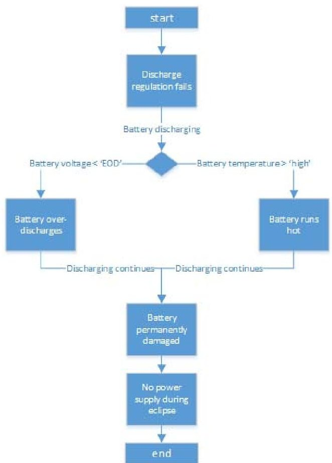

Figure 4-1. Example failure scenario elaboration "Discharge regulation fails"

Table 4-2. FMEA table expanded with local and final effects

<table border="1"><tr><td>Component</td><td>Part</td><td>Function</td><td>Failure mode</td><td>Local effect</td><td>Final effect</td><td>Failure mechanism</td></tr><tr><td rowspan="10">PCDU</td><td>Battery discharge regulator</td><td>Regulate discharging</td><td>Discharge regulation fails</td><td>1) Battery over-discharges [OR]2) Battery runs hot</td><td>No power supply during eclipse</td><td rowspan="10">SEE, ESD, Signal disruption, Normal degradation, Thermal cycling, TID</td></tr><tr><td rowspan="2">Data Interface Module</td><td>Process control command</td><td>Command processing fails</td><td>Non-critical loads cannot be switched</td><td rowspan="2">1) Non-critical subsystems permanently off during eclipse [OR]2) Critical subsystems unsufficiently supplied during eclipse</td></tr><tr><td>Provide measurement data</td><td>Measurement data transfer fails</td><td>Subsystem power supply cannot be controlled</td></tr><tr><td>Transistor</td><td>Switch load</td><td>Load switching fails</td><td>Non-critical loads cannot be switched</td><td>1) Non-critical subsystems permanently off [OR]2) Critical subsystems unsufficiently supplied during eclipse</td></tr><tr><td rowspan="2">MPPT supply regulator</td><td>Optimize generated power output</td><td>Maximum power tracking fails</td><td>SA generates less power than required</td><td>Critical subsystems unsufficiently supplied during eclipse</td></tr><tr><td>Regulate charging</td><td>Charge regulation fails</td><td>1) Battery runs hot [OR]2) Battery overcharges</td><td>No power supply during eclipse</td></tr><tr><td>Battery temperature sensor</td><td>Measure battery temperature</td><td>Battery temperature measurement fails</td><td>1) No temperature data during charging [OR]2) No temperature data during discharging</td><td>No power supply during eclipse</td></tr><tr><td>Electronic fuse</td><td>Protect electrical circuit</td><td>Circuit protection fails</td><td>Wiring melts down</td><td>1) Critical subsystems permanently off [OR]2) Non-critical subsystems permanently off</td></tr><tr><td>Measurement Unit</td><td>Measure available and consumed power</td><td>Power measurement fails</td><td>Subsystem power supply cannot be controlled</td><td>1) Critical subsystems unsufficiently supplied during eclipse [OR]2) Non-critical subsystems permanently off during eclipse</td></tr><tr><td rowspan="3">Solar array</td><td>Panel</td><td>Convert sunlight to current</td><td>Sunlight to current conversion fails</td><td>Solar array string disabled</td><td rowspan="3">Critical subsystems unsufficiently supplied during eclipse[Only if all solar array failure modes occur simultaneously!]</td><td rowspan="3">Surface erosion, UV absorption, Normal degradation, ESD</td></tr><tr><td>Blocking diode</td><td>Protect solar panel</td><td>Reverse current protection fails</td><td>Sunlight to current conversion fails</td></tr><tr><td>Bypass diode</td><td>Bypass inactive panel</td><td>Panel bypass fails</td><td>Solar array string disabled</td></tr><tr><td>Battery</td><td>Battery</td><td>Store power</td><td>Power storage fails</td><td>1) Battery can&#x27;t be charged [OR]2) Battery can&#x27;t be discharged</td><td>No power supply during eclipse</td><td>Normal degradation, Thermal cycling</td></tr></table>

<!-- PDF_PAGE: 73 -->

To execute the FMECA based on a standard approach, the result of which is summarized in Table 4-2, the same system design information (see Chapter 2) has been utilized as for the model-based approach, presented in Section 3.2.1. For this reason, the qualitative result in Table 4-2 is similar to the overview presented in Figure 3-4. However, the employment of comprehensive design information is not typical for the traditional FMEA, as it only implies utilizing a very limited system design information such as physical decomposition and a basic functional block diagram. If only this information was used, the result presented Table 4-2 would in all probability be less accurate, which is also caused by the fact that traditional FMEA doesn't incorporate failure scenario modeling and doesn't account for conditional system behavior; expert judgement is used instead to foresee how a failure would propagate throughout the system. Compared with a standard FMEA table format, the model-based elaboration on each failure mode, an example of which is shown in Figure 3-2 and Figure 3-3, also helps to better visualize and understand the relations between various reliability and system elements, by applying the so-called SysML "associations" and "flow" features to connect "blocks" and "actions" that have been used to represent all reliability model elements; this potentially leads to a more detailed and comprehensive analysis for each particular failure mode. The model-based approach also allows to reuse the already modeled system elements instead of manually editing all given system information in a table.

Because the system and reliability elements are being reused, they are mutually interconnected; if the need arises to edit one of the model elements or a certain functional/physical dependency, the adjustment will automatically propagate throughout the model, while a traditional approach would in this case require manual editing of all entries, which will be a) more time-consuming and b) potentially prone to human-made mistakes. While both Figure 3-4 and Table 4-2 basically present the same qualitative result, the corresponding model-based diagram shown in Figure 3-4 will thus automatically update when a change to a specific model element or a dependency will be performed. On the other hand, in case, for example, the failure mode propagation scenario shown in Figure 4-1 would require a revision, all corresponding changes would also need to be manually carried through in Table 4-2. The same considerations not only hold for reliability analysis but also for system design. For a small hypothetical example system as described in this work the manual approach won't have a large impact on effort; when considering the real-world system, however, the difference between the standard and model-based approaches in terms of required effort will become much more considerable.

Based on the FMEA Table 4-2 a qualitative criticality analysis is performed. The result is shown in Table 4-3. In this table basically the same information is provided as in Figure 3-7; each failure mode has been provided with failure mode probability, final effect probability and final effect severity classes. Based on these values the risk priority number for each failure mode is calculated. The motivation for all assigned values is extensively described in Section 3.2.2 and will for this reason not be covered again.

Table 4-3. Traditional qualitative criticality analysis

<table border="1"><tr><td>Component</td><td>Part</td><td>Failure mode</td><td>Failure mode probability class(Pfm)</td><td>Final effect probability class(Pfe)</td><td>Final effect severity class(Sfe)</td><td>Risk priority number{RPN=Pfm*(Sfe1*Pfe1+Sfe2*Pfe2)}</td></tr><tr><td rowspan="9">PCDU</td><td>Battery discharge regulator</td><td>Discharge regulation fails</td><td>3</td><td>4</td><td>4</td><td>48</td></tr><tr><td rowspan="2">Data Interface Module</td><td>Command processing fails</td><td>3</td><td>1)3</td><td>1)2</td><td>54</td></tr><tr><td>Measurement data transfer fails</td><td>3</td><td>2)3</td><td>2)4</td><td>54</td></tr><tr><td>Transistor</td><td>Load switching fails</td><td>3</td><td>1)32)3</td><td>1)42)3</td><td>63</td></tr><tr><td rowspan="2">MPPT supply regulator</td><td>Maximum power tracking fails</td><td>3</td><td>5</td><td>4</td><td>60</td></tr><tr><td>Charge regulation fails</td><td>3</td><td>4</td><td>4</td><td>48</td></tr><tr><td>Battery temperature sensor</td><td>Battery temperature measurement fails</td><td>3</td><td>4</td><td>4</td><td>48</td></tr><tr><td>Electronic fuse</td><td>Circuit protection fails</td><td>3</td><td>1)32)3</td><td>1)42)3</td><td>63</td></tr><tr><td>Measurement Unit</td><td>Power measurement fails</td><td>3</td><td>1)32)3</td><td>1)42)2</td><td>54</td></tr><tr><td rowspan="3">Solar array</td><td>Panel</td><td>Sunlight to current conversion fails</td><td>5</td><td rowspan="3">2</td><td rowspan="3">4</td><td>40</td></tr><tr><td>Blocking diode</td><td>Reverse current protection fails</td><td>5</td><td>40</td></tr><tr><td>Bypass diode</td><td>Panel bypass fails</td><td>5</td><td>40</td></tr><tr><td>Battery</td><td>Battery</td><td>Power storage fails</td><td>3</td><td>5</td><td>4</td><td>60</td></tr></table>

<!-- PDF_PAGE: 74 -->

Comparing the model-based approach for a qualitative criticality analysis, presented in Section 3.2.2 with a traditional approach, the result of which is shown in Table 4-3, leads to the following observations: the model-based approach allows to better visualize and understand the dependencies between failure modes, probability and severity values by using "blocks", corresponding "values" and "associations". The computational framework which is established using a Parametric Diagram in Figure 3-6 allows to perform RPN calculations and to automatically update the RPN ranking list, which is shown in Figure 3-7. Although automated calculation feature is also supported by Excel, in SysML FMEA and criticality analysis are more closely integrated, which, as mentioned earlier, allows the potentially required adjustments to be performed only at a single place, while in a traditional approach any adjustment to FMEA would require to be manually carried through in a traditionally 'separate' criticality analysis. Considering the iterative nature of the reliability analysis, this could potentially save a lot of time and prevent mistakes that are typical for manual revisions.

The qualitative model is completed by a fault tree (see Figure 4-2), which is based on the same logic as discussed in Section 3.2.3. Although the standard representation differs from the Activity Diagram presented in Figure 3-8, both diagrams contain the same information.

A typical FTA consists of the following elements: a) events （'basic'，'intermediate'，'conditioning'， 'undeveloped' and 'external') and b) gates （'OR'，'AND'，'INHIBIT'）。All of these elements have been incorporated into the fault tree; the SysML representation in Figure 3-8, however, differs from the conventional technique: the 'Decision Node' is used to represent the OR-gate, while the 'Join Node' represents the AND-gate. Both 'nodes' are suitable for this implementation because they don't contravene with SysML logic. The INHIBIT-gate, which specifies certain enabling conditions, is replaced by the 'Join Node' combined with 'conditioning event'，which was previously expressed as a guard at the object flows during scenario modeling. This is done to be able to account for the probability of occurrence of these guards, as they may have a major influence on final outcome. The events are typed by 'actions'. The 'stereotypes' are used to distinguish between sorts of events. Each event is marked by means of an unique ID, to help maintain a better overview during parametric analysis.

As already mentioned in Section 3.2.3, failure development and the corresponding events are derived from scenario modeling, which makes the entire process more efficient: basic events represent the earlier established failure modes, intermediate events are derived from local effects conditioning and external events are being fulfilled by guards.

A traditional fault tree more resembles a 'tree' because the events may be copied within a single FTA diagram, while in SysML single events get multiple flows/connections when applicable; cloning "actions" (which represent events here) in SysML is considered as a bad practice. For this reason reading a SysML-based FTA diagram may be less intuitive when compared to a traditional fault tree, in which the same events may just be reused in different branches. However, because the fault tree has been set up based on the earlier modeled failure scenarios, in SysML these scenarios can be reused to set up a fault tree, as opposed to Visio, where only the individual elements can be copied; SysML may thus reduce effort required to set up a fault tree. Also, because both scenario models and fault tree make use of the same "actions", a change to a certain element in a modeled scenario will automatically propagate to a fault tree and vice versa as opposed to a Visio-based drawing.

<!-- PDF_PAGE: 75 -->

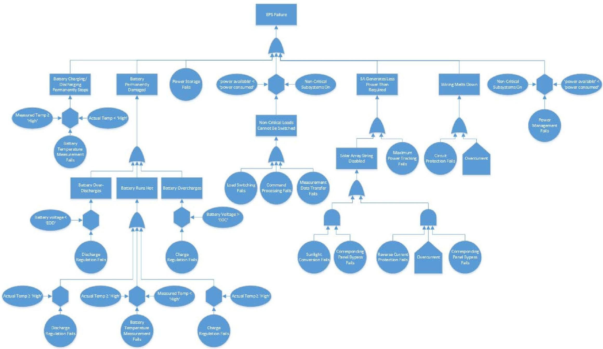

Figure 4-2. Traditional fault tree

<!-- PDF_PAGE: 76 -->

Table 4-4 provides the outcome of the quantitative criticality analysis. To complete this table the same approach was used to estimate the part failure rate, based on failure rate prediction models as described in Section 3.3.2. Furthermore, similar to the model-based quantitative criticality analysis performed in Section 3.3.3 each failure mode is also provided with a failure mode ratio, final effect probability and operating time for each corresponding part. The same considerations are used here to estimate the corresponding values; for this reason the resulting failure mode criticality numbers are similar to the result presented in Section 3.3.3.

Table 4-4. Traditional quantitative criticality analysis

<table border="1"><tr><td>Component</td><td>Part</td><td>Failure mode</td><td>Failure mode ratio{alpha=lambda/p/Sum(lambda/p)}</td><td>Final effect probability(beta)</td><td>Part failure rate(lambda-p=[#failures/10^6hours])</td><td>Operating time(t=[h])</td><td>Failure mode criticality{Cm=alpha*beta*lambda-p*t}</td><td>Failure probability{P=1-EXP(-lambda-p/10^6*t)}</td></tr><tr><td rowspan="9">PCDU</td><td>Battery discharge regulator</td><td>Discharge regulation</td><td>0,1603</td><td>0,5</td><td>0,8093</td><td>17520</td><td>1136,3424</td><td>0,04164481</td></tr><tr><td rowspan="2">Data Interface Module</td><td>Command</td><td>0,0003</td><td>0,25</td><td>0,0033</td><td>52560</td><td>0,0142</td><td>0,000173433</td></tr><tr><td>Measurement data transfer fails</td><td>0,0003</td><td>0,25</td><td>0,0033</td><td>52560</td><td>0,0142</td><td>0,000173433</td></tr><tr><td>Transistor</td><td>Load switching fails</td><td>0,009</td><td>0,25</td><td>0,0456</td><td>6</td><td>0,0006</td><td>0,002393866</td></tr><tr><td rowspan="2">MPPT supply regulator</td><td>Maximum power tracking fails</td><td>0,0801</td><td>1</td><td>0,8093</td><td>35040</td><td>2272,6848</td><td>0,04164481</td></tr><tr><td>Charge regulation</td><td>0,0801</td><td>0,5</td><td>0,8093</td><td>35040</td><td>1136,3424</td><td>0,04164481</td></tr><tr><td>Battery temperature sensor</td><td>Battery temperature measurement fails</td><td>0,0089</td><td>0,5</td><td>0,045</td><td>52560</td><td>10,5399</td><td>0,002362405</td></tr><tr><td>Electronic fuse</td><td>Circuit protection</td><td>0,5942</td><td>0,05</td><td>3</td><td>4380</td><td>390,3666</td><td>0,145876942</td></tr><tr><td>Measurement Unit</td><td>Power measurement</td><td>0,0667</td><td>0,25</td><td>0,3366</td><td>52560</td><td>294,8558</td><td>0,017536117</td></tr><tr><td rowspan="3">Solar array</td><td>Panel</td><td>Sunlight to current conversion fails</td><td>0,2205</td><td>0,0001</td><td>0,0353</td><td>35040</td><td>0,0273</td><td>0,001853648</td></tr><tr><td>Blocking diode</td><td>Reverse current protection fails</td><td>0,3898</td><td>0,0001</td><td>0,0624</td><td>35040</td><td>0,0107</td><td>0,003274372</td></tr><tr><td>Bypass diode</td><td>Panel bypass fails</td><td>0,3898</td><td>0,0001</td><td>0,0624</td><td>35040</td><td>0,0142</td><td>0,003274372</td></tr><tr><td>Battery</td><td>Battery</td><td>Power storage fails</td><td>1</td><td>1</td><td>0,15</td><td>17520</td><td>2628</td><td>0,007853003</td></tr></table>

The fault tree (Figure 4-2) based system reliability calculation is shown in Table 4-5. In this table failure probabilities of basic events are derived from part failure rates, that are captured in Table 4-4. To estimate the probabilities of conditioning events the same considerations were used as described in Section 3.3.3. The probabilities of the intermediate events are also calculated based on the Boolean logic. The system reliability is again calculated based on the failure probability of the top event "EPS Failure". In Figure 3-15 the corresponding Boolean logic is shown. The same logic is also applied for this calculation; for this reason corresponding formulas aren't depicted below.

Table 4-5. EPS reliability calculation based on Boolean FTA

<table border="1"><tr><td>Event</td><td>ID</td><td>Theoretical failure probability{Boolean}</td><td>Event</td><td>ID</td><td>Theoretical failure probability{Boolean}</td><td>Event</td><td>ID</td><td>Theoretical failure probability{Boolean}</td></tr><tr><td>Load Switching Fails</td><td>B2.1</td><td>0,002393866</td><td>Reverse Current Protection Fails</td><td>B1.6</td><td>0,00327437</td><td>Solar Array String Disabled</td><td>I2.4</td><td>7,1417E-06</td></tr><tr><td>Circuit Protection Fails</td><td>B2.5</td><td>0,145876942</td><td>Power Storage Fails</td><td>B3.1</td><td>0,007853</td><td>Battery Overcharges</td><td>I2.3</td><td>0,0104112</td></tr><tr><td>Power Measurement Fails</td><td>B3.2</td><td>0,017536117</td><td>Battery voltage&lt;EOD&#x27;</td><td>C1.1</td><td>0,25</td><td>Battery Runs Hot</td><td>I2.2</td><td>0,02097006</td></tr><tr><td>Command Processing Fails</td><td>B2.2</td><td>0,000173433</td><td>Actual Temp≥High&#x27;</td><td>C1.2</td><td>0,25</td><td>Battery Over-Discharges</td><td>I2.1</td><td>0,0104112</td></tr><tr><td>Measurement Data Transfer Fails</td><td>B2.3</td><td>0,000173433</td><td>Measured Temp&lt;High&#x27;</td><td>C1.3</td><td>0,25</td><td>Wiring Melts Down</td><td>I3.5</td><td>0,01458769</td></tr><tr><td>Maximum Power Tracking Fails</td><td>B2.4</td><td>0,04164481</td><td>Battery Voltage&gt;EOC&#x27;</td><td>C1.4</td><td>0,25</td><td>SA Generates Less Power Than Required</td><td>I3.4</td><td>0,04165195</td></tr><tr><td>Charge Regulation Fails</td><td>B1.3</td><td>0,04164481</td><td>Overcurrent</td><td>E1.1</td><td>0,1</td><td>Non-Critical Loads Cannot Be Switched</td><td>I3.3</td><td>0,00274073</td></tr><tr><td>Battery Temperature Measurement Fails</td><td>B1.2</td><td>0,002362405</td><td>Measured Temp≥High&#x27;</td><td>C2.1</td><td>0,25</td><td>Battery Permanently Damaged</td><td>I3.2</td><td>0,04179246</td></tr><tr><td>Discharge Regulation Fails</td><td>B1.1</td><td>0,04164481</td><td>Actual Temp&lt;High&#x27;</td><td>C2.2</td><td>0,25</td><td>Battery Charging/Discharging Permanently Stop</td><td>I3.1</td><td>0,00014765</td></tr><tr><td>Sunlight Conversion Fails</td><td>B1.4</td><td>0,001853648</td><td>power available&#x27;&lt;power consumed&#x27;</td><td>C3.1</td><td>0,7071</td><td>EPS Failure</td><td>F4</td><td>0,11980289</td></tr><tr><td>Corresponding Panel Bypass Fails</td><td>B1.5</td><td>0,003274372</td><td>non-critical subsystems on</td><td>C3.2</td><td>0,7071</td><td>Reliability</td><td>F4</td><td>0,88019711</td></tr></table>

<!-- PDF_PAGE: 77 -->

Diagrams in Figure 3-10 and Figure 3-11 show how a model-based approach was used to set up a framework for the quantitative criticality analysis. The existing model elements were enhanced by the specific values that are required to calculate the criticality numbers, and were prepared for the parametric analysis, which was finally used to calculate the corresponding item criticality values. In Figure 3-13 and Figure 3-14 it was shown how the basic event probabilities were calculated using a model-based approach, while the diagrams in Figure 3-15 and Figure 3-16 present the model-based framework which was used to calculate the probabilities of the intermediate events and final system reliability. Comparing the Excel-based and SysML-based approaches to estimate the failure mode criticalities and to calculate system reliability, it can be noted that in terms of automated calculation both approaches may be considered as identical; both Excel and SysML support automatic recalculation when a certain value is changed. But the advantage of SysML is in this case, the fact that both qualitative and quantitative models are integrated into a single model as opposed to a traditional approach. This integration allows any modification made to a qualitative model to automatically propagate throughout the quantitative model; this is not the case for a traditional method, which doesn't support integration of both models types. Considering the fact that reliability analysis is an iterative process, which is performed at all stages of system design, it becomes obvious that the model-based approach may substantially reduce total effort required to perform a quantitative analysis based on the qualitative reliability model. Also, it may help to minimize the human-made mistakes that are inherent to manual document adjustments.

## 4.2.2 General observations from comparison between traditional and MBSE approaches

By comparing the traditional reliability modeling approach with the MBSE-approach presented in Chapter 3 a number of observations can be made:

- Using SysML for FMECA only can be more time consuming, compared to a table format. However, when combined with scenario modeling, it allows to reuse model elements, which on its turn will require less time than when both have to be performed traditionally, as this requires manual editing of all information in the table.

- Various physical and functional design aspects (components, parts, conditions and functions) that typically have to be incorporated into the FMECA can be reused from the SysML design model, while traditional approach requires to manually enter all system information. These benefit, however, can be obtained only if the reliability analysis and system design are integrated into a single model. Using SysML for reliability analysis only may become very time consuming, even assuming the engineer already has experience with SysML. This is because a number of system design elements will still have to be modeled first prior to developing a reliability model.

- When a revision has to take place, e.g. after a brainstorm session, manual document revisions would be required in multiple sections of a traditional reliability model, while SysML allows automatic propagation of a single change made at one place throughout the entire model, which may save a lot of time, especially when the model is large, and helps to prevent typical mistakes that arise from manual document revisions.

- As SysML utilizes a graphical modeling approach, it helps to visualize interconnections and dependencies between model elements, which provides a more intuitive approach to model system reliability.

- SysML provides standardized instruments for both system and reliability modeling. While learning SysML definitely requires a considerable effort and additional project resources it may for sure help to reduce room for interpretation when everyone within a design team "speaks" the same language, because there is only a single correct way to represent model information. A reliability model in SysML may for this reason be considered as a single point of truth for all project members. This, however, means that everybody in a project team needs to have essential knowledge of SysML.

<!-- PDF_PAGE: 78 -->

- In Section 3.1 it has been mentioned that basic SysML specification doesn't provide automated computational support, which is also the case for the modeling tool used for this work. The equations established in the Parametric Diagrams throughout Section 3.3 had to be solved manually; in this thesis Excel was used. Using external solver like Excel, unfortunately, requires manual input of the results into the system model. However, currently, a number of SysML tools exist that provide full integration with parametric solvers, including interfaces with Excel, MATLAB and Mathematica, which, however, requires a paid license. Nevertheless, purchase of a single tool that allows requirement analysis, system design and reliability assessment may still be considered as a valuable investment, also on the university-based scale. MBSE-approach thus allows to integrate qualitative and quantitative risk models, which eliminates the necessity to manually update the model with the results that follow from calculations. Assuming a SysML tool supports bidirectional integration with external parametric solver, manual calculation work and model update won't be any more required, because the reliability model will be automatically updated with the resulting numerical values.

- Because all information is captured within a single model the need for conventional documentation disappears. However, sometimes it might be convenient or even required to write a report for the sake of review or presentation. While basic SysML specification doesn't support automated report generation, a number of more advanced tools do, which can be seen as a big advantage.

<!-- PDF_PAGE: 79 -->

## 5. Conclusion and recommendations

The purpose of this section is to a) summarize the information captured in this report to answer the questions, that have been stated in Section 1.3, and b) provide further recommendations for future research and application.

## a) Is it feasible to integrate reliability analysis and system design using SysML?

Although the basic SysML specification provides a possibility to model system parameters, it is mainly limited to manual editing of quantitative data which doesn't allow any further calculations, unless the model is linked to an external parametric solver. On the other hand, given the basic toolset, the qualitative part of risk analysis can be modelled rather comprehensively in SysML. System functional architecture, including specification of conditional behavior, gives a strong basis for risk analysis and can be modeled extensively to each desirable level of detail. The structural diagrams (Block Definition Diagram and Internal Block Diagram) give insight into the system's physical composition and internal configuration, and can be allocated to required functions that have to be fulfilled, while the corresponding behavior is then modeled using the functional diagrams, such as the Activity Diagram, State-Machine Diagram and Sequence diagram. Alternating deployment of the corresponding toolset for each design level provides a possibility to model various system processes from different perspectives and for various levels of detail. Because SysML allows to link parts with processes and (intermediate and final) states, the complete chain of events can be depicted as function of different triggers. This, theoretically, enables to integrate any of the existing qualitative risk analysis methods into a model, including the analysis of such impacts as human error, software error, environment and hardware malfunctioning for each desired phase of the system life-cycle. For the software part, however, it is recommended to incorporate UML into the model due to its specialized focus on software architecture. UML allows to extensively model the software which goes beyond the standard SysML specification. A number of tools exist, that allow to integrate both UML and SysML within a single model.

## b) Which potential benefits and drawbacks are inherent to the integration of reliability analysis and system design using SyML?

Using SysML for FMECA only can be more time consuming, compared to a table format. However, when combined with scenario modeling, it allows to reuse model elements, which on its turn will require less time than when both have to be performed traditionally, as this requires manual editing of all information in the table.

Various physical and functional design aspects (components, parts, conditions and functions) that typically have to be incorporated into the FMECA can be reused from the SysML design model, while traditional approach requires to manually enter all system information. These benefit, however, can be obtained only if the reliability analysis and system design are integrated into a single model. Using SysML for reliability analysis only may become very time consuming, even assuming the engineer already has experience with SysML. This is because a number of system design elements will still have to be modeled first prior to developing a reliability model.

When a revision has to take place, e.g. after a brainstorm session, manual document revisions would be required in multiple sections of a traditional reliability model, while SysML allows automatic propagation of a single change made at one place throughout the entire model, which may save a lot of time, especially when the model is large, and helps to prevent typical mistakes that arise from manual document revisions.

<!-- PDF_PAGE: 80 -->

As SysML utilizes a graphical modeling approach, it helps to visualize interconnections and dependencies between model elements, which provides a more intuitive approach to model system reliability.

SysML provides standardized instruments for both system and reliability modeling. While learning SysML definitely requires a considerable effort and additional project resources it may for sure help to reduce room for interpretation when everyone within a design team "speaks" the same language because there is only a single correct way to represent model information. A reliability model in SysML may for this reason be considered as a single point of truth for all project members. This, however, means that everybody in a project team needs to have essential knowledge of SysML.

In Section 3.1 it has been mentioned that basic SysML specification doesn't provide automated computational support, which is also the case for the modeling tool used for this work. The equations established in the Parametric Diagrams throughout Section 3.3 had to be solved manually; in this thesis Excel was used. Using external solver like Excel, unfortunately, requires manual input of the results into the system model. However, currently, a number of SysML tools exist that provide full integration with parametric solvers, including interfaces with Excel, MATLAB and Mathematica, which, however, requires a paid license. Nevertheless, purchase of a single tool that allows requirement analysis, system design and reliability assessment may still be considered as a valuable investment, also on the university-based scale. MBSE-approach thus allows to integrate qualitative and quantitative risk models, which eliminates the necessity to manually update the model with the results that follow from calculations. Assuming a SysML tool supports bidirectional integration with external parametric solver, manual calculation work and model update won't be any more required, because the reliability model will be automatically updated with the resulting numerical values.

Because all information is captured within a single model the need for conventional documentation disappears. However, sometimes it might be convenient or even required to write a report for the sake of review or presentation. While basic SysML specification doesn't support automated report generation, a number of more advanced tools do, which can be seen as a big advantage.

## c) Which risk assessment method(s) is/are mostly suitable for this purpose, and which reliability modeling approach can be best followed to perform risk assessment in SysML?

Implementation of FMECA provides a good basis for cause and effect analysis by considering the failures of single parts and its final effect on system performance and to quantify the criticality of each failure mode. To compensate for the lack of experience, which is typically the case for the student design teams, FMECA has been be enhanced by scenario modeling, which has its similarities with the Event Tree Analysis technique. This helped to take into account the initially modeled interfaces and conditional behavior. Each failure mode was used as a starting point to model the failure propagation throughout the whole system, based on the already modeled system design information. To calculate system reliability the Fault Tree Analysis technique was applied after FMEA together with scenario modeling for each failure mode have been completed. Therefore, the earlier modeled failure scenarios were rearranged and combined, making it possible to consider not only the single failure modes but also their combinations. The reason why it was chosen to combine FTA and FMECA, is the fact that while FMECA mainly focuses on analyzing the effects of a single functional or component failure and finding all possible initiating fault events, FTA, on the other hand, allows to consider the combination of failures so that total system reliability can be calculated.

These basic risk assessment methods are all widely used and lots of information on their application is available. Furthermore, they can be modified to become complementary to each other, and combined into a single integrated risk analysis methodology, so that all available design information can be utilized. This methodology supports implementation of qualitative and quantitative aspects as

<!-- PDF_PAGE: 81 -->

well. The comprehensive qualitative basis makes it usable for modeling in SysML, while the quantitative results can be assigned as values to the corresponding SysML artifacts. The calculations, though, have to be performed externally, as basic SysML specification doesn't support a full quantitative analysis. For this reason, it is recommended to consider a SysML tool, which provides interfaces with external parametric solvers.

Prior to start modeling two important question have to be answered first: a) which system aspects need to be modeled?, and b) to which extent?

## d) What should a system design model at least consist of to provide a sufficient basis for reliability assessment within a single modeling environment?

A comprehensive answer to this question can be found in Section 2.6, which is summarized below:

- System context to identify related systems within a spacecraft domain;

- Basic operational scenarios to understand the operational context;

- Functional and physical system decomposition at different levels;

- External interfaces with context systems;

- Internal configuration at different levels;

- Flow-based, control-based and event-based behaviors, based on the physical and functional analyses.

The abovementioned system design characteristics have been specifically selected to support the reliability assessment methodology, that is described in section 3.1, and implemented throughout Chapter 3. However, in case a different risk assessment methodology would be applied, the to be captured design information could also be different. For this reason, it is recommended to first decide which risk modeling techniques are going to be used, prior to capture the necessary design information into a model to prevent unnecessary effort. On the other hand, in case a design team decides to apply MBSE and SysML for the sake of system design, no specific additional information would be needed to build a reliability model.

## e) Which level of detail should a system model possess?

It depends on the stage of system design at which risk assessment is performed. In this thesis an emphasis was put on the conceptual system design stage. The first reason for this is the fact, that conceptual design stage can be considered as the most critical part of the design process; wrong decisions made at this point will potentially propagate through the rest of the system design cycle. That’s why performing risk analysis at the very beginning may provide the biggest benefits. The second reason is that at a relatively high system level the demonstration of risk analysis integration into MBSE is being made more accessible; modeling to a very low level of detail won't provide any added value for the demonstration purposes, neither contribute to better clarification, due to an unnecessarily increased complexity. However, in a real-life CubeSat design project a system model should be further extended for each development stage to provide sufficient basis for risk analysis, that needs to be performed at the same stage of system design. For this reason, the level of detail will correspond with the design stage at which risk assessment must be performed.

## f) Can the university-based CubeSat design teams benefit from the developed methodology?

Reliability analysis methods that were reviewed in Section 4.2.1 all shared a number of similarities, such as a utilization of a single risk assessment method only, that is modified to fit a student-based satellite development project in terms of decreased complexity and reduced time consumption,

<!-- PDF_PAGE: 82 -->

thereby focusing on preliminary design phase and trade studies. Also, considered approaches were whether strictly qualitative or quantitative; integration of multiple risk assessment methods to combine both aspects is likely avoided to prevent increasing in complexity. Furthermore, none of the reviewed methods utilized all aspects of system design; some methods were specifically focused on behavioral analysis, while other methods strictly considered system's physical architecture. Finally, considered reliability assessment methods didn't share the same modeling platform with system design, as opposed to an attempt in this thesis work to integrate reliability analysis and system design, based on the MBSE principles.

While reviewed reliability assessment methods specifically aimed at reducing complexity and cost to make them more accessible for student-based development teams, they can be considered as the simplified versions of the commercially applied techniques, that usually incorporate multiple risk assessment methods, e.g. the PRA methodology, making them less practical for the projects with a limited budget. The simplifications make the analysis less complex and time consuming; this, however, comes with a price: only a relatively small number of reliability analysis aspects can be covered, which may increase the probability of the unforeseen behavior during testing or even in-orbit operation. This concern is inherent to all reviewed methodologies in the previous sections. The methodology presented in this thesis work is expected to cope with this issue as it attempts to cover multiple aspects of system reliability analysis, utilize both functional and physical architectures and provide basis for both qualitative and quantitative analysis, while still being rather accessible for a practical application at the universities, by deploying the benefits of MBSE. These benefits, however, can be obtained only if the reliability analysis and system design are integrated into a single model. Using SysML for reliability analysis only may become very time consuming, even assuming the engineer already has experience with SysML. This is because a number of system design elements will still have to be modeled first prior to developing a reliability model.

<!-- PDF_PAGE: 83 -->

## Appendix A Spacecraft failures and risk assessment

In this chapter general information will be provided on mission failures, including (sub)system reliability issues, effects of space environment and human factor. Also, a number of existing risk assessment methods will be elaborated upon to provide a basis for further deployment in Chapter 3.

## A1 Spacecraft system failures and causes

During the operational lifetime a satellite can experience various malfunctions that may negatively affect the entire space mission. In most cases these are the performance issues leading to a decrease in efficiency such as solar panel degradation or temporary problems with data communication. However, some malfunctions may also cause a fatal mission failure [11].

The purpose of this section is to list the most common causes of spacecraft failures that can be attributed to the natural space environment and to describe the relative contribution of various subsystems to satellite failures. Aside from the mentioned failure categories, human factor will also be considered.

## A1.1 Satellite anomalies caused by space environment

## Background information on space environment

Prior to listing the most common satellite anomalies a description of the space environment is provided below. As stated by the National Research Council: "spacecraft anomaly is a mission-degrading or mission-terminating event affecting in-orbit operational spacecraft" [11].

The major contributor to variety of events that occur in our solar system is the sun, which has a core temperature of 15,7 million Kelvin, a surface temperature of 6000 Kelvin and 1 million degrees Kelvin in the sun's atmosphere (corona). The temperatures of such a high magnitude cause all of the sun material to be in plasma state. Some of this plasma is injected into space, which is called solar wind, that mainly consists of protons and electrons with densities of 5 particles per $ cm^{3} $ and average velocities of 300 km/s, also carrying the sun's magnetic field with it. The solar wind may interact with the sun's magnetic field resulting in mass ejections of higher density and the velocities of several times higher above the average. This is called coronal mass ejections (CMEs). The CMEs often reach the near-Earth space environment which typically happens once in several days.

Another anomaly that can be related to CMEs is the solar flares, which are massive explosions near the sun's surface producing a high energy radiation that results in even higher velocity particles compared to the CMEs. Both phenomena may thus result in arrival of high-energy protons at near-Earth space, which is called the solar proton events. Such events may cause the interaction of the high-energy particles with the Earth's magnetic field and induce variations in plasma densities and the Earth's magnetic field strength and orientation in the near-Earth space and the upper atmosphere. This phenomenon is called the geomagnetic activity. A particular case of the geomagnetic activity is the geomagnetic storm, a period of intensive magnetic field strengths and injection of high-energy plasma into the Earth's magnetic field (magnetosphere). Inside the magnetosphere high-energy charged particles are aligned across the Earth's magnetic field lines and constitute the Van Allen radiation belts that occur form 1500 km altitude to approximately 6 Earth radii. The Van Allen radiation belts (Figure A-1) are known to threaten the satellites mostly in medium Earth orbit (MEO) but also in low Earth orbit (LEO) with high inclinations, and geostationary orbits (GEO) [11]. Besides, due to the fact that the Earth's dipolar field is shifted relative to the Earth's center, the Van Allen belts can reach relatively low altitudes up to 200 km in the region of the eastern coast of South America, which is called the South Atlantic Anomaly (SAA) (Figure A-2). In this

<!-- PDF_PAGE: 84 -->

region the flux of high-energy particles is relatively high, causing the increased exposure of satellites to radiation [1].

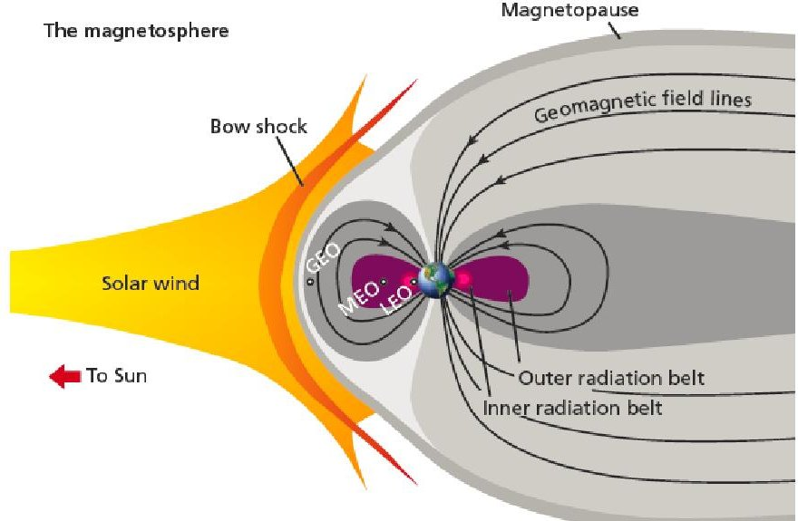

Figure A-1. Schematic picture of the Earth's magnetosphere with regions where satellite anomalies occur [11].

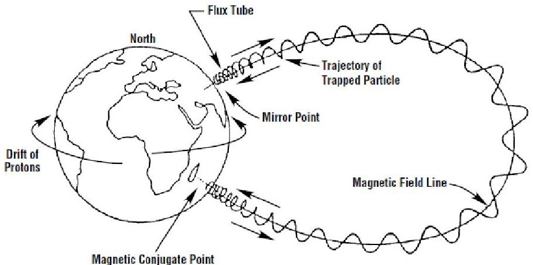

Figure A-2. Schematic picture of the South Atlantic Anomaly [1].

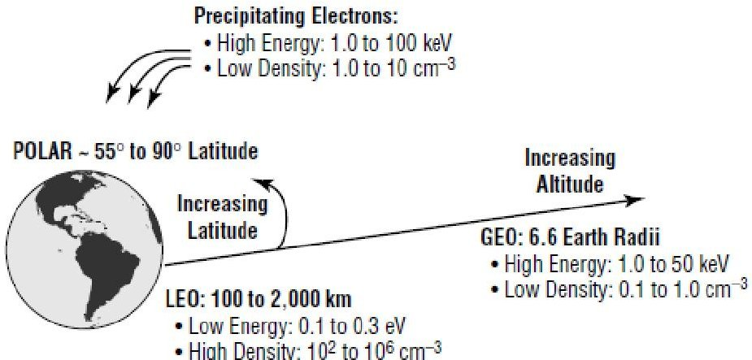

Figure A-3. Properties of the natural space plasma [1].

The high-energy particles can also arrive from distant supernova and may, together with the above mentioned solar proton events and Van Allen radiation belts, cause the so-called single event effects (SEE), whereby the spacecraft performance is directly affected. The emissions caused by the solar flares can produce the intense X and gamma rays, which can induce surface charging and sensor damage [11].

Spacecraft damage may also occur as a result of interaction with meteoroids and space debris, but this doesn't happen on a regular basis [11].

<!-- PDF_PAGE: 85 -->

Below, some general satellite anomalies are discussed, based on a number of representative cases (note: the list is not exhaustive).

## Total ionizing dosage (TID)

On 8 august 1989 ESA launched a star mapping mission, called HIPPARCOS whose final destination was a $ 1 2^{0} $ W geostationary position but due to a failure of its apogee motor the satellite couldn't come any further than the initial geostationary transfer orbit (GTO). The corresponding radiation environment containing the high-energy particles that can travel through spacecraft material and cause various anomalies such as decreased power production by solar arrays, electronic failures and amplification of background noise in sensors [1], highly exceeded the design specifications of HIPPARCOS. When the high-energy particles impact the spacecraft material also both the surface and internal charging may occur, not only resulting in degradation of electronics over time but also in instantaneous electrostatic discharges [11]. In addition, a major solar event of March 1991 caused the enhancement of radiation flux in the Van Allen belts. The subsequent increase in background noise in the instruments could be immediately addressed to this phenomenon [12].

The unintended residence in the GTO has led to irradiation of 5-10 times higher compared to the case when the initially planned orbit would have been reached. After 3 mission years five gyroscopes successively failed during 6 months while one of the gyros was already degraded. Four of the gyroscopes reduced the spin speeds and finally stopped due to the degradation of bipolar PROM (a non-volatile memory which earned its popularity back in the days thanks to the immunity to space radiation [13]). The received radiation dose by PROM was estimated to be 40 krad (=400 J/kg). Prior to the final run of the gyroscopes a futile attempt was made to restart the gyros because of the degradation of transistors in AC/DC converter and in the 262 kHz clock of the wheel motor power supply. The last redundant gyroscope also failed after it was turned on close to the mission ending because of the radiation degradation failure of an opto-coupler in the thermal regulation system that received around 90 krad of radiation [12].

The science mission was finally terminated after the communication loss with the on-board computer on 24 June 1993.

Despite of the described issues HIPPARCOS operated longer than 3.5 years in a more aggressive environment than it was designed for (which is one year longer than initially intended for GEO), and accomplished all scientific goals [12].

This result leads to a conclusion that an estimate of the TID that has to be accounted for during the mission design, was over-approximated resulting in a higher than required radiation hardness level of various hardware components.

## Surface charging, internal charging and electrostatic discharge (ESD)

On January 20, 1994 40 northern Canadian communities were left without telephone service while the Canadian press wasn't more able to deliver news to over 100 newspapers and 450 radio stations. The reason behind this accident was the failure of the Anik E-1 and Anik E-2 satellites operated by Telesat Canada, to provide communication services across Canada and support business with a variety of voice, data and image services [14].

Both satellites were launched into GEO in 1991 (Anik-E1 at $ 1 1 1. 1^{\circ} \mathrm{W} $ and Anik E-2 at $ 1 0 7. 3^{\circ} \mathrm{W} $ ). The satellites were 3-axis stabilized by a biased momentum system comprising a major and a backup momentum wheels [14].

On January 20, 1994 Anik E-1 went into an uncontrolled spin. The issue was resolved 7 hours later by enabling the redundant momentum wheel system. About one and half hours later after losing

<!-- PDF_PAGE: 86 -->

control over the Anik E-1, Anik-E2 started to experience a similar problem. The attempts to turn on the backup control system however was unsuccessful due to its total failure [14].

The failure investigation including the analysis on telemetry data and diagnostic test, has led to a conclusion that the malfunctioning of control system was caused by the electrostatic discharge (ESD) damage to the momentum wheel control board of the momentum wheel assemblies, resulting in a false "full speed" signal that made the control wheel to spin down to zero [14].

When the Anik-E's failures occurred the space weather conditions were relatively normal except for an unusually large Coronal Hole in the southern hemisphere of the sun that resulted in high-speed solar wind streams which enhanced the high-energy electron density in the Anik-E's environment. In the period of January $ 1 1 ^{th} $ until $ 2 2 ^{th} $ an increment in solar wind velocity from 300km/s to 700km/s was measured together with the enhancement of solar wind density which came down to $ \sim 2 2, 5 $ particles/cm $ ^{3} $ and electron fluxes higher than 2MeV. This circumstances provoked a gradual charge buildup of electrons inside both satellites due to internal charging (Figure A-4) and finally led to voltages that exceeded the discharge threshold causing the ESD [15].

The ESD is an arc discharge that arises as a result of a charge buildup on a satellite surface or between its internal hardware components (when a spacecraft travels through the ionized atmosphere it can develop an induced charge of thousands of Volts [1]). The most common cause of internal charging is the penetration by the high-energy electrons (> 10keV) which then localize around insulating materials such as wiring insulation and circuit boards. When a certain threshold of electrical potential between the internal components has been reached an ESD may occur in electric and electronic parts. The charge buildup rate depends on the specific location of a spacecraft in space environment while the electric potential that is required to produce an arc depends on the used materials and a relative position of the conductors [11].

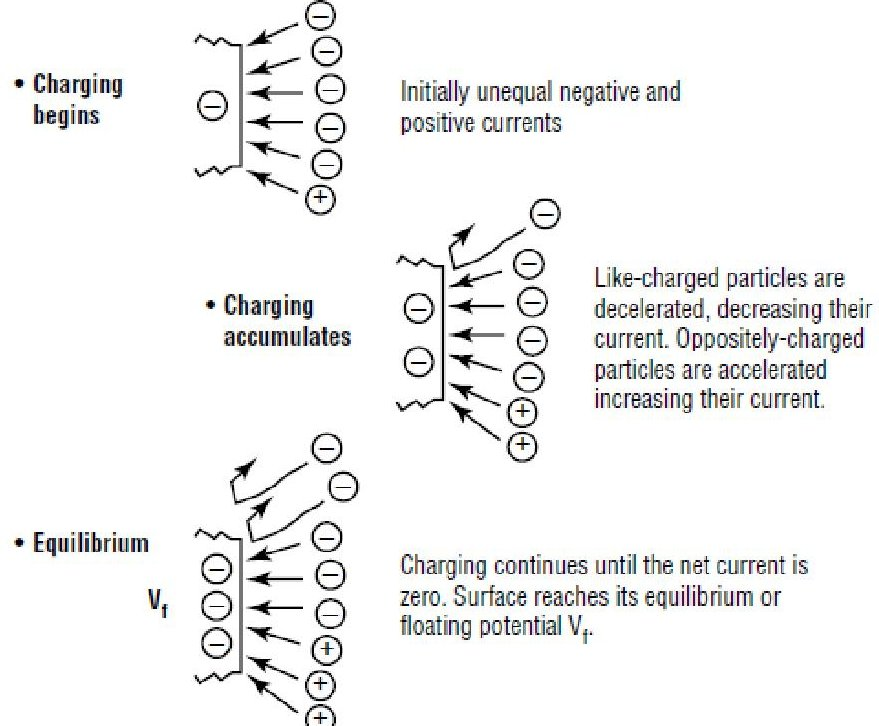

Figure A-4. Schematic picture of satellite charging [1].

<!-- PDF_PAGE: 87 -->

## Single event effect (SEE)

A representative case of this phenomenon is the Tracking and Data Relay Satellite System (TDRS-1) designed by NASA to provide communications and high data-rate transmissions for low Earth-orbiting satellites. The TDRS-1 was launched from the space shuttle in Aril, 1983 but due to a failure of the shuttle's second stage thruster the satellite had to make use of its own power source to reach the GEO with $ 0^{\circ} $ inclination. During the transfer orbit, various anomalies have been observed in the Attitude Control System (ACS). The reason behind these anomalies was the state changes in the Random Access Memory (RAM) in the ACS. A number of these anomalies were considered as mission-threatening, requiring an extensive intervention by ground control. This unusual behavior in memory equipment is typically referred to as Single Event Upsets (SEU) [16].

SEU is an anomalous change in the state of a memory device. While the ESD's occur after a gradual charge buildup, the single event upsets are caused by impact of one or several high-energy particles (protons and electrons of > 2MeV) into vulnerable (sub)system components, immediately resulting in an operational anomaly [11].

An example of an SEU is a "bit flip" when the solid state memory devices suddenly gain charge after being impacted. This may negatively influence the system software and hardware. Another example is a single-event latch up (SEL) when a subsystem hangs or crashes. Under these conditions the affected subsystem may even pull an excessive current from the EPS and drastically reduce the available electrical power for all other subsystems, also called single-event burnout (SEB) [11].

The SEU's on the TDRS-1 were addressed to both galactic cosmic rays (GCRs) and energetic solar particles, accelerated by solar flares. The galactic cosmic rays can possess energies varying from several to $ 1 0^{1 4} $ MeV. Galactic cosmic radiation has an approximate 11-year solar cycle variation with intensities that are inversely proportional to solar activities, as the increasing sunspot number disturbs the GCRs by inducing a shielding effect on them (Figure A-5). The spikes in SEUs are associated with solar events that occurred in August, September and October of 1989 [16].

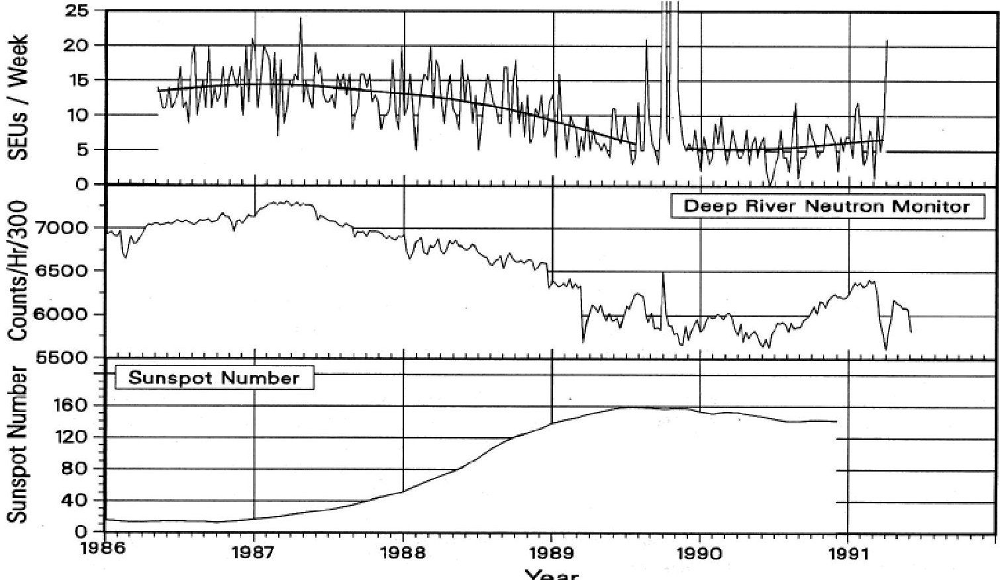

Figure A-5. Relation between solar events (bottom), intensity of GCR's (middle) and number of SEUs on TDRS-1 (up) [16].

Thermal effects

<!-- PDF_PAGE: 88 -->

In-orbit temperature fluctuations can lead to fatigue of various satellite subsystems (Table A-1). The sensitive electronics needs to be properly cooled while the variations in temperature may lead to e.g. erosion of wires and solder joints. Thermal environment must also be accounted for when choosing certain lubricants and thermal control fluids, as the excessive freeze-thaw cycling may negatively affect the required properties of these liquids, finally resulting is (sub)system failures, e.g. permanent radiator freezing [1].

Below, some representative cases are briefly described [1].

- The solar arrays of Hubble Space Telescope strongly vibrated and interfered with the deepspace observations when the spacecraft went from shadow to sunlight, caused by the thermal expansion of the support poles [1].

- The antenna of the Galileo spacecraft failed to deploy properly due to the shortcoming of the used lubricant on the mechanical joint. This issue has resulted in the reduction of data transfer capabilities back to Earth [1].

- Meteosat 6 permanently experienced issues with its radiometer, probably due to ice forming on the instrument and contamination of the optical surfaces.

- The power cables on two of the four solar arrays failed on Landsat-4 caused by stresses in the conductors due to thermal cycling.

- The solar sail of the Insat IB failed to deploy due to the thermal binding of the deployment mechanism caused by a lubricant failure.

Table A-1. Examples of operational and survival temperatures of satellite components [17].

<table border="1"><tr><td>Component or subsystem</td><td>Operating temperature(0℃)</td><td>Survival temperature(0℃)</td></tr><tr><td>General electronics</td><td>-10 to 45</td><td>-30 to 60</td></tr><tr><td>Batteries</td><td>0 to 10</td><td>-5 to 20</td></tr><tr><td>Infrared detectors</td><td>-269 to -173</td><td>-269 to 35</td></tr><tr><td>Solid state particle detectors</td><td>-35 to 0</td><td>-35 to 35</td></tr><tr><td>Motors</td><td>0 to 50</td><td>-20 to 70</td></tr><tr><td>Solar panels</td><td>-100 to 125</td><td>--100 to 125</td></tr></table>

## Meteoroids and orbital debris

An Earth orbiting spacecraft may encounter a variety of small particles originating, for example, form the comet remnants or the asteroid belt. Besides, due to the human activity, there is a lot of debris left in space consisting of e.g. operational payloads, spent rocket stages and other spacecraft components (Figure A-6) which will remain in the Earth's orbit for a long time period. Because of the growing human activity in space the amount of orbiting debris will keep expanding which is an increasing issue for future space missions [1].

A collision with space debris and meteoroids may severely damage a spacecraft because of the extreme relative velocities of the crossing orbits. An impact by a 90-gram particle is for example able to transfer 1 MJ of energy which could easily mean a vehicle's sudden death while a continuous bombardment by small particles can lead to a serious surface erosion [1].

<!-- PDF_PAGE: 89 -->

The following examples [1] can be attributed to the threats explained above:

- A loss of contact with a Miniature Sensor Technology Integration (MSTI) satellite. The failure analysis has led to an electrical short as a result of the impacted wire bundle by space debris.

- The Russian KOSMOS-1275 broke in 200 pieces at altitude of 977 km. The assumption is that this satellite collided with a space debris fragment at a hypervelocity.

- The Japanese Solar x-ray telescope mission satellite was hit by a micrometeoroid on the thin film membrane covering the optical system resulting in the failure of visual portion of the telescope.

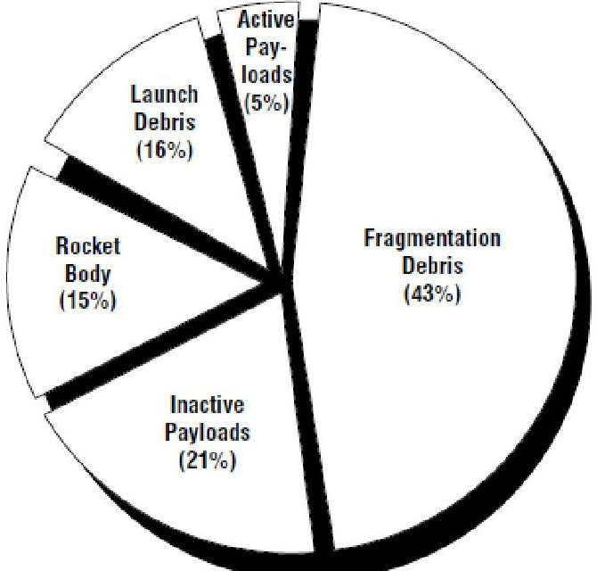

Figure A-6. Relative space debris distribution [1].

## Atomic oxygen (AO)

In LEO, a lot of materials comprising the satellite surfaces can become prone to AO which exists in an atomic form due to photo dissociation, at the altitudes approximately from 200 to 400 km. intensive contact with AO, amplified by other contributing factors such as UV-radiation, micrometeoroid impact damage, sputtering and contamination can severely impact mechanical, optical and thermal characteristics of the spacecraft surface materials [1].

Long Duration Exposure Facility (LDEF), a spacecraft designed to provide long-term experimental data on the outer space environment and its effects on space systems, dealt with significant AO effects on the insulation samples [1].

The Russian space station Mir had a constant power shortage due to the degraded solar panels as a result of the impact by tiny meteorites, space debris, combined with AO effects [1].

## A1.2 Human factor

## Insufficient design

The earlier mentioned space environmental effects are well-known but still pose a threat to space missions as they are difficult to be completely accounted for during the (sub)system design due to the limited mission budgets. On the other hand, there exist various ground testing facilities that help to simulate the dynamic space environment and its appropriate effects. However, in a variety of cases design errors have become the main reason of mission failures when the space environmental conditions didn't exceed the design specifications [11]. It becomes clear when the example below is considered.

<!-- PDF_PAGE: 90 -->

The STRV 1-C and STRV 1-D, the Space Technology and research Vehicles were the microsatellites launched on November 16, 2000 to test the influence of the radiation environment on the state-of the-art materials and components in geosynchronous transfer orbit. Two weeks after the launch the STRV-1C experienced control problems and a couple of days later the STRV-1D showed the same symptoms prior to the final loss of contact with a ground station [18].

Failure analysis has led to the conclusion that a software design error was culprit which sent a continuous current to latching relays (these are the bi-stable relays that are switched by a short current pulse after which they retain their last position when the current is switched off, instead of being hold in their position by a continuous current) of the radio frequency distribution unit instead of a short pulse. Because of the continuous current a thermal damage to relays insulation material between coils occurred leading to a short circuit, thereby disabling the main receiver [19]. There was no possibility to activate the redundant receiver as the corresponding trip switch couldn't be switched on from the ground because it was meant to be communicated through the main receiver. This means that both satellites finally couldn't receive any ground command, including recovery commands.

In this example two design flaws were responsible for the irretrievable failure of the satellites. A software design error was the primary reason, providing a continuous current to the latching relays instead of a pulsed signal. The secondary reason was a badly thought out redundancy: the activation of the redundant receiver from the ground couldn't be achieved because the corresponding trip switch could only be communicated through the main receiver.

## Operator error and other risks from human actions

Some mission failures can be attributed to the errors made by satellite operators, including commanding errors causing a spacecraft to take wrong actions, mistakes in calculating the necessary thruster outputs, reaction wheel rates, antenna pointing, power cycling or to enable a safe mode during severe environmental conditions, e.g. a geomagnetic storm while it could have been predicted beforehand [11]. The following representative case describes a satellite failure which occurred due to software error and the operator error as well:

On February $ 1 7^{\mathrm{th}} $ Jaxa (a Japan's space agency) has launched an X-ray satellite observatory to explore the nature of super-massive black holes, also attempting to retrieve the origin of the dark matter [20]. Within a month after the satellite has reached the orbit, contact with it was lost during its maneuvering into a position for examining an active galaxy cluster. The investigation has concluded that a software error and a control command mistakenly sent by the ground operators, activated the angular motion on the wrong moment which moved the satellite into uncontrolled spin. The angular velocity exceeded the design specification of the mechanical attachment of the solar panels leading to their break off, leaving the satellite subsystems and instruments without power [21].

The problem started when the ACS (attitude control system) suddenly reported that the satellite was spinning while it wasn't. To "counteract" the mistakenly interpreted spin, ground operators activated the reaction wheel. At the same moment, the magnetic torque operated by the ACS was malfunctioning which led to a further spin up of the reaction wheel. Besides, also the star tracker data was lost, otherwise the ground controllers would have probably been reported on time about the unintended spinning. When the ACS went in a safe mode and a problem became clear, operators activated the thrusters to compensate for a spin but due to the incorrect thruster parameters the rotation velocity has become even higher causing the solar panels to break off [22].

(Fatal) system failures can also arise from other accidental human actions. Electromagnetic interference by adjacent satellites or transmitting on similar frequencies are the examples of

<!-- PDF_PAGE: 91 -->

accidental disruptions sometimes resulting in e.g. temporal inability to communicate with a satellite. Unintentional interference is a relatively recurring problem for GEO orbiting communication satellites because of the high satellite density in these orbits and usage of similar data communication frequencies [11].

Nowadays, a potential threat exists that a satellite anomaly could be caused by an intentional human action but there will be no further elaboration upon in this report.

## A1.3 Relative subsystem contribution to spacecraft failures

The purpose of this subsection is to investigate the relative share of satellite subsystems in Class I in-space failures (a subsystem failure resulting in satellite retirement). The obtained result will then be used to choose a sample subsystem for the risk analysis in the course of this report.

For the sake of this investigation a use will be made of the Small Satellite Anomalies Database (SSAD), which contains 296 in-orbit anomalies of 222 small satellites (<500kg). This database is created by [23], and is primarily based on the data from SpaceTrak. Additional data was obtained from SCALES database, the "Database for Active Satellites Below 10 kg", the publicly available databases and satellite websites [23]. It is important to mention that in the SSAD the systematic design failures are only counted once to make the failure data independent. Besides, the launch failures have not been looked at.

It is difficult to estimate in how far the SSAD is representative for a given time span. Furthermore, the data has become rather obsolete as it is collected from 1990 to 2010 while the small satellite development has being increasing exponentially over the last few years. On the other hand, the database should be sufficient enough to get a basic idea on the most culprit satellite subsystems, which doesn't require any extensive statistical analysis. Besides, the obtained result will be compared to the outcomes from other sources.

The SSAD contains data for both major and fatal failures. As mentioned earlier, only the fatal failures are considered.

The subsystems are divided as follows:

- EPS: Electric Power Subsystem;

- TT&C: Telemetry, Tracking and Control;

- AD&C: Attitude determination and Control;

- C&DH: Command and Data Handling;

- P/L: Payload;

- M&S: Mechanisms and Structure;

- TCS: Thermal Control System;

- Unknown: the reason of failure is unknown.

Thereby, C&DH and P/L are combined, which also holds for M&S and TCS.

The results are provided in the table below:

<!-- PDF_PAGE: 92 -->

Table A-2. Relative share of subsystems to failures

<table border="1"><tr><td>Subsystem</td><td>Number of fatal failures</td><td>Relative share(round off)</td></tr><tr><td>AD&amp;C</td><td>13</td><td>16%</td></tr><tr><td>C&amp;DH,P/L</td><td>6</td><td>7%</td></tr><tr><td>EPS</td><td>29</td><td>35%</td></tr><tr><td>M&amp;S,TCS</td><td>7</td><td>8%</td></tr><tr><td>TT&amp;C</td><td>26</td><td>31%</td></tr><tr><td>Unknown</td><td>2</td><td>2%</td></tr></table>

Based on these results it can be concluded that an EPS can be accounted for the most fatal failures. It has to be however noticed that the calculated numbers are averaged over the total time span and no further analysis has been performed based on certain periods in time.

Nevertheless, it's interesting to compare this result with [24] which is based on SpaceTrak failure data on satellites ranging from 0,2 to 122399 kg, from 1990 to 2008, whereby also only the fatal inorbit failures of 1584 satellites are considered. The analysis didn't account for any specific mass range, mission type, orbital data, etc. Another downside of this data is the fact that it is even more obsolete than the SSAD. However, as mentioned earlier, at this point only an indication of the most culprit subsystem is required for the sake of this study.

The authors apply the following subsystem division:

- Gyro/sensor/reaction wheel (Gyro);

- Thruster/fuel;

- Control processor (CP);

- Mechanisms/structures/thermal (mechanisms);

- Payload instrument/amplifier/on-board data/computer/transponder (payload);

- Battery/cell;

- Electrical distribution;

- Solar array deployment (SAD);

- Solar array operating (SAO);

- Telemetry, tracking and command (TTC);

- Unknown: the reason of failure is unknown.

It has to be noticed that an EPS isn't considered here as a whole but has been broken down into four major components: battery/cell, electrical distribution, SAD and SAO.

The outcome of the analysis performed by [24] is provided below:

<!-- PDF_PAGE: 93 -->

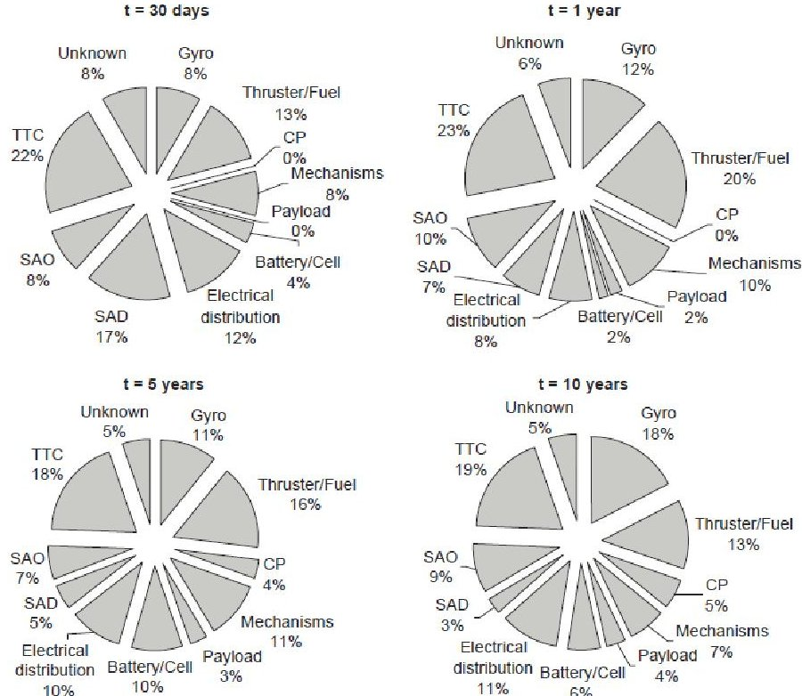

Figure A-7. Subsystem contributions to satellite failures after 30 days, 1 year, 5 years and 10 years on-orbit [24]

From [24] the TTC seems to have a major failure rate at a first glance, considering various moments in time. However, if the battery, electrical distribution, solar array deployment and solar array operating are combined into a major subsystem, which is the EPS, a conclusion can be drawn that it clearly has the highest failure rate for all periods in time: 41%, 27%, 32% and 29% for 30 days, 1 year, 5 years and 10 years respectively.

This outcome is very comparable with the result obtained from SSAD.

Another comparison will be made with [25] which specifically focuses on the reliability of CubeSat's from 2003 to 2014. Although authors don't describe the exact mass range, a CubeSat is typically not heavier than 10kg. The research is based on an in-house created CFD (a CubeSat Failure Database) which contains failure data of 178 individual CubeSat's. Again, only the fatal in-orbit failures were considered. The CFD, when compared to the previously considered SSAD and SpaceTrak, is most upto-date but the amount of data is rather limited, as the CubeSat manufacturing has become a trend only in late 2000's.

The authors apply the following subsystem partition:

- EPS: Electric Power Subsystem;

- OBC: On-board Computer;

- COM: Communication System, incl. antennas;

- ADCS: Attitude Determination and Control System;

- PL: Payload;

- STR: Structure and Deployables (STR);

- Unknown: the reason of failure is unknown.

It has to be mentioned that it is not clear whether the solar panel deployment makes part of STR or EPS. Despite this fact, the result of the reliability analysis is presented below:

<!-- PDF_PAGE: 94 -->

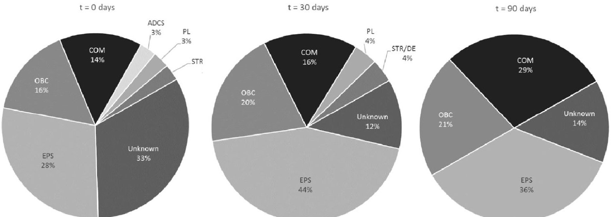

Figure A-8. Subsystem contributions to satellite failures after 0 days, 30 days, 5 years and 90 days years in-orbit [25]

The downside of the representation used by the authors is a short time span of 0 to 90 days. However, it should be kept in mind that CubeSat missions also have a relatively short life-cycle of 3-6 years.

Again, also in this study an EPS appears to account for the vast majority of mission failures.

Finally, to confirm this result a final reference will be made to a study [26] which is an extended version of [23]. In this paper the reliability analysis is also performed using the SSAD for the satellites under 500 kg (see the second paragraph of this subsection) but it extensively describes the relative share of various subsystems to satellite failures in time. The final result of this study is presented below:

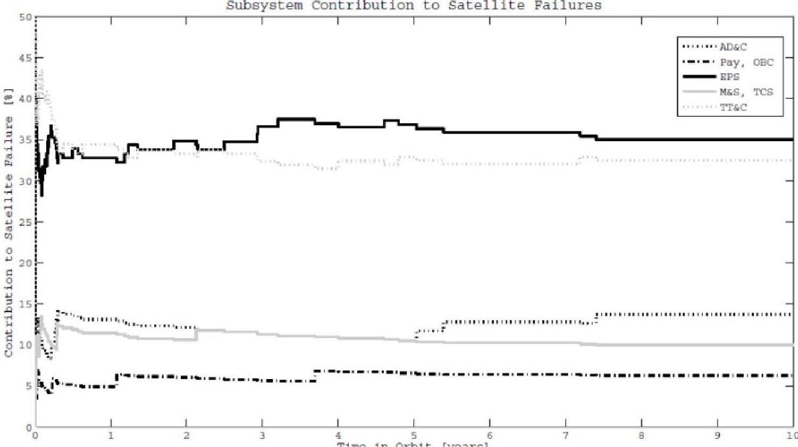

Figure A-9. The contributions of the subsystems to fatal failures of small satellites [26]

From this figure an obvious conclusion can be made that both TT&C and EPS mostly contribute to fatal satellite failures which doesn't differ a lot from the other studies in this subsection. In the first year in-orbit a TT&C seems to be the most culprit subsystem. However, after one year EPS clearly takes a lead and keeps it until the last year. According to authors, the TT&C negatively dominates in

<!-- PDF_PAGE: 95 -->

the first year due to the application of cheap transponders without extensive testing. The reliability decrease of EPS is especially attributed to the failures of the batteries. This statement clearly corresponds with the results in [24] (see Figure A-7).

## Conclusion

The purpose of this subsection was to get an indication of which satellite subsystem contributes to the most fatal failures of the Earth orbiting satellites. When comparing the results of different studies it becomes obvious that despite the differences in considered mass ranges, amount of data and time span, the electric power subsystem appears to have the highest share in fatal mission failures. It will further be used as a sample subsystem for the sake of risk analysis in the course of this report (starting from Chapter 2). The reason for this among other things is a comprehensive amount of data on failure descriptions for this subsystem which can be used to create an extensive failure mode specification.

## A2 Risk assessment methods

The goal of this subsection is to review various widely used risk assessment methods prior to the selection of the most suitable methods for this project, which is performed in Chapter 3. The provided information will remain high-level, as for the sake of a future trade-off no very detailed information on the risk analysis methods is required. Instead, the major definitions and principles of each listed method will be considered together with their common application areas.

## A2.1 General information on risk assessment

Prior to describing various risk analysis methods a number of basic definitions will be provided below [27]. (Note: human safety is out of the scope of this report and only the technical risks (hardware and software) are considered).

Risk: the potential of losses and rewards resulting from an exposure to a hazard or as a result of a risk event. The following quantities are relevant:

- Event occurrence probability;

- Event occurrence consequences;

- Consequence significance;

- The population at risk.

A generalized expression for risk is given as:

$$
R i s k \equiv [ (I _ {1}, o _ {1}, u _ {1}, c s _ {1}, p o _ {1}), (I _ {2}, o _ {2}, u _ {2}, c s _ {2}, p o _ {2}), \dots , (I _ {n}, o _ {n}, u _ {n}, c s _ {n}, p o _ {n}) ]
$$

Where:

I = likelihood;

o = outcome;

u = utility (significance);

cs = causal scenario;

po = population affected by the outcome;

n = number of outcomes.

Another common definition of risk is the product of likelihood of occurrence and the impact severity of the occurrence of the event.

<!-- PDF_PAGE: 96 -->

Risk assessment mainly consists of hazard identification and the assessment of event probability and consequences.

Event consequences: the degree of damage or loss from some failure. Each failure of a system has consequences. To facilitate risk analysis consequences should be quantified using relative or absolute levels.

Hazard: an act or phenomenon posing potential harm to (some person or) thing.

Reliability: the ability of a system or a component to fulfill its design functions under designated operating or environmental conditions for a specified time period. Reliability can also be expressed in the following way:

Reliability = 1-Failure Probability

Availability: the probability that a required function can be performed at a random moment under given conditions. Availability can be considered as a percentage of a certain time period or a number of system requests. The availability can be affected by expected (maintenance - not further considered) and unexpected events [28].

Failure: an event or a combination of events due to which a system (partially) losses its function(s) [28].

Event consequences: the degree of damage or loss from some failure. Consequences need to be quantified using relative or absolute measures for various consequence types to facilitate risk analysis.

Performance: the ability of a system or a component to meet functional requirements.

## A2.2 General risk assessment methods

This subsection covers a number of widely used risk assessment methods. For each method general information will be provided, including basic principles and methodology, application areas, common benefits and drawbacks.

A2.2.1 Qualitative methods

## Expert analysis (based on checklists, expertise and benchmarking) [28]

This "method" is mainly based on the expert's experience who have a comprehensive design knowledge, including the ability to predict various risks. The expert opinion is then used to estimate the potential weaknesses in a system design and by doing so, to eliminate possible threats.

The advantage of this method is the utilization of people's knowledge, experience and lessons learned from the previous projects, for example to prevent the same design flaws that have been made in the past.

However, expert analysis also has a number of disadvantages:

- The outcome cannot always be substantiated.

- The results cannot be quantified.

- The result may highly depend on individual experience and be highly subjective.

<!-- PDF_PAGE: 97 -->

- The experience and knowledge may be insufficient and even not applicable within the development of some new systems.

Failure Mode and Effects Analysis (FMEA) and Failure Mode and Effects Criticality Analysis (FMECA) A FMEA is an analytical and structured method to determine system's failure modes and their effect on system's performance. Besides, this method also provides possibilities for risk mitigation and management [10]. FMEA identifies potential hazards during the system's early design stages which helps to prevent design flaws in later stages, where applying changes can be very costly. FMECA extends FMEA by adding a criticality factor estimating the severity of each failure. The methods are considered to be qualitative, however the outcome of performed analysis can result in quantitative figures such as risk priority numbers. The final outcome can serve as a good input for further quantitative analysis [29]. An example FMEA spreadsheet is provided below:

<table border="1"><tr><td colspan="9">SYSTEM SAMPLE PREPARED BY DATESUBSYSTEM APPROVED BY REVISIONSUBSYSTEM ELEMENT PAGE 1 OF 1</td></tr><tr><td rowspan="2">Item Identification</td><td rowspan="2">Function</td><td rowspan="2">Failure Mode</td><td rowspan="2">Failure Cause</td><td colspan="3">Failure Effect on</td><td rowspan="2">Failure Detection Method</td><td rowspan="2">Remarks</td></tr><tr><td>Component or Functional Assembly</td><td>Next Higher Assembly</td><td>System</td></tr><tr><td>Switch</td><td>Initiates Motor Power Function</td><td>Fails to Open</td><td>Release Spring FailureContacts Fused</td><td>None</td><td>Maintains Energy to Circuit Relay</td><td>Maintains Energy to Pwr Circuit Through Relay</td><td>Motor Continues to RunSmoke-Visual When Pwr Circuit Wire Overheats</td><td></td></tr><tr><td>Battery #2(Relay Circuit)</td><td>Provides Relay Voltage</td><td>Fails to Provide Adequate Power</td><td>Depleted BatteryPlates Shorted</td><td>NoneBattery Gets Hot and Depletes</td><td>Fails to Operate Relay Circuit</td><td>Systems Fails to Operate</td><td>Motor Not Running</td><td></td></tr><tr><td>Relay Relay Coil</td><td>Closes Relay Contacts When Energized</td><td>Coil Fails to Produce EMF</td><td>Coil Shorted or Open</td><td>Does Not Close Relay Contacts</td><td>Does Not Energize Pwr Circuit</td><td>System Fails to Operate</td><td>Motor Not Running</td><td></td></tr><tr><td>Relay Contacts</td><td>Energizes and De-Energizes Pwr Circuit</td><td>Fails to Open</td><td>Contacts Fused</td><td>None</td><td>Maintains Energy to Motor</td><td>Overheated Pwr Circuit Wire if Motor is Shorted and Circuit Breaker Fails to Open</td><td>Motor Continues to RunSmoke-Visual</td><td></td></tr><tr><td>Motor</td><td>Provides Desired Mechanical Event</td><td>Fails to Operate</td><td>Motor Shorted</td><td>Motor Over-heats</td><td>High Current in Pwr Circuit</td><td>Overheated Pwr Circuit Wire if Circuit Breaker Fails to Open and Switch or Relay Fails</td><td>Smoke-Visual</td><td></td></tr><tr><td>Circuit Breaker</td><td>Provides Pwr Circuit Fusing</td><td>Fails to Open</td><td>Contacts FusedSpring Failure</td><td>None</td><td>Maintains Pwr to Motor if Relay Contacts are Closed</td><td>Maintains Energy to Motor</td><td>Motor Continues to RunSmoke-Visual</td><td></td></tr><tr><td>Battery #1(Pwr Circuit)</td><td>Provides Motor Voltage</td><td>Fails to Provide Adequate Power</td><td>Depleted BatteryPlates Shorted</td><td>NoneBattery Gets Hot and Depletes</td><td>None</td><td>System Fails to Operate</td><td>Motor Not Running</td><td></td></tr></table>

Figure A-10. Example FMEA spreadsheet of a power subsystem

FME(C)A allocates the following entities [30]:

- Items

- Functions

- Failures

- Effect(s) of failures

- Cause(s) of failures

- Current control(s)

- Recommended action(s)

- Plus other relevant details

Both methods include the following basic steps [30]:

- Assemble the team.

- Establish the ground rules.

- Gather and review relevant information.

- Identify the item(s) or process(es) to be analyzed.

<!-- PDF_PAGE: 98 -->

- Identify the function(s), failure(s), effect(s), cause(s) and control(s) for each item or process to be analyzed.

- Evaluate the risk associated with the issues identified by the analysis.

- Prioritize and assign corrective actions.

- Perform corrective actions and re-evaluate risk.

- Distribute, review and update the analysis, as appropriate.

## Advantages:

- Very structured and reliable bottom-up method to classify hardware and system failures [31].

- A possibility to incorporate the existing knowledge.

- Can serve as a worthy input for quantitative methods such as Fault Tree Analysis [28].

## Disadvantages:

- Not proficient at modeling common cause failures (e.g. two failures arising from one initial failure) [10].

- Can become very complex when applied to a system consisting of components with multiple functions.

- Doesn't consider potential hazard during normal operation.

- When executing FME(C)A on a very detailed level, the method may become very time consuming and expensive.

- Doesn't address failures resulting from human errors.

- Generally, no quantification is possible.

- Different teams can have different results after the analysis of the same system [28].

## Hazard and Operability (HAZOP)

This method has in general a lot of similarities with the previously described FME(C)A. It identifies deviations in operation of a system, and their initiating events that can result in undesirable consequences. Also, it helps to determine actions for the purpose of risk mitigation [27]. This method uses a set of guidewords (e.g., none, reverse, less of, more of, as well as, part of, sooner than, later than, etc.) to examine each system element or each task and activity of a human operator. The input model to start the analysis is a physical component diagram or a task diagram [32]. Based on this diagram a brainstorm session takes place where different specialists use their experience and imagination to systematically determine all possible scenarios in which hazard of failure might occur.

HAZOP can be best applied to systems in which human operation plays a major role or to systems for which the potential hazards are difficult to detect and quantify. The drawback of this method is its inability to account for the cognitive ability of a human that could lead to an unsafe action. Besides, performing the analysis in different organizations for the same system can provide different results. Also, the interaction between the system or process components is not being taken into account. Finally, the analysis can be expensive and time consuming [31].

All other disadvantages and drawbacks of HAZOP can be generally compared to FME(C)A.

## Human Reliability Analysis (HRA)

HRA considers the interactions between the humans and the system. These interactions are being analyzed in terms of their impact on system's reliability. This method is often being used in the context of Probabilistic Risk Assessment for systems with a large number of human interactions (e.g., activities of the ground crew to diagnose launch vehicle guidance control malfunction) such as space missions [33].

<!-- PDF_PAGE: 99 -->

The human interactions are generally classified in different aspects, such as their timing with respect to the initiating event, human error type and cognitive behavior of humans in responding to accidents. Several widely applied human interaction classifications are presented below [33]:

- Type A: pre-initiating event interactions (e.g., maintenance errors, testing errors, calibration errors, etc.);

- Type B: initiating events related interactions (e.g., human errors causing system trip, human errors causing loss of power, etc.);

- Type C: post-initiating event interactions-emergency actions (e.g., actuating a manual safety system, backing up an automatic system, etc.). This classification type is divided into two main elements of cognitive response:

- Cognitive response: e.g., human failure to correctly detect an event, to perform the diagnosis and to make a right decision;

- Post-diagnosis action response: human failure to perform correct actions after the correct diagnosis has been made.

The complex human cognitive behavior is categorized as follows [33]:

- Skill-based: response requiring little or no cognitive effort;

- Rule-based: response driven by procedures or rules;

- Knowledge-based: response requiring problem solving and decision making.

- The human errors are generally divided in two categories [33]:

- Error of omission: the failure to initiate a required action;

- Error of commission: the to perform a required action correctly.

The basic process of performing the HRA is described below [28]:

- A hierarchical task analysis on critical activities (i.e. activities that potentially can cause a failure) is being conducted, which starts with the identification of individual tasks and steps belonging to a certain activity.

- Potential errors within specific steps are considered based on identifying the possible failure mechanisms.

- After the error mechanisms has been identified, the potential errors can be estimated.

One of the major quantitative HRA methods is called THERP (Technique for Human Error Rate Prediction). Applying this method helps to predict human error probabilities and to evaluate the degradation of the men-machine system [33]. Besides, there also exist another quantitative HRA method, called OPSCHEP, which is applied by the Dutch Ministry of Infrastructure and Environment.

The following limitations apply to the HRA [34]:

- The analysis result strongly depends on the quality of the analysts.

- The assumptions made during the analysis can have a strong influence on the final result.

- The type of human task considered can impact the result. A simple task can much easily be analyzed when compared to the more complicated tasks.

- When the new technology is being applied the data sources that are being used as input can negatively impact the validity of a result.

- Specific organizational aspects cannot be included in a model.

- Performing only the qualitative HRA will provide less reliable result compared to quantitative HRA.

## Master Logic Diagram (MLD)

Basically, MLD is a graphical representation of systems perturbations, which comprises symbols to define the type of failure [10]. The MLD helps to identify the initiating events that can lead to system

<!-- PDF_PAGE: 100 -->

failures. The analysis starts with considering the critical end states. Then the failures leading to this states are allocated. At the system top level the system faults are identified, at the intermediate level the subsystem failures are considered and at the lowest level the failure modes are projected [10]. The relationship of lower levels of assembly to higher level and system function can be traced.

A key concept in MLD is a pinch point which occurs when decomposing a branch into lower levels doesn't more lead to new failure modes. When the pinch point has been achieved, the more detailed decomposition has thus no more sense [33].

MLD execution is an iterative process. As the scenarios are developed, the similarities and differences in system response should be observed so that the diagrams can be updated [10].

The advantage of this technique is its relatively simple application. Besides, the diagrams can often be interpreted only in one way which helps to omit the ambiguity. The drawback of the method is a need to apply the absolute failure modes and the absence of sequence-dependent failures [10].

## A2.2.2 Quantitative methods: hardware

## Part Count Analysis (PCA) and Part Stress Analysis (PSA)

Both methods are uniform for predicting the reliability of electronic parts and systems. A basic difference between both methods is the amount of information needed to apply them. PCA typically requires part quantities, quality levels and the operational environment, when the accurate design data and component specifications are not determined in the early design process. So it requires a minimal amount of information and is thus useful in the early design stages. The formula which is used in PCA is just the summation of the base failure rates of all components in the system, based on the generic failure rate tables and environmental quality factors, which makes this method less accurate compared to PSA. The PSA requires a greater amount of information and is applied later in the design process when a detailed parts lists and actual operating conditions such as environment, temperature, voltage, current, power levels, etc. are known [35], [36], [37].

Despites the differences between the methods, they both share the same formula for reliability calculations in which PCA makes use of the estimated values, while PSA counts with calculated or measured values [37].

The general advantages of both methods are [28]:

- The analysis is straightforward and doesn't require extensive system knowledge;

- The analysis can be easily automated;

- The methods are used in military acquisition programs in which the state-of-the-art technology is often dealt with. It means that the methods seem to be suitable for the development of new technologies.

The disadvantages are [28]:

- The generic failure rates of components and environmental quality factors are required for PCA (the legitimacy of the available input data is always questionable);

- There is no specification of failure mechanisms;

- Testing and repair of components are not taken into consideration.

## Reliability block diagram (RBD) analysis

An RBD is a graphical representation of the components of a system and their mutual relation with respect to reliability. The method gives a chain description of a system thereby representing the dependencies and redundancies (see Figure A-11). Besides, it can be used to define the single points

<!-- PDF_PAGE: 101 -->

of failure. In this diagram a system state (success or failure) is represented based on the states of its components that are represented by blocks. An RBD is typically used to perform the reliability and availability analysis of the large complex systems. The blocks that represent the system components, can be connected in series or parallel configuration. Parallel connection is used to show the redundancy. A diagram can contain both serial and parallel configurations which starts at the input node and ends at the output node. Between the input and the output there should be at least one operational path to guarantee a reliable operation [38].

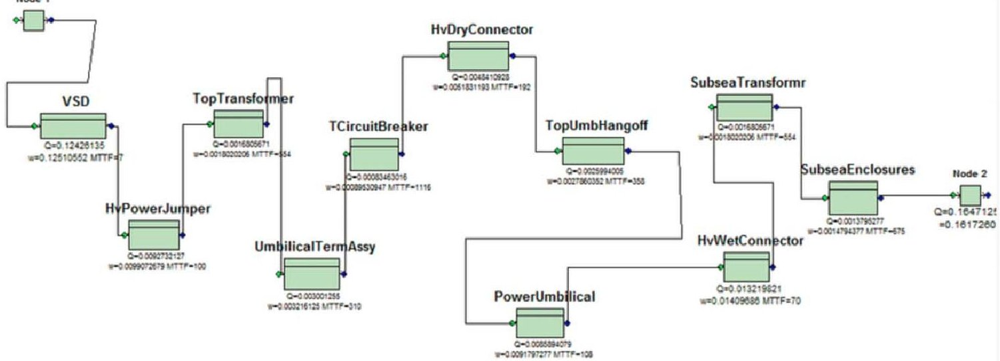

Figure A-11. Example RBD of a power subsystem [39]

Various algebraic expressions are used to calculate the least amount of failures or their combination, to cause a system failure. When the system configuration has been set up and the image data has been provided, the failure rates, Mean Time Between Failure (MTBF), reliability and availability can be calculated. When the system configuration changes, the calculation outcome also does. Typically, the physical system architecture corresponds with the configuration of an RBD, but this is not always the case, e.g. when in an electric circuit two resistors are connected in parallel and one of them fails, the system will also fail. To correctly represent this failure mode in RBD the blocks should, on the contrary, be connected in series [40].

This method has the following advantages [28], [40]:

- The analysis is relatively simple and straightforward;

- Graphical representation gives more insight;

The common disadvantages are [28]:

- The physical arrangement of system components doesn't always correspond with an RBD configuration;

- The method doesn't include the analysis on available failure data;

- The blocks can only have a single failure mechanism (failure or success);

- Testing and repair don't make part of the analysis;

- Common cause failures can only be traced by introducing additional blocks;

- Modeling of degraded system states isn't achievable;

- Time-dependent or sequent failure mechanisms cannot be modelled;

- Different models are required to analyze non-critical and critical failures;

- The method is commonly only suitable for calculating system's reliability.

## Fault Tree Analysis (FTA)

FTA is a top-down risk assessment technique for analyzing the performance of a system or its components. It starts with specifying an undesired top event (e.g., a failure mode) to identify all

<!-- PDF_PAGE: 102 -->

secondary low-level events that together or separately may lead to a top event (system failure). It provides a graphic representation of the events or their combination that result in a top event. FTA is executed graphically (see Figure A-12) using a logical structure of AND and OR gates. In some cases not just a single event but a combination of them will lead to a specified top event which requires an application of an AND gate. It means that for a top event to be triggered a combination of lower-level events is required. When just a single low-level event is required to trigger a top event, this kind of events would then be arranged using the OR gates. There is no single way to construct a fault tree. Different organization may construct different fault trees for the same top event [31], [10].

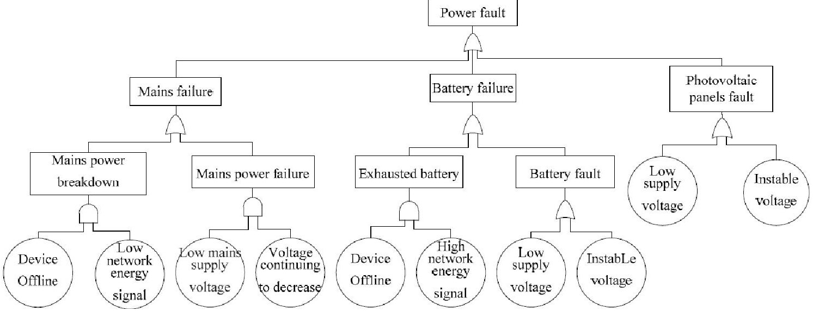

Figure A-12. Example fault tree of a power subsystem [41]

FTA can be used as a quantitative tool for calculating failure probabilities by applying Boolean algebra between the gates. A strong point of FTA is that it is based on visual models that clearly indicate the cause-and-effect relationship between the root-cause events from which both qualitative and quantitative results can be obtained [31].

The following benefits apply to this method [28] [10], [31]:

- Method clearly show cause-and effect relationships between various events;

- It deals with one particular failure at the same time;

- Due a detailed and structured approach the risk analyst is forced to study the system in great detail so that hidden risks won't be overlooked;

- FTA can be applied for complex systems by dividing a system into multiple subsystems and modeling a fault tree for any of them;

- Not only hardware and/or software failures can be identified that lead to a failure but also different operational conditions such as human activities;

- The models can be understood by non-specialists;

- The method can be executed for redundantly built systems.

The general drawbacks are provided below [28], [10], [31]:

- The method isn't suitable for risk identification (it identifies the triggers that lead to an undesired top event). It means that for this purpose another risk analysis method has to be used;

- Accounting for human errors can make analysis very complicated due to the complexity of human behavior;

- The method is time consuming and complex;

- Hidden risks may not be identified due the specific construction of a fault tree;

- For each top event a specific fault tree model is required;

<!-- PDF_PAGE: 103 -->

- Relationships between low-level events cannot be modelled (influence of one low-level event on the other low-level event). However, dynamic fault trees can be applied in this case.

## Event tree analysis (ETA)

Event tree is a graphic representation of the potential events that can occur in a system. ETA usually starts with a diagram (Event Sequence Diagram - see Figure A-13) in which a top event (i.e., a specific failure) is being captured on the left side. Then, it identifies the corresponding chain events and their consequences until the end state is reached on the right side of the diagram, which provides a specific scenario. Each event can be true or false depending on a system's current state. The possible consequences of the initiating event are considered and the outcomes are analyzed to estimate their potential results. This process stops when the end state is reached, showing the potential final result caused by the initial event. Event trees are useful for analyzing systems with sequential operations and transitions, as proceeding from the beginning towards the end of the diagram the events are advancing in time. The final goal of an event tree is to estimate the probability of each scenario [10], [42].

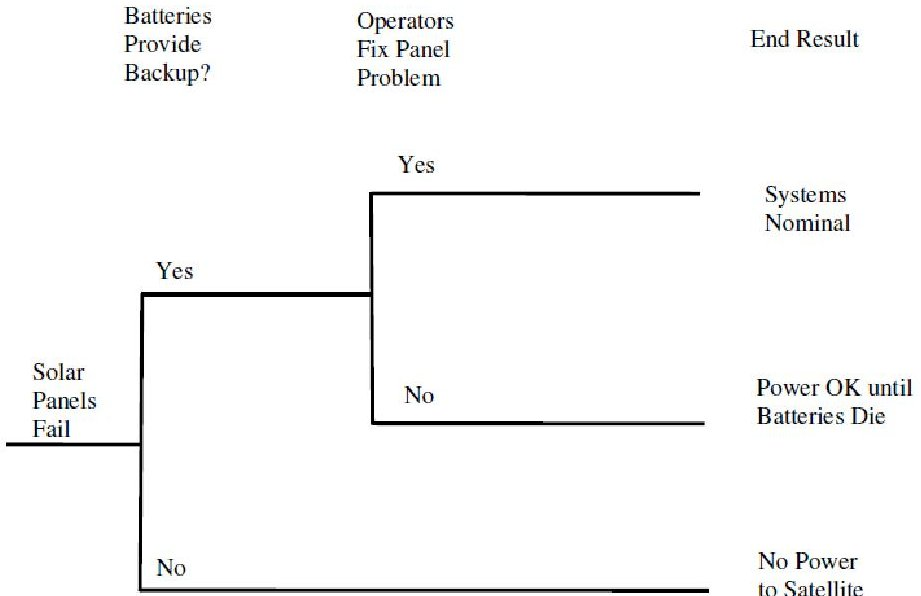

Figure A-13. Example ETA of a solar panel failure [10]

The advantages of this method are [28],[10],[31]:

- When ETA is performed together with FTA a very good indication of cause-and-effect can be obtained.

- Aspects with respect to component recovery can be modelled.

- The tools for evaluation and probability quantification are available.

- The models can be understood by non-specialists.

- The dynamic nature of complex systems is account for.

- The event tree can be easily updated as system design changes.

- The method is easy to learn and apply.

- The human, hardware, software and environment can all be combined.

The general disadvantages are [28], [31]:

- Event trees lead to a large number of scenarios, a big part of which aren't relevant for design teams. For this reason, the method can be inefficient.

- There can only be one initiating event at one time, so that multiple event trees are required.

## Markov analysis

Markov analysis is a probabilistic technique and is applicable to systems that encompass a

probabilistic transition from one to another state. This method allows to estimate reliability of

<!-- PDF_PAGE: 104 -->

systems whose components show strong mutual dependencies, while other methods, e.g., FTA, often assume the components to independent. The model starts with defining a set of all possible system states at any time, which is done in Markov diagram (see Figure A-14). The transitions between the states are represented by a probability matrix. Compared to fault and event trees, the accident sequence can return to the previously entered states. The states of the model represent the system component failures. The transitional probabilities between various states are a function of the failure rates of different system components [43], [44].

Figure A-14. Example of a Markov diagram [45]

There are two basic Markov analysis methods: Markov chain which deals with discrete states and discrete time parameter, and Markov process where the states are continuous. The methods allow the condition that a failure of a component and its repair can occur at any point in time. The model calculates the probability of transition from one step to another, e.g., from everything is functioning correctly to a failure of the first component and then to a failure of the second component, etc., until the system has reached its final state (e.g., totally failed).

The method is based on important assumption that the system's behavior in each state is memoryless, which means that its future state only depends on the current state. This assumption leads to the following basic rule: the probability of transition from one state to another remains the same, regardless the moment in time.

Alongside of the Markov models, the semi-Markov models are often applied in risk probability analysis for the sake of analyzing complex dynamic systems. In this type of model the transition times and the probabilities depend on the time at which the system reached its present state, which means that the transition rates of each particular state depend on a time spent in this state.

In some case, it is best to apply Markov method together with other previously described risk analysis methods, where Markov models can be best used for small subsystems with strongly mutually dependent components, while, for example, fault and event trees can be applied to a whole system [44].

The Markov method has the following advantages [28], [44]:

- The analysis is very detailed;

- The system is being completely captured in one model;

- The method accounts for the mutual dependencies between the system components;

- A system can return to its previous states;

- System reconfiguration can be easily incorporated allowing for iterative analysis;

<!-- PDF_PAGE: 105 -->

- There exist simplifying techniques that allow modelling complex systems;

- The failures and their subsequent repairs can be modelled. Also a model can describe the degraded states, where the functionality of particular components is not completely lost.

The major drawbacks are presented below [28], [44]:

- A number of states can become enormous with increasing system size. The resulting diagrams are very large and difficult to construct, and require a very extensive computational analysis;

- Models are difficult to verify.

A2.2.3 Quantitative methods: software

## Software Reliability Growth Modeling

There exist two general software reliability models. The first model, which is sometimes called a "defect density" model attempts to predict software reliability based on the design parameters, while the second model, a "software reliability growth model", is meant to deal with the software test data. It models how the system reliability changes over time during testing process, as when the failures are discovered, the bugs can be repaired, thereby increasing the total software reliability [46], [47].

The basic principle of the growth model is to develop a statistical relation between the defect detection data and some existing functions (e.g., an exponential function). The growth models are basically the statistical interpolation of defect detection data by mathematical functions. When the correlation matches, the basic function can be applied to predict future behavior of the software. By correlating the reliability growth with such function, it becomes possible to predict reliability at a future point in time. General software reliability growth models include a parameter which is related to a number of bugs. Applying this parameter in combination with an actual number of bugs found, the amount of faults in the remaining code can be estimated [46], [47].

The growth models can be divided in two main types: concave and S-shaped (see Figure A-15). The common thing about these models is their asymptotic behavior: a fault detection rate decreases as the number of defects found and repaired, increases. This behavior is caused by two major factors: 1) repair and new functionality may contribute to the new defects; 2) each time a bug is repaired, the total amount of bugs also decreases until a certain constant value due to the first factor.

Figure A-15. Two general types of growth models [46]

Correlating failure data with a function can be done by whether directly inserting the data into the equation which represents the function (e.g., by using a maximum likelihood technique), or by using a numerical technique, such as a least square method [46].

The growth model has the following advantages [28]:

- The software reliability can be quantified;

- It provides a possibility to predict the reliability development.

<!-- PDF_PAGE: 106 -->

The general drawbacks is:

- The selection of a proper model can be difficult, as the assumptions for the type of a function and the underlying probability distribution of the detected faults over time, may differ substantially [28].

- The method is only meant to be applied after the first software module or version have been released and not during the design stage.

## CSRM (Context-Based Software Risk Modeling) [48]

The CSRM is a method developed by NASA to model and identify software-related risks thereby accounting for potential faults and failures that have been identified in the previous space missions. The main focus lies on the software risks at the functional level based on various PRA (Probabilistic Risk Assessment - see subsection A2.2.5) techniques which help to identify and evaluate operational mission scenarios. This forms a further basis for developing risk models and the corresponding quantitative analysis in relation to the mission-critical and safety-critical system functions. The key feature of CSRM is a software functional decomposition to differentiate its functions, control and safety actions for identifying both "unconditional" and "conditional" software failures. It is done by considering each action of the software in the overall system functional context:

(system enters condition "i") AND (software responds correctly) = (successful software behavior); (system enters condition "i") AND (software responds incorrectly) = (unsuccessful software behavior).

CSRM covers both conditional (failures evolving from certain events) and unconditional (random software anomalies that suddenly happen during normal operation) software risk scenarios. It can be performed using the failure rate models when available.

The advantage of CSRM is that it can be applied at different system development stages, such as the specification and design levels. At the specification level CSRM's input will be the top-level system specification and generic data to obtain the preliminary software risk identification and its potential contribution to system performance. When the system design has been advanced to the more detailed level and more design data is available a design-level CSRM analysis can be performed. Another advantage of CSRM is that it can be integrated with other risk analysis methods.

The CRSM analysis is performed according to the following basic steps:

- Identification of the critical software functions;

- Relation of the critical software functions to system event models;

- Development of the corresponding logic models;

- Differentiation of the software-related elements that could potentially contribute to mission failures;

- Estimation of the failure probabilities.

A2.2.4 Quantitative methods (human factor)

## THERP (Technique for Human Error Rate Prediction)

THERP is a very structured, detailed and widely used HRA method. Originally, it has been developed in order to be applied for the risk analysis of nuclear power plants but nowadays it's also being applied within other sectors, such as aerospace (NASA applies this method in context of their PRA methodology). It consists of methods, models and estimated human error probabilities (HEPs) to allow both qualitative and quantitative assessment of human error related risks. It assesses human reliability in relation to task analyses, e.g. document reviews and visual inspection, error

<!-- PDF_PAGE: 107 -->

identification and representation, but also the quantitative estimation of HEPs [49]. THERP is officially defined in [33] as "a method to predict human error probabilities and to evaluate the degradation of a man-machine system likely to be caused by human errors alone or in connection with equipment malfunctions, operational procedures and practices, or other system and human characteristics that influence system behavior.

The method is based on the following major principles [33]:

- The human task analysis should be very detailed and properly performed. After the task analysis has been executed, human interactions (HIs) are captured in the event trees which combine various tasks, cognitive and action responses. For cognitive response two different models have been developed: Alarm Response Model (ARM), in which cognitive response is controlled by alarms after an accident, and Time Reliability Curve (TRC), when the cognitive response is commanded by decision-making process and is strongly time-dependent;

- For action response various tasks and activities (e.g., emergency operating procedures and operation in the control room) should be identified which will form a basis for a further task analysis;

- Identification of recovery mechanisms (e.g., additional checks, post-maintenance tests, arrival of new personnel, etc.) has to be implemented in event trees;

- For both cognitive and action responses, the "basic human error probability" has to be estimated under different conditions such as stress levels, educational level, etc. The correction factors have to be used based on these conditions;

- A dependency model has to be set up to account for possible relations between multiple tasks of HIs. The dependency rate is broken down into five basic levels:

0 Zero dependence;

0 Low dependence;

0 Moderate dependence;

O High dependence;

0 Complete dependence.

## A2.2.5 (PRA) Probabilistic Risk Assessment

PRA originates from the aerospace industry and is being nowadays applied within various technical economic and social disciplines. It is not a single method but a methodology comprising a variety of coherent risk assessment methods (a number of which is described in the preceding subsections), each having its specific application. A PRA generally leads to a risk curve and the corresponding uncertainties as a final result. The risk curve can reflect on different parameters but typically compares the frequency of exceeding a consequence value versus the consequence values. When the risk assessment is qualitative a two-dimensional probability versus consequence matrix can be constructed. PRA can be used for internal (e.g., hardware and software failures, operator error, etc.) and external (e.g., space environment) initiating events [50], [51].

PRA is a widely used risk analysis tool due its systematic and comprehensive nature which allows to evaluate risks for very complex systems such as a spacecraft, at each design stage. For this reason, PRA is vastly incorporated in NASA's risk management approach. The method can be applied to reveal risks and hazards during the design, operation and maintenance, thereby improving all RAMS (Reliability, Availability, Maintainability and Safety) aspects [50], [51].

PRA helps to find the answers to three basic questions [51]:

- What can go wrong, i.e. what are the initiating events that cause failures?

- How severe are these consequences?

<!-- PDF_PAGE: 108 -->

- What is the probability of occurrence of the consequences?

A typical PRA process consists of the following steps:

First, the purpose of risk assessment has to be defined together with the undesirable consequences for a project or mission failure. The next step encompasses the comprehensive system study based on its design and the operations it is made for. After no more doubts exist on how a system is designed and what it has to do, the analysis has to take place on what can go wrong and the corresponding initiating events have to identified. For this purpose, the methods like FMEA and MLD can be applied. The accident scenarios can for example be modelled using ETA and ESD, while different triggers that cause system failures can be estimated using FTA. The probability of occurrence of each end state can be calculated and summed up. After the risk probabilities are estimated, the uncertainty and sensitivity (i.e., the relation between input changes and analysis results) analyses have to be performed. For the uncertainty analysis the probabilistic methods like Monte Carlo simulation can be applied [50], [51].

<!-- PDF_PAGE: 109 -->

## Appendix B FMEA PCDU-Battery Temperature Sensor

Figure B-1. FMEA PCDU - Battery Temperature Sensor

<!-- PDF_PAGE: 110 -->

## act ETA: Battery Temperature Measurement Fails

Figure B-2. ETA - Battery temperature measurement failure

<!-- PDF_PAGE: 111 -->

## Appendix C FMEA PCDU - Data Interface Module

Figure C-1. FMEA PCDU - Data Interface Module

<!-- PDF_PAGE: 112 -->

## act ETA: Command Processing Fails/Measurement Data Transfer Fails

Figure C-2. ETA - Command processing/Measurement data transfer failur

<!-- PDF_PAGE: 113 -->

## Appendix D FMEA PCDU - Distribution Unit

Figure D-1. FMEA PCDU - Distribution Unit

<!-- PDF_PAGE: 114 -->

## act ETA: Load Switching Fails/Circuit Protection Fails

Figure D-2. ETA - Load switching/Circuit protection failure

<!-- PDF_PAGE: 115 -->

## Appendix E FMEA PCDU - MPPT Supply Regulator

Figure E-1. FMEA PCDU - MPPT Supply Regulator

<!-- PDF_PAGE: 116 -->

## act ETA: Maximum Power Tracking Fails/Charge Regulation Fails

Figure E-2. ETA - Maximum power tracking/Charge regulation failure

<!-- PDF_PAGE: 117 -->

## Appendix F FMEA PCDU - Measurement Unit

Figure F-1. FMEA PCDU - Measurement Unit

<!-- PDF_PAGE: 118 -->

Figure F-2. ETA Power measurement failure

<!-- PDF_PAGE: 119 -->

## Appendix G FMEA Solar Array

Figure G-1. FMEA Solar Array

<!-- PDF_PAGE: 120 -->

Figure G-2. ETA Sunlight conversion/Module bypass/Reverse current protection failure

<!-- PDF_PAGE: 121 -->

## Appendix H FMEA Battery

Figure H-1. FMEA Battery*

*Battery has not being further decomposed in parts as it is a COTS product.

<!-- PDF_PAGE: 122 -->

Figure H-2. ETA Power storage failure

<!-- PDF_PAGE: 123 -->

## Bibliography

[1] K. Bedingfield, R. Leach, and M. Alexander, "Spacecraft system failures and anomalies attributed to the natural space environment," NASA Ref. Publ. 1390, no. August, p. 51, 1996, doi: doi:10.2514/6.1995-3564.

[2] J. H. S. Gregory F. Dubos, Jean-Francois Castet, "STATISTICAL RELIABILITY ANALYSIS OF SATELLITES BY MASS CATEGORY: DOES SPACECRAFT SIZE MATTER?," 2009, doi: 10.1017/CBO9781107415324.004.

[3] I. Kiselyov, "Literature study: Model-Based Systems Engineering," Delft University of Technology, Delft, 2016.

[4] "TU Delft: Risk analysis." http://www.lr.tudelft.nl/en/organisation/departments/space-engineering/space-systems engineering/expertise-areas/mission-concept-exploration/risk/.

[5] ECSS, "ECSS-Q-HB-30-08A Space Product Assurance: Component Reliability Data Sources and Their Use," no. January, 2011.

[6] Department of the US Army, "Failure modes, effects and Criticality Analysis (FMECA) for command, control, computer, intelligence, surveillance and reconnaissance (C4ISR) Facilities," Facilities, no. September, p. 75, 2006.

[7] K. M. Brumbaugh and E. G. Lightsey, "Application of Risk Management to University CubeSat Missions," J. Small Satell., vol. 2, no. 1, pp. 147-160, 2013.

[8] A. Menchinelli et al., "A reliability engineering approach for managing risks in CubeSats," Aerospace, vol. 5, no. 4, 2018, doi: 10.3390/aerospace5040121.

[9] M. Weisgerber, M. Langer, and F. Schummer, "Reliability Prediction of Student-Built CubeSats," no. October, 2018.

[10] E. Deems, "Risk Management of Student-Run Small Satellite Programs," pp. 1-148, 2007.

[11] D. B. David A. Galvan, Brett Hemenway, William Welser IV, Satellite Anomalies Benefits of a Centralized Anomaly Database and Methods for Securely Sharing Information Among Satellite Operators, vol. 47, no. 1. 2013.

[12] R. R. RAOUL VELAZCO, PASCAL FOUILLAT, Radiation Effects on Embedded Systems, 1st ed. Dordrecht: Springer Netherlands, 2007.

[13] "Bipolar PROM Programmer." http://www.xeltek.com/resources/technical-articles/memory-device-types/bipolar-prom programmer/ (accessed Apr. 22, 2017).

[14] H. L. Lam, D. H. Boteler, B. Burlton, and J. Evans, "Anik-E1 and E2 satellite failures of January 1994 revisited," Sp. Weather, vol. 10, no. 10, pp. 1-13, 2012, doi: 10.1029/2012SW000811.

[15] H. L. Lam, D. H. Boteler, B. Burlton, and J. Evans, "Anik-E1 and E2 satellite failures of January 1994 revisited - Summary," Sp. Weather, vol. 10, no. 10, 2012, doi: 10.1029/2012SW000811.

[16] P. Darling, "TDRS-1 single event upsets and the effect of the space environment," IEEE Transactions on Nuclear Science, vol. 38, no. 6. pp. 1708-1712, 1991, doi: 10.1109/23.124166.

[17] V. L. Pisacane, Fundamentals of Space Systems, 2nd ed. Oxford: Oxford University Press Inc, 2005.

[18] T. L. Hardy, Software and System safety. Bloomington: AuthorHouse, 2012.

[19] S. N. Digest, "Satellite Outages and Failures." http://sat-nd.com/failures/index.html?http://satnd.com/failures/timeline.html.

[20] E. Tasker, "What Killed Japan's Hitomi X-Ray Satellite?," [Online]. Available: https://blogs.scientificamerican.com/guestblog/what-killed-japan-s-hitomi-x-ray-satellite/.

[21] J. Ryall, "Japan says 'human error' to blame for loss of multi-million pound satellite studying black holes." http://www.telegraph.co.uk/news/2016/04/28/japan-says-human-error-to-blame-for-loss-of-multi-million-pound/.

[22] R. Chirgwin, "Jaxa's litany of errors spun Hitomi to pieces." https://www.theregister.co.uk/2016/06/01/jaxas_litany_of_errors_spun_hitomi_to_pieces/.

[23] J. Guo, L. Monas, and E. Gill, "Statistical analysis and modelling of small satellite reliability," Acta Astronaut., vol. 98, no. 1, pp. 97-110, 2014, doi: 10.1016/j.actaastro.2014.01.018.

[24] J. F. Castet and J. H. Saleh, "Satellite and satellite subsystems reliability: Statistical data analysis and modeling," Reliab. Eng. Syst. Saf., vol. 94, no. 11, pp. 1718-1728, 2009, doi: 10.1016/j.ress.2009.05.004.

[25] M. Langer and J. Bouwmeester, "Reliability of CubeSats - Statistical Data, Developers' Beliefs and the Way Forward," AIAA/USU Conf. Small Satelll., 2016.

[26] L. N. Monas, J. Guo, and E. K. A. Gill, "Small satellite reliability modelling: A statistical analysis," 4S Symp. 2012, no.1, 2012.

<!-- PDF_PAGE: 124 -->

[27] B. M. Ayyub, Risk Analysis in Engineering and Economics, 2nd ed. London: Chapman and Hall/CRC, 2014.

[28] RWS, "Leidraad RAMS: sturen op prestaties van systemen," Rijkswaterstaat, Utrecht, Delft, 2010.

[29] D. Space, M. Bijl, and R. Hamann, "Risk Management Literature Survey," Aerosp. Eng., no. August, 2002, [Online]. Available: http://lr.home.tudelft.nl/fileadmin/Faculteit/LR/Organisatie/Afdelingen_en_Leerstoelen/Afdeling_SpE/Space_Systems_Eng./Expertise_areas/Systems_engineering/References/doc/Risk_Management_Survey.pdf.

[30] "Basic Concepts of FMEA and FMECA." http://www.weibull.com/hotwire/issue46/relbasics46.htm (accessed Jun. 24, 2017).

[31] H. M. Altabbakh, "Risk analysis: comparative study of various techniques," MISSOURI UNIVERSITY OF SCIENCE AND TECHNOLOGY, 2013.

[32] M. Everdij and J. Scholte, "Unified Framework for FAA Risk Assessment and Risk Management - Toolset of Methods for Safety Risk Management," p. 194, 2012, [Online]. Available: http://www.nlr-atsi.nl/downloads/rarm-toolset-of-methods-for-safety-risk-manage.pdf.

[33] M. Stamatelatos, "Probabilistic Risk Assessment Procedures Guide for NASA Managers and Practitioners," Office, no. December, p. 323, 2002, doi: NASA/SP-2011-3421.

[34] "Human reliability analysis 》NOPSEMA." https://www.nopsema.gov.au/resources/human-factors/human-reliability analysis/ (accessed Jun. 26, 2017).

[35] "MIL-HDBK-217 Reliability Prediction." http://www.reliabilityeducation.com/intro_mil217.html (accessed Jun. 28, 2017).

[36] "Reliability Predictions: Parts Count, Part Stress, Pseudo Stress and Dormant - Quanterion Solutions Incorporated." https://www.quanterion.com/reliability-predictions-parts-count-part-stress-pseudo-stress-and-dormant/ (accessed Jun. 28, 2017).

[37] "Reliability Handbooks (Stress Analysis)." http://www.tutorialsweb.com/reliability/reliability6.htm (accessed Jun. 28, 2017).

[38] "Reliability Block Diagram Analysis (RBD Analysis)." http://www.reliasoft.com/BlockSim/rbd_analysis.htm (accessed Jul. 01, 2017).

[39] "Fig 13: Reliability Block Diagram (RBD) of the Power Sub-System - Figure 9 of 9."

[39] Fig 13: Reliability Block Diagram (RBD) of the Power Sub-System - Figure 9 of 9. https://www.researchgate.net/figure/305817130_fig9_Fig-13-Reliability-Block-Diagram-RBD-of-the-Power-Sub-System (accessed Jul. 13, 2017).

[40] A. . Fallis et al., "Reliability Block Diagram (RBD)," System, vol. 53, no. 9, pp. 1-6, 2007, doi: 10.1017/CBO9781107415324.004.

[41] Y. Chen, Z. Zhen, H. Yu, and J. Xu, "Application of Fault Tree Analysis and Fuzzy Neural Networks to Fault Diagnosis in the Internet of Things (IoT) for Aquaculture," Sensors, vol. 17, no. 1, p. 153, 2017, doi: 10.3390/s17010153.

[42] G. Hadjisophocleous and Z. Fu, "Literature Review of Fire Risk Assessment Methodologies," Int. J. Eng. Performance-Based Fire Codes, vol. 6, no. 1, pp. 28-45, 2004.

[43] H. James, M. J. Harris, and S. F. Hall, "Comparison of event tree, fault tree and Markov methods for probabilistic safety assessment and application to accident mitigation," IChemE Symp. Ser., no. 130, pp. 59-72, 1992.

[44] N. B. Fuqua, "The Applicability of Markov Analysis Methods to Reliability, Maintainability, and Safety," Sel. Top. Assur. Relat. Technol., vol. 10, no. 2, pp. 1-8, 2003.

[45] "Markov Modeling - Examples." http://www.mathpages.com/home/kmath232/part4/part4.htm (accessed Jul. 13, 2017).

[46] A. Wood, "Software reliability growth models," Microelectron. Reliab., vol. 36, no. September, p. 446, 1996, doi: 10.1016/0026-2714(96)81958-5.

[47] "Reliability growth modeling - Software Engineering 10th Edition." http://iansommerville.com/software-engineering-book/web/reliability-growth-modeling/ (accessed Jul. 05, 2017).

[48] S. Guarro, M. Yau, and S. Dixon, "Context-based Software Risk Modeling: A Recommended Approach for Assessment of Software Related Risk in NASA Missions," no. January, 2012.

[49] J. Bell and J. Holroyd, "Review of human reliability assessment methods," Heal. Saf. Lab., p. 78, 2009, [Online]. Available: http://www.hse.gov.uk/research/rrpdf/rr679.pdf.

[50] M. Stamatelatos, "Probabilistic Risk Assessment: What is it and Why is it Worth it?," pp. 3-6, 2000.

[51] M. Stamatelatos, "Probabilistic Risk Assessment," no. 202, p. 2000, 2000, [Online]. Available: http://www.nasa.gov/sites/default/files/files/ProbriskAssessment_200_July_Tagged.pdf.