<!-- PDF_PAGE: 1 -->

WILEY

# Unified design approach for systems engineering by integrating model-based systems design with axiomatic design

Haoqi Wang $ ^{1} $ iD Hao Li $ ^{1} $ Chengtong Tang $ ^{2} $ Xu Zhang $ ^{2} $ Xiaoyu Wen $ ^{1} $

$ ^{1} $Henan Key Laboratory of Intelligent Manufacturing of Mechanical Equipment, Zhengzhou University of Light Industry, Zhengzhou, Henan, China $ ^{2} $School of Mechanical Engineering, Beijing Institute of Technology, Beijing, China

## Correspondence

Haoqi Wang, Henan Key Laboratory of Intelligent Manufacturing of Mechanical Equipment, Zheng zhou University of Light Industry, Zheng zhou, Henan 450000, China. Email: haoqiwang0218@163.com

## Abstract

## Funding information

National Natural Science Foundation of China Number 51775517; Henan Key Laboratory of Intelligent Manufacturing of Mechanical Equipment, Number IM201907

Model-Based Systems Design (MBSD) formalizes the application of system modeling. However, it is still difficult for designers to implement MBSD in practice. One of the challenges is to make the field of design more unified, as different MBSD methodologies focus on specific areas, and various designers from different areas use ambiguous terms. Moreover, the failure of some products originates in undiscovered couplings of functions in the design stage. Axiomatic Design (AD) provides a scientific foundation for system design. In order to reduce ambiguity and alleviate functional couplings, this paper integrates AD with the MBSD and proposes a unified systems design approach, called Axiomatic Model-Based Systems Design (A-MBSD). A-MBSD uses four pillars: (a) the fundamental framework of AD; (b) the Independence Axiom; (c) a new behavior domain (BD); and (d) an A-MBSD modeling profile. Finally, the design of a Forest Fire Satellite Monitoring and Control System demonstrates that the proposed approach can improve unity and alleviate the coupling of functions in a system design.

## KEYWORDS

axiomatic design, complex engineering system, function-behavior-structure, model-based systems design, SysML

## 1 INTRODUCTION

The development of a large-scale product such as an automobile, a satellite, or an airplane has evolved to employ a systems engineering methodology, in which systems design (SD) performs a crucial role through the explicit representations of system requirements and overall solutions that have a profound influence on subsequent integration, verification, validation, and operation. A general SD process includes three iterative activities: requirements analysis, function analysis, and design synthesis. $ ^{1} $

In the conventional Document-Based Systems Design (DBSD) process, designers share information and design intent through a set of documents, $ ^{2} $ such as requirements specifications, interface definition documents, N-squared charts, and SD specifications. However, DBSD shows limitations, where the growth in system complexity has increased the risk to unacceptable levels. Ambiguity tends to arise when information is scattered throughout a disjointed set of text documents, spreadsheets, and diagrams.

Model-Based Systems Design (MBSD) improves upon DBSD by formalizing the application of modeling to support requirements analysis, function analysis, and design synthesis. $ ^{3} $ Application of Model-based

Systems Engineering (MBSE) follows traditional "Vee" model, while this paper focuses on system decomposition and definition, that is, the left part of "Vee" model, which is MBSD. $ ^{4} $ Researchers have proposed many MBSD methodologies. Popular ones include Harmony Systems Engineering, $ ^{5} $ Object Process Methodology (OPM), $ ^{6,7} $ Vitech MBSE, $ ^{8} $ Object-Oriented Systems Engineering Methodology (OOSEM), $ ^{9} $ System Modeling Methodology (SYSMOD), $ ^{10} $ and State Analysis (SA). $ ^{11} $ Table 1 compares these methods by listing their core ideas, modeling languages, supporting tools, advantages, and limitations.

Although several of the previously listed MBSD methodologies focus on using unified languages, such as SysML $ ^{12} $ and OPL, $ ^{6} $ throughout the product development life cycle, and they are able to specify the SD through the language iteratively, it is still a challenge for designers to implement them in a unified way. This is in large part because most designers from different areas create products intuitively, and use ambiguous terms based on their experience, which leads to unnecessary iterations. $ ^{13} $

A review of leading MBSD methodologies is shown in Table 1, in which the advantages and limitations of them are provided. For example, OOSEM is widely advocated as an example of MBSE best practice; it enables designers to specify system requirements, behaviors, and

<!-- PDF_PAGE: 2 -->

TABLE 1 Leading MBSD approaches and their merits

<table border="1"><tr><td>Approach</td><td>Core idea</td><td>Language</td><td>Tool</td><td>Advantages</td><td>Limitations</td></tr><tr><td>Harmony SE5</td><td>Use case-driven design</td><td>SysML</td><td>IBM Rational Rhapsody</td><td>1. Provides a step-by-step guide.
2. Provides a seamless transition for subsequent verification and validation.</td><td>1. Hard to manage different abstract levels;
2. Insufficient in analyzing requirements.
3. General criteria for good design are not specified.</td></tr><tr><td>OPM67</td><td>Object process unified design</td><td>OPL</td><td>OPCAT(Object Process Case Tool)</td><td>1. Uses simple modeling elements to represent a complex system.
2. An effective decomposing capability for different system levels.</td><td>1. Lack of ability to represent specific information in detailed design stages;
2. Does not support requirements representation.
3. General criteria for good design are not specified.</td></tr><tr><td>Vitech MBSE8</td><td>Concurrent design based on“onion model”</td><td>System definition language</td><td>Vitech&#x27;s CORE</td><td>1. Uses an integrated SD repository to coordinate design activities</td><td>1. Relies on Vitech&#x27;s CORE.
2. General criteria for good design are not specified.</td></tr><tr><td>OOSEM9</td><td>Object-oriented design</td><td>SysML</td><td>Tools that support SysML such as MagicDraw</td><td>1. Object-oriented theory is largely accepted, and it is widely advocated as an example of MBSE best practice.
2. Partitioning criteria is established to ensure a robust design.</td><td>1. Other general criteria for good design (beyond the partitioning criteria) are not specified.</td></tr><tr><td>SYSMOD10</td><td>SD based on“Vee”model</td><td>SysML</td><td>SysML Plugin of MagicDraw</td><td>1. Provides a detailed guide.
2. Gives a detailed modeling process.</td><td>1. Relies on SysML or UML.
2. General criteria for good design are not specified.</td></tr><tr><td>SA11</td><td>Control architecture based on states</td><td>Varies(eg,UML/SysML,OWL2)</td><td>States database based on relational database</td><td>1. Eliminates inconsistencies between system engineering and software engineering.
2. Provides rigorous state-based foundation for systems engineering.</td><td>1. Used mainly for control systems.
2. General criteria for good design are not specified.</td></tr></table>

structure systematically when applied in conjunction with SysML diagrams. Although partitioning criteria in OOSEM can increase cohesion and reduce couplings by refactoring common functionality and partitioning comments, it falls to the experience of designers to determine what other characteristics a good design should have. Therefore, one challenge for SD is how to make it in a more unified way in order to alleviate misunderstanding among various design teams.

To complement contemporary MBSD methods by reducing ambiguity and alleviating functional couplings, this paper provides an analysis technique that integrates MBSD with Axiomatic Design (AD) from two perspectives: $ ^{14} $

1. The fundamental framework of AD is used within the context of MBSD.

2. Behavior analysis and unified modeling technology of MBSD are introduced to enhance AD.

AD was developed to become a commonly applied engineering design theory, and Kulak et al $ ^{15} $ provided an overview during a 20-year period (1990-2010) from the type of axiom, application area, method,

and evaluation type. The findings of this study indicated that AD was used mainly in the areas of product (42%) and software design (23%), while it was used in systems design only 19% of the time. Over the past few years, AD has played a larger role in SD where growth in system complexity has increased risk to unacceptable levels. Hong and Park $ ^{16} $ proposed a collaborative design process for large-scale systems by admonishing designers to maintain the independence of functional elements using the Independence Axiom. Hehenberger et al $ ^{17} $ presented a hierarchical design process for mechatronic systems that integrates AD principles with systems design. Wang et al $ ^{4} $ proposed a semantic model for axiomatic systems design.

The key concepts and theories of AD can be related to MBSD from four pillars: first, an AD process provides a framework for MBSD by organizing information into four design domains, that is, customer, functional, physical, and process; $ ^{14} $ second, functional couplings that hinder the SD process $ ^{18} $ can be identified by the Independence Axiom of AD; third, behavior analysis of MBSD can bridge the functional and physical domains (PDs) $ ^{19} $ so as to analyze the relationships between functions and structures, and help designers establish the design matrix to apply the independence axiom; fourth, MBSD's model-based

<!-- PDF_PAGE: 3 -->

technology can unify representations of different AD design domains as to reduce ambiguous representations.

However, research and applications of AD and MBSD are relatively independent. For AD, although much attention is paid to product design, manufacturing SD, material processing, and decisions during design, $ ^{20} $ there is less research on effectively integrating AD with model-based technology and SD. In terms of MBSD, advanced modeling languages and integration between a system model and domain-specific models are research hotspots. $ ^{21,22} $

In order to integrate MBSD with AD, this paper gives a unified engineering systems design approach called Axiomatic ModelBased Systems Design (A-MBSD), which introduces the result of behavior analysis as a new domain (behavior domain [BD]) into AD and constructs a top-down system decomposition process called Requirements- Functions -Behaviors-Structures (RFBS). In addition, to represent the system model in a unified way, an A-MBSD modeling profile is constructed through SysML stereotypes.

In short, A-MBSD improves MBSD by incorporating AD.

1. The new BD of A-MBSD increases the reliability of the design matrix by bridging the functional and PDs.

2. The system model of A-MBSD reduces ambiguity through unifying system requirements, functions, and structures.

3. The RFBS framework enables designers to document and manage design information from high abstract levels to more detailed levels.

4. A-MBSD is tool independent and places emphasis on specifying decomposing, and allocating functional requirements (FRs).

5. The Independence Axiom of AD is used to help designers make correct decisions by identifying the coupling of functions at an early stage.

Finally, the proposed method is demonstrated by the design of a Forest Fire Satellite Monitoring and Control System (FFSMCS), which shows that the method can improve design unity and alleviate unnecessary, nonintrinsic couplings during SD.

## 2 RESEARCH BACKGROUND

## 2.1 Axiomatic design

AD is a design methodology created by Suh. $ ^{2 3} $ AD is built on three core methods: design domains, a zigzag process, and design axioms.

1. Design domains. AD consists of four domains: customer, functional, physical, and process, as displayed in Figure 1. They are represented by Customer Needs (CNs), FRs, Design Parameters (DPs), and Process Variants (PVs).

2. A zigzag process. The mapping between adjacent domains is accomplished by top-down zigzag decomposition, which is called the requirements flow-down in systems engineering. There are two kinds of mapping relationships between two domains: (a) mapping at the same level, and (b) mapping between two different levels.

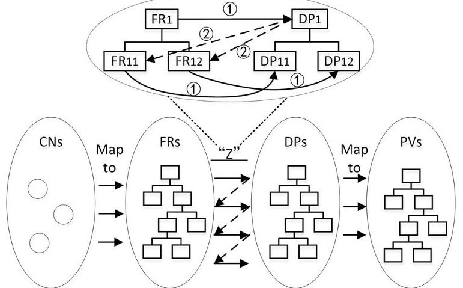

Customer domain Functional domain Physical domain Process domain

FIGURE 1 Design domains and the zigzag mapping process

TABLE 2 Relationship between FRs and DPs

<table border="1"><tr><td>Type</td><td>Ideal</td><td>Decoupled</td><td>Coupled</td></tr><tr><td>Design Matrix</td><td> $ \left[ \begin{array}{cc} A_{11} & 0 \\ 0 & A_{22} \end{array} \right] $</td><td> $ \left[ \begin{array}{cc} A_{11} & 0 \\ A_{21} & A_{22} \end{array} \right] $</td><td> $ \left[ \begin{array}{cc} A_{11} & A_{12} \\ A_{21} & A_{22} \end{array} \right] $</td></tr></table>

They are, respectively, represented by solid lines with arrows and dashed lines with arrows in Figure 1.

3. Design axioms. The basis of AD is the Independence Axiom and Information Axiom; this paper focuses on the former. The main concern of the Independence Axiom is the relationships between FRs and DPs. These relationships can be expressed by design equation (1), where a vector {FR} with m components represents the characteristics of a design, and DPs constitute a vector {DP} of n components. The relationships are documented in the design matrix [A]. According to the characteristics of [A], three possible cases of a design are shown in Table 2:

$$
\{F R \} = [ A ] \{D P \}.
$$

For instance, there are two FRs for a water faucet design. FR1 controls the water flow rate, and FR2 controls the water temperature. $ ^{2 3} $ As for the first design shown in Figure 2A, the rotation angle of the two knobs is used to control the hot and cold water (ie, $ \mathrm{D P 1}=\theta_{1} $ $ \mathrm{D P 2}=\theta_{2} $ ), respectively. However, the matrix shows it is a coupled design because every DP affects both FR1 and FR2. In the second design shown in Figure 2B, one handle is used to control both the water flow rate and temperature. The Y- and X-shifts of the handle are selected as two DPs (ie, $ \mathrm{D P 1}=\mathrm{Y}, $ $ \mathrm{D P 2}=\mathrm{X} $ ). Because adjusting one DP affects one FR, the design matrix is diagonal and the design is an ideal design.

Although AD can improve SD, inaccuracy in the design matrix tends to arise when a function of a complex product involves various DPs. $ ^{17} $ For example, complex functional influences among a satellite and its monitoring system, navigation system, and ground control station can be accurately specified only after designers analyze their activities, interactions, and other behaviors. The transfer of information, material, and energy between parameterized components cannot be documented to understand how FRs are realized. The paper addresses

<!-- PDF_PAGE: 4 -->

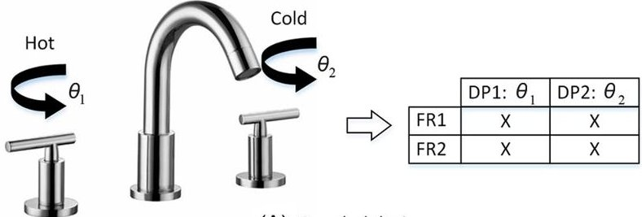

(A) Coupled design

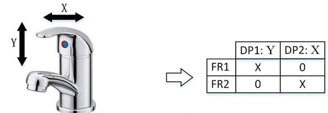

(B) Decoupledl design

FIGURE 2 Independence axiom is applied to water valves

this issue by introducing behavior analysis into AD and constructing an RFBS decomposition process. The difference between behavior analysis and conventional Function-Behavior-Structure (FBS) is discussed in Section 2.2.

## 2.2 | Function-behavior-structure

Rosenman and Gero $ ^{24} $ proposed the FBS framework for representing the design process. Then, Gero and Kannengiesser $ ^{25} $ formally defined core concepts of FBS: (a) Functions describe design objectives; (b) Behaviors describe actions of components that realize objectives; (c) Structures describe the components and their relationships. Katehi et al $ ^{26} $ provided another definition: "FBS relates the components (structures) in a system to their purpose (function) in the system and the mechanisms that enable them to perform their functions (behavior)." Katehi also stated that the FBS framework is suited for representing SD because SD involves specifying functions, identifying corresponding components and their relationships, and describing how they work together to fulfill original requirements.

A-MBSD is based on the FBS framework where functions are not allocated to structures directly. In FBS, when a design starts, a function is analyzed first by the behaviors to identify alternative solutions. van Beek et al $ ^{27} $ applied FBS in the conceptual design of mechatronic systems by automatically generating a Design Structure Matrix (DSM) from FBS. Couturier et al $ ^{28} $ proposed an FBS-based model for analyzing consequences of design decisions in mechatronic systems engineering. Hamraz et al $ ^{29,30} $ integrated FBS with change management technology for predicting multidomain change propagation risks.

However, behavior modeling methods of the above FBS-based studies show limitations. First, behaviors are only described by verb-object structures, and relationships in FBS are represented by simple binary relations. For example, the BD in Ref. 27 does not illustrate complex interactions between different actions; Refs. 29 and 30 do not distinguish behaviors that relate functions to structures, every function of a diesel engine is enabled by some mechanical, electronic, and thermal behavior of components. Designers thus need rich experience to understand how the behavior of elements in the

system structure enables the realization of their functions. However, designers always skip this analysis and map system functions directly into DPs when structures that fulfill a behavior are well-developed according to previous design experience. For example, a design matrix of AD is constructed based upon the assumption that the functional domain is directly mapped into the PD. Although Song and Lin $ ^{19} $ have introduced behaviors into AD, the method only describes a behavior by use of a simple natural language. According to Suh $ ^{31} $ and Henley, $ ^{32} $ in such situation, designers have to identify function couplings by a predefined design matrix, which leads to inconsistency between the matrix and reality.

A-MBSD complies with the FBS framework. In A-MBSD, modeling the BD requires representing actions of a behavior, as well as specifying how these actions are executed for realizing functions. In addition, the structure is treated as a set of DPs. Therefore, although definitions of functions, behaviors, and structures of the proposed RFBS are same as FBS, RFBS of A-MBSD has three additional positive characteristics.

1. More refined mapping mechanism. The design process based on FBS is a top-down process, in which decomposed functions are mapped to behaviors and structures. The foundation of the RFBS-based process is a "Z" form decomposition, in which after functions are mapped to behaviors and structures, the design goes back into the function domain (FD) for the next iteration. In the next iteration, more detailed behaviors enable the designer to analyze how structures accomplish abstract functions. Thus, functional couplings can be identified at an early stage.

2. Emphasis on CNs. A SD starts from analyzing requirements, which examines, evaluates, and translates external inputs into a set of functional and performance requirements. $ ^{33} $ In addition, as the number of customer requirements becomes larger, designers should explicitly capture them in a representation of the FD. $ ^{34} $ So, it is important to clearly classify different CNs and formally define FRs.

3. A different process of modeling behaviors, which is similar to the behavior modeling approach of OOSEM. Compared with FBS behaviors in RFBS are dynamic processes that are represented by the exchange of information, material, and energy between components carrying out actions, message transfer, and state changes. RFBS not only helps designers understand relationships between functions and structures and build the design matrix, but it also enables them to analyze the hierarchical and internal structure of the system.

## 3 | A-MBSD APPROACH

## 3.1 A-MBSD framework

A-MBSD is a top-down, iterative process as shown in Figure 3, and it consists of a SD process and a domain-specific design process. The SD is composed of three phases: system requirements analysis,

<!-- PDF_PAGE: 5 -->

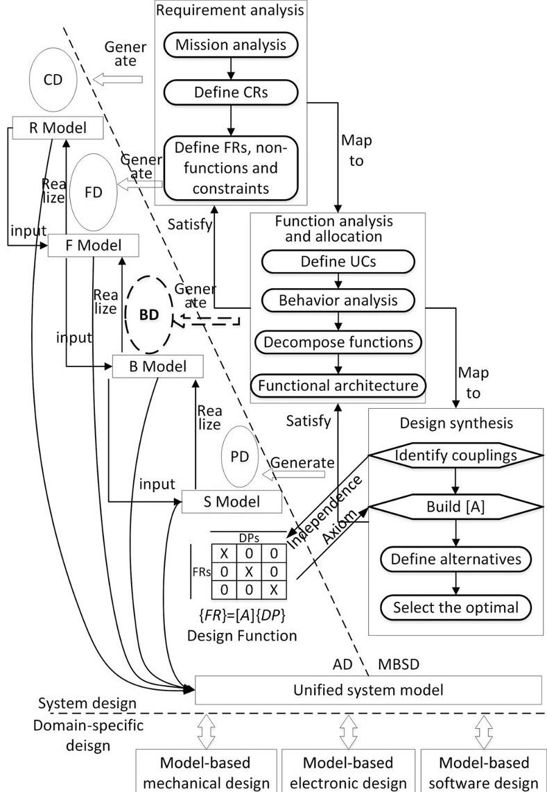

FIGURE 3 A-MBSD framework

system function analysis and allocation, and design synthesis. It differs from a general SD process by organizing information into AD design domains. SysML is used to build the requirement, function, behavior, and structure models that constitute a unified system model.

SD starts by analyzing requirements, which analyzes the provided mission and creates a customer domain (CD). Designers then translate CNs into a set of functional, performance requirements, and constraints. The result of this phase is represented in a FD by specifying FRs, which are also inputs to the subsequent phase.

In system function analysis and allocation, first, a designer defines use cases (UCs) according to FRs. Then, the designer analyzes these UCs through an action response, message transfer, and state change to create a BD shown by the dashed ellipse in Figure 3. Based on the behavior, the designer decomposes functions and defines the functional architecture. Thus, elaborated functions bridge the gap between the abstract set of FRs and the detailed set of DPs. For example, functions of a ground station communicating with a satellite are realized by a series of activities like receiving, analyzing, and sending commands. In the next iteration, these activities are further decomposed and allocated to specific components. Exchange of information, material, and energy between components carrying out these activities specifies interfaces between the components. The result of this phase is the input for the subsequent phase.

Introducing the independence axiom into the design synthesis is the unique aspect of the A-MBSE. Design synthesis starts by applying the Independence Axiom. Before defining alternative solutions, a designer can identify functional couplings by the design matrix that represents the realizing relationships between FRs and DPs. Only designs conforming to the Independence Axiom can be considered as alternatives. The designer then selects the optimal solutions with corresponding DPs as the final system architecture, which is the structure model (S model) in the PD. In this paper, DPs represent the Design Parameters, which are the elements in the PD that are chosen to satisfy the FRs. According to the definition in AD, both variables and their associated components at any level of aggregation are called DPs. The scale of DPs is very wide, including systems, subsystems, components, or variables.

Accordingly, A-MBSD enables designers to connect the FD with the PD by analyzing behaviors and building the design matrix rather than being based only on experience; this is illustrated in Section 3.2.

## 3.2 RFBS decomposition process

In a specific decomposition level, first, the FD is mapped into the BD rather than the PD directly, and then FRs are analyzed by activities interactions, and other behaviors to be allocated to components that have DPs. Figure 4 gives the new mapping process called RFBS, which is from CNs in the requirement domain, FRs in the functional domain, behavior elements (BEs) in the BD to DPs in the physical/structure domain.

In order to analyze the relationships between FRs and DPs and help designers establish the design matrix to apply the independence axiom, a BD is introduced. The new BD consists of BEs that include UCs for describing system services and actions as well as messages

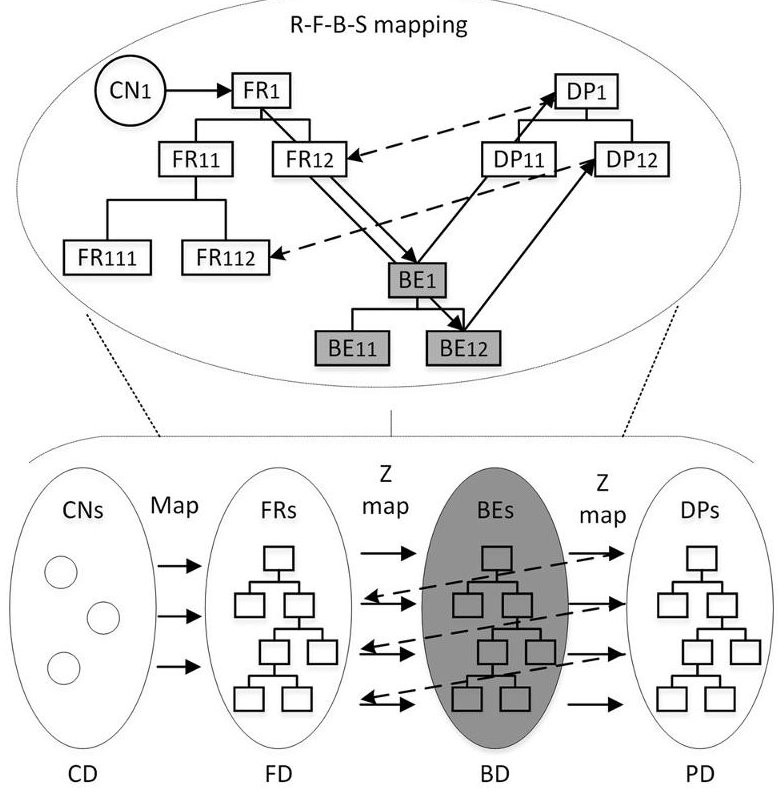

FIGURE 4 Mapping process of A-MBSD

<!-- PDF_PAGE: 6 -->

between components parameterized by DPs. Figure 5 illustrates how to use these BEs to explain FRs and allocate them to DPs, whereas in MBSD, functions are allocated to components by "swim lines" in activity diagrams or by executing the functions allocated to a given block. $ ^{14} $ First, designers represent FRs at different levels of abstraction by UCs or actions. While UCs are generally used to represent functions at the top level, actions are created when the functions are decomposed into more detailed levels.

Second, activity diagrams enable designers to specify how actions are executed to realize corresponding UCs. The partition of activities can allocate actions into different parameterized components. In addition, these actions are treated as input FRs for the next iteration.

Third, sequence diagrams are created based on activity diagrams for generating the internal structure of the system in which interfaces are captured by the messages transferred between parameterized components.

Figure 6 shows how the RFBS mapping process enables designers to build the SD matrix [A] and apply the Independence Axiom to identify the coupling of the design. Relationships between FRs and BEs constitute the function-behavior matrix [B], and the relationships between BEs and DPs constitute the behavior-structure matrix [C], where together they constitute a composite design matrix.

The logical OR operation is used to obtain the SD matrix [A] as shown by the new system equation (2). Equation (3) shows its corresponding extension where {BE} denotes a vector composed of BEs.

$$
\{F R \} = [ B ] \cup [ C ] \{D P \} = [ A ] \{D P \}.
$$

Designers judge if a current design complies with the Independence Axiom by the form of the SD matrix [A].

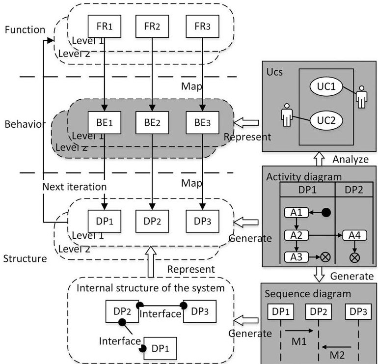

FIGURE 5 System functions and structures are connected by behaviors

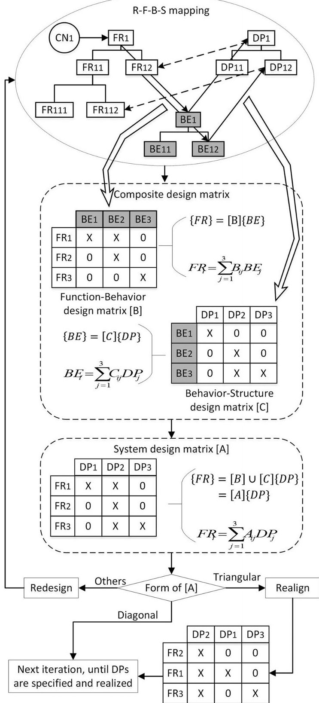

FIGURE 6 Building process of an A-MBSD SD matrix

1. When [A] is diagonal, the design is said to be ideal; thus, designers further decompose DPs and FRs, and initiate the next iteration.

2. When [A] is triangular, the design is said to be decoupled. Designers should realign DPs to obtain independent FRs. For example, the design matrix shown in Figure 6 is decoupled as changes of DP2 affect both FR1 and FR2 after DP1 is specified. FRs are independent of each other when DP2 is achieved before DP1.

3. The design is coupled in other situations. Designers have to reselect DPs in order to remove the impacts that DPs have on different FRs until FRs stay independent from each other.

<!-- PDF_PAGE: 7 -->

Obtaining the SD matrix from the composite matrix follows Equation (4), where any element of the matrix is either an "X" or "0," where "X" means that the corresponding column element has a relationship with the element in the row, and where "0" means that no such a relationship exists.

$$
\left\{ \begin{array}{l} F R _ {1} \\ F R _ {2} \\ .. \\ F R _ {m} \end{array} \right\} = \left[ \begin{array}{c c c c} B _ {1 1} & . & .. & B _ {1 n} \\ B _ {2 1} & . & .. & B _ {2 1} \\ . & . & .. & . \\ B _ {m 1} & . & .. & B _ {m n} \end{array} \right] \cup
$$

$$
\left[ \begin{array}{c c c c} C _ {1 1} & . &.. & C _ {1 n} \\ C _ {2 1} & . &.. & C _ {2 1} \\ . & . &.. &. \\ C _ {m 1} & . &.. & C _ {m n} \end{array} \right] \left\{ \begin{array}{l} D P 1 \\ D P 2 \\.. \\ D P m \end{array} \right\}
$$

$$
= \left[ \begin{array}{c c c} A _ {1 1} & \dots A _ {1 n} \\ A _ {2 1} & \dots A _ {2 1} \\ . & \dots . \\ A _ {m 1} & \dots A _ {m n} \end{array} \right] \left\{ \begin{array}{c} D P 1 \\ D P 2 \\ .. \\ D P m \end{array} \right\},
$$

$$
A _ {i j} = B _ {i j} \cup C _ {i j}, \{A _ {i j}, B _ {i j}, C _ {i j} | a _ {i j}, b _ {i j}, c _ {i j} \in (X, 0) \}.
$$

The logical OR operation is applied to Equation (4) as follows:

$$
\begin{array}{l} \succ X \cup X = X \\ \succ X \cup 0 = X \\ \succ 0 \cup 0 = 0 \\ \end{array}
$$

A formal description of the RFBS mapping process is represented as follows:

$Map = (R,F,B,S)$

{

    $I = 1$;

}

Iterate{

    $\forall r\left(l,i_{L}^{R},j_{L}^{F}\right)\in R_{L},M_{RF}\left(r\left(l,i_{L}^{R},j_{L}^{F}\right)\right)$

    $= \{f\left(l,j_{L}^{F},i_{L}^{R}\right)|j_{L}^{F}=1,2\ldots,n\left(i_{L}^{R}\right)\}$;

    $\forall f\left(l,i_{L}^{F},j_{L}^{B}\right)\in F_{L},M_{FB}\left(f\left(l,i_{L}^{F},j_{L}^{B}\right)\right)$

    $= \{b\left(l,j_{L}^{B},i_{L}^{F}\right)|j_{L}^{B}=1,2\ldots,n\left(i_{L}^{F}\right)\}$;

    $\forall b\left(l,i_{L}^{B},j_{L}^{S}\right)\in B_{L},M_{BS}\left(b\left(l,i_{L}^{B},j_{L}^{S}\right)\right)$

    $= \left\{s\left(l,j_{L}^{S},i_{L}^{B}\right)|j_{L}^{S}=1,2\ldots,n\left(i_{L}^{B}\right)\right\}$;

    $M_{FS}=M_{FB}\cup M_{BS}$;

    $\forall m(k,i_{k},j_{k})\in M_{FS}$;

if $\lambda(\mathrm{m}\left(k,i_{k},j_{k}\right))=-1$, then RETURN;

else $\forall s\left(l,i_{L}^{S},j_{L+1}^{B}\right)\in S_{L},M_{SD}\left(s\left(l,i_{L}^{S},j_{L+1}^{B}\right)\right)$

$= \left\{f\left(l+1,j_{L+1}^{F},i_{L}^{S}\right)|j_{L+1}^{F}=1,2\ldots,n\left(i_{L}^{S}\right)\right\}$;

    $I=I+1$;

}

}

"L" denotes the current design level, abstract level, or iteration times. " $ M_{RF} $ ," $ M_{FB} $ ," $ M_{BS} $ ," and $ M_{SF} $ represent the mapping relationships of Requirement-Function, Function-Behavior, Behavior-Structure, and Structure-Function, respectively. $ M_{RF}(r(l,i_{L}^{R},j_{L}^{F})) $ is the mapping from the customer requirement $ r_{i} $ in the requirement domain at level L to the FR $ f_{j} $ in the FD at the same level and $ n(i_{L}^{R}) $ is the number of the customer requirements.

In the same way, $ M_{FB} ( f ( l,i_{L}^{F},j_{L}^{B})) $ represents a mapping from the FD to the BD and $ n ( i_{L}^{F} ) $ is the number of BEs. $ M_{BS} ( b ( l,i_{L}^{B},j_{L}^{S})) $ represents a mapping from the BD to the PD and $ n ( i_{L}^{B} ) $ is the number of DPs.

Designers can build the design matrix according to Equations (2) and (3) after they finish a complete mapping process. The coupling of functions is then identified by the SD matrix which is written as $ \lambda(m(k,i_{k},j_{k}))=\{-1,0,1\} $ . When $ \lambda $ equals -1, the design is coupled and should be modified before the next iteration. When $ \lambda $ equals 1 or 0, the design is ideal or decoupled; so, the next iteration starts. $ M_{SB}(b(l,i_{L}^{S},j_{L+1}^{B})) $ represents the mapping from the PD at level L to the FD at level L+1.

## 4 UNIFIED MODEL FOR A-MBSD

SysML is selected for modeling the system model of A-MBSD to keep it unified, because it has been designed to enable extensions that support specialized concepts such as design domains and axioms of AD by its own extension mechanism, called stereotyping. $ ^{12} $ Stereotypes are organized into a profile. In fact, SysML is defined as a UML profile.

Stereotypes are used for customizing core concepts of AD. An AMBSD Modeling Profile is constructed as shown in Figure 7, where the

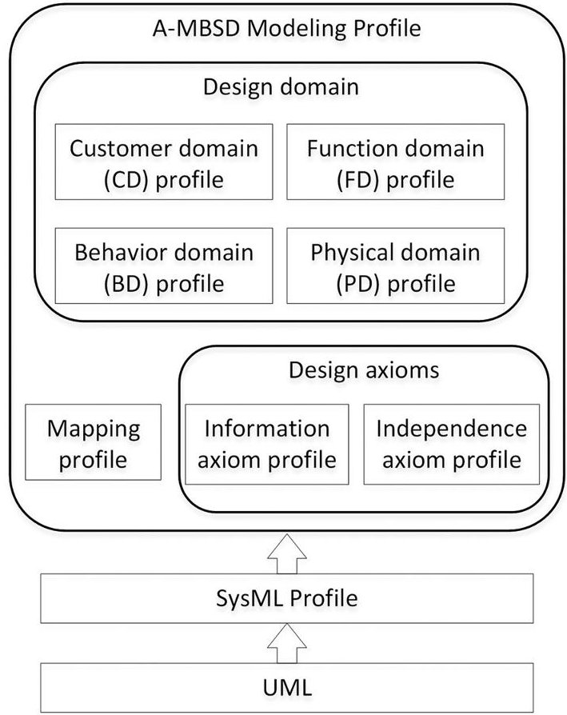

FIGURE 7 A-MBSE modeling profile

<!-- PDF_PAGE: 8 -->

CD, FD, BD, and PD profiles constitute the design profile, and the mapping profile represents the mappings and decomposition relationships of RFBS.

Figure 8 shows an A-MBSD Modeling Profile that is defined by importing a SysML model that references a UML profile (ie, UML4SysML) in order to reuse their classes such as «requirement», «property», and relationships such as «dependency».

The definition of a mapping profile is described in Figure 9. According to the AD zigzag process, two kinds of mapping relationships: (a) mapping at the same level and (b) mapping between two different levels, are named as H mapping and V mapping, respectively, by extending the «dependency» relationship. A constraint for V mapping is also presented.

Figure 10 illustrates how the CD profile is specified. Customer Constraint and Customer Requirement are two subclasses of «requirement». Priority Kind and Type Kind are added as new properties of a CN. Priority Kind denotes the degree of importance of a CN by a low, medium, and high level for helping designers focus on requirements with higher priority. Type Kind is used to classify a requirement into a customer and a system requirement. The former is provided by a customer directly and the latter is a requirement translated from a CN for designers understanding. A constraint shows that one CN should be mapped to one or more FRs by «H mapping».

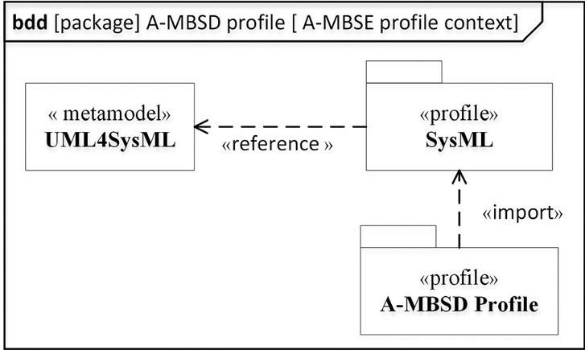

FIGURE 8 Definition of an A-MBSD modeling profile

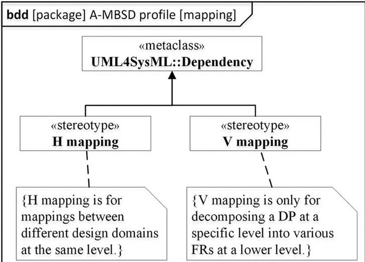

FIGURE 9 Definition of the mapping profile

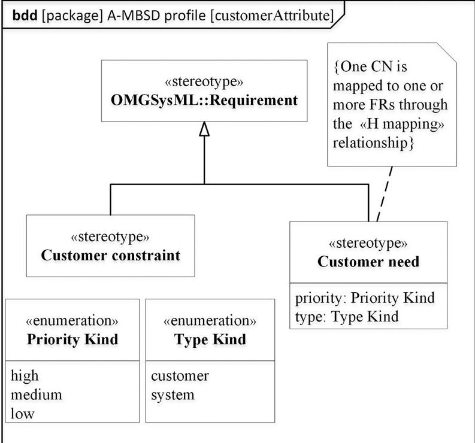

FIGURE 10 Definition of a customer domain profile

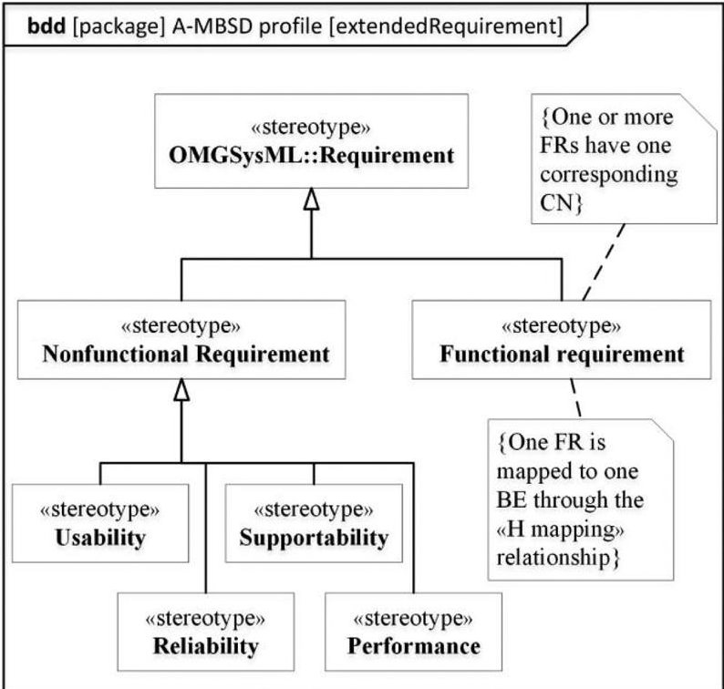

FIGURE 11 Definition of the function domain profile

The definition of an FD profile is shown in Figure 11. A system requirement is either an NFR (Nonfunctional Requirement) or an FR that inherits from SysML Requirement. An NFR is further specialized into Usability, Supportability, Reliability, and Performance. An FR can only be mapped to a BE by an «H mapping» relationship at the same level.

As shown in Figure 12, a BE is defined by extending a UC activity and interaction, and can be mapped to a DP by an 《H mapping》 relationship.

A DP can be a system, subsystem, component, part, or variable, and their relationships are described in Figure 13A. Figure 13B represents the definition of a PD profile, in which a DP at a specific level is mapped into various FRs at a lower level by the V mapping relationship.

<!-- PDF_PAGE: 9 -->

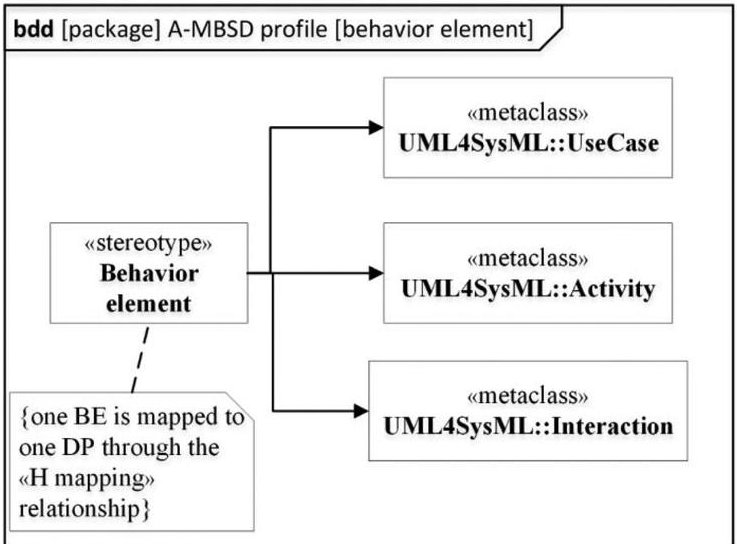

FIGURE 12 Definition of a behavior domain profile

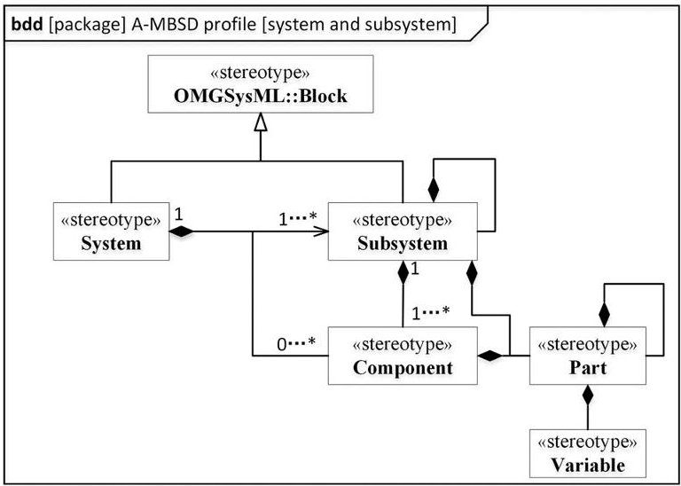

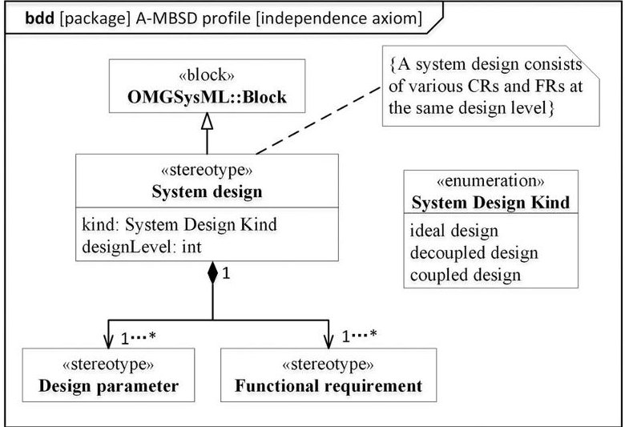

(A) system and subsystem profile

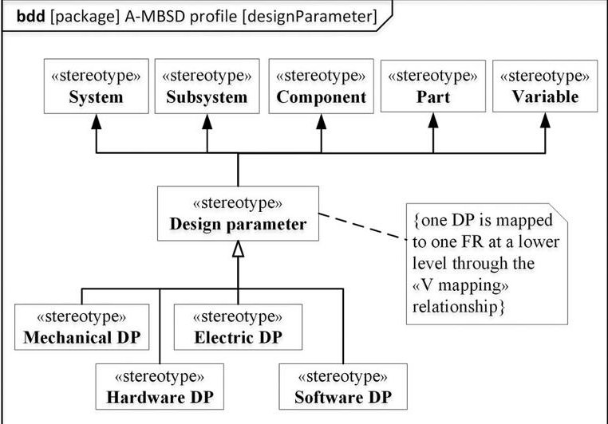

(B) design parameter profile

FIGURE 13 Definition of a physical domain profile

According to different disciplines, a DP is classified into a Mechanical, Electrical, Hardware, or Software DP.

FIGURE 14 Definition of an independence axiom profile

Figure 14 shows the definition of the Independence Axiom profile. System Design (SD) is extended from Block of UML4SysML. An SD consists of FRs and DPs that satisfy the requirements at a certain design level. SD Kind and design Level are added as two properties of an SD. A

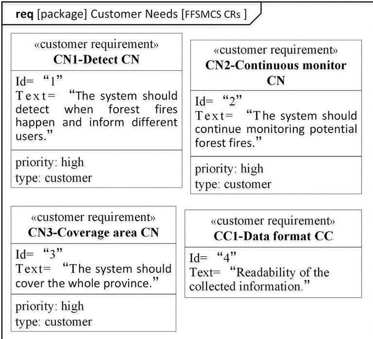

FIGURE 15 CNs of the FFSMCS mission

design Level denotes the number of the current design iteration. Based on the design matrix of the independence design, an ideal design, decoupled design, or coupled design is specified by SD Kind, which represent the SD conforms with or violates the independence axiom.

## 5 A-MBSD IS USED TO SPECIFY A SATELLITE SYSTEM DESIGN FOR OBSERVING FOREST FIRES

The FireSAT mission was aimed at observing forest fires $ ^{35} $ and has been adopted as a standard study case for understanding the space SD process. Based on the FireSAT project, in 2011, the SSWG (Space Systems Working Group) of INCOSE demonstrated the feasibility of the MBSD approach in reality, where SysML could formally specify every aspect of a system through a CubeSat project. $ ^{36} $ Accordingly, in the following sections, the A-MBSD is applied to the SD of a virtual FireSAT mission.

<!-- PDF_PAGE: 10 -->

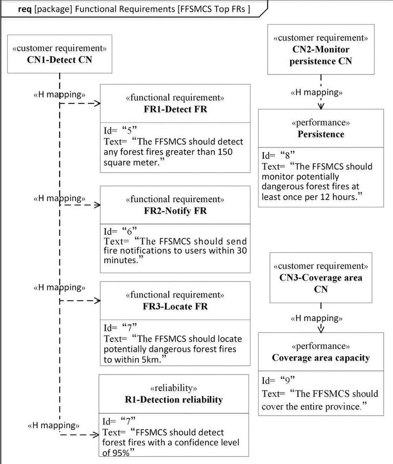

FIGURE 16 Top level FRs of FFSMCS

## 5.1 Mission description

Forest fires cause serious harm every year to both the environment and people's daily lives. An assumed FireSAT project, called FFSMCS, is aimed at monitoring daily forest fires and informing local forestry departments of these fires to be able to control them in time.

The overall mission of the FFSMCS is described as: "Because forest fires cause dramatic harm to local people's safety of life and wealth, and seriously impact the development of local tourism and business, it is necessary to build a system for effectively observing and controlling potential forest fires. The system should satisfy the following requirements: a local forestry department can afford it; information about a forest fire such as its location, diffusion situation, and duration that are collected by the system should be available for the local forestry department, managers of the forest region, and firefighters; data formats of the above information should be readable by users without special training; and the system should enable users to respond effectively to any change in the forest fire."

Although a conventional MBSD approach can specify components and parameters realizing functions of the mission by iterative processes, function analysis resulting in unsatisfactory requirements due to the omission of potential relationships between functions, behaviors, components, and requirements should be determined. Especially when functions are coupled, designers have to reselect DPs, and even reanalyze FRs, which dramatically increases iteration times and obstructs development efficiency. The proposed A-MBSD is thus applied to the FFSMCS to illustrate how the RFBS documents SD information explicitly helping designers to make decisions through building design matrixes and using the Independence Axiom.

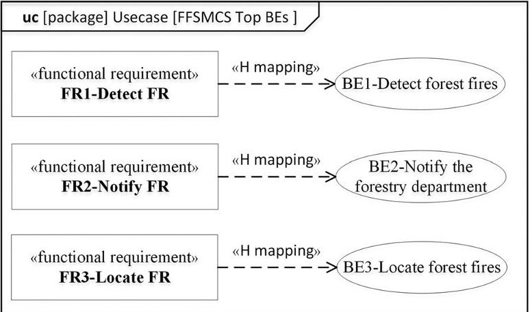

FIGURE 17 Top level BEs of FFSMCS

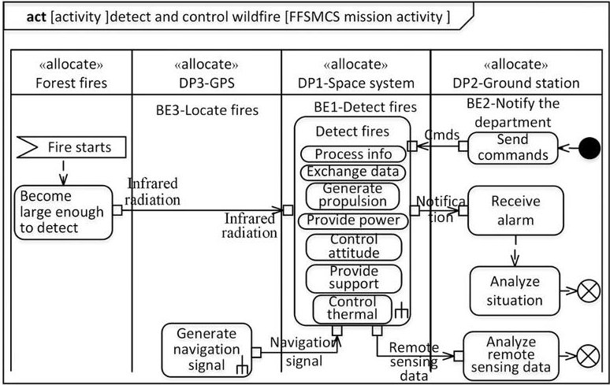

FIGURE 18 Top level activity diagram of FFSMCS

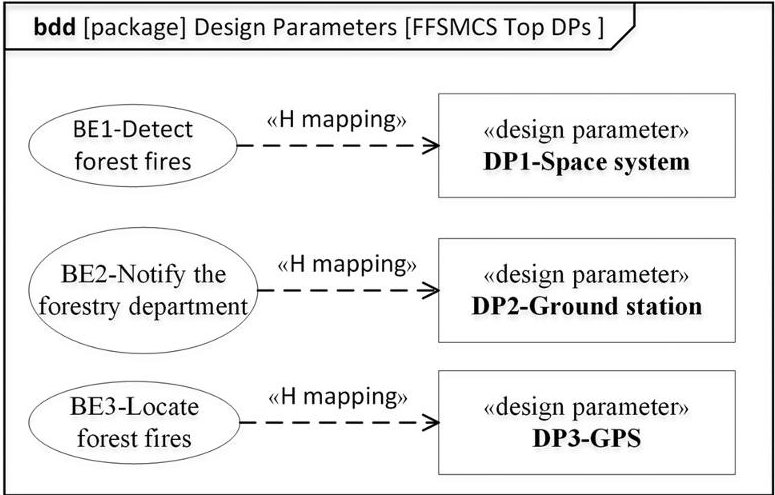

FIGURE 19 Top level PDs of FFSMCS

Based on the above statement, basic customer requirements of the FFSMCS include:

## 5.2 The first iteration

1. CN1: the system should detect dangerous forest fires and inform different users;

2. CN2: the system should continue monitoring potential forest fires for a certain time;

3. CN3: the system should cover the whole area of a province.

<!-- PDF_PAGE: 11 -->

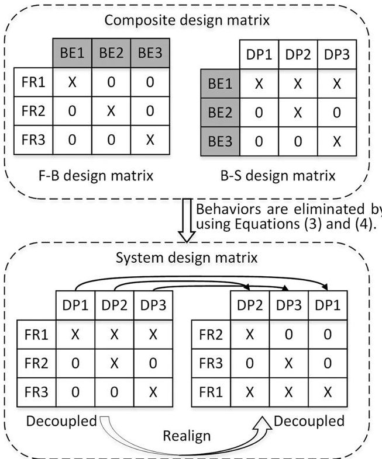

FIGURE 20 Build of the top level design matrix of FFSMCS

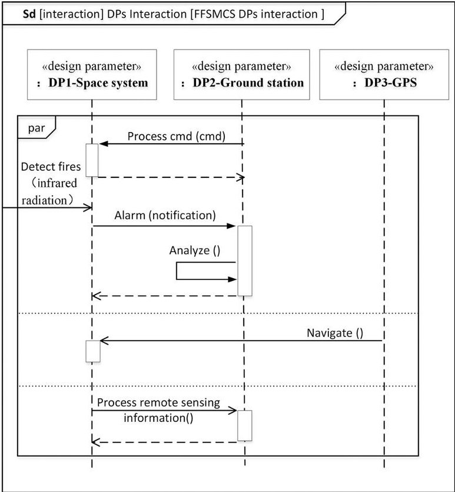

FIGURE 21 Top level sequence diagram of FFSMCS

In addition, readability of the output data is extracted as a customer constraint (CC1-Data formats CC). The result of initial requirement analysis is represented by a requirements diagram named the FFSMCS CNs, as shown in Figure 15.

Next, every CN is mapped to corresponding FRs or NFRs by «H mapping». For instance, CN1 is mapped to three FRs, that is, Detect FR, Notify FR, and Locate FR, and one reliability as described in Figure 16.

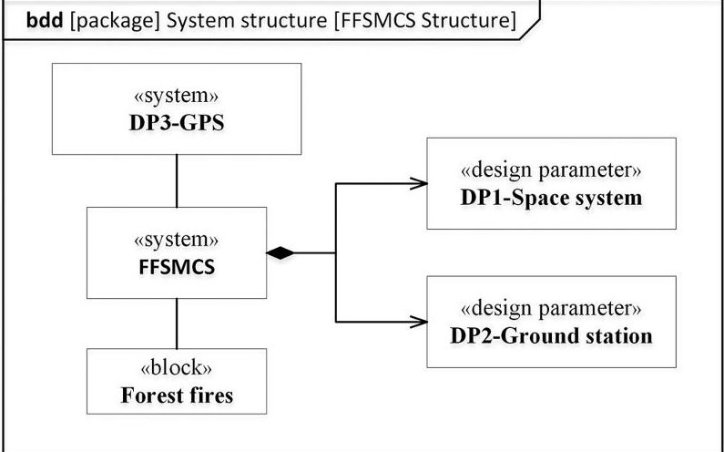

(A) Hierarchical structure of FFSMCS

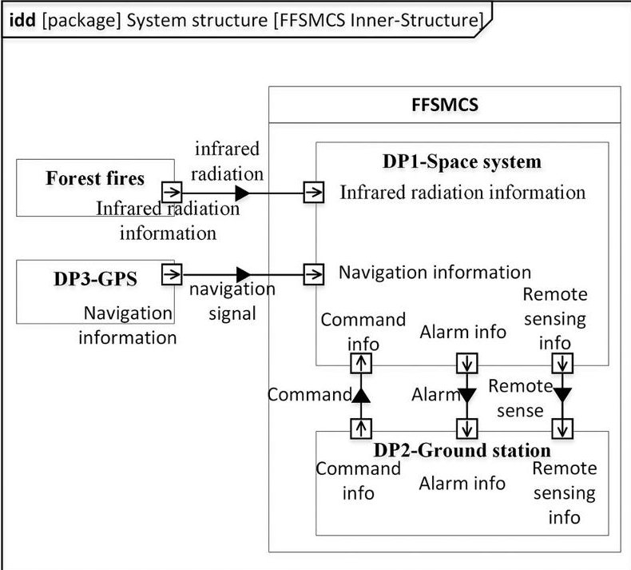

(B) Internal structure of FFSMCS

FIGURE 22 System structure of FFSMCS

The above FRs are further associated with BEs by UCs that are represented through verb-object structures. Figure 17 gives the BEs at the top level:

1. BE1: Detect forest fires;

2. BE2: Notify the forestry department;

3. BE3: Locate forest fires.

Figure 18 shows an FFSMCS mission activity diagram elaborating UCs by the detailed actions and connections that realize the UCs. Different behaviors include different actions, for example, "BE1- Detect forest fires" is realized by processing information, exchanging data, generating propulsion, etc. These behaviors also communicate with each other. For instance, when the forest fire spreads more than $ 1 5 0 \mathrm{m}^{2} $ the space system detects the infrared radiation signal and specifies the location of the fire based on the navigation information provided by the Global Positioning System (GPS). Then, it sends an alarm to the ground station. Meanwhile, the space system receives

<!-- PDF_PAGE: 12 -->

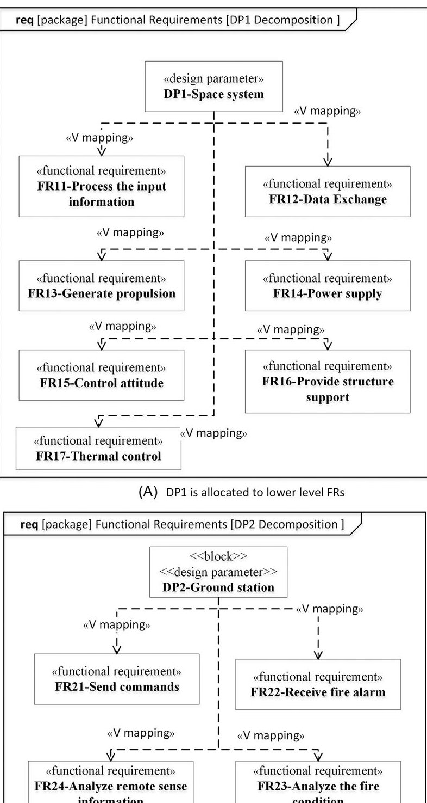

(B) DP2 is allocated to lower level FRs

FIGURE 23 Zigzag mappings of the space system and ground station

commands from the ground station and generates remote sensing information as a feedback. These actions, representing the behaviors of different DPs, are further decomposed into functions in the next iteration.

In the activity diagram, the BD is mapped to the PD by activity partitions. Actions in the partitions represent behaviors of specific DPs as given by Figure 19

1. DP1: Space system;

2. DP2: Ground station;

3. DP3: GPS.

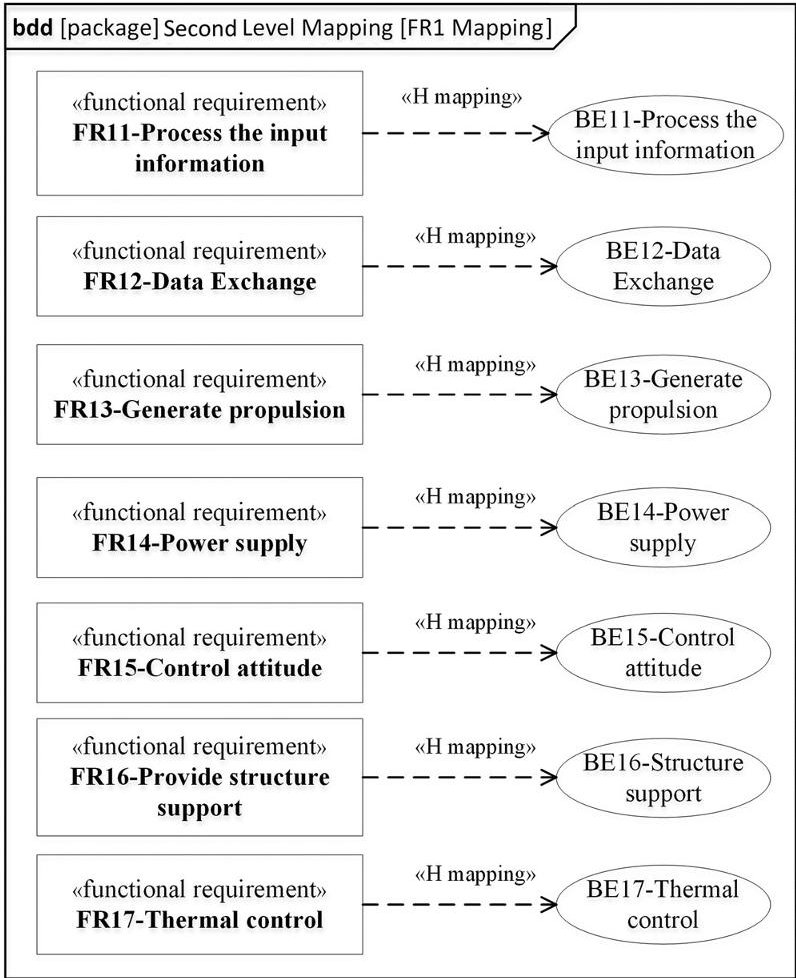

FIGURE 24 The function domain of DP1 is mapped to its behavior domain

The behavior analysis aims at helping designers build the design matrix to identify the coupling of functions. Figure 20 illustrates that the top level design matrix consists of a triangular Function- Behavior matrix and a diagonal Behavior-Structure matrix. It can be seen in Figure 18 that BE1 needs information from DP2 and DP3, which means that BEs are not independent. So, the SD matrix in Figure 20 is triangular (upper or lower) according to Equations (3) and (4), and thus, the current design is decoupled, FR1 is affected by FR2 and FR3. Accordingly, the components of DP2 for sending commands are specified first, then, components of DP3 for generating navigation signals, and components of DP1 for monitoring forest fires can be designed. As a result, the functions of specified components are not coupled with unspecified ones. For example, interfaces of DP1 responsible for receiving commands sent by DP2 should be specified after the corresponding interfaces for sending such commands are designed.

Another advantage of behavior analysis is to help designers represent the hierarchical and internal structure of the system. Figure 21 shows that a sequence diagram is created from the activity diagram for describing interactions among DPs. Interfaces are thus identified and a block definition diagram is created in Figure 22A for illustrating that the FFSMCS is composed of the space system and ground station, and has relationships with the GPS and forest fires. An internal block diagram is also created in Figure 22B for describing how items flow between these DPs through connectors.

<!-- PDF_PAGE: 13 -->

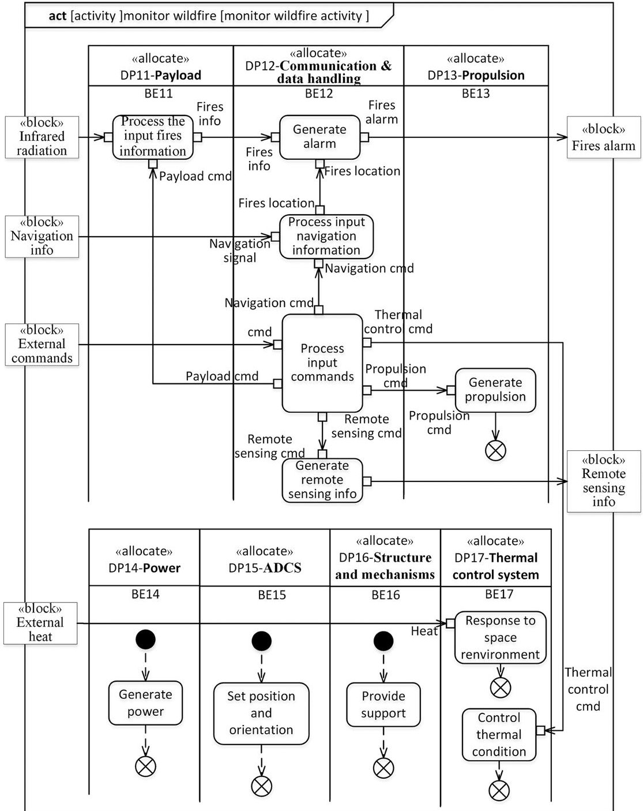

FIGURE 25 Detailed activities of BE1

## 5.3 The second iteration

The top mapping of RFBS is developed at the forest fire design level, then, the next iteration starts.

As described in Figure 18, DP1 is responsible for monitoring the fire. The actions of DP1 in the forest fire iteration are treated as FRs in the second iteration as shown in Figure 23A:

1. FR11: Process the input information about forest fires;

2. FR12: Exchange data between devices;

3. FR13: Generate propulsion;

4. FR14: Provide power supply;

5. FR15: Control satellite attitude;

6. FR16: Support structure for devices;

7. FR17: Control thermal for devices.

According to the same activity diagram, FRs of DP2 at the top design level are mapped to subfunctions through BE2 as shown in Figure 23B:

1. FR21: Send commands to the space system;

2. FR22: Receive the fire alarm from the space system;

3. FR23: Analyze remote sensing information;

4. FR24: Analyze the fire condition.

The emphasis of the FFSMCS design is placed on the space system (DP1); so, the zigzag mappings between DP1's FRs, Bes, and DPs are described, and the SD is built in the subsequent part. Designers first allocate the FRs of DP1 to BEs in the BD as described in Figure 24.

BE1 of DP1 is then elaborated by an activity diagram, as shown in Figure 25, which explains the corresponding action in the activity diagram in Figure 18 from the first iteration. The behavior analysis

<!-- PDF_PAGE: 14 -->

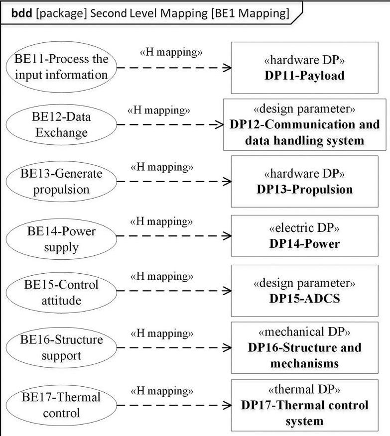

FIGURE 26 The behaviors domain of FR1 is mapped to its physical domain

provides a foundation for the mapping from the BD to the PD. For example, the data change action, BE12, in Figure 25 includes actions such as generate an alarm, process the input navigation information, process input commands, and generate remote sensing information.

It can be seen from Figure 25 that different DPs execute different actions, and thus, the DPs have the corresponding BEs (shown in Figure 26):

1. DP11: Payload;

2. DP12: Communication and data handling system;

3. DP13: Propulsion system;

4. DP14: Power;

5. DP15: Attitude Determination and Control System (ADCS);

6. DP16: Structure and mechanisms;

7. DP17: Thermal control system.

Figure 27 shows the decomposing process of FR1, which is mapped to the PD by analyzing BE1 as a bridge.

The last step is to identify couplings of DP1 based on previous behavior analysis results. Figure 28 shows this level's design matrix. Because BEs are in one-to-one correspondence with FRs, relationships between DPs and BEs are able to reflect the relationships of the design matrix alone in this iteration. The matrix is neither diagonal nor triangular; so, the current design of DP1 is said to be coupled. It can be seen in Figure 28 that in order to process the input forest fire information (FR11), the payload (DP11) receives commands from the data exchange system (DP12) on the one hand; and on the other hand, DP12

The first iteration

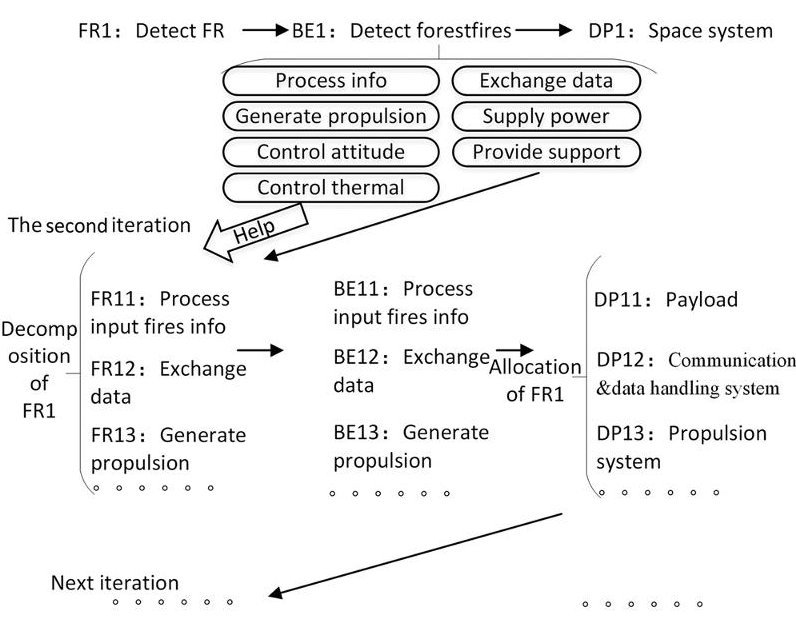

FIGURE 27 Function analysis and composition based on behaviors

<table border="1"><tr><td rowspan="2" colspan="2"></td><td colspan="6">DP1</td></tr><tr><td>DP11</td><td>DP12</td><td>DP13</td><td>DP14</td><td>DP15</td><td>DP16</td><td>DP17</td></tr><tr><td rowspan="7">FR1</td><td>FR11</td><td>X</td><td>X</td><td>0</td><td>0</td><td>0</td><td>0</td><td>0</td></tr><tr><td>FR12</td><td>X</td><td>X</td><td>0</td><td>0</td><td>0</td><td>0</td><td>0</td></tr><tr><td>FR13</td><td>0</td><td>X</td><td>X</td><td>0</td><td>0</td><td>0</td><td>0</td></tr><tr><td>FR14</td><td>0</td><td>0</td><td>0</td><td>X</td><td>0</td><td>0</td><td>0</td></tr><tr><td>FR15</td><td>0</td><td>0</td><td>0</td><td>0</td><td>X</td><td>0</td><td>0</td></tr><tr><td>FR16</td><td>0</td><td>0</td><td>0</td><td>0</td><td>0</td><td>X</td><td>0</td></tr><tr><td>FR17</td><td>0</td><td>X</td><td>0</td><td>0</td><td>0</td><td>0</td><td>X</td></tr></table>

FIGURE 28 The design matrix of DP1

receives the forest fire information from DP11 as well. So, they are inputs for each other. As a result, much attention should be paid to this coupling in the subsequent, more detailed design.

The sequence diagram that enables designers to identify interfaces is created based on the activity diagram of BE1. The SysML block definition diagram and internal block diagram are then used to specify the hierarchical and internal structure of PD1. In this way, after every DP is represented, a unified system model of FFSMCS can be created. Due to this paper's limitation, it is not discussed here.

## 5.4 Discussion

The FFSMCS is a large-scale engineering system that involves multiple disciplines, for example, mechanical, electronics, and software engineering, and consists of various subsystems and components. The SD of the FFSMCS plays a significant role for subsequent detailed design, system integration, manufacturing, and implementation. Conventional mission analysis and SD of a satellite system is a document-oriented process, where informal representations can lead to inconsistent information, which can increase iteration times and obstruct development

<!-- PDF_PAGE: 15 -->

efficiency dramatically. In contrast to a system model that does not apply the proposed functional analysis, the return on investment of using A-MBSD is obvious since changes due to coupled functions can be identified at an early stage and impacted structures, behaviors and requirements can be traced clearly. Otherwise, the change effort is huge when couplings are identified during detailed design because then designers have to reselect DPs, and even reanalyze FRs.

A-MBSD represents the system model of the FFSMCS from requirement, functional, behavioral, and physical perspectives in a unified way. The zigzag mappings of RFBS enable designers to analyze and decompose the functions of the FFSMCS and manage the abstract levels of the SD.

In a specific iteration, designers can document system, hierarchical and internal structures, construct the design matrix through analyzing system functions and behaviors, and identify functional couplings by the Independence Axiom. In addition, designers can navigate impacted DPs and CNs due to the coupling of functions through the RFBS model.

However, designers have criticized the intensive manual work required for building the system model. In reality, designers were unwilling to spend too much time in learning SysML. In addition, experienced designers have said that they would not select a design that is largely based on the degree of independence and coupling among requirements and solutions, and that they preferred referencing similar design cases or cases from their experience. On the other hand, they suggested a few improvement ideas for future work, such as linking the model to available information databases and building AD ontologies for common cases in order to reuse or reference them rather than creating new ones.

## 6 CONCLUSIONS AND FUTURE WORK

Leading MBSD methodologies like Harmony SE, OOSEM, SA, etc., improve upon traditional DBSD by formalizing the application of modeling to support requirements analysis, function analysis, and design synthesis. However, different MBSD methodologies focus on specific areas, and various designers from different areas use ambiguous terms. Moreover, failure of some products originated in undiscovered couplings of functions in the design stage. In order to implement MBSD in a more unified way by reducing ambiguity and alleviating functional couplings:

1. Based on the axiomatic SD, this paper proposes a unified MBSD approach, called A-MBSD, that is not only able to represent a system's static structure, but is also able to allocate functions to the structure by observing dynamic behaviors.

2. The RFBS framework introduces a new BD into AD for bridging abstract functions and more detailed design solutions.

3. The core concepts and relationships of AD are customized by a SysML profile (ie, an A-MBSD profile) that keeps every view of the system model unified.

Although SysML modeling tools, such as Magicdraw, enable designers to create and document a system model, many designers in China find it unacceptable to spend too much time in learning such a graphical modeling language without appropriate patterns. In addition, when the number of models increases greatly, it is hard to respond to design changes. In the future, we will carry out in-depth research on:

1. Linking available information databases to the A-MBSD to create reusable cases and appropriate pattern, and

2. Managing design change to predict change impact using the AMBSD approach.

## ACKNOWLEDGMENTS

This work was funded by the National Natural Science Foundation of China (No. 51775517), the Open Project of Henan Key Laboratory of Intelligent Manufacturing of Mechanical Equipment (No. IM201907). Sincere thanks for Prof Vincent Thomson for his English correction of the manuscript.

## ORCID

Haoqi Wang ID https://orcid.org/0000-0002-9012-5370

## REFERENCES

1. Kapurch SJ. NASA Systems Engineering Handbook. Pennsylvania: DIANE Publishing; 2010:5-16.

2. Mhenni F, Choley JY, Penas O, Plateaux R, Hammadi M. A SysMLbased methodology for mechatronic systems architectural design. Adv Eng Inform. 2014;28(3):218-231.

3. Estefan JA. Survey of model-based systems engineering (MBSE) methodologies. Incose MBSE Focus Group. 2007;25(8):1-47.

4. Wang H, Zhang X, Tang C, Thomson V. A semantic model for axiomatic systems design. Proc Inst Mech Eng C J Mech Eng Sci. 2018; 232(12):2159-2184.

5. Peter H, Hoffmann HP. SysML-based systems engineering using a model-driven development approach. White Paper, Telelogic, 2008.

6. Dori D. Model-Based Systems Engineering with OPM and SysML. New York: Springer; 2016.

7. Dori D, Wengrowicz N, Dori YJ. A comparative study of languages for model-based systems-of-systems engineering (MBSSE). 2014 World Automation Congress (WAC), August 03-07, Waikoloa Hilton Village, Hawaii. IEEE; 2014:790-796.

8. Long D, Scott Z. A Primer for Model-Based Systems Engineering. North Carolina: Lulu Press, Morrisville; 2012.

9. Friedenthal S, Moore A, Steiner R. A Practical Guide to SysML. San Francisco; California: Morgan Kaufmann Publishers; 2014.

10. Weilkiens T. Systems Engineering with SysML/UML: Modeling, Analysis, Design. Burlington: Denise E.M. Penrose; 2011.

11. Ingham MD, Rasmussen RD, Bennett MB, Moncada AC. Engineering complex embedded systems with state analysis and the mission data system. J Aerosp Comput Inf Commun. 2005;2(12):507-536.

12. Object Management Group. OMG System Modeling Language (SysML), Version 1.5. 2017 [Online] http://www.omg.org/spec/SysML/ index.htm. Accessed October 28, 2017.

13. Di Gironimo G, Lanzotti A, Marzullo D, Esposito G, Carfora D, Siuko M. Iterative and participative axiomatic design process in complex

<!-- PDF_PAGE: 16 -->

mechanical assemblies: case study on fusion engineering. Int J Interact Des Manuf. 2015;9(4):325-338.

14. Farid AM, Suh, NP. Axiomatic Design in Large Systems: Complex Products, Buildings and Manufacturing Systems. New York: Springer; 2016.

15. Kulak O, Cebi S, Kahraman C. Applications of axiomatic design principles: a literature review. Expert Syst Appl. 2010;37(9):6705-6717.

16. Hong EP, Park GJ. Collaborative design process of large-scale engineering systems using the axiomatic design approach. Proc Inst Mech Eng C J Mech Eng Sci. 2011;225(9):2174-2188.

17. Hehenberger P, Poltschak F, Zeman K, Amrhein W. Hierarchical design models in the mechatronic product development process of synchronous machines. Mechatronics. 2010;20(8):864-875.

18. Bonnema GM. Insight, innovation, and the big picture in SD. Syst Eng. 2011;14(3):223-238.

19. Song H, Lin Z. A model of generating schemes in product conceptual design. Comput Integr Manuf Syst. 2002;8(5):342-346.

20. Xiao R, Cai C, Liu Y. Current research situation and problem analysis of axiomatic design. J Mech Eng. 2008;44(12):1-11.

21. Liu Y, Jiang Y, Gao S. Model-driven modeling for SD of complex product: a survey. China Mech Eng. 2010(6):741-749.

22. Cao Y, Liu Y, Paredis CJJ. System-level model integration of design and simulation for mechatronic systems based on SysML. Mechatronics. 2011;21(6):1063-1075.

23. Suh NP. Axiomatic Design: Advances and Applications. New York: Oxford University Press, 2001.

24. Rosenman MA, Gero JS. Purpose and function in design: from the socio-cultural to the techno-physical. Des Stud. 1998;19(2):161-186.

25. Gero JS, Kannengiesser U. The situated function-behaviour-structure framework. Des Stud. 2004;25(4):373-391.

26. Katehi L, Pearson G, Feder. Engineering in K-12 Education: Understanding the Status and Improving the Prospects. Washington DC: National Academies Press; 2009.

27. van Beek TJ, Erden MST, Tomiyama T. Modular design of mechatronic systems with function modeling. Mechatronics. 2010;20(8):850-863.

28. Couturier P, Lo M, Imoussaten A, Chapurlat V, Montmain J. Tracking the consequences of design decisions in mechatronic systems engineering. Mechatronics. 2014;24(7):763-774.

29. Hamraz B, Caldwell NHM, Clarkson PJ. A multidomain engineering change propagation model to support uncertainty reduction and risk management in design. J Mech Des. 2012;134(10):100905. 01-14

30. Hamraz B, Caldwell NHM, Ridgman TW, Clarkson PJ. FBS linkage ontology and technique to support engineering change management. Res Eng Des. 2015;26(1):3-35.

31. Suh NP. The Principles of Design. Oxford; England, UK: Oxford University Press on Demand; 1990.

32. Henley R. Using functional metrics to facilitate designing collectively exhaustive mutually exclusive systems in the context of managing return on investment. Procedia CIRP. 2015;34:31-36.

33. Bijan Y, Yu J, Stracener J, Woods T. Systems requirements engineering-state of the methodology. Syst Eng. 2013;16(3):267-276.

34. Yao H, Jin Y, Yan J. Qualitative and quantitative analysis of requirements on product function. J Mech Eng. 2010;46(5):191-198.

35. Larson W, Wertz J. Space Mission Analysis and Design. 3rd ed. Torrance, CA (United States): Microcosm Press; 2008.

36. Spangelo SC, Kaslow D, Delp C, et al. Applying model based systems engineering (MBSE) to a standard CubeSat. IEEE Aerospace Conference, March 03-10, 2012, Big Sky, MT, USA. IEEE; 2010:1-20.

How to cite this article: Wang H, Li H, Tang C, Zhang X, Xiaoyu W. Unified design approach for systems engineering by integrating model-based systems design with axiomatic design. Systems Engineering. 2020;23:49-64. https://doi.org/10. 1002/sys.21505