<!-- PDF_PAGE: 1 -->

# A Multi-University Small Satellite Systems Design Course: Systems Engineering Approach

Shelly Mann $ ^{1} $ and Michelle Weinmann $ ^{2} $ Old Dominion University, Norfolk, VA, 23517, USA

Edmundson Effort $ ^{3} $ North Carolina A&T State University, Greensboro, NC, 27411, USA

This paper will review the technical outcomes of a unique two-semester graduate-level Small Satellite Systems Design Course, offered under a collaboration between North Carolina A&T, Old Dominion University, Georgia Tech and Florida Institute of Technology, with additional faculty support from Hampton University and NASA Langley Research Center. The course provided students with skills that are relevant to present day satellite design while fostering an open-ended mission design assignment that is relevant to the support of Earth observation using systems of small satellites. Major outcomes of this course include that the students have the experience of working in multi-disciplinary, multi-university teams, practicing critical thinking skills, and managing the design of complex systems. In addition, the course was developed around utilizing Model-Based Systems Engineering (MBSE) practices and tools throughout the design life-cycle while utilizing a common design language, Systems Modelling Language (SysML). The approach started with a mission idea and proceeded to a feasible concept that included requirements development and management, concept modeling and performance simulation, and prototype building using low-cost additive manufacturing techniques, ending with a "Shark-tank" style presentation.

## I. Introduction

Systems Engineering projects are interdisciplinary in nature and require efficient and effective management throughout the project life cycle. This two-semester graduate-level course was a collaborative offering between North Carolina A&T, Old Dominion University, Georgia Tech, and Florida Institute of Technology, and was facilitated by The National Institute of Aerospace. With support from Hampton University and NASA Langley, this course offered participating students a unique opportunity to employ a Model Based Systems Engineering (MBSE) approach to the design of a small satellite. The faculty initially formed four teams, intentionally pairing students from different universities and disciplinary backgrounds to expose them to some of the inherent challenges of collaborating with team members from a geographical distance. The teams were given a set of customer requirements and one of four different global target regions. Then, with as few limitations as possible, were set free to design a satellite system to fulfill these requirements as interpreted by each team.

## II. Course Structure

The first class was a traditional face-to-face meeting to allow for as many members as possible to establish an in person connection with their teammates. The teams were chosen by the faculty to ensure an even distribution of students from different institutions with different discipline backgrounds would be on each team. Doing so meant students would have to work with students at other institutions that varied significantly with size and demographic distinctions. Through the initial meeting, web conferencing and cloud-based collaboration tools were researched and voted on using a decision matrix to identify the tools that would best serve the needs of the class throughout the duration of the course. This served as both an icebreaker and a team building exercise as each group was given a certain set of tools to look up and present to the rest of the class, with the decision matrix being a focal point for

<!-- PDF_PAGE: 2 -->

determining the desired attributes and their values. The course was delivered via interactive web conferencing and utilized a cloud-based collaborative tool for the class as whole as well as for individual teams. Each class meeting provided students with a seminar-styled series of lectures given by different professors and scientists with expertise in the various topics relevant to the project.

## A. Semester One

During the first semester each of the four teams, Chesapeake BaySAT, Polar (ICE) $ ^{3} $ , SPACE GOAT, and BioScope, held virtual meetings as needed to plan, research, design, and prepare the required presentations. The design process and procedure followed the methods outlined in the NASA Systems Engineering Handbook [NASA/SP 2007-6105], as well as the text Space Mission Engineering: The New SMAD. Teams learned and utilized MBSE tools like Visual Paradigm, Modelio, and Magic Draw to structure and organize their projects using SysML/ UML2 syntax and semantics. Emphasis was placed on trade studies for decision making and all aspects of mission architecture were addressed including con-ops, orbital design and analysis, performance metrics, data budgets, cost, testing, scheduling, sub-systems integration, and preliminary risk assessment. There were three major presentations given to a panel of faculty members and guest experts, each followed by technical questions and feedback: a Mission Concept Review (MCR), a Preliminary Design Review (PDR), and a Critical Design Review (CDR). The result was four unique mission concepts that were feasible and developed enough to present to a customer, the faculty, for selection. As there were intentionally no financial limitations imposed for this semester, the proposed budgets for the mission concepts ranged from approximately $1 Million to $2.65 Million.

## B. Semester Two

The second semester began with a major de-scoping of the first semester results with the goal of launching a reasonably priced payload, with the same initial customer requirements, as a balloon satellite to an altitude of 30 kilometers targeting the geographical region of the Chesapeake Bay. The teams were reorganized into two teams and used the concept of ThinSat/XinaBox technology as a starting point for the re-design. Utilizing the MBSE methods learned in semester one, the missions were de-scoped and re-framed. Once the designs were completed, the remainder of the semester was spent acquiring and assembling the satellites for launch.

## III. Semester One Team Mission Concept Results

The four teams were formed after careful consideration of areas of expertise and included Mechanical Engineers, Aerospace Engineers, Electrical Engineers, and a computer scientist. Four different target regions around the globe were assigned. Having different target regions provided an additional design challenge that contributed to four unique solutions since orbital design strategy is a significant driver of the design of a small satellite. The target regions given were the Chesapeake Bay, Trinidad and Tobago, Prudhoe Bay, and the South West coast of Africa. The customer, or faculty, expectations outlined for the design were:

1) Observe and quantify chlorophyll-a (Chl-a) in the target region.

2) Measure sea surface temperature (SST) in the target region.

3) Improve upon the current state of the art for either spatial resolution, temporal resolution or both.

4) Added functionality or value is desired, but not required.

5) Reduced cost is desired, but not required.

Following MBSE principles, each team began the system design process with a stakeholder analysis, which led to four unique mission concepts based on their interpretation of the customer requirements. Additionally, for each of the three required presentations the teams provided trade study results for each decision as required. Evidence of their MBSE approach includes Block Definition Diagrams and Internal Block Diagrams utilized to illustrate mission design context and subsystems integration. For the final presentation, or Critical Design Review (CDR), each team presented a mature mission concept complete with developed subsystems and mature concept of operations (con-ops). A mission design summary for each team follows.

<!-- PDF_PAGE: 3 -->

<table border="1"><tr><td colspan="2">System Design</td></tr><tr><td colspan="2">Requirements Definition</td></tr><tr><td></td><td>1. Stakeholder Expectations</td></tr><tr><td></td><td>2. Technical Requirements</td></tr><tr><td colspan="2">Technical Solution Definition</td></tr><tr><td></td><td>3. Logical Decomposition</td></tr><tr><td></td><td>4. Design Solution</td></tr></table>

Figure 1: System Design Table; derived from NASA Systems Engineering Handbook

## A. Chesapeake Bay SAT

Chesapeake Bay SAT chose to focus on improving upon the currently established state of the art values for the spatial and temporal resolutions of current similar science missions. These values are taken to be 375m/pixel for spatial resolution and 2 passes/day for temporal resolution. They also sought to incorporate as much value into the design as possible by incorporating multiple areas of observation into the functionality of the satellite.

## Primary Objective and Mission Concept Overview

Chesapeake Bay SAT's primary mission objective was to collect measurements on the Chesapeake Bay's phytoplankton levels to understand its ecological health. This will be done through launching and establishing a constellation of three CubeSats for a one-year mission, collecting data in all four seasons. This constellation of three will be launched at evenly spaced intervals and will follow an identical orbital path. The constellation concept will provide a temporal resolution of 5 passes/day. Each 6U satellite in the constellation will utilize deployable solar arrays and a battery for power, and carry a scientific payload of:

- SCS Gecko Imager providing a spatial resolution of 39m/pixel @ 500km

- Argus 1000 Infrared sensor providing a spatial resolution of 1.5 km @ LEO

This mission configuration improves upon the spatial resolution by a factor of 10 and the temporal resolution by a factor of 2.5.

## Orbit Design

The mission will utilize the orbital parameters listed in the table below. This orbit provides 100% coverage of the Chesapeake Bay twice a day 70% of the year. With orbital drift, there are three periods during the year in which coverage is reduced. This drift is not tethered to seasonal change and coverage reduction can reduced through pointing. An additional advantage of this orbit is the shared inclination with the International Space Station. This allows for numerous launch opportunities for orbit insertion as a secondary payload with an ISS resupply mission. The ground track in Fig. 2 shows the ground stations of Old Dominion University and Hawaii and illustrates the opportunities for additional regions of interest.

Inclination: 51.6°

Eccentricity: 0

Altitude: 500 km

True Anomaly Offset: 60°

RAAN: 127.5°

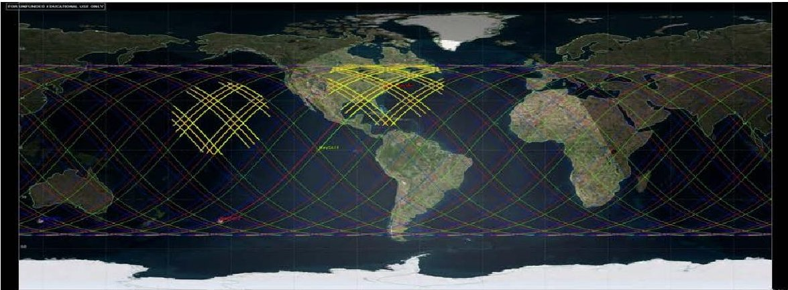

Figure 2: Ground track of Chesapeake Bay SAT's orbit

<!-- PDF_PAGE: 4 -->

## B. Polar (Ice) $ ^{3} $

Team Polar (Ice) $ ^{3} $ focused on the improvement of spatial and temporal resolutions using COTS parts to reduce mission cost as well as added functionality. The added functionality was chosen to maximize the scientific value of the mission due to the seasonal conditions of the assigned region of the Beaufort Sea.

## Mission Objectives

Polar $ \{Ice \} ^ {3} $ had a primary mission objective to image chlorophyll and measure sea surface temperatures in the Beaufort Sea; this area includes Prudhoe Bay and Mackenzie Bay. The secondary science mission is to track ice changes in the target region since the Beaufort Sea is frozen from late October to May, resulting in chlorophyll only being present in the summer months. The Pine Island Glacier has also been identified as a region of interest. The team began with a performance objective to produce images that have a spatial and temporal resolution that is at least three times greater than the images that are currently available to researchers; these values would be better than 125 m/pixel for spatial resolution and 6 per day for temporal resolution.

## Mission Concept Overview

This mission will utilize two 6U CubeSats. The result will be a lower cost mission that utilizes COTS products to produce the images with the expected improvements. Each satellite will use a battery and fixed solar panels for power. The scientific payload for each satellite includes:

- A Visual and Near IR imager- the Hyperscout by Cosine

- A Longwave IR Imager- the Tau2 640 by FLIR with a 50mm lens

These instruments have spatial resolutions of 72m/pixel for the VNIR, and 183 m/pixel for the LWIR, which represents an improvement of approximately 5 times the current standard. Additionally, the constellation configuration provides a temporal resolution of 8 passes/day, an improvement by a factor of 4.

## Orbital Design Parameters

The final orbit was selected based on the access it provided to the target region and the frequency of visitation. Four ground stations were identified for the downlink of data. The parameters are shown on the left, and Figure 3 depicts the ground track within the context of the target region, secondary region of interest, and the ground stations.

PolarICE3 1A I72 Inclination: 72° Eccentricity: 0 Altitude: 540 km RAAN: 110°

PolarICE3 1A I72 pointer Inclination: 72° Eccentricity:0 Altitude: 540 km RAAN: 60°

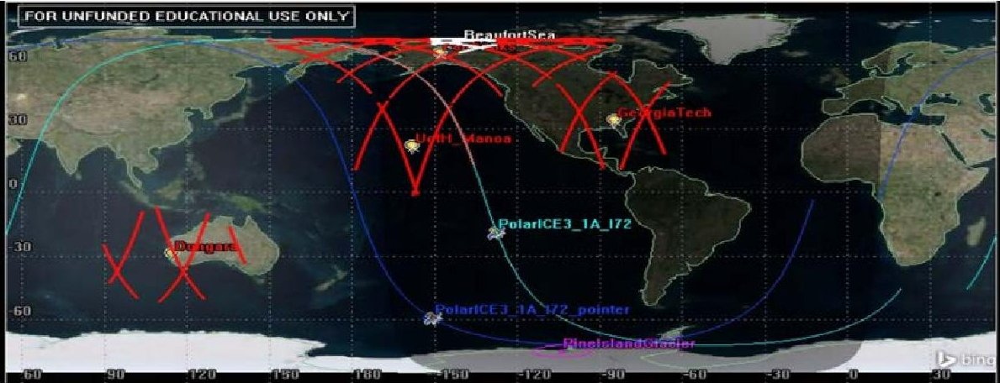

Figure 3: Ground track of Polar (ICE) $ ^{3} $

## C. SPACE GOAT

Team SPACE GOAT focused on minimizing cost using COTS parts, in order to demonstrate the versatility and value in developing CubeSat missions.

## Primary Objective

The primary mission of SPACE GOAT was to detect, monitor, and report microscopic algae (phytoplankton) and macroscopic algae (seaweed) growth rates in the exclusive economic zone of the Republic of Trinidad and Tobago and surrounding areas via Chl-a and SST. Additionally, the mission will demonstrate improvement of algae monitoring capabilities (spatial/temporal resolution) over currently available resolutions. Additionally, SPACE GOAT intended to detect, monitor, and report microscopic algae (phytoplankton) and macroscopic algae

<!-- PDF_PAGE: 5 -->

(seaweed) growth rates in the exclusive economic zones of other countries and unclaimed high seas via Chl-a and SST.

## Mission Concept Overview

The SPACE GOAT mission included a constellation of three 6U CubeSats in a circular orbit with an offset of $ 60^{\circ} $ between the Right Ascension of the Ascending Node (RAAN) of each satellite. Together they will observe ocean color and sea surface temperature of the primary region of Trinidad and Tobago as well as other secondary regions of scientific interest along the satellites orbital path. Along with fixed solar panels and a battery for power, each satellite would be have a payload including:

- Chameleon Multispectral linescan Imager by Space Advisory Company.

- Flir Tau2 640 Thermal Infrared Imager w/ 100mm lens.

This configuration provides spatial resolutions of 19m/pixel and 84.5 m/pixel respectively at an altitude of 500 km. This represents an improvement of the current standard by a factor of 19.

## Orbit Design

SPACE GOAT's orbit design was optimized for the target observation region. Utilizing the constellation concept significantly increases the temporal resolution.

Orbit Parameters Inclination: 15° Eccentricity: 0 Altitude: 500 km RAAN: 60° offset between each satellite. Period: 1.57 hours

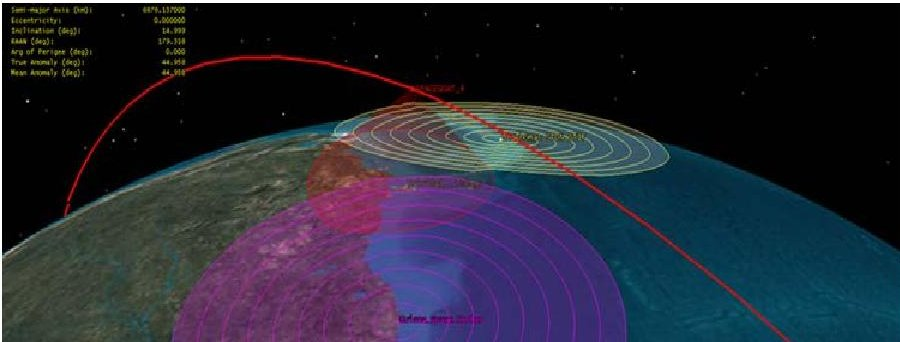

Figure 4: SPACE GOAT's orbital path of one satellite

## D. BioScope

Team BioScope chose to include additional functionality to the required mission objectives. These two areas of added functionality include incorporating the ability to process the multi-spectral images for multiple scientific purposes and the orbital design to offer several secondary regions of scientific interest.

## Primary Mission Objectives

BioScope's primary objective was to monitor ocean color through the detection and quantification of Chl-a specifically in (but not limited to) the region of the South West African Coast with a design that improves upon the current SOA capabilities in either spatial resolution, temporal resolution, or both.

## Mission Concept Overview

The BioScope Mission consists of a train of 2 satellites in a circular orbit about the earth at an inclination of $ 7 0^{\circ} $ and an altitude of 422km. Together they will observe ocean color, SST, and provide access to a wide range of scientific data and images appealing to the science community as well as the private sector. Each satellite has a 6U CubeSat structure housing state of the art imagers with fixed solar panels and battery.

- Sat 1 includes a Headwall Photonics VNIR hyperspectral push-broom imager and TIR sensor.

- Sat 2 includes a Headwall Photonics SWIR hyperspectral push-broom imager and TIR sensor.

This configuration provides a spatial resolution of 38m/pixel for the VNIR instrument, 42m/pixel for the SWIR, and 301m/pixel for the TIR @ 422m. This is an improvement of the current standard by more than a factor of 8.

<!-- PDF_PAGE: 6 -->

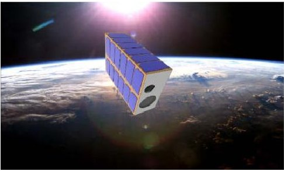

Figure 5: Rendering of one 6U satellite

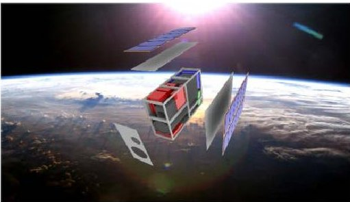

Figure 6: Exploded view

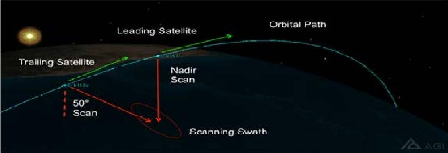

Figure 5: BioScope Mission Configuration

Secondary Objectives

Bioscope's concept for secondary mission objectives provides maximum flexibility to our customer. This concept takes full advantage of the chosen Headwall Photonics, Inc. VNIR and SWIR hyperspectral imagers. Utilizing pushbroom continuous scan imagers, BioScope would be able to collect full spectrum images from which any wavelength of interest or combination of wavelengths can be extracted and viewed in post processing. This flexibility affords the customer the ability and opportunity to mitigate mission costs with the marketability of additional data and imagery that will appeal to a wide range of additional customers in the science community, both in official environmental agencies as well as in the private sector.

Some examples of additional objectives that could be marketed to additional customers include specific harmful bacterial and algal blooms, coastal water health (in the 20-30m depth range), oil spill detection and monitoring, natural gas and petroleum seepage, monitoring and mapping micro-plastics in the oceans, mineral mapping, vegetation and forest health, drought monitoring, mapping burned regions, and many more. The details regarding image type and bandwidths required for each of these examples were provided in BioScope's presentations and formal reports. The versatility of the Headwall imagers and the software that accompanies them makes this approach to secondary objectives feasible.

## Orbit Design

The orbit of the BioScope mission was designed to balance spatial resolution (primary), temporal resolution (secondary), orbital lifetime (both for longevity of image collection, and passive deorbit within a responsible period), day and night coverage of the target region of scientific interest, and access to secondary regions of scientific interest.

Orbit

Eccentricity, e = 0

Altitude, A = 422km

Inclination, i = 70°

Period, T=1.4 hrs

Repeat Cycle

Orbits/Repeat = 46

Cycle Period = 2.96 days

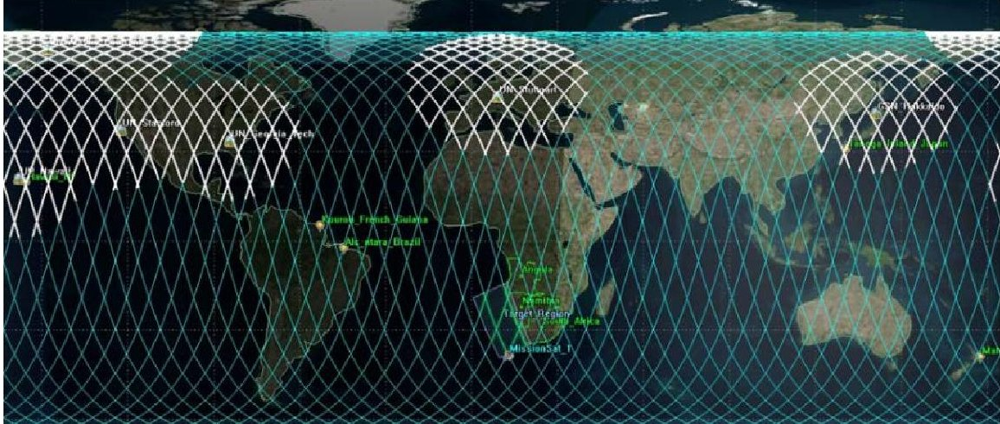

Figure 6: BioScope's ground track with highlighted regions of additional scientific interest

<!-- PDF_PAGE: 7 -->

## E. Concept of Operations and other Mission Design Elements

All four teams presented a mature concept of operations as well as equipment selection for the Avionics, Communications, and Data Handling subsystems to support their mission design. Equipment selection for these subsystems were specific to each teams' scientific instruments chosen and their mission objectives. Teams justified the choices for these subsystem components by considering their system's demand for data, file size, image quality, transmission opportunity and cost, and the feasibility of data compression and on-board processing. After each "Shark-Tank" style presentation, teams were questioned and pushed for clarification in all areas of their design. The final presentation of the first semester was the Critical Design Review (CDR). In this presentation teams were required to demonstrate the continuity of their project design management through the MBSE methods learned, with a focus on subsystems integration. Also required by the course instructors was a preliminary risk analysis. Some methods used were Fault Tree Analysis and the Risk Assessment Matrix. Figure 7 is an example of one team's ConOps illustration.

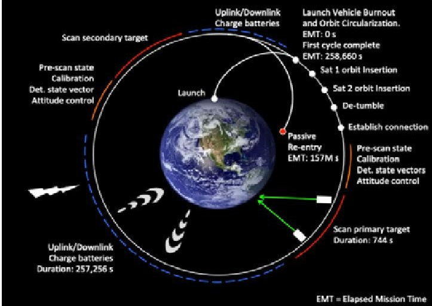

Figure 7: BioScope ConOps illustration

## F. Model Based Systems Engineering

All four teams followed a Model Based Systems Engineering approach for the organization and design process of their mission concepts. The tools needed for following this approach were incorporated into the seminar-styled lectures throughout the first semester and delivered by guest lecturers having a specialized expertise with these tools. The teams used these methods for overall project management, to conduct trade studies for decision making, to demonstrate subsystems interconnections and integration, and to begin the risk assessment process. Some examples of how the teams used these tools follows.

<table border="1"><tr><td></td><td>SEMP Structure</td><td>SEMP Substructure</td><td>Methodologies</td></tr><tr><td rowspan="10">System Engineering Process</td><td rowspan="6">Integrated Product &amp; Process Design</td><td>Establish Need</td><td>NASA Decadal Survey</td></tr><tr><td>Define Problem</td><td>Affinity Diagram, Prioritization Matrix</td></tr><tr><td>Establish Value Objectives</td><td>Quality Function Deployment</td></tr><tr><td>Generate Feasible Alternatives</td><td>Morphological Matrix</td></tr><tr><td>Evaluate Feasible Alternatives</td><td rowspan="2">Pugh Matrix, Overall Evaluation Criterion, Historical Data Comparison</td></tr><tr><td>Make Decision</td></tr><tr><td rowspan="3">Verification &amp; Validation</td><td>Conceptual Design Verification</td><td>System Testing</td></tr><tr><td>Detailed Design Verification</td><td>Subsystem Testing</td></tr><tr><td>System Validation</td><td>Successful Beaconing and Data Downlink</td></tr><tr><td rowspan="6">Project Management</td><td rowspan="2">Schedule</td><td>Reviews</td><td>October, November, December</td></tr><tr><td>Milestones</td><td>MCR, PDR, CDR, FRR</td></tr><tr><td rowspan="2">Organization</td><td>Documentation</td><td>PowerPoint, Research Notebook, PERT Chart, BOX</td></tr><tr><td>Verification Infrastructure</td><td>STK, NASA, ODU, GATECH, FIT, NCAT</td></tr><tr><td rowspan="2">Risk &amp; Cost Management</td><td>Risk Management</td><td>Risk Assessment Matrix</td></tr><tr><td>Cost</td><td>Quality Function Deployment, Concept Selection, Pugh Matrix</td></tr></table>

Figure 8: SPACE GOAT System Engineering Management Plan

<table border="1"><tr><td colspan="3">Mission Tradeable Elements</td></tr><tr><td>Element of Mission Architecture</td><td>Can be Traded</td><td>Reason</td></tr><tr><td>Mission Concept</td><td>No</td><td>Depends on Payload choices, and both Payload choices will require ground data processing with a central computer after receiving data from various ground stations. The Tasking and scheduling will be dependent on Orbit design.</td></tr><tr><td>Subject</td><td>No</td><td>Region of interest is a firm requirement, but can observe and sense additional things and regions.</td></tr><tr><td>Payload</td><td>Yes</td><td>Instruments may vary in complexity to achieve optimum temporal and spatial resolutions as well as in consideration of secondary mission objectives.</td></tr><tr><td>Spacecraft Bus</td><td>No</td><td>Payload choice dictates Bus design.</td></tr><tr><td>Orbit</td><td>Yes</td><td>LEO only; with multiple geometries, inclinations possible and well as varying number of satellites.</td></tr><tr><td>Launch System</td><td>Yes</td><td>Choose the minimum cost for selected orbit and spacecraft number.</td></tr><tr><td>Ground System</td><td>No</td><td>Data transmittal and processing will require aggregation of information received from multiple ground communication stations.</td></tr><tr><td>Communications Architecture</td><td>Yes</td><td>Options range from fixed interpretation of preclemined primary and secondary mission objectives to the ability to add objectives through post-processing of additional imaged wavelengths. Partially dependent on Payload choice.</td></tr><tr><td>Mission Operations</td><td>Possibly</td><td>Mostly automated operations, but may have some level of control.</td></tr></table>

Figure 9: BioScope's Tradeable Elements Matrix

<!-- PDF_PAGE: 8 -->

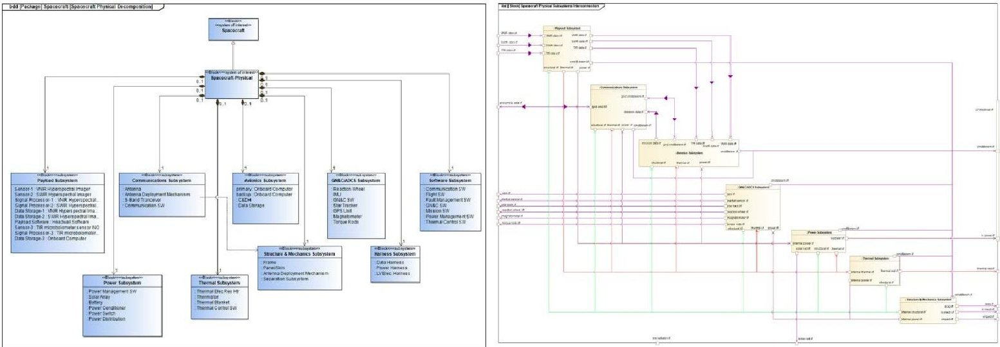

Figure 10: BDD example

Figure 11: IBD Example

## IV. Semester Two - Team Results

Over winter break, representatives from each team attended a workshop hosted by XinaBox, a South African company dedicated to making science affordable and accessible using modular scientific sensors sized for FlatSat applications. This was the starting point for the second semester with the goal of having an operational system that would be launched. The XinaBox kits are designed for simple science and weather experiments, which require customization to achieve the primary objective of ocean color observation. The class makeup of this semester changed somewhat due to scheduling conflicts. The remaining students from GT, ODU, and NC A&T were reorganized into two teams and instructed to de-scope the mission designs from semester one. The new scope limited the missions to a high-altitude balloon launch versus the low earth orbits previously planned for by each team; additionally a major reduction in cost was mandated to make the launch feasible and attainable in the semester time frame. The new teams, ICE $ ^{2} $ BayBSAT and BioGOAT, were faced with the challenge of reducing cost while maintaining as much of the primary and secondary objectives from the model missions of the first semester. This prompted new payload instrument selections and a re-design of the subsystems. The new target region for both teams was assigned as the Chesapeake Bay and the design altitude for the balloon is 30 km. At each presentation the teams used their previously established MBSE derived project management framework to incorporate the de-scoping parameters. The satellite systems related lectures and instruction continued throughout the course, but more time was devoted to planning and managing the de-scoping of the missions.

## Funding and Budget Process

At the start of the de-scoping process, funding was still to be determined. This affected the re-design process and resulted in an evolution of the design over the course of the semester. The new BalloonSat concept enabled an immediate reduction in cost as the lower altitude of 30 km allowed for less expensive imagers to achieve comparable spatial resolutions. A few weeks into the second semester NC A&T, ODU, and GA Tech each committed an amount of $500 to the project, which prompted further mission concept changes as a ballpark budget emerged. An example of these concept changes is that both teams originally had the goal of including the secondary objective of sensing Sea Surface Temperature (SST), but ultimately eliminated this capability from their mission concepts. Additionally, both teams made multiple iterations of budget reductions and submitted them to course instructors to facilitate the securing of further funding. The final word on funding came on April 25 with additional contributions from the National Institute of Aerospace and Science and Technology Corporation (STC) of Hampton, VA totaling $1500. This process created a time delay for the ordering of equipment and, consequentially, has delayed the launch tentatively until later in May.

## ICE $ ^{2} $ BayBSAT

ICE $ ^{2} $ BayBSAT's primary focus for the de-scoping was cost reduction, which required a simplification of mission objectives. The new mission concept is to employ two small visual imagers: one RGB camera and a second without an infrared filter. These images will be processed after retrieval to provide the required scientific information on chlorophyll-a in the Chesapeake Bay by calculating the Normalized Difference Vegetation Index (NDVI) for each

<!-- PDF_PAGE: 9 -->

pixel. The NDVI ratio emphasizes photosynthesis while filtering out solar glare and values can range from -1 to 1. High photosynthesis activity corresponds to an NDVI value between 0.1 and 0.9.

The housekeeping processes will be controlled with a raspberry pi3 B+ and supported by XinaBox x-chip sensors. The main housing for the payload will be a Styrofoam container. To reduce the tendency of the payload to spin, a tethering system will be employed (as shown in Figure 12) [1] utilizing four booms and eight securing lines. A 3D printed housing will be used to contain the XinaBox chips and raspberry pi3 B+ (Figure 13).

-8MP Images will be produced with 11 m/pixel Spatial Resolution.

## Recovery

ICE $ ^{2} $ BayBSAT will use a SPOT Trace backup GPS system to increase the chances of recovery.

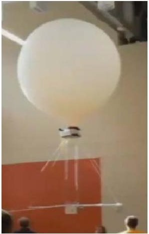

Figure 12: Tethering system

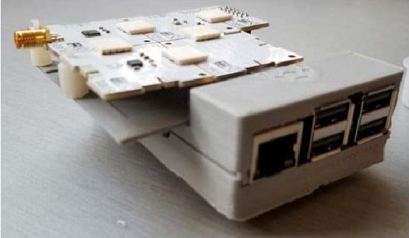

Figure 13: Custom 3D printed housing

## BioGOAT

BioGOAT's new mission concept focused on balancing the lower cost with the original concept of providing added functionality from the BioScope first semester design. The payload will include a MAPIR VNIR Imager that will provide images with 3 bands of information in the 850nm (NIR), 550nm (Green), and 475nm (Blue) ranges. Also included in the payload will be a First-Person View camera. BioGOAT's BalloonSat will be able to determine altitude by sensing atmospheric pressure as well as direction, with an additional sensor that will serve as a digital compass. The mission will be controlled by a raspberry pi3 and supported with XinaBox sensors. Images will be transmitted at regular intervals during the mission, while images taken between transmission will be processed on recovery. The main housing will be a 3D printed chassis (Figure 14) with Styrofoam panels for insulation.

- 12MP Images will be produced with 5.6 m/pixel Spatial Resolution

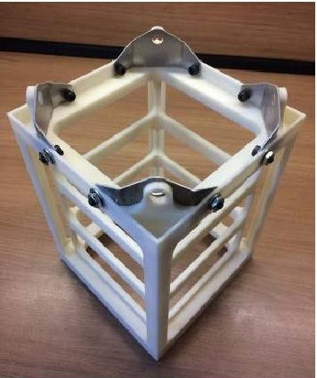

Figure 14: BioGOAT 3D printed chassis

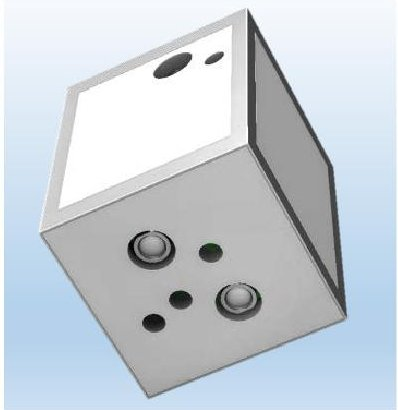

Figure 15: Rendering with foam panels

## Recovery

BioGOAT has decided to attempt to steer the parachute towards shore if the flight simulation predicts an ocean touchdown. The concept was inspired by the work the University of Missouri has done in the area of steerable parachutes for cargo delivery [2]. This required a custom designed cruciform style parachute, and a pair of linear actuators. For simplicity, the actuators selected include built-in PID controllers. The original idea included a custom Autonomous Guidance algorithm to guide the parachute towards one of a few predetermined GPS locations. The time delay in funding has reduced the plan to guiding the parachute back to shore, making use of the digital compass XinaBox add-on chip. This goal is completely dependent on time and will be attempted once the data handling and

<!-- PDF_PAGE: 10 -->

communications functionality of the primary mission goals has been assured. Figures 15(a), 15(b), and 15(c) illustrate the rigging configurations for this concept. By applying this concept to BioGOAT's BalloonSat system configuration it is estimated that BioGOAT could potentially autonomously steer the parachute back to shore if it reaches a steerable altitude of between 6,000 and 10,000 ft (depending on wind velocities) no more than 3.34 miles or 5.57 miles, respectively, away from shore.

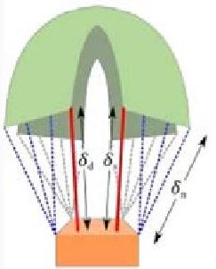

(a) Neutral rigging.

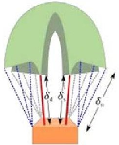

(b) Rigging for glide.

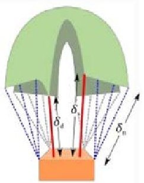

(c) Rigging for spin.

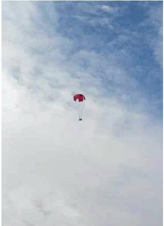

Figure 16: Parachute system rigging for steerability

Figure 17: Custom parachute drop test

## V. Avionics and Onboard Computing Systems

The myriad of computing solutions available to handle data and communication processing needs meant that there was a variety of options for teams to choose from during both semesters of the class. The Onboard Computing System (OBC) can be based on custom-built hardware and software or use Commercial off the Shelf (COTS) components or any mixture of the two. What became readily apparent to all the groups is that a sizeable gap in price, performance, and capability existed between some of the more enterprise grade custom solutions and their COTS/hobbyist counterparts. This was in part due to the significant advancements in computational power as a result of the boom in mobile computing, the push for the Internet of Things (IoT) and hobbyist processing power coupled with a significant decrease in hardware pricing.

An example of how pronounced this differential was exhibited by the BioScope/BioGoat selection presented as a part of their final design review of the first semester. The ISIS OBC (Figure 18(a)) which cost $5,600 featured several space hardened and redundant onboard components that were specifically designed and built to withstand the severe environment to be encountered in space. The manufacturer had been in business for decades as a supplier to the space industry and supported multiple real-time operating systems specifically designed for space flight. In contrast, the BeagleBoard BeagleBone (Figure 18(b)) which cost $50 had double the processing power, double the data storage, and eight times the amount of RAM available for running applications (Figure 19). With a cost differential so pronounced, justifying the significantly higher cost which in turn would lower the overall risk tolerance of the mission while sacrificing performance characteristics often made choosing the more expensive platform an indefensible position. This phenomenon presented itself for multiple avionics and OBCs offerings that were evaluated by the groups throughout the course.

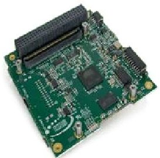

(a) ISIS OBC

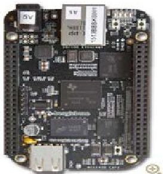

(b) BeagleBoard BeagleBone

Figure 18: The Innovative Solutions In Space and BeagleBoard OBC

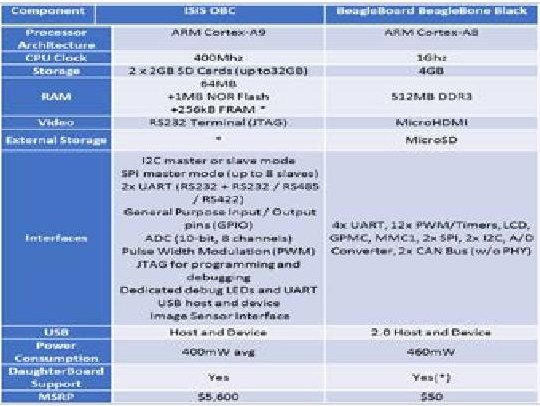

Figure 19: OBC Component Comparison Chart

<!-- PDF_PAGE: 11 -->

## V. Conclusions and Student Feedback

This multi-University course in Small Satellite Systems Design was a unique and rewarding experience as a graduate student. The scope of the course was broad and yet it provided a detailed exposure to nearly all aspects of the design of small satellite systems. Utilizing the project management approach of Model Based Systems Engineering provided students with valuable real-world knowledge and experience that will be useful in both the research and corporate environments. The multi-University and multi-disciplinary aspects of this course highlighted the usefulness of the MBSE approach as most engineering projects are multi-disciplinary in nature and modern technology makes communicating with experts around the world nearly effortless.

Students provided some feedback on this course at the end of the second semester. The main suggestion was to have the funding amount and process defined at the beginning of the build semester. This would allow teams to be more productive during the build semester, and requiring only one design process with a well-defined scope and budget. It would also allow time for purchasing parts with longer lead times and allow them to budget time for more testing. Another possibility would be to only have one team during the build semester to allow for more cooperative work on the various subsystems.

## Acknowledgments

The authors would like to thank the lead instructors; Dr. William Edmonson (NCAT), Dr. William Moore (HU), Dr. Robert Moses (LaRC), and Dr. Robert Ash (ODU). Additional instructors and contributors included Colin Britcher (ODU), Glenn Lightsey (GT), Stephen Horan (LaRC), Andrew Aldrin (FIT), Brian Kaplinger (FIT), Justin Little (UWash), Dr. Miguel Nunes (UH Manoa), and Charles Camarda (LaRC). Thanks are also extended to Judi Sandrock and Bjarke Gotfredsen of XinaBox. The authors would also like to include the other students in the class: Amanda Stark, Allan Anzagira, Nadew Kibret, Richard Hunter, Robert Fowler, Joshua Ingersoll, Jairus Elarbee, and John Amin.

## References

[1] Flaten, James & Gosch, Christopher & Habeck, Joseph. (2015). Techniques for Payload Stabilization for Improved Photography During Stratospheric Balloon Flights. In 6th Annual Academic High-Altitude Conference.

[2] Herrington, Shawn & Renzelman, Jeff & Fields, Travis & Yakimenko, Oleg. (2019). Modeling and Control of a Steerable Cruciform Parachute System Through Experimental Testing. 10.2514/6.2019-1074.

[3] XinaBox https://xinabox.cc/