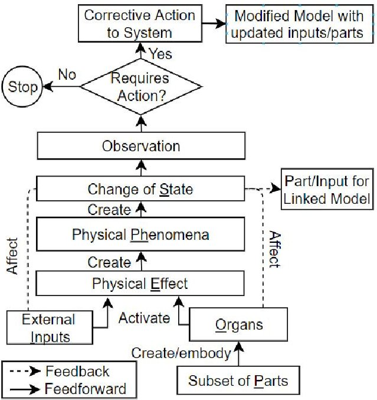
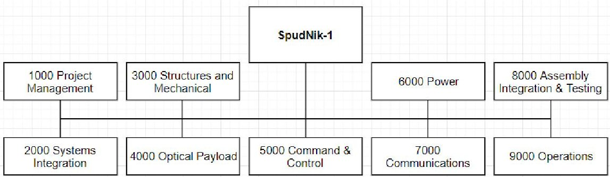
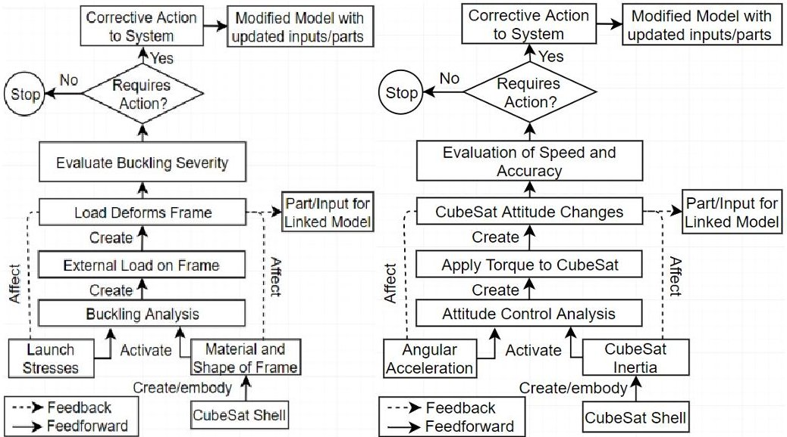
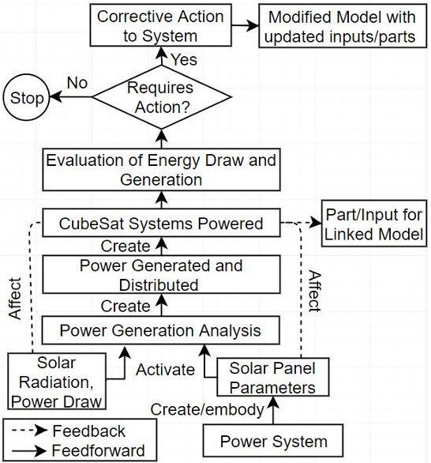

<!-- PDF_PAGE: 1 -->

# A Novel Approach to Product Lifecycle Management and Engineering Using Behavioural Models for the Conceptual Design Phase

Stephen Peters, Clement Fortin, Grant Mcsorley

## To cite this version:

Stephen Peters, Clement Fortin, Grant Mcsorley. A Novel Approach to Product Lifecycle Management and Engineering Using Behavioural Models for the Conceptual Design Phase. 16th IFIP International Conference on Product Lifecycle Management (PLM), Jul 2019, Moscow, Russia. pp.159-169, <10.1007/978-3-030-42250-9_15>. <hal-04444751>

HAL Id: hal-04444751

https://inria.hal.science/hal-04444751v1

Submitted on 7 Feb 2024

HAL is a multi-disciplinary open access archive for the deposit and dissemination of scientific research documents, whether they are published or not. The documents may come from teaching and research institutions in France or abroad, or from public or private research centers.

L'archive ouverte pluridisciplinaire HAL, est destinée au dépôt et à la diffusion de documents scientifiques de niveau recherche, publiés ou non, émanant des établissements d'enseignement et de recherche français ou étrangers, des laboratoires publics ou privés.

<!-- PDF_PAGE: 2 -->

## ifip International Federation for Information Processing

This document is the original author manuscript of a paper submitted to an IFIP conference proceedings or other IFIP publication by Springer Nature. As such, there may be some differences in the official published version of the paper. Such differences, if any, are usually due to reformatting during preparation for publication or minor corrections made by the author(s) during final proofreading of the publication manuscript.

<!-- PDF_PAGE: 3 -->

# A Novel Approach to Product Lifecycle Management and Engineering Using Behavioural Models for the Conceptual Design Phase

Stephen Peters $ ^{1} $ , Clément Fortin $ ^{2} $ and Grant McSorley $ ^{1} $ [0000-0003-2289-9283]

$ ^{1} $ University of Prince Edward Island, Charlottetown PE CIA 3T3, CA $ ^{2} $ Skoltech, Skolkovo Innovation Center, Moscow, RU sepeters@upei.ca

Abstract. This work builds upon a previous proposal for the use of the extended SAPPhIRE model of causality as a foundation for a PLM system, and more specifically the management of design data at the conceptual design phase. During the conceptual design phase, the product definition is in a state of flux as multiple iterations and options are considered until a suitable baseline design is developed. The role of PLM systems is to manage the people, processes and products involved in developing and sustaining a product in order to increase stakeholder satisfaction and product quality while reducing lifecycle costs. At the conceptual design stage, a balance must be struck between the freedom to iterate and the need to control the design process and capture relevant data.

Currently, PLM systems are not well suited for the support of the conceptual design stage due to their reliance on the product structure, as the unavoidable, significant design changes to the physical configuration in the early design stages make it difficult to maintain a coherent product definition. This paper presents a case study of the product data created during the conceptual design phase of the SpudNik-1 CubeSat. The results demonstrate the ability of the model to represent a variety of design data representing different subsystems at several levels of maturity. This could prove to be more consistent and easier to use for conceptual design and is one part of a larger goal of redesigning PLM systems for the support of the extended product lifecycle.

Keywords: Conceptual Design, Behaviour, Function, Causal, Satellite Nanosatellite, Product Lifecycle Management, Behavioural Model

## 1 Introduction

Designing, building and operating spacecraft and other complex systems involve unique challenges for engineers. To address these challenges, engineers have developed methodologies and tools that emphasize collaboration and dynamic exchanges between personnel. These methodologies form the basis of concurrent engineering and are central to the systems engineering development process. Typically, the systems engineer-

<!-- PDF_PAGE: 4 -->

ing process is represented by the V-model, and more recent work has specifically focused on the early stages of space system design [1], which can be referred to as concurrent conceptual design. Creating a proper tool for exchanging and storing design data and supporting the concurrent work and collaboration is imperative for optimizing the quality of work, schedule goals and capital expenditures.

The effective handling of data is crucial for the success of each phase of an engineering design project. Previous work focused on the design data used within the CEDESK concurrent conceptual engineering tool, which is based on parametric systems models, and was restricted to the thermal behaviour of a CubeSat [2]. CEDESK is a data exchange tool that was developed to conduct concurrent design studies in an efficient way, with previous case studies performed on satellite projects [3]. This paper will expand on the previous work in two ways. First, by examining conceptual design data in multiple formats and from multiple sources, and second by comparing the representation of multiple CubeSat subsystems.

The paper is structured as follows. After a summary of the literature review and an explanation of the Extended SAPPhIRE model, the context of the case study is established. The methodology of the data collection and analysis is explained, and the results presented. Finally, relevant insights and conclusions are made based on the case study and future work in this direction is proposed.

## 2 Conceptual Design Data In Product Development and PLM

During the conceptual design phase, the product definition is in a state of flux as multiple iterations and options are considered until a suitable baseline design is developed [4]. The role of PLM systems is to manage the people, processes and products involved in developing and sustaining a product in order to increase stakeholder satisfaction and product quality while reducing lifecycle costs [5].

At the conceptual design stage, a balance must be struck between the freedom to iterate and the need to control the design process and capture relevant data. To date, PLM and computer assisted engineering tools have been limited in support of conceptual design [4,6], although some authors have proposed possible solutions, with a focus on managing and exploiting the types of information available at early versus late stages of the development process.

Rizzi and Regazzoni [7] suggest that the use of problem solving or solution generation tools such as GTI's RelEvent Diagram or TRIZ in a PLM framework could help exploit unstructured conceptual design information to improve knowledge management, identify criticalities and reduce revision times, but do not elaborate on implementation. Torres et al [6] distinguish between geometric and non-geometric data at the conceptual design phase, and propose a knowledge-based approach combing QFD, axiomatic design and FMEA with CAD Tools in order to connect the two. However, the product structure remains the foundation for the connection, and initial geometric design parameters must be defined early on. Chandrasegaran et al [8] explain that PLM extended the abilities of PDM systems to represent product data to the representation

<!-- PDF_PAGE: 5 -->

of product knowledge which can be "represented in terms of requirements, specifications, artifacts, forms, functions, behaviours, design rationale, constraints and relationships". However, in actual implementation, many commercial tools continue to rely primarily on the product structure as the defining element of the product. A notable exception is Rachuri et al [9] who propose a PLM framework centered on the Core Product Model, which includes behaviour, function and geometry, which is in line with our current work but does not include relationships of causality like SAPPhIRE.

An overall theme from the literature is that there is a distinction to be made between geometric and non-geometric data. This is consistent with the authors' experience that non-geometric data may be more important than geometric data at the conceptual design stage [2]. In this work, 'geometric' is defined as data which can be measured in physical units and directly refers to the physical dimensions or configuration of a system. The present work proposes how engineers and designers can organize these representations in a logical structure based on a behavioural model.

## 3 Representations of Product Behaviour for Supporting Conceptual Design

The extended SAPPhIRE (State-Action-Parts-physical Phenomenon-Inputs-oRganphysical Effect) causality model [11] based on the work of Chakrabarti et al. [10] shown in Figure 1, provides a visual representation of how the behaviour and function of the system are brought about through one or multiple changes of state which occur due to the physical laws acting upon the system. This model provides a richer representation, at various levels of granularity, of the relationships between the function, behaviour and structure of a system, than previous function-behaviour-structure models, such as those of [12], [13], and [14]. Descriptions of each model element can be found in table 1. Previous work has demonstrated the use of the SAPPhIRE model for the representation of in-service [15], test [11] and conceptual design data [16], and proposed as a framework for product lifecycle management [11]. The modified Extended SAPPhIRE model was developed in order to more closely align with the product development process and to represent the evolution of the product over its lifecycle [10]. The intended benefits of this representation over traditional PLM product data structures include the ability to represent system behaviour at various level of granularity and system decomposition, as well as the focus on system functions and behaviours, which demonstrate compliance to requirements, as opposed to a primary focus on the product structure or bills of materials.

Preliminary research has demonstrated the use of the Extended SAPPhIRE model for the structuring the design data found within parametric design models used for concurrent conceptual design of CubeSats [2]. Three categories of conceptual design data were defined and identified within parametric models managed by a concurrent conceptual design tool, CEDESK. These categories were then associated with corresponding elements of the Extended SAPPhIRE model (Table 2), providing an initial indication of the viability of the use of the model for structuring conceptual design data.

<!-- PDF_PAGE: 6 -->

Fig. 1. Extended SAPPhIRE Model

Table 1. Extended SAPPhIRE model constructs [17]

<table border="1"><tr><td>Model Construct</td><td>Definition</td></tr><tr><td>Parts</td><td>A set of physical components and interfaces constituting the system and its environment of interaction.</td></tr><tr><td>Change of State</td><td>The attributes and values of attributes that define the properties of a given system at a given instant of time during its operation.</td></tr><tr><td>Organ</td><td>The structural context necessary for a physical effect to be activated.</td></tr><tr><td>Physical Effect</td><td>The law of nature governing a change.</td></tr><tr><td>Input</td><td>The energy, information or material requirements for a physical effect to be activated; interpretation of energy/material parameters of a change of state in the context of an organ.</td></tr><tr><td>Physical Phenomenon</td><td>A set of potential changes associated with a given physical effect for a given organ and inputs.</td></tr><tr><td>Corrective Action:</td><td>Action taken (by human intervention or by system self-correction) based on interpretation of change of state.</td></tr><tr><td>Observation</td><td>The interpretation of the change of state which may modify the current system.</td></tr></table>

<!-- PDF_PAGE: 7 -->

Table 2. Design Data Types and Element Correspondence [2]

<table border="1"><tr><td>Data Type</td><td>Definition</td><td>Element</td></tr><tr><td>Behavioural</td><td>Corresponds to physical phenomenon</td><td>Physical Effects
Physical Phenomenon</td></tr><tr><td>Geometric</td><td>Measurable via physical units referring to physical system dimensions</td><td>Organs
Subset of Parts
Change of State</td></tr><tr><td>State</td><td>Important design variables required for a change</td><td>Inputs
Change of State</td></tr></table>

## 4 Case Study Context

The University of Prince Edward Island is currently in the process of designing a 2U (20x10x10cm) CubeSat named 'SpudNik-1' in partnership with the Canadian Space Agency. This is part of the national Canadian CubeSat Project and has a target launch window of Q4 2021. The primary functional requirement for the satellite is to capture 2-10m optical resolution of the Canadian province of Prince Edward Island (PEI) and relay it back to a ground station. This information will be used for ongoing precision agriculture research. The CubeSat standard was developed as a low cost means for universities to allow researchers and students to conduct a range of experiments [18]. These are typically launched as part of larger payloads by external partners and rely on existing infrastructure. As a result, the interfaces and safety requirements are tightly controlled by interface configuration documents and standards.

The SpudNik-1 work breakdown structure presented in Figure 2 is based on typical breakdowns for CubeSats and complex systems engineering projects [18], [19], as well as logistical considerations.

Fig. 2. Simplified Work Breakdown Structure

The CubeSat development process (prior to launch) has been divided into four standard stages: Mission Concept Development; Preliminary Design; Detail Design; Assembly, Integration and Testing. The conceptual design activities were completed as part of the Mission Concept Development phase, and so the current work considers only the design progress up to the Mission Concept Review.

<!-- PDF_PAGE: 8 -->

## 5 Methodology

The methodology for the case study consisted of five main steps:

1. Selection of a key behaviour for each subsystem

2. Representation of subsystem behaviour using the Extended SAPPhIRE model

3. Survey of design data created during the conceptual design phase (i.e. prior to the Mission Concept Review)

4. Association of conceptual design data to relevant elements of the behavioural models

5. Validation of model with designers

The subsystems selected were based on the SpudNik-1 WBS. While additional behavioural models would be needed to represent the complete CubeSat, for the scope of the present study, this was limited to one significant behaviour per subsystem. As the UPEI co-authors are involved in the project in the roles of project manager and systems engineer, they had access to all relevant design data produced by the student teams. Where possible, conceptual design data was traced to originating files or documents. These sources were related to the appropriate model elements. For example, external inputs may be derived from standards and requirements, while relevant parts may be included in a BOM or a labelled sketch.

## 6 Results

## 6.1 Model Identification and Data Collection

Based on the CubeSat system requirements and WBS, it was decided to develop six behavioural models, one for each subsystem, see table 3. The relevant team was identified in order to determine the most relevant data sources. It should be noted that while a central, web-based project management and documentation hub was used by all teams, each team also had its own data repository.

Determining a suitable approach to partitioning the CubeSat design into behavioural models was referenced from both the system requirements, and the preexisting design teams. Table 3 summarizes this. There were a host of possible analysis files to choose from for every team. One of the authors, as the system engineer and integration lead, had access to all relevant data and a thorough understanding of the overall development process. For the purposes of narrowing the scope, each behaviour was limited to a single parametric model, selected based on its relevance to the design and its impact on the overall design definition. The selected models are presented in table 3, along with the associated subsystem, team, and the primary driving requirements, in order to provide context.

The source and types of data used for the parametric models varies between teams. The Buckling Analysis used dimensional and mechanical property data of initial rail designs and prototypes. The Reaction Wheel Analysis was based on preliminary estimates regarding weight distribution from initial layouts and CAD assemblies provided

<!-- PDF_PAGE: 9 -->

by the Structures and Payload team. It is important to note that the analyses are iterative, due to the ongoing evolution of the CubeSat design.

Table 3. Subsystems and Behavioural Models

<table border="1"><tr><td>Subsystem(Team)</td><td>Behavioural Model</td><td>Driving Requirement</td></tr><tr><td>Thermal(Structures and Payload)</td><td>Heat Transfer with environment</td><td>Component temperature limits</td></tr><tr><td>Structure(Structures and Payload)</td><td>Structural Buckling</td><td>Critical launch load case</td></tr><tr><td>Communications(Communications)</td><td>Data Transceiving</td><td>Link budget and power requirements</td></tr><tr><td>Power(Power)</td><td>Power Generation</td><td>Power budget</td></tr><tr><td>Optical Payload(Structures and Payload)</td><td>Optical Sensing</td><td>Image quality</td></tr><tr><td>Attitude(Command &amp; Control)</td><td>Reaction Wheel Dynamics</td><td>Positioning requirements for image acquisition</td></tr></table>

## 6.2 Mapping of analysis files to the SAPPhIRE Model

The behavioural models of all six subsystems were developed, three of which are presented below in Figures 3, 4 and 5. Due to the observed consistency across data sources (Excel spreadsheets, initial CAD models, data sheets), there is a high level of confidence that the models represent the targeted subsystem behaviours. The developed models and the information sources were also presented to the relevant designers, to garner their opinions. They expressed understanding of this representation of their system and indicated an interest in the use of functional models for organizing their files.

As reported in [2], and confirmed in this study, at the conceptual design stage, the physical phenomena are typically represented by calculations, parametric models or simplified simulations. These representations in turn draw on external data, which can be related to the inputs, parts and organs necessary for activating the phenomena. Table 4 presents the sources for data used in each of the parametric models. We have not included project requirements and universal information (i.e. physical constants) in this summary as they are accessible project wide.

There were three models whose analyses included standard components to be outsourced, and thus used specifications from online distributors. Two models were reliant on the geometries of the CubeSat that were featured in the CAD assembly. Finally, because of the simplicity of manufacturing rails, the Buckling Analysis used geometries from the simple physical prototypes to confirm its validity.

<!-- PDF_PAGE: 10 -->

Fig. 3. Buckling Analysis

Fig. 4. Motor and Reaction Wheel Analysis

Fig.5. Evaluation of Power Generation

For this case study, most of the exterior input data originated from either a CAD model or an online specifications sheet. Ideally, any future tool will be able to properly capture and store design information in all its forms, originating from a logbook to a website. Quantitative data should be inputted seamlessly into the model and its functions. In contrast, qualitative would be catalogued and stored as its original file type into the appropriate behavioural model element.

<!-- PDF_PAGE: 11 -->

Table 4. External sources for models

<table border="1"><tr><td>Parametric Model</td><td>External Data Source(s)</td><td>Element</td></tr><tr><td>Thermal Analysis</td><td>CAD Model</td><td>Organs</td></tr><tr><td>Buckling Analysis</td><td>Prototype</td><td>Organs</td></tr><tr><td>Transceiver Analysis</td><td>Component, Supplier Datasheet</td><td>Parts. Organs</td></tr><tr><td>Operational Modes</td><td>Component, Manufacturer Datasheet</td><td>Parts, Organs</td></tr><tr><td>Optical Sensor Design</td><td>CAD Model</td><td>Organs</td></tr><tr><td>Reaction Wheel Analysis</td><td>Component Supplier Datasheet</td><td>Parts, Organs</td></tr></table>

One difficulty encountered in representing system behaviour is capturing the different operational modes. This affects the behaviour of the power system, as other subsystems such as the optical payload, attitude control and communications have varying power requirements depending on the mode of operation of SpudNik-1. For example, the imaging mode requires more power than the hibernation mode. SAPPhIRE includes a feedback loop, so it can model these temporal variations in the data but it remains difficult to convey that here. This representation will be the focus of future work.

## 7 Implications of work:

Initially it was hypothesized that the buckling behaviour of the structure would be the most difficult to represent through a behavioural model due to its reliance on geometric data. However, during the mapping process it was realized that because the outer shell of the CubeSat is controlled by detailed interface requirements and pre-defined launch loads, the structure has little dependency on design changes to the other CubeSat subsystems. The Structures and Payload team can design the frame based on the load requirements, while the relative placement and design of the internal components do not have to be taken into account. This indicates that it is the unvarying nature of the geometric data rather than its total amount that is more relevant for defining the data structure (i.e. behavioural versus structural).

In contrast, the assumptions necessary for designing the reaction wheels (i.e. CubeSat inertia) are heavily dependent on geometric data that were not finalized at the conceptual design phase, for example the mass properties and distribution within the BUS. As a result, there is a high likelihood of design changes to the reaction wheels later in the development process. This indicates that the dependency between systems, in particular with respect to geometric properties, can be a critical factor.

Lastly the Power analysis is primarily concerned with non-geometric data, for example solar radiation levels in Low Earth Orbit and the power draw from the CubeSat subsystems. However, indirectly the analysis will be affected by the lack of geometric data. As the reaction wheel cannot be sourced confidently because of the lack of knowledge about the inertia, there remains uncertainty with respect to the power requirements.

An important observation that was not captured in the three models presented is the uncertainty and necessary iterations regarding the overall geometric definition and physical configuration of the CubeSat. For example, there are strict requirements re-

<!-- PDF_PAGE: 12 -->

garding the allowable mass and location of center of gravity for CubeSats, and uncertainty with respect to the geometric properties of the subsystems results in an ongoing risk to meeting these requirements. Similarly, there is a strong dependency between the design of the Optical Payload and the overall CubeSat layout, due to the need to achieve as long an effective focal length as possible. The novelty of the of optical design adds to this complexity.

These observations further indicate that the high level of uncertainty regarding the physical definition of the system at the early stages of design calls into question the utility of the product structure for organizing conceptual design data, as traditionally done in PLM systems. It should be noted that there exist tools to manage the complexity described above, for example the design structure matrix and collaborative design tools aim to reduce the risk associated with coupled systems. However, these tools do not address questions of data structure for sharing and reuse, which are central to PLM systems.

## 8 Conclusion

This paper served to further experiment with the extended SAPPhIRE model as a potential substitute for the product data structure via a case study on a CubeSat design. To reiterate the overall objective of the work, the behavioural models shown are proposed as the framework for replacing the generic product data structure, represented by the BOMs, used in PLM systems. During the conceptual design phase, system functions, behaviour and spatial and geometric properties go through multiple iterations, which causes the product data structure to also evolve quickly. When one considers the potential scale of a PLM system and the corresponding engineering tools that rely on the product data structure the ramifications are substantial. The functional definition of the design is much more consistent, and thus a more stable foundation on which to base a data structure.

One area of future work is the study of project management data, such as schedule constraints and budget, present during conceptual design, as these can have a significant influence on design decisions. An additional goal is to eventually represent the entire CubeSat in one integrated model. Being able to show how some behaviours are more interconnected including causality relationships with regards to requirements, inputs etc. compared to others has potential for optimizing the data framework and reflecting the true reliance between design teams. Having different design teams test out a tool would be very useful for both validation and optimization. Finally, there is an option to experiment with a wider range of engineering fields i.e. aerospace and automotive industries. In general, CubeSats can be considered variant designs, comparable to sequential generations of products with common platforms seen in said industries i.e. models. Both cases involve heavily relying on previous designs as a reference for the new product, a practice that may be considered with the during the work on the tool.

<!-- PDF_PAGE: 13 -->

## References

1. D. Knoll, C. Fortin and A. Golkar, "Review of concurrent engineering design practice in the space sector: State of the art and future perspectives," in 2018 IEEE International Systems Engineering Symposium (ISSE), Rome, Italy, 2018.

2. C. Fortin et al, "Study of data structures and tools for the concurrent conceptual design of complex space systems," in IFIP 14th International Conference on Product Lifecycle Management, PLM17, Seville, Spain, Jul 10, 2017.

3. D. Knoll and A. Golkar, "A coordination method for concurrent design and a collaboration tool for parametric system models", Concurrent Engineering, vol. 26, no. 1, pp. 5-21, 2017. Available: 10.1177/1063293x17732374.

4. T. Vuletic et al, "The challenges in computer supported conceptual engineering design," Computers in Industry, vol. 95, pp. 22-37, 2018. DOI: 10.1016/j.compind.2017.11.003.

5. J. Stark, Product Lifecycle Management: 21st Century Paradigm for Product Realisation. (3rd ed.) Springer International Publishing, 20151.

6. V. H. Torres et al, "Approach to integrate product conceptual design information into a computer-aided design system:" Concurrent Engineering, vol. 21, (1), pp. 27-38, 2013. DOI: 10.1177/1063293X12475233.

7. D. Regazzoni and C. Rizzi, "Conceptual design knowledge management in a PLM framework," in 4th International Conference on Product Life Cycle Management (PLM'07), 2007.

8. S. K. Chandrasegaran et al, "The evolution, challenges, and future of knowledge representation in product design systems," Computer-Aided Design, vol. 45, (2), pp. 204-228, 2013. DOI: 10.1016/j.cad.2012.08.006.

9. R. Sundarsan et al, "A product information modeling framework for product lifecycle management," Computer-Aided Design, vol. 37, (13), pp. 1399-1411, 2005. DOI: 10.1016/j.cad.2005.02.01

10. A. Chakrabarti et al, "A functional representation for aiding biomimetic and artificial inspiration of new ideas," Artificial Intelligence for Engineering Design, Analysis and Manufacturing, vol. 19, (2), pp. 113-132, 2005. DOI: 10.1017/S0890060405050109.

11. G. McSorley, C. Fortin and G. Huet, "Modified SAPPhIRE model as a framework for product lifecycle management," in DS 77: Proceedings of the DESIGN 2014 13th International Design Conference, Dubrovnik, Croatia, 2014, pp. 1843-1852.

12. V. Hubka, Principles of Engineering Design. London: Butterworth Scientific, 1982.

13. J. S. Gero and U. Kannengiesser, "The situated function-behaviour-structure framework," Des Stud, vol. 25, (4), pp. 373-391, 2004.

14. Y. Umeda et al, "Supporting conceptual design based on the function-behavior-state modeler," Artificial Intelligence for Engineering Design, Analysis and Manufacturing, vol. 10, (4), pp. 275-288, 1996. DOI: 10.1017/S0890060400001621.

15. S. Jagtap, "Capture and Structure of in-Service Information for Engineering Designers", University of Cambridge, Cambridge, 2008.

16. R. Tsykunova, "Study of Data Structures, Tools and Processes to Support Concurrent Conceptual Design of Space Products", Skolkovo Institute of Science and Technology, 2016.

17. A. Chakrabarti and V. Srinivasan, "Sapphire-an approach to analysis and synthesis," in ICED09: Proceedings of the 17th International Conference on Engineering Design, California, USA, 2009, pp. 417-428.

18. R. Munakata et al, "CubeSat design specification," California Polytechnic State University, San Luis Obispo, California, Feb 20, 2014.

19. NASA, "NASA systems engineering handbook," National Aeronautics and Space Administration (NASA), Washington, DC, USA, 2016.