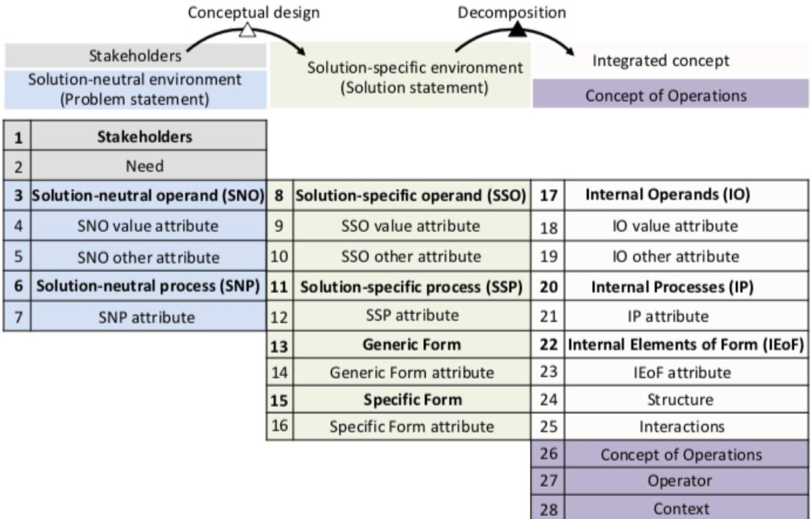
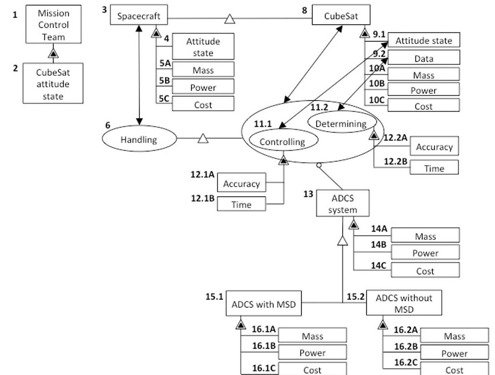
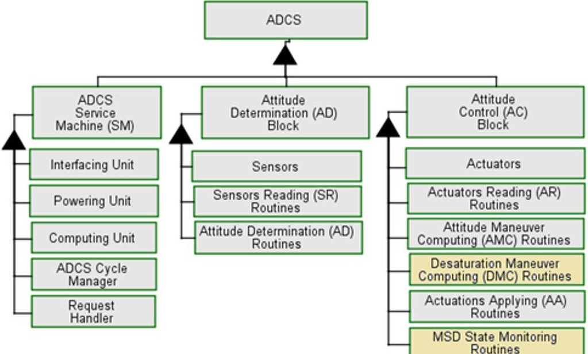
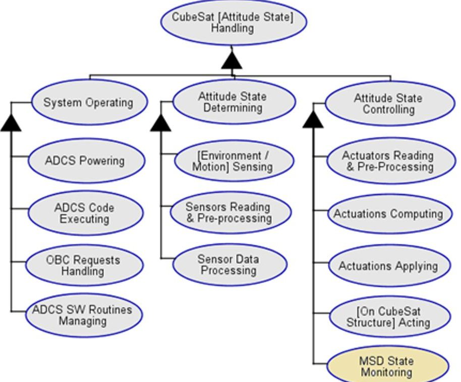
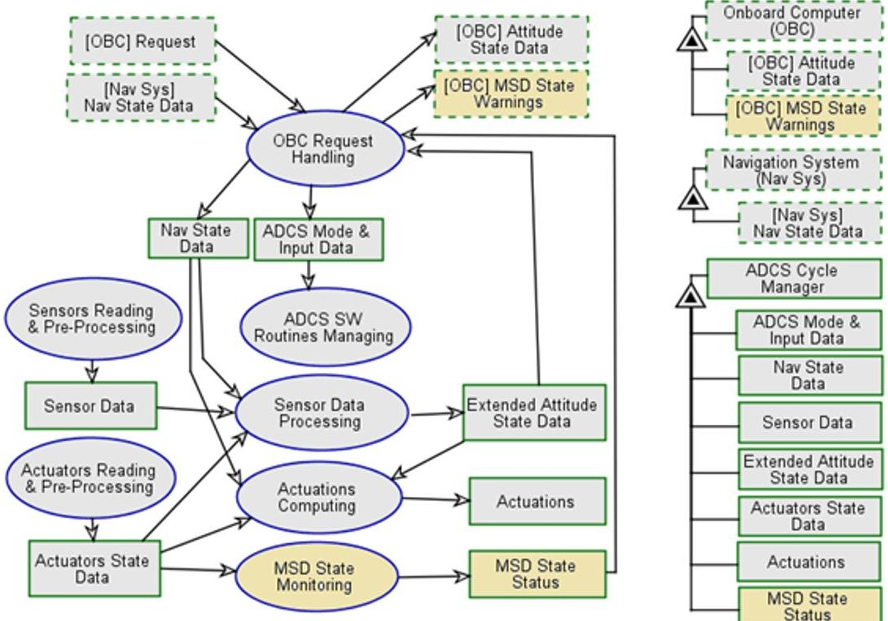
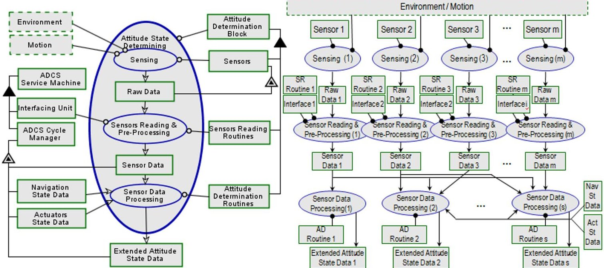
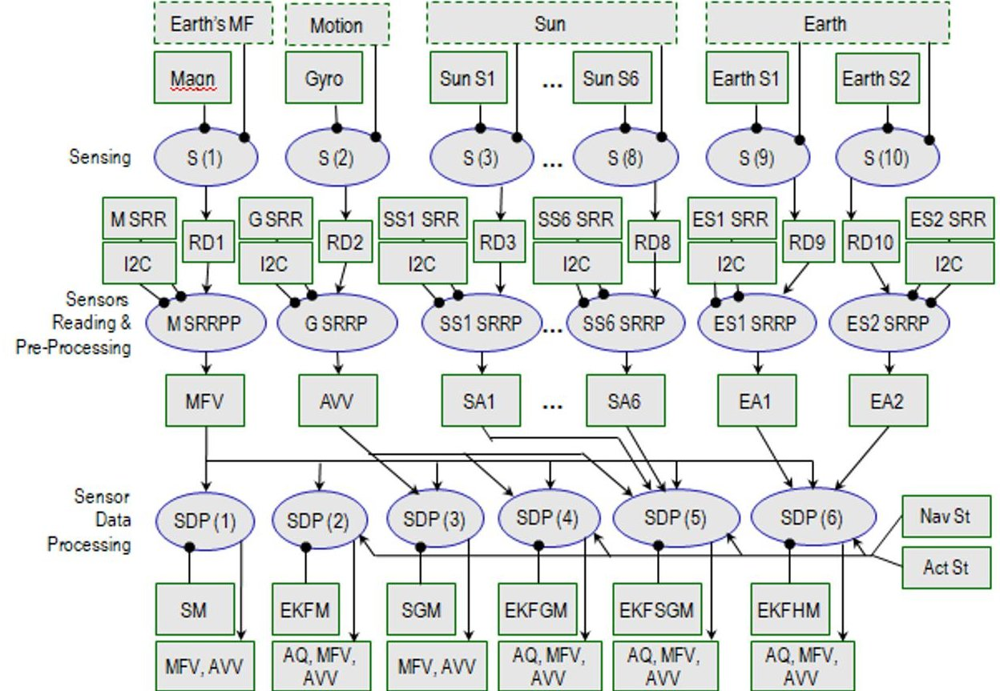
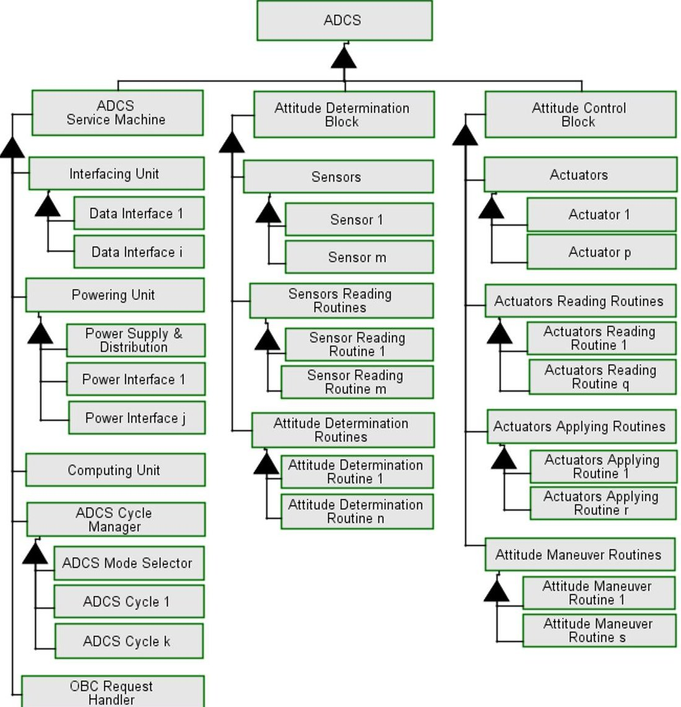

<!-- PDF_PAGE: 1 -->

IAC-19.D1.2.8

# Applying the model-based conceptual design approach to ADCS development: a case study of a CubeSat swarm mission

Yaroslav Menshenin $ ^{a} $ $ ^{*} $ , Kir Latyshev $ ^{b} $ , Ahmed Mahfouz $ ^{c} $ , Dmitry Pritykin $ ^{d} $

$ ^{a} $ Skolkovo Institute of Science and Technology, Bolshoy Boulevard 30, bld.1, Moscow, Russia 121205, Y.Menshenin@skoltech.ru

b Skolkovo Institute of Science and Technology, Bolshoy Boulevard 30, bld.1, Moscow, Russia 121205, Kir.Latyshev @skoltech.ru

$ ^{c} $ Skolkovo Institute of Science and Technology, Bolshoy Boulevard 30, bld.1, Moscow, Russia 121205, Ahmed.Mahfouz @skoltech.ru

$ ^{d} $ Skolkovo Institute of Science and Technology, Bolshoy Boulevard 30, bld.1, Moscow, Russia 121205, D.Pritykin@skoltech.ru

* Corresponding Author

## Abstract

Conceptual design plays an important role in the space product development process. The model-based concept framework rooted in design theory contains information about key entries that should be taken into account during the early design phase. This framework emphasizes not only the question "what" should be specified during the conceptual design phase, but also proposes "how" it should be done using a strict ontology and semantics supported by a conceptual modeling language, such as the Object-Process Methodology (OPM). In many cases, space systems engineering approaches are applied to the whole space system. In this paper we demonstrate the applicability of the framework to the development of a space subsystem, namely, the attitude determination and control system (ADCS) for a CubeSat. We describe the concept framework development starting from the upstream information stakeholders and their needs, going down to the problem formulation and alternative solutions elicitation. We show that in such highly conservative systems as space ones, the alternatives might appear at the level of integrated concept, although the design principles remain the same regardless the level of granularity. We conclude the framework with the information about the concept of operations. Based on the system architecture principles, we identify alternatives of the ADCS components architectures. Presented with this set of alternatives, the ADCS designer is able to choose a specific architecture based on the mission requirements and engage the corresponding domain-specific tools for further simulations. We showcase this process by applying the proposed framework to a CubeSat swarm mission to detect gamma-ray bursts. The software developed as part of this case not only allows to determine the mass, power, and cost budgets but also provides estimates for such ADCS performance indicators as detumbling time, pointing and attitude determination accuracy. Informed by this data, the ADCS designer is then able to determine if the chosen architectural solution meets the requirements. Another utility of the proposed framework is that it facilitates the ADCS development in the Concurrent Engineering Design environment by identifying functional interactions between the ADCS and its surrounding systems - other CubeSat subsystems - and thus informing the data flow between the corresponding design teams. To support this flow, the software developed has the capability to produce various attitude-specific data relevant to other subsystems.

## 1. Introduction

The paradigm of designing and launching a single satellite to perform a certain task can be changed by designing groups of thousands miniature satellites that possess a much broader potential. Such setup increases the reliability of the system as the instruments of individual satellites coordinate to function together as in a large distributed system. Various configurations can be considered such as trains of satellites (which follow one after another along the same orbit) [1], formations that maintain rigorous geometry (e.g. to reflect sunlight to the Earth's surface, and thus producing pixel images in the sky) [2], swarms that act as a group, while fulfilling a common task, or evenly spread giant

networks surveilling the Earth's entire surface [3]. The shapes of such networks can be tuned to fulfill different tasks. Various groups of satellites in different constellations may be virtually connected together if need be, to enhance their coverage and power consumption. These groups might even include special service satellites, whose function is to repair the broken ones, de-orbit the defunct ones or transfer the operational ones to specific orbits.

Deployment of the miniature satellites' swarms is considered to be relatively inexpensive and fast. Vast populations of such satellites can be let out of a single large central satellite in orbit. Swarms can comprise simplistic units that detect certain events and exchange signals with each other and larger more complicated

<!-- PDF_PAGE: 2 -->

spacecraft that act as analysis hubs. Finally, swarms or constellations can be employed as distributed artificial intelligence. They can exhibit collective behavior, such as self-organization, transformability, self-learning and simultaneous sensing over large areas.

Leading space agencies, e.g. NASA, are actively involved with modeling, implementing, and testing swarm-based concept missions [4]. The need to collect new data and perform new science is causing the complexity of space missions to continually increase. This complexity needs to be controlled via new technological advancements and balanced with a reduction in mission and operation costs. Planned and hypothesized missions involve self-management, biological-inspiration based on swarms, and autonomous operation as a means of achieving these goals. NASA is contemplating space missions that will focus on the development of swarm-based spacecraft systems comprising multiple self-organizing and autonomous spacecraft. Developing such systems is obviously a complex task, that needs to be driven by standards and safety requirements to ensure reliability of sophisticated hardware and software [5].

Several years ago, a consortium has been formed comprising several Russian technical universities with the aim to incorporate skills and knowledge possessed by its members to build a set of small spacecraft to demonstrate algorithms of swarm behavior. Skoltech joined the consortium to offer its competence in systems engineering and concurrent design and become an integrating party putting together the parts of the project done by other universities [6]. The mission objective, in addition to swarm technology demonstration, was suggested by the colleagues from Moscow State University: their gamma-ray detectors can be used on several satellites flying in a group to track Gamma-Ray Bursts (GRBs) or Terrestrial Gamma-Ray Flashes (TGFs) and calculate their sources' coordinates by means of triangulation. The detectors, previously flown on small satellites, are perfect to be mounted on CubeSats, of which there has to be at least three in order to be able to calculate the coordinates of an incoming gamma burst.

It is supposed that the CubeSats will not be equipped with propulsion and the only means of controlling their dynamics to exhibit the swarm behavior is the ADCS. Thus a number of studies has been carried out with the aim of designing the spacecraft themselves [6] and their ADCS in particular [7], [8]. This paper reflects the results of these studies and generalizes them by proposing a procedure to apply a model-based conceptual design approach to ADCS development.

## 2. Materials and Methods

System architecture methods are considered as related to "inductive process", aiming at "client satisfaction" [9]. The authors notice that "architecting is characterized by dealing with ill-structured situations, situations where neither goals nor means are known with much certainty". The system architecture methods have a wide applicability to a diverse range of systems from purely technical and engineering ones, for example, space systems [10] to the financial systems [11]. This makes the system architecture methods universal and widely applicable. In our paper we demonstrate how system architecture methods facilitate the conceptual design for ADCS system development for a CubeSat swarm mission developed at Skoltech.

## 3. United system concept representation framework

In this section we provide a theoretical background for the united system concept representation framework. After this we apply this framework to the ADCS system concepts.

## 3.1 Theoretical Background

In our paper we use the system concept representation framework [12] that serves as a tool for the ADCS concepts development and analysis at the conceptual design phase. Throughout a paper, we use the notation of the Object-Process Methodology [13].

In Figure 1 the entries of the framework are presented. Such a framework has the information about stakeholders of the ADCS system concept (entries 1-2 presented in Figure 1), the so-called solution-neutral environment that aims to formulate the functional intent (entries 3-7) for ADCS system development, the solution-specific environment (entries 8-16) in which the specialized operand and specialized process are present. The biggest difference of solution-specific comparing to solution-neutral, however, is the presence of instrument that executes the function (generic form and specific form). Having the instrument, at the next step we decompose it into internal elements of form, processes, and operands (entries 17-23). These are, together with the structure (entry 24) and interactions (entry 25) information form the integrated concept. Finally, the system concept representation framework has the concept of operations (entries 26-28) that describe how the ADCS system is intended to operate at high-level abstraction. The information about 28 entries spread among 5 propositions is required to specify the alternative concepts and the decomposition of each one of them. The detailed rationale to include each one of these entries into the system concept representation framework has been provided in [12].

<!-- PDF_PAGE: 3 -->

Fig. 1. System Concept Representation Framework

Fig. 2. Stakeholders, solution-neutral and solution-specific environments for ADCS system development

3. 2 ADCS system concepts representation framework

Applying the system concept representation framework to the ADCS system concepts development we start with the identification of stakeholders and their needs. In this article, as an illustrative example, we identify the

stakeholders as the "mission control team" (entry 1), whose need is "CubeSat attitude state" (entry 2) - see Figure 2. After this we formulate the solution-neutral problem (entries 3-7). The functional intent is defined as "handling spacecraft's attitude state" (entries 6, 3, and 4). The other attributes of spacecraft are "mass" (entry 5A),

<!-- PDF_PAGE: 4 -->

"power" (entry 5B), and "cost" (entry 5C). Once this information is defined, the system architect can further execute the conceptual design, defining the specialized operand, specialized process, and finally - assigning the instrument to the function. The specialized operand of "spacecraft" is "CubeSat" (entry 8), the specialized processes of "handling" are "controlling" (entry 11.1) (CubeSat's attitude state, entry 9.1) and "determining" (entry 11.2) (CubeSat's data, entry 9.2). Note that the attributes (entries 10A, 10B, and 10C) are inherited from the solution-neutral environment. The core essence of the conceptual design is its ability to capture the form that executes the function. The generic form is "ADCS

system" (entry 13) that has the attributes "mass" (entry 14A), "power" (entry 14B), and "cost" (entry 14C). We start distinguishing the conceptual difference between alternative solutions at the next entry - the specific form. As there are two major types of ADCS - ADCS that use momentum storage devices (MSD) such as reaction wheels and ADCS that do not use those - the generic form is specialized into "ADCS with MSD" (entry 15.1) and "ADCS without MSD" (entry 15.2). The attributes are inherited from the attributes of the generic form. These entries of framework are summarised in Figure 2, which is the model-based representation of ADCS system concepts.

Fig. 3. ADCS Objects: second-level decomposition of form

Fig. 4. ADCS Processes: second-level decomposition of function

<!-- PDF_PAGE: 5 -->

Fig. 5. ADCS data flow (rectangles with dashed borders stand for data external to ADCS; the owner of this data is noted in the corresponding square brackets)

ADCS concepts were developed down to the third level of decomposition, separately for systems with and without MSD. The second-level decomposition diagrams of ADCS form and function are shown in Figures 3 and 4 respectively. Due to the similarities between MSD and non-MSD systems, both types are presented within the same diagrams - MSD systems contain all the elements of non-MSD systems plus additional elements, which are filled with orange colour in the diagrams. The data flow between the processes is shown in Figure 5. Table 1 associates each of the processes (elements of function) with its respective instruments and operands (elements of form). A more detailed description of each row of the table follows.

Table 1. ADCS second-level decomposition.

<table border="1"><tr><td></td><td>Instrument(s)(entry 22)</td><td>Process(entry 20)</td><td>Operand(s)(entry 17)</td></tr><tr><td>000</td><td>ADCS</td><td>Handling</td><td>CubeSat[Attitude State]CubeSat[Attitude State Data]</td></tr><tr><td>010</td><td>ADCS SM</td><td>SystemOperating</td><td>AD Block,ACBlock</td></tr><tr><td>011</td><td>Powering Unit</td><td>ADCSPowering</td><td>Computing Unit,Sensors,Actuators</td></tr><tr><td>012</td><td>ComputingUnit</td><td>ADCS CodeExecuting</td><td>Request Handler,ADCS CycleManager</td></tr></table>

<table border="1"><tr><td>013</td><td>Request Handler, Interfacing Unit</td><td>OBC Requests Handling</td><td>OBC [Data], Nav System [Data], ADCS Cycle Manager [Data]</td></tr><tr><td>014</td><td>ADCS Cycle Manager</td><td>ADCS SW Routines Managing</td><td>SR Routines, AD Routines, AR Routines, AMC Routines, DMC Routines, AA Routines, MSD State Monitoring Routines</td></tr><tr><td>020</td><td>AD Block</td><td>Attitude State Determining</td><td>ADCS SM [Data]</td></tr><tr><td>021</td><td>Sensors</td><td>Sensing</td><td>Environment, CubeSat Motion</td></tr><tr><td>022</td><td>SR Routines, Interfacing Unit</td><td>Sensors Reading &amp; Pre-processing</td><td>Sensors</td></tr><tr><td>023</td><td>AD Routines</td><td>Sensor Data Processing</td><td>ADCS Cycle Manager [Data]</td></tr><tr><td>030</td><td>AC Block</td><td>Attitude State Controlling</td><td>CubeSat [Attitude State], ADCS SM [Data]</td></tr><tr><td>031</td><td>AR Routines, Interfacing</td><td>Actuators Reading &amp;</td><td>Actuators, ADCS Cycle Manager</td></tr></table>

<!-- PDF_PAGE: 6 -->

<table border="1"><tr><td></td><td>Unit</td><td>Pre-Processing</td><td>[Data]</td></tr><tr><td>032</td><td>AMC Routines, DMC Routines</td><td>Actuations Computing</td><td>ADCS Cycle Manager [Data]</td></tr><tr><td>033</td><td>AA Routines, Interfacing Unit</td><td>Actuations Applying</td><td>Actuators</td></tr><tr><td>034</td><td>Actuators</td><td>Acting</td><td>CubeSat Structure</td></tr><tr><td>035</td><td>MSD State Monitoring Routines</td><td>MSD State Monitoring</td><td>ADCS Cycle Manager [Data]</td></tr></table>

## 3.3 ADCS Processes/Instruments Description

## Level 1 Processes/Instruments

010 - ADCS Service Machine provides services to the OBC: it receives requests from the OBC and operates the AD and AC Blocks in order to implement those. It can receive data from other subsystems (either directly or via the OBC) if it is needed for implementing the operation requested

020 - Attitude Determination Block produces attitude state estimates as well as other sensor based data which may be required for attitude control (such as magnetic field vector estimates).

030 - Attitude Control Block implements attitude maneuvers and (in case of a system with MSD) MSD desaturation maneuvers requested by the OBC. For MSD systems, the AC Block monitors the MSD state. (It is assumed that desaturation maneuvers are not launched automatically by ADCS but are requested by the OBC based on the received MSD State Warnings).

## Level 2 Processes/Instruments

011 - Powering unit (part of ADCS hardware - for example, part of the ADCS board) powers the subsystem, including its computing unit, sensors and actuators.

012 - Computing unit (part of ADCS hardware - for example, part of the ADCS board) executes ADCS software, which includes two main blocks - Request Handler and ADCS Cycle Manager.

013 - Request Handler is part of the ADCS software responsible for exchanging data with other CubeSat subsystems such as OBC and Navigation System. It receives OBC Requests; if necessary, gets data from other subsystems (directly from the subsystem or via the OBC); switches the mode of the ADCS Cycle Manager and makes the corresponding data available to the latter; returns the results of the ADCS Cycle Manager execution (such as the attitude state vector and MSD state warnings (for MSD systems) to the OBC.

014 - OBC Requests are basically OBC commands to run the ADCS Cycle Manager in a particular ADCS

Mode with specific Input Data. An ADCS Mode defines a sequence of specific AD/AC routines to be implemented. This would usually consist of a pair AD routine - AC routine (AMC or DMC), but may also include only AD routine if, for some mode, only attitude state knowledge is needed. The Interfacing Unit* ensures communication between the Request Handler and the OBC and (if applicable) other subsystems.

021 - Sensors (such as magnetometers, gyros, Sun sensors, Earth sensors, star sensors) react to the environment and the CubeSat motion and produce respective raw sensor data.

022 - Sensors Reading Routines use SW libraries of the respective sensors to read raw sensor data. They also may apply some pre-processing to this raw data (for example, apply calibration data). The result of this process is (pre-processed) Sensor Data. The Interfacing Unit* supports the SW libraries used by SR Routines to communicate with the sensors.

023 - Attitude Determination Routines implement attitude determination algorithms which may range from some very simple math operations to more complicated algorithms such as TRIAD or Kalman filter. They use Sensor Data as their input and produce Extended Attitude State Data (see below). Depending on the algorithm encoded in the routine, AD routines may also use Navigation State Data and Actuators State Data (for example, for extended Kalman filter algorithms) as their inputs.

It is worth noting that the term 'attitude determination' is used loosely here, and the resultant Extended Attitude State Data may include not only attitude quaternion and/or angular velocity vector but also any other values required for attitude control and obtained from the sensors (such as magnetic field vector).

031 - Actuators Reading Routines use SW libraries of the respective actuators to read actuators current state. Some pre-processing (such as applying calibration data) may also be implemented at this step. The Interfacing Unit* supports the SW libraries used by AR Routines to communicate with the actuators.

032 - Attitude Maneuver Computing Routines implement attitude control algorithms. They use Extended Attitude State Data as their input and compute actuations needed to perform a particular attitude maneuver (such as detumbling, slew, pointing). Actuations, in this case, are some numerical values (such as reaction wheels new rates or new currents to be put through magnetorquers) defining the new state of the actuators. Depending on the control algorithm, the routines can additionally use Actuators State Data and/or Navigation State Data as their inputs.

<!-- PDF_PAGE: 7 -->

Fig. 6. Second-Level OPM diagram (left) for the 'Attitude State Determining' process and its generic third-level representation (right)

Fig. 7. A third-level OPM representation of the 'Attitude State Determining' process for the swarm mission CubeSat ADCS

The main purpose of Desaturation Maneuver Computing Routines is to unload the respective MSD. They work similarly to the AMC Routines. The only difference is that they compute two sets of actuations one for the MSDs being unloaded and the other for the actuators that are used to create the compensating torque.

033 - Actuations Applying Routines use SW libraries of the respective actuators to apply the

actuations computed and set the actuators into their new respective states. The Interfacing Unit $ ^{*} $ supports the SW libraries used by AA Routines to communicate with the actuators.

034 - Actuators act on the CubeSat Structure creating the control torque which changes/maintains the attitude state of the CubeSat.

<!-- PDF_PAGE: 8 -->

035 - MSD State Monitoring Routines use Actuators State Data (for MSD) as their input to check how close the momentum accumulated is to the MSD limit value and return the corresponding MSD State Status.

* It is assumed that the Interfacing Unit includes both hardware (such as built-in support for the respective data protocols and respective peripheral ports on the ADCS board) and software (such as communication libraries based on the respective data protocols) necessary for the respective SW routines to communicate with peripheral devices (sensors, actuators, and OBC, in case of a separate ADCS board).

As one can see from the diagrams, there is no significant architectural difference between MSD and non-MSD systems, which sits in accordance with the empirically established impression of those system types. Hence, the same framework (presented in Table 1) can be used for representing both types of ADCS with simply setting some of the elements/processes (the ones associated with the MSD state monitoring and MSD desaturation) of the framework to null when describing systems without MSD.

The architectural differences between ADCS for different missions first appear at the third level of decomposition. To illustrate this, Figure 6 shows a second-level OPM diagram for the 'Attitude State Determining' process on the left and its generic thirdlevel representation on the right. An example of the same process representation for a specific mission is shown in Figure 7 where the diagram depicts the elements and processes of the swarm mission CubeSat ADCS. As one can see from the diagrams, the differences between ADCS for different missions are encoded by decomposing generic objects (such as Sensors, SR Routines, AD Routines, Interfacing Unit), their data attributes (such as Sensor Data, Extended Attitude State Data), and the corresponding generic processes (Sensing, Sensors Reading & Pre-Processing, Sensor Data Processing) into their specific components and specifying the respective connection links between those.

For example, the swarm mission ADCS (see Figure 7) uses a magnetometer (Magn), a gyro (G), six Sun sensors (Sun S1, ..., Sun S6) and two Earth sensors (Earth S1, Earth S2). The sensors, by interacting with the environment (Earth's magnetic field, Sun, Earth) or being affected by the motion of the CubeSat (in case of the gyro), produce 10 sets of raw data (RD1...RD10) recorded in each of the sensors. To obtain this data from the sensors, the respective sensor reading and preprocessing routines (M SSR, G SSR, SS1 SSR ... SS6 SSR, ES1 SSR, ES2 SSR) are used. The routines are supported by the I2C data interface (in case of the swarm mission, all sensors are connected to the main computing unit via the same interface). The result of the sensors reading and pre-processing processes is the

Sensor Data which includes magnetic field vector (MFV), angular velocity vector (AVV), 6 sun angles (SA1...SA6) and 2 Earth angles (EA1, EA2). The swarm mission ADCS uses six attitude determination algorithms encoded in six AD routines. The routines use specific sets of Sensor Data components as their inputs to produce the corresponding sets of the Extended Attitude State Data as their outputs (see Table 2). The EKF (extended Kalman filter) algorithms also need navigation state data and actuators state data for their work.

Table 2. Attitude determination algorithms used by the swarm mission ADCS

<table border="1"><tr><td rowspan="2">#</td><td rowspan="2">Attitude Determination Algorithm</td><td colspan="3">Uses</td><td>Returns</td></tr><tr><td>Sensor Data</td><td>Nav State Data</td><td>Actuators State Data</td><td>Extended Attitude State Data</td></tr><tr><td>1</td><td>Simple Magnetic (SM)</td><td>MFV</td><td>no</td><td>no</td><td>MFV, AVV</td></tr><tr><td>2</td><td>Simple Gyro-Magnetic (SGM)</td><td>MFV, AVV</td><td>no</td><td>no</td><td>MFV, AVV</td></tr><tr><td>3</td><td>EKF Magnetic (EKF M)</td><td>MFV</td><td>yes</td><td>yes</td><td>MFV, AVV, AQ</td></tr><tr><td>4</td><td>EKF Gyro-Magnetic (EKFGM)</td><td>MFV, AVV</td><td>yes</td><td>yes</td><td>MFV, AVV, AQ</td></tr><tr><td>5</td><td>EKF Sun-Gyro-Magnetic (EKFSGM)</td><td>MFV, AVV, SA1, SA2, ... SA6</td><td>yes</td><td>yes</td><td>MFV, AVV, AQ</td></tr><tr><td>6</td><td>EKF Horizon-Magnetic (EKFHM)</td><td>MFV, EA1, EA2</td><td>yes</td><td>yes</td><td>MFV, AVV, AQ</td></tr></table>

Though the example above is provided for one of the ADCS processes ('Attitude State Determining'), it is obvious that the other two processes ('Attitude State Controlling' and 'System Operating') can be dealt with analogously. Figure 8 shows a generic third-level decomposition diagram for non-MSD ADCS (additional elements for ADCS with MSD will decompose analogously). As one can see from the diagram, most of the ADCS elements follow the same decomposition logic as in the example provided. The only exceptions are the Computing Unit and the Request Handler which third-level decompositions will be the same for different missions (they are not shown in the figure).

<!-- PDF_PAGE: 9 -->

The proposed framework can be used as an instrument to describe different CubeSat ADCS concepts in a uniform and formalized way. In this capacity, it can serve as a basis for developing tools supporting the ADCS design team participating in concurrent design sessions.

- a front-end user interface providing the design team with the means for "building" the system and viewing its performance characteristics;

- four 'libraries' (implemented as Excel tables) capturing the main information derived from the ADCS concepts framework and containing

Fig. 8. A generic third-level decomposition of ADCS without MSD

## 3. Using the framework for developing a concurrent design tool in support of ADCS design team

At present, the framework is being used to develop a concurrent design tool that would provide the ADCS design team with quick rough estimations of the system performance based on the architectural decisions they make while exploring possible ADCS solutions for a specific mission. At this stage, the main components of the prospective tool have been outlined, and an Excelbased prototype of the tool was created to validate the core ideas to be implemented in the tool. The swarm mission ADCS design process was simulated to test the mockup.

The prototype includes the following components:

parametric models of the main ADCS components (each parametric model is a row in the table), including:

- Attitude Maneuver Computing Routines library (at this stage, the Excel mockup does not include components unique for ADCS with MSD): each routine is characterized by the Extended Attitude State Data it takes as its input, types of actuators it computes actuations for, and an approximate number of math operations; each routine is also associated with some control parameters (which are accessible to the user through the front-end interface - see examples below) and functions that implement formulas assessing the system performance;

<!-- PDF_PAGE: 10 -->

- Attitude Determination Routines library: each routine is characterized by the Extended Attitude State Data it provides, types of Sensor Data it requires, the characteristic number of math operations; each routine is also associated with the corresponding approximation formulas which estimate the system's attitude determination accuracies;

- Sensors library: the main characteristics of each sensor are the type of Sensor Data it provides and its raw accuracy; at this stage, it is assumed that each sensor has only one SRRP Routine, and it is described in the corresponding sensor model as having a certain number of operations and providing a certain SRPP accuracy (derived from the sensor raw accuracy); the sensor model also includes the corresponding electric characteristics, data interface type, and mass (future versions of the library will also include sensor cost estimations);

- Actuators library: each actuator is characterized by its type, 'main performance parameter' (g.e., by magnetic moment for magnetorquers), the characteristic number of math operations for the corresponding AR and AA routines, electric parameters, data interface (if any), and mass (future versions of the library will also include actuator cost estimations);

- The fifth library containing parametric models of the integrated Computing, Powering, and Interfacing Unit is to be added to the tool in the future. It is assumed that the contents of the five libraries will accumulate gradually over time, as the Skoltech ADCS team works on its projects; at this stage, the libraries include the components of the swarm mission CubeSat ADCS as well as some mockup models for testing;

- an Excel VBA module containing functions that emulate approximation formulas.

<table class="table table-bordered"><thead><tr><th></th><th>A</th><th>B</th><th>O</th><th>P</th><th>AC</th><th>AD</th></tr></thead><tbody><tr><td>1</td><td></td><td></td><td></td><td></td><td></td><td></td></tr><tr><td>2</td><td></td><td></td><td></td><td></td><td></td><td></td></tr><tr><td>3</td><td rowspan="2">Enter ADCS Mode Name:</td><td>#1</td><td rowspan="2">Enter ADCS Mode Name:</td><td>#2</td><td rowspan="2">Enter ADCS Mode Name:</td><td>#3</td></tr><tr><td>4</td><td>Nominal Detumbling</td><td>Set to Nominal / Thermal Slew (day)</td><td>Set to Nominal / Thermal Slew (night)</td></tr><tr><td>5</td><td></td><td></td><td></td><td></td><td></td><td></td></tr><tr><td>6</td><td>Choose Attitude Control Algorithm:</td><td>BDot</td><td>Choose Attitude Control Algorithm:</td><td>Magnetic Pointing - Slewing</td><td>Choose Attitude Control Algorithm:</td><td>Magnetic Pointing - Slewing</td></tr><tr><td>7</td><td>Choose Actuator 1:</td><td rowspan="4">BDot Magnetic Pointing - Pointing Magnetic Pointing - Slewing RW Pointing RW Slewing</td><td>Choose Actuator 1:</td><td>3: Skoltech Rod</td><td>Choose Actuator 1:</td><td>3: Skoltech Rod</td></tr><tr><td>8</td><td>Choose Actuator 2:</td><td>Choose Actuator 2:</td><td>3: Skoltech Rod</td><td>Choose Actuator 2:</td><td>3: Skoltech Rod</td></tr><tr><td>9</td><td>Choose Actuator 3:</td><td>Choose Actuator 3:</td><td>4: Skoltech Coil</td><td>Choose Actuator 3:</td><td>4: Skoltech Coil</td></tr><tr><td>10</td><td>Choose Actuator 4:</td><td>Choose Actuator 4:</td><td>-</td><td>Choose Actuator 4:</td><td>-</td></tr><tr><td>11</td><td></td><td></td><td></td><td></td><td></td><td></td></tr><tr><td>12</td><td>Enter Maneuver Parameters:</td><td>-</td><td>Enter Maneuver Parameters:</td><td></td><td>Enter Maneuver Parameters:</td><td></td></tr><tr><td>13</td><td>Power limit, W:</td><td>0.6</td><td>Max slew angle, deg:</td><td>180</td><td>Max slew angle, deg:</td><td>180</td></tr><tr><td>14</td><td>w0max, deg/s:</td><td>10</td><td>-:</td><td></td><td>-:</td><td></td></tr><tr><td>15</td><td>waccmax, deg/s:</td><td>1</td><td>-:</td><td></td><td>-:</td><td></td></tr><tr><td>16</td><td></td><td></td><td></td><td></td><td></td><td></td></tr><tr><td>17</td><td>Choose Attitude Determination Algorithm:</td><td>2 - Simple Gyro-Magnetic</td><td>Choose Attitude Determination Algorithm:</td><td>5 - EKF Sun-Gyro-Magnetic</td><td>Choose Attitude Determination Algorithm:</td><td>4 - EKF Gyro-Magnetic</td></tr><tr><td>18</td><td>Choose Sensor 1:</td><td>2: MPU-9250 (magn)</td><td>Choose Sensor 1:</td><td>2: MPU-9250 (magn)</td><td>Choose Sensor 1:</td><td>2: MPU-9250 (magn)</td></tr><tr><td>19</td><td>Choose Sensor 2:</td><td>4: MPU-9250 (gyro)</td><td>Choose Sensor 2:</td><td>4: MPU-9250 (gyro)</td><td>Choose Sensor 2:</td><td>4: MPU-9250 (gyro)</td></tr><tr><td>20</td><td>Choose Sensor 3:</td><td>-</td><td>Choose Sensor 3:</td><td>5: nanoSSOC-D60 3.3</td><td>Choose Sensor 3:</td><td>-</td></tr><tr><td>21</td><td>Choose Sensor 4:</td><td>-</td><td>Choose Sensor 4:</td><td>5: nanoSSOC-D60 3.3</td><td>Choose Sensor 4:</td><td>-</td></tr><tr><td>22</td><td>Choose Sensor 5:</td><td>-</td><td>Choose Sensor 5:</td><td>5: nanoSSOC-D60 3.3</td><td>Choose Sensor 5:</td><td>-</td></tr><tr><td>23</td><td>Choose Sensor 6:</td><td>-</td><td>Choose Sensor 6:</td><td>5: nanoSSOC-D60 3.3</td><td>Choose Sensor 6:</td><td>-</td></tr><tr><td>24</td><td>Choose Sensor 7:</td><td></td><td>Choose Sensor 7:</td><td>5: nanoSSOC-D60 3.3</td><td>Choose Sensor 7:</td><td>-</td></tr><tr><td>25</td><td>Choose Sensor 8:</td><td></td><td>Choose Sensor 8:</td><td>5: nanoSSOC-D60 3.3</td><td>Choose Sensor 8:</td><td>-</td></tr><tr><td>26</td><td>Choose Sensor 9:</td><td></td><td>Choose Sensor 9:</td><td>-</td><td>Choose Sensor 9:</td><td>-</td></tr><tr><td>27</td><td>Choose Sensor 10:</td><td></td><td>Choose Sensor 10:</td><td>-</td><td>Choose Sensor 10:</td><td>-</td></tr></tbody></table>

Fig. 9. A screenshot of the design tool user interface - three (out of 12) 'decision columns' for the respective swarm mission ADCS modes are shown. The blue options correspond to the selections made via drop-down lists. The green numeric values for the Manoeuvre Parameters are entered manually.

<!-- PDF_PAGE: 11 -->

<table border="1"><tr><td>ADCS Mode Summary:</td><td>Nominal Detumbling</td><td>ADCS Mode Summary:</td><td>Set to Nominal/Thermal Sleep(day)</td><td>ADCS Mode Summary:</td><td>Set to Nominal/Thermal Sleep(night)</td></tr><tr><td>Attitude determination accuracy,deg:</td><td>-</td><td>Attitude determination accuracy,deg:</td><td>0.5</td><td>Attitude determination accuracy,deg:</td><td>0.9</td></tr><tr><td>Angular rate determination accuracy,deg/s:</td><td>0.008</td><td>Angular rate determination accuracy,deg/s:</td><td>0.004</td><td>Angular rate determination accuracy,deg/s:</td><td>0.004</td></tr><tr><td>Detumbling time,s:</td><td>2400</td><td>Slewing time,s:</td><td>1500</td><td>Slewing time,s:</td><td>1500</td></tr><tr><td></td><td></td><td></td><td></td><td></td><td></td></tr><tr><td>Power consumption,W(excl.Computing Unit):</td><td>0.6</td><td>Power consumption,W(excluding Computing Unit):</td><td>2.8616</td><td>Power consumption,W(excluding Computing Unit):</td><td>2.8616</td></tr><tr><td>Mass,g(excluding Computing Unit):</td><td>130</td><td>Mass,g(excluding Computing Unit):</td><td>169</td><td>Mass,g(excluding Computing Unit):</td><td>130</td></tr><tr><td></td><td></td><td></td><td></td><td></td><td></td></tr><tr><td>Data interfaces:</td><td></td><td>Data interfaces:</td><td></td><td>Data interfaces:</td><td></td></tr><tr><td>I2C</td><td>2</td><td>I2C</td><td>8</td><td>I2C</td><td>2</td></tr><tr><td>SPI</td><td>0</td><td>SPI</td><td>0</td><td>SPI</td><td>0</td></tr><tr><td>UART</td><td>0</td><td>UART</td><td>0</td><td>UART</td><td>0</td></tr><tr><td>1-Wire</td><td>0</td><td>1-Wire</td><td>0</td><td>1-Wire</td><td>0</td></tr><tr><td>no interface</td><td>3</td><td>no interface</td><td>3</td><td>no interface</td><td>3</td></tr><tr><td></td><td></td><td></td><td></td><td></td><td></td></tr><tr><td>Power interfaces:</td><td></td><td>Power interfaces:</td><td></td><td>Power interfaces:</td><td></td></tr><tr><td>3.3V</td><td>2</td><td>3.3V</td><td>8</td><td>3.3V</td><td>2</td></tr><tr><td>5V</td><td>3</td><td>5V</td><td>3</td><td>5V</td><td>3</td></tr><tr><td>Other</td><td>0</td><td>Other</td><td>0</td><td>Other</td><td>0</td></tr><tr><td></td><td></td><td></td><td></td><td></td><td></td></tr><tr><td>Total # of Operations per ADCS Cycle:</td><td>270</td><td>Total # of Operations per ADCS Cycle:</td><td>980</td><td>Total # of Operations per ADCS Cycle:</td><td>480</td></tr></table>

Fig. 10. A screenshot of the ADCS modes summaries produced by the design tool

<table border="1"><tr><td colspan="4">ADCS Summary</td></tr><tr><td rowspan="6">Attitude Determination algorithms selected:</td><td>Simple Magnetic</td><td rowspan="6">Attitude Control algorithms selected:</td><td>BDot</td></tr><tr><td>Simple Gyro-Magnetic</td><td>Magnetic Pointing-Slewing</td></tr><tr><td>EKF Magnetic</td><td>Magnetic Pointing-Pointing</td></tr><tr><td>EKF Gyro-Magnetic</td><td></td></tr><tr><td>EKF Sun-Gyro</td><td></td></tr><tr><td>EKF Horizon-Magnetic</td><td></td></tr><tr><td colspan="4"></td></tr><tr><td>Sensors selected:</td><td></td><td>Actuators selected:</td><td></td></tr><tr><td>(magnetometer)</td><td>2:MPU-9250(magn)</td><td>(magnetorquer)</td><td>3:Skoltech Rod</td></tr><tr><td>(gyro)</td><td>4:MPU-9250(gyro)</td><td>(magnetorquer)</td><td>3:Skoltech Rod</td></tr><tr><td>(sun sensor)</td><td>5:nanoSSOC-D603.3V</td><td>(magnetorquer)</td><td>4:Skoltech Coil</td></tr><tr><td>(sun sensor)</td><td>5:nanoSSOC-D603.3V</td><td></td><td></td></tr><tr><td>(sun sensor)</td><td>5:nanoSSOC-D603.3V</td><td></td><td></td></tr><tr><td>(sun sensor)</td><td>5:nanoSSOC-D603.3V</td><td></td><td></td></tr><tr><td>(sun sensor)</td><td>5:nanoSSOC-D603.3V</td><td></td><td></td></tr><tr><td>(Earth sensor)</td><td>7:MAI-400</td><td></td><td></td></tr><tr><td>(Earth sensor)</td><td>7:MAI-400</td><td></td><td></td></tr><tr><td colspan="4"></td></tr><tr><td>Data Interface Summary:</td><td></td><td>Power Interface Summary:</td><td></td></tr><tr><td>I2C:</td><td>10</td><td>3.3V:</td><td>10</td></tr><tr><td>no interface:</td><td>3</td><td>5V:</td><td>3</td></tr><tr><td colspan="4"></td></tr><tr><td>Best attitude determination accuracy,deg:</td><td>0.5</td><td>Worst attitude determination accuracy,deg:</td><td>1</td></tr><tr><td>Best angular rate determination accuracy,deg/s:</td><td>0.004</td><td>Worst angular rate determination accuracy,</td><td>0.008</td></tr><tr><td colspan="4"></td></tr><tr><td># of ADCS modes:</td><td>12</td><td>Max Power consumption,W(excl.Computing Unit):</td><td>2.9</td></tr><tr><td>Max # of Math Operations per ADCS cycle:</td><td>980</td><td>ADCS Mass,g(excl.Computing Unit):</td><td>235</td></tr></table>

Fig. 11. An example of the system summary

<!-- PDF_PAGE: 12 -->

ADCS design process is modeled in the tool as a sequence of decisions made by the design team for each of the ADCS modes being explored. Though the set of decisions is the same for each mission and each ADCS mode, the specific options for those decisions are dependent on the options selected during the previous steps (for example, if the AD Routine chosen for some mode assumes using only magnetic field vector as its input, then only one of the sensor drop-down lists will be available to the designer at the next decision step, and this list will be populated with magnetometer models). Most of the work with the tool involves selecting options from drop-down lists. As soon as all the decisions are made, the designer is presented with performance and interface summaries for each of the modes and for the whole system.

Below, the design steps within the tool are described in more detail:

- Step 0. Based on the mission information, define the list of attitude maneuvers that the ADCS shall be able to implement. For example, the swarm mission CubeSat ADCS shall be able to implement the following maneuvers derived from the general mission requirements:

- Detumbling: decreasing angular velocity from some initial $ \omega_{0\mathrm{max}}=1 0 \mathrm{~d e g / s} $ to an acceptable value $ \omega_{\mathrm{a c c} \mathrm{m a x}}=1 \mathrm{~d e g / s} $

- Set to nominal: slew from a random orientation to the nominal local vertical (LV) orientation (nominal attitude);

- Pointing along LV: maintaining nominal attitude (three-axis control);

- Thermal slew: rotation from the current LV attitude (either nominal or previously established 'thermal' attitude with a certain azimuth angle) to another LV attitude (set by OBC) with a different azimuth angle.

For each maneuver, do the following (see Figure 9 for illustration):

- Step 1. Start a new ADCS mode by entering its name in the corresponding field.

- Step 2. Select the attitude control algorithm (AMC Routine) to use for the maneuver from the dropdown list.

- Step 3. Select the attitude determination algorithm (AD Routine) for the selected attitude control algorithm from the drop-down list (the contents of the list will depend on the Step 2 choice). If there's more than one attitude determination algorithm needed for the maneuver (for example, an algorithm using Sun sensors for the day part of the orbit, and some other algorithm for the night part of the orbit), create an additional ADCS mode for each of the AD algorithms to be used and repeat the same steps for each of the modes created.

- Step 4. Fill in the Maneuver Parameters fields, if there are any (the list of parameters is different for different control algorithms).

- Step 5. Select actuators. The number of active drop-down lists and their contents depend on the Step 2 Choice.

- Step 6. Select sensors. The number of active drop down lists and their contents depend on the Step 3 Choice.

After identifying each of the ADCS modes, check if there are any modes that fully repeat each other consider merging them under a common name.

Based on the selections made, the model will automatically compute the expected system performance characteristics and the respective summaries (see Figures 10, 11 for illustration). Presented with this information, the ADCS designer is able to determine if the chosen architectural solution meets the requirements.

## Conclusion

In this paper we have presented a model-based framework that enables to encode the ADCS system concepts into a systematic view. We demonstrated that such approach allows satisfying the stakeholders' needs and to represent the design process in a modeling environment.

In particular, we have shown that there is no significant architectural difference between MSD and non-MSD systems, and the proposed framework allows keeping track of this information. It was also shown that the architectural differences between ADCS for different missions starts appearing at the third level of system decomposition.

The proposed framework can be used as a tool to describe different CubeSat ADCS concepts in a modeling ontology and formalized way. For instance, it is demonstrated how the framework can be used to develop a concurrent engineering design tool that would provide the ADCS design team with quick rough estimations of the system performance based on the architectural decisions developed while exploring alternative ADCS solutions for a specific mission.

The future work includes running of a number of concurrent engineering design sessions together with industrial partners. Another direction of future work includes the integration of DSM-based tools [14] to represent the specialization and decomposition relationships for alternative ADCS concepts.

## References

<!-- PDF_PAGE: 13 -->

[2] D. Ivanov, S. Biktimirov, et al. Writing with Sunlight: CubeSat Formation Control Using Aerodynamic Forces. Proceedings of the 70th International Astronautical Congress, 2019.

[3] Inigo del Portillo, B.G. Cameron, E.F. Crawley, A technical comparison of three low earth orbit satellite constellation systems to provide global broadband, Acta Astronautica, Vol. 159, pp. 123- 135, 2019.

[4] J. Peña, C.A. Rouff, M. Hinchey, and A. Ruiz-Cortes, Modeling NASA swarm-based systems: using agent-oriented software engineering and formal methods. Software & Systems Modeling, 10(1), pp. 55-62, 2011.

[5] E. Vassev, R. Sterritt, C. Rouff, and M. Hinchey, Swarm technology at NASA: Building resilient systems. IT Professional, 14(2), pp. 36-42, 2012.

[6] A. Kharlan, N. Veliev, S. Biktimirov, N. Mullin, and A. Ivanov, A university-based facility for evaluation and assessment of space projects. In Proceedings of the 69th International Astronautical Congress, 2018.

[7] A. Annenkova, S. Biktimirov, K. Latyshev, A. Mahfouz, P. Mukhachev, and Pritykin D, Cubesat ADCS model for preliminary design procedures

within a concurrent design approach. In AIP Conference Proceedings, 2019.

[8] A. Mahfouz, D. Pritykin, et al. Coordinated Attitude Determination and Control in a Swarm of CubeSats. Proceedings of the 70th International Astronautical Congress, 2019.

[9] E. Rechtin, M.W. Maier, The art of systems architecting. CRC Press, 2010.

[10] NASA Systems Engineering Handbook 2017. https://ntrs.nasa.gov/search.jsp?R=20170001761. Accessed October 4, 2019

[11] A.W. Boot, A.V. Thakor, Financial system architecture. The Review of Financial Studies, 10(3), pp.693-733, 1997.

[12] Y. Menshenin, E. Crawley, Model-based concept framework for suborbital human spaceflight missions. In Proceedings of the 69th International Astronautical Congress, 2018.

[13] D. Dori, Object-Process Methodology: A Holistic System Paradigm. Springer, 2002.

[14] Y. Menshenin, E. Crawley, DSM-Based Methods to Represent Specialization Relationships in a Concept Framework. In 20th International DSM Conference (DSM Conference), 2018.