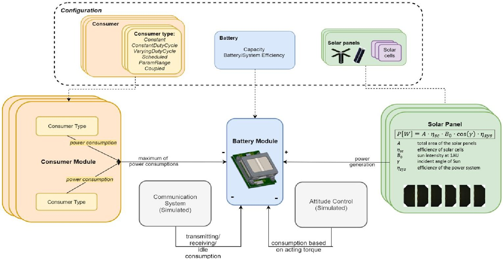
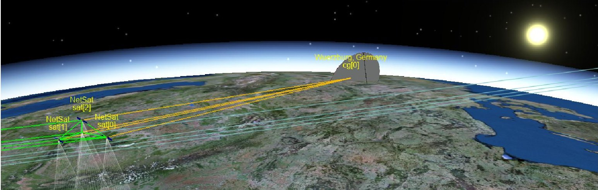
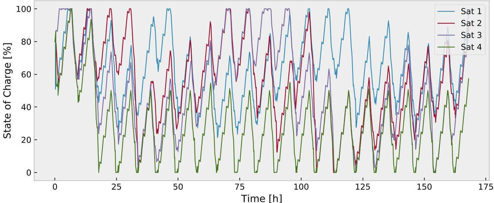
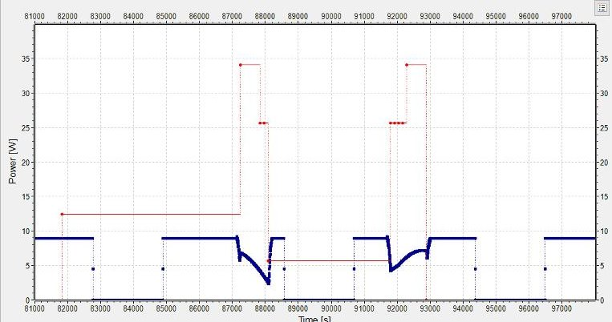
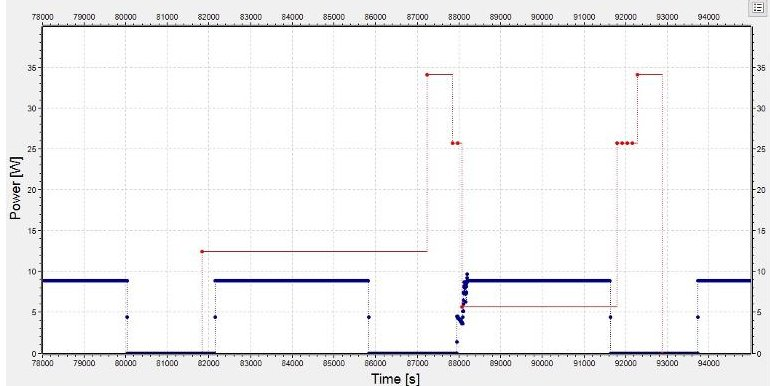

<!-- PDF_PAGE: 1 -->

IAC-2019-B6.IP.7

# CUBESAT ENERGY MODELLING FOR IMPROVED MISSION PLANNING AND OPERATIONS

Andreas Freimann University of Würzburg, Germany, freimann@informatik.uni-wuerzburg.de

Julian Scharnagl Center for Telematics, Germany, julian.scharnagl@telematik-zentrum.de

Timon Petermann University of Würzburg, Germany, timon.petermann@stud-mail.uni-wuerzburg.de

Holger Döbler Humboldt University of Berlin, Germany, stephaho@informatik.hu-berlin.de

Klaus Schilling University of Wurzburg, Germany, schi@informatik.uni-wuerzburg.de

The number of CubeSat launches has significantly increased in recent years. While CubeSats have been mainly used for technology demonstration missions in the past meanwhile also many commercial systems are in development. The capabilities of CubeSats have been extended by integration of new components. Payload such as optical sensors and communication systems as well as actuators for orbit and attitude control consume a lot of power and thereby push the satellite power systems to their limits. Usually satellite engineers use power budget calculations to design the power system properly. After discussing the pitfalls of this approach another tool for the analysis of CubeSat power systems is presented in this paper that is based on detailed system models and simulations. It is shown that energy simulations can improve the mission design and the operation of satellites, e.g. by proper load distribution between the nodes in a satellite formation. The satellite formation NetSat is used as an example to compare both approaches.

## I. INTRODUCTION

The dimensioning of the power system and the solar panels is one of the most important challenges for CubeSat engineers. Due to the limited space for solar panels the generated energy is a very limited resource. One of the challenges here is to estimate the usage of the different consumers to be able to determine the required size of the solar panels and the required capacity of the batteries.

A simple approach is to estimate the mean power consumption of the different subsystems as well as their on off cycle to estimate the average power consumption of the satellite. The generated power can be estimated in a similar way by taking into account the expected eclipse duration and the expected mean orientation of the solar panels to the sun. It is obvious that this approach includes a lot of estimations and simplifications. Furthermore, the on-board software as well as the commanding of the satellite is also based on these estimations. In this paper, an energy simulation approach is presented that allows system engineers and operators to analyze the available

energy of satellites more accurately and in a timely manner. We model and simulate the dynamic power generation and consumption of a system which allows us to identify if the satellite runs out of energy in specific situations and if consumption exceeds a maximum current. This model is implemented in ESTNeT[1], an OMNeT++ based simulation framework for space-terrestrial networks.

In section 2 the model of the generation of energy by solar panels is presented before in section 3 the model for the power consumption by different satellite subsystems is described. The power budget approach described in section 4 and the simulation approach, described in section 5, are compared to each other in section 6. Section 7 concludes the paper with a summary and an outlook on further developments.

## II. ENERGY GENERATION

CubeSats generate energy using solar cells attached to the surface of the satellite or on deployable panels. Since most CubeSats either do not have an Attitude Control System (ACS) or mainly use it to

<!-- PDF_PAGE: 2 -->

point a payload system in a desired direction, such as a camera or an antenna, solar panels are attached to multiple sides of the CubeSat. The configuration of solar panels on the surface of the satellite varies from satellite to satellite. The generated power mainly depends on the illumination angle and the size of the area of solar panels illuminated by the sun, therefore the power that will be available during the course of a mission can not simply be calculated in advance.

The power generated by a solar panel can be calculated by equation 1, where A is the total area of the solar panel, $ \eta_{sc} $ the efficiency of the solar cells, $ B_{0} $ denotes the Sun intensity at 1AU, $ \gamma $ the incidence angle of the Sun and $ \eta_{sys} $ the efficiency of the system.

$$
P = A \cdot \eta_ {s c} \cdot B _ {0} \cdot \cos (\gamma) \cdot \eta_ {s y s}
$$

Table 1: Parameters of a solar module

<table border="1"><tr><td>Parameter</td><td>Value</td></tr><tr><td>A</td><td>26.5cm2</td></tr><tr><td>$\eta_{sc}$</td><td>27.5%</td></tr><tr><td>$B_{0}$</td><td>1367W/m2</td></tr><tr><td>$\eta_{sys}$</td><td>90%</td></tr></table>

Table 1 shows typical values of CubeSat Electric Power Systems (EPSs) and solar cells. For the simplified case that the sun perfectly illuminates one side of a 1U Cubesat with two typical solar panels the satellite produces about 1.24 W. Further we assume 10% conversion loss, leading to a value of about 1.12 W of available power that can be used to charge a battery or to supply consumers.

## II.i Attitude Dependency

Considering a CubeSat with solar panels mounted at several (or all) of its six faces, the dependency of total power generation on the direction of incident sun light with respect to the satellite body's reference frame may be described completely in closed form if assuming the model [1]. The total power generated equals the sum of power generated at each of the cube's faces

$$
P _ {\mathrm {t o t}} = A _ {\mathrm {e f f}} \cdot \eta_ {s c} \cdot B _ {0} \cdot \eta_ {s y s}
$$

where $ A_{\mathrm{eff}}=\sum_{i\in \mathrm{faces}}A_{i}\cdot R(\vec{n}_{i}\cdot \vec{s}) $ is the effectively illuminated area of solar panels, R is the ramp function $ ^{*} $ , $ \vec{s} $ is the unit vector pointing from the satellite to the center of the sun, and $ A_{i} $ and $ \vec{n}_{i} $ are the area

and surface normal vectors of the $ i^{\mathrm{th}} $ face's solar panel respectively.

For solar panels mounted on a CubeSat's faces, the panels' surface normal vectors are mutually perpendicular or anti-parallel, so at most three faces can be illuminated simultaneously, e.g., $ (\vec{n}_{1},\vec{n}_{2},\vec{n}_{3})=(\vec{e}_{x},\vec{e}_{y},\vec{e}_{z}) $ . As can be shown with simple algebraic calculations, the maximum effective area $ A_{\mathrm{eff}}^{\mathrm{max}}=\sqrt{A_{1}^{2}+A_{2}^{2}+A_{3}^{2}} $ is achieved for the sunlight coming from $ \vec{s}=\vec{e}\bigl((A_{1},A_{2},A_{3})\bigr) $ where $ \vec{e}(\vec{v})=\frac{\vec{v}}{||\vec{v}||} $ is the unit vector function.

## III. ENERGY CONSUMPTION

The energy stored in the battery of a satellite is consumed by a number of satellite subsystems. Most subsystems have a finite number of modes that is traversed, the simplest of them being the on and off states. By defining power consumption values and proportional durations for each mode the overall consumption of a subsystem can be calculated. Finally the overall consumption of a CubeSat can be defined by combining different subsystems. In a more general way consumer models can be defined, that represent the power consumption behavior of a satellite subsystem.

## III.i Consumer Models

A CubeSat usually contains a number of basic subsystems that implement the basic features of the satellite. The EPS stores energy that is usually generated by solar cells and supplies all subsystems of the satellite with energy. The On-Board Computer (OBC) manages the subsystems of the satellite, executes commands and usually handles the communication with the ground station by the primary Communication System (COMM) including the reception of commands and the transmission of telemetry. A number of secondary COMMs can be present to provide high data rate links to ground stations or to enable intersatellite communication. The Panels (PAN) can be equipped with sensors, solar panels, antennas and microcontrollers. An Attitude Determination and Control System (ADCS) can be integrated to detect the attitude of the satellite, perform attitude maneuvers, track the sun or point sensors or antennas to a target. Some Cubesats are additionally equipped with an Orbit Control System (OCS), a Navigation System (NAV) or a High Performance Computing Unit (HPCU). Additionally payloads can be integrated such as image sensors.

<!-- PDF_PAGE: 3 -->

## III.ii Consumer Types

Each subsystem can have multiple states. Some subsystems follow a given activation and reactivation cycle with constant durations, such as a navigation system that determines the position of the satellite in regular intervals. We call this type a Constant Duty Cycle (CDC) Consumer. Therefore, if the system has only two states, namely On and Off, the behavior is defined by values defining the length of the two intervals. Other systems can traverse more than two states, e.g. the preheating phase of propulsion systems.

Other subsystems do not follow a regular cycle. The duration of the interval of each state varies. Usually it is estimated for which percentage of an orbital period the subsystems are expected to be active or these values are derived from reference systems. The mean durations and the standard deviations can be defined to characterize the duty cycle of such systems. We call this type of system a Varying Duty Cycle (VDC) consumer. For each state the mean duration is defined by the Mean Time of Activation (MTA). Further a second value is needed which defines the duration until this state will be reactivated, the Mean Time of Reactivation (MTR).

Furthermore the activity of subsystems can be coupled to the status of another subsystem. For example the ADCS, which is active if the camera or the propulsion system is active to orient the satellite appropriately. Activities can also be defined beforehand and executed by a schedule which is uploaded to the satellite, such as sensor measurements. The activity can also be coupled to the position of the satellite in orbit, like within a range of latitudes and longitudes, such as a camera that is used to take pictures of a target area.

Following a list of the consumer types is given with a short description:

Essential subsystem which is active all the time except for failure states

## Constant

## Constant Duty Cycle

A duty cycle is defined for the system that exactly defines after which time the systems switches to the next status

## Varying Duty Cycle

Only the average percentages of time during which a status is active are defined. The switching occurs based on a random process.

## Coupled

The system is activated if another specific subsystem is active.

## Simulated

The system is simulated in detail and changes its state based on events occurring during the simulation. Only consumption values for each state need to be defined.

## Target Tracking

The system is active if a specific parameter is in a defined range, e.g. latitude, longitude.

A detailed schedule is given for the activity of the system

## III.iii Communication, Attitude and Orbit Control

The consumption of the COMM and the ACS can be simulated in ESTNeT based on their actual status. The activity of a satellite transceiver is simulated based on the actual network traffic. The COMM switches its states accordingly during the simulation and records the respective power consumption.

The consumption of the ACS is calculated based on the performed maneuvers. For each maneuver the ACS module calculates the required angular velocity for changing the satellite's orientation to the desired direction in a defined time interval. The only limiting factor is the maximum angular acceleration $ \alpha_{m a x} $ . If this limit is reached, the satellite can only partially perform the desired maneuver.

As an example, for an ideal 1U CubeSat with an edge length of a = 100 mm, a mass of m = 1 kg which is evenly distributed in the body, the moment of inertia for each axis is

$$
I = \frac {1}{6} \cdot m \cdot a ^ {2} = \frac {1}{6 0 0} \left[ k g * m ^ {2} \right]
$$

A typical reaction wheel for a 1U CubeSat has a maximum torque of about M=0.2 mNm. If three reaction wheels are located in the center of the satellite, the maximum angular acceleration is

$$
\alpha_ {m a x} = \frac {M}{I} = 0. 1 2 \left[ \frac {r a d}{s ^ {2}} \right]
$$

The power calculation assumes a linear correlation between power consumption and angular acceleration. At maximum torque the ACS consumes a power of $ P_{max} $ . The power consumed during a maneuver is then:

<!-- PDF_PAGE: 4 -->

Table 2: Power Consumption parameters

<table border="1"><tr><td></td><td>Nominal Mode</td><td>Heat-up Mode</td><td>Warm Mode</td><td>Thrust Mode</td></tr><tr><td>Subsystem</td><td>Consumption[mW]</td><td>Consumption[mW]</td><td>Consumption[mW]</td><td>Consumption[mW]</td></tr><tr><td>OBC</td><td>14</td><td>14</td><td>14</td><td>14</td></tr><tr><td>PAN</td><td>168</td><td>168</td><td>168</td><td>168</td></tr><tr><td>EPS</td><td>40</td><td>40</td><td>40</td><td>40</td></tr><tr><td>OCS</td><td>0</td><td>10016</td><td>5016</td><td>11556-40656</td></tr><tr><td>ADCS</td><td>413</td><td>413</td><td>413</td><td>4984</td></tr><tr><td>UHF</td><td>161</td><td>161</td><td>161</td><td>161</td></tr><tr><td>GPS</td><td>0</td><td>0</td><td>0</td><td>165</td></tr><tr><td>ISL</td><td>186</td><td>186</td><td>186</td><td>186</td></tr><tr><td>Total Consumption(includes10%margin)</td><td>1261mW</td><td>12097mW</td><td>6597mW</td><td>51011mW</td></tr><tr><td>Active Time</td><td>67.63%</td><td>18.56%</td><td>12.37%</td><td>1.44%</td></tr><tr><td>Average Consumption</td><td>853mW</td><td>2245mW</td><td>816mW</td><td>735mW</td></tr></table>

$$
W = \frac {P _ {m a x}}{\alpha_ {m a x}} \cdot \alpha \cdot \Delta t [ J ]
$$

## IV. POWER BUDGETS

As common tool for planning a mission's power supply, power budgets are used. The power budget is based on calculating the average power consumption and generation and compare them, in order to ensure that enough power is generated. Basically, the power consumption of all subsystems is listed and summed for each operation mode, like in the example in table 2. Guessing the amount of time the satellite spends in each mode enables to determine the average power consumption of the satellite. Further, the average power generation of the satellite's solar panels is estimated. Therefore, the amount of time in sun and eclipse is calculated, mostly in pessimistic way of assuming a maximum eclipse time, since the orientation of the satellite orbit to the sun is not known exactly beforehand and since its changes if the orbit is not sun-synchronous. The eclipse period $ T_{eclipse} $ is dependent on the satellite's altitude h, the Earth's radius $ R_{e} $ and the angle between the orbital plane and the sun's position vector $ \beta $ and can be calculated with equation [6] using the orbital period T.

$$
T _ {e l i p s e} = \frac {T}{\pi} \arccos \frac {\sqrt {h ^ {2} + 2 R _ {e} h}}{(R _ {e} + h) \cdot \cos \beta}
$$

In the worst case scenario for energy generation, the angle $ \beta $ is assumed to be 0. An example for such an energy generation power budget is given in table

3. The resulting mean power generated per orbit is $ P_{gen}=5.5W. $

Table 3: Energy generation parameters

<table border="1"><tr><td>Semi major axis</td><td>6978.14km</td></tr><tr><td>Orbital period</td><td>97min</td></tr><tr><td>Period in sun</td><td>61min</td></tr><tr><td>Solar to battery power</td><td>8.74W</td></tr><tr><td>Average energy generation</td><td>8.89Wh/rev</td></tr></table>

In table 2, an example for all energy consuming subsystems and their consumption in different operation modes are presented. For a predefined mission scenario, the percentage of time for each state is defined and henceforth, a mean power consumption is calculated. In this case, the mission scenario is an orbital maneuver consisting of 90 minutes preheating, followed by a thrust phase with 7 minutes thrust and 60 minutes of keeping the thruster temperature at a certain level in between the thrust periods. The maneuver is done in a cycle of five orbit revolutions. Therefore, the mean power consumption of the satellite is $ P_{cons}=8 5 3 m W+2 2 4 5 m W+8 1 6 m W+ 7 3 5 m W=4 6 4 8 m W $ . The result in this case is, that the satellite will produce more energy than it consumes as $ P_{gen}>P_{cons} $ . Thus, the power supply of the satellite is assumed to be sufficient.

## V. BATTERY SOC SIMULATION

Additionally to the typical power budget calculations presented in section 4 a comprehensive model has been implemented. Based on the system models

<!-- PDF_PAGE: 5 -->

Fig. 1: Simulation module overview

described in chapter 2 and 3 an energy module has been integrated into ESTNeT.

Figure 1 shows the structure of the energy module with its submodules. The solar panel module calculates the amount of generated energy based on the model presented in section 2. The battery module calculates the state of charge taking into account the maximum capacity and the system efficiency. A number of consumer modules represents the energy consumption of the satellite subsystems, based on detailed simulations of their activity in the case of the attitude control system and the communication system and by the consumer type models described in section 3 in case of the other subsystems in the satellite. If multiple consumer types are defined for a single consumer the module always considers the highest consumption value of consumer types. This happens for example in a sensor consumer module that models a cyclic activity and a position based activity.

## VI. EVALUATION

For comparison simulations based on the parameters of the NetSat[2] mission have been performed. This mission consists of four 3U CubeSats, as shown in figure 2. Table 4 shows the configuration of the simulation regarding subsystem models, consumption types and subsystem modes. The activity of the communication system is simulated based on the actual

data traffic in the network. The ACS simulates the energy consumption based on the actual maneuvers required during the orbit control phases. The subsystems OBC, EPS, PAN and the Attitude Determination System (ADS) are constantly active. The navigation system is active during the orbit control phase and is therefore modeled as a coupled consumer. The activity of the OCS was simulated in a different simulator based on Orekit. The model predictive controller presented in [3] controls the orbit maneuvers to keep the formation. The resulting thrust vectors are imported into ESTNeT to simulate the power consumption of the OCS and the required attitude maneuvers by the ACS.

Table 4: Consumer types configuration example for the NetSat mission

<table border="1"><tr><td>System</td><td>Type</td><td>States</td></tr><tr><td>OBC</td><td>Constant</td><td>On</td></tr><tr><td>EPS</td><td>Constant</td><td>On</td></tr><tr><td>COMM</td><td>Simulated</td><td>Tx/Rx/Off</td></tr><tr><td>PAN</td><td>Constant</td><td>On</td></tr><tr><td>ADS</td><td>Constant</td><td>On/Off</td></tr><tr><td>ACS</td><td>Simulated, Coupled</td><td>On/Off</td></tr><tr><td>OCS</td><td>Scheduled</td><td>Heat/Cont/Off</td></tr><tr><td>NAV</td><td>Coupled</td><td>On/Off</td></tr></table>

The result of the power budget evaluation of the

<!-- PDF_PAGE: 6 -->

Fig. 2: The NetSat formation visualized in ESTNeT

Fig. 3: Battery state of charge simulation results of the NetSat scenario

NetSat satellites in section 4 leads to the assumption that the power supply of the satellites is sufficient for the desired operation. This result was revised by a full system simulation in ESTNeT. The resulting State of Charge (SoC) of the satellite batteries show that one of the satellites runs out of energy multiple times during the simulation period of 7 days, see figure 3. By further analysis of the simulation results the reasons for the supply shortages could be identified. In this example one satellite is undersupplied due to a worse orientation of its solar panels. The reason for that is the orientation defined by the formation control algorithm to point the thrusters appropriately. The power generation decreases during orbit maneuvers as shown in figure 4(a). Together with the consumption of the thrusters this leads to temporary power supply problems that have not been

recognized using simple power budgets.

Based on the simulation results several potential improvements for the operations of satellites have been identified.

Based on the relation of the activity of the OCS and the power generation a potential improvement is to perform orbit maneuvers when the satellites is in eclipse, as shown in figure 4(b). This leads to increased power generation since the solar panels can be pointed towards the sun when the satellite is illuminated by the sun instead of pointing the thrusters. If orbit maneuvers are necessary during periods with sun illumination it would be advantageous to select points of time where the required thruster orientation corresponds to the optimal orientation of the solar panels to the sun. Since the desired orientation of the thrusters is defined by a vector there is

<!-- PDF_PAGE: 7 -->

still one degree of freedom left for the orientation of the satellite. This can be used to optimize the power generation by simultaneously minimizing the pointing error of the solar panels to the sun. Since relative orbit control is distributed to all satellites the simulation of the energy consumption allows to improve the load balancing between the satellites.

Similar improvements can be made by optimizing the usage of the communication system of satellites. The orientation of directional antennas also leaves one degree of freedom that can be used to maximize the power consumption. The activities can be preferably scheduled for the eclipse periods and to points in time where antenna pointing requirements and solar panel pointing requirements correspond to each other. Furthermore, if a directional antenna is used the link budget only slightly decreases in case of a small pointing error, so a trade-off between the link budget and the power generation can be considered to improve the overall power efficiency.

Generally, by simulations of the SoC of satellites the usage of all satellite subsystems can be adjusted to improve the load balancing of the satellites and prevent power outages by planning subsystem activities accordingly. Furthermore the overall activity schedule of all satellite subsystems can be optimized to prevent that too many consumers are active simultaneously, resulting in exceeding the load limit of the EPS.

## VII. CONCLUSION

In this paper a simulation model and evaluations regarding the availability of energy in a CubeSat during a mission have been presented. The evaluations show that the simulation allows system engineers and satellite operators to perform better analyses and thereby increase the outcome of satellite missions. The analysis of the NetSat mission shows how the system design and the on-board software can be improved. Since propulsion and communication systems are often the main power consumers modifying the activity of these subsystems could prevent power outages. Improving orbit control and network communication algorithms for better load balancing in multi-satellite systems and avoiding power outages preventatively by appropriate software concepts are left as further work.

## VIII. ACKNOWLEDGEMENT

This work was supported by the German Research Foundation (DFG) under grant number SCHI

(a) Original Formation Control Timing

(b) Improved Formation Control Timing

Fig. 4: Generated power by solar cells (blue) and consumption of thrusters (red)

327/29-1 and SCHE 1649/7-1. Further funding was received by the European Research Council (ERC) within the Advanced Grant "NetSat" under the Grant Agreement No. 320377.

## REFERENCES

[1] A. Freimann, M. Dierkes, T. Petermann, C. Liman, F. Kempf, and K. Schilling. ESTNeT: A Discrete Event Simulator for Space-Terrestrial Networks. In Deutscher Luft- und Raumfahrtkongress, 2019.

[2] K. Schilling, P. Bangert, S. Busch, S. Dombrovski, A. Freimann, A. Kramer, T. Nogueira, D. Ris, J. Scharnagl, and T. Tzschichholz. Netsat: a four pico/nano-satellite mission for demonstration of autonomous formation flying. In 66th International Astronautical Congress, 2015.

[3] Julian Scharnagl, Panayiotis Kremmydas, and Klaus Schilling. Model predictive control for continuous low thrust satellite formation flying. IFAC-PapersOnLine, 51(12):12-17, 2018.