<!-- PDF_PAGE: 1 -->


Article

<div align="center">

# Model-Based Fault Detection and Diagnosis for Spacecraft with an Application for the SONATE Triple Cube Nano-Satellite

</div>

Kirill Djebko $ ^{1,*} $ ID, Frank Puppe $ ^{1} $ and Hakan Kayal $ ^{2} $

$ ^{1} $ Department of Computer Science VI, University of Wurzburg, Am Hubland, 97074 Wurzburg, Germany; frank.puppe@uni-wuerzburg.de

$ ^{2} $ Department of Computer Science VIII, University of Wurzburg, Emil-Fischer-Str. 32, 97074 Wurzburg, Germany; hakan.kayal@uni-wuerzburg.de

* Correspondence: kirill.djebko@uni-wuerzburg.de; Tel.: +49-931-31-86405

Received: 7 August 2019; Accepted: 19 September 2019; Published: 24 September 2019


Abstract: The correct behavior of spacecraft components is the foundation of unhindered mission operation. However, no technical system is free of wear and degradation. A malfunction of one single component might significantly alter the behavior of the whole spacecraft and may even lead to a complete mission failure. Therefore, abnormal component behavior must be detected early in order to be able to perform counter measures. A dedicated fault detection system can be employed, as opposed to classical health monitoring, performed by human operators, to decrease the response time to a malfunction. In this paper, we present a generic model-based diagnosis system, which detects faults by analyzing the spacecraft's housekeeping data. The observed behavior of the spacecraft components, given by the housekeeping data is compared to their expected behavior, obtained through simulation. Each discrepancy between the observed and the expected behavior of a component generates a so-called symptom. Given the symptoms, the diagnoses are derived by computing sets of components whose malfunction might cause the observed discrepancies. We demonstrate the applicability of the diagnosis system by using modified housekeeping data of the qualification model of an actual spacecraft and outline the advantages and drawbacks of our approach.

Keywords: fault detection; model-based diagnosis; nano-satellite

## 1. Introduction

Fault detection during spacecraft missions is classically done by human operators in a manual or semi-automatic fashion with the use of a telemetry client displaying the spacecraft's housekeeping data. When a telemetry parameter violates a predefined threshold limit, the operators get notified and try to find the cause of the limit violation. The main drawback of this process is that it relies on malfunctions, be it a component fault or failure, to be directly observable in the telemetry. Many malfunctions do not suddenly occur with full intensity. Instead, the spacecraft's components degrade slowly, which causes initial abnormal behavior to be very subtle and to increase in severity as the component deteriorates. These subtle changes in a components behavior are initially not observable in the telemetry data. Manual supervision by human operators is highly susceptible to overlook such subtle malfunctions, not directly visible while using the telemetry alone. However, the occurrence of a malfunction in form of a violated limit often indicates that a fault could not be spotted in time and may have already damaged the associated component.

Dedicated fault detection systems have been developed as a response to the flaws of manual health monitoring. Such dedicated fault detection systems are often tailored to a specific spacecraft or

<!-- PDF_PAGE: 2 -->

a specific subsystem within a specific spacecraft and especially quantitative systems feature little or no decoupling of the fault detection algorithm and the structural description of the spacecraft. As a result, the expansion of the diagnostic capabilities of a special purpose system on board a spacecraft becomes difficult, as it requires the upload of both the system description of the spacecraft, as well as the complete fault detection algorithm. This poses an impediment to mission operation, as the uplink capacity is generally very limited. Software uploads may take up to several weeks. Another unfavorable aspect is that transferring the fault detection system from one spacecraft to another requires extensive re-engineering. While most systems are limited to the single fault case, some systems simultaneously allow for the detection of multiple malfunctions, but are often limited by being based on qualitative system descriptions, greatly reducing their power of expression and the number of components that can be modelled.

The Artificial Intelligence (AI) community and the Fault-Detection and Isolation (FDI) community are both active on the research topic of diagnosis. While fault detection and diagnosis of spacecraft often relies on hardware and sensor redundancy [1], adding redundant hardware to the spacecraft is not always possible, due to space, weight, and cost constraints. As a result, redundancy through software was studied. The FDI community's classical approach to the problem is the concept of analytical redundancy [2-4]. Focusing on quantitative model-based methods, parity relations, observers, Kalman-filter, and parameter estimations are used to derive so-called Analytical Redundancy Relations (ARRs). If an ARRs residual deviates from zero by more than a certain threshold, a fault is detected. The residuals of all ARRs form the fault signature. The fault signature can then be used to narrow down the candidates of malfunctioning components.

Examples of fault detection systems from the field of aerospace based on residual generation include the work of [5,6], while using both Matlab/Simulink models. The work of [5] deals with faults that affect the thrusters of the Mars Express spacecraft and [6] deals with the detection of faults on the wing-flap actuators of the HL-20 reusable launch vehicle. For both systems, the model is tightly coupled with the fault detection algorithm, making both adaptions to the existing model and transfer to different air- and spacecraft require extensive re-engineering.

The AI community on the other hand employs expert systems and so-called Model-Based Diagnosis (MBD), which is of qualitative and symbolic nature [7,8]. Expert system based fault detection uses the sensor data of the technical system to compute characteristic values, so-called symptoms, which then are used to derive diagnoses, with the help of a knowledge base. An application that was based on this principle built to be used in spacecraft missions was developed by [9]. The knowledge base consists of hand written rules of the form "if symptom then diagnosis". However, the number of rules grows exponentially in the number of components that the system consists of. Every rule has to be manually formulated and then calibrated tediously, to fit as many fault cases as possible. Even for moderate sized systems, this effort soon becomes infeasible. As a result, the rule set is almost guaranteed to be incomplete. The diagnostic capabilities of such a system are also limited since only those malfunctions can be detected, for which a rule was formulated. Additionally, the rule set cannot be transferred from one spacecraft to another easily. Applying the fault detection system to another spacecraft would require extensive re-engineering of the rule set.

Model-Based Diagnosis follows a different approach. Starting with the physical system, a qualitative model is created to capture its nominal behavior [10,11]. During operation, the observed behavior is compared with the expected behavior of the system, as given by the model through simulation, and discrepancies are detected. Each discrepancy between the observed and the simulated behavior is called a symptom. These symptoms are then used to compute diagnoses, mostly in a qualitative fashion [12]. Hybrid systems, which use both quantitative models and expert systems, are possible. The work described in [13] demonstrates the diagnosis of a fuel cell. It uses a quantitative Dymola/Modelica model to compute symptoms in combination with an expert system to derive diagnoses from these symptoms. While the power of expression of a quantitative model is superior to that of a qualitative model, the drawbacks of the use of an expert system remain. Transferring the fault

<!-- PDF_PAGE: 3 -->

detection of [13] would require the complete re-engineering of not only the model, but also the rule set. The approach of [14,15] describes a system for the diagnosis of motor vehicles. It uses a tabular representation of the model components qualitative nominal and faulty behavior. To derive a diagnosis, the available measured data is propagated backwards through the model graph, eliminating those rows of the components behavior tables that are inconsistent with the observations. After the reduction of the behavior tables, the components with reduced tables are assigned a score, based on the number of rows left that can explain the observed symptoms. This MBD approach directly derives diagnoses from a qualitative system description without the need for an expert system. This greatly reduces the manual effort needed, as no rules need to be formulated by hand. Additionally, this approach separates the model from the diagnostic algorithm, which makes the system transferable without the need for extensive re-engineering. A drawback of this system is that it can only detect single faults and relies on a qualitative model.

The most famous MBD applications that were used in satellite missions are Livingstone [16] flown on board the Deep Space 1 spacecraft and its successor Livingstone 2 [17] flown on board the Earth Observing One spacecraft. Livingstone uses a qualitative model to describe the different states a component can have. Unlike [13], the nominal and faulty behaviors are modelled. The diagnostic algorithm of Livingstone uses a conflict directed best first search to assign a nominal or fault state to every component, so that the observed behavior of the system can be explained. The components that have been assigned a fault state form the diagnosis. The use of a qualitative instead of a quantitative model greatly reduces the accuracy of the model and the variety of component functions that can be modelled, especially in regards to arithmetic operations, as the authors of [17,18] note in reflection of their experiences with Livingstone 2. Additionally, many components can malfunction in arbitrary many ways, most of which are difficult to anticipate in advance. Therefore, the need to describe the faulty behavior of components might pose a problem for certain technical systems. Another MBD application that was designed for the use in spacecraft missions is the approach of [19]. It uses a quantitative Matlab/Simulink model for simulation. When a discrepancy between the observed and the simulated behavior of a component is detected, diagnoses are derived by removing single components one at a time and repeating the last simulation step for the remaining model. The order in which components are removed is dependent on the number of connections to other components and their reliability score, which has the character of an a priori failure probability. When one of these simulation runs returns no discrepancy, the last removed component is the diagnosis. This method avoids the exponential complexity of computing diagnoses directly and instead executes a number of simulations, linear in the number of components, which the model consists of. A disadvantage of this approach is that it can only diagnose single faults. Another disadvantage is that not every component can be removed with the rest of the model still being simulatable in a meaningful way, therefore limiting the diagnostic capabilities of the system. The FDI approach and the AI Model-Based Diagnosis are both partially similar and comparable in terms of using some form of analytical redundancy. The authors of [20] concluded that both approaches are equivalent in regards to their power of expression and ability to detect malfunctions.

Our system is not deeply intertwined with a specific spacecraft but presents a generic approach to fault detection and diagnosis that can be easily adapted to different spacecraft. Our approach aims at using the power of expression of a quantitative model, while still being able to simultaneously detect multiple malfunctions. It is not relying on proprietary libraries like Matlab/Simulink, making it suitable to be ported to be used on board a spacecraft. Further, our approach strictly separates the model from the diagnostic algorithm. The separation of model and diagnostic algorithm is especially important for spacecraft, as software uploads are extremely time consuming. As the diagnostic capabilities of the spacecraft can be adapted and expanded simply by adjusting the model, without the need for changes to the underlying algorithm, only the model has to be uploaded, which minimizes the size of the software upload. Additionally, our system allows for the update of model parameters at

<!-- PDF_PAGE: 4 -->

runtime without the need to recompile the model, and therefore minimizes the downtime due to the recalibration of the model.

In this paper, we first briefly describe the classical approach to health monitoring performed by human operators. Subsequently, we present the generic format and structure that is used for building a model. The following sections describe the different parts of our fault detection and diagnosis system, namely the simulation, the detection of discrepancies, and therefore the generation of symptoms, as well as the computation of so-called conflict and hitting sets and give information on how models are calibrated. We used the modified housekeeping data of the qualification model of the SONATE Nano-satellite [21], a triple cube Nano-satellite built for the in-orbit verification of autonomous detection, planning, and diagnosis technologies, to evaluate the fault detection system. We describe the different experiments performed and show that the fault detection and diagnosis system is able to detect the induced malfunctions, even those that are not apparent from the housekeeping data alone. Further, we discuss the strengths and weaknesses of our approach and give an outlook on future work.

## 2. Classical Health Monitoring and Fault Detection

Without a dedicated fault detection system, health monitoring is based on supervision by human operators and telemetry parameter thresholds. The spacecraft is recording and storing its telemetry data periodically during operation. This so-called housekeeping data is then transferred to a ground station during contact times, where the telemetry data is displayed to human operators, primarily in the form of ASCII characters.

Figure 1 shows the telemetry display of the telemetry client that was developed as part of the ADIA++ [22] and ADIA-L Project, which is used during the SONATE project to display spacecraft telemetry. It shows two telemetry pages of actual telemetry data of the qualification model of the SONATE Nano-satellite. Some telemetry parameters have associated lower and upper threshold limits. When a threshold limit is violated, a warning or alarm is generated and made visible to the operator. Upon noticing, the operator can take measures.


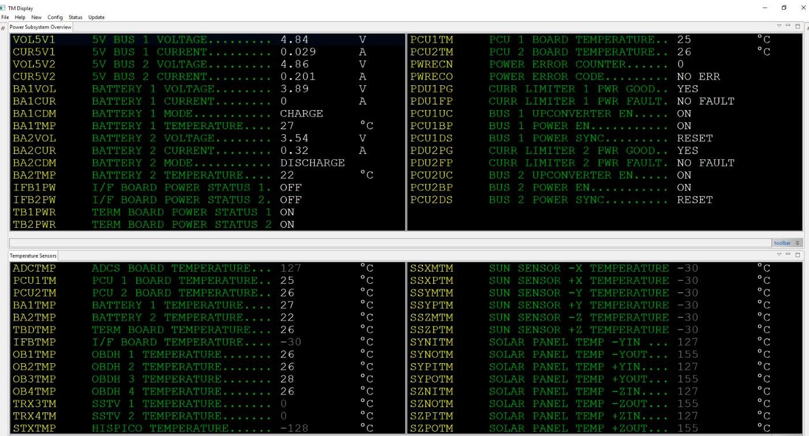


<div align="center">

Figure 1. Telemetry client displaying two telemetry pages of housekeeping data.

</div>

Figure 2 shows a telemetry page with four violated threshold limits and the error display summarizing the threshold limit violations of the different telemetry parameters. When new telemetry data is received, the data is calibrated, the threshold limits are checked, and the data is displayed. By using the error display, the operator gets a quick overview of all limit violations that occurred.

<!-- PDF_PAGE: 5 -->

The operator then can view the associated telemetry pages to assess the situation further. Based on his expertise and knowledge of the system, the operator derives a conclusion regarding the type and severity of the occurred limit violation and the possible cause of it. In the next step, the operator can initiate counter measures. However, this procedure takes time to perform. The spacecraft itself might react to some threshold limit violations with switching into safe mode without operator interaction. In that case, it is of importance to find out what caused the spacecraft to switch into safe mode. However, while using this process, a malfunction can only be detected when a threshold limit was violated. Ideally, a malfunction should be detected before a limit violation happens, as some threshold limits might be critical to the spacecraft's safety. Using only the telemetry data and an ASCII display, like that of the telemetry client of Figure 1, this task becomes highly dependent on the operator's availability, expertise, and knowledge of the system. Observing all telemetry parameters at the same time and detecting anomalies manually is difficult, even when multiple operators are present, as anomalies might be very subtle, e.g., when monitoring a boost converter, given its input voltage and current stemming from the power supply together with its output voltage and the current draw of the consumers connected to it, it is difficult to decide whether the voltages and currents are acceptable. The boost converter may still malfunction while no limit violation happened. The raw data alone does not give information about whether a current of e.g., 0.45 A drawn from the power supply is appropriate given the voltages and currents of the power supply and the current draw of the consumers. The boost converters efficiency might have slowly deteriorated and increased the current draw from a nominal value of e.g., 0.26 A to 0.45 A. However, the nominal value is not known to the operator, as it is highly dynamic and dependent on the voltage and current of the power supply and the current draw of all consumers. Identifying a malfunction before a threshold is violated shortens the duration between the detection of the malfunction and the time of initiation of the first counter measure and it reduces the impact of the malfunction on the spacecraft. A dedicated fault detection system might observe different components and detect such anomalies. In case of the boost converter, the fault detection system would try to infer the correct voltages and currents, given the appropriate measured data and a functional description of the boost converters behavior and decide whether the boost converter is malfunctioning.


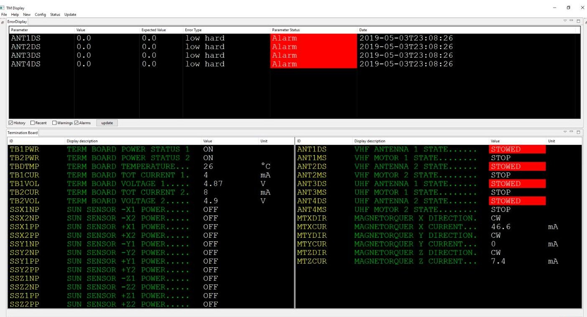


<div align="center">

Figure 2. Telemetry client displaying a telemetry page of housekeeping data with violated threshold limits.

</div>

<!-- PDF_PAGE: 6 -->

## 3. Model-Based Diagnosis

The approach that was employed in this paper is that of quantitative model-based diagnosis, with the main principles following the qualitative approach of [7,8] and implemented in Java. For quantitative model-based diagnosis, a quantitative model of the physical system is built, which captures its nominal behavior. The model is preprocessed and then loaded into the simulation environment. Parts of the housekeeping data are then used to simulate the model, to obtain simulated values, and therefore the expected behavior of the spacecraft. After the simulation has been performed, the simulated values are compared to the measured values from the housekeeping data and discrepancies are detected. Each discrepancy is called a symptom. These symptoms are then used to compute so-called conflict sets. These are sets of components on which the corresponding symptom components are dependent. In a qualitative fashion, the malfunction of one component from the conflict set explains the associated symptom components abnormal behavior. Finally, the minimal hitting sets are computed. A minimal hitting set is a minimal set of components, such that it contains at least one component from every conflict set. Therefore, each hitting set explains all symptoms. Each minimal hitting set corresponds to one diagnosis.

The source code of the fault detection and diagnosis system can be provided by the authors on personal request. Figure 3 shows an overview of the steps that were performed during the fault detection and diagnosis process. The following sections describe the different algorithms in detail.


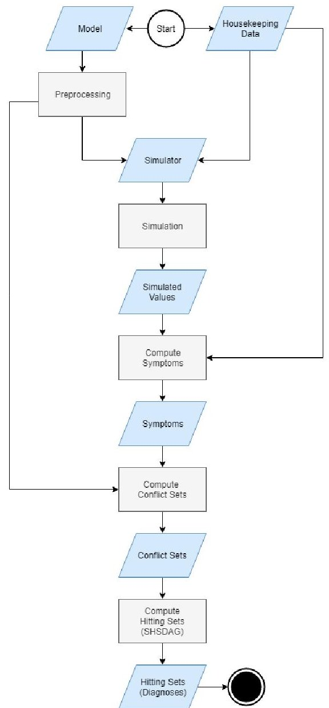


<div align="center">

Figure 3. Overview of the different steps performed during fault detection and diagnosis.

</div>

<!-- PDF_PAGE: 7 -->

## 3.1. Model and Simulator

A model has to be built first in order to be used within an application like model-based diagnosis. The modeling is usually done by or with the help of the system engineers or other experts who have enough knowledge about the system to capture all relevant information of the spacecraft. Components are modelled on component class level first and then instantiated since many technical systems contain multiple components of one class, e.g., multiple batteries of the same type. The component instances are then port-wise interconnected to form a model.

## 3.1.1. Model Editor

Various modeling tools and languages can be found in the literature. Among them are Matlab/ Simulink used by [5,6,19], AD2L a language that was originally developed to interchange diagnostic system descriptions over the internet and later adapted for industrial needs [23], which enables users to build diagnostic models without the need to be specific to the underlying diagnosis algorithm [24], Dymola/Modelica a modeling suite comparable to Matlab/Simulink used by [13] and system specific languages like the one used in [16]. For usability and deployment reasons, we use Microsoft Excel as model editor and Python inline code for the description of the components behavior. Since, often, knowledge from different engineers of a technical system is needed, an easy to use and easy to deploy solution for building the model has been chosen.

## 3.1.2. Component Class Format

Each component class consists of a name, an a priori failure probability, arbitrary many inputs, and arbitrary many outputs, each with a quantitative description, defining how the corresponding output values are computed. The inputs of a component are also referred to as input ports or inports and outputs are also referred to as output ports or outports. Each component class needs to have a unique name. The instances of a component class can have arbitrary names. The a priori failure probabilities should be picked by the systems engineers or other qualified experts based on component tests during the early phases of the engineering process of the spacecraft or based on experience. An educated guess can be made when no such knowledge is obtainable. Each input port of a component class consists of a name, unique within the component class, an abbreviated name that is later displayed in the model graph, a datatype, a lower threshold limit, an upper threshold limit, and an optional unit. Each output port of a component class is defined the same way as an input, with the exception that every output port additionally has a relative tolerance interval value, an absolute tolerance interval value and it is additionally associated with a quantitative description. These quantitative descriptions are functions of the type $ \mathrm{output}_{i}=f(X), $ $ X\subseteq INPORTS, i=1,\dots,n $ , with INPORTS being the set of input ports of the corresponding component class and n being the number of output ports of the component class. Each quantitative description is formulated as Python inline code. Additionally, for each component class, arbitrary many error functions can be defined. These error functions are used to describe known abnormal behavior explicitly. Error functions are similar to the quantitative descriptions of the outputs, with the exception that they can be defined using both the inputs and outputs of the corresponding component class. Each error function is given a probability and a descriptive text describing the formulated abnormal behavior, as well as the error function itself.

Figure 4 shows an example component class definition of a boost converter with an priori failure probability of 0.2. There are 10 inputs and two outputs defined, e.g., the output port "CurrentDrawOut" with the abbreviated name "CDO" is parametrized with datatype double, a lower threshold of 0.0, an upper threshold of 4.0, a relative tolerance interval of 0.05, an absolute tolerance interval of 0.15, unit "A", and a quantitative description. The abbreviated name "CDO" is later displayed in the model graph, next to the respective port of the instances of the Boostconverter component class. The defined error function has a probability of 0.2, a descriptive text, and a quantitative description, defining if the respective error is present or not. In this case, it checks whether the output voltage of the Boostconverter

<!-- PDF_PAGE: 8 -->

is higher than 5.2 V. If this is the case, the Boostconverter is producing overvoltage and the special variable "error" is set to true, meaning that the described error is present; or else, it is set to false. No meaningful direct comparison between simulated and measured values can be performed without tolerance intervals, as they will diverge from each other in most cases, since noise and quantization errors affect the measured values. When a simulated value lies within the tolerance intervals of a measured value, both values are considered to be equal. The absolute tolerance interval is given as an absolute value and is used to mitigate the effect of quantization errors and the relative tolerance interval is given as a value in percent and is used to compensate for noise. Section 3.3.1 explains the use of tolerance intervals in more detail. A component with no inputs and with outputs, which have quantitative descriptions, is called an emitter. Emitters usually produce either fixed or random values via their outputs. A component with no inputs and with outputs, which have no quantitative descriptions, is called a sensor component. This type of component is used to explicitly model sensors.

<table border="1"><tr><td></td><td>Probability</td><td>Name</td><td>Type</td><td>QuantitativeDescription</td></tr><tr><td>Component</td><td>0.2</td><td>Boostconverter</td><td></td><td></td></tr><tr><td>Inputs</td><td></td><td></td><td></td><td></td></tr><tr><td>CDI</td><td></td><td>CurrentDrawIn</td><td>double,0.0,4.0,A</td><td></td></tr><tr><td>VBO</td><td></td><td>VBatOldIn</td><td>double,0.0,4.3,V</td><td></td></tr><tr><td>CBO</td><td></td><td>CurBatOldIn</td><td>double,0.0,4.0,A</td><td></td></tr><tr><td>BRP</td><td></td><td>BatResistanceParam</td><td>double,0,1</td><td></td></tr><tr><td>BVP</td><td></td><td>BaseVoltageParam</td><td>double,0,10</td><td></td></tr><tr><td>BRP</td><td></td><td>BoostResistanceParam</td><td>double,0,1</td><td></td></tr><tr><td>SBP</td><td></td><td>SigmoidBaseParam</td><td>double,0,10</td><td></td></tr><tr><td>SNP</td><td></td><td>SigmoidNegativeOffsetParam</td><td>double,0,10</td><td></td></tr><tr><td>SSP</td><td></td><td>SigmoidScalarParam</td><td>double,0,1</td><td></td></tr><tr><td>SOP</td><td></td><td>SigmoidOffsetParam</td><td>double,0,1</td><td></td></tr><tr><td>Outputs</td><td></td><td></td><td></td><td></td></tr><tr><td>CDO</td><td></td><td>CurrentDrawOut</td><td>double,-5.0,4.0,0.05,0.15,A</td><td>VBat=VBatOldIn-CurBatOldIn*BatResistanceParamc=(BaseVoltageParam-CurrentDrawIn*BoostResistanceParam)*CurrentDrawIneff=(SigmoidScalarParam/(1+pow(SigmoidBaseParam,(CurrentDrawIn-SigmoidNegativeOffsetParam)*-1))+SigmoidOffsetParamCurrentDrawOut=((VBat-math.sqrt(max(VBat*VBat-4*BatResistanceParam*eff*c,0.0)))/(2*BatResistanceParam))</td></tr><tr><td>VO</td><td></td><td>VOut</td><td>double,-5.0,5.2,0.05,0.0,V</td><td>if(VBatOldIn>=2.8):VOut=(BaseVoltageParam-CurrentDrawIn*BoostResistanceParam)else:VOut=0.0</td></tr><tr><td>ErrorFunctions</td><td></td><td></td><td></td><td></td></tr><tr><td></td><td>0.2</td><td>Boostconverter is producing overvoltage</td><td></td><td>if(VOut&gt;5.2):error=Trueelse:error=False</td></tr></table>

<div align="center">

Figure 4. Example component class of a boost converter. The name of the component class and its a priori failure probability are defined in the dark blue block, the input ports are defined in the green block, the output ports are defined in the blue block and the error functions are defined in the light red block.

</div>

## 3.1.3. Connector Format

Once the component classes have been defined, they can be instantiated and port wise interconnected to form a model. Therefore, a different Excel spreadsheet with three tables is used. The first table, the "components" table, contains the instance names of the component instances and the name of the component class that has to be instantiated. These instances correspond to the components of the real technical system. The components of a model form the set V of vertices of the model graph. The second table, the "forward connector" table, contains the port connections, which are simulated during each time step by forward propagation. The set of forward connections is called $ E_{forward} $ . The third table, for a better distinction, called the "backwards connector" table, contains the

<!-- PDF_PAGE: 9 -->

port connections, which are simulated once at the beginning of the simulation of a time step, while using data from the previous iteration. The set of backward connections is called $ E_{backward} $ . The model graph $ G=\left(V,E_{forward},E_{backward}\right) $ contains all components, as well as all connections between the ports of the different components.

Figure 5 shows an example of a components table and a forward connector table. In the components table, the column "Id" contains the instance name of the component instance to be created and the "Type" column contains the component class that has to be instantiated. For the forward connector and backward connector table, the syntax for the column "Output" is component_instance.outport and for the "Input" column the syntax is component_instance.inport. Each row of the forward connector and backward connector table reads: "component_instance.outport is connected to component_instance.inport". For all of the connections, only those ports can be referenced that have been previously defined in the respective component class. To guarantee a fixed simulation sequence, there are no loops allowed in the model on port level during forward propagation, i.e., an outport is not allowed to have a connection to an inport on which it is dependent. Therefore, the graph $ G_{forward}=\left(V,E_{forward}\right) $ has to be acyclic on port level.

<table border="1"><tr><td>Id</td><td>Type</td></tr><tr><td>Battery1</td><td>Battery</td></tr><tr><td>Battery2</td><td>Battery</td></tr><tr><td>Boostconverter1</td><td>Boostconverter</td></tr><tr><td>Boostconverter2</td><td>Boostconverter</td></tr><tr><td>Bus1</td><td>Bus</td></tr><tr><td>Bus2</td><td>Bus</td></tr><tr><td>Terminationboard1</td><td>Terminationboard</td></tr><tr><td>Terminationboard2</td><td>Terminationboard</td></tr></table>

<div align="center">

(a)

</div>

<table border="1"><tr><td>Output</td><td>Input</td></tr><tr><td>Boostconverter1.CurrentDrawOut</td><td>Battery1.CurrentDrawIn</td></tr><tr><td>Boostconverter2.CurrentDrawOut</td><td>Battery2.CurrentDrawIn</td></tr><tr><td>Boostconverter1.VOut</td><td>Bus1.VIn</td></tr><tr><td>Boostconverter2.VOut</td><td>Bus2.VIn</td></tr><tr><td>Bus1.CurrentDrawOut</td><td>Boostconverter1.CurrentDrawIn</td></tr><tr><td>Bus2.CurrentDrawOut</td><td>Boostconverter2.CurrentDrawIn</td></tr><tr><td>Bus1.VOut</td><td>Terminationboard1.VIn</td></tr><tr><td>Bus2.VOut</td><td>Terminationboard2.VIn</td></tr></table>

<div align="center">

(b)

</div>

<div align="center">

Figure 5. Example of a components table used to instantiate components (a) and a forward connector table used to connect component instances port wise (b).

</div>

Figure 6 shows an example of a backwards connector table. The graph $ G_{backward}=\left(V, E_{backward}\right) $ might contain feedback loops, since the connections of the "backwards connector"-table are only considered once at the beginning of the simulation of a time step, as described in Algorithm 1 of Section 3.2. The two types of connections are necessary to model loops over time.

<table border="1"><tr><td>Output</td><td>Input</td></tr><tr><td>Battery1.VBatOut</td><td>Battery1.VBatOldIn</td></tr><tr><td>Battery1.CurrentOut</td><td>Battery1.CurrentOldIn</td></tr><tr><td>Battery2.VBatOut</td><td>Battery2.VBatOldIn</td></tr><tr><td>Battery2.CurrentOut</td><td>Battery2.CurrentOldIn</td></tr><tr><td>Battery1.VBatOut</td><td>Boostconverter1.VBatOldIn</td></tr><tr><td>Battery1.CurrentOut</td><td>Boostconverter1.CurBatOldIn</td></tr><tr><td>Battery2.VBatOut</td><td>Boostconverter2.VBatOldIn</td></tr><tr><td>Battery2.CurrentOut</td><td>Boostconverter2.CurBatOldIn</td></tr></table>

<div align="center">

Figure 6. Example of a backwards connector table used to connect component instances port wise.

</div>

Figure 7 illustrates how a loop on port level is modelled. A system containing a loop (a) is modelled by changing one connection of the loop from a forward connection to a backward connection (b), so that the computation of the loop is done in two time steps (c). During time step i, A produces an output, while using the output of B from the previous time step, or an initial value, if the current time step is the first one. Afterwards, B uses the output of A to produce its own output. At the beginning of

<!-- PDF_PAGE: 10 -->

time step i+1 the output of B from time step i is used as input of A. With the use of feedback loops memory and operations like incrementation of a value can be modelled.


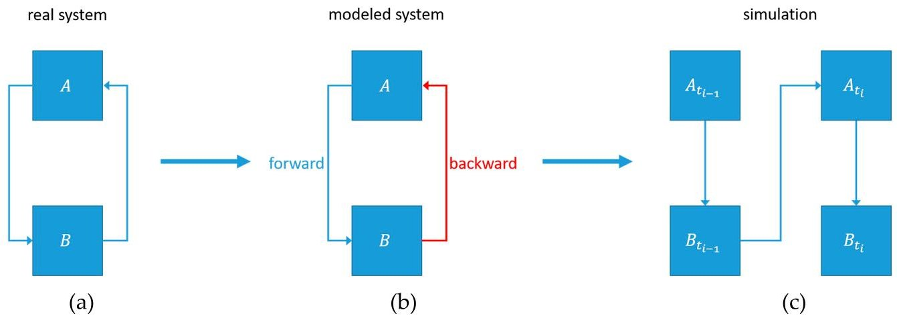


<div align="center">

Figure 7. The modelling of a loop. A system containing a loop (a), the model of the system (b) and an illustration of how the model is simulated (c).

</div>

Figure 8 shows how a component can compute $ x=x+1 $ . A feedback loop is used to assign the value of $ x_{in}+1 $ to $ x_{out} $ . Since $ x_{in_{t_{i}}}=x_{out_{t_{i-1}}} $ , the component computes $ x_{out_{t_{i}}}=x_{out_{t_{i}-1}}+1. $


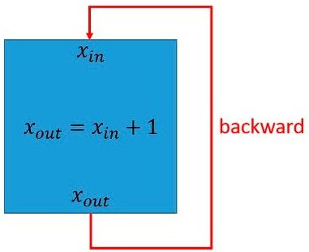


<div align="center">

Figure 8. Example of a component computing $ x=x+1. $

</div>

## 3.1.4. Port Dependencies

An important preprocessing step for both the simulation and the diagnosis is the computation of port dependencies. There are two types of dependencies:

- The static port dependencies map each outport of each component to the inports that are needed to compute a value for the corresponding outport, independent of the actual inport values. These port dependencies are all inports, which are part of the quantitative description of the corresponding outport. When the outport of a component is simulated, it is first checked, if the values for all inports on which the outport is dependent are available.

- The dynamic port dependencies are used for the computation of conflict sets during the diagnosis. These port dependencies map each outport of each component to the inports on which the corresponding outport is dependent during the current time step, given the available values for the inports. These port dependencies are updated after each simulation, since the port dependencies can change in respect to the values of the inports.

Figure 9 shows an example quantitative description of an output with two inputs. If input1 is greater than 0, then the output becomes dependent on input1 and input2, or else the output is only dependent on input1. There exists a special parser and tree walker, which analyses the quantitative descriptions of the different components and generates data structures that allow for the update of port dependencies, given the measured and simulated values for the different inports.

<!-- PDF_PAGE: 11 -->

```python

if(input1>0):

    output = input1 + input2

else:

    output = input1

```

<div align="center">

Figure 9. Example quantitative description of an output with two inputs

</div>

Figure 10 shows an excerpt of the context free ANTLR grammar, used by the parser to analyze the port dependencies. The quantitative expressions of each outport are split into parts, e.g., "ifBlock", "elseifBlock", and "elseBlock" consisting of expressions that can be evaluated, e.g., "booleanExpression" and "arithmeticExpression". The Boolean and arithmetic expressions are evaluated by order of their if-elseif-else parts, while using the data of the current time step. The ports contained in the respective if-elseif-else part to apply first are added to the dynamic port dependencies. This procedure is repeated recursively, as the grammar allows for nesting of expressions. These dynamic port dependencies are later used to limit the number of components that have to be considered during the computation of the conflict sets, as described in Section 3.3.2.


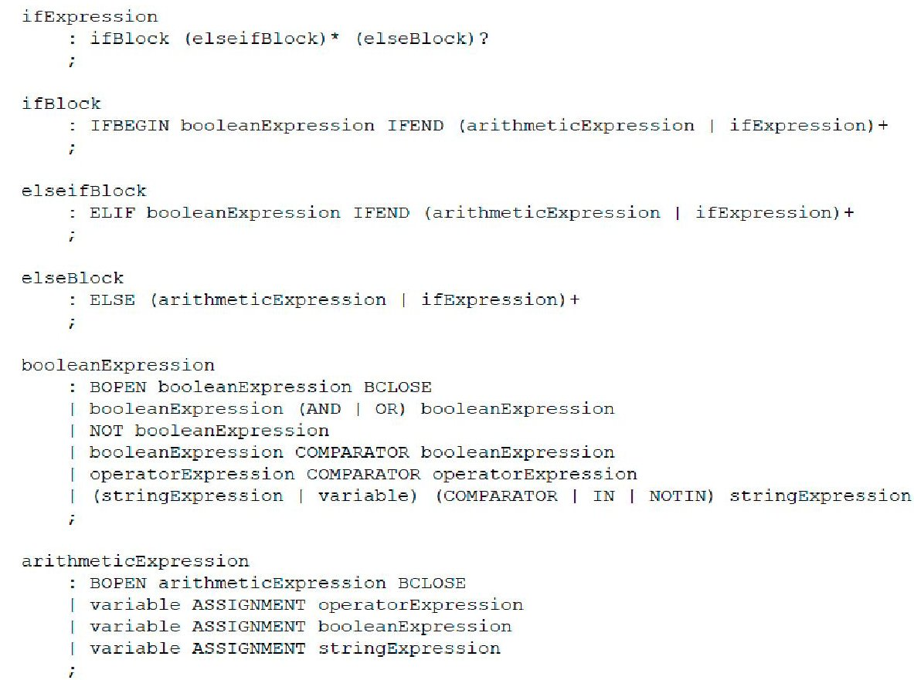


<div align="center">

Figure 10. Excerpt from the context free grammar used to analyze the port dependencies.

</div>

## 3.2. Simulation

After a model is created, it can be used for simulation. The simulator is not bound to a single model, as the model is separated from the simulator. Any model built in accordance to the format of Sections 3.1.2 and 3.1.3 can be simulated. For simulation, the model is preprocessed and transformed into the software's internal data structures. The components are instantiated according to the connector, their input and output ports are made unique and their quantitative descriptions are accordingly adjusted. The quantitative descriptions are parsed and the port dependency data structures are created. The static port dependencies are computed. Variable assignment functions and the different adjusted quantitative expressions of the component instances are pre-compiled and loaded within the execution environment. The model graphs $ G_{forward}, $ $ G_{backward}, $ and G are built and the simulator is initialized. The pseudo code of Algorithm 1 and Algorithm 2 describes how the simulation of a time step is performed.

<!-- PDF_PAGE: 12 -->

Algorithm 1. Pseudo code of the SimulateInitial-function of the simulator, used to perform initial computations e.g., the simulation of emitters and to initialize the necessary data structures for further simulation of the model.

ALGORITHM: SimulateInitial

INPUTS: The set of simulated outputs from the previous iteration: $SIMULATED_OUTPUTS_{old}$

The set of measured inputs from the current iteration: $MEASURED_INPUTS$

The set of measured outputs from the current iteration: $MEASURED_OUTPUTS$

The set of model components: $COMPONENTS$

The set of forward connections: $FORWARD_CONNECTIONS$

The set of backward connections: $BACKWARD_CONNECTIONS$

OUTPUTS: The set of simulated outputs: $SIMULATED_OUTPUTS$

1. Map outputs from $SIMULATED_OUTPUTS_{old}$ to inputs $SIMULATED_INPUTS$, using $BACKWARD_CONNECTIONS$

2. Let $INPUT_VALUES$ be an empty set of input values. Merge $MEASURED_INPUTS$ and $SIMULATED_INPUTS$ into $INPUT_VALUES$

3. Map all outputs from $MEASURED_OUTPUTS$ to inputs, using $FORWARD_CONNECTIONS$ and merge them with $INPUT_VALUES$

4. Let $SIMULATED_OUTPUTS$ be an empty set of output values

5. Let $CANDIDATES$ be an empty set of components to consider for simulation

6. Let $SIMULATED_COMPONENTS$ be an empty map of components to sets of ports to keep track which ports of which components have been simulated already

7. Determine the set of components $UNSIMULATABLE_COMPONENTS$, that cannot be simulated during the current iteration of the simulation

8. Simulate all emitter components, map their outputs to inputs and merge them with $INPUT_VALUES$. Add all components connected to them that are not in $UNSIMULATABLE_COMPONENTS$ to $CANDIDATES$

9. Check $INPUT_VALUES$ and add all components, that have at least one $input\_value \in INPUT_VALUES$ and are not in $UNSIMULATABLE_COMPONENTS$ to $CANDIDATES$

10. IF $CANDIDATES! = \{}$ THEN

    SimulateRecursive($INPUT_VALUES$, $FORWARD_CONNECTIONS$, $UNSIMULATABLE_COMPONENTS$, $CANDIDATES$, $SIMULATED_COMPONENTS$, $SIMULATED_OUTPUTS$)

ELSE

RETURN $SIMULATED_OUTPUTS$

The simulation not only uses the primary inputs, i.e., sensor data and external inputs, but all the available measured data. For a port, there might exist a measured and a simulated value simultaneously. When this occurs, the measured value overwrites the simulated one. This is used to ensure that the model is being simulated with as many values from the real technical system as possible, in order to prevent an accumulation of errors due to modelling errors. The following figure illustrates the need for value overwrites:

Figure 11 shows the behavior of a hypothetical real technical system on the left and its corresponding model on the right, while assuming the absence of noise. Most models only approximate the real behavior with certain accuracy since it is difficult to capture the behavior of a real technical system perfectly. In this case, the behavior of the real technical system and its model deviate by an error of $ \epsilon>0 $ . For the sake of simplicity, it is assumed that $ f(in)=in+1 $ . If the input of the component from Figure 11 is replaced by a measured value each iteration, then the accumulated error per iteration would be $ \epsilon $ . If the simulated value would not be overwritten by the measured value, then after x

<!-- PDF_PAGE: 13 -->

iterations, the accumulated error would be $ x\cdot\epsilon $ . For a great enough x, the modeling error would become so large that no meaningful comparison of the observed and the simulated values could be done, as the accuracy of the model then only depends on the number of simulated time steps, i.e., the number of housekeeping frames.

Algorithm 2. Pseudo code of the SimulateRecursive-function of the simulator, used to perform the simulation of model components in a recursive fashion.

ALGORITHM: SimulateRecursive

INPUTS: The set of all input values: $INPUT_VALUES$

The set of forward connections: $FORWARD_CONNECTIONS$

The set of unsimulatable components: $UNSIMULATABLE_COMPONENTS$

The set of current candidates: $CANDIDATES$

The map of currently simulated components: $SIMULATED_COMPONENTS$

The set of currently simulated outputs: $SIMULATED_OUTPUTS$

OUTPUTS: The set of simulated outputs: $SIMULATED_OUTPUTS$

1. Let $CANDIDATES_{new}$ be an empty set of components to consider for simulation

2. FOR EACH $candidate \in CANDIDATES$

    IF $candidate$ has ports that are simulatable and are not contained in $SIMULATED_COMPONENTS$

    THEN

        $outputs_{candidate} =$ simulate new simulatable ports

        Merge $outputs_{candidate}$ into $SIMULATED_COMPONENTS$

        Map $outputs_{candidate}$ to inputs, using $FORWARD_CONNECTIONS$ and merge them with $INPUT_VALUES$

    IF $SIMULATED_COMPONENTS$ contains all outports of $candidate$ THEN

        $candidate$ is finished and won’t be considered again for simulation

        Add all components connected to $candidate$ to $CANDIDATES_{new}$

3. IF $CANDIDATES_{new}! = \{ \}$ THEN

    SimulateRecursive($INPUT_VALUES, FORWARD_CONNECTIONS, UNSIMULATABLE_COMPONENTS, CANDIDATES_{new}, SIMULATED_COMPONENTS, SIMULATED_OUTPUTS$)

ELSE

    RETURN $SIMULATED_OUTPUTS$


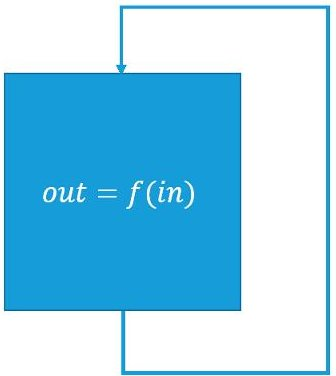


<div align="center">

(a)

</div>


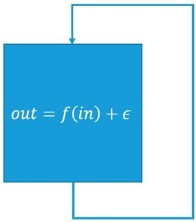


<div align="center">

(b)

</div>

<div align="center">

Figure 11. The behavior of a real technical system (a) and its model with modelling error (b).

</div>

<!-- PDF_PAGE: 14 -->

## 3.3. Diagnostic Algorithm

A simulation is first performed before a diagnosis is computed. The simulation yields simulated values, which are later used to detect discrepancies and to compute symptoms. With the use of the measured and simulated values, symptoms are derived, the heuristic error functions are evaluated, conflict sets are determined, and finally hitting sets are computed. After the simulation, the original measured values are merged with the simulated values. If there is simultaneously a measured and a simulated value available for the same port, the measured value overwrites the simulated one. These merged values are then used to update the dynamic port dependencies, as described in Section 3.1.4.

## 3.3.1. Symptoms

After the simulation of a time step has been completed, a check for threshold limit violations and discrepancies between the observed and expected behavior of components is performed. Every limit violation and discrepancy between the observed behavior of a component and its expected behavior is called a symptom. The observed behavior is given by the measured values and the expected behavior is given by the simulated values of the different components. A discrepancy is detected, and therefore a symptom is computed when either of the following holds true:

- The measured value of an outport is smaller than its lower threshold limit

- The measured value of an outport is greater than its upper threshold limit

- The deviation of the measured value of an outport from its corresponding simulated value violates its tolerance intervals

If any of the above conditions hold true for the port p of a component c, then a symptom s is created. However, the tolerance intervals need special consideration. The tolerance intervals are divided into absolute and relative tolerance intervals. The absolute tolerance intervals are mainly used to mitigate the effects of the quantization error of the sensors. Assuming that a sensor is used to measure a current range of 0 A to 3.2 A with a resolution of 8-bit, the 8-bit resolution results in 256 discrete quantization levels. For the current range of 0 A to 3.2 A each quantization level corresponds to 12.5 mA. Depending on the sensor, this value or multiples of this value can be used as the absolute tolerance interval. The relative tolerance intervals are used to mitigate the effect of noise and model errors and are determined during model calibration. During the calibration phase, the average achieved accuracy is used as the initial relative tolerance interval. During a comparison of a simulated value $ v_{sim} $ with its corresponding measured value $ v_{meas} $ , first the absolute tolerance value $ t_{abs} $ is considered. If $ v_{meas}+t_{abs}\geq v_{sim}\geq v_{meas}-t_{abs} $ holds true, then $ v_{sim} $ and $ v_{meas} $ are considered to be equal, or else the relative tolerance interval $ t_{rel} $ is considered. If $ v_{meas}\cdot(1+t_{rel})\geq v_{meas}\geq v_{meas}\cdot(1-t_{rel}) $ holds true, then $ v_{sim} $ and $ v_{meas} $ are considered equal; else, a symptom is created. The component c is then called a symptom component and p the symptom port of symptom s.

If there is at least one simulatable output port and there exist measured values for all simulatable output ports of a component c and c is not a symptom component, then c is considered to be correctly working and it is called an excluded component.

Generally, all of the components that have a quantitative description should be simulatable. However, in rare cases, output ports of components that are not sensor components might not be simulatable due to the unavailability of certain measured values. This is a special case and it occurs when a component requires the unavailable output values of a sensor component to compute a value for one of its own outports. The modelling of partial knowledge needs to be carefully considered to avoid undefined model behavior. The modelling of such cases should only be done for output ports for which there exist measured values and whose quantitative description equals the operation that directly forwards the value from one of their input ports via the respective outport in the absence of the unavailable sensor values, which cause the outport to be unsimulatable.

The measured and simulated values, port dependencies, symptoms and excluded components form the model state of a time step, also called an iteration. After the symptoms have been computed, the error

<!-- PDF_PAGE: 15 -->

functions of each symptom component are evaluated. If an error function applies, its description text, together with its probability, is mapped to the corresponding symptom component. These probabilities later overwrite the associated components failure probability when the scores are computed.

## 3.3.2. Computation of Conflict Sets

A conflict set $ CS_{sc} $ is a set of components, corresponding to a symptom component sc, for which holds that a malfunction of one of the components $ c\in CS_{sc} $ would explain the symptom associated with sc. The set of all conflict sets is denoted as CSS. A basic conflict set for a symptom component sc would contain each component c, for which there exists a path of dependent port connections from c to sc in the model graph. The computation time of diagnoses may potentially grow exponentially in the number and size of all conflict sets. Therefore, it is of importance to reduce the size of the conflict sets before diagnoses are computed. The pseudo code of Algorithm 3 describes how the conflict set $ CS_{sc} $ for a symptom component sc is computed.

Algorithm 3. Pseudo code of the ComputeConflictSet-function used to compute a conflict set, given a symptom component, so that a malfunction of a component of the conflict set would explain the observed symptoms of the symptom component.

ALGORITHM: ComputeConflictSet

INPUTS: The symptom component to compute a conflict set for: sc

The dynamic port dependencies: portDependencies

The set of measured outputs of the current iteration: MEASURED_OUTPUTS

The model graph: G

The set of all excluded components: EC

The model state of the previous iteration: previousState

OUTPUTS: The conflict set $ C S_{s c} $ corresponding to sc and the map of components to sets of suspecting components SUSPICIONS

1. Let PORTS be an empty set of output ports. Merge the symptom ports of the symptoms associated with sc into PORTS

2. Let SUSPICIONS be an empty map of components to sets of suspecting components

3. Use portDependencies to compute for each port $ \in $ PORTS the inputs INPUT_PORTS on which port is dependent and use G to identify the output ports OUTPUT_PORTS, which are connected to the input ports of INPUT_PORTS. Search the whole model graph using a backwards directed breadth-first search. Replace PORTS with OUTPUT_PORTS before continuing with the next level. Before visiting a component c through an output port p, take an action based on the following conditions:

- If c is a symptom component, continue the search

- If c is an excluded component, do not visit c

- If c is neither a symptom component, nor an excluded component and there exists no measured and simulated value simultaneously for p, continue the search

- If c is neither a symptom component, nor an excluded component and there exists a measured and a simulated value for p, do not visit c

- If c was reached through a backwards connection, check the above conditions, but use the models previous state

If a component c is visited and c is not a symptom component, it is suspected by sc and added to the set of components that suspect c in SUSPICIONS. The set of all visited components is the conflict set $ C S_{s c} $ of sc

4. RETURN $ CS_{sc} $ and SUSPICIONS

<!-- PDF_PAGE: 16 -->

It is to be noted that, when a component has been reached from a backwards connection, further backwards connections are ignored. Therefore, the search is limited to the system state of the current and previous time step. A similar computation is done for each excluded component ec, yielding the map of components to sets of relieving components EXCLUSIONS. The maps SUSPICIONS and EXCLUSIONS are then used to calculate a suspicion score for each component c, determining whether c is suspicious or not suspicious by comparing the suspicions and exclusions for each component, weighted by the respective suspecting or relieving components a priori failure probability. If c is found not to be suspicious, c is removed from all conflict sets. While the backwards directed breadth-first search is using port dependencies and the model state to limit the amount and length of paths to visit, the suspicions and exclusions are used to remove unlikely malfunctioning components from the remaining paths. Assuming the conflict sets as paths, after the non-suspicious components are removed, the remaining paths can contain gaps.

## 3.3.3. Computation of Hitting Sets

A hitting set HS is as set of components, for which holds, that if all components c $ \in $ HS are malfunctioning, all of the observed symptoms would be explained. Interpreting the components c $ \in $ CS $ i $ $ i \in $ COMPONENTS as literals, conflict sets can be seen as Boolean formulae $ CS_{i}=\vee_{c_{i}\in CS_{i}}c_{i}=c_{1}\vee\ldots\vee c_{n} $ . A hitting set then can be described as the solution to the Boolean formula $ HS=\wedge_{CS_{i}\in CSS}CS_{i}=\left(c_{1,1}\vee\ldots\vee c_{1,n_{1}}\right)\wedge\ldots\wedge\left(c_{m,1}\vee\ldots\vee c_{m,n_{m}}\right), $ $ c_{i,j}\in CS_{i} $ . A minimal hitting set is a hitting set that cannot be subsumed by any other hitting set. Each minimal hitting set, HS corresponds to one diagnosis. Minimal hitting sets can be computed with the help of a SAT-solver [25,26]. The simplest procedure to compute all possible hitting sets given the formula above is to solve the Boolean formula first, and then after a solution has been found, the solution has to be negated, added as a blocking clause to the formula and another solution has to be derived. This has to be repeated until no solutions can be found. As the fault detection system is supposed to be ported to run on board the SONATE-Nano satellite, a SAT-solver is not lightweight enough. Therefore, a different approach of hitting set computation has been used, which offers high quality results for the relevant model sizes, while having low computational cost [27]. Based on the Hitting Set Directed Acyclic Graph (HSDAG) of [28], which is a modified version of the Hitting Set Tree (HSTree) by [7], a Scored Hitting Set Directed Acyclic Graph (SHSDAG) has been implemented, utilizing node reusing, regular edge pruning techniques, and score based edge pruning to reduce the computation time of diagnoses. The pseudo code of Algorithm 4 describes how a SHSDAG is built.

The node state of a node node can be either one of the following:

- open, when node has child nodes

- closed, when the path from $ n_{0} $ to node is a dead end and does not correspond to a hitting set

- end_of_path, when the path from $ n_{0} $ to node corresponds to a minimal hitting set

The label of a node is a set of components. The label of an edge is a single component. Each path from the root of the SHSDAG to a node, labeled as end_of_path, is a minimal hitting set. The score for a path PATH is calculated by multiplying the a priori failure probabilities or when available the suspicion scores of each component $ c\in PATH $ . These scores have the character of a pseudo probability. To reduce the size of the SHSDAG and to ensure that only minimal hitting sets are being computed, additional to the algorithm above, the following node-reuse and node-termination rules are being used.

Node-reuse rule:

- If a new child node childNode for a node node is to be created, due to a component c, while there exists a node node $ ^{\prime} $ , with path(node $ ^{\prime} $ ）= path(node) $ \cup $ c, then childNode is not created, but node $ ^{\prime} $ is added to the child nodes of node.

Node-termination rules:

<!-- PDF_PAGE: 17 -->

- If the SHSDAG contains a node node after a node node has been created, with path(node $ ^{\prime} $ ） $ \subset $ path(node), then close node

- If the score cut-off is used with a cut-off factor cutOffFactor and the score of a newly created node node is score(path(node)) < minScore $ \cdot $ cutOffFactor, then close node

Algorithm 4. Pseudo code of the BuildSHSDAG-function used to build a Scored Hitting Set Directed Acyclic Graph (SHSDAG) and therefore to compute the minimal hitting sets, given a set of conflict sets.

ALGORITHM: BuildSHSDAG

INPUTS: The set of all conflict sets: CSS

OUTPUTS: The SHSDAG: SHSDAG

1. Use logical absorption on the $CS \in CSS$

2. Sort CSS ascending by cardinality

3. Let $n_0$ be the empty root node of the SHSDAG

4. Let currentNodes be an empty list of nodes

5. Let nextNodes be an empty list of nodes

6. Add $n_0$ to currentNodes

7. WHILE currentNodes is not empty

FOR EACH node $ \in $ currentNodes

Let PATH be the set of edge labels of the path from $n_0$ to node

FOR EACH $CS \in CSS$

IF $CS \cap PATH = \emptyset$ THEN

Label node with CS

BREAK

IF node was labeled with CS THEN

FOR EACH $c \in CS$

Let childNode be an empty node with state open

Add childNode as child node to node

Set the path of childNode to $PATH \cup c$

Label the edge from node to childNode with $c$

Compute a score for childNode based on its new path

Add childNode to nextNodes

ELSE

Set the state of node to end_of_path

Set currentNodes to nextNodes

Set nextNodes to an empty list of nodes

8. RETURN the SHSDAG

The cut-off rule can be parametrized with the so-called cut-off factor. The cut-off factor describes how likely a diagnosis has to be at least, relative to the minScore, the probability of the diagnosis in which all of the symptom components are simultaneously malfunctioning. The cut-off factor can be manually set. Optionally, the fault detection system starts with a high cut-off factor and iteratively adapts it until a single diagnosis is computed. The following example illustrates how a SHSDAG is built, and therefore minimal hitting sets are computed by starting with the set of conflict sets and building the SHSDAG step by step:

Assuming that, for a model, the symptom components $ \{A,C,E\} $ have been found. The computation and reduction of the conflict sets has finished and the conflict sets are $ CS_{A}=\{A,B,C,H\},CS_{C}=\{C,B,D\} $

<!-- PDF_PAGE: 18 -->

and $ C S_{E}=\{E,H,B\} $ . After sorting by cardinality the set of conflict sets CSS is CSS $ =\{C S_{C},C S_{E},C S_{A}\}=\{\{C,B,D\},\{E,H,B\},\{A,B,C,H\}\} $ . The failure probabilities of the components are given by $ P(A)=0.5 $ $ P(B)=0.2 $ $ P(C)=0.6 $ $ P(E)=0.5 $ $ P(D)=0.5 $ , and $ P(H)=0.2 $ . The pseudo probability minScore is $ minScore=P(A)\cdot P(C)\cdot P(E)=0.5\cdot 0.6\cdot 0.5=0.15 $ and the cut-off factor is set to 1.0.

To build the SHSDAG, first the root node $ n_{0} $ is created, as depicted in Figure 12.


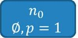


Figure 12. The root node $ n_{0} $ of the SHSDAG, initially without label and with a pseudo probability score of 1.

Subsequently, for each $ CS\in CSS, path(n_{0})\cap CS $ is computed. As $ path(n_{0})=\varnothing $ and $ path(n_{0})\cap CS_{c}=\varnothing, n_{0} $ is labeled with $ CS_{C}, $ as depicted in Figure 13.

$$
\{C, B, D \}, p = 1
$$

<div align="center">

Figure 13. The root node $ n_{0} $ of the SHSDAG, after being labeled with $ CS_{c}=\{C,B,D\} $

</div>

For each $ c\in CS_{C} $ , a new child node is created and its path, as well as its score is updated. Figure 14 shows the SHSDAG after this step.


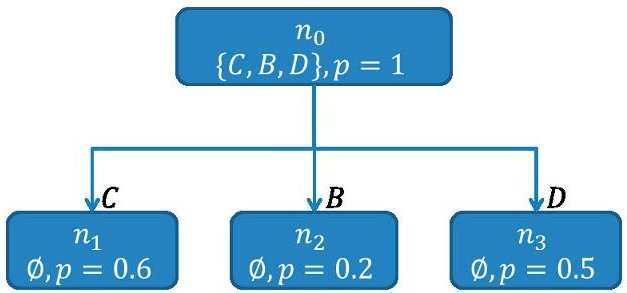


<div align="center">

Figure 14. The SHSDAG after the expansion of the root node $ n_{0} $ . The new child nodes $ n_{1}, n_{2} $ and $ n_{3} $ have been created and their paths and scores have been updated.

</div>

As there are no other nodes on the same level as $ n_{0} $ , the nodes of the next level are processed. First $ n_{1} $ , with $ path(n_{1})=C $ is examined. As $ C\cap CS_{C}\neq \varnothing $ $ CS_{E}=\{E,H,B\} $ is looked at. $ n_{1} $ is labeled with $ CS_{E} $ , because $ C\cap CS_{E}=\varnothing $ . The same is repeated for $ n_{2} $ . In opposite to $ n_{1},n_{2} $ is labeled as end_of_path because for each $ CS\in CSS $ , the intersection $ path(n_{2})\cap CS $ is not empty. This makes $ HS_{0}=\{B\} $ , with $ P(HS_{0})=0.2 $ , the first found hitting set. The node $ n_{3} $ is labeled with $ CS_{E} $ in the same way. Figure 15 shows the SHSDAG after the expansion of $ n_{1} $ and $ n_{3} $ .

On the next level, the nodes $ n_{4}, n_{5}, n_{6}, n_{7}, n_{8} $ , and $ n_{9} $ are examined. As the pseudo probability of $ n_{5} $ being $ P(n_{5})=0.12 $ is smaller than minProbability $ \cdot $ cutOffFactor $ = 0.15\cdot 1.0=0.15 $ , a cut-off is made and $ n_{5} $ is closed. For the same reason $ n_{8} $ is closed. For $ n_{6} $ and $ n_{9} $ , besides the cut-off rule, the first termination-rule also applies, since $ path(n_{2})\subset path(n_{6}) $ and $ path(n_{2})\subset path(n_{9}) $ , which causes $ n_{6} $ and $ n_{9} $ to be closed. The path of $ n_{4} $ has a non-empty intersection with each of the $ CS\in CSS $ and it is labeled as end_of_path, making $ HS_{1}=\{C,E\} $ , with $ P(HS_{1})=0.3 $ the second found hitting set. The node $ n_{7} $ is expanded, due to having an empty intersection with $ CS_{A} $ . Figure 16 shows the SHSDAG after this step.

The nodes $ n_{10}, n_{11} $ , and $ n_{13} $ are closed by applying the cut-off rule. Additionally, for $ n_{11} $ and $ n_{12} $ the first termination-rule applies. Figure 17 shows the SHSDAG after the computation of hitting sets has finished.

<!-- PDF_PAGE: 19 -->


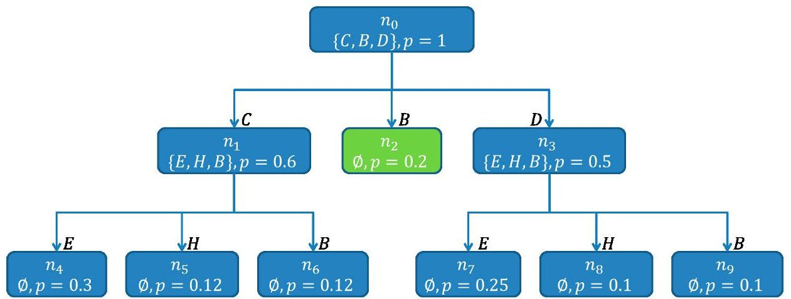


<div align="center">

Figure 15. The SHSDAG after the expansion of $ n_{1} $ and $ n_{3} $ . The nodes $ n_{1} $ and $ n_{3} $ are both labeled with $ C S_{E}=\{E H B\} $ . The new child nodes $ n_{4}, n_{5}, n_{6} $ of $ n_{1} $ and the new child nodes $ n_{7}, n_{8}, n_{9} $ of $ n_{3} $ have been created. The node $ n_{2} $ was labeled as end_of_path and is a hitting set (therefore depicted in green).

</div>


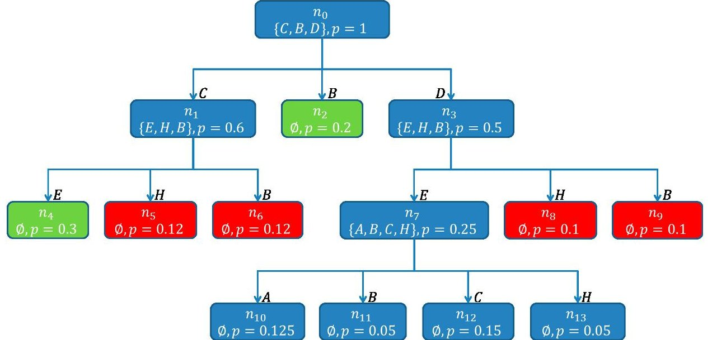


<div align="center">

Figure 16. The SHSDAG after the expansion of $ n_{7} $ . The node $ n_{7} $ is labeled with $ CS_{A}=\{A,B,C,H\} $ The new child nodes $ n_{10},n_{11},n_{12} $ and $ n_{13} $ of $ n_{7} $ have been created. The node $ n_{4} $ was labeled as end_of_path and is a new found hitting set (therefore depicted in green) and the nodes $ n_{5},n_{6},n_{8} $ and $ n_{9} $ are closed and won't be considered further (therefore depicted in red).

</div>


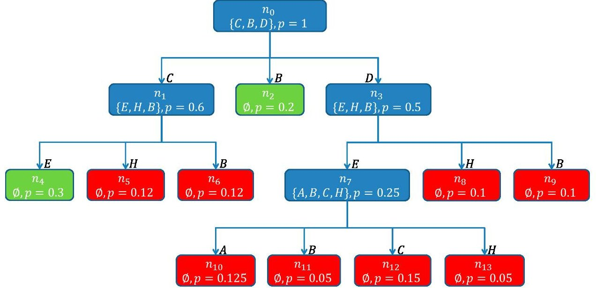


<div align="center">

Figure 17. The SHSDAG after the computation of the hitting sets has finished. The nodes $ n_{10}, n_{11}, n_{12} $ and $ n_{13} $ were closed. Since no more open nodes exist, the algorithm terminates. The computed hitting sets are the paths of the nodes $ n_{2} $ and $ n_{4} $ labeled as end_of_path.

</div>

<!-- PDF_PAGE: 20 -->

As there are no more open nodes, the algorithm terminates. The computed hitting sets are $ H S_{0}=\{B\} $ with $ P(HS_{0})=0.2 $ , and $ HS_{1}=\{C,E\} $ , with $ P(HS_{1})=0.3 $ . In total two diagnoses have been computed. The diagnoses are then ranked by their probability, which results in the ranking $ HS_{1}, $ $ HS_{0} $ . By choosing a different cut-off factor, it is possible to determine which minimal probability the diagnoses should have, relative to the probability of the diagnosis in which all symptom components are simultaneously malfunctioning. For example a cut-off factor of 2.0 would return the diagnosis $ HS_{0} $ and a cut-off factor of 0.5 would return the diagnoses $ HS_{0}, HS_{1}, HS_{2}=\{C,H\} $ , with $ P(HS_{2})=0.12 $ and $ HS_{3}=\{D,H\} $ , with $ P(HS_{3})=0.1 $ .

## 4. Satellite Model

The power supply of the qualification model of the SONATE Nano-satellite was modelled to evaluate the fault detection system. The power supply consists of two Power Control Units (PCU), two main energy supply busses and different consumers connected to the buses.

Figure 18 shows the complete model graph, as displayed in the diagnosis view of the telemetry client, when no data is supplied. The graphs main purpose is to inform the operator of detected malfunctions. During operation, components that are deemed to function correctly are displayed in green, components which are suspected to malfunction are displayed in red and components for which there is not enough information to identify them as either malfunctioning or working correctly are displayed in blue.


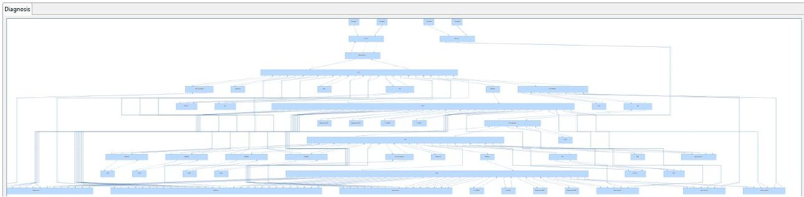


<div align="center">

Figure 18. The complete model graph as displayed in the diagnosis view of the telemetry client.

</div>

Figure 19 shows a schematic overview of the model graph that is displayed in Figure 18. In this figure, the connections between the different components have been reduced to one connection each. Some connections are depicted with dotted lines in order to increase the readability of the figure. The instances of each component class share the same name but are numbered differently, e.g., "Bus1" and "Bus2" are both instances of the component class "Bus". Table 1 gives an overview of the component classes modelled:

Most consumers that are redundantly available are connected to one bus each, e.g., Transceiver1 is connected to Bus1 and Transceiver2 is connected to Bus2. Consumers that are not redundantly available, like the ASAP payload, an autonomous short-term phenomenon detection and planning system, as well as the OBDHConv and OBDH components, can be powered by both busses.

<!-- PDF_PAGE: 21 -->


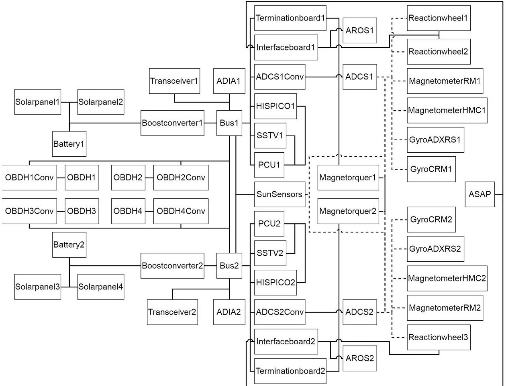


<div align="center">

Figure 19. Schematic overview of the complete model graph from Figure 18.

</div>

<div align="center">

Table 1. Overview of the different modelled component classes.

</div>

<table border="1"><tr><td>Component</td><td>Instances</td><td>Description</td></tr><tr><td>Battery</td><td>2</td><td>A battery pack consisting of 4 single batteries. The main power source of the satellite.</td></tr><tr><td>Solarpanel</td><td>4</td><td>A single solar panel, explicitly modelled as a sensor component</td></tr><tr><td>Boostconverter</td><td>2</td><td>The PCUs boost converter is used to generate a stable bus voltage. Since most consumers need a voltage higher, than the main power supply can provide, each of the two power supply busses uses one of these converters.</td></tr><tr><td>Bus</td><td>2</td><td>The power supply bus is used to connect the consumers to the main power supply via a boost converter.</td></tr><tr><td>Magnetorquer</td><td>2</td><td>The magnetorquer component combines three actual magnetorquers. A ferrite core coil (X-direction) and two air core coils (Y-and Z-direction) are used.</td></tr><tr><td>Terminationboard</td><td>2</td><td>Connects three single physical magnetorquers in either positive or negative X-, Y-, Z-direction to a power supply bus.</td></tr><tr><td>Reactionwheel</td><td>3</td><td>A single experimental reaction wheel.</td></tr><tr><td>ASAP</td><td>1</td><td>The ASAP-payload.</td></tr><tr><td>AROS</td><td>2</td><td>The AROS-payload.</td></tr><tr><td>Interfaceboard1</td><td>1</td><td>Connects two reaction wheels, an AROS unit and ASAP to a power supply bus.</td></tr><tr><td>Interfaceboard2</td><td>1</td><td>Connects a reaction wheel, an AROS unit and ASAP to a power supply bus.</td></tr><tr><td>ADCSConv</td><td>2</td><td>The voltage converter of the attitude determination and control system.</td></tr><tr><td>ADCS</td><td>2</td><td>The attitude determination and control system.</td></tr><tr><td>Magnetometer</td><td>4</td><td>The magnetometer of the ADCS.</td></tr><tr><td>Gyro</td><td>4</td><td>The gyro of the ADCS.</td></tr><tr><td>Transceiver</td><td>2</td><td>The transceiver of the satellite.</td></tr><tr><td>HISPICO</td><td>2</td><td>A single HISPICO device.</td></tr><tr><td>SSTV</td><td>2</td><td>A SSTV device.</td></tr><tr><td>PCU</td><td>2</td><td>The dedicated microcontroller of the PCU.</td></tr><tr><td>ADIA</td><td>2</td><td>The ADIA-payload.</td></tr><tr><td>OBDHConv</td><td>4</td><td>The voltage converter of the on board computer.</td></tr><tr><td>OBDH</td><td>4</td><td>The on board computer of the satellite.</td></tr><tr><td>SunSensor</td><td>1</td><td>The SunSensor component combines 12 actual sun sensors.</td></tr></table>

<!-- PDF_PAGE: 22 -->

## 4.1. Model Calibration

A simulation model that is built using white box and expert knowledge requires subsequent calibration to maximize its accuracy. Classically, model calibration is done manually in a trial-and-error fashion by the systems engineer. Initially, a set of parameters, that are deemed reasonable, are picked and then iteratively refined until a certain model accuracy in regard to a quality metric has been reached. The most common metric used is the root-mean-squared error (RMSE). For components with a large number of parameters, which have non-linear dependencies among each other, the manual calibration turned out to be a highly work intensive and time consuming task.

To address this issue, only components with few parameters and those whose power consumption is based on their measurable discrete state were manually calibrated, while more complex and dynamic components, like the reaction wheels were calibrated by using a Cyclic Genetic Algorithm (CGA) [29] that was implemented in Java. The CGA consists of two independently working Genetic Algorithms (GA) [30], hybridized with a hill climber [31]. The CGA starts with a population of sets of random parameter values and uses the GA operations "selection", "mutation", and "recombination" to iteratively modify those values in order to maximize a so-called fitness function. The two GAs of the CGA are the GA Calibrator, used to converge the population and the GA Diversifier, used to diversify the population. The GA Calibrator uses a low mutation rate and a recombination strategy that favors convergence, while the GA Diversifier uses a high mutation rate and a recombination strategy that favors diversification. The GA Calibrator and the GA Diversifier have a cyclical relationship, as the GA Calibrator passes the population to the GA Diversifier, when the solution can no longer be improved and the GA Diversifier passes the population back to the GA Calibrator after a diversification phase has been performed. When the CGA is stuck at a local optimum and the GA Calibrator is unable to improve the solution after a diversification phase has been performed, the hill climber is used to further refine the solution, before the population is passed to the GA Diversifier. The algorithm terminates, when a certain number of iterations, so-called generations, has been reached or no improvement was made for a certain number of generations. The fitness function of the CGA, as well as the quality metric for the hill climber, was chosen to be the RMSE and for the calibration of the model components, housekeeping data of the qualification model of the SONATE Nano-satellite and data recorded during component tests was used. The resulting parameters from the manual and automatic calibration were used as an initial calibration for the model.

## 4.2. Data and Interfaces

The telemetry client supplies the fault detection system with telemetry data after the housekeeping data has been calibrated according to a calibration specification contained in a special database, the so-called telemetry database. These calibrations include e.g., the conversion of analog-to-digital converter (ADC) values from the raw housekeeping data to voltage values in volt (V). While the telemetry client formats the telemetry data according to a format specification contained in the telemetry database before displaying it, the fault detection system receives the calibrated non-formatted data, as it uses its own adjustable formats for computation and display of the data. Each housekeeping frame is used to simulate a single time step. With each time step, all of the components that can be simulated during this time step, given the current housekeeping data frame, are simulated. The positions of the different telemetry parameters within the housekeeping frames are fixed and do not change during operation, e.g., parameter x is always at position y within the housekeeping frame. However, not all telemetry parameters are always available, e.g., when a component is turned off, its sensors no longer produce meaningful values. A validity check has to be performed on the different parameter values, as these invalid parameter values are still contained in the housekeeping frame. For each parameter, a Boolean condition can be formulated. If this condition holds true, the parameter value is valid; or else, the value is invalid and can be discarded. In order for the fault detection system to simulate the model, it has to be supplied with the housekeeping data of the satellite. Therefore, the different telemetry parameters have to be mapped to ports of the model. No static port mapping

<!-- PDF_PAGE: 23 -->

can be used for the SONATE Nano-satellite, since most of the redundantly available components share the same parameter positions within the housekeeping frame, due to a strict data size limit of the housekeeping data, as given by the downlink capacity. To reduce the size of the housekeeping frame, for most components that are redundantly available, only the telemetry data of the currently active component is being recorded, e.g., there exist two AROS components, AROS1 and AROS2, of which only one can be active at a given time. However, the housekeeping frame only contains data for one AROS system. Therefore, these parameter values need to be conditionally mapped to their respective model component, e.g., when AROS1 is active, the AROS values from the housekeeping data frame are mapped to AROS1 and when AROS2 is active they are mapped to AROS2. Each such condition is a Boolean expression that is being evaluated based on the current housekeeping data frame. When a condition holds true, an appropriate port mapping is created and the model is supplied with the respective parameter value. Mappings to inports are being created independent of whether the respective parameter is available or not, since the model requires values for inports in order for the outports to be simulatable. The model itself takes care of how the actual inport values are being processed and it makes sure that no unavailable value is being used to compute an output value. Mappings to outports of unavailable parameter values are not created, in order to ensure that no limit check and no comparison between measured and simulated values are done, when the measured values hold no meaningful information. An outport for which the measured value is not available uses the simulated output only, for further propagation.

Besides the necessary data to simulate the model, the model's internal parameters are adjustable at runtime. Such model parameters include e.g., the internal resistance of the battery and the base current draw of the different microcontrollers. As a direct change to the quantitative descriptions would make a recompilation of the model necessary, the model parameters are modelled as inports instead. The model parameters are then supplied as input values, allowing for a change of the model parameters at runtime without the need to change the quantitative descriptions themselves, and therefore eliminating any downtime in regards to recalibration of the model.

## 5. Experiments

For the following experiments, the housekeeping data of the qualification model of the SONATE-Nano satellite was used and directly modified to simulate malfunctions of components. For all experiments, a cut-off factor of 1.0 was used. The housekeeping data was generated by the qualification model of the SONATE-Nano satellite and transmitted via UHF/VHF Radio to the receiver of the ground station where it was forwarded to the telemetry client, into which the fault detection system is integrated. As the voltage and current sensors of the OBDHs were disabled on the qualification model, these values have been added artificially to the housekeeping data while using their respective expected values taken from previous component tests. To simulate a malfunction, the housekeeping data was used as a base and manipulated either directly or by adjusting model parameters, given to the simulator to generate the response of the system and finally the modified housekeeping data and the response were merged, which results in a consistent data frame containing the simulated malfunction. The fault detection system only received data for those ports for which it would have received the data while using actual unmodified housekeeping data.

## 5.1. Boost Converter Malfunction

The deterioration of the efficiency of one of the boost converters, Boostconverter2, was simulated to demonstrate the applicability of the model-based fault detection system. The component Boostconverter2 draws a larger current from the power supply than expected. This is detected by a discrepancy at its port CurrentDrawOut (CDO), as depicted in Figure 20, because its tolerance intervals in the component class definition are exceeded (see Section 3.3.1). This discrepancy must be caused either by the Boostconverter itself or by its adjacent components (resp. their neighbor etc.). In this case, Battery2 is an excluded component, since further discrepancies at its other output

<!-- PDF_PAGE: 24 -->

ports would be expected (e.g. at port VBO in Figure 20). The port CurrentOut (CO) of Battery2 is unsimulatable as it requires measured values from the deactivated solar panels, which are modelled as sensor components and do not produce simulated values. Therefore, the solar panels have no effect on the port CurrentOut (CO) of Battery2 and its output has the same value as CurrentDrawIn (CDI), i.e., the value of CurrentDrawIn is forwarded to CurrentOut. The component Battery2 is an excluded component, as neither of its measured outport values violates a limit and for each of its simulatable outports, there exists a measured and a simulated value, which do not diverge from each other by more than the tolerance intervals defined for the respective port allow. Bus2 cannot cause the discrepancy either, as the values of its port CurrentOut (CO) are correct and Bus2 does not feature any other discrepancies, and therefore is not a symptom component (see Section 3.3.2).


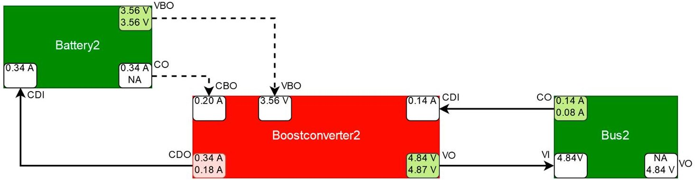


<div align="center">

Figure 20. Simplified schematic depiction of the suspected component Boostconverter2 in red together with its adjacent components (not suspected, therefore in green), taken over from the satellite model from Figure 19 with relevant ports (boxes within the components with their abbreviated names above the boxes, e.g., VBO) and relevant port values (values within the port boxes if available, top value: measured, bottom value: simulated). Forward connections are depicted by solid arrows, backward connections by dotted lines. Comparisons between measured and simulated values are performed at the output ports (denoted with an outgoing arrow; if an output value is not available, it is denoted with "NA"; the port box color denotes red for detected discrepancies, green for correct and white for unknown). Input ports are white, because they do not compute discrepancies, and use measured values if available, otherwise simulated values.

</div>

As a discrepancy was observed at the port CurrentDrawOut (CDO) of Boostconverter2, a symptom is generated, with Boostconverter2 being the corresponding symptom component and CurrentDrawOut being the symptom port. Figure 21 shows the corresponding symptom that was contained in the diagnosis.xml-file generated by the fault detection system.

There exists one single diagnosis, containing the boost converter for which a fault was induced, as can be seen in Figure 22. The diagnosis has a score of 1.0, given by a relative pseudo probability, here simply denoted as probability.

In this experiment, the measured current drawn from the power supply was 0.34 A, while the expected current was 0.18 A. The difference between the measured and expected values are quite large, but their absolute values are not large enough to exceed a limit, therefore no anomaly would be apparent by using the telemetry alone. To detect the fault using the telemetry alone, the operator would need to have enough expertise to deduce that given X different loads from different other telemetry pages and the present state of the power supply, the correct current that is being drawn from the power supply has to be 0.18 A, instead of 0.34 A. It is unlikely that the operator would detect this discrepancy based on the telemetry in practice, since no limit was violated. Hard limit violations occur close to a component failure and, before that, the components usually start to behave anomalous with increasing severity in the deviation from their nominal behavior. Detecting abnormal behavior in time, before a limit is violated, allows for counter measures to be initiated, which may prevent a system failure.

<!-- PDF_PAGE: 25 -->


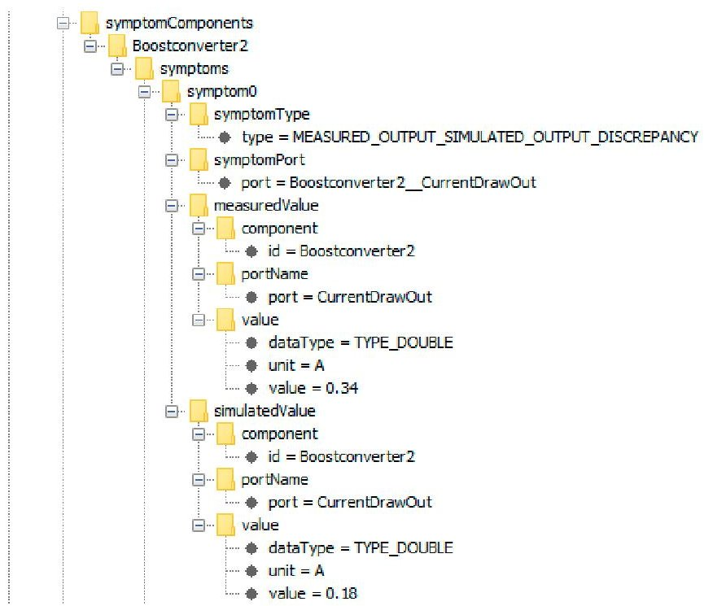


<div align="center">

Figure 21. Fully expanded symptom of Boostconverter2, showing the symptom type, the symptom port, as well as the measured and simulated values that have caused the corresponding discrepancy. The symptom component is Boostconverter2, the symptom port is CurrentDrawOut, and the symptom type is MEASURED_OUTPUT_SIMULATED_OUTPUT_DISCREPANCY, indicating that the symptom was caused by a discrepancy between the measured and the simulated output of symptom port CurrentDrawOut.

</div>


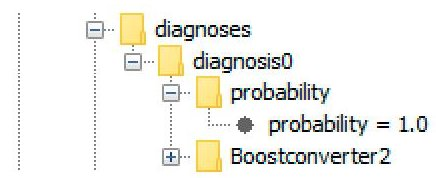


<div align="center">

Figure 22. The diagnosis corresponding to the malfunction of Boostconverter2. The diagnosis consists only of Boostconverter2, meaning that a malfunction of Boostconverter2 would explain the observed discrepancy.

</div>

## 5.2. Transceiver Malfunction

A special anomaly was detected within the unmodified housekeeping data of the qualification model of the SONATE Nano-satellite. One of the transceivers was turned on, but its power consumption was measured to be 0 mA, as opposed to an expected value of approximately 16.14 mA. This discrepancy can be seen at the port CurrentOut (CO) of Transceiver1 in Figure 23. The cause for the discrepancy is Transceiver1, Boostconverter1, or Bus1. As Boostconverter1 is an excluded component, it cannot have caused the discrepancy and, while Bus1 is initially suspected by Transceiver1, it gets relieved by other consumers that were connected to it and is therefore not deemed a possible cause of the observed discrepancy either.

As the transceiver cannot be turned on, while consuming no power, either the current sensor on the transceivers circuit board is malfunctioning or the transceiver is turned off, even though it is supposed to be turned on. The fault detection system identified the transceiver as a symptom component, and the diagnosis only contained the symptomatic transceiver. The fault detection system could not find any other discrepancies. The solution to this anomaly turned out to be that the data was generated during component tests and that the transceivers connection to the satellites power supply was cut off, while the transceiver was externally supplied with power. Therefore, the transceiver could be turned on, while drawing 0 mA current from the satellites power supply. The ability of Transceiver1 to be externally powered was not considered during modelling and it was unexpected when encountered first. This

<!-- PDF_PAGE: 26 -->

experiment showed that the fault detection and diagnosis system is able to detect malfunctions that are caused by arbitrary behavior that deviates from the nominal behavior of a component.


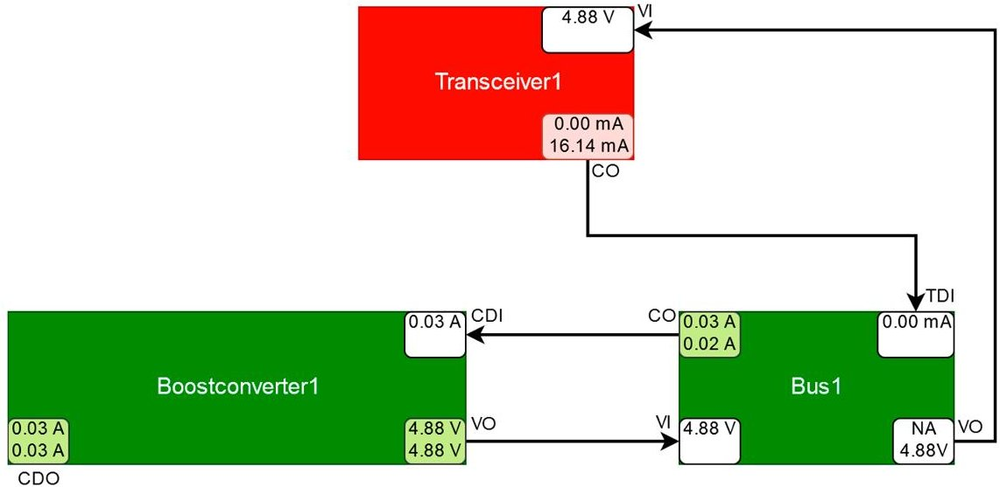


<div align="center">

Figure 23. Simplified schematic depiction of the suspected component Transceiver1 and its relevant surrounding components (explanation see Figure 20).

</div>

## 5.3. OBDH Voltage Converter Malfunction

For the next experiment, a malfunction of the voltage converter OBDH1Conv of OBDH1 was simulated. Instead of generating a 3.3 V output via its outport VoltageOut (VO), its output is observed to be 3.12 V, as can be seen in Figure 24. While Bus1 and Bus2 might supply OBDH1Conv, it can only be supplied by one of them at a given time. A parameter, modeled as input value defines which bus supplies OBDH1Conv. In this case, OBDH1Conv is supplied by, and draws from, Bus2. The dynamic port dependencies therefore do not contain the connections to Bus1, causing Bus1 and Boostconverter1 not to be considered. The remaining components that might have caused the observed discrepancy are OBDH1Conv itself, OBDH1, Bus2, or Boostconverter2. As OBDH1 and Boostconverter2 are excluded components and other consumers relieve Bus2, OBDH1Conv is the only suspected component.


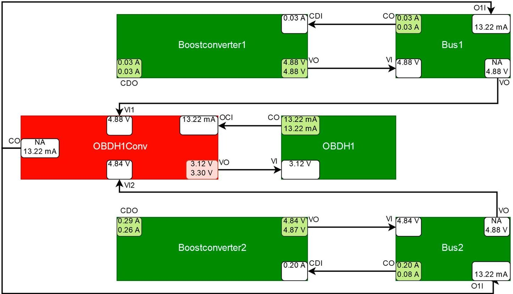


<div align="center">

Figure 24. Simplified schematic depiction of the suspected component OBDH1Conv and its relevant surrounding components (explanation see Figure 20).

</div>

<!-- PDF_PAGE: 27 -->

The diagnosis system identified OBDH1Conv as symptom component and the diagnosis only contained ODBH1Conv. Therefore, the malfunction of OBDH1Conv was successfully detected and no other component was wrongfully suspected to malfunction.

## 5.4. OBDH Voltage Converter and OBDH Malfunction

Two discrepancies were induced for the next experiment. The voltage converter OBDH1Conv was manipulated like before and, additionally, the current draw of OBDH1 caused a discrepancy at its port CurrentOut (CO), as can be seen in Figure 25. Like in the previous experiment OBDH1Conv and therefore Bus2 supplies OBDH1, therefore Bus1 and Boostconverter1 have no effect on the behavior of OBDH1Conv and OBDH1. The component Boostconverter2 is an excluded component and Bus2 is relieved by other consumers, causing it to be deemed to be working correctly. In contrast to the previous experiment, OBDH1 is now suspected to malfunction because of the discrepancy at its port CurrentOut (CO). Due to the cyclical relation of OBDH1Conv and OBDH1, a malfunction of OBDH1 can explain the discrepancies detected at OBDH1 and OBDH1Conv and a malfunction of OBDH1Conv can explain the discrepancies that were detected at OBDH1Conv and OBDH1.


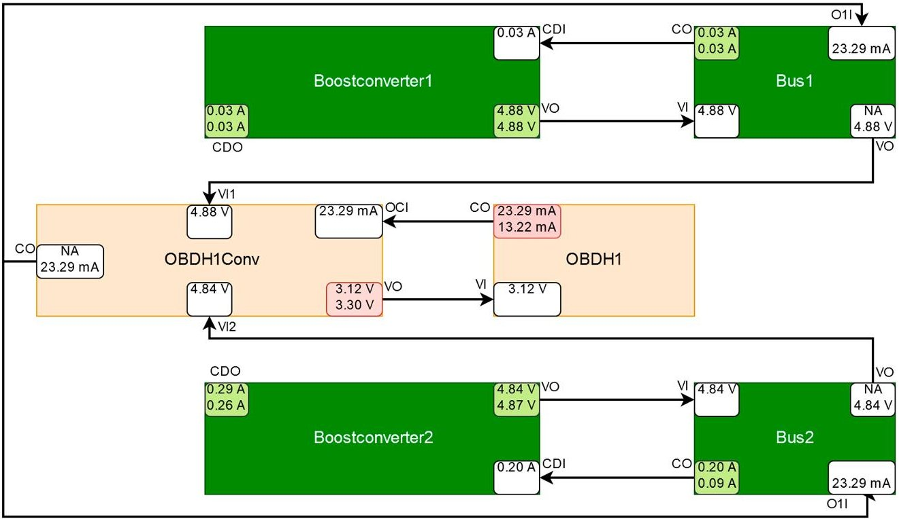


<div align="center">

Figure 25. Simplified schematic depiction of the suspected component OBDH1Conv and OBDH1 and its relevant surrounding components. In addition to the explanation of Figure 20, OBDH1Conv and OBDH1 are depicted in a lighter shade of red to indicate that the probability of their respective diagnosis is lower than in the previous experiments.

</div>

Due to the cyclical relationship of the OBDH and its voltage converter, the malfunction of OBDH1 might have been induced by a (not necessarily observed) previous fault occurring at OBDH1Conv and the malfunction of OBDH1Conv may have been induced by a fault occurring at OBDH1. Correctly, OBDH1 is contained in the conflict set of OBDH1Conv and OBDH1Conv is contained in the conflict set of OBDH1.

Figure 26 shows the symptom components that are listed in the diagnosis.xml-file. Both of the discrepancies were detected by the fault detection system. The diagnoses that were contained in the diagnosis.xml-file can be seen in Figure 27.

<!-- PDF_PAGE: 28 -->


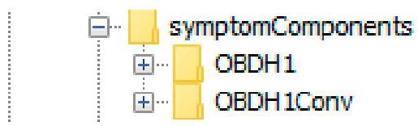


<div align="center">

Figure 26. The symptom components OBDH1 and OBDH1Conv corresponding to the detected discrepancies listed in the diagnosis.xml-file.

</div>


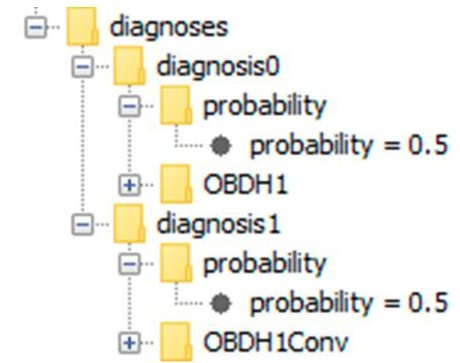


<div align="center">

Figure 27. The two diagnoses contained in the diagnosis.xml-file. The first diagnosis is the malfunction of OBDH1 and the second diagnosis is the malfunction of OBDH1Conv. Both diagnoses have the same probability (probability = 0.5), because OBDH1 and OBDH1Conv have the same a priori failure probability (modeled in the component class definitions) and both can explain all observed discrepancies.

</div>

In the models graph, both of the components are displayed in a lighter shade of red than in the previous experiments, as for each component, the relative probability to be the root cause of all symptoms is now lower, since each component is equally likely (probability = 0.5) to be the root cause, given equal failure probabilities of OBDH1Conv and OBDH1.

## 5.5. Interface Board Malfunction

For the next experiment, a malfunction of Interfaceboard1 with turned on ADCS1, AROS1, Reactionhweel1, and Reactionwheel2 components was simulated. The malfunction causes the supply voltage to abnormally drop at Interfaceboard1, which in turn leads to an increase in the current drawn by the consumers connected to it. This causes a discrepancy at the port CurrentOut (CO) of AROS1, at the port CurrentOut (CO) of Reactionhweel1 and at the port CurrentOut (CO) of Reactionhweel2, as can be seen in Figure 28. As Interfaceboard1 is not directly measured, no discrepancy can be detected at Interfaceboard1 and no symptom can be generated for it. A malfunction of Interfaceboard1 can only be detected by observing the deviation of the observed behavior of the connected consumers from their expected behavior. The consumers that may be affected by a malfunction of Interfaceboard1 are Reactionhweel1, Reactionhweel2, AROS1, and the ASAP payload (not depicted because it is turned off). However, if abnormal behavior is observed at these components, then a malfunction of Interfaceboard1 is just one of multiple possible causes. Since all of the components are connected to the power supply via a bus, a malfunction of the power supply is also a viable candidate. Additionally, the reaction wheels are controlled by both ADCS systems, ADCS1 and ADCS2 (not depicted because it is turned off), which makes them a candidate to cause abnormal behaviour that is associated with the reaction wheels. The simplest explanation for a malfunction of the payloads is that the payloads themselves are malfunctioning. However, this becomes less likely, the more payloads are simultaneously malfunctioning. As ASAP is turned off, it has no effect on the remaining system. Each ADCS system is able to control all of the reaction wheels and therefore has a connection to each of them, but only one ADCS system is active at a time. as ADCS2 is turned off, the dynamic port dependencies do not include connections to ADCS2. Therefore, ADCS2 is not considered. The components Boostconverter1 and ADCS1 are excluded components, since there exist measured and simulated values for all of their output ports, which do not deviate from each other more than allowed by their respective tolerance intervals and no measured value violates a threshold limit. The remaining

<!-- PDF_PAGE: 29 -->

components that can cause the observed discrepancies are AROS1, Reactionwheel1, Reactionhweel2, Interfaceboard1, and Bus1. Bus1 is relieved by other consumers, including ADCS1 via the ADCS1Conv component (not depicted due to readability reasons) and deemed to be not suspicious. Interfaceboard1 is relieved by Boostconverter1, but, as it is suspected by all symptom components, Interfaceboard1 is found to be malfunctioning.


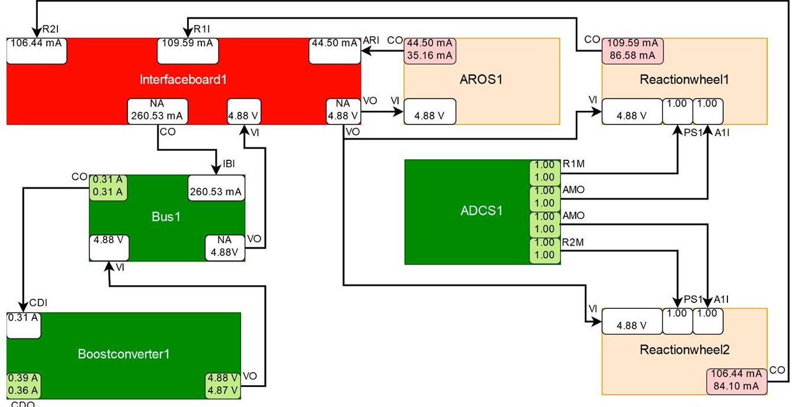


<div align="center">

Figure 28. Simplified schematic depiction of the suspected components AROS1, Reactionwheel1, Reactionwheel2, and Interfaceboard1 and its relevant surrounding components (explanation see Figure 20). The dark red coloring of Interfaceboard1 indicates that it is part of a diagnosis with a high probability and the light red coloring of AROS1, Reactionwheel1, and Reactionwheel2 indicates that they are part of a diagnosis with a lower probability.

</div>

A look into the diagnosis.xml-file gives more information about the observed discrepancies.

Figure 29 shows the symptom components, corresponding to the detected discrepancies, as listed in the diagnosis.xml-file. The symptom components are AROS1, Reactionwheel1, and Reactionwheel2. Even though the malfunction was induced for Interfaceboard1, it is not a symptom component, as neither of its outputs can be measured, and therefore no abnormal behavior can be directly observed at Interfaceboard1.


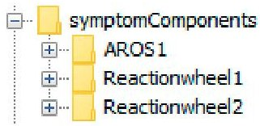


<div align="center">

Figure 29. The symptom components AROS1, Reactionhweel1, and Reactionhweel2 corresponding to the detected discrepancies listed in the diagnosis.xml-file.

</div>

Figure 30 shows the diagnoses that were computed by the fault detection system. In this case there exist two diagnoses. The first diagnosis is a malfunction of Interfaceboard1 and the second diagnosis is a simultaneous malfunction of AROS1, Reactionwheel1, and Reactionwheel2. The first diagnosis has a significantly higher pseudo probability. It is more likely for Interfaceboard1 to malfunction and cause all symptoms, then for AROS1, Reactionhweel1, and Reactionwheel2 to malfunction simultaneously and cause the symptoms associated with each of them independently. The second diagnosis however is not impossible either, since no definitive statement about the state of Interfaceboard1 can be made, as it is not directly measurable. The second diagnosis could have been omitted by using an appropriate cut-off factor. As the anomalous behaving components are connected to Bus1, the components that

<!-- PDF_PAGE: 30 -->

are connected to Bus2 are unaffected. The fault detection system detected the abnormal behavior of AROS1, Reactionwheel1, and Reactionwheel2, identified the possible causes and focused on the actual malfunction.


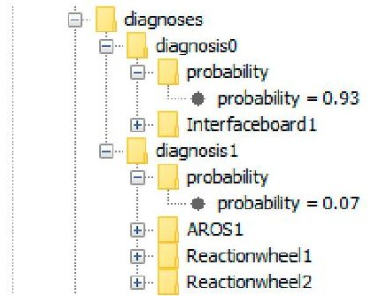


<div align="center">

Figure 30. The two diagnoses listed in the diagnosis.xml-file. The first diagnosis only contains Interfaceboard1 and has a probability of 0.93 and the second diagnosis consists of AROS1, Reactionwheel1, as well as Reactionwheel2 and it has a probability of 0.07.

</div>

## 5.6. Summary of Results

The experiments showed that the fault detection system was able to identify the induced malfunctions and find the root causes. Three single faults, a cyclical fault, and a fault that can only be indirectly observed were considered and diagnosed. The single faults of Boostconverter2 (Section 5.1) and OBDH1Conv (Section 5.3) were successfully identified and correctly diagnosed. The unexpected behavior of Transceiver1 was successfully identified even though Transceiver1 was not considered to be powered externally during modelling (Section 5.2). The cyclical relationship of the components OBDH1Conv and OBDH1, for which discrepancies were detected, was successfully captured and diagnosed (Section 5.4). In the case of the not directly observable malfunction of Interfaceboard1, all of the discrepancies were detected and Interfaceboard1 was correctly found to be malfunctioning with a very high diagnosis probability. Components that were not involved in the malfunctions were identified and no unrelated component was wrongfully suspected to malfunction. As no threshold limit violations occurred during any of the experiments, the detected discrepancies in the experiments could not have been detected by an operator while using telemetry alone. Table 2 summarizes the different experiments performed and their results.

<div align="center">

Table 2. Summary of the different experiments performed and their results

</div>

<table border="1"><tr><td>Ex.</td><td>Malfunctioning Components</td><td>Detected Discrepancies</td><td>Identified Diagnoses (Probability)</td><td>Result</td></tr><tr><td>1</td><td>Boostconverter2</td><td>CDO at Boostconverter2</td><td>Boostconverter2(100%)</td><td>Cause of discrepancy correctly diagnosed.</td></tr><tr><td>2</td><td>Transceiver1</td><td>CO at Transceiver1</td><td>Transceiver1(100%)</td><td>Cause of discrepancy correctly diagnosed.</td></tr><tr><td>3</td><td>OBDH1Conv</td><td>VO at OBDH1Conv</td><td>OBDH1Conv(100%)</td><td>Cause of discrepancy correctly diagnosed.</td></tr><tr><td>4</td><td>OBDH1Conv</td><td>VO at OBDH1Conv, CO at OBDH1</td><td>OBDH1Conv(50%)/OBDH1(50%)</td><td>Both discrepancies detected. Cyclical relationship identified and most viable diagnoses computed.</td></tr><tr><td>5</td><td>Interfaceboard1</td><td>CO at AROS1, CO at Reactionwheel1, CO at Reactionwheel2</td><td>Interfaceboard1(93%)/AROS1, Reactionwheel1, Reactionwheel2(7%)</td><td>Discrepancies caused by not directly observable malfunction detected. Root cause determined and plausible probabilities assigned to diagnoses.</td></tr></table>

<!-- PDF_PAGE: 31 -->

## 6. Discussion

The experiments showed that the model-based fault detection system allows for the detection of abnormal behavior, which cannot always be detected using the telemetry data alone. The most interesting types of malfunctions are those that do not cause a complete component failure immediately. These types of malfunctions usually occur prior to a component failure and they should therefore be detected early on, in order to be able to initiate countermeasures in time. These slight deviations however are difficult to capture using a classical approach and often go unnoticed. With the help of the model-based fault detection system, such deviations can be found while using a model of only the nominal behavior of the spacecraft. To reduce the time from the occurrence of a malfunction to the time the first countermeasure is initiated, the fault-detection system uses a diagnosis component, which narrows down the possible causes of the detected anomalies. These diagnoses help the operator to focus his or her attention on the components that are most likely to malfunction. Additionally, a graphical user interface displays the model graph and visually notifies the operator when an anomaly has been detected. The fault-detection system itself works autonomously, even when no operator is present and it needs no active maintenance. Due to the strict separation of the model from the diagnostic algorithm, the diagnostic capabilities of a spacecraft can be adapted and expanded, simply by adjusting the model. Changes of model parameters, e.g., due to recalibration, can be performed without additional downtime of the fault detection and diagnosis system. Additionally, the system can easily be transferred from one spacecraft to another, since only the model needs to be changed, while the diagnostic algorithm requires no re-engineering. The main drawback of the model-based approach is the dependency on a sufficiently accurate system model. While white box and expert knowledge may be obtained fairly easily, the model calibration is still a tedious and time consuming task. Components whose behavior is of highly dynamic nature need special attention, since they require the most amounts of data and time for calibration. The authors of this paper recommend the use of a global optimization algorithm to either calibrate those components automatically, or to produce good initial parameter values for a consequent manual calibration. To ensure that a model is sufficiently accurate and correctly calibrated, a goodness of fit metric, like the root-mean-squared error (RMSE), should be used on recoded data, prior to putting the model into operation. Using a model that does not capture the systems nominal behavior sufficiently accurately or a model that is not well calibrated might cause the fault-detection system to produce either false-positives, false-negatives, or both. In the case of false-positives the operator will have to filter out wrongly detected malfunctions, while in the case of false-negatives, actual malfunctions are not detected. Besides the initial calibration, wear and degradation might affect the components of the spacecraft. Natural degradation is not always an indicator of a malfunction and should therefore be accounted for by recalibration. Natural degradation mainly affects mechanical parts, but also components, like batteries, with the most common form of degradation being a reduced battery capacity after a large number of charge-discharge cycles. Another factor that affects the quality of the fault-detection is the accuracy of the sensors used within the spacecraft. A recorded sudden current spike for example could be interpreted as an anomaly and cause a false-positive. Inaccurate sensors cause the need for larger tolerance intervals, which in turn decreases the sensitivity of the model and therefore might increase the amount of false-negatives. For an optimal operation of the fault-detection system, the sensors should be as accurate as possible and the data collection well timed, so that the delay between the times of measurement of the different parameter values supplied to the fault-detection system at one time step is minimal. The fault-detection system should be automatically supplied with the spacecraft's housekeeping data. To enable continuous operation of the fault-detection system, it should have direct access to the housekeeping data without the interaction of an operator needed.

## 7. Conclusions

We have presented a quantitative model-based fault detection and diagnosis system that strictly separates the model from the diagnosis algorithm and demonstrated its applicability by using a model

<!-- PDF_PAGE: 32 -->

of the power supply of the qualification model of the SONATE-Nano satellite. We have done so, by modifying actual housekeeping data of the qualification model of the SONATE-Nano satellite to simulate malfunctions, which then were diagnosed by the fault detection system. We have illustrated that the malfunctions were difficult to spot while using the telemetry alone, while the fault detection system was able to easily identify the malfunctioning components. Future work will include the adaption of the fault detection system to the flight model of the SONATE-Nano satellite and the successive porting of the fault detection system to be uploaded and run on board the SONATE-Nano satellite, which was launched July 5th 2019, shortly before the end of the ADIA-L project, during which the fault detection system that is presented in this paper was developed. The fault detection system is supposed to work autonomously on board and transmit the detected malfunctions as telemetry to a ground station during contact times. First, the simulator and the symptom calculation will be ported and then, later, the conflict and hitting set computation. Long-term development includes the tackling of transient phenomena, e.g., current spikes, adaptive tolerance intervals using machine learning techniques, the implementation of a rule-based component to directly initiate counter measures when a malfunction is detected, an increased incorporation of heuristic knowledge, and a closed loop of periodic automatic recalibration of the systems model during operation.

Author Contributions: The concept was proposed by F.P. The funding was acquired by F.P. and H.K. The ADIA++ and ADIA-L projects were supervised by F.P. and H.K. The algorithms were developed by K.D. The Experiments were performed by K.D. under the supervision of F.P. and H.K. The manuscript was written by K.D. and reviewed by F.P. and H.K.

Funding: This work was done as part of the ADIA-L Project (FKZ: 50 RM 1723), which is a continuation of the ADIA++ Project (FKZ: 50 RM 1524) and part of the SONATE Project (FKZ: 50 RM 1606), funded by the German Federal Ministry of Economics and Technology through the German Space Agency DLR e.V. This publication was funded by the German Research Foundation (DFG) and the University of Wuerzburg in the funding programme Open Access Publishing.

Conflicts of Interest: The authors declare no conflict of interest.

## References

1. Shim, D.; Yang, C. Optimal Configuration of Redundant Inertial Sensors for Navigation and FDI Performance Sensors 2010, 10, 6497-6512. [CrossRef]

2. Bouallègue, W.; Bouslama Bouabdallah, S.; Tagina, M. Causal approaches and fuzzy logic in FDI of Bond Graph uncertain parameters systems. In Proceedings of the IEEE International Conference on Communications, Computing and Control Applications (CCCA), Hammamet, Tunisia, 3-5 March 2011.

3. Venkatasubramanian, V.; Rengaswamy, R.; Yin, K.; Kavuri, S. A review of process fault detection and diagnosis: Part I: Quantitative model-based methods. Comput. Chem. Eng. 2003, 27, 293-311. [CrossRef]

4. Thirumarimurugan, M.; Bagyalakshmi, N.; Paarkavi, P. Comparison of fault detection and isolation methods: A review. In Proceedings of the 2016 10th International Conference on Intelligent Systems and Control (ISCO), Coimbatore, India, 7-8 January 2016. [CrossRef]

5. Patton, R.; Uppal, F.; Simani, S.; Polle, B. Robust FDI applied to thruster faults of a satellite system. Control Eng. Pract. 2010, 18, 1093-1109. [CrossRef]

6. Falcoz, A.; Henry, D.; Zolghadri, A. Robust Fault Diagnosis for Atmospheric Reentry Vehicles: A Case Study. IEEE Trans. Syst. Man Cybern. Part A Syst. Hum. 2010, 40, 886-899. [CrossRef]

8. de Kleer, J.; Williams, B. Diagnosing multiple faults. Artif. Intell. 1987, 32, 97-130. [CrossRef]

9. Fellinger, G.; Dietrich, G.; Fette, G.; Kayal, H.; Puppe, F.; Schneider, V.; Wojtkowiak, H. ADIA: A Novel Onboard Failure Diagnostic System for Nanosatellites. In Proceedings of the 64th International Astronautical Congress 2013, Beijing, China, 23-27 September 2013.

10. Picardi, C. A Short Tutorial on Model-Based Diagnosis. 2005. Available online: https://pdfs.semanticscholar.org/e3e7/fbf0581d05aeff0e213641f5b36886264dbd.pdf?_ga=2.250857024.778130362.1569288585-1114982217.1569288585 (accessed on 7 August 2019).

<!-- PDF_PAGE: 33 -->

11. De Kleer, J.; Kurien, J. Fundamentals of model-based diagnosis. In Proceedings of the Fifth IFAC Symposium on Fault Detection, Supervision and Safety of Technical Processes (Safeprocess), Washington, DC, USA, 23-27 June 2003.

12. De Kleer, J.; Mackworth, A.; Reiter, R. Characterizing diagnoses and systems. Artif. Intell. 1992, 56, 197-222. [CrossRef]

13. Fröhlich, S. Model-Based Error Detection and Diagnostics in Real Time Using the Example of a Fuel Cell (Modellbasierte Fehlererkennung und Diagnose in Echtzeit am Beispiel einer Brennstoffzelle). Ph.D. Thesis, University of Kassel, Kassel, Germany, 2009.

14. Dang Duc, N. Conception and Evaluation of a Hybrid, Scalable Tool for Mechatronic System Diagnostics Using the Example of a Diagnostic System for Independent Garages (Konzeption und Evaluation eines Hybriden, Skalierbaren Werkzeugs zur Mechatronischen Systemdiagnose am Beispiel eines Diagnosesystems für freie Kfz-Werkstätten). Ph.D. Thesis, University of Würzburg, Würzburg, Germany, 2011.

15. Dang Duc, N.; Engel, P.; de Boer, G.; Puppe, F. Hybrid, scalable diagnostic system for independent garages (Hybrides, skalierbares Diagnose-System für freie Kfz-Werkstätten). Artif. Intell. 2009, 23, 31-37.

16. Williams, B.C.; Nayak, P.P. A model-based approach to reactive self-configuring systems. In Proceedings of the Thirteenth National Conference on Artificial Intelligence (AAAI-96), Portland, OR, USA, 4-8 August 1996.

17. Hayden, S.; Sweet, A.; Shulman, S. Lessons learned in the Livingstone 2 on Earth Observing One flight experiment. In Proceedings of the Infotech@Aerospace, Arlington, VA, USA, 26-29 September 2005.

18. Sweet, A.; Bajwa, A. Lessons Learned from Using a Livingstone Model to Diagnose a Main Propulsion System. In Proceedings of the JANNAF 39th CS/27th APS/21st PSHS/3rd MSS Joint Subcommittee Meeting Colorado Springs, CO, USA, 1-5 December 2003.

19. Kolcio, K. Model-Based Fault Detection and Identification System for Increased Autonomy. In Proceedings of the AIAA SPACE 2016, Long Beach, CA, USA, 13-16 September 2016.

20. Cordier, M.; Dague, P.; Levy, F.; Montmain, J.; Staroswiecki, M.; Trave-Massuyes, L. Conflicts versus Analytical Redundancy Relations: A Comparative Analysis of the Model Based Diagnosis Approach from the Artificial Intelligence and Automatic Control Perspectives. IEEE Trans. Syst. Man Cybern. Part B (Cybern.) 2004, 34, 2163-2177. [CrossRef]

21. Kayal, H.; Balagurin, O.; Djebko, K.; Fellinger, G.; Puppe, F.; Schartel, A.; Schwarz, T.; Vodopivec, A.; Wojtkowiak, H. SONATE—A Nano Satellite for the in-Orbit Verification of Autonomous Detection, Planning and Diagnosis Technologies. In Proceedings of the AIAA SPACE 2016, Long Beach, CA, USA, 13-16 September 2016.

22. Fellinger, G.; Djebko, K.; Jager, E.; Kayal, H.; Puppe, F. ADIA++: An Autonomous Onboard Diagnostic System for Nanosatellites. In Proceedings of the AIAA SPACE 2016, Long Beach, CA, USA, 13-16 September 2016.

23. Havelka, T.; Stumptner, M.; Wotawa, F. AD2L-A Programming Language for Model-Based Systems (Preliminary Report). In Proceedings of the Eleventh International Workshop on Principles of Diagnosis (DX-00), Morelia, Mexico, 8-10 June 2000.

24. Fleischanderl, G.; Havelka, T.; Schreiner, H.; Stumptner, M.; Wotawa, F. DiKe-A Model-Based Diagnosis Kernel and Its Application. In Proceedings of the KI 2001: Advances in Artificial Intelligence, Vienna, Austria, 19-21 September 2001; pp. 440-454. [CrossRef]

25. Koitz, R.; Wotawa, F. SAT-Based Abductive Diagnosis. In Proceedings of the 26th International Workshop on Principles of Diagnosis, Paris, France, 31 August-3 September 2015.

26. Zhao, X.; Zhang, L.; Ouyang, D.; Jiao, Y. Deriving all minimal consistency-based diagnosis sets using SAT solvers. Prog. Nat. Sci. 2009, 19, 489-494. [CrossRef]

27. Pill, I.; Quaritsch, T.; Wotawa, F. From conflicts to diagnoses: An empirical evaluation of minimal hitting set algorithms. In Proceedings of the 22nd International Workshop on Principles of Diagnosis (DX-2011), Murnau, Germany, 4-7 October 2011.

28. Greiner, R.; Smith, B.; Wilkerson, R. A correction to the algorithm in reiter's theory of diagnosis. Artif. Intell. 1989, 41, 79-88. [CrossRef]

29. Djebko, K.; Fellinger, G.; Puppe, F.; Kayal, H. Cyclic Genetic Algorithm for High Quality Automatic Calibration of Simulation Models with an Use Case in Satellite Technology. Int. J. Model. Simul 2019. under review.

<!-- PDF_PAGE: 34 -->

30. Holland, J. Adaptation in Natural and Artificial Systems; University of Michigan Press: Ann Arbor, MI, USA, 1975.

31. Russel, S.; Norvig, P. Artificial Intelligence: A Modern Approach, 3rd ed.; Prentice Hall: Upper Saddle River, NJ, USA, 2009.


$ \textcircled{c} $ 2019 by the authors. Licensee MDPI, Basel, Switzerland. This article is an open access article distributed under the terms and conditions of the Creative Commons Attribution (CC BY) license (http://creativecommons.org/licenses/by/4.0/).