<!-- PDF_PAGE: 1 -->

# Modeling Radiation Risk Assessment and Mitigation for Spacecraft Electronics

By

Rebekah Ann Austin

Submitted to the Faculty of the Graduate School of Vanderbilt University in partial fulfillment of the requirements for the degree of DOCTOR OF PHILOSOPHY

in

Electrical Engineering

December 14,2019

Nashville, Tennessee

Approved:

Brian D. Sierawski, Ph.D

Arthur F. Witulski, Ph.D

Ronald D. Schrimpf, Ph.D Gabor Karsai, Ph.D Hiba Baroud, Ph.D

<!-- PDF_PAGE: 2 -->

To my parents, Sue Ann and Jon, and my sister, Stephanie.

Thank you for your constant support, good humor, and phone calls all around campus.

<!-- PDF_PAGE: 3 -->

## ACKNOWLEDGEMENTS

I would first like to thank my advisor. Dr. Brian Sierawski was one of the first ISDE engineers I worked with as an undergraduate researcher. He has provided guidance and support in this research and the larger CubeSat program ever since. Next, I would like to thank my committee, Dr. Hiba Baroud, Dr. Art Witulski, Dr. Ron Schrimpf, and Dr. Gabor Karsai. They have provided support on the model-based mission assurance project, and it has led me to places and research which have opened countless doors. This work would not have been possible without the support of the Arnold Engineering Development Complex, the Defense Threat Reduction Agency Basic Research Program 6.1 and 6.2, NASA ELaNa program, the NASA Reliability and Maintainability Program, the NASA Electronics Parts and Packaging Program and the NASA Pathways Internship Program. The RER group at Vanderbilt has, for over seven years, supported and encouraged me in this research. Special thanks to Dr. Weller for planting the seed for grad school when I was an undergraduate first-year and to Dr. Reed, who has provided countless opportunities to grow in this field. Thanks to Becky Borsody for supporting all of my travel, to Dr. Sternberg, Dr. Warren, and Dr. Trippe for everything they have done for the CubeSat program. Thanks to Nag Mahadevan and the Institute for Software Integrated Systems for supporting the modeling environment. There have been many students in the group who have come and gone that have provided support, sanity, and inspiration; the list is too long to enumerate here, but thank you.

Lastly, thank you to my family that has formed here in Nashville. Special thanks to Susan Ferguson and the college students at St. Augustine's Chapel. Finally, to Frank: you have opened the world to me and been there to support and encourage me in the grind that is the end of a dissertation, thank you.

<!-- PDF_PAGE: 4 -->

## TABLE OF CONTENTS

ACKNOWLEDGEMENTS...iii

LIST OF TABLES...vi

LIST OF FIGURES...vii

LIST OF ABBREVIATIONS AND ACRONYMS ...ix

Chapter

I. INTRODUCTION ...1

RadFxSat CubeSat Platform ...5

REM Experiment ...7

RadFxSat-1 ...9

System Engineering and Assurance Modeling ...11

II. IDENTIFICATION OF POSSIBLE RADIATION-INDUCED FAULTS ...14

Common Radiation Effects ...14

Total Ionizing Dose ...14

Displacement Damage Dose ...15

Single-Event Effects ...16

Single-Event Latch-up ...16

Single-Event Burnout ...17

Single-Event Functional Interrupt ...19

Radiation Environment Models ...20

Trapped Particle Environments ...20

Solar Particle Environments ...21

Galactic Cosmic Ray Environments ...22

Conclusions ...22

III. LIKELIHOOD CALCULATIONS FOR RADIATION EFFECTS ...23

Motivation ...23

Dose Likelihood Calculations ...24

Risk Avoidance Radiation Hardness Assurance: Radiation Design Margin ...24

Risk Tolerant Radiation Hardness Assurance: Probability of Failure ...28

Single Event Effects in Power Devices Likelihood Calculations ...29

Risk Avoidance Radiation Hardness Assurance: Safe-Operating Area ...30

Risk Tolerant Radiation Hardness Assurance: Probability of Failure ...31

<!-- PDF_PAGE: 5 -->

Conclusions... 39

Extensions... 40

IV. EVALUATING CONSEQUENCES OF RADIATION-INDUCED FAULTS ... 41

Qualitative Evaluation of Radiation-Induced Fault Consequences ... 41

Single Event Effect Criticality Analysis... 41

Fault Propagation Models in SEAM... 44

Quantitative Evaluation of Radiation Induced Fault Consequences ... 49

Bayesian Net Analysis... 49

Fault Tree Analysis... 51

Conclusions... 57

V. MODEL-BASED RISK MANAGEMENT FOR RADIATION-INDUCED FAULTS ... 58

Mitigation of Risks From Radiation Effects... 60

Careful COTS... 61

Single-Event Effect System Mitigation for Microcontrollers... 61

Redundancy... 65

Evaluating Mitigation Options and Tradeoffs for Radiation Effects... 66

Goal Structuring Notation... 67

NASA’s Reliability and Maintainability Hierarchy... 71

Application of MBMA Throughout the Project Lifecycle ... 71

Conclusions... 78

CONCLUSIONS ... 80

REFERENCES ... 83

<!-- PDF_PAGE: 6 -->

## LIST OF TABLES

Table Page

1. Summary of RadFxSat Missions ... 6

2. SEE Vulnerabilities by Electronics Type ... 16

3. SEB Threshold Voltage Derating and Critical LET Values ... 33

4. Estimated Distribution Parameters ... 35

5. Example Approved Part List... 71

<!-- PDF_PAGE: 7 -->

## LIST OF FIGURES

Figure Page

1. Bathtub curve...3

2. Simplified block diagram of REM CubeSat experiment board...8

3. AO-91 spacecraft bus...10

4. AO-91 CAD model...10

5. SEAM modeling environment...11

6. Yellowing and darkening of CMOS camera on CubeSat XI-IV ...15

7. Two-transistor model for latch-up in an n-well CMOS structure...17

8. Characteristics of SEB in Si MOSFET devices...18

9. Characteristic regions of damage for SiC devices...19

10. Comparison of differential proton fluences for AP8 and AP9 ...21

11. Block diagram of categorization process...25

12. Categories using PCC method...26

13. Comparison of confidence level to RDM...29

14. SEB threshold for different LET for SiC MOSFET...32

15. Fluence probability distribution for GEO mission with 100 mils Al shielding...34

16. Reliability of parts that exhibit SEB...37

17. Reliability of parts for various environments...38

18. Integral fluence environment versus LET for various environments...39

19. SEE Decision Tree...42

20. SEU propagation analysis method...43

21. Fault propagation blocks in SEAM...45

<!-- PDF_PAGE: 8 -->

22. Fault propagation model for linear regulator with all possible anomalies from TID ...46

23. Modified fault propagation model for linear regulator ...47

24. Fault propagation model for linear regulator with SEL ...48

25. BN model for the REM experiment board ...50

26. Generic functional decomposition model used to generate fault tree ...52

27. Fault tree automatically generated ...53

28. Auto-generated fault tree including component fault propagation ...54

29. Top of the fault tree auto-generated for the REM experiment board ...55

30. LC_Power auto-generated FT. The dotted lines indicate more nodes below ...56

31. Reliability and Maintainability Hierarchy ...59

32. Simplified block diagram of SEFI and SEL for microcontroller ...62

33. WDT fault propagation model for mitigation of SEFI ...63

34. FRAM fault propagation model for mitigation of SEFI ...63

35. Load Switch fault propagation model for mitigation of SEFI and SEL ...64

36. Reliability of parts with redundancy ...66

37. Elements of GSN. ...69

38. M of N options ...70

39. Model-Based Mission Assurance process diagram ...72

40. Functional decomposition of the mission objective ...73

41. NASA Life-Cycle Phases with RHA activities added in red ...75

42. GSN at the beginning of Phase B. ...76

43. GSN argument at the end of Phase B ...77

44. GSN argument at the end of Phase C ...78

45. Artifacts attached to the GSN Model in SEAM ...79

46. MBSE Connects the Dots ...80

<!-- PDF_PAGE: 9 -->

# LIST OF ABBREVIATIONS AND ACRONYMS

AMSAT: Radio Amateur Satellite Corporation

BJT: Bipolar Junction Transistor

BN: Bayesian Nets

CAD: Computer-Aided Design

CDF: Cumulative Density Function

CDR: Critical Design Review

CL: Confidence Level

CMOS: Complementary Metal Oxide Semiconductor

COTS: Commercial Off-The-Shelf

CRÉME: Cosmic Ray Effects on Micro-Electronics

DDD: Displacement Damage Dose

DMBP: Design Margin BreakPoint Method

DUT: Device Under Test

ESP: Emission of Solar Protons

FinFET: Fin Field-Effect Transistor

FPGA: Field-Programmable Gate Array

FT: Fault Tree

FTA: Fault Tree Analysis

GCR: Galactic Cosmic Ray

GEO: Geosynchronous Earth Orbit

GSN: Goal Structuring Notation

<!-- PDF_PAGE: 10 -->

I2C: Inter-Integrated Circuit protocol

IC: Integrated Circuit

INCOSE: International Council on Systems Engineering

I/O: Input/Output

IRENE: International Radiation Environment Near Earth

ISS: International Space Station

LC: Lost Component

LEO: Low-Earth Orbit

LEP: Low-Energy Proton experiment board

LEPF: Low-Energy Proton FinFET experiment board

LET: Linear Energy Transfer

LF: Lost Function

MBMA: Model-Based Mission Assurance

MBSE: Model-Based System Engineering

NASA: National Aeronautics and Space Administration

PCC: Part Categorization Criteria method

PDF: Probability Density Function

PDR: Preliminary Design Review

P-POD: Poly-Picosatellite Orbital Deployer

PSYCHIC: Prediction of Solar particle Yields for CHARacterizing Integrated Circuits

R&M: Reliability and Maintainability

RBD: Reliability Block Diagram

R-GENTIC: Radiation GuidElines for Notational Threat Identification and Classification

<!-- PDF_PAGE: 11 -->

RDF: Radiation Design Factor

RDM: Radiation Design Margin

REM: Radiation Effects Modeling experiment board

RHA: Radiation Hardness Assurance

RPP: Rectangular Parallelepiped

SAA: South Atlantic Anomaly

SAMPEX: Solar Anomalous Magnetospheric Particle Explorer

SEAM: System Engineering and Assurance Modeling

SEB: Single-Event Burnout

SEE: Single-Event Effects

SEECA: Single-Event Effect Criticality Analysis

SEFI: Single-Event Functional Interrupt

SEGR: Single-Event Gate Rupture

SEL: Single-Event Latch-up

SET: Single-Event Transient

SEU: Single-Event Upset

SiC: Silicon Carbide

SMAP: Soil Moisture Active Passive

SOA: Safe Operating Area

SOI: Silicon-on-Insulator

SRAM: Static Random-Access Memory

SSWG: Space Systems Working Group

SysML: System Modeling Language

<!-- PDF_PAGE: 12 -->

TFPG: Temporal Failure Propagation Graph

TID: Total Ionizing Dose

TMR: Triple Modular Redundancy

VUC: Vanderbilt University Controller

WebGME: Web-based Generic Modeling Environment

WDI: Watch-Dog timer Input

WDO: Watch-Dog time Output

WDT: Watch-Dog Timer

XML: eXtensible Markup Language

<!-- PDF_PAGE: 13 -->

## CHAPTER I

## INTRODUCTION

Time, money, and personnel limitations are increasingly driving the spacecraft design process. One way to maximize these limited resources is to use Model-Based Systems Engineering (MBSE) to capture knowledge about the system in models instead of documents and to automate and track parts of the systems engineering process. These constraints likewise limit radiation effects engineers and the radiation hardness assurance (RHA) process. Specifically, time and money constraints are limiting the use of radiation-hardened components because of cost and lead time. However, using commercial off-the-shelf (COTS) components within traditional RHA activities is equally, if not more, costly and time-consuming. Even if a project does have the time and money to use radiation-hardened components, these components might not meet performance requirements. Space-qualified components often cost more, have a larger footprint, and consume more power than their commercial counterparts precluding their use in many space-based applications. COTS components are considered for every class of mission because space-qualified processors and memories are usually several technology generations behind. Missions that require processing large amounts of data are unable to meet requirements with space-grade components [1]. Interest in components designed for commercial applications for use in NASA missions was renewed in the 1990s with the use of the Intel 80386 microprocessor on the Solar Anomalous Magnetospheric Particle Explorer (SAMPEX) mission [2]. One of the current examples is the use of the Xilinx Virtex-5 QV Field Programmable Gate Arrays (FPGA) on the SpaceCube processor.

<!-- PDF_PAGE: 14 -->

SpaceCube is a high-performance computing box used on multiple experiments on the International Space Station (ISS) [3] and manifested for several future missions.

Many of the COTS components used to meet performance requirements have a large state space to consider for radiation testing consisting of different modes, frequencies, and power levels. The complexity makes qualifying the components for all of the possible operating modes, frequencies, or power levels unreasonable [4]. The components then are qualified only for their use in a specific system. As a result, risk assessments make many assumptions about component use when analyzing the risk from the radiation environment for a system. These analyses are increasingly including system-level mitigation and using radiation test results that are from similar components or even not using radiation tests at all. Leveraging MBSE would make these analyses more transparent and enable the engineers to keep up-to-date with design changes. While NewSpace, which includes CubeSats and large near-earth constellations of satellites [1], seem to be driving constraint-driven design and the resulting changes to the radiation hardness assurance process, missions of all classifications can take advantage of and even require these changes [5].

RHA is the risk assessment and management process for radiation-induced faults. Risk is the probability of failure times the consequence of the failure [6]. Risk assessment is the activity of determining possible faults and failures, what the likelihood of the fault is, and what the consequences of those faults are. Risk management is the activity of reducing the possible faults, the likelihood of the faults, and the consequences of the faults within the constraints of the system. Effective risk assessment and management requires knowledge about the measures of reliability for components and the uncertainty of those measures. The risks for a system depend on the configuration of the components in the system and the mission environment. RHA has two broad methodologies that drive the choice of risk assessment and management activities: risk avoidance

<!-- PDF_PAGE: 15 -->

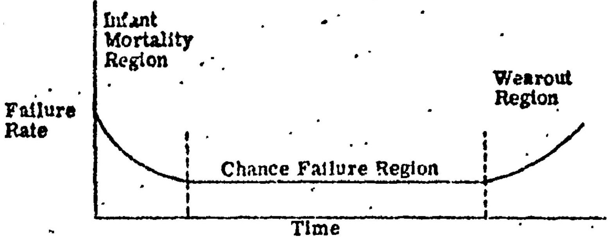

Figure 1. Bathtub curve, after [7].

and risk tolerance. Risk avoidance is what is found in most RHA standards currently. The roots of this methodology are found in [7] and shown in Figure 1. The assumption underlying the curve is that a single failure rate, $ \lambda $ , can be used to describe the "chance" failure rate of components, the middle part of the curve in Figure 1. Assuming that the failure rate is constant, the reliability, one minus the probability of failure, the probability of failure is described by an exponential function. It was assumed that failures that did not fit a constant failure rate would overestimate the failure rate, not underestimate. The emerging NewSpace community is pushing a risk tolerance methodology, which requires the RHA activities to be re-evaluated and revised. This paradigm shift is illustrated in reports like [8], which gives guidance on what verification activities to eliminate based on the risk tolerance of the mission and what the increased risk is as a result.

This dissertation presents a novel method to calculate the likelihood of radiation-induced destructive faults, demonstrated for a silicon carbide (SiC) power metal-oxide field-effect transistor (MOSFET). The method decouples the environment variability from the component failure rate variability by leveraging the fluence distribution for the solar particle environment in Prediction of Solar particle Yields for CHARacterizing Integrated Circuits (PSYCHIC)[9]. The

<!-- PDF_PAGE: 16 -->

calculated probability of failure can be included in system-level risk assessment calculations, unlike the current design margin method. Then new guidelines for risk-tolerant risk assessment and management activities for space-based systems are presented. A novel fault propagation model is proposed to enable the evaluation of radiation-induced faults and consequences within traditional model-based systems engineering.

The next section of this chapter presents the CubeSat experiment board used to demonstrate the new guidelines for risk-tolerant RHA. The last section of this chapter describes a web-based modeling environment called System Engineering and Assurance Modeling (SEAM), which captures these new activities.

Chapter II reviews the process for assessing systems for possible faults. This is the part of risk assessment that answers the question: What are the possible faults? The chapter provides background on common radiation effects and environments.

Chapter III reviews the process for assessing the likelihood of radiation-induced faults. This is the part of risk assessment that answers the question: What is the likelihood of a fault? The traditional method of using design margin for total ionizing dose (TID) and displacement damage dose (DDD) is compared to a method for including environment variability and device variability. The inclusion of environment variability is extended to single-event burnout (SEB), and paths for the inclusion of other single-event effects (SEE) are presented.

Chapter IV reviews how to evaluate the consequences of radiation-induced faults. This is the part of risk assessment that answers the question: What are the consequences of a fault? Presented first is a review of current methods for system-level evaluation of radiation effects. Then a new method for describing radiation-induced faults and fault propagation using fault propagation models in SEAM is presented.

<!-- PDF_PAGE: 17 -->

Chapter V reviews how model-based engineering can improve risk management. Risk management evaluates the tradeoffs of mitigation activities, which include reducing the likelihood or consequences of faults. The method presented shows how goal structuring notation (GSN), part of the National Aeronautics and Space Administration's (NASA) latest revision of the Reliability and Maintainability (R&M) standard, can enable the linking of RHA with model-based system models. Linking of models improves the evaluation of tradeoffs in testing and mitigation for radiation effects. This method is implemented on SEAM, and then it is shown how SEAM can help manage risk management throughout the project lifecycle.

Finally, Chapter VI concludes with some thoughts on the exciting opportunities for modelbased RHA. Discussed also are some of the challenges, common to model-based engineering in general, to overcome.

## RadFxSat CubeSat Platform

CubeSats, in their base or 1U form, are 10cm x 10cm x 11cm and up to 1.3 kg satellites. They were originally developed at California Polytechnic State University in 1999 to make space flight achievable and affordable for universities and their students while exposing students to the challenges of real engineering practices and system design [10]. Using the Poly-Picosatellite Orbital Deployer (P-POD) to facilitate ride-sharing and CubeSat deployment, 6 CubeSats were launched in 2003, in 2018, the $ 1,000^{\mathrm{th}} $ CubeSat was launched [11]. As the CubeSat platform matures, the mission goals for CubeSats have expanded beyond educational goals to include science objectives and technology demonstrations [12]. As the expectations for this platform increase, the reliability concerns of traditional satellites start to become important, especially radiation effects.

<!-- PDF_PAGE: 18 -->

Table 1. Summary of RadFxSat Missions

<table border="1"><tr><td>Launch Program</td><td>Vanderbilt Payload</td><td>Launch Date And Orbit</td><td>Status</td><td>Mission Goal</td></tr><tr><td>ELaNa-12(AO-85)</td><td>VUC,LEP</td><td>Oct.8,2015LEO</td><td>Operational1170days,switched to beacon onlymodeDec.20,2018to manage battery issues[13]</td><td>SEU rates forCOTS SRAM</td></tr><tr><td>Spaceflight&#x27;sSSO-A(AO-95)</td><td>VUC,LEP</td><td>Dec.3,2018LEO polar</td><td>Radio issues discoveredduring commissioning,still troubleshooting[14]</td><td>SEU rates atdifferent orbits</td></tr><tr><td>ELaNa-14(AO-91)</td><td>VUC,3REMs</td><td>Nov.18,2017LEO polar</td><td>Still operational,over693days[15]</td><td>SEU rates atdifferent biasvoltage</td></tr><tr><td>ELaNa-20</td><td>VUC,LEPF,LEP,REM</td><td>Q42019LEO</td><td>Awaiting launch onVirgin OrbitLauncherOne</td><td>SEU rates atdifferenttechnologynodes</td></tr></table>

The Radio Amateur Satellite Corporation (AMSAT) developed the Fox-1 spacecraft platform to provide power, radio, and telemetry processing for a 1U CubeSat for low-earth orbit (LEO) deployment. The RadFxSat platform was developed at Vanderbilt to enable modular development of CubeSat science payloads with a variety of spacecraft bus configurations. The Vanderbilt University Controller (VUC) provides the electrical and signal interface between the spacecraft and the science experiments. This interface can support up to four experiment boards.

Three experiment boards have been developed for the RadFxSat platform. The Low-Energy Proton (LEP) experiment contains eight commercial static random-access memories (SRAM) as devices under test (DUT) and records the number of bit flips from single-event upsets (SEU) of the checkerboard pattern written to the memories in a five-minute exposure. This experiment first launched and collected data on AO-85 [13], a second one was launched on AO 95 [14], and a third is awaiting launch through ELaNa-20.

<!-- PDF_PAGE: 19 -->

Performing the same experiment as the LEP board for a 28nm SRAM is the Radiation Effects Modeling (REM) board. The 28nm SRAM is capable of running in low-power modes by reducing the core bias of the SRAM. The REM experiment board added the capability of changing the bias of the SRAM during flight. This capability enables the science mission goal of recording SEUs at different bias voltages. The REM board is also the board used to model and demonstrate the guidelines and fault-propagation modeling and analysis of the SEAM platform described in the next section. Three REM boards launched on AO-91 [15], and another is awaiting launch on ELaNa-20.

The latest experiment board developed was the Low-Energy Proton FinFET (LEPF) experiment, which contains a 16nm fin field-effect transistor (FinFET) SRAM as the DUT. This SRAM also supports lowering the core voltage for low-power modes enabling the ability to record SEUs at different bias voltages as well. One LEPF is awaiting launch through ELaNa-20. These three experiment boards are part of four different Fox-1 satellites: AO-85, AO-91, and AO-95 have launched, and the fourth is awaiting launch. Table 1 summarizes the RadFxSat missions and their current statuses.

## REM Experiment

The science objective for the REM CubeSat experiment is to evaluate models used for error rate predictions [16] by counting and reporting the number of radiation-induced errors in a 28nm commercial SRAM. This SRAM is susceptible to SEUs from low-energy protons [17] and electrons [18], [19] in ground tests.

Figure 2 presents a simplified diagram of the REM CubeSat experiment board first described in [20]. The input power from the Fox-1 bus is a regulated 3V rail represented by the blue boxes in Figure 2. This 3V primary power is divided into two different power domains by

<!-- PDF_PAGE: 20 -->

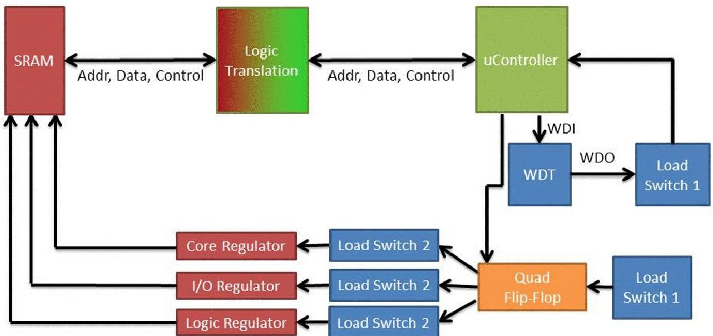

Figure 2. Simplified block diagram of REM CubeSat experiment board, after [20].

load switches to create a rail that supplies the components in green and a rail that supplies the component in orange. There are three regulators on the board to provide the three voltage domains for the SRAM and are the red boxes components in Figure 2. The load switches provide current limiting to mitigate single-event latch-ups (SEL) on the board. These load switches also prevent SEL from propagating to the rest of the satellite. Load Switch A has an auto-restart capability after an SEL, while Load Switch B toggles a flag signal after SEL. The load switches result in five isolated power domains on the REM board. The microcontroller handles running the SEU experiment on the SRAM and reporting telemetry on an I2C bus. The watchdog timer (WDT) mitigates single-event functional interrupts (SEFI) om the microcontroller. Chapters IV and V describe the identification of possible radiation-induced faults and their mitigation for the REM experiment board.

<!-- PDF_PAGE: 21 -->

## RadFxSat-1

The REM experiment was designed for the RadFxSat-1 mission. Three copies of the REM experiment and a VUC were launched as payloads on AO-91 on November 18, 2017 [15]. The capability of decreasing the core voltage of the DUT during flight is used to study the difference in SEU rates at different bias voltages for this mission. Figure 3 presents the spacecraft bus architecture for AO-91 first published in [21], and Figure 4 presents the CAD model first published in [22].

<!-- PDF_PAGE: 22 -->

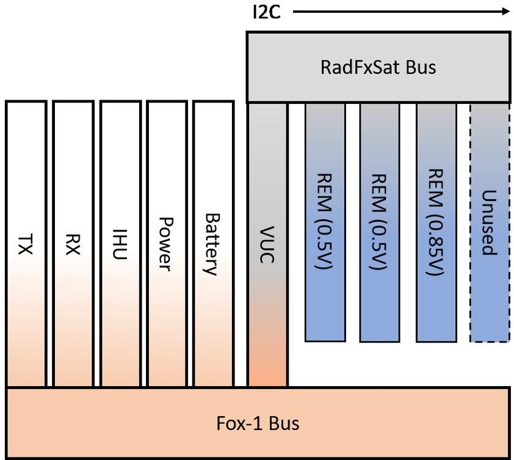

Figure 3. AO-91 spacecraft bus. The Fox-1 bus provides the radio, power, and structure while the RadFxSat bus provides the science payload, after [21].

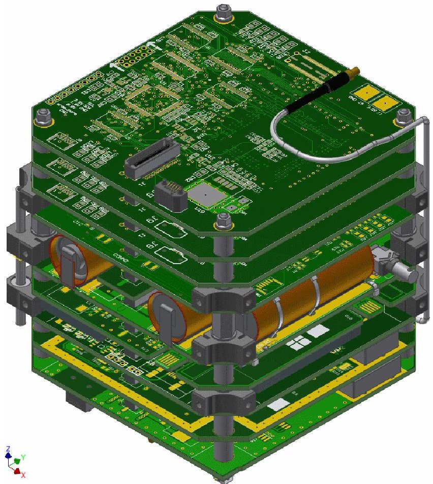

Figure 4. AO-91 CAD model. Top three boards are the REM experiment board set to different bias voltages. The board above the orange cylinders is the VUC and manages the three REM experiments stacked above the VUC, after [22].

<!-- PDF_PAGE: 23 -->

## System Engineering and Assurance Modeling

The System Engineering and Assurance Modeling (SEAM) platform was developed in order to better understand the system-level effects on increasingly complex systems and to support the paradigm shift to Model-Based Systems Engineering (MBSE) [23]. The Department of Defense defines a model as "A physical, mathematical, or otherwise logical representation of a system, entity, phenomenon, or process" [24]. MBSE is the process of using the different types of models for a mission and system to capture and connect the design process, and moving the design authority from documents to the model-based environment.

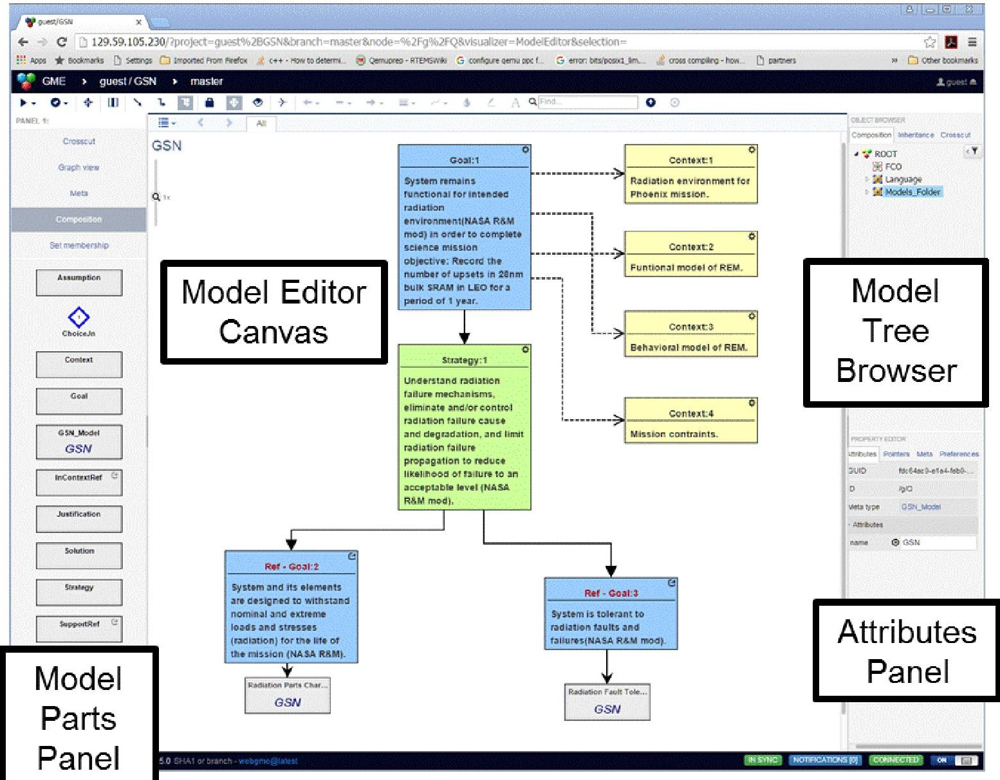

Figure 5. SEAM modeling environment, after [23].

<!-- PDF_PAGE: 24 -->

SEAM is a web-based online collaborative modeling and analysis platform [25] that allows users to create assurance case models linked to architectural, functional, and fault models of the system. SEAM is built using Web-based Generic Modeling Environment (WebGME), a web-based modeling tool that allows for the creation of domain-specific modeling languages [26]. Figure 5 shows a screenshot of SEAM. The model, in this case, a Goal Structuring Notation (GSN) model, appears in the modeling editor canvas, the center section of Figure 5. Engineers choose modeling elements from the model parts panel on the left side of Figure 5. Those elements can then be modified in the attributes panel on the bottom right or by double-clicking on the elements in the model editor canvas. Engineers can navigate to other parts of the model and add library parts through the model tree on the top right side of Figure 5. The following chapters will detail how to use the modeling languages and features in SEAM as they are relevant to the risk assessment and risk management process.

SEAM currently supports the following modeling languages, standards, and capabilities:

- Goal Structuring Notation

- NASA-STD-8729.1A Appendices A and B

- SysML Block Diagrams

- Failure Propagation (within SysML block diagrams)

- SysML Requirements Diagrams

- Import/Export of supported SysML diagrams to MagicDraw (XML)

- Functional Decomposition

- R-GENTIC Viewing

- CREME Viewing

- Export of Bayesian Nets (XML)

<!-- PDF_PAGE: 25 -->

- Export of Fault Tress (XML)

- Linkage between GSN, SysML, and Functional decomposition models

- Coverage checks for GSN, SysML, and Functional decomposition models

- REM experiment board example

<!-- PDF_PAGE: 26 -->

## CHAPTER II

## IDENTIFICATION OF POSSIBLE RADIATION-INDUCED FAULTS

The following chapter describes the three categories of radiation effects and the three radiation environments that appear in the different analyses in the dissertation.

Common Radiation Effects

Radiation effects, or faults, in circuits fall into three categories: TID, DDD, and SEE. There are also multiple types of events within SEE, divided into destructive and nondestructive. The chapter reviews the ones discussed in the rest of the dissertation.

Total Ionizing Dose

Total Ionizing Dose (TID) is the amount of energy deposited in a circuit over time, and the manifestations are usually trapped charge or defect-related energy levels. TID is measured as the energy deposited per unit mass of the material, usually in krads(Si). The dose is the result of high energy electrons and protons ionizing atoms and producing charge carriers as they pass through the dielectric layers of an integrated circuit (IC). The charge accumulated in the insulating oxides of the circuits changes the amount of energy band bending in the transistor, which causes parametric changes in the circuit behavior. For example, trapped charge in the gate oxide changes the gate potential needed to turn off complementary metal-oxide-semiconductor (CMOS) transistors. The trapped charge may lead to an increase in supply current for the IC and eventual functional failure. Trapped charge in field and buried oxides can create parasitic leakage paths in the IC and increase the static power leakage current. TID is generally becoming less of a reliability

<!-- PDF_PAGE: 27 -->

issue for CMOS digital ICs because of decreased transistor size and gate oxide thickness. As a result, many COTS can survive the dose accumulated for LEO missions, which is usually less than 30 krads (Si). More details about the mechanisms of TID can be found in [27].

## Displacement Damage Dose

Displacement damage is when energetic particles dislodge atoms in the lattice structure of semiconductor devices. This degrades the electrical and optical characteristics of devices through the introduction of new energy levels in the bandgap of the device affecting the recombination lifetime. These effects are permanent, though annealing can decrease the effects and can be part of a mitigation scheme like the one implemented on the Hubble Space Telescope [28]. In Figure 6 from [29], pictures taken by the camera on CubeSat XI-IV show how displacement damage in the CMOS camera caused the picture to turn yellow and darken over the 16 years on orbit. In an

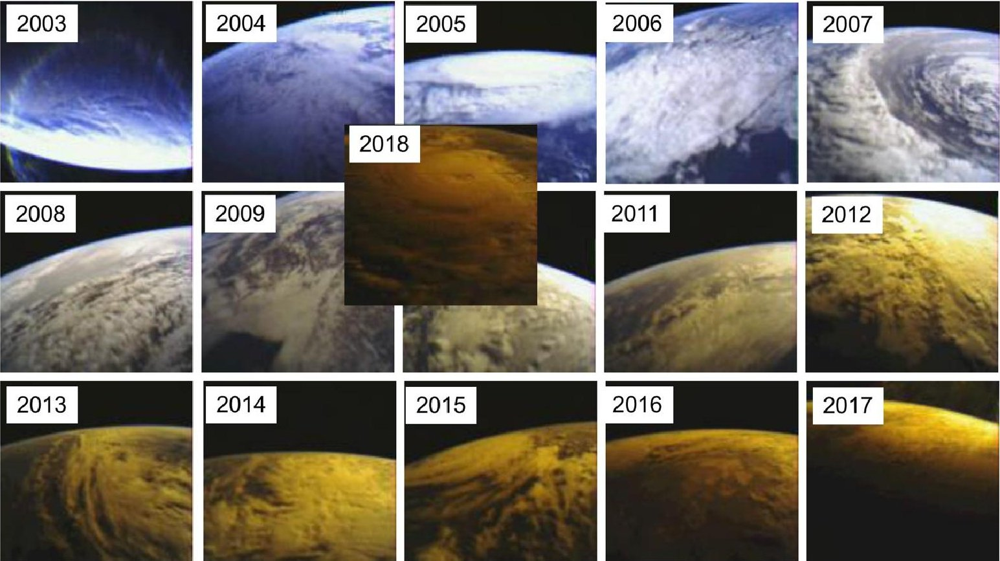

Figure 6. Yellowing and darkening of CMOS camera on CubeSat XI-IV, after [29].

<!-- PDF_PAGE: 28 -->

Table 2. SEE Vulnerabilities by Electronics Type

<table border="1"><tr><td>SEE Type</td><td>Destructive or Nondestructive</td><td>Seen in</td></tr><tr><td>SEL</td><td>Destructive(might be latent)</td><td>CMOS,not seen in SOI CMOS</td></tr><tr><td>SEGR</td><td>Destructive</td><td>MOSFET,Flash memory</td></tr><tr><td>SEB</td><td>Destructive</td><td>Power devices</td></tr><tr><td>SEU</td><td>Nondestructive</td><td>Devices with memory and/or registers</td></tr><tr><td>SEFI</td><td>Nondestructive</td><td>Devices with registers</td></tr><tr><td>SET</td><td>Nondestructive</td><td>All technologies</td></tr></table>

analogous way to TID, displacement damage is measured in terms of displacement damage dose (DDD), which is the non-ionizing energy loss (NIEL) of the particle times the fluence of the particle. More details about DDD can be found in [30].

## Single-Event Effects

Single-event effects (SEE) is the category of effects that are caused by a single particle. The arrival of the particles is described by a Poisson process. This means that the rate is constant as long as the environment is constant on average over time so that only the time interval of interest determines the number of events. Additionally, the time between events is distributed exponentially [31]. Broadly, SEEs can be further divided into destructive and non-destructive SEEs. For the most part, this dissertation will focus on destructive SEE, except for the mitigation of single-event functional interrupts (SEFI). Table 2 lists common SEE and the types of technologies that are susceptible.

## Single-Event Latch-up

Single-Event Latch-up (SEL) is when a particle strike deposits enough charge to turn on a parasitic p-n-p-n junction (thyristor) in an IC. The parasitic thyristor structure is shown in Figure 7 and formed by the p+ contact to power, n-well, p-substrate, and n+ contact to ground path notated

<!-- PDF_PAGE: 29 -->

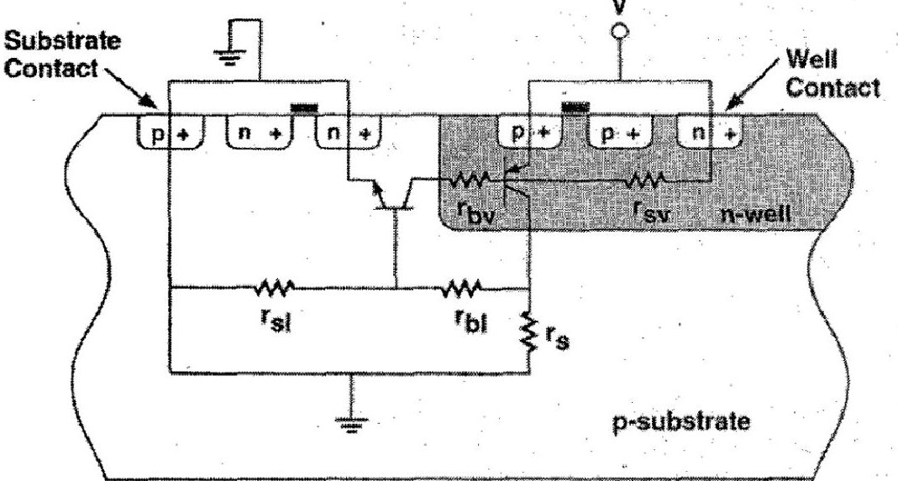

Figure 7. Two-transistor model for latch-up in an n-well CMOS structure, after [33].

by the two bipolar transistors. The parasitic thyristor is inherent to the bulk CMOS process and is a concern for COTS electronics. The current needed to induce latch-up is determined by the bipolar gains and series resistances, which are determined by the geometry of the devices. These factors change with the technology node, process, and specific circuit layout. For bulk CMOS technologies, engineers should assume that ICs are susceptible to SEL [32].

The result of SEL is a self-sustaining electrical short between the power and ground of the circuit, yielding a large current draw. In addition to disrupting the proper operation of the circuit, if power is not quickly removed, the high current event may permanently damage and destroy the circuit, introduce latent damage, or drain a battery source. If mitigation is in place to detect the SEL before the IC is destroyed, power cycling the circuit will stop the latch-up condition. More details about the mechanisms of SEL in different processes can be found in [33].

## Single-Event Burnout

Single-event burnout (SEB) occurs when a MOSFET transitions from a normal off-state to a bipolar turn-on condition or a second breakdown state due to a particle strike, usually through

<!-- PDF_PAGE: 30 -->

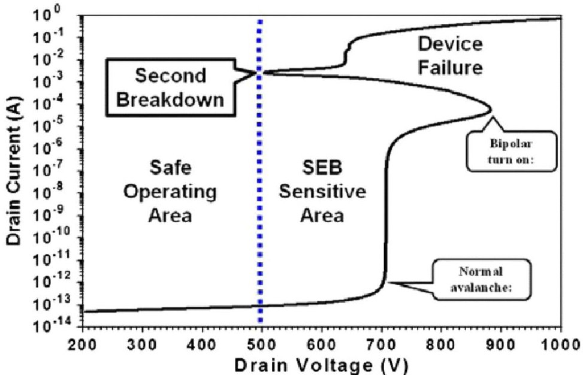

Figure 8. Characteristics of SEB in Si MOSFET devices, after [36],[37].

the depletion region of a MOSFET when it is off. The first SEB was measured in 1986 [34], and by 1990 it was shown that effective LET, the standard method for calculating SEE rates, was a poor approximation for rate prediction of SEB [35]. Figure 8 shows the voltage-current characteristics for a MOSFET when off [36], [37]. RHA for SEB has been focused on finding the safe operating area (SOA) voltage to ensure that SEB does not occur during a mission. In the case of silicon MOSFETs, if the off-state voltage is always below the second breakdown voltage, the component will not experience SEB.

SEB in silicon carbide (SiC) power devices was first reported in diodes in 2006 [38] and MOSFETs in 2012 [39]. In [40], an additional damage region was described and is shown in Figure 9. SiC devices have an area between the safe operating area and the SEB sensitive area where individual particle strikes cause leakage current increases. The mechanisms for the discrete leakage current increases are still being researched [41], [42], but the design implication is that the SOA for SiC devices would need to be below the voltage where leakage current increases are seen. The leakage current increase is assumed to be latent damage, which decreases the life of the component.

<!-- PDF_PAGE: 31 -->

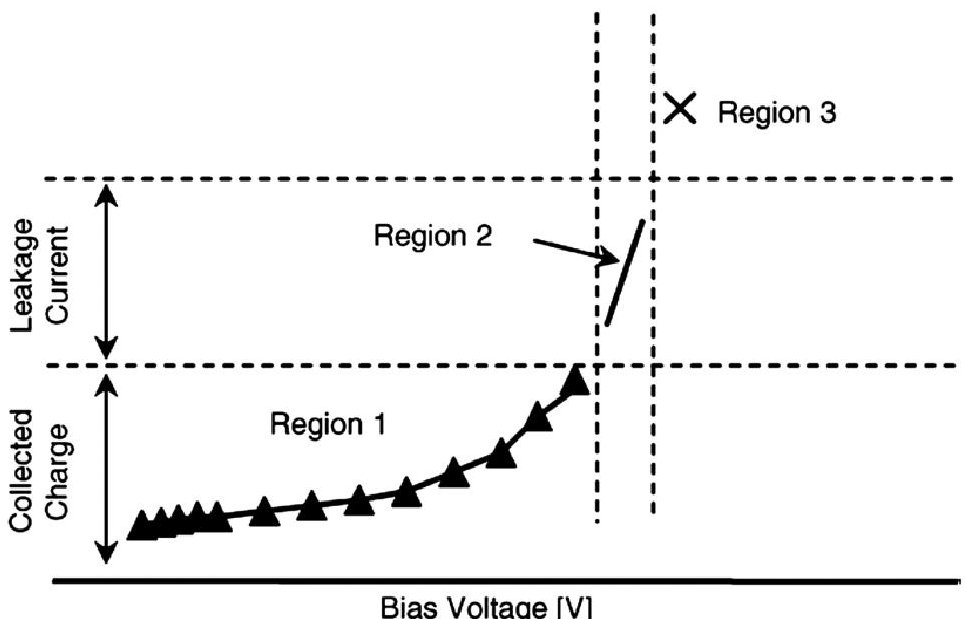

Figure 9. Characteristic regions of damage for SiC devices, after [40].

## Single-Event Functional Interrupt

A single-event functional interrupt (SEFI) results from a type of SEU. A SEU is when a particle strike deposits enough charge into a memory element to change the state of the memory, changing a stored 0 to a stored 1 or vice versa. Depending on the intended function of the memory element, different types of faults are at the system level. SEUs in the SRAM for the REM experiment board are detected by writing a known pattern to the memory and then reading it back and checking for differences. Because the SRAM is a DUT and not used to store data or programs, the effect of the SEU is limited to the memory. An SEU in the program counter register of a microcontroller could change the next instruction executed. This type of SEU is a SEFI because the SEU in the control registers or program memory causes a functional disruption in the microcontroller software [43]. Mitigation of SEFIs in microcontrollers will be discussed in Chapter V. More details about the mechanisms of SEUs are in [44].

<!-- PDF_PAGE: 32 -->

## Radiation Environment Models

The near-Earth space radiation environment is divided into two types of particle groups: trapped and transient. The magnetosphere causes particles to become trapped in "belts" around the earth, mainly protons and electrons. The inner belt, which has trapped electrons and protons, starts at about 0.2 Earth radii or 1,000 km. The inner belt is above the orbit of most LEO satellites except for the dip in the belt at the South Atlantic Anomaly (SAA), where it decreases to 200 km from the surface of the Earth. The SAA affects almost all LEO missions. Transient particles come from solar particle events and background particles come from galactic cosmic rays (GCR). The solar cycle influences the number of transient particles.

Over the last decade, several radiation environment models have been created or improved to provide probability distributions of particle populations. By describing the environment probabilistically, the fluences of particle populations for different energies can be calculated for different confidence levels (CL). In addition, these models enable the ability to decouple the uncertainty in the radiation environment from the uncertainty in the component response. For the latest developments in space climatology models, see [45]. The models used in this dissertation are briefly described below.

## Trapped Particle Environments

The International Radiation Environment Near Earth (IRENE), also known as AE9/AP9, models the fluxes of the trapped protons and electrons based on 37 data sets. IRENE also estimates the uncertainty from the measurements and space weather variability and quantifies the uncertainty as statistical CLs. IRENE is designed to replace AE8/AP8 and to be able to incorporate new data sets. Additionally, future updates are planned to account for solar cycle variation [46]. The mean fluences for IRENE are similar to the AE8/AP8, as seen in Figure 10.

<!-- PDF_PAGE: 33 -->

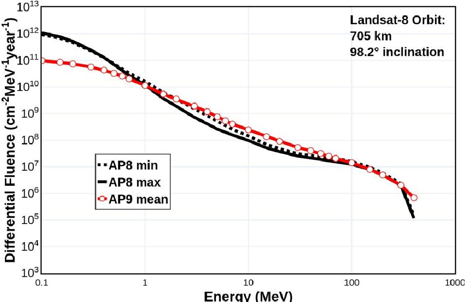

Figure 10. Comparison of differential proton fluences for AP8 and AP9, after [46].

## Solar Particle Environments

The Prediction of Solar particle Yields for CHARacterzing Integrated Circuits (PSYCHIC) [9] is a probabilistic model for solar heavy-ions extending the Emission of Solar Protons (ESP) model [47]. PSYCHIC provides fluences for each ion and energy level for a mission time from a lognormal cumulative distribution function (CDF) of the fluences.

When estimating the environment for radiation effects, the uncertainty in the environment can be handled in different ways. Solar particle environments exist for worst day, worst week, and CLs from 1% to 99%. Missions use different estimates of the environment depending on the criticality of the component and the risk posture of the mission. These different estimates still do not account for the environment variability that comes from describing the environment using the lognormal CDF mean and standard deviation. For some missions, considering the average environment matches the risk posture of the mission and reduces the chance of overdesign. Chapter III presents this new method.

<!-- PDF_PAGE: 34 -->

## Galactic Cosmic Ray Environments

The Galactic Cosmic Ray (GCR) model used in CREME96 is the Nymmik model [48]. The particle flux variation is modeled as a function of the sunspot number. In [49], the average error is measured to be about 25%. GCR fluxes currently are not described probabilistically like the trapped environment in IRENE and the solar particle environment in PSYCHIC.

## Conclusions

Trapped environments, the main contributor to TID and DDD, can be described probabilistically. The first part of Chapter III describes a method by Xapsos [50] used to decouple uncertainty in the environment and uncertainty in part-to-part variability to get a probability of failure for the component. What is considered "failure" for a component from TID and DDD depends on the components' use in the system. Chapter V describes ways to model and analyze the critical parameter that determines failure.

Transient environments are the main contributor to heavy-ion induced SEE. The second part of Chapter III describes a new method to calculate the probability of failure from SEB for a solar-particle dominant mission. Non-destructive SEEs can be intentionally or unintentionally masked at the system level. Chapter IV presents a new method to model the fault propagation of SEEs in order to evaluate the system-level consequences. Chapter V shows how the fault propagation model can be used to model the mitigation of SEEs as well.

<!-- PDF_PAGE: 35 -->

## CHAPTER III

## LIKELIHOOD CALCULATIONS FOR RADIATION EFFECTS

Once the possible radiation effects in a system are determined, the next step is to calculate the likelihood of the effects. Depending on the broad category of effect (TID, DDD, or SEE), the environment (trapped, solar, GCR), and the risk posture for the mission, this involves calculating a design margin or a probability of failure. This chapter outlines the information necessary for these calculations and introduces a new method for calculating the likelihood of SEB in SiC devices with direction on how it can be applied to other SEEs.

## Motivation

In [51], the authors propose a method to predict the failure rate, $ \lambda $ , of a component from radiation effects, assuming the failure rate from radiation is independent of other types of failures. The authors assume that the SEE, TID, DDD failure rates are independent failure rates, through TID has been shown to affect the SEE rates of components since 1983 [52]. In order to calculate the SEE rate, the failure rate of each different type of SEE is summed. By summing the failure rates, the authors assume that each type of SEE is independent, which is usually not true. For example, SETs and SEUs are not independent rates. Some percentage of SET are latched as SEU in devices.

Additionally, TID and DDD failure rates are treated as end-of-life failures and do not account for parametric degradation, which can also cause a system failure. The authors in [51] were awarded the Best Paper Award for the 2016 Reliability and Maintainability Symposium, one of the top conferences for reliability engineers. There is a gap between what radiation effects

<!-- PDF_PAGE: 36 -->

engineers are currently providing for reliability analysis and what the reliability community desires. This chapter presents likelihood calculations for different radiation effects that could be incorporated into system reliability assessments. Chapter V presents possible avenues for including probabilities of failure in system-level calculations.

## Dose Likelihood Calculations

There are two main methods for determining the likelihood of failure from TID and DDD. One is radiation design margin (RDM) [53], with a variation being radiation design factor (RDF)[54]. The second is a method published in 2017 for calculating the probability of failure that decouples environment variability and part-to-part variability [50]. The next section describes these approaches.

## Risk Avoidance Radiation Hardness Assurance: Radiation Design Margin

Risk avoidance RHA methodology ensures that individual piece parts in a system will perform to their specification in the planned mission radiation environment. A common practice is the use of RDM to categorize components and their risk of failure. The RDM methodology intends to capture the uncertainty of device performance and the environment definition in a single "margin" (e.g., TID failure level). The required probability of survival and level of confidence for the system also determines the margin.

The first step is to categorize components in order to identify those that need the most monitoring and mitigation to survive the radiation environment. Categorization is the critical activity of RHA [53]. After the radiation environment for the mission is defined, the candidate component's radiation sensitivity is either found or tested. Then the required performance in the system is determined. These three results are combined to determine the RDM for the component.

<!-- PDF_PAGE: 37 -->

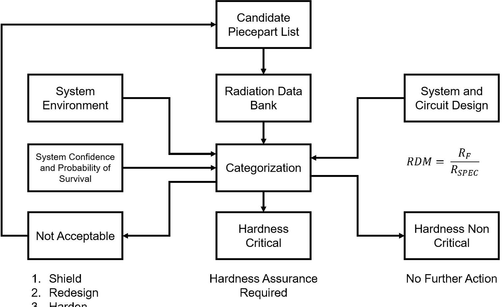

Figure 11. Block diagram of categorization process, after [53] .

Figure 11 presents this RDM process flow. RDM results in components initially placed into one of three categories: unacceptable, hardness critical, and hardness non-critical. RDM is defined in Equation 1 as the ratio of the nominal radiation failure level of the component to the radiation specification.

$$
R D M = \frac {R _ {F}}{R _ {S P E C}}
$$

The nominal radiation failure level, $ R_{F} $ , is determined by both the system use and the results of the component radiation tests. The radiation specification, $ R_{SPEC} $ , is determined first as the free-field environment incident to the spacecraft.

<!-- PDF_PAGE: 38 -->

There are two different methods for determining which RDMs fall into which categories: Design Margin Breakpoint Method (DMBP) and the Part Categorization Criteria Method (PCC). DMBP is a qualitative approach to determining the breaks; more details can be found in [53]. PCC uses the average and standard deviation of the component characteristic data along with the required system-level probability of survival and level of confidence to determine the breaks and is shown in Figure 12. Assuming that the component radiation failure level is a lognormal distribution, the PCC is calculated using Equation 2.

$$
P C C = e ^ {K _ {T L} S _ {l n} \left(R _ {F}\right)}
$$

$ K_{T L} $ is the one-sided tolerance limit that is a function of sample size, probability of survival, and level of confidence and $ S_{l n} ( R_{F} ) $ is the sample standard deviation of the natural log of the failure levels measured for the component. The full process is described in [55] and [56].

These three categories reflect the types of RHA activities that are prescribed for the component, based on the level of risk acceptance for the mission. The goal of the RHA activities is to move all the components into the hardness non-critical category by the end of the design process. If this is true for all the components in the system, then a worst-case probability of survival and confidence level prescribed for the system surviving the radiation environment is met. RDM methodology includes "hidden" margins in order to provide relief against some of the known and unknown uncertainties in the RDM calculation [57]. These include heating from the spacecraft during operation, hidden margins in the environment models, and hidden margins from the worstcase circuit analysis that determines the radiation failure level.

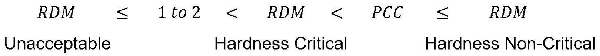

Figure 12. Categories using PCC method, after [53].

<!-- PDF_PAGE: 39 -->

As described in [54], often organizations impose a blanket RDM of 2 or 3, even when uncertainty studies have shown that RDM should be between 3.5 and 11.5. Historically, limitations on spacecraft mass for missions has made the imposition of a required RDM that high impossible. In these cases, the RDM is referred to as a radiation design factor (RDF), to prevent the implication that a RDM of 2 means a margin of 100 percent. In this case, the probability of survival and the level of confidence required by the system do not determine the RDM. Only Equation 1 is used, and if the calculated RDM is two or greater, than the component can be used in the system.

For TID, the standard recommendation for missions is to determine that the components can survive to a dose level twice the mission specification. This criterion comes from the original RDM process that divided unacceptable and hardness critical categories by a RDM of 1 to 2 [58] and best practice guidelines developed at NASA [54], [59]. The original RDM process assumes that most components in the system fall into the hardness non-critical category, with the categories of unacceptable and hardness critical to help determine resource allocation in a hardness assurance plan. By using an arbitrary design margin of 2, originally intended to allocate radiation mitigation resources, the probability of the component surviving is lost and obscured, as demonstrated in the next section in Figure 13. Using an arbitrary design margin of 2 on a component does not imply anything about the probability of the entire system surviving. If missions do not have the resources to acquire components that will meet the margin calculated when using Equation 2 to determine what the cut-offs for each of the categories, a different measure of reliability should be used. A method that quantitatively describes the uncertainty in the environment and the test data is described next.

<!-- PDF_PAGE: 40 -->

Risk Tolerant Radiation Hardness Assurance: Probability of Failure

For missions with higher risk acceptance at the component level, the traditional RDM approach does not account for system-level mitigation, leads to overdesign, and precludes many components, including commercial off-the-shelf (COTS) components. RDM does little to illuminate the consequences of trading risk in the system. Xapsos presented a method that determined the probability of failure from TID or DDD instead of a design margin [50] for the trapped radiation environment. The probability of failure for a device randomly selected from the lot(s) characterized by $ G ( x ) $ for the device's total dose response in the space environment characterized by $ H ( x ) $ is

$$
P _ {f a i l} = \int [ 1 - H (x) ] \cdot g (x) d x
$$

G(x) is the cumulative distribution function (CDF) of the failure doses for a device. Component dose failures are assumed to be a lognormal distribution. The CDF is derived by ranking the component failure dose and then fitting to a lognormal distribution. Using the estimated lognormal parameters, the probability distribution function (PDF) g(x) is calculated. H(x) is the CDF of the expected environment total dose. It is obtained by computing 99 trapped environments in IRENE [46] and then ranking the histories using the median rank method. The probability of failure is calculated by numerically integrating over dose.

This method was compared to the RDM method by assuming an RDM of 1 was the same as the 50% CL. The confidence level is plotted versus the RDM and is reprinted in Figure 13. For an RDM of 2, a commonly required margin, the confidence level is actually 96% for the component analyzed for TID, and 79% for the component analyzed for DDD. Figure 13 illustrates that when RDM is required instead of calculating the Part Categorization Criteria (PCC), described in the first part of Chapter II, based on the actual system required probability of survival, CL, and the

<!-- PDF_PAGE: 41 -->

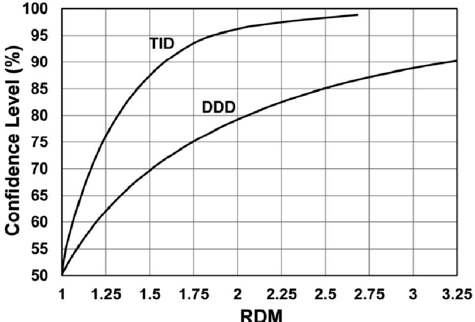

Figure 13. Comparison of confidence level to RDM for a 10-year mission in GEO and 200 mils of Al shielding. Results are shown for both TID and DDD, after [50].

number of components tested, the RDM is arbitrary. The RDM obscures where the margin actually is: the amount of radiation expected during the mission or the radiation failure level of the component.

## Single Event Effects in Power Devices Likelihood Calculations

Destructive SEEs in power devices pose challenges for risk avoidance RHA methodologies. For example, error rate prediction for SEB and SEGR is difficult because the sample size required to generate traditional cross-section curves is large [60] and the tests are destructive. However, in some emerging technologies, like silicon carbide (SiC) MOSFETs, derating the operating voltage by even 50% [61] does not eliminate the risk of SEB and might negate the benefits of using the technology in the first place. SiC MOSFETs are of interest for space applications requiring high-voltage, high-temperature operation [62] with low on-resistance. Worst case failure rates calculated for these devices would preclude their use in many critical applications [63]. However, there are applications such as a large constellation of CubeSats with

<!-- PDF_PAGE: 42 -->

spacecraft-level redundancy or a high-temperature power application [64], where these devices are under consideration. There are also many applications where SiC devices are still better than silicon devices, even though the drain voltage is derated significantly. A less conservative reliability estimate would provide value to a design team.

First, the risk avoidance method of determining the SOA for a device is presented. Then a new method to predict the probability of failure for risk-tolerant systems is described. Environment stress, the mission dose, and device radiation tolerance were combined in an estimate of mission TID and DDD failure probabilities in [50] and described earlier in this chapter. Berg in [65] presented a reliability estimate for SEEs as a function of particle fluence. These two methodologies are synthesized to construct a new assessment of catastrophic SEB reliability that includes environment variability. Probabilistic models for multiple solar particle environments are combined with aluminum shield thickness and device derating to estimate the probability of catastrophic failure from SEB for 1200 V SiC power MOSFETs. The reliability is compared between a GCR environment, a solar maximum environment at a 90% confidence level (CL), the worst day environment, and an average solar maximum environment derived from accounting for the environment variability. Failure rates are analyzed to provide a measure of reliability over a 1- or 2-year geosynchronous earth orbit (GEO) mission. This methodology shows how these parameters significantly impact the estimated reliability for SiC power MOSFETs.

## Risk Avoidance Radiation Hardness Assurance: Safe-Operating Area

The prescribed method for RHA in power devices is to derate the voltage to a point where no SEB is seen for a worst case environment [60], [66]. The standard test methods do not provide much guidance on how to confidently determine the SOA and focus instead on how to find the cross-section curve [67], [68]. One reason for this focus is that current limiting circuits can mitigate

<!-- PDF_PAGE: 43 -->

SEB in Si devices. As discussed in Chapter II, this is not a possible mitigation strategy for SiC devices. In [69], a method for determining the SOA for risk avoidance missions is presented. Similar to the PCC calculation for TID and DDD reliability calculations, the procedure uses the number of devices tested and the desired confidence level to establish a SOA with margin.

## Risk Tolerant Radiation Hardness Assurance: Probability of Failure

In this section, a new method is presented for computing the probability of failure for a SiC device susceptible to SEB in the heavy-ion environment of space and was first published in [70]. The method incorporates the SiC burnout thresholds for different operating voltages and the heavy-ion environment variability. After estimating the solar particle environment, the portion of the environment that will cause radiation-induced failures is determined. For SEB, this occurs when a particle deposits enough charge in the sensitive area and the MOSFET drain-source junction is reverse biased beyond a critical voltage (the SEB threshold voltage). Two assumptions are made to calculate the probability of failure from SEB for a SiC MOSFET.

First, it is assumed that the component tested represents the entire population of parts. The radiation community does not usually account for part-to-part variability for destructive effects in power devices as that variability usually is small for space-grade devices [68]. Commercial Si power MOSFETs exhibit considerable variability [69]. Part-to-part variability has not been measured in SiC power devices yet, but if commercial SiC devices did exhibit similar variability, this variability could be incorporated similar to how [50] incorporated for TID and DDD.

Second, it is assumed that any particle within an acceptance angle and with a linear energy transfer (LET) above the critical LET will result in SEB if it hits the sensitive area while the component is in the off state. Figure 14 shows how the SEB threshold voltage changes for a Wolfspeed C2M0080120D (1200V, 80 m $ \Omega $ ) SiC MOSFET as a function of LET [61]. The test

<!-- PDF_PAGE: 44 -->

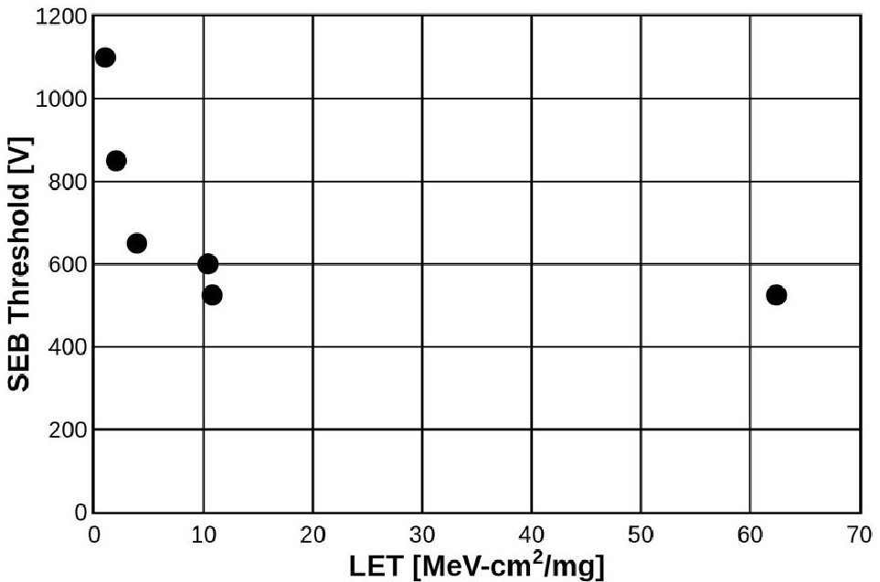

Figure 14. SEB threshold for different LET for SiC MOSFET, after [61].

circuit grounded the device gate and source with the drain biased. For the device tests, the ion beam was at normal incidence and in vacuum. The beam characteristics are in [61]. From the "hockey stick" curve in Figure 14, the safe operating area for this device is below 525 V, the voltage at which the critical LET saturates. The device is not susceptible to SEB if operated below this voltage. To calculate the probability of failure from SEB for this component, the test points above the safe operating area, the first four points in Figure 14, are used. The probability of failure from a destructive SEB when operating below 525V is assumed to be zero.

In this method, it is assumed that the failure rate is proportional to the particle flux, similar to the lethal ion failure analysis from [71] and [72]. For a given drain bias, an ion is considered "lethal" if:

1. The ion LET is at or above the critical LET for SEB

2. The ion hits the SEB sensitive area ( $ \sigma $ )

3. The ion hits when the device is off (1-duty cycle)

4. The ion hits within the angle of sensitivity ( $ \theta $ )

<!-- PDF_PAGE: 45 -->

Equation 4 determines the proportionality factor k. This constant combines $ \sigma \left( \mathrm{c m}^{2} \right) $ the SEB sensitive area, 1 - duty cycle, corresponding to the fraction of time the device is off, and (1 - cos $ \theta $), which is the acceptance angle in which burnout may occur.

$$
k = \sigma (1 - d u t y c y c l e) (1 - \cos \theta)
$$

Using the device and conditions reported in [61] and [63], the sensitive area of the MOSFET is $ 3 \times1 0^{-2} \mathrm{c m}^{2} $ , the duty cycle is 50%, and the angle of sensitivity around the normal is $ \pm1 5^{\circ} $ . The conversion of angle around the normal to solid angle normalized to steradians for a whole sphere is $ 2^{*} 2 \pi(1-\cos \theta) / 4 \pi $ . The arrival of a particle that causes SEB during a mission is a random event [73], [31]. In Equation 5, the random variable for the exponential distribution is fluence rather than the commonly used random variable of time. Let x be the random variable of the total mission fluence above the critical LET. The probability that the device experiences SEB is calculated using Equation 5.

$$
F _ {G} (x) = 1 - e ^ {- k x}
$$

Next, PSYCHIC was used to generate spectra with CL from 1% to 99% for 1- and 2-year missions in solar maximum. Each environment was transported through 100, 200, 500, and 1000 mils of aluminum shielding using CREME96 [49] and folded into an integral LET spectrum. This process produces a CDF of the fluences above the critical LET for SEB shown in Figure 14 for the

Table 3. SEB Threshold Voltage Derating and Critical LET Values

<table border="1"><tr><td>SEB Voltage(V)</td><td>Derating(%)</td><td>LETcrit(MeV-cm2/mg)</td><td>Color and Shape</td></tr><tr><td>1100</td><td>92</td><td>1</td><td>Green Triangle</td></tr><tr><td>850</td><td>71</td><td>2</td><td>Orange Square</td></tr><tr><td>650</td><td>54</td><td>3.9</td><td>Purple Diamond</td></tr><tr><td>600</td><td>50</td><td>10</td><td>Pink Circle</td></tr></table>

<!-- PDF_PAGE: 46 -->

total mission time. Figure 15 plots the CDFs for different critical LETs for a 1- and 2-year mission with 100 mils of shielding. Each curve contains 99 points corresponding to the cumulative fluence for the CL 1% to 99%. The fluence axis is a log scale. The critical LET levels for the curves, from right to left, are 1, 2, 3.9, and 10 MeV-cm $ ^{2} $ /mg. These LET values come from the test values in Figure 14 and correspond to a specific SEB threshold voltage listed in Table 3.

The CDFs of the fluence above a critical LET was used instead of the rectangular parallelepiped (RPP) method to determine the space environment. Effective LET has been shown

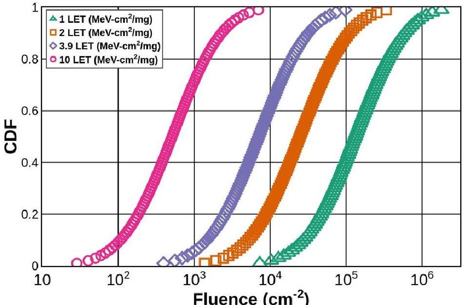

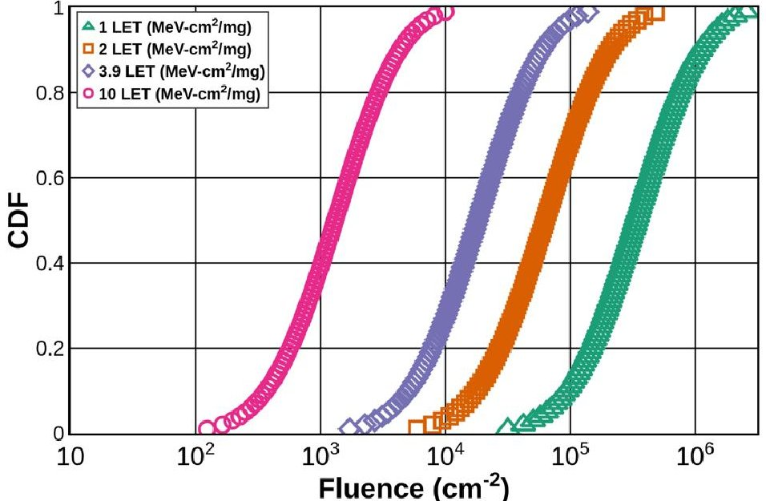

Figure 15. Fluence probability distribution for a (top) 1-year and (bottom) 2-year solar max, GEO mission with 100 mils Al shielding, after [70].

<!-- PDF_PAGE: 47 -->

Table 4. Estimated Distribution Parameters

<table border="1"><tr><td></td><td colspan="2">1 LET(Si)(MeV-cm2/mg)</td><td colspan="2">2 LET(Si)(MeV-cm2/mg)</td><td colspan="2">3.9 LET(Si)(MeV-cm2/mg)</td><td colspan="2">10 LET(Si)(MeV-cm2/mg)</td></tr><tr><td>Environment</td><td>μ</td><td>σ</td><td>μ</td><td>σ</td><td>μ</td><td>σ</td><td>μ</td><td>σ</td></tr><tr><td>2 years,100 mils</td><td>12.7</td><td>0.926</td><td>11</td><td>0.926</td><td>7.16</td><td>0.926</td><td>7.04</td><td>0.926</td></tr><tr><td>1 year,100 mils</td><td>11.7</td><td>1.15</td><td>10.1</td><td>1.15</td><td>8.85</td><td>1.15</td><td>6.22</td><td>1.15</td></tr><tr><td>2 years,200 mils</td><td>10.6</td><td>0.926</td><td>8.76</td><td>0.926</td><td>7.5</td><td>0.926</td><td>5</td><td>0.926</td></tr><tr><td>1 year,200 mils</td><td>9.69</td><td>1.15</td><td>7.82</td><td>1.15</td><td>6.57</td><td>1.15</td><td>4.06</td><td>1.15</td></tr><tr><td>2 years,500 mils</td><td>8.12</td><td>0.926</td><td>6.2</td><td>0.926</td><td>4.96</td><td>0.926</td><td>2.63</td><td>0.926</td></tr><tr><td>1 year,500 mils</td><td>7.19</td><td>1.15</td><td>5.26</td><td>1.15</td><td>4.02</td><td>1.15</td><td>1.7</td><td>1.15</td></tr><tr><td>2 years,1000 mils</td><td>5.91</td><td>0.926</td><td>4.26</td><td>0.926</td><td>2.96</td><td>0.926</td><td>0.756</td><td>0.926</td></tr><tr><td>1 year,1000 mils</td><td>4.97</td><td>1.15</td><td>3.33</td><td>1.15</td><td>2.03</td><td>1.15</td><td>-0.18</td><td>1.15</td></tr></table>

to be invalid for destructive events in power devices [60], [74]. The lethal ion method accounts for ion track length through the use of the angle of sensitivity. The LETs used in this work assumes a target material of Si. The difference in the LET spectrum between Si and SiC was within the measurement error for the experiment. Therefore, the rest of the chapter uses LET(Si).

Notice that the CDF curves in Figure 15 shift to the right from 1 year (top) to 2 years (bottom) as the number of particles expected during the mission increases. The width of the CDF curves from 1 year to 2 year decreases because the model relative uncertainty decreases as the mission time increases. The variability in the solar cycle averages out as mission time increases. The environment CDFs were fit with a lognormal distribution, the mean and standard deviation were estimated, and the probability density functions (PDF), $ \mathrm{f_{s}} (\mathrm{x}) $ , were calculated. Equation 6 uses PDFs. The calculated lognormal mean and standard deviations for the different environments are listed in Table 4.

The probability of zero SEB events during a mission, or the reliability, is one minus the exponential cumulative distribution function $ \mathrm{F_{G}}(\mathrm{x}) $ . This is considered the strength distribution. The particle fluence $ \mathrm{f_{s}}(\mathrm{x}) $ provides the stress distribution. Assuming the two probabilities are

<!-- PDF_PAGE: 48 -->

independent, the reliability (R), one minus the probability of failure, of a device is calculated using static stress-strength analysis [75], [76].

$$
R = \int [ 1 - F _ {G} (x) ] f _ {s} (x) d x
$$

Equation 6 is numerically calculated over the mission fluences for a given $ \mathrm{LET}_{\mathrm{crit}} $ . Each mission length, shielding thickness, and $ \mathrm{LET}_{\mathrm{crit}} $ have individual CDF curves like the ones in Figure 15 that are used to derive $ \mathrm{f_{s}}(\mathrm{x}) $ . These critical LETs used to model the environment correspond to different operating voltages for the device. The SEB threshold voltages for critical LETs of 1, 2, 3.9, and 10 MeV-cm $ ^{2} $ /mg correspond to operating voltages of 1100, 850, 650, and 600 V, respectively, in Figure 16. This figure shows the reliability of a component that exhibits SEB for a GEO mission length of 1 (a) or 2 (b) years for SEB threshold voltages of 1100, 850, 650, and 600V and 100, 200, 500, and 1000 mils of aluminum shielding. For example, if the component is derated by 50% so that the operating voltage is 600 V with 200 mils of Al shielding, the component reliability is 96% for a 1-year mission and 91% for a 2-year mission.

When the critical LET for a device is relatively low for the expected mission environment, the preceding method can calculate the reliability of that component. The ability to calculate the probability of failure is useful when derating the operating voltage to a SOA would eliminate the technology advantage of the component. The reliability estimate can be used to evaluate the effectiveness of derating, shielding, and limiting operational time. For the device in this paper, derating the voltage alone is not enough to achieve high reliability. To achieve an estimated reliability above 80%, the components need to be behind at least 200 mils of Al shielding for a 50% voltage derating. If the components can be heavily shielded, lower derating voltages could be considered. For example, for a 1-year mission behind an equivalent of 1000 mils of aluminum

<!-- PDF_PAGE: 49 -->

shielding, operating the component at 850 V (derating it to 71%) , corresponding to a critical LET of 2 MeV-cm $ ^{2} $ /mg, the reliability is estimated to be 99%. This high equivalent shielding case can happen after performing a ray-trace analysis for a component located deep inside of a spacecraft with spot shieling. When adding shielding to increase the reliability, consider the effect on the mass budget of a system.

Figure 17 compares this novel reliability prediction method to the background GCR environment and the worst day solar particle environment. CREME96 was used to calculate the

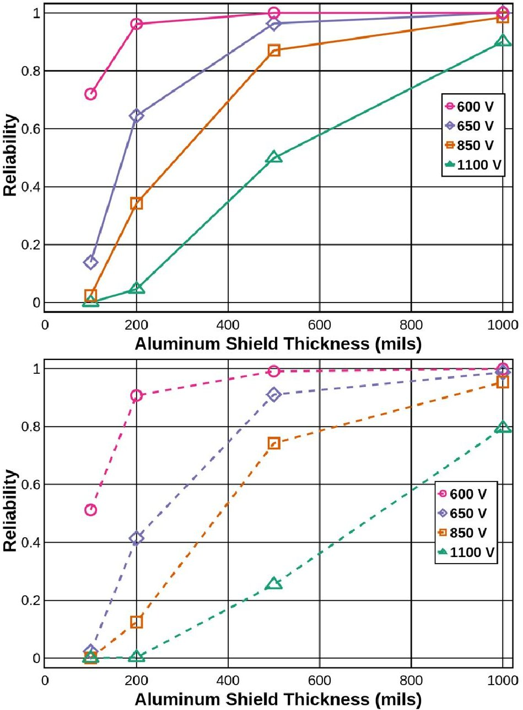

Figure 16. Reliability of parts that exhibit SEB. (top) 1-year (solid lines) and (bottom) 2-year (dotted lines) GEO missions. The triangles are for an operating voltage of 1100 V, the squares 850 V, the diamonds 650 V, and the circles 600 V, after [70].

<!-- PDF_PAGE: 50 -->

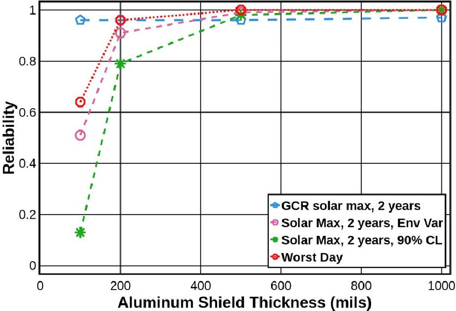

Figure 17. Reliability of parts when the critical LET is for 10 MeV-cm $ ^{2} $ /mg for just a GCR environment (blue pentagon dash), a solar max environment including environment variability (pink circle dash), solar max for a specific confidence level (green starburst dash), and worst day (red octagon dots) for a 2 year mission, after [70].

integral fluence for all of the critical LETs [49]; 10 MeV-cm $ ^{2} $ /mg for various shielding thicknesses at solar maximum is shown in Figure 17. The GCR environment, worst day solar particle environment, and the 90% confidence level environment for solar maximum through 100 mils of aluminum shielding as integral fluences are plotted in Figure 18. Equation 5 was used to calculate the reliability for the different environments, based on these fluences. The solar maximum environment fluence does not include the fluence from the GCR environment when calculating the reliability.

When the critical LET is 10 MeV-cm $ ^{2} $ /mg and the shielding thickness is below 400 mils, the solar particle environment limits the reliability of the component because the calculated reliability is lower than the reliability calculated for the GCR environment. As shielding increases, and the lower energy solar particles are more effectively shielded, the GCR component of the environment limits the reliability. Figure 17 also shows a prediction based on the 90% confidence

<!-- PDF_PAGE: 51 -->

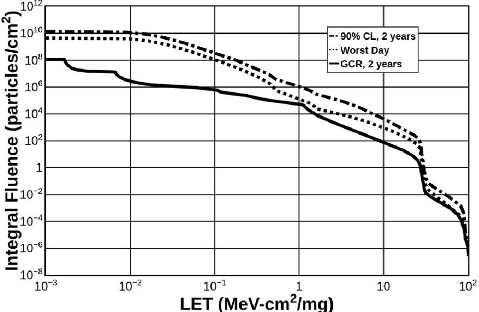

Figure 18. Integral fluence environment versus LET for the 90% confidence level for 2 years (dot dash), the worst day solar particle fluence (dots), and the GCR environment (solid line) for through 100 mils of Al shielding for a GEO orbit during solar maximum, after [70].

level solar energetic particle environment. Recall a confidence level of 90% means there is a 90% chance that the fluence will not be greater than predicted for the given mission length. If one were to consider this as a worst-case environment, the component reliability would be underestimated by a factor of $ 3 \times $ for nominal shielding of 100 mils of aluminum. For noncritical applications, including environment variability gives a better estimate of reliability. Figure 17 also shows the difference in reliability calculated for an extreme environment often mentioned in radiation requirements, the worst day environment. The probability of surviving the worst day environment is higher than the reliability predicted that includes environment variability but lower than the 90% confidence level environment.

## Conclusions

Presented were two methods to show how environment variability can be included to calculate the probability of failure. The new method for destructive SEE does not rely on a large testing sample that would be required to construct traditional cross-section curves for each possible

<!-- PDF_PAGE: 52 -->

operating condition[60], or assumptions related to effective LET [77]. By including environment variability, reliability for a component can be calculated that is not worst case and allows for the evaluation of components for noncritical systems where the possibility of a destructive SEE is tolerated. For the 1200 V SiC power MOSFETs used outside of the safe operating area in this paper, the reliability was calculated for a range of derating voltages, shielding, and mission length. Shielding thickness and the derated voltage have a substantial effect on the reliability in a solar particle environment with low critical LET. These techniques may increase the reliability to an acceptable level in noncritical applications.

## Extensions

Several extensions to this method could be explored to incorporate different types of variability. George, in [69], shows that assuming no part variability is invalid for Si components. In this case, where the LET of the particle does not predict the component response, the environment fluences should be binned by atomic number and energy, similar to the method in [72]. Different lethal ion rates could be calculated for each angle of sensitivity to cases where there are different cross-section curves for different angles [71]. For power devices, the sensitive volume is large relative to the ion track. For destructive events where the sensitive volume is small, Weeden-Wright in [78] shows that energy deposition variability is significant for small sensitive volumes. Designers may need to consider this variability in addition to environment variability for calculating probabilities of failure for SEEs in highly-scaled devices. This method assumes that there is no way to recover from an SEB as a destructive event. For nondestructive events that can be described with an angle of sensitivity, this method could be extended to provide an error rate that could be used in availability assessments.

<!-- PDF_PAGE: 53 -->

## CHAPTER IV

## EVALUATING CONSEQUENCES OF RADIATION-INDUCED FAULTS

This chapter reviews how to evaluate the consequences of radiation-induced faults. Presented first is a review of a current method for system-level evaluation of SEEs called single-event effect criticality analysis (SEECA). This method helps illustrate the complexity of determining the consequences of SEEs. Then a novel method for describing radiation-induced faults using fault propagation models is presented using the SEAM platform. Two possible paths for quantifying and evaluating the consequences of faults at a system level are presented that can be auto-generated from SEAM. One is using Bayesian Nets (BN) and is published in [79], and the second is using Fault Trees (FT) and will be published in [80].

## Qualitative Evaluation of Radiation-Induced Fault Consequences

Two of the processes from SEECA are presented to describe how the consequences of faults at the component level are evaluated at a sub-system or system level. Then these analyses are modeled using fault propagation diagrams in SEAM for the REM board.

## Single Event Effect Criticality Analysis

Non-destructive SEEs like SETs, SEUs, and SEFIs, pose a unique challenge for determining the consequence of the fault. These faults usually have a high likelihood, but the majority of the faults are masked [81]. For example, a SET in a digital device is only observed at the next stage of the circuit if the transient is large enough to be latched. In analog circuits, the transient has to be larger than the filtering in the circuit to have a higher-level consequence. SEFIs

<!-- PDF_PAGE: 54 -->

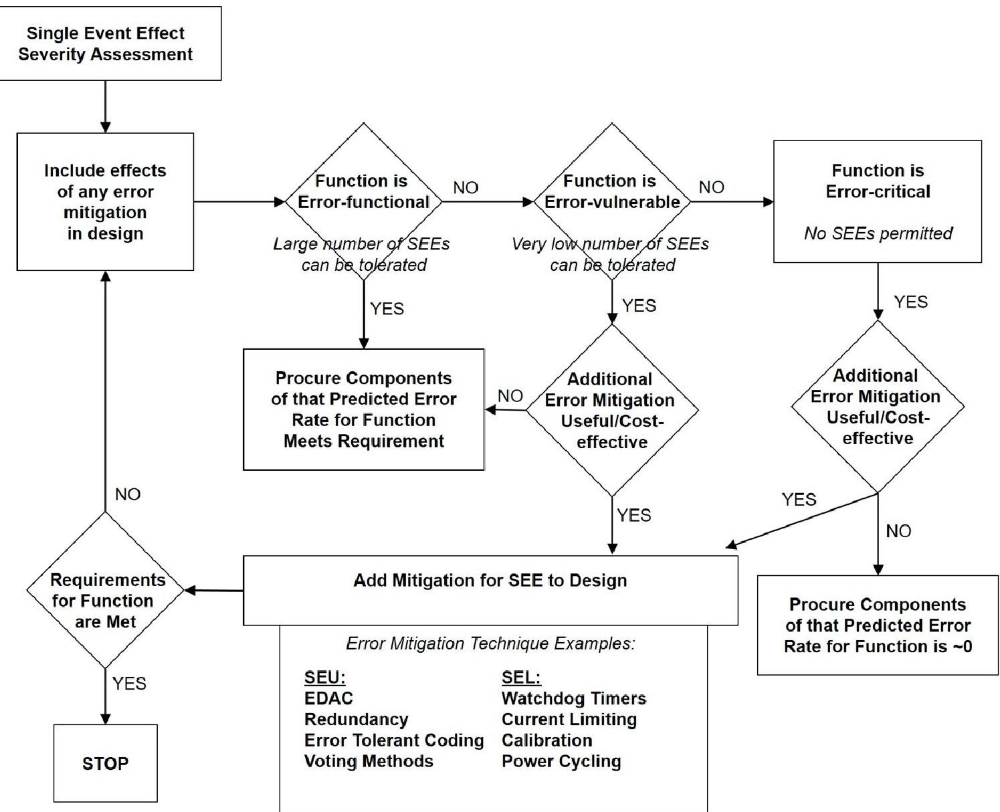

Figure 19. SEE Decision Tree, after [82].

are a particular case of an SEU in a device register that causes a notable mis-behavior of the component. The likelihood of a SEFI depends on the configuration of the component. Additionally, if the component has software, the state of the software running on the component affects the SEFI rate as well.

Single-Event Effects Criticality Analysis (SEECA) is the analysis of SEEs on system performance [82]. The process is an implementation of functional analysis, usually a systems engineering task, for radiation-induced faults. The goal is to determine the effects of SEEs on the functions of the component, sub-system, or system, in order to define the problem and to

<!-- PDF_PAGE: 55 -->

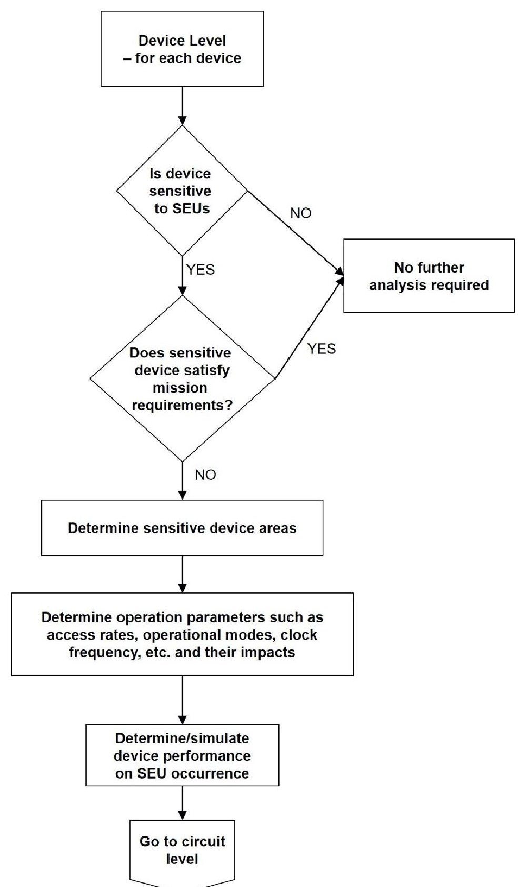

Figure 20. SEU propagation analysis method, after [82].

implement mitigation that minimizes the impact on the system. The first step is recreated from [82] in Figure 19. The goal is to determine the criticality of the functions and what components, sub-systems, or systems implement that function. If the function is error-functional, meaning it

<!-- PDF_PAGE: 56 -->

can tolerate many faults, then components are chosen that have a predicted error rate that is less than the availability requirement for that function. If the function is error-vulnerable or error critical, meaning it can tolerate only a few faults or no faults, respectively, then components and mitigation are chosen to drive the error-rate to zero.

Another process in SEECA is the SEU propagation analysis method recreated in Figure 20. In this case, SEU refers to both bit flips and transients. First, determine if the component is susceptible to SEUs and what the threshold LET is for the SEU. Then, compare that threshold to the highest LET likely to be seen in the environment for the mission duration. If the SEU threshold LET is below the highest expected LET for the mission environment, determine the device sensitive areas. For example, a memory device is susceptible to SEUs in both the memory cells and the control logic, but the level of susceptibility will be different for each. Then the operation parameters are determined. For example, the SEU rate for an SRAM cell increases with decreasing bias voltage. Next, the effect of the SEUs on device performance is determined, usually through circuit simulation. For example, fault injection techniques can be used to determine the effects of SEUs for the software application on a device [81]. Then the SEU effect on the component level is analyzed analogously on the circuit level. For example, an SRAM being used to store data results in a bad data point versus an SRAM being used to store software program instructions results in a SEFI. The consequences are then fed to analyses for sub-systems or systems until the functional impact on the system is determined. Based on the criticality of the function, further mitigation may need to be implemented or a new component chosen in order to lower the error rate.

## Fault Propagation Models in SEAM

SEAM supports the SysML Block Diagram language to capture the system architecture. Within the blocks in the block diagram model that represent components in SEAM, modeling

<!-- PDF_PAGE: 57 -->

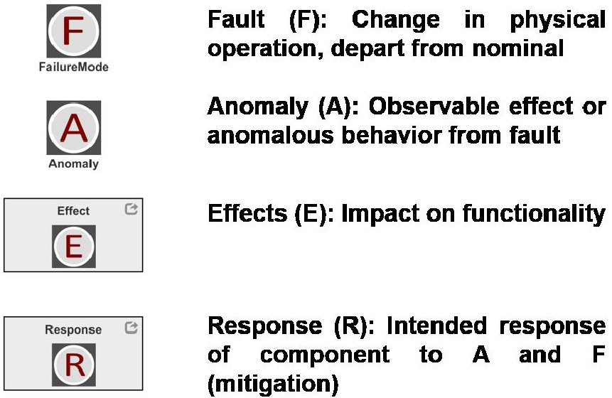

Figure 21. Fault propagation blocks in SEAM.

elements have been added to capture fault propagation models. This novel method is described in [79] and [80]. In the SysML Block Diagram modeling language, the blocks represent components or subsystems, and the ports in the blocks represent the component interfaces. The interconnections between the blocks represent the interaction between the components. The fault propagation models are graphs within the blocks where edges represent the cause-effect relationship for propagating the fault to effects. The nodes for the fault propagation model include Fault nodes (F) that correspond to faults in the component, Anomaly nodes (A) that represent observable deviations from some nominal value, Effect nodes (E) that represent the functional degradation, and Response nodes (R) that describe any mitigation functions. Figure 21 summarizes these blocks. Labeled fault propagation edges to and from the component's interface port describe fault propagation across component boundaries. These labels allow the engineer to determine which faults propagate to which anomalies within the component for faults that originate outside the component. The links between the component ports, which represent the component interactions via energy and information flows, are used to represent the fault propagation paths between components. The energy ports are marked with a P in the fault propagation model and are black

<!-- PDF_PAGE: 58 -->

ports in the block diagram model. The information ports are marked with an S in the fault propagation model and are the green ports in the block diagram model. This radiation-induced fault modeling is based on Temporal Failure Propagation Graphs (TFPG), described in [83] and [84].

For TID, the cumulative dose over time causes parametric changes in components leading to total part failure as reviewed in Chapter II. It can be seen as a degradation mechanism that moves the end of the 'bathtub curve' to the left, shortening the expected life of the component. Depending on the use of the component in the system, parametric changes due to TID can cause system failure. In other cases, a catastrophic component failure might lead to system failure. In addition, the degradation of a component depends on the bias and load of the component in the system. A linear regulator used on the REM experiment board is used to show an example analysis. Some of the listed electrical characteristics on the datasheet for a linear regulator include minimum input voltage, regulated output voltage, line regulation, load regulation, output voltage noise, shutdown

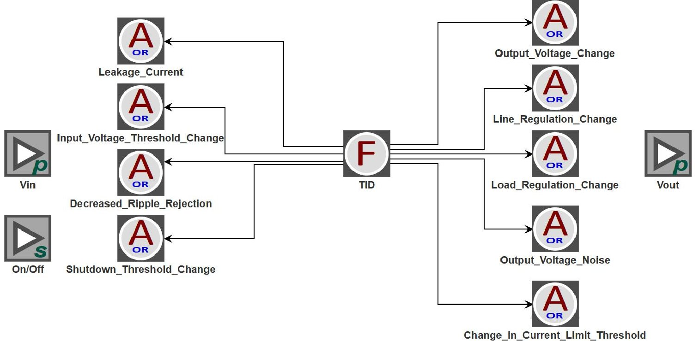

Figure 22. Fault propagation model for linear regulator with all possible anomalies from TID.

<!-- PDF_PAGE: 59 -->

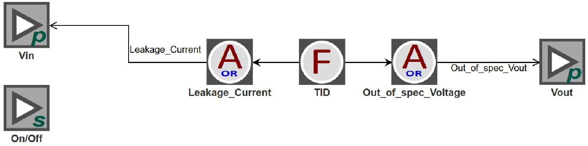

Figure 23. Modified fault propagation model for linear regulator based on component use on the REM experiment board and the results of the TID test.

threshold, ripple rejection, quiescent current, and current limit [85]. These possible anomalies are modeled in Figure 22. The anomalies are not connected to the device ports to ensure that the engineer considers whether each degradation is important to the system performance. These characteristics also depend on the load current and operating temperature of the device, as well. TID could degrade the nine characteristics listed here, and that degradation will change with output load and temperature. Whether the parametric shift will affect the system depends on the component's use in the system.

For the linear regulators on the REM experiment board, the quiescent current and the regulated output voltage were the main parameters of concern. The line regulation and load regulation were not of concern since the input voltage and output load were not expected to change much during the mission. The experiment running on the REM board was not also expected to be sensitive to noise or ripple. These parameters were checked using a visual inspection of the output voltage on an oscilloscope during testing. Since the application circuit did not use logic levels or power bus voltage close to the datasheet limits, the shutdown threshold and minimum input voltage were not precisely measured. Instead, they were checked with a pass-fail test. Lastly, the current limit was not checked because the system was also using a load switch with a lower current limit

<!-- PDF_PAGE: 60 -->

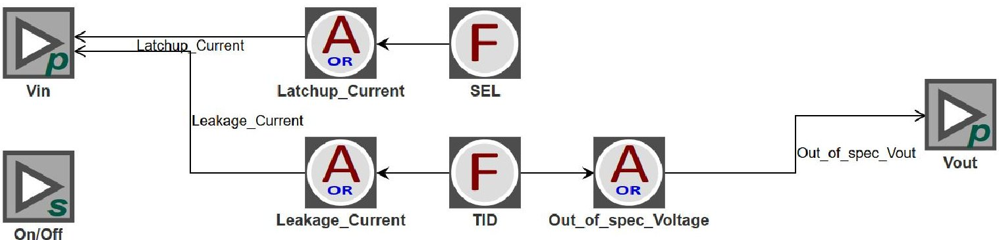

Figure 24. Fault propagation model for linear regulator with SEL.

than the one on the linear regulator. Figure 23 shows the modified fault model. The TID-induced faults originate from the "TID" fault block. The main faults of concern are a change in the output voltage and leakage current. The change in the output voltage is modeled as the anomaly "Out_of_spec_Voltage" and propagates out of the component through the "Vout" port. The anomaly "Leakage_Current," the increase in power supply current, propagates out of the component through the "Vin" port.

The previously described analysis and capture of that analysis in the SEAM fault propagation models is performed for every component in the system. To figure out the radiation induced failure mechanisms that should be considered, resources like R-GENTIC [86] can be used.

For the REM experiment board, the SEEs of concern were SEL and SEFI. SEL testing is expensive, time-consuming, and destructive, so components were assumed to be susceptible to SEL based on prior knowledge of CMOS commercial components. Because the REM experiment board was a constraint-driven, risk-tolerant mission, SEL faults were assumed to be a possibility for every component in the system and mitigated at the system-level. Figure 24 shows the linear regulator fault model with the addition of the SEL fault and anomaly.

<!-- PDF_PAGE: 61 -->

## Quantitative Evaluation of Radiation Induced Fault Consequences

One of the challenges of estimating the reliability of a system is determining when faults lead to an observable failure that results in the loss of a function. Space-based systems are impacted by thermal, shock, and vacuum environments in addition to radiation. These faults are not independent, and quantifying the interaction is challenging. Two methods for quantifying the consequences of radiation-induced faults are presented. Both of these methods, Bayesian networks (BN) and fault trees (FT), are graph structures. SEAM fault propagation models are used to generate these structures. The quantification and calculation of those nodes and graphs is a continuing area of research.

## Bayesian Net Analysis

Bayesian networks (BN) are directed graphs that model the conditional probabilities of random variables. For space-based systems, BNs are interesting for determining the effect of the radiation environment on a system because the different types of radiation effects are not necessarily independent. For example, TID can increase the SEE rate for a component. In the case of the REM experiment board, a BN is used to show the interaction of three environment conditions:

1. TID-induced faults will increase over the mission life

2. The SEL rate will depend on whether the satellite is in the SAA.

3. The SEL rate will probably increase with TID

In [79], a BN is constructed for the REM experiment board from the SEAM model and used to perform a sensitivity analysis. Using the SEAM models to construct the directed graph of the BN is presented here. The population of conditional probabilities for the nodes is a continuing area of research.

<!-- PDF_PAGE: 62 -->

The nodes and edges in the BN structure are identified by traversing all the fault paths in the SEAM fault propagation model. The structure is refined by grouping the radiation-induced faults of TID and SEL in each component in top-level environment nodes. Also, wherever possible, anomalies, degradation, and mitigation responses are abstracted into component nodes whose states correspond to the health of the component or functionality of the component. The graph is further simplified based on expert knowledge.

Figure 25 shows the refined BN for the REM experiment board. Top-level nodes are introduced to capture the mission-operation time as well as the mission environment. These nodes influence the nodes related to radiation effects (TID, SEL). The states of these nodes represent the

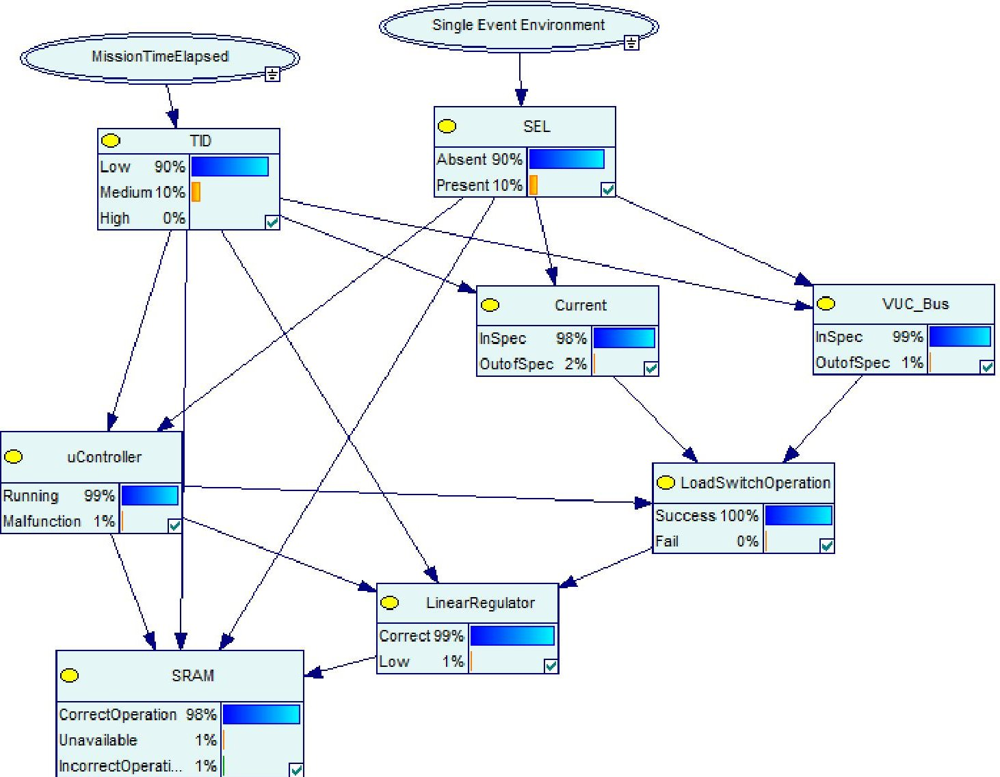

Figure 25. BN model for the REM experiment board, after [79].

<!-- PDF_PAGE: 63 -->

probability of the presence of a fault (SEL) or the strength of the radiation-induced degradation (TID). Additionally, because of the orbit of the REM experiment boards, the SEL rate is affected by the location of the experiment in its orbit: whether the satellite is over the SAA.

The nodes bearing the component names, LoadSwitch, Microcontroller, LinearRegulator, and SRAM, reflect the health and performance of these components. The states in these nodes correspond to the correct or incorrect functioning of the component. In the case of the SRAM, the "correct operation" and "incorrect operation" states represent whether the SRAM experiment correctly ran the SEU experiment for a five-minute exposure. The "unavailable" state represents the cases when SRAM is not available for operation because of a system reset related to mitigation or malfunctioning of other components. Details on using the BN to perform a sensitivity analysis are published in [79].

The BN evaluates the impact of the radiation environment on the performance (availability and correctness) of the REM experiment board. It assesses the performance degradation of individual components in the context of the radiation environment as well as the impact of degradation of other components. For instance, the SRAM correctness and availability for the mission experiment depend on the radiation level and performance of the microcontroller and the linear regulator.

## Fault Tree Analysis

Fault tree analysis (FTA) is when an undesirable state for the system, a failure, is analyzed to find all the ways that the failure can occur [87]. The tree structure that is created during the analysis shows the logical relationships of how the steps to the failure occur, including events that need to happen in sequence or parallel. In [88], FTA is performed on a CubeSat flight computer that results in an estimated lifetime for the board for a space environment. The failure of the flight

<!-- PDF_PAGE: 64 -->

computer board is the top-level failure. Nine different failures are identified that can cause the board to fail: FPGA failure, passive component failure, PCB thermal failure, programming circuitry failure, supervisory circuit failure, timing reference failure, memory failure, I/O failure, and power regulation failure. Then each of these nine failures is further analyzed. After this analysis, the board failure is plotted as unreliability vs. time. The author acknowledges that the paper does not cover different radiation mitigation strategies or how to model them [88]. This dissertation addresses how to model mitigation strategies that can be incorporated into FTA in Chapter V.

In [80], a general method to automatically generate FTs from the functional decomposition and fault propagation models embedded in SysML block diagram models was presented. The method for creating radiation-induced fault propagation models was described previously in this

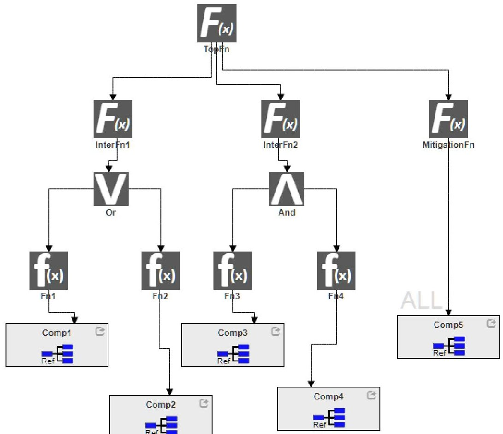

Figure 26. Generic functional decomposition model used to generate fault tree, after [80].

<!-- PDF_PAGE: 65 -->

chapter. The REM experiment board was used to demonstrate the possible impact of radiation induced faults in components on the functionality of the board.

First, the functional decomposition model is used to generate the top of the fault tree. Each function is translated into a "Lost Function" intermediate or top event in the fault tree. Then AND nodes in the functional decomposition model are translated into OR gates in the fault tree and vice versa. The component nodes at the bottom of the functional decomposition model are translated into basic events called "Lost Component." Figure 26 shows a generic functional decomposition on the top, and that diagram translated to a fault tree in Figure 27.

The next step involves updating the fault tree based on the information contained in the SysML model and the underlying fault propagation model. For each component that contains at least one fault, the "Lost Component" basic event in the fault is converted to an intermediate event. For each fault, a basic event is added to the fault tree. For each "Lost Component" event, the

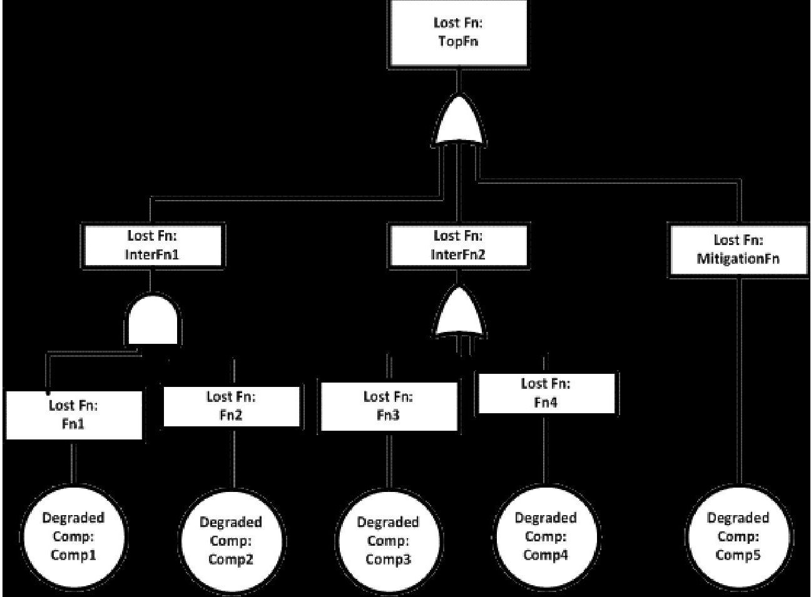

Figure 27. Fault tree automatically generated from Figure 26, after [80].

<!-- PDF_PAGE: 66 -->

underlying fault events are connected through an "AND" logic gate, unless the fault model indicates that the faults are connected through an "OR" anomaly. Then the fault tree is updated by traversing from each fault and following the rules below. Figure 28 shows the result in red.

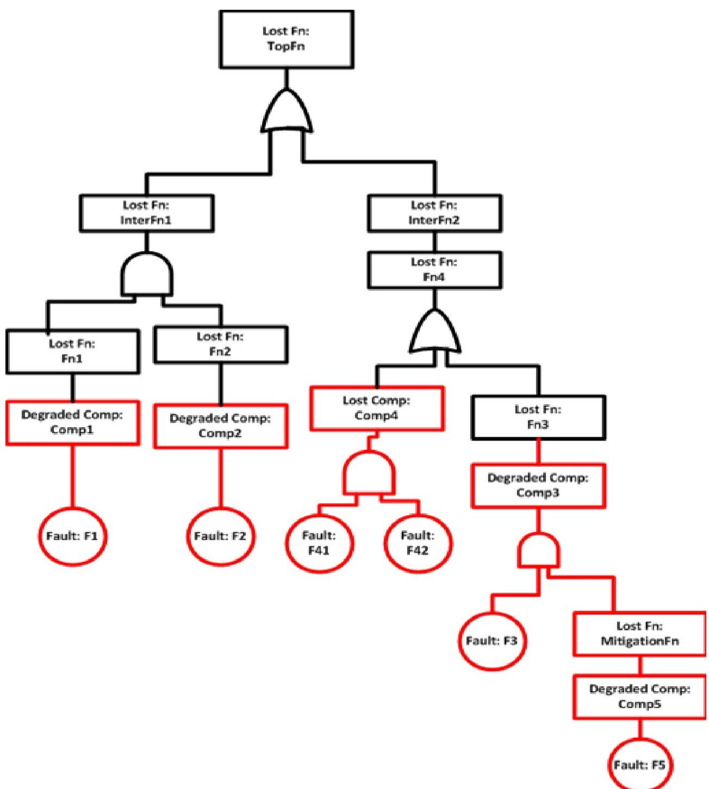

Figure 28. Auto-generated fault tree including component fault propagation, after [80].

<!-- PDF_PAGE: 67 -->

- For each anomaly (AND/OR) encountered in the path, add a corresponding logic gate (AND/OR) to the fault tree

- For each effect node encountered in the path, ensure that there is a corresponding logic relationship between the fault event and the "Lost Function" event in the fault tree

- For each response node encountered in the path, ensure that the fault event does not lead to "Lost Function" events until the mitigation function is also lost

- Eliminate any AND logic gates that have only one input

- Eliminate any OR logic gates that connect to other logic gates and not to basic or intermediate events

Figure 29 shows the fault tree generated for the REM experiment board. The redacted branches of the tree, for readability, are notated with dotted lines below the node. The functions in the functional decomposition models are now lost function (LF) events in the fault tree. The

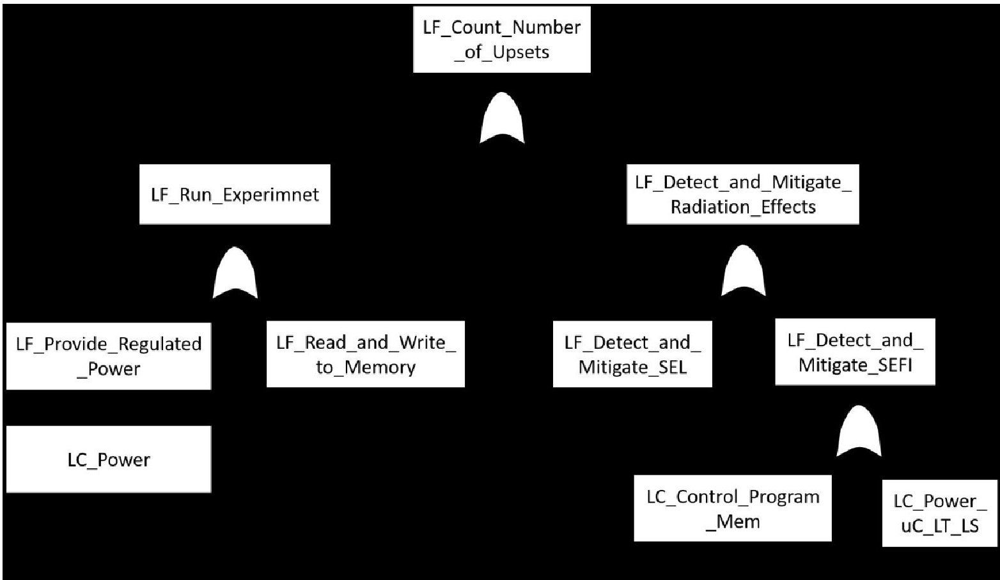

Figure 29. Top of the fault tree auto-generated for the REM experiment board, after [80].

<!-- PDF_PAGE: 68 -->

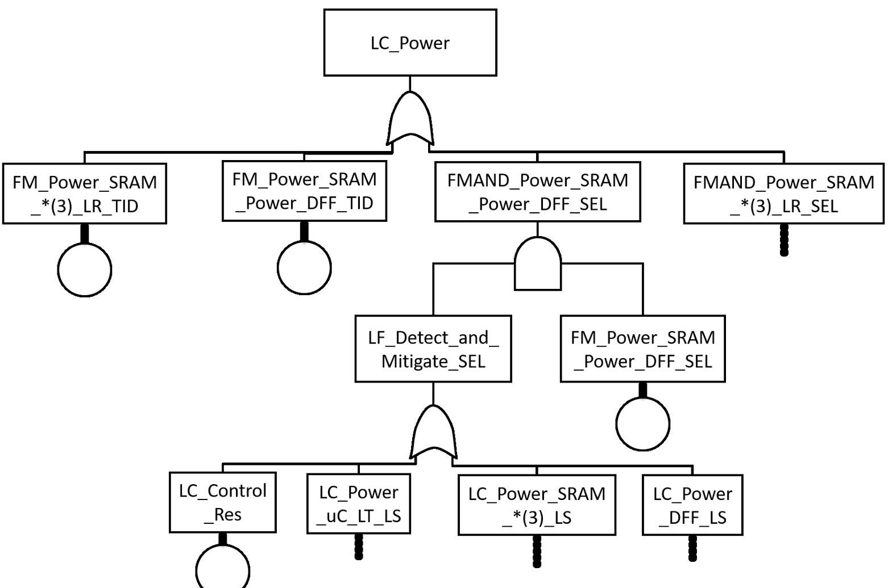

Figure 30. LC_Power auto-generated FT. The dotted lines indicate more nodes below, after [80].

components in the SysML models are now the lost component (LC) events. In the fault propagation models, components can either be lost by a TID-induced fault or an SEL-induced fault. Fault tree events with a circle below are basic events. The basic events are where the probabilities of failure, like the ones described in Chapter III, can be included. "FMAND" nodes are AND connectors between basic events and the loss of a corresponding mitigation strategy. This AND combination reduces the probability of the higher-level event. In the REM experiment, this is demonstrated in the SEL failure mode. The load switches implement the mitigate SEL functionality. For a SEL fault to cause a higher-level loss of function or component, such as "LC_Power," both the SEL fault "FM_POWER_SRAM_DFF_SEL" has to occur and the "Detect and Mitigate" function has to be lost, as shown in Figure 30. The probability of loss of the load switch is designed to be very

<!-- PDF_PAGE: 69 -->

low through part selection, and so the combined probability, the product of the probability of an SEL fault and the probability of failure of the load switch, would decrease the loss of component probability.

## Conclusions

Evaluating the consequences of radiation-induced faults is one of the most challenging aspects of RHA because of the amount of information need about the system and the mission. Capturing the evaluation of consequences in a modeling environment helps keep track of the information and can lead to some automated analysis. Risk management, including mitigation strategies, are discussed in more detail in Chapter V.

When mitigation strategies can be represented in fault propagation models, the automated fault tree generation provides a means to analyze the effectiveness of the mitigation in terms of the functionality of the board. The effect of applying the mitigation strategy will be reflected in the lower probabilities associated with the corresponding fault that is mitigated. In the case that the mitigation strategy does not cover every fault path, this would also be brought out in the FTA.

<!-- PDF_PAGE: 70 -->

## CHAPTER V

## MODEL-BASED RISK MANAGEMENT FOR RADIATION-INDUCED FAULTS

After the possible risks are assessed and analyzed, then the activities related to risk management take place. These activities reduce the possible faults, the likelihood of the faults, and the consequences of the faults within the constraints of the system. These constraints may be time, money, or personnel in addition to functional and performance requirements for the system. One measure of risk management is calculating the "ilities": survivability, availability, criticality, and reliability for components, sub-systems, and systems. Reliability is the probability that a component will accomplish a function within the specified time in a specific environment [6]. Changes to the component, time frame, and environment will change the reliability, which will be reflected in the relationship between probability and time. Risk management requires knowledge of the system, including changes to mission parameters and system design. Missions that use model-based mission assurance (MBMA) enable closer integration of system design and design analysis to improve risk management.

NASA's Office of Safety and Mission Assurance (OSMA) created the NASA Reliability & Maintainability (R&M) hierarchy to require that reliability and maintainability activities and decisions for a mission be presented in a graphical format [89]. In addition to simplifying the evaluation of system reliability, the R&M hierarchy accommodates reliability evaluation of systems developed within the Model-based System Engineering (MBSE) paradigm. MBSE is the application of models to support activities related to system requirements, design, analysis, verification, and validation through the entire life-cycle of a system [90]. The R&M hierarchy

<!-- PDF_PAGE: 71 -->

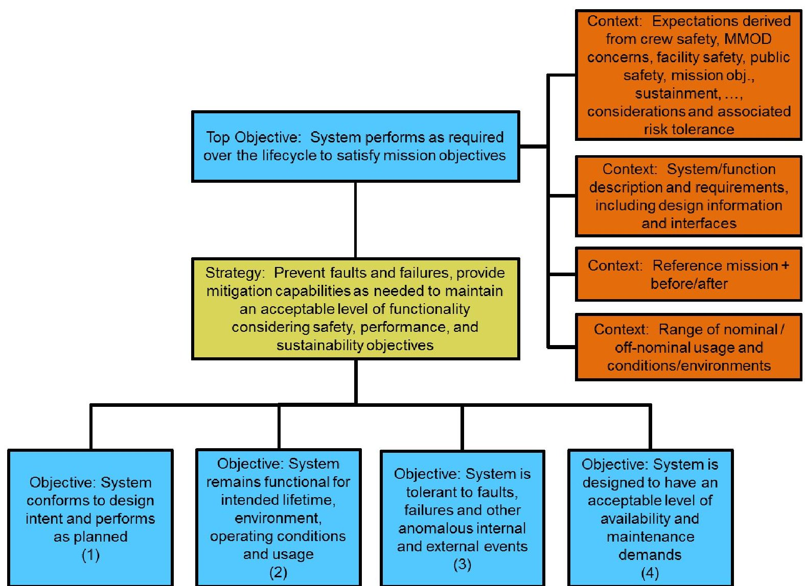

Figure 31. Reliability and Maintainability Hierarchy from NASA-STD-8729.1A [91].

became the Reliability and Maintainability standard (NASA-STD-8729.1A) for NASA in 2017 [91], and the top of the hierarchy from Appendix A of the standard is shown in Figure 31.

In response to increased expectations on the capabilities of CubeSats, the small satellite community has started to apply system engineering best practices to the CubeSat platform. The International Council on Systems Engineering (INCOSE) Space Systems Working Group (SSWG) has been investigating the applicability of MBSE to the CubeSat platform since 2011 with the goal of creating a CubeSat Reference Model. Their progress can be seen in [92]. Additionally, NASA is applying MBSE to missions of all classifications, including Mars 2020, Europa Clipper, and Soil Moisture Active Passive (SMAP). Motivations for using MBSE include improving the quality

<!-- PDF_PAGE: 72 -->

of communication among development teams for systems and subsystems with the ultimate goal of reducing failures [93].

A common issue for radiation effects engineers is that evaluating the effectiveness of system-level mitigation schemes on component-level failure rates is difficult and not part of the traditional RHA methodology. For example, it is possible to detect and recover from an SEL event with appropriate current sense and limiting circuitry. The reliability of the circuit with SEL mitigation is greater than the reliability of the SEL-sensitive component. The reliability of the circuit with the additional part to implement mitigation is probably greater than the worst-case system failure rate. The worst-case rate is calculated by adding the failure rates of each component in the circuit together, as prescribed in Appendix A of MIL-HDBK-217F, a standard method for estimating a system failure rate [94].

This chapter will first go over some of the typical radiation mitigation strategies for risk-tolerant missions and how arguments for these mitigation strategies can be made in a model-based paradigm using SEAM. The second section reviews how a model-based mission assurance (MBMA) paradigm can improve the evaluation of risk mitigation. An example is given for an SEB requirement and how it could be implemented over the lifecycle of the project.

## Mitigation of Risks From Radiation Effects

First, an approach called "Careful COTS" is presented that was implemented during the REM experiment board design process. Then a closer look at mitigation strategies for microcontrollers is described. The mitigation strategies are then modeled in SEAM using the guidelines for fault propagation models described in Chapter IV. Lastly, redundancy as a mitigation strategy is presented, and the probability of failure calculations for two different implementations of redundancy are given.

<!-- PDF_PAGE: 73 -->

## Careful COTS

In [95], the authors present a "Careful COTS" approach to using COTS for sub-class D and CubeSat missions. This approach was the basis for the RHA plan the Vanderbilt CubeSat experiments. Arguments for some of these strategies are presented in the next section of the chapter. The strategies are listed below.

- Screen candidate components by performing TID testing to 30 krads $ \mathrm{(S i O_{2})} $

- Use the lowest supply voltage to decrease the SEL rates for components

- Use series resistors to limit current between pins where there could be bus contention

- Implement current and thermal limiting on power buses

- Use BJT for power devices; if MOSFET needed, use P-channel

- Derate the drain voltages of power transistors

- Avoid components with charge pumps

- Check that for components that are reconfigurable; that if they are misconfigured by a SEFI, they do not damage the rest of the board

- Do not power components when they are not being used

## Single-Event Effect System Mitigation for Microcontrollers

One of the main focus areas for mitigation of radiation effects for risk-tolerant missions is mitigation related to microcontrollers and microprocessors. COTS microcontrollers are assumed to exhibit SEL, SEFI, and SEU. In order to maintain a robust system, the following strategies are commonly deployed.

<!-- PDF_PAGE: 74 -->

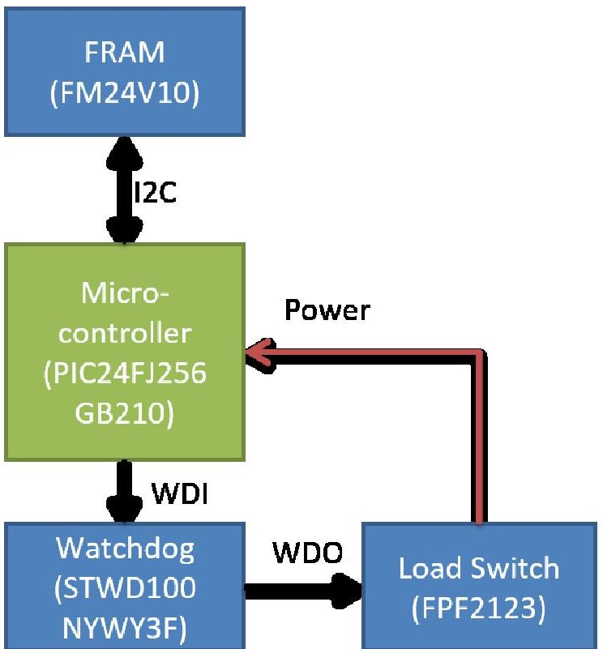

Figure 32. Simplified block diagram of single-event latchup and single-event functional interrupt mitigation scheme for the microcontroller, after [21].

1. A hardware watchdog timer to automatically reset power to the board if it becomes unresponsive

2. An external nonvolatile memory not sensitive to radiation effects, like an FRAM, to store critical data

3. Programing of the microcontroller software to reduce the impact of corrupt data

A simplified block diagram of the hardware mitigation scheme for SEFIs in the microcontroller is shown in Figure 32. The assumption of this hardware scheme is that SEFIs in the microcontroller will cause the signal going to the watchdog timer (WDT), WDI, to stop. When the watchdog timer does not receive a toggle for a set amount of time, the output, WDO, is pulled low. WDO is the ON signal to the load switch. When WDO is low, the load switch shuts off power for a set amount of time and then turns back on. The microcontroller then starts up and loads its

<!-- PDF_PAGE: 75 -->

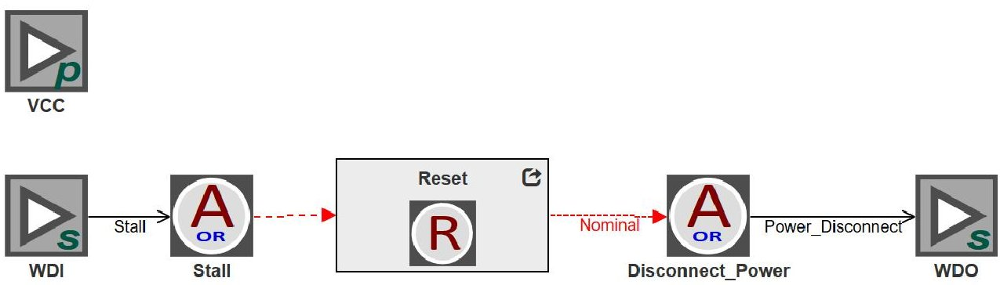

Figure 33. WDT fault propagation model for mitigation of SEFI.

configuration from the FRAM. This clears the upsets in the microcontroller that caused the SEFI. Watchdog timers can be implemented in software as well. The watchdog listens for a "heartbeat" signal from a component, sub-system, or system. If it does not hear the signal, then the system is reset. This technique does not reduce the number of single-event functional interrupts (SEFI), often the cause of the "heartbeat" signal being lost, that occur in the component. However, WDT will limit the duration of a SEFI impact and improve the availability of the system.

The WDT fault model in Figure 33 shows the mitigation of SEFI, which causes anomalies in the microcontroller. The red arrows indicate propagation related to response nodes which are used to model mitigation. When the anomaly, modeled here as a stall in the program, is detected by the watchdog timer, it resets the system. Then the microcontroller is reloaded from a FRAM that is immune to radiation effects, as modeled in Figure 34. The "Reset" and "Reload_uC"

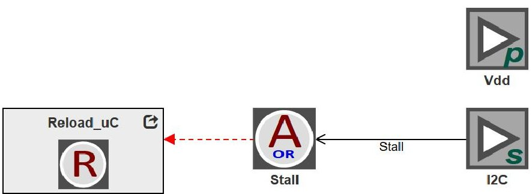

Figure 34. FRAM fault propagation model for mitigation of SEFI.

<!-- PDF_PAGE: 76 -->

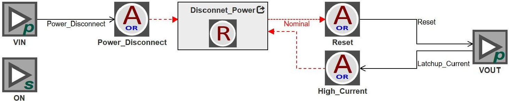

Figure 35. Load Switch fault propagation model for mitigation of SEFI and SEL.

responses are linked to functions in the functional decomposition model.

When writing the software for the microcontroller, global variables and static data were avoided. Instead, the external FRAM stored the variables and data. Another software mitigation scheme implemented was that prior to a peripheral's use, such as the I2C peripheral, all related control registers were re-written to appropriate values. The assumption was that control registers not immediately used could be affected by SEUs. These hardening schemes and other SEE considerations can be found in [96].

Load switches were used on every power bus to detect and mitigate SEL. The resulting fault model can be seen in Figure 35. When the sense terminals detect latchup current, the load switch disconnects the power. This response is linked to the mitigation function in the functional decomposition diagram. The reliability of these schemes will be dependent on how much is known about the SEL characteristics of the component and how many components are on the same current sensing and reset circuitry. The current sense level needs to be set above the max operating current of the component with some room for current leakage from TID over the mission. But setting this limit significantly higher could prevent the detection of SEL or increase the latent damage during an SEL. These trade-offs are part of the risk mitigation process.

<!-- PDF_PAGE: 77 -->

Redundancy

Redundancy is a commonly suggested mitigation scheme, but the effectiveness depends on the type of error being mitigated, how the redundancy is implemented, and the inherent reliability of the system or component before the redundancy is implemented. One redundancy method described in [96] uses a voting scheme for lockstep systems. Faults that occur only in one system are outvoted by the other two systems in a triple modular redundancy (TMR) scheme. The two effects that this scheme focuses on mitigating are SEUs and SEFIs, usually in processors and FPGAs. The reliability of a TMR scheme, as described in [97], is calculated using Equation 7, where $ \mathrm{R_{M}} $ is the reliability of a single module. Further considerations for the reliability of TMR circuits can be found in [98] for SEE reliability of airplane avionics computers.

$$
R = 3 R _ {M} ^ {2} - 2 R _ {M} ^ {3}
$$

Another way to increase the reliability of components susceptible to destructive effects, like SEB for the SiC MOSFET described in Chapter III, would be to implement redundant systems. By adding one or two additional systems in parallel, the probability of failure is raised to the power of the number of systems in parallel, reducing the probability of failure. Parallel systems are systems that, when one fails, the other system(s) are not affected, meaning the system fails in an "open" configuration, not a "short" configuration. For example, in a CubeSat constellation, a mission objective could be fulfilled by multiple identical satellites. If one, two, or three satellites are redundantly used to implement a function for the system, the redundancy increases the reliability of the overall constellation. Assuming that the SiC power MOSFET's reliability was the lowest in the satellite and dominated the overall system reliability, Figure 36 shows how redundancy increased the probability of success for the different derated voltages for a 1-year GEO mission with 200 mils of aluminum shielding. If the reliability of the component is close to zero,

<!-- PDF_PAGE: 78 -->

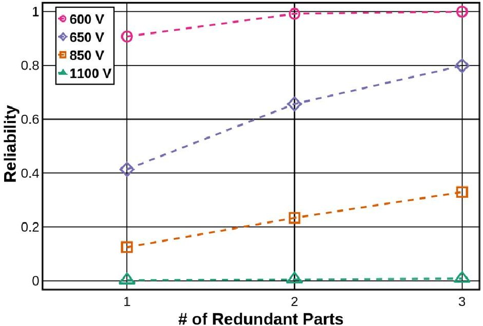

Figure 36. Reliability of parts for a 1-year GEO mission behind 200 mils of Al shielding. Redundancy is implemented in a parallel configuration, after [70].

like the case of when the operating voltage is 1100 V, redundancy does not improve the reliability of the system. For the opposite extreme, like the case of when the operating voltage is 600 V, if the reliability is high, the increase in system reliability with redundancy is also not noticeable. The most significant improvements in reliability from redundancy comes from components where the reliability of the component is low (less than 50%) but not zero. By using a probability of failure to describe the susceptibility of the MOSFET to SEB this type of redundancy calculation is enabled, which would not be possible when using a design margin.

## Evaluating Mitigation Options and Tradeoffs for Radiation Effects

An overview of GSN and the NASA R&M Standard are provided, and then the use of GSN throughout the NASA project life-cycle is provided to demonstrate MBMA.

<!-- PDF_PAGE: 79 -->

## Goal Structuring Notation

Goal Structuring Notation (GSN) is a graphical notation standard used to document an assurance case [99], updated in [100]. An assurance case is a reasoned and compelling argument supported by evidence that a system will operate as intended for a given, defined environment. An argument is a connected series of claims that support an overall claim. Assurance cases, and by extension, a GSN model, are only means of documenting an argument and do not establish the truth of the argument. Acceptance of the case requires the argument to be reviewed by stakeholders of the system. GSN provides a way of documenting the assurance case that allows others to discuss, challenge, and review. GSN was created at the University of York in the 1990s and has been used in a variety of safety and security assurance cases [101], [102]. In Figure 37, the different types of elements in a GSN model are described.

GSN provides a structure to indicate how claims are supported by sub-claims. These claims in GSN are represented as goals. An example goal is "Part is not susceptible to SEB." A sub-claim, or child goal, is "Probability of failure from SEB is less than 1%." The goal for the reliability of the electronic components to not experience an SEB-induced failure supports the claim that the part is not susceptible to SEB. The assertion of evidence to support the truth of a goal is represented by a solution. An example solution is "The probability of failure from SEB is 2%." The stakeholders reviewing the assurance case would then decide if the probability of failure of 2% is evidence enough to support the goal of "Part is not susceptible to SEB." When documenting the reasoning between goals and child-goals, strategy elements are used. An example strategy is "Determine part susceptibility to SEB," which provides the task that specifies why the parent goal "Part is not susceptible to SEB" is completed by the child goal "Probability of failure from SEB is less than 1%." Goals, strategies, and solutions make up the base of the GSN structure and are

<!-- PDF_PAGE: 80 -->

connected with solid arrows and indicate inferential and evidential relationships. In summary, goals and strategies are alternately refined until the goal is specific enough to be supported by a solution element that links to the results of components tests, system tests, simulations and analysis, or literature review.

An assurance case is made for a system in a specific mission environment. For a space mission, the environment can include radiation, thermal profile, budget, and development time. There are several ways in GSN to show how the environment interacts with the assurance case. The first way is with a context element that provides information on how a goal or strategy should be interpreted. An example context is "Radiation environment for mission," which provides information for the goal "System remains functional for the intended radiation environment." Details about the radiation environment are needed to ensure the system functionality system will not be compromised.

The second way of indicating the effect of the environment on the argument is through assumption elements. Assumptions are premises that need to be true in order for the goal or strategies to be valid. For example, the assumption "A SEFI in the microcontroller will cause it to stop sending the watchdog timer signal" is an assumption for the strategy "Implement detection and reset of a SEFI in the microcontroller using a watchdog timer." There are cases when a SEFI would not stop the watchdog timer signal. It is up to the stakeholders to determine if that assumption is acceptable for the mission. Assumptions are valid for all the child strategies and goals further down the evidential path from the point where the strategy or goal the assumption first appears.

<!-- PDF_PAGE: 81 -->

The last way of indicating the effect of the environment on the argument is through a justification element. Justifications explain why a goal or strategy is acceptable. For example, the justification "Heavy-ion SEL tests were not performed because the heavy-ion environment does not significantly contribute to the radiation environment" is an explanation for the strategy "Perform proton SEL characterization tests on system parts." A reviewer might ask why heavy-ion SEL testing was not completed as it is a part of standard RHA activities. The justification box explicitly states the reasoning for that decision. Assumptions, justifications, and context are connected to goals, strategies, and solutions with dotted arrows to indicate contextual relationships. In summary, assumptions, justifications, and context about the argument are linked to appropriate

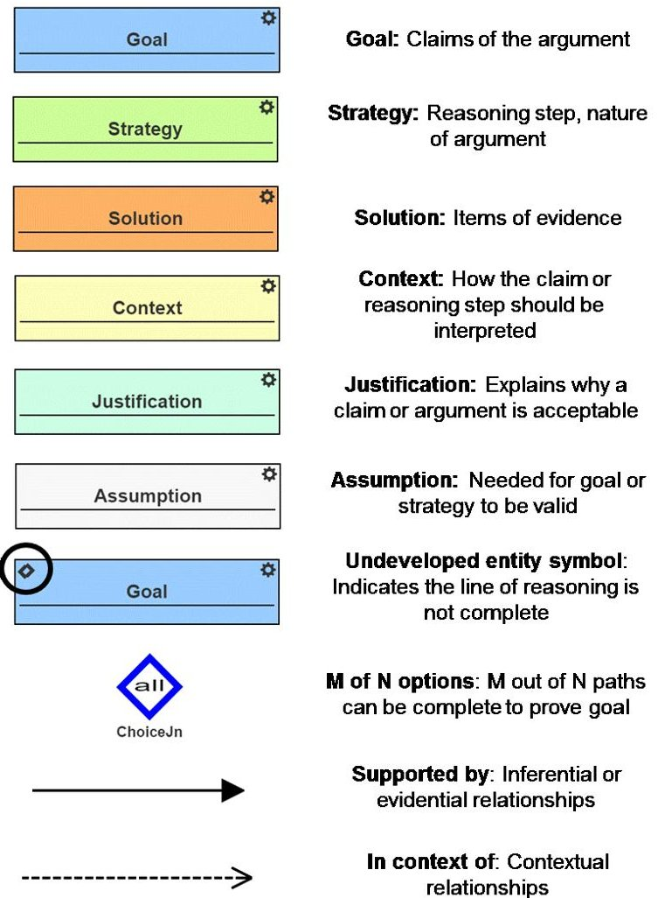

Figure 37. Elements of GSN.

<!-- PDF_PAGE: 82 -->

strategies or goals to clarify the assurance case. In Figure 37 summarizes all of the elements of GSN.

During the development of the model, an undeveloped element symbol indicates incomplete lines of reasoning. This indicates that the goal or strategy is not fully supported. For example, if a test has not been completed for a goal, then the evidence is undeveloped. During development, or for argument templates, multiple ways of making an argument can be notated by using the M of N options connector. For example, in Figure 38, a component can be considered SEL immune by either performing radiation tests to the level required by the radiation environment or by applying knowledge regarding the process technology. Either of these solutions would support the goal of a component being SEL immune. These elements are tools for the engineers to use during development and when creating a high-level template for other engineers to use.

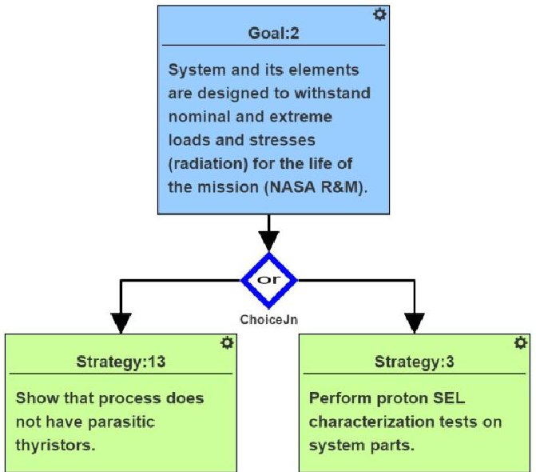

Figure 38. M of N options

<!-- PDF_PAGE: 83 -->

## NASA's Reliability and Maintainability Hierarchy

NASA's OSMA chose the GSN standard to create the NASA R&M Hierarchy that defines the top-level goals and strategies for building an R&M plan. The GSN assurance case presented here builds upon the R&M hierarchy to specify the RHA plan for a risk-tolerant mission. Figure 31 shows the top-level of the R&M hierarchy. In this hierarchy, objectives are used instead of goals and state the technical goals of the project. Strategies facilitate the accomplishment of the objective. These two blocks are used in an alternating hierarchical fashion to create a template broad enough to apply to a wide range of projects and disciplines.

## Application of MBMA Throughout the Project Lifecycle

The end work product for a radiation effects engineer is the approved parts list. This list includes all the components in the system and whether they will survive the expected radiation environment. An example of what this list looks like during a design review given in Table 5. The process that results in that approved part list, the RHA process, requires knowledge about the system design, radiation environment, radiation testing, and reliability calculations. For example, the system design determines the components in the system and whether mitigation techniques are possible. The previous section of this chapter describes several radiation mitigation strategies. All these approaches require information about the system and design at multiple points in the project

Table 5. Example Approved Part List

<table border="1"><tr><td>Part</td><td>Status</td><td>Comment</td></tr><tr><td>Microcontroller</td><td>Passed with comments</td><td>SEFI and SEL circuit mitigation</td></tr><tr><td>SiC power MOSFET</td><td>Passed with comments</td><td>Probability of failure of 2% at derating of 50% with 100 mils Al shielding</td></tr><tr><td>FRAM</td><td>Passed</td><td></td></tr></table>

<!-- PDF_PAGE: 84 -->

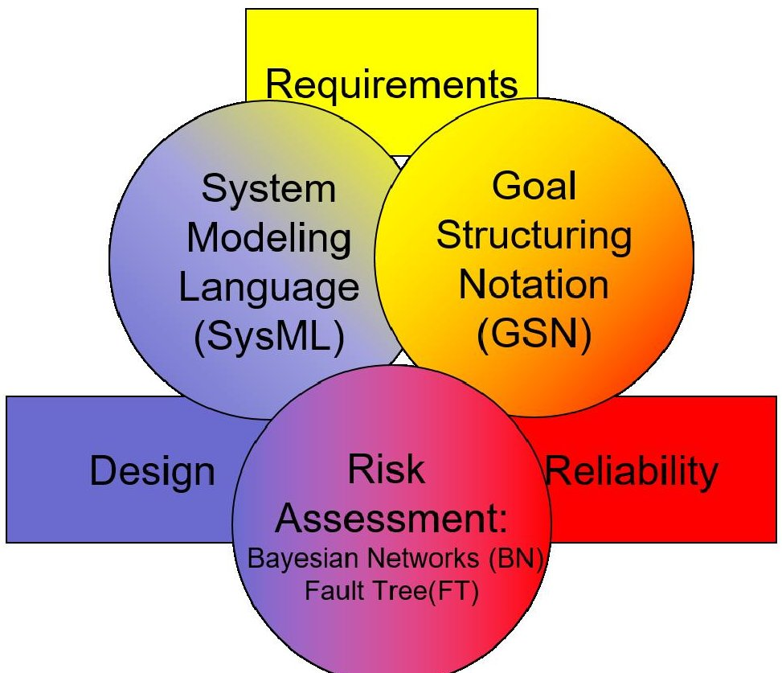

Figure 39. Model-Based Mission Assurance process diagram. The modeling languages in the circles connect the engineering disciplines in the rectangles and enable an integrated modeling approach to RHA.

lifecycle. For example, the radiation environment partially determines the pass/fail levels for the components. The radiation tests provide information on how the components will respond in the radiation environment. These tests are often also specific to the component's use in the system and provide additional information on the pass/fail level for the component. The reliability calculations include information about the risk tolerance of the mission. None of this information, analysis, and linkage is captured well in a document-based system. Additionally, this information is added to, built upon, and changed over the life-cycle of a project.

Model-based Mission Assurance (MBMA) can improve the tracking and analysis required for the RHA process. Figure 39 shows the MBMA elements and analyses implement on SEAM. This section presents a method for using SEAM to capture information about the system and design in order to make explicit assumptions and justifications for the RHA activities throughout the

<!-- PDF_PAGE: 85 -->

project lifecycle. One of the steps of risk assessment is determining the consequence of faults. This can only be done with knowledge of the system's functions and which components play a role in accomplishing a function. In the case of the REM experiment board, it needs to reliably count and report the number of upsets in the SRAM. This objective forms the top-level function for the functional decomposition. This function is divided into three main sub-functions, and two of them are further divided:

- Communicate with SRAM

Power SRAM

Run experiment exposure

- Communicate telemetry to VUC

- Recover from anomalies

Recover from SEFIs

Recover from SELs

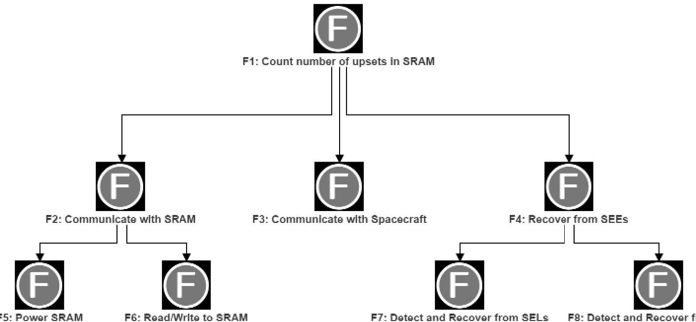

Figure 40. Functional decomposition of the mission objective, after [23].

<!-- PDF_PAGE: 86 -->

Looking at these functions from a SEECA approach, the time between resets of the REM boards needs to be more than the expected time between SEUs for the SRAM in order to be able to run the experiment. It was determined that the top-level objective is error-functional as defined in the SEECA method. This type of functional decomposition for a larger project would be done early in the life-cycle by the system engineers. Figure 40 captures the decomposition as it would appear in SEAM, specifically for the REM experiment board.

As the system is further specified and designed throughout the project life-cycle, this information informs the RHA process. For a project using MBSE, the system design can be captured in a SysML block diagram model. For the REM experiment, the board is divided into five functional blocks: power, control, logic translation, the SRAM, and the bus with the VUC. For larger systems, the experiment would be a block, possibly one of several experiments that would be linked with satellite power, communication, and attitude and control. Information captured with these blocks that are useful to the RHA process includes power levels, communication interfaces, and signal and power flow.

Chapter IV presented the method for capturing radiation-induced faults in SEAM. Capturing this information within the system model enables the radiation-effects engineer to understand the consequences of faults. Additionally, the system model provides information about the component’s use in the system, which ensures that radiation tests of components are for the component’s use in the system.

As the system is designed, SEAM enables the linking of artifacts of one model-type to another. For example, components in the SysML model can be linked to the functional decomposition to show which components accomplish which functions. When developing the fault propagation models, the response and effect blocks are linked to the function model to show the

<!-- PDF_PAGE: 87 -->

consequences of faults. The GSN models can link to artifacts from the functional decomposition and the SysML model to show what part of the system design the argument is addressing. Coverage checks implanted in SEAM summarize these links.

To demonstrate this process, the derivation and verification of an SEB requirement is modeled throughout the NASA project life-cycle. The requirement is, "The probability of failure from SEB shall be less than 1%." This requirement will drive design and test decisions and needs to be verified. The final product of the RHA activities may be summarized in an approved parts list like Table 5, where the result is "Probability of failure of 2% at derating of 50% with current shielding," but by using SEAM and GSN, all of the activities, results, assumptions, and justifications are captured.

Figure 41 shows the NASA Life-Cycle Phases from [103] and added in red are the RHA activities. These activities mainly occur before the Preliminary Design Review (PDR) and Critical Design Review (CDR), also known as the Formulation phase. The GSN argument captures the activities in red. During the formulation phase, the system and mission design might change to

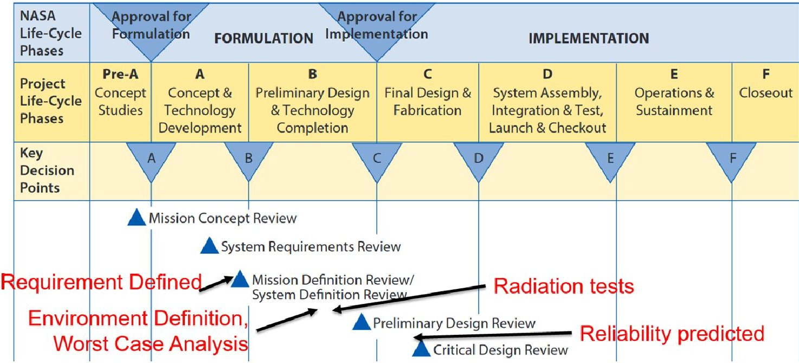

Figure 41. NASA Life-Cycle Phases from [103] with RHA activities added in red.

<!-- PDF_PAGE: 88 -->

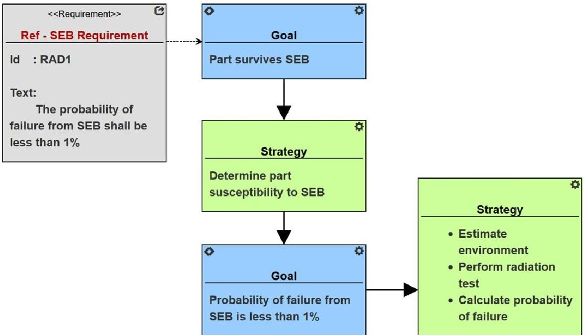

Figure 42. GSN at the beginning of Phase B.

account for issues discovered during the design process. The RHA activities might have to be revisited or even re-done as these changes occur. When the RHA activities are linked with the system model, SEAM can keep track of when these changes happen and to notify when arguments may no longer be valid.

At the beginning of Phase B, generic goals are generated for the GSN argument from part assurance templates and provide a framework for planning RHA activities. For example, the requirement RAD1 in Figure 42 implies that there is a goal that the components in the system survive SEB. In order to meet that goal, the components in the system that are susceptible to SEB need to be identified. Then their probability of failure needs to be calculated. In order to make these calculations, the mission environment needs to be estimated, radiation tests need to be found or performed, and then the susceptibility of the component can be evaluated by calculating a probability of failure. These activities will happen throughout Phase B.

<!-- PDF_PAGE: 89 -->

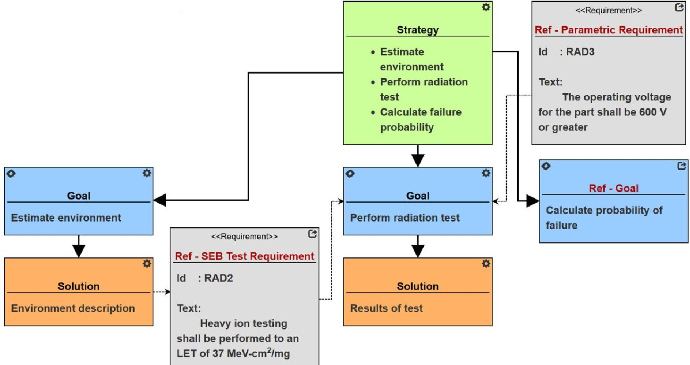

Figure 43. GSN argument at the end of Phase B.

During Phase B, the mission length, orbit, and nominal shielding will need to be provided by the project and system engineers. These are inputs into the environment prediction tools. In SEAM, CRME and R-GENTIC can be accessed within the modeling environment, and the outputs from SEAM can be attached and uploaded to SEAM. Next, how the sensitive components are used in the system needs to be determined. For SEB, this includes bias voltages and duty cycle. The component use will determine test conditions and what will be considered failure for a component. Parametric information about components can be captured in SEAM in the SysML block diagram models. Now radiation tests are found or performed. The results of the tests are attached to the solution in the GSN model. Figure 43 shows the GSN argument at the end of Phase B.

During Phase C, the mission and system design become more stable, and the probability of failure can be calculated, assuming changes in the design are covered or accounted for in the

<!-- PDF_PAGE: 90 -->

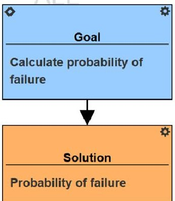

Figure 44. GSN argument at the end of Phase C.

previous activities. The probability of failure calculation is attached to the solution in the GSN model and is shown in Figure 44.

Figure 42-44 show the evolution of the GSN argument over the mission life-cycle. Using MBMA to capture RHA activities enables concurrent engineering of reliability and design. It also shows how requirements are derived and verified throughout the project. These requirements are both intelligent and mission-specific, one of the driving forces behind the new R&M standard. Requirements can be defined as more about the implementation of mission objectives is known, and then mission assurance activities that are performed are tailored to the system design and mission objectives. Additionally, artifacts related to the MBMA activities are captured and linked in the GSN model, as shown in a cartoon in Figure 45.

## Conclusions

Methods for mitigation of radiation-induced faults were presented and were modeled using fault propagation models in SEAM. An assurance case was constructed using GSN for different phases of the project life-cycle to demonstrate how MBMA can improve the risk management process. The process was improved by linking models of the system implementation together with a GSN model that captured assumptions and justifications for system-level mitigation strategies.

<!-- PDF_PAGE: 91 -->

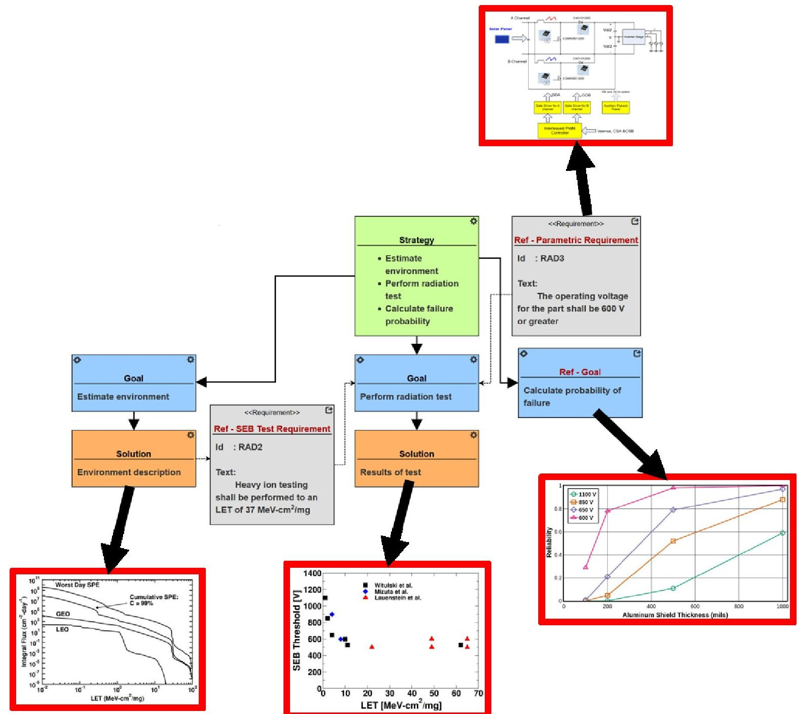

Figure 45. Artifacts attached to the GSN Model in SEAM.

<!-- PDF_PAGE: 92 -->

## CHAPTER VI

## CONCLUSIONS

Improved probabilistic radiation environment models and increased use of models to capture mission requirements and system design for missions enable better evaluation of risk. The increase in modeling at all levels of design and analysis are part of NASA's digital transformation [104]. One of the drivers is the emergence of NewSpace, which is new ways of achieving mission success while reducing the cost of mission design for space-based missions [105]. While environment models are improving, the electronic components being used are increasingly complex. Additionally, information and control over the technology process is decreasing. So while the uncertainty in the environment is decreasing, the uncertainty in the component response

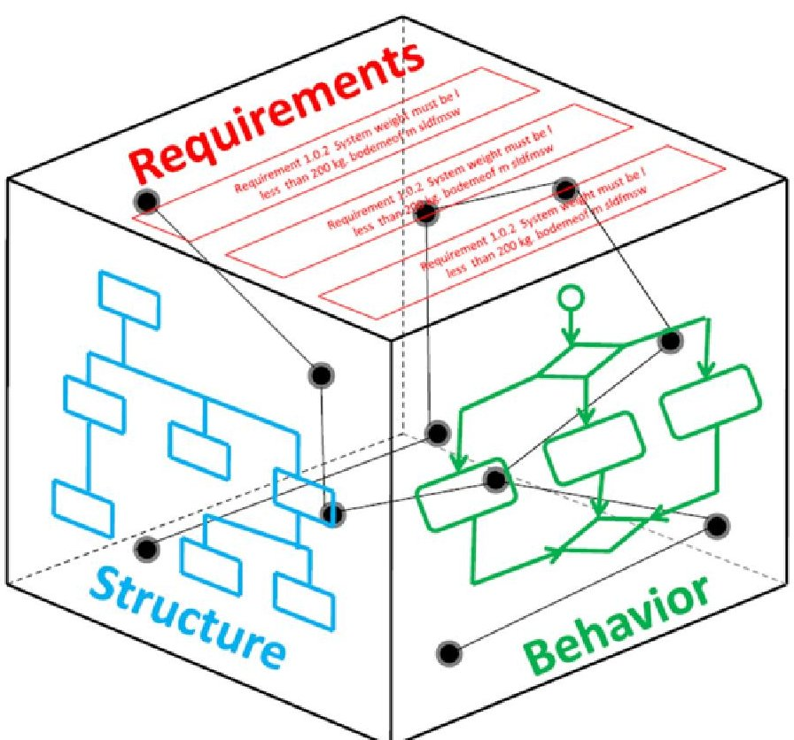

Figure 46. MBSE Connects the Dots, after [107].

<!-- PDF_PAGE: 93 -->

is increasing along with the complexity of the systems. RHA for NewSpace is about risk acceptance and cost reductions, but the current methods do not allow for this paradigm [106].

More and more, evaluating the risk of radiation to the system requires knowledge of the component's use in the system. Currently, radiation effects engineers gather knowledge about the system through email and personal contact, especially between PDR and CDR. The more that information can be captured and kept up-to-date in a model-based environment, the quicker and easier the information can be used by all the engineers that need that information, as described in [107] and represented pictorially in Figure 46. While there can be a big investment at the beginning to create and support model-based engineering, the investment is quickly returned when changes in the mission and system are made.

A new way to calculate the probability of failure for destructive SEEs that decouples environment variability and part-to-part variability was described and demonstrated for a SiC power MOSFET. The calculated probability of failure was done for different operating voltages and shielding thickness, demonstrating how the failure probability could be traded with different design parameters. The probability of failure can be included in system-level quantitative risk assessments.

Additionally, a novel method of modeling radiation-induced faults and fault-propagation within SysML block diagrams was described. This method was implemented on SEAM. SEAM was also used to show how MBMA could be implemented throughout a project life-cycle to improve risk management.

These additions to the RHA process enable the inclusion of radiation effects into MBMA so that NewSpace missions can maximize limited resources. The additions to modeling system mitigation schemes are useful to traditional space missions as well. With further development, the

<!-- PDF_PAGE: 94 -->

quantification of the consequence of faults could be included. Mission objectives and constraints that are ranked by their importance in order to manage limited project resources. By linking the possible faults to the requirements and functions of the system, the management of those faults can be prioritized by the importance of the linked mission objective. By leveraging MBSE, these radiation effects engineers can use these methods to evaluate radiation risks at the system level and estimate probabilities of failure for destructive effects in emerging technologies.

<!-- PDF_PAGE: 95 -->

## REFERENCES

[1] J. Keller, "The evolving world of radiation-hardened electronics," Military & Aerospace Electronics, Jun. 2018. [Online]. Available: https://www.militaryaerospace.com/computers/-article/16707204/the-evolving-world-of-radiationhardened-electronics

[2] A. Moran, K. LaBel, M. Gates, C. Seidleck, R. McGraw, M. Broida, J. Firer, and S. Sprehn, "Single event effect testing of the Intel 80386 family and the 80486 microprocessor," IEEE Trans. Nucl. Sci., vol. 43, no. 3, pp. 879-885, Jun. 1996.

[3] D. Petrick, A. Geist, D. Albaijes, M. Davis, P. Sparacino, G. Crum, R. Ripley, J. Boblitt, and T. Flatley, "SpaceCube v2.0 space flight hybrid reconfigurable data processing system," in 2014 IEEE Aerospace Conference, Mar. 2014, pp. 1-20.

[4] K. A. LaBel, R. L. Ladbury, L. M. Cohn, and T. R. Oldham, "Radiation test challenges for scaled commercial memories," IEEE Trans. Nucl. Sci., vol. 55, no. 4, pp. 2174-2180, Aug. 2008.

[5] K. A. LaBel, M. J. Sampson, and J. A. Pellish, "Electrical, electronic and electromechanical (EEE) parts in the new space paradigm: When is better the enemy of good enough?" Presented at 14th Int. School Effects Radiation Embedded Systems Space Applications, Nov. 2018.

[6] P. D. T. O'Conner and A. Kleyner, Practical Reliability Engineering, 5th ed. New York, NY, USA: Wiley, 2012.

[7] Advisory Group on Reliability of Electronic Equipment, "Reliability of military electronic equipment," Washington: U.S. Gov. Print Off., Report, Aug. 1957.

[8] O. Gonzalez, Y. Chen, R. L. Ladbury, D. R. Morgan, C. M. Green, and D. E. Yuchnovicz, "Guidelines for verification strategies to minimize RISK based on mission environment, application and lifetime (MEAL)," NASA Engineering and Safety Center, Tech. Report NASA/TM-2018-220074, Jun. 2018.

[9] M. A. Xapsos, C. Stauffer, T. Jordan, J. L. Barth, and R. A. Mewaldt, "Model for cumulative solar heavy ion energy and linear energy transfer spectra," IEEE Trans. Nucl. Sci., vol. 54, no. 6, pp. 1985-1989, Dec. 2007.

[10] J. Puig-Suari, C. Turner, and W. Ahlgren, "Development of the standard CubeSat deployer and a CubeSat class PicoSatellite," in Proc. 2001 IEEE Aerospace Conf., vol. 1, Mar. 2001, pp. 1/347- 1/353.

[11] M. A. Swartwout, "CubeSat database." [Online]. Available: https://sites.google.com/a/slu.edu/-swartwout/home/cubesat-database

[12] National Academies of Sciences, Engineering, and Medicine, "Achieving science with CubeSats: Thinking inside the box," The National Academies Press, Washington, DC, Tech. Rep., 2016.

<!-- PDF_PAGE: 96 -->

[13] P. Stoetzer, "AO-85 status update," Dec. 2018. [Online]. Available: https://www.amsat.org/ao-85- status-update/

[14]——, "Fox-1Cliff/AO-95 commissioning status," Dec. 2018. [Online]. Available: https:// www.amsat.org/fox-1cliff-ao-95-commissioning-status/

[15]——, "RadFxSat (Fox-1B) launched, designated AMSAT-OSCAR 91 (AO-91)," Nov. 2017. [Online]. Available: https://www.amsat.org/radfxsat-fox-1b-launched-designated-amsat-oscar 91-ao-91/

[16] M. Swartwout, S. Jayaram, R. Reed, and R. Weller, "Argus: A flight campaign for modeling the effects of space radiation on modern electronics," in Proc. 2012 IEEE Aerospace Conf., Mar. 2012, pp. 1-11.

[17] N. A. Dodds, M. J. Martinez, P. E. Dodd, M. R. Shaneyfelt, F. W. Sexton, J. D. Black, D. S. Lee, S. E. Swanson, B. L. Bhuva, K. M. Warren, R. A. Reed, J. Trippe, B. D. Sierawski, R. A. Weller, N. Mahatme, N. J. Gaspard, T. Assis, R. Austin, S. L. Weeden-Wright, L. W. Massengill, G. Swift, M. Wirthlin, M. Cannon, R. Liu, L. Chen, A. T. Kelly, P. W. Marshall, M. Trinczek, E. W. Blackmore, S.-J. Wen, R. Wong, B. Narasimham, J. A. Pellish, and H. Puchner, "The contribution of low-energy protons to the total on-orbit SEU rate," IEEE Trans. Nucl. Sci., vol. 62, no. 6, pp. 2440-2451, Dec. 2015.

[18] M. P. King, R. A. Reed, R. A. Weller, M. H. Mendenhall, R. D. Schrimpf, B. D. Sierawski, A. L. Sternberg, B. Narasimham, J. K. Wang, E. Pitta, B. Bartz, D. Reed, C. Monzel, R. C. Baumann, X. Deng, J. A. Pellish, M. D. Berg, C. M. Seidleck, E. C. Auden, S. L. Weeden-Wright, N. J. Gaspard, C. X. Zhang, and D. M. Fleetwood, "Electron-induced single-event upsets in static random access memory," IEEE Trans. Nucl. Sci., vol. 60, no. 6, pp. 4122-4129, Dec. 2013.

[19] J. M. Trippe, R. A. Reed, R. A. Austin, B. D. Sierawski, R. A. Weller, E. D. Funkhouser, M. P. King, B. Narasimham, B. Bartz, R. Baumann, J. Labello, J. Nichols, R. D. Schrimpf, and S. L. Weeden-Wright, "Electron-induced single event upsets in 28 nm and 45 nm bulk SRAMs," IEEE Trans. Nucl. Sci., vol. 62, no. 6, pp. 2709-2716, Dec. 2015.

[20] A. Witulski, R. Austin, R. Reed, G. Karsai, N. Mahadevan, B. Sierawski, J. Evans, and K. LaBel, "Goal structured notation in a radiation hardening safety case for COTS-based spacecraft," in Proc. Govt. Microelectronic App. Critical Tech. Conf. (GOMAC), 2016, pp. 1-4.

[21] R. A. Austin, B. D. Sierawski, R. A. Reed, J. M. Trippe, K. M. Warren, A. L. Sternberg, R. A. Weller, and A. F. Witulski, "Mitigation of single-event effects in CubeSat commercial off-the-shelf components," in Proc. Govt. Microelectronic App. Critical Tech. Conf. (GOMAC), 2018, pp. 1-4.

[22] R. A. Austin, B. D. Sierawski, J. M. Trippe, A. L. Sternberg, K. M. Warren, R. A. Reed, R. A. Weller, R. D. Schrimpf, M. L. Alles, L. W. Massengill, D. M. Fleetwood, G. W. Buxton, J. C. Brandenburg, W. B. Fisher, and R. Davis, "RadFxSat: A flight campaign for recording single-event effects in commercial off-the-shelf microelectronics," in Proc. IEEE Radiation Effects Components and Systems, Oct. 2017, pp. 1-5.

<!-- PDF_PAGE: 97 -->

[23] R. A. Austin, "A radiation-reliability assurance case using goal structuring notation for a CubeSat experiment," Master's thesis, Vanderbilt University, Aug. 2016.

[24] Modeling and Simulation Coordination Office, Ed., Modeling and Simulation (M&S) Glossary. 1901 N. Beauregard St., Suite 500 Alexandria, VA 22311: Department of Defense, Oct. 2011.

[25]“SEAM (System Engineering and Assurance Modeling).” [Online]. Available: https:// modelbasedassurance.org

[26] M. Maróti, T. Kecskés, R. Kereskényi, B. Broll, P. Völgyesi, L. Jurácz, T. Leventovszky, and Á. Lédeczi, "Next generation (meta)modeling: Web- and cloud-based collaborative tool infrastructure," in 8th Multi-Paradigm Modeling Workshop, 2014.

[27] D. M. Fleetwood, "Total ionizing dose effects in MOS and low-dose-rate-sensitive linear-bipolar devices," IEEE Trans. Nucl. Sci., vol. 60, no. 3, pp. 1706-1730, Jun. 2013.

[28] C. J. Marshall, P. W. Marshall, A. Waczynski, E. J. Polidan, S. D. Johnson, R. A. Kimble, R. A. Reed, G. Delo, D. Schlossberg, A. M. Russell, T. Beck, Y. Wen, J. Yagelowich, and R. J. Hill, "Hot pixel annealing behavior in CCDs irradiated at -84/spl deg/C," IEEE Trans. Nucl. Sci., vol. 52, no. 6, pp. 2672-2677, Dec. 2005.

[29] R. Funase, S. Ikari, R. Suzumoto, N. Sako, M. Sanada, and S. Nakasuka, "On-orbit operation results of the world's first CubeSat XI-IV - lessons learned from its successful 15-years space flight," Presented at 2019 AIAA/USU Conf. Small Satellites, Aug. 2019. [Online]. Available: https://digitalcommons.usu.edu/smallsat/2019/all2019/48/

[30] J. R. Srour and J. W. Palko, "Displacement damage effects in irradiated semiconductor devices," IEEE Trans. Nucl. Sci., vol. 60, no. 3, pp. 1740-1766, Jun. 2013.

[31] R. Ladbury, "Strategies for SEE hardness assurance - from buy-it-and-fly-it to bullet proof," in Proc. IEEE NSREC Short Course, 2017, pp. II/1-II/83.

[32] J. R. Schwank, M. R. Shaneyfelt, and P. E. Dodd, "Radiation hardness assurance testing of microelectronic devices and integrated circuits: Test guideline for proton and heavy ion single-event effects," IEEE Trans. Nucl. Sci., vol. 60, no. 3, pp. 2101-2118, Jun. 2013.

[33] A. H. Johnston, "The influence of VLSI technology evolution on radiation-induced latchup in space systems," IEEE Trans. Nucl. Sci., vol. 43, no. 2, pp. 505-521, Apr. 1996.

[34] A. E. Waskiewicz, J. W. Groninger, V. H. Strahan, and D. M. Long, "Burnout of power MOS transistors with heavy ions of californium-252," IEEE Trans. Nucl. Sci., vol. 33, no. 6, pp. 1710- 1713, Dec. 1986.

[35] A. E. Waskiewicz and J. W. Groninger, "Burnout threshold and cross sections of power MOS transistors in heavy ions," Rockwell Int. Corp., Anaheim, CA, USA, Rockwell Int. Rep. DNA-MPIR-88-507, Feb. 1990.

<!-- PDF_PAGE: 98 -->

[36] S. Liu, M. Boden, D. A. Girdhar, and J. L. Titus, "Single-event burnout and avalanche characteristics of power DMOSFETs," IEEE Trans. Nucl. Sci., vol. 53, no. 6, pp. 3379-3385, Dec. 2006.

[37] J. L. Titus, "An updated perspective of single event gate rupture and single event burnout in power MOSFETs," IEEE Trans. Nucl. Sci., vol. 60, no. 3, pp. 1912-1928, Jun. 2013.

[38] S. Kuboyama, C. Kamezawa, N. Ikeda, T. Hirao, and H. Ohyama, "Anomalous charge collection in silicon carbide schottky barrier diodes and resulting permanent damage and single-event burnout," IEEE Trans. Nucl. Sci., vol. 53, no. 6, pp. 3343-3348, Dec. 2006.

[39] A. Griffoni, J. van Duivenbode, D. Linten, E. Simoen, P. Rech, L. Dilillo, F. Wrobel, P. Verbist, and G. Groeseneken, "Neutron-induced failure in silicon IGBTs, silicon super-junction and SiC MOSFETs," IEEE Trans. Nucl. Sci., vol. 59, no. 4, pp. 866-871, Aug. 2012.

[40] E. Mizuta, S. Kuboyama, H. Abe, Y. Iwata, and T. Tamura, "Investigation of single-event damages on silicon carbide (SiC) power MOSFETs," IEEE Trans. Nucl. Sci., vol. 61, no. 4, pp. 1924-1928, Aug. 2014.

[41] R. A. Johnson, A. F. Witulski, D. R. Ball, K. F. Galloway, A. L. Sternberg, E. Zhang, L. D. Ryder, R. A. Reed, R. D. Schrimpf, J. A. Kozub, J. Lauenstein, and A. Javanainen, "Enhanced charge collection in SiC power MOSFETs demonstrated by pulse-laser two-photon absorption SEE experiments," IEEE Trans. Nucl. Sci., vol. 66, no. 7, pp. 1694-1701, Jul. 2019.

[42] R. A. Johnson, A. F. Witulski, D. R. Ball, K. F. Galloway, A. L. Sternberg, R. A. Reed, R. D. Schrimpf, M. L. Alles, J. M. Lauenstein, A. Javanainen, A. Raman, P. S. Chakraborty, and R. R. Arslanbekov, "Unifying concepts for ion-induced leakage current degradation in silicon carbide schottky power diodes," IEEE Trans. Nucl. Sci., 2019, iEEE Early Access.

[43] P. V. Nekrasov, A. B. Karakozov, D. V. Bobrovskyi, and V. A. Marfin, "Investigation of single event functional interrupts in microcontroller with PIC17 architecture," in Proc. IEEE Radiation Effects Components and Systems, Sep. 2015, pp. 1-4.

[44] P. E. Dodd and L. W. Massengill, "Basic mechanisms and modeling of single-event upset in digital microelectronics," IEEE Trans. Nucl. Sci., vol. 50, no. 3, pp. 583-602, Jun. 2003.

[45] M. Xapsos, "A brief history of space climatology: From the big bang to the present," IEEE Trans. Nucl. Sci., vol. 66, no. 1, pp. 17-37, Jan. 2019.

[46] T. P. O'Brien, W. R. Johnston, S. L. Huston, C. J. Roth, T. B. Guild, Y. J. Su, and R. A. Quinn, "Changes in AE9/AP9-IRENE version 1.5," IEEE Trans. Nucl. Sci., vol. 65, no. 1, pp. 462-466, Jan. 2018.

[47] M. A. Xapsos, J. L. Marth, E. G. Stassinopoulos, E. A. Burke, and G. B. Gee, "Space environment effects: Model for emission of solar protons (ESP) - cumulative and worst-case event fluences," NASA Marshall Space Flight Center, Tech. Report NASA/TP-1999-209763, Dec. 1999.

<!-- PDF_PAGE: 99 -->

[48] R. A. Nymmik, M. I. Panasyuk, T. I. Pervaja, and A. A. Suslov, "A model of galactic cosmic ray fluxes," Int. J. Radiation Applications and Instrumentation. Part D. Nucl. Tracks and Radiation Measurements, vol. 20, no. 3, pp. 427-429, 1992.

[49] A. J. Tylka, J. H. Adams Jr., P. R. Boberg, B. Brownstein, W. F. Dietrich, E. O. Flueckiger, E. L. Petersen, M. A. Shea, D. F. Smart, and E. C. Smith, "CREME96: A revision of the cosmic ray effects on micro-electronics code," IEEE Trans. Nucl. Sci., vol. 44, no. 6, pp. 2150-2160, Dec. 1997.

[50] M. A. Xapsos, C. Stauffer, A. Phan, S. S. McClure, R. L. Ladbury, J. A. Pellish, M. J. Campola, and K. A. LaBel, "Inclusion of radiation environment variability in total dose hardness assurance methodology," IEEE Trans. Nucl. Sci., vol. 64, no. 1, pp. 325-331, Jan. 2017.

[51] Q. Wang, D. Chen, and H. Bai, "A method of space radiation environment reliability prediction," in Proc. Ann. Reliability and Maintainability Symp., Jan. 2016, pp. 1-6.

[52] A. R. Knudson, A. B. Campbell, and E. C. Hammond, "Dose dependence of single event upset rate in MOS dRAMS," IEEE Trans. Nucl. Sci., vol. 30, no. 6, pp. 4508-4513, Dec. 1983.

[53] R. L. Pease and D. R. Alexander, "Hardness assurance for space system microelectronics," Radiation Physics and Chemistry, vol. 43, no. 1, pp. 191-204, 1994.

[54] "Radiation design margin requirement," Jet Propulsion Laboratory, Practice PD-ED-1260, May 1996.

[55] J. S. Browning and J. E. Glover, "Hardness assurance based on system reliability models," IEEE Trans. Nucl. Sci., vol. 34, no. 6, pp. 1775-1780, Dec. 1987.

[56] R. L. Pease, "Microelectronic piece part radiation hardness assurance for space systems," in Proc. IEEE NSREC Short Course, 2004, pp. II/1-II/56.

[57] P. C. Adell and J. Boch, "Dose and dose-rate effects in micro-electronics: pushing the limits to extreme conditions," in Proc. IEEE NSREC Short Course, 2014, pp. II/1-II/102.

[58] J. Ferry, Ed., MIL-HDBK-814: Ionizing radiation and neutron displacement damage hardness assurance guidelines for semi-conductor devices and microcircuits. Dep. of Defense, 1994.

[59] K. A. LaBel, A. H. Johnston, J. L. Barth, R. A. Reed, and C. E. Barnes, "Emerging radiation hardness assurance (RHA) issues: a NASA approach for space flight programs," IEEE Trans. Nucl. Sci., vol. 45, no. 6, pp. 2727-2736, Dec. 1998.

[60] D. K. Nichols, J. R. Coss, T. Miyahira, J. Titus, D. Oberg, J. Wert, P. Majewski, and J. Lintz, "Update of single event failure in power MOSFETs," in IEEE Radiation Effects Data Workshop, Jul. 1996, pp. 67-72.

[61] A. F. Witulski, D. R. Ball, K. F. Galloway, A. Javanainen, J.-M. Lauenstein, A. L. Sternberg, and R. D. Schrimpf, "Single-event burnout mechanisms in SiC power MOSFETs," IEEE Trans. Nucl. Sci., vol. 65, no. 8, pp. 1951-1955, Aug. 2018.

<!-- PDF_PAGE: 100 -->

[62] A. Elasser and T. P. Chow, "Silicon carbide benefits and advantages for power electronics circuits and systems," Proc. IEEE, vol. 90, no. 6, pp. 969-986, Jun. 2002.

[63] K. F. Galloway, A. F. Witulski, R. D. Schrimpf, A. L. Sternberg, D. R. Ball, A. Javanainen, R. A. Reed, B. D. Sierawski, and J.-M. Lauenstein, "Failure estimates for SiC power MOSFETs in space electronics," Aerospace, vol. 5, no. 67, pp. 1-7, 2018.

[64] S. A. Ikpe, J.-M. Lauenstein, G. A. Carr, D. Hunter, L. L. Ludwig, W. Wood, C. J. Iannello, L. Y. Del Castillo, F. D. Fitzpatrick, M. M. Mojarradi, and Y. Chen, "Long-term reliability of a hard-switched boost power processing unit utilizing SiC power MOSFETs," in Proc. Int. Reliability Physics Symp., Apr. 2016, pp. ES-1-1-ES-1-8.

[65] M. D. Berg, K. A. Label, M. J. Campola, and M. Xapsos, "Analyzing system on a chip single event upset responses using single event upset data, classical reliability models, and space environment data," Presented at Radiat. Effects on Components and Systems, Geneva, SZ, Oct. 2017.

[66] C. Poivey, "Radiation hardness assurance for space systems," in Proc. IEEE NSREC Short Course, 2002, pp. V/1-V/57.

[67] Method 1080.1, Single-Event Burnout and Single-Event Gate Rupture, Defense Logistics Agency (DLA) Land and Maritime Std. MIL-STD-750F, Jan. 2012.

[68] EIA/JEDEC, JESD57: Test Procedures for the Measurement of Single-Event Effects in Semiconductor Devices from Heavy Ion Irradiation. 2500 Wilson Blvd., Arlington, VA 22201: Electronic Industries Association, 1996.

[69] J. S. George, D. A. Clymer, T. L. Turflinger, L. W. Mason, S. Stone, R. Koga, E. Beach, K. Huntington, J.-M. Lauenstein, J. Titus, and M. Sivertz, "Response variability in commercial MOSFET SEE qualification," IEEE Trans. Nucl. Sci., vol. 64, no. 1, pp. 317-324, Jan. 2017.

[70] R. A. Austin, B. D. Sierawski, R. A. Reed, R. D. Schrimpf, K. F. Galloway, D. R. Ball, and A. F. Witulski, "Inclusion of radiation environment variability for reliability estimates for SiC power MOSFETs," in Proc. Nuclear Space Radiation Effects Conf., Jul. 2019, pp. 1-5.

[71] J. L. Titus, C. F. Wheatley, T. H. Wheatley, W. A. Levinson, D. I. Burton, J. L. Barth, R. A. Reed, K. A. LaBel, J. W. Howard, and K. M. van Tyne, "Prediction of early lethal SEGR failures of VDMOSFETs for commercial space systems'," IEEE Trans. Nucl. Sci., vol. 46, no. 6, pp. 16401651, Dec. 1999.

[72] J.-M. Lauenstein, N. Goldsman, S. Liu, J. L. Titus, R. L. Ladbury, H. S. Kim, A. M. Phan, K. A. LaBel, M. Zafrani, and P. Sherman, "Effects of ion atomic number on single-event gate rupture (SEGR) susceptibility of power MOSFETs," IEEE Trans. Nucl. Sci., vol. 58, no. 6, pp. 26282636, Dec. 2011.

[73] R. Ladbury and M. J. Campola, "Statistical modeling for radiation hardness assurance: Toward bigger data," IEEE Trans. Nucl. Sci., vol. 62, no. 5, pp. 2141-2154, Oct. 2015.

<!-- PDF_PAGE: 101 -->

[74] J. L. Titus and C. F. Wheatley, "Experimental studies of single-event gate rupture and burnout in vertical power MOSFETs," IEEE Trans. Nucl. Sci., vol. 43, no. 2, pp. 533-545, Apr. 1996.

[75] E. A. Amerasekera and F. N. Najm, Failure Mechanisms in Semiconductor Devices, 2nd ed. New York, NY, USA: Wiley, 1997, ch. 5, sec. 5.6.11.

[76] D. Kerwin, "Reliability and qualification of custom integrated circuits for harsh environment applications using commercial wafer foundries," in Proc. IEEE NSREC Short Course, 2010, pp. V/1-V/134.

[77] J. C. Pickel, "Single-event effects rate prediction," IEEE Trans. Nucl. Sci., vol. 43, no. 2, pp. 483- 495, Apr. 1996.

[78] S. L. Weeden-Wright, M. P. King, N. C. Hooten, W. G. Bennett, B. D. Sierawski, R. D. Schrimpf, R. A. Weller, R. A. Reed, M. H. Mendenhall, D. M. Fleetwood, M. L. Alles, and R. C. Baumann, "Effects of energy-deposition variability on soft error rate prediction," IEEE Trans. Nucl. Sci., vol. 62, no. 5, pp. 2181-2186, Oct. 2015.

[79] R. A. Austin, N. Mahadevan, A. F. Witulski, G. Karsai, B. D. Sierawski, R. D. Schrimpf, and R. A. Reed, "Radiation assurance of CubeSat payloads using bayesian networks and fault models," in Proc. Ann. Reliability and Maintainability Symp., Jan. 2018, pp. 1-7.

[80]——, "Automatic fault tree generation from radiation-induced fault models," in Proc. Ann. Reliability and Maintainability Symp., Jan. 2020, pp. 1-5.

[81] H. M. Quinn, D. A. Black, W. H. Robinson, and S. P. Buchner, "Fault simulation and emulation tools to augment radiation-hardness assurance testing," IEEE Trans. Nucl. Sci., vol. 60, no. 3, pp. 2119-2142, Jun. 2013.

[82] "Single event effect criticality analysis," NASA HQ/Code QW, GSFC, Greenbelt, MD, Tech. Rep. 431-REF-000273, Feb. 1996.

[83] S. Abdelwahed, G. Karsai, and G. Biswas, "A consistency-based robust diagnosis approach for temporal causal systems," in 16th International Workshop on Principles of Diagnosis (DX 05), Monterey, CA, Jun. 2005.

[84] S. Padalkar, J. Sztipanovits, G. Karsai, N. Miyasaka, and K. Okuda, "Real-time fault diagnostics," IEEE Expert, vol. 6, pp. 75-85, 1991.

[85] "Lt1963 series datasheet," Linear Technology. [Online]. Available: https://www.analog.com/- media/en/technical-documentation/data-sheets/1963fc.pdf

[86] "R-GENTIC." [Online]. Available: https://vanguard.isde.vanderbilt.edu/RGentic/

[87] "Fault tree handbook with aerospace applications," NASA, Handbook, Aug. 2002, version 1.1.

[88] C. Wilson, A. George, and B. Klamm, "A methodology for estimating reliability of SmallSat computers in radiation environments," in Proc. 2016 IEEE Aerospace Conf., Mar. 2016, pp. 1-12.

<!-- PDF_PAGE: 102 -->

[89] F. J. Groen, J. W. Evans, and A. J. Hall, "A vision for spaceflight reliability: NASA's objectives based strategy," in Proc. Ann. Reliability and Maintainability Symp., Jan. 2015, pp. 1-6.

[90] "System engineering vision 2020," International Council on Systems Engineering (INCOSE), Tech. Rep. INCOSE-TP-2004-004-02, Sep. 2007.

[91] NASA Reliability and Maintainability (R&M) Standard for Spaceflight and Support Systems, Office of Safety and Mission Assurance Std. NASA-STD-8729.1A, Jun. 2017. [Online]. Available: https://standards.nasa.gov/standard/nasa/nasa-std-87291

[92] D. Kaslow, B. Ayres, P. T. Cahill, L. Hart, and R. Yntema, "Developing a CubeSat model-based system engineering (MBSE) reference model - interim status /#3," in Proc. 2017 IEEE Aerospace Conf., Mar. 2017, pp. 1-15.

[93] D. Nichols and C. Lin, "Integrated model-centric engineering: The application of MBSE at JPL through the life cycle," Presented at INCOSE International MBSE Workshop, Jan. 2014.

[94] Reliability Prediction of Electronic Equipment, Department of Defense, Washington, DC, Dec. 1991, mIL-HDBK-217F, Notice 2.

[95] D. Sinclair and J. Dyer, "Radiation effects and COTS parts in SmallSats," in Proc. AIAA/USU Conf. Small Satellites, no. SSC13-IV-3, 2013, pp. 1-12. [Online]. Available: https:// digitalcommons.usu.edu/smallsat/2013/all2013/69/

[96] K. A. LaBel and M. M. Gates, "Single-event-effect mitigation from a system perspective," IEEE Trans. Nucl. Sci., vol. 43, no. 2, pp. 654-660, Apr. 1996.

[97] R. E. Lyons and W. Vanderkulk, "The use of triple-modular redundancy to improve computer reliability," IBM J. Res. Development, vol. 6, no. 2, pp. 200-209, Apr. 1962.

[98] L. H. Mutuel, "Single event effects mitigation techniques report," Federal Aviation Administration, Final Report DOT/FAA/TC-15/62, Feb. 2016.

[99] GSN Community Standard Version 1, Std., Nov. 2001.

[100] GSN Community Standard Version 2, The Assurance Case Working Group (ACWG) Std. SCSC 141B, Jan. 2018.

[101] R. A. Austin, N. Mahadevan, B. D. Sierawski, G. Karsai, A. F. Witulski, and J. Evans, "A CubeSat-payload radiation-reliability assurance case using goal structuring notation," in Proc. Ann. Reliability and Maintainability Symp., Jan. 2017, pp. 1-8.

[102] "CertWare," NASA Langley Research Center. [Online]. Available: http://nasa.github.io/- CertWare/

[103] Office of the Chief Engineer, "NASA space flight program and project management handbook," NASA, Washington, DC, Tech. Rep. NASA/SP-2014-3705, Sep. 2014.

<!-- PDF_PAGE: 103 -->

[104] T. DiVenti, "NASA's digital transformation (DT) initiative: Potential opportunities for the NEPP community," Presented at NASA NEPP ETW in Goddard, MD, USA, Jun. 2019.

[105] M. N. Sweeting, "Modern small satellites-changing the economics of space," Proc. IEEE, vol. 106, no. 3, pp. 343-361, Mar. 2018.

[106] M. J. Campola and J. A. Pellish, "Radiation harndess assurance: Evolving for NewSpace," in Proc. IEEE RADECS Short Course, Sep. 2019, pp. V/1-V/35.

[107] M. Bajaj, B. Cole, and D. Zwemer, "Architecture to geometry - integrating system models with mechanical design," in Proc. AIAA SPACE, Sep. 2016.