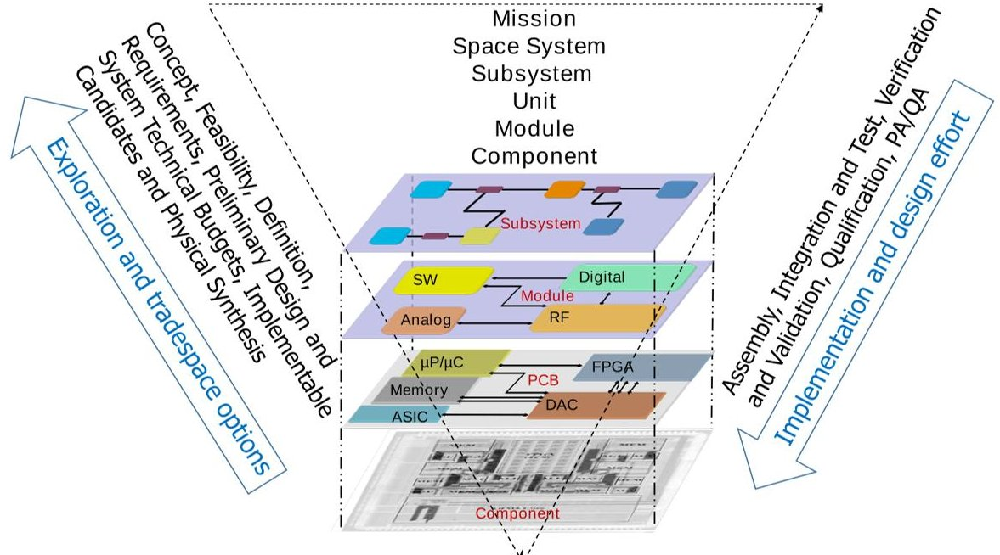
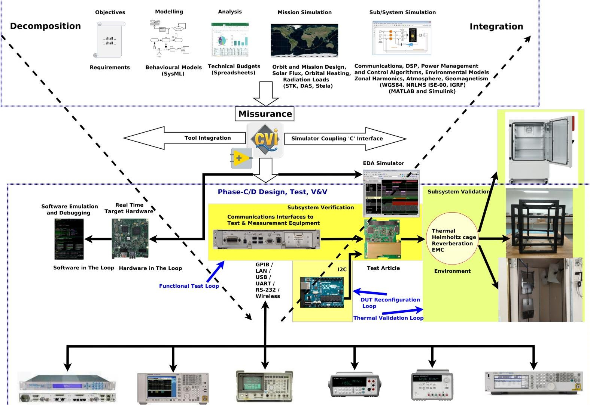
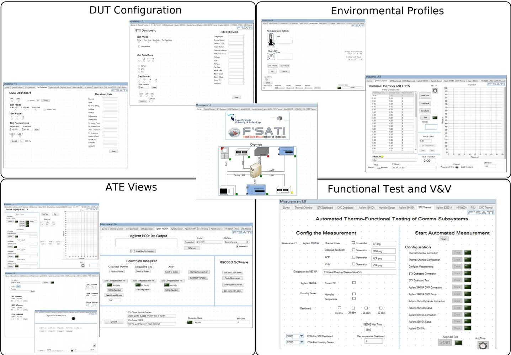
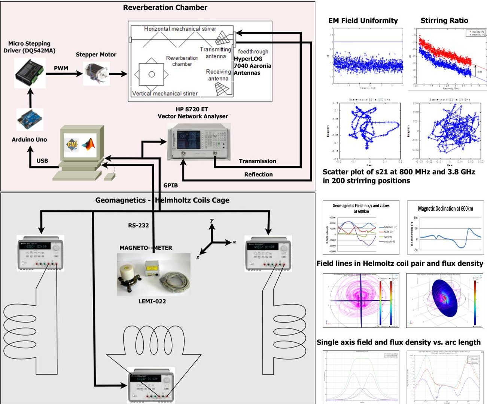
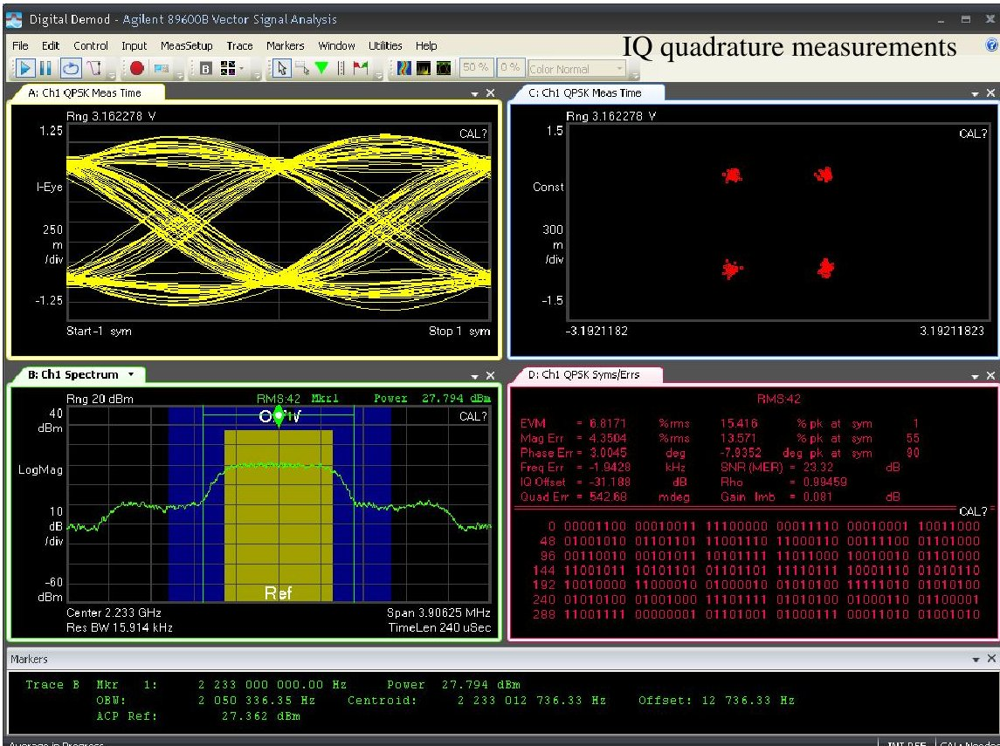
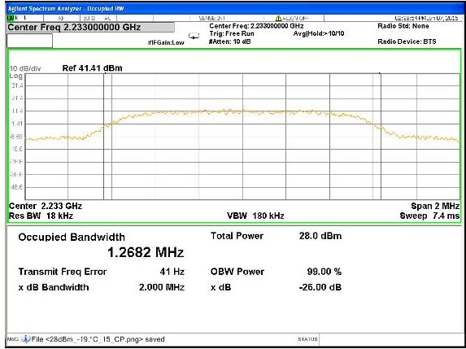
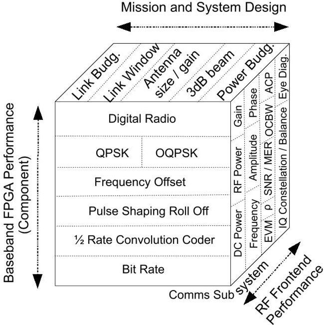

<!-- PDF_PAGE: 1 -->

## Rapid, automated, test, verification and validation (v&v) for the cubesats

## Yaseen Zaidi $ ^{*} $

Department of Engineering Design and Mathematics, University of the West of England, Frenchay Campus, Coldharbour Lane, Bristol, BS16 1QY, England, UK Email: yaseen.zaidi@uwe.ac.uk *Corresponding author

## Norman G. Fitz-Coy

Department of Mechanical and Aerospace Engineering University of Florida Gainesville, FL 32611, USA Email: nfc@ufl.edu

## Robert van Zyl

French South African Institute of Technology Cape Peninsula University of Technology Symphony Way, Bellville 7530 Western Cape, South Africa Email: vanzylr@cput.ac.za

Abstract: Bringing up of a small-scale mission assurance and engineering workflow is described. The experiences learned in the ZACUBE-1 mission prompted the development of an automated systems engineering platform leading to conformity in system design, test, and verification. The platform implements the methodology of systems engineering by coordinating diverse elements of the lifecycle and by incorporating the tools involved. The phase B/C activities of system modelling, simulations, prototyping, and design may be unified to a compounding effect and raising the level of the system view. The Verification and Validation (V&V) is achieved by integrating a test and measurement facility to the platform. With the platform, we accomplish rapid electrical and functional test and verification of the CubeSat subsystems and thermal validation in $ - 2 0^{\circ} \mathrm{C} $ to $ + 5 0^{\circ} \mathrm{C} $ cycle. The platform is automated by an application software which executes functional and thermal environment tests and provides support for requirements flow, system definition, embedded development, and simulations by integrating real-time target hardware. The platform is exploited in validating an S-band communications subsystem while economizing time and obtaining valuable insight into transmission performance under thermal loading.

<!-- PDF_PAGE: 2 -->

Keywords: Automated Test Equipment (ATE); CubeSat; Measurement, Satellite, Space, Systems Engineering; Test; Verification and Validation (V&V).

Biographical notes: Yaseen Zaidi is a senior lecturer (systems engineering) in the aerospace cluster at the University of the West of England. He received Ph.D. and BS in electrical engineering at the Vienna University of Technology and Louisiana Tech University, and MS in engineering management from Western New England College. From 2018 to 2019 he was a research officer at the University of Cape Town in the radar remote sensing group and from 2015 to 2017 he was a research fellow at the Cape Peninsula University of Technology. He lectured satellite systems courses in the dual master's programme at the French South African Institute of Technology. From 2003 to 2014, he was the head of the on-board computer group and later the director of the low earth-observing satellite systems engineering department at Space and Upper Atmosphere Research Commission. Between 2014 and 2015, he was head of the department of electrical engineering at Grafton College. He is an external examiner at the Nelson Mandela University. He is an associate editor of SAE Aerospace Journal. His research interests are in embedded systems for space and applying agile methodologies and integrated systems engineering to the academic space missions. He served, in varying roles, on the mission teams of one geostationary satellite, two small satellites, and a CubeSat—all operational in orbit. He is a senior member of IEEE and member of INCOSE, ACM, and SIAM. According to the Mathematics Genealogy Project, Bessel and Gauss are his 9th and 10th generation supervision ascendants.

Norman Fitz-Coy is an associate professor in the department of mechanical and aerospace engineering at the University of Florida, Gainesville. He established and now serves as the director of the Advanced Space Technologies Research and Engineering Centre (ASTREC), a National Science Foundation (NSF) Industry/University Cooperative Research Centre that focuses on the development and validation of transformative technologies with specific application to small satellites. His involvement in small satellite systems has been instrumental in the small satellite research focuses at the UoF. He received the Henry Pusey Best Paper Award and the IEST Maurice Simpson Technical Editors Award. He is founding and the editor-in-chief of the Journal of Small Satellites. His current research interests are on small satellite systems with the design of control strategies with multi-objective criteria, deployment and multiple flexible-body dynamics, autonomous rendezvous and docking, ground vehicle dynamics, cooperative control for formation flight, and strategies for reconfigurable systems.

Robert van Zyl was born in Cape Town and studied electronic engineering at the University of Stellenbosch. He established a satellite engineering programme at the Cape Peninsula University of Technology in 2009 where he is also an associate professor. Under his leadership of the French South African Institute of Technology at CPUT, this programme has developed into a prominent regional centre for satellite technology innovation. The group focuses on CubeSats as a technology platform. The team of students and staff developed TshepisoSAT, Africa's first nanosatellite, which was launched in 2013. He established the International African CubeSat Workshop series to provide a developmental forum for networking among the fledgling CubeSat communities on the continent. In his spare time, he enjoys playing the French horn.

This paper is a revised and expanded version of a paper entitled 'Rapid, automated test, verification and validation for cubesats' presented at the 67th International Astronautical Congress (IAC), 26-30 September 2016, Guadalajara, Mexico (www.iafastro.org).

<!-- PDF_PAGE: 3 -->

## 1 Introduction

CubeSat development commonly is characterised by decisions that are often revised late in the engineering cycle. The decisions generally relate to the mission objectives, system requirements, payload/bus configurations, and launcher selection. To a great degree, the belated determinations and consequently casual and high-risk driven systems engineering is the very essence of the CubeSat missions. That is, the project stakeholders enjoy unprecedented liberty that is nonexistent in the high budgeted, larger missions.

The open-ended engineering, however, may result in re-definition of the subsystems or the system. A significant change may result in the different performance of the synthesised sub/systems. Proportionally, a flexible design methodology should accompany flexible Verification and Validation (V&V) methodology. With this notion in view, the French South African Institute of Technology (F'SATI) has developed a test and V&V platform. Although the platform concentrates on test and verification, it has been conceived through the systems engineering approach in order to accelerate the lifecycle processes and to readily adjust to the project dynamics. The platform enables, at the acceptance-level test, rapid V&V of the assembled and integrated hardware and software units. The vision behind the platform is about cutting the engineering cycle by overlapping the iterative phases of design, development, test, and V&V, as soon as the subsystem prototypes are available. The platform aids to the broader scope mission assurance goal.

A successful systems engineering methodology, connecting the highest conceptual level and the low-level details of performance, must support a high degree of automation and interfacing of the tools involved in the activities. The platform enables the systems engineering activities to advance and retrace when necessary. In effect, the platform is a structured engineering environment for design and test in which modelling, simulation, development tools, software and hardware modules as well the test and measurement equipment are integrated. The integration occurs based on the principles of software and network engineering and formal interfaces. The platform acts as a cohering, central gear to the model-based and automated systems engineering activities. Once fully integrated, the platform provides a virtual prototype of the system under consideration by collaborating with the elements of the system at different complexity and maturity levels in the lifecycle. Constituents of the resulting heterogeneous system are abstract or refined executable models, behaviours through simulations and flight-like software and hardware units that are functionally and electrically verified for performance. The tool based environment assists in repetitively, quickly and correctly analysing the system behaviour by experimenting with diverse modelling and simulation scenarios under orbital conditions. The underlying idea of the platform methodology is to unravel the mysteries on system behaviour and resolve clashes even though the intended, feasible system has yet to be fully realised.

An important aspect of the platform during design and testing is the manifestation of physical effects which are abstracted through the environmental enclosures, the Automated Test Equipment (ATE) or computer simulations. The physical environments producible are thermal cycles due to eclipse and sunlit conditions, geomagnetism and radiated emissions of the on-board radio frequency equipment. The software simulations are used for incorporating the in-orbit effects such as solar heat, radiation, geomagnetic field, and atmospheric drag.

The platform is developed in a phased way. This approach is adopted to avoid a hefty and immediate one-time investment. From the success and the lessons learned through the ZACUBE-1 mission, the expertise and legacy equipment are used to piece together

<!-- PDF_PAGE: 4 -->

a test automation setup. Initially, the setup achieved functional verification and electrical performance evaluation of a basic S-band transmitter. The capability was then extended to a line of communications subsystems operating at VHF, UHF and S-band frequencies, and having different characteristics of the digital radio. A feature for Device Under Test (DUT) configuration was added to characterise all possible attributes of the subsystem DUT. Then followed the automated test capability for electrical performance. Finally, a test loop for thermal cycling was added which nested the DUT configuration and functional test loops. The expansion of the platform to encompass more activities anticipated in the systems engineering is an on-going process.

This paper presents the systematic thinking and the rationale in architecting the platform, its interfaces and exploiting the platform in a manner that complements development and testing. The usability, expandability and the reconfigurability of the platform are its quality metrics. The main elements of the platform are a test and measurement testbed for rapid V&V discussed in Section 3, an instrumentation bus hosting a variety of physical layer interfaces and communication protocols detailed in Section 4, and an automation testware called Missurance discussed in Section 5. An important dimension noted in that section is the software lifecycle and the accommodation of change, which is supported in the testware through modularity and adaptability. The environmental validation aspect of the platform is presented in Section 6. A summary of the test results on the platform usage on a communications subsystems is presented in Section 7. These sections comprise the main body of the paper. We begin, however, in Section 2, with analysis on the state of modern systems engineering approach in the CubeSat systems engineering standardization forum and the need for greater functional verification coverage. In Section, 8 we remark major observations from this authorship.

## 2 Motivation and Relationship to the State-of-the-Art

In the large spacecraft industry, modelling (Rainey, 2004; Pintér, 2013), simulation (Eickhoff, 2009; Fortescue, 2011) and the framework (Adamsen, 2000; Larson et al., 2000) based systems engineering are established practices. Rather than the theory of efficient and feasible systems design, the reasons for a disciplined approach to systems engineering usually are traced back to experience and observation (Endres, 2003) such as painful lessons learned in the previous spaceflight (Leveson, 2004). Other reasons include the lack of coordination in the engineering activities as well as the insufficient flow of information in design processes (Adamsen, 2000) and most notably, according to Harland (2006), compromising design in wake of pressing schedules, short test times and the cost running exuberantly. According to Shiotani (2017), a survey of 28 developers from academia, government, industry, and private enterprise, showed a strong response to hardware and software V&V. Still, it does not come as a surprise in the small satellite landscape that the high failure rates are compelling (Betancourt, 2014; Bouwmeester and Guo, 2010; Dubos, 2010; Swartwout, 2013; Tafazoli, 2009), and portray a grim picture of uncoordinated systems engineering.

Within the CubeSat developers community, two activities related to the lifecycle are noteworthy. The first is an initiative by the Space Systems Working Group (SSWG) of the International Council on Systems Engineering (INCOSE). The SSWG aims to develop a CubeSat reference model (Becker, 2007) covering the lifecycle (Engel, 2010, NASA, 2009). The fundamental idea of the reference model is to manage system complexity from the get-

<!-- PDF_PAGE: 5 -->

go by providing a framework in which the information flow is consistent between the project phases. The developer communities may derive the mission specific CubeSat model from the reference model (Kaslow et al., 2015). Once mature, the reference model will be capable of defining the relationships between the top-level concept, mission scenarios, functions and the interfaces between system entities. The operation scenarios could be concisely represented by abstract modelling and simulation. Most CubeSats are highly integrated, constraint-driven, often use standard, procured subsystems built with commercial-grade components, and only differ in the mission applications. The CubeSat projects are usually nebulous to a high degree beyond formal preliminary design review. The reference model, thus, can be adapted to pliable missions. The SSWG aims to achieve its objectives by presenting the model entities graphically in the domain-specific SysML language. Overall, this work is part of the Model-Based Systems Engineering (MBSE) paradigm, contrasted by the conventional paper-based activity. In the MBSE approach the technical requirements can be represented as executable specification or a simulation model which drives development, therefore, parametric traceability can be ensured across the project phases. Furthermore, due to modelling being meta (Becker, 2007), high simulation speeds are possible easing trade studies or what-if scenarios. So far, the SSWG has demonstrated a first-pass of a modelling framework that formally generates a basic specification of a generic CubeSat (Spangelo et al., 2012). Then, the framework was applied to a real mission (Spangelo et al., 2013). When the high level of abstraction was inadequate to describe complex mission scenarios or system algorithms, the SSWG integrated application-specific, numerical simulators in the framework (Anderson et al., 2014). Most recently, a top-level functional architecture was obtained (Kaslow et al., 2017). Clearly, the SSWG has proceeded on to capture the concept lifecycle activities of Phase-A/B and until early Phase-C design (Kaslow et al., 2015). The approach is top-down and has yet to mature to consider the use of physical design and test aspects.

Secondly, some groups emphasise environmental qualification. For example, the effort outlined by Cho et al., (2012) is the first account of comprehensive tests conceived for the nanosatellite mission success. Kang et al., (2015) has reported combined load testing on a nanosatellite, while Maldonado et al., (2014) outlined a test facility for different orbital conditions. These approaches are at the bottom in the lifecycle and suited for assembly, integration and test activities that assume that the functional testing of physical design has been conformal. The emphasis being on qualification, these works do not address functional verification. The dominant and urgent need of the CubeSat developers is the functional verification due to high failure rates and mission losses owing to design errors that result in incorrect functionality (Betancourt, 2014; Swartwout, 2013).

## 2.1 MBSE Candidate Methodologies

For the systems engineering lifecycle, at least five MBSE methodologies have been identified by INCOSE MBSE Focus Group in a survey by Estefan (2008). However, these methodologies largely apply to "desktop engineering" in the early project phases of requirements analysis, concept development, trade studies, system definition or architecture development through simulation models. The survey acknowledges that any methodology would rely on the underlying MBSE toolset. Obviously, as the concept, analysis and design mature and the project moves to candidate system implementation, test and verification of the physically realised system, different methods would be required (Maier, 2000) and the toolset needed in those phases will be entirely different. In this paper, we alleviate the MBSE

<!-- PDF_PAGE: 6 -->

methodology by addressing the missing link between the virtual design and the physical test and V&V through a platform that spans over, to a high degree, the in-between activities.

## 2.2 Our Contribution

In absence of a platform, the activities of design and test are decoupled as physical design is engineering centric with the expectation of design iteration, while V&V is test-centric expecting limited or no iteration. In a properly funded and staffed organisation, the placement of sufficient processes ensures handoff from one phase to another. In the CubeSat developers community, the boundaries of project phases are usually not very clear. With the present work, we bridge the activity gap after design and before qualification phases. This is done by integrating automated testing and V&V in the development lifecycle. Our approach is meet-in-the-middle and platform-centric. The platform provides linkage for Phase-A to D activities. The platform connects to the modelling tools, computer simulations, prototypes or flight hardware as well as to the environmental chambers. The aim is to integrate the various elements of spacecraft to determine the anomalies, their impact on the system and to reduce the developmental cost and time.

<div align="center">

Figure 1 Vee model applied to the top-down and bottom-up activities in the lifecycle.

</div>





The methodology is based on the Vee model (Forsberg et al., 2005) of the project, widely used in the aerospace (ECSS, 2009) and software (Pressman, 2010) industries and elsewhere (INCOSE, 2015). The model is iterative as described in Figure 1, but later stage iterations ensue penalties on schedule and costs depending on the required project phase to be drawn back.

Central to the platform is the capability of interconnectivity of the project activities by integrating a multitude of tools utilised in those activities. Therefore, requirements conformance, model abstractions, and refinement, scenario experimentation through simulations, verifying functional performance based on measurement data and subjecting the realised systems to limited environmental conditions may be visualised—all in one

<!-- PDF_PAGE: 7 -->

## Rapid, Automated, Test, Verification and Validation (V&V) for the CubeSats

go. The gain is a heterogeneous platform that may be used as a satellite virtual prototype or a satellite simulator. Clearly, for the methodology to be successful, a high degree of automation and Application Programming Interface (APIs) are necessary for the platform.

Figure 2 Design and test methodology are encapsulated in the platform to ease management of the explosion of system complexity. The Missurance application provides necessary interfaces and automated test control. The dataflow principle is used to channel information from various computer-based systems engineering activities in the platform. Vee style evolution of the system is accomplished through collaborating tools when system elements are integrated or the inputs are modified, making possible speedy re-assessment of total behaviour, impact analysis of systems parameters, and the trade-off studies.

<div align="center">

Test and V&V Platform

</div>

Phase-0/A/B/C Concept Exploration, Definition and Design





<!-- PDF_PAGE: 8 -->

## 3 Architecture of the V&V Platform

The platform-oriented approach ensures the flow of information from system definition and design to the point when the physically realised design is verified. The topology to the approach is illustrated in Figure 2. The information typically consists of requirements, outputs of the executable models, the technical analysis carried out in spreadsheets (Schumann et al., 2010) and data off the live simulations. The information collectively defines the system or the subsystem at the preliminary level. Once processed, the information precipitates to system specification against which the physical realisation of the target system will be made. All activities above Phase-C and the necessary connectivity to the tools that participate in Phase-A/B activity are shown at the top of the platform. The flow of information from these activities is input to the platform.

The physical system is shown to be connected below the platform. The platform drives the instrumentation. At the core of the platform is the Missurance software that controls the test and V&V equipment and receives empirical data thereof when the functional and environmental tests are carried out. Therefore, the platform can flag if the functional tests and environmental validation data meets the design and performance requirements and the test specification and whether new modelling and simulation scenarios need to be tried out.

In the remaining section, we discuss the overview of the platform, the principles for selecting the particular technology and how the collection of test frameworks, software development services and tool integration facilitate the construction of the platform. The possible interaction of the platform with the standard MBSE methodologies and strengthening of the development process will also be addressed. An important aspect in realising the frameworks is the identification of hardware and software interfaces to enable the flow of information in the MBSE methodology; the interfaces will be highlighted.

## 3.1 The Development Environment

As the methodology stresses test and verification, a test and measurement driven development environment is chosen. LabWindows $ ^{\mathrm{TM}} $ /CVI $ ^{\mathrm{TM}} $ by National Instruments (NI) is the ideal candidate for this purpose. CVI ('C' for Virtual Instrumentation) provides instrumentation, measurement, automation, and control solutions through a huge cache of instrument drivers, and interactive C-language based development. The instrument drivers are generally supplied free of cost by NI or the instrument manufacturer. The drivers can be easily developed in the LabWindows CVI or the companion LabVIEW package. The CVI package utilises the power of ANSI C, the standard C library, easy design of the user interface and the necessary services needed to develop software such as editing, monitoring, debugging, source code protection and project management. Other important features of the package are library support for data acquisition from assorted hardware and software interfaces of the test equipment, post-processing, and visualisation of the measured signals, controlling the test flow and the test instruments. Data acquisition and the instrument control tasks can be interactively created. Prior to the integration, if the code has been verified through interactive execution, the developed application is robust. Moreover, through interaction, the hardware interfaces and instrument responses check out, the measurements tend to be deterministic and consistent, and the test logic substantiates the control flow before a full test suite is deployed. The desired aspect across a complex toolchain is the support for debugging, which the CVI environment provides through viewing the execution profile while monitoring the memory use, tracking resources, task allocation and

<!-- PDF_PAGE: 9 -->

viewing the spawned processes, thread tree, variables, call stack and also by setting a watch. Thus, the stock of facilities in the development environment is comprehensive and provides rich infrastructure to design high-quality applications.

## 3.2 Interface to Requirements, Modelling and Analysis

Capturing of the mission objects by deriving mission and systems requirements and the engineering parameters may be accomplished in NI Requirements Gateway. The framework provides requirement management capabilities—linking, visual traceability, relationships/dependencies, coverage analysis, categorising, impact propagation and reporting. Moreover, the solution has an interface that is compatible with the aerospace industry favourite DOORS requirements management tool. DOORS is supported in Harmony-SE which has been identified as an MBSE methodology by Estefan (2008) of the INCOSE MBSE Initiative team.

Requirements may be represented in UML/SysML models which when executed generate systems parameters. NI GOOP development framework draws a diagram and generates code or may generate a diagram from the code. Similar diagrams may be generated in LabVIEW State Diagram toolkit to describe discrete events, states, and state changes. This framework is similar to the JPL State Analysis, another MBSE methodology shown by Estefan (2008). A more practical tool is the NI Statechart module for physical design. If used with the NI's Real Time, FPGA or C Generator modules, the Statechart description may be converted to embedded code for the target hardware. This capability is ideal in designing the spacecraft subsystems in which intelligent hardware/software items are used such as the on-board mission software, bi-level ON/OFF command handling unit, control algorithms, switchable devices to deploy mechanisms or microcontrollers to manage the power profile and regulate the power bus.

A common practice in the space systems engineering is to model and analyse system technical budgets in the spreadsheets e.g., mass, power, RF link and reliability budgets, and the costs. The budget data may be directly utilised in the analysis and verification of the requirements, in system modelling or during testing. Similarly, the measurement data may be written to the spreadsheet. NI LabVIEW Report Generation framework graphically creates reports in Microsoft Office products. The platform frameworks may exchange the spreadsheet objects using the ActiveX Automation in a client/server topology. ActiveX provides methods that execute functions on the spreadsheet objects, and have properties that are returned as variables. The spreadsheet determines the scope of its objects to be accessible to each method or property.

## 3.3 Programming Interoperability

The language of choice for the processor or microcontroller-based designs is C. The runtime overhead of C is lower than C++ and other programming languages especially when run-time libraries are used. The C compiler produces smaller object code for the same tasks written in than other languages (Plamauer, 2017), therefore C is fast. Also, C is native to interact with embedded hardware services.

C is also easily portable, both cross-compiler and cross-processor. For precision timing needs, the NI Real-Time module enables deployment of run-time applications from Windows/PC host to the dedicated hardware. The application routines used in the platform may be utilised in the DSP or microprocessors of the on-board computer, attitude

<!-- PDF_PAGE: 10 -->

determination and control, and imaging payload subsystems. Such support in a CubeSat mission to the embedded engineering is expedient. For instance, the platform may be augmented with real-time operating systems e.g., Phar Lap and VxWorks. Similarly, the ARM, x86 or PowerPC development toolchains such as Visual Studio, Eclipse, Linux/GNU—all having C nativity, may be connected. Ivanov (2017) has presented a behavioural modelling framework for flight software design and V&V in which top-level software architecture may be broken down to detailed design and automatic C++ code may be generated for the target processor. The output from such low-level development may be coupled to the platform.

The C based development opens avenues to integrate other C/C++ add-ons that can enhance modelling, designing and testing capabilities. For instance, MATLAB Coder and Embedded Coder generate C/C++ code portable to target processors or executions to hardware/software in the loop systems. Modelling and analysis capabilities may be augmented by C/C++ based signal processing and mathematical libraries in the public domain such as Signal Processing Using C++ (SPUC), GNU Scientific Library (GSL), Blitz++ and IT++.

The advantages of C based APIs are also tremendous. Many operating system kernels are written in C. Data may be exchanged over distributed computers or same platform computation engines using Inter-Process Communication (IPC) sockets calls or systems calls of the operating system. This is advantageous when a high-end computer is needed for a particular simulation or numerically intense computation and data is to be imported. The C types are useful in data exchanges between APIs and for encapsulating control and measurement data as abstract types. Also, C data types are recognised in C++ and Python. The shared library interface in MATLAB provides all C scalar types and passing them by reference.

## 3.4 Simulator Coupling—Continuous Time and Discrete Event

The majority of the MBSE methodologies are SysML or state diagram based. The model representation in a state diagram or SysML is the discrete event and usually abstract. SysML activity diagrams, however, are supported by continuous time flow at the ports. The flow rates represent infinitesimally sampled tokens or transactions which are effectively at 0s $ \delta $ delay in terms of discrete event simulation jargon. However, the computation itself for the streaming flow is still discrete. The model scope and fidelity of such representation are inadequate in orbital analysis, attitude control simulations or in mission scenarios. The use of reference coordinate transformations and the space environment effects (gravitational potential harmonics, geomagnetic field, atmospheric effects, solar cycles, and the radiation hotspots) in modelling contributes complexity in the description. The formalism of time in such type of model representations is the continuous time and the underlying mathematical representation is differential algebraic or ordinary differential equations. These execution semantics of the model complicate further the numerical simulation. Thus, application specific tools built for the particular class of problems and having speciality modules, toolboxes and numerical solvers are generally employed. On the other hand, the specialty tools typically lack discrete event modelling capability, the levels of abstraction and simulation speed rendered by discrete event modelling.

Studying several behaviours of the system concurrently warrants global, hybrid simulations mixed discrete and continuous-time (Kawahara et al., 2009). So arises the problem of simulator coupling which entails the issues of interfacing, controlling the

<!-- PDF_PAGE: 11 -->

simulators and receiving the simulation data. During the preliminary design phase, the System Tool Kit (STK) and MATLAB/SIMULINK simulators play a vital role in mission analysis. Both tools host socket interfaces for cosimulation. IPC and socket communication is mainstream in C when programming networks. Thus, when attitude dynamics and control scenarios, orbit propagation coverage, analysis of in-orbit radiation, temperature and magnetic flux power are analysed with STK, the simulation data may be imported to the platform's application software—Missurance. STK simulation data may be analysed using advance, post-processing and visualisation capabilities of MATLAB/SIMULINK, a feature that STK lacks, and imported to other tools in the platform through sockets. The mission simulation may be further complemented by modelling the sensors, communication, control, and signal processing routines in MATLAB/SIMULINK.

Similar to the mission and control design simulators, the Electronic Design Automation (EDA) simulators may be coupled. The general need of C level access of EDA simulation is in verification, cosimulation, co-interaction of models across heterogeneous systems and portability of simulation data to virtually any API. An EDA simulator may be employed when the system has been decomposed to finer digital implementation and the subsystem level behaviour is to be brought about. Typical use cases arise in simulating Register Transfer Level (RTL) models written in Hardware Descriptive Language (HDL) or the netlists or IP cores provided by the third parties. Both the RTL and the netlist will eventually be implemented as reconfigurable logic in the subsystem. If a physical FPGA device is not ready for prototyping, then during testing of the larger system, golden RTL model may be used instead. The data at the ports of the HDL model will be accessed as C types. The ports may be read or written through the HDL simulator's procedural interface. For example, the RTL description of the software defined radio, Ethernet/PCI comms interfaces, USB interface for the camera and image data storage as well as compression algorithm may be coupled as a virtual prototype in the platform, much earlier than the physical synthesis and integration of other glue logic to the chip.

The C level access of HDL simulation objects is facilitated through the simulator's programming language interface. The interface provides the capability to write or read the HDL objects as C data types. Major EDA vendors host industry compliant VHDL (VHPI IEEE 1076c-2007) and Verilog (VPI IEEE 1800-2009) procedural language interfaces in their digital EDA tools. Using the procedural interface, during the simulation the user may dynamically write to the hierarchical models, their instances, ports, signals, and variables. The user may retrieve simulation object properties e.g., test vectors, current cycle and the next $ \delta $ delay, as well as the simulation data. The user could debug the HDL design and add assertions in the code to check whether tasks are accomplished or specific code is executed. Algorithm 1 illustrates the flow of typical tasks in designing an API for coupling digital EDA simulators. Besides the EDA level, the newer Electronic System Level (ESL) SystemC/SystemC AMS simulators (Rigo et al., 2011) and their variants may be coupled for their backbone being C/C++.

The procedural interfaces allow reading and writing to the simulation objects from external sources. In both cases, the initialising and static or dynamic modification of the data is doable. In course of running a digital simulation, due to the sequentiality property of the digital circuits, it is practically acceptable to drive logic values from external drivers on the gate inputs or on the boolean variables. In analogue simulations, however, due to the simultaneity property of analogue description, instantaneous modification to a variable or simulation object such as voltages and currents, induces topological problems in the description of the continuous time system. That means writing to simulation objects would

<!-- PDF_PAGE: 12 -->

add new voltage or current sources in the description, and essentially a new differential algebraic equation system would manifest requiring new initial conditions during the simulation. To date, the mathematical and numerical integration complexities (Vlach, 2004) have forestalled the development of external interfaces for the write-access to the analogue simulators. Similarly, the coupling of analogue EDA for read-access of the dynamics of full signal envelope, such as slew rate and wave smoothing, is also troublesome due to synchronization problem under adaptive integration step size and also due to global convergence. However, localized events of interests or analogue events may be detected and passed on e.g., zero crossing and threshold levels. Therefore, the current technology prevents coupling circuit level analogue simulations in the platform. Nevertheless, instead of the EDA, analogue behaviour may be abstracted in the synchronous dataflow-based discrete time models of computation as those in MATLAB/SIMULINK and they are integrable.

## 3.5 Hardware in the Loop (HIL)—FPGA Module and C API Interface for FPGA

This module supports graphical FPGA development as a Virtual Instrument (VI) on reconfigurable I/O targets. That is, the application using DSP algorithms and communications protocols runs on Windows PC while the code is compiled and synthesised for target FPGA hardware with cycle accurate timing. Additionally, the development assumes no prior knowledge of the HDLs or the peripheral hardware around the FPGA on the PCB. The FPGA VI component may contain logic needed for en/decoders, pulse shaping, comb filters, bit serialiser, quadrature phase multiplier, decimators, communications interfaces, conditioning and monitoring, timing and triggering routines as well as for the hardware prototypes and the HIL simulator. As the requirements change or when new tests and measurement scenarios are required, the graphical VI block may be reconfigured and resynthesised on the fly.

The NI FPGA Interface C API is a development tool that may be used to write C/C++ applications. This interface is like VPI and VHPI, only the C access is to the real device than the RTL. The applications so developed provide real-time I/O to the LabVIEW FPGA bit streams. The application may be directly used in the CVI and low-level access to the control and data of the logic in the LabVIEW developed FPGA hardware will be available.

The need for HIL based simulations arises in integrating mechanical actuators, using hardware acceleration in the flight dynamics controllers, sampling a large number of I/Os and verifying of physical operations (Corpino, 2014).

## 3.6 Automated Test Equipment (ATE)

Frequent and extensive testing is facilitated by using the ATE in the platform. In the lifecycle, the ATE is used in three distinct phases. First during benchtop testing the developmental models. Secondly, in the functional verification of models that fit flight form factor, whether at the unit, subsystem or spacecraft level. Lastly, when the functionality is validated under the environmental conditions. The ATE consists of various electrical testsets such as power supplies, DMM, power meter, oscilloscope, signal generators, spectrum and network analysers and satellite modem. Initially, the bulk of the testing is performed on checking the nominal operation of the subsystems and modules through ON/OFF switching and voltage and current measurements. These sanity checks verify the correct telecommand sequence and telemetry collection. Once passed, functional verification is conducted through performance tests.

<!-- PDF_PAGE: 13 -->

## 4 The Instrumentation Bus for Communications, Control and Data Acquisition

A number of communication interfaces and protocols enable acquisition of measurements, and the command and control of the ATE, test jigs and DUT connected to the instrumentation bus. The de facto interface in the test and measurement industry is the General Purpose Interface Bus (GPIB). Converter devices of many other physical interfaces from or to GPIB are commercially available. The degree of equipment connectivity and the richness in driver software around GPIB have been the fundamental enablers to expand the automation campaign to a more comprehensive electrical-functional test and verification coverage.

In the platform, IEEE 488.2 GPIB, LAN, USB, RS-232, UART, $ \mathrm{I}^{2} \mathrm{C} $ and wireless interfaces are supported. The software layer to the interfaces is supported through C libraries for Virtual Instrument Software Architecture (VISA), TCP, UDP, DDE services, ActiveX exchange, GPIB, and serial communication types. There is library support for data streaming between applications and for functions to receive files and commands from the remote servers on the internet. Certain equipment requires custom interfaces, these are programmed in the platform e.g., datalogger of the thermal chamber uses propriety frame formats on Modbus tunnelled through TCP/IP and humidity is measured on a wireless interface to the sensor. The pool of interfaces aids the access of the hosting test computer to the devices on the entire testbed.

## 4.1 Abstractions in Instrument Access

Three levels of access to the instruments are possible depending on the sophistication and complexity of the instrument. The first level is the Virtual Instrument Software Architecture (VISA) specification, an I/O API of the test and measurement industry. VISA is maintained by the IVI Foundation. The second level is the manufacturers or third-party high-level driver, typically a C driver. The most primitive and lowest level and perhaps the most useful one is the legacy Standard Commands for Programmable Instruments (SCPI), also maintained by the IVI Foundation.

## 4.1.1 VISA Interface

VISA is a powerful I/O interface for accessing ATE for configuration, troubleshooting and most importantly programming the instrument. The software interface communicates over the ATE physical layer interface whether GPIB, LAN, serial or USB. The NI's implementation of the VISA architecture allows accessing VISA standard features through libraries. To troubleshoot the ATE, I/O traces may be set up with parametric probing and assertion of fail/success return calls in the test and measurement code. The interactive control of the instrument through graphical interface renders access to the attributes, message passing, register operations and capturing events based on interrupts on the interface. The information returned (process and thread IDs, buffer content, time stamps) helps locate the problem in the test and measurement code and isolating the faulty response of the ATE.

## 4.1.2 Interchangeable Virtual Instruments (IVI)

The VISA architecture simplifies the instrument control, however, the I/O and commands are still needed for finer control. To solve this problem, C class drivers are written to wrap up (Lopes, 2012) the low-level communication detail (Cheij, 2004). Interchangeable

<!-- PDF_PAGE: 14 -->

Virtual Instruments (IVI) is an industry standard software interface for instrument drivers. Its primary aim is interchangeability and compatibility (O'Donnell, 2002) by formalising test equipment specification for programming based on the common features. The interface works with the VISA layer and helps maintain the instrument drivers.

## 4.1.3 Standard Commands for Programmable Instruments (SCPI)

The SCPI language (Gutterman, 2004) is a pure commanding syntax that is independent of the underlying instrument's hardware or protocol layers and thus wrapping it in any higher level language poses no difficulty. If communications with the instrument using other modes fail, the inelegant SCPI usually works. It is based on pure ASCII syntax. It is common and often necessary to mix abstraction levels in the test and measurement applications as shown in Listing 1.

Listing 1 VISA, IVI and SCPI abstractions for calls to the instruments and data logging

```c

/* VISA call for the right address of ATE and connexion */

char VISABufferN9010A100;

GetCtrlVal(N9010ATabHandle, N9010A_N9010APortLbl, VISABufferN9010A);

/* Connect to the ATE */

ViSession sess;

res = viOpen(rm, (ViString)VISABufferN9010A, VI_NULL, 50000, &sess);

...

/* IVI C driver level call for measurements using the signal analyser */

if(AutoStateCPScreenShot == 1){// RF Channel Power

    N9010ASwitchScreenCPExt();

    snprintf(TempBufferChar, 5, "%f", actualTemperature);

    N9010AAutoScreenshotExt("24dBm", TempBufferChar, AutoStateCPScreenShotDir);

}

if(AutoStateOBWScreenShot == 1){// Occupied Bandwidth

    N9010ASwitchScreenBWExt();

    snprintf(TempBufferChar, 5, "%f", actualTemperature);

    N9010AAutoScreenshotExt("24dBm", TempBufferChar, AutoStateOBWScreenShotDir);

}

if(AutoStateACPScreenShot == 1){// Adjacent Channel Power

    N9010ASwitchScreenACPExt();

    snprintf(TempBufferChar, 5, "%f", actualTemperature);

    N9010AAutoScreenshotExt("24dBm", TempBufferChar, AutoStateACPScreenShotDir);

}

...

/* Calls of mixed IVI C driver and SCPI call for measuring 12dB SINAD on UHF channel */

if (sinad > (target + 5)){

    ampl = ampl - 2;

    sprintf(Buffer, "%s%0.1f%s%0.5f%s", "RFG:AMPL ", ampl, " DBM;FREQ ", freq,

    " MHZ;AMPL:STAT ON");

    write8920(Buffer);

    sinad = read8920_f("MEAS:AFR:SINAD?");

}

...

ExcelRpt_SetCellValue (worksheetHandle, buf, ExRConst_dataDouble, sinad);

```

## 4.2 Interface to Environmental Validation

Environmental validation, when it can be performed in conjunction with functional verification, requires interfaces to the environmental chambers. Three types of environmental simulations are considered. These are temperature cycling, electromagnetic radiated immunity, and geomagnetism. A thermal chamber, a reverberation chamber, and a Helmholtz coil cage have been integrated into the platform. The interface to the reverberation

<!-- PDF_PAGE: 15 -->

chamber is through an Arduino device. Two stepper motors rotate the mechanical stirrers to change the electromagnetic field inside the chamber. The Helmholtz cage is used to simulate the earth's magnetic field in 3-axis by changing the input DC currents to the coils. The digital magnetometer has RS-232 output. Alongside the chambers, the necessary ATE is on the GPIB bus. More details on environmental validation follow in Section 6.

## 4.3 Interface to the Device Under Test

The V&V coverage is carried out on the complete feature set of the test article. This requires on the fly reconfiguration of the DUT. The reconfiguration is an important step before the execution of the test suite and therefore the necessary interfaces to the test fixtures (dashboards) that enable setting up the DUT have been programmed. Generally, a serial interface is required in the intelligent component of the DUT to put it in different modes. In the comms payloads, reconfiguration is through the $ \mathrm{I}^{2} \mathrm{C} $ interface by setting the modulation schemes, RF power levels, carrier frequency, data rates, transmission modes, and the software protocol interfaces (AX.25 or transparent mode to pass data directly to the radio). The modes are set for synchronisation, data transmission or the data testing. Different configuration combinations are set on an integrated UHF-transmitter and VHF-receiver subsystem. The transceiver is implemented in 9600 bps GMSK and 1200 bps AFSK modulations, simplex/duplex mode, selectable frequency within the 400 MHz to 420 MHz band and adjustable in 25 kHz steps, and configurable output radio power from 27 dBm to 33 dBm. The valid combinations are autonomously loaded in the radio FPGA using an Arduino device during execution of the test loops. The $ \mathrm{I}^{2} \mathrm{C} $ optionally can receive voltage, current and on-chip temperature telemetry of the DUT.

## 5 Architecture of the Testware—Missurance

Missurance is the application software and testware built upon CVI and utilises the facilities of the V&V platform described in sections 3 and 4. It is developed as a graphical User Interface (UI). The UI implementation helps keep the backend code relevant to graphical controls at the front panels. Ease of use to the tester is another gain. The application is architected to support test-driven development of the CubeSats. Therefore, the V&V platform and the testware must be flexible to accommodate the scalability and model philosophy (Jacklin, 2015) in a CubeSat project. The architecture has been conceived to address agility in test and V&V methodology and for long-term system diversity needs in the CubeSat programme. To this end, the simplicity of the software architecture has been the main driver. Figure 3 shows the main views of Missurance and the bussed communications topology.

Missurance allows reliability, precision, and determinism in the electrical measurements since the test executive data structures are verified in interactive calls first. Missurance is an evolving and futuristic test and V&V software. It is projected to integrate various facets of engineering development to a common platform. It is an event-driven environment. The current version executes three hierarchical loops: configures the DUT, performs functional testing of the DUT using several ATE and the superlative loop that runs the functional test suite and optionally under a programmed thermal cycle. This illustration is shown in Figure 2 in the yellow shaded boxes. The test control logic is implemented as callback functions that execute test code in response to the user generated events, timed events or the events generated by the operating system calls. The test control flow is explained in [Zaidi, 2017].

<!-- PDF_PAGE: 16 -->

<div align="center">

Figure 3 Missurance user interface and tabular views.

</div>





<div align="center">

The initial release of Missurance was sequential programming that has been changed recently to multi-threaded style for context-switching and better resource allocation while executing simultaneous and multiple tests on a variety of ATE. This style improves parallelisation by continuing running other tasks while waiting on the ATE to finish their measurements. On bus time-outs, the style prevents the application hang-up.

</div>

## 5.1 Productivity Metrics

Few quality assurance metrics of Missurance architecture and their need in the MBSE development cycle to benefit the stakeholders are discussed.

## 5.1.1 Tabularity

The UI is a tabular interface. The tabular approach was adopted for an extensible and modular architecture and for maintainability. Additionally, the tabular approach allows minimal utilisation of the UI area as the number of options required to configure a specific test and to set up the related ATE may overfill the display space and may possibly confuse the user. The tabular approach allows navigation between different tabs if multiple ATE is required.

The UI is designed to support three types of views: DUT centric, ATE centric and functional test-centric view that includes optional thermal validation. Depending on the

<!-- PDF_PAGE: 17 -->

user concern, test applications may be executed for the test jig that configures the DUT, for the tests belonging to a specific ATE or for full functional test suite on the article under the thermal cycle. Tabularity also encapsulates abstractions. In the ATE centric view, the information related to a specific test instrument is encapsulated. Figure 3 shows the ATE centric view in which all relevant tests of a particular instrument are collated. A user may have a need to run power measurements. The instrument-centric view enables setting up the power test and modular design allows running it independently. The instrument-centric view is useful for testing the unit level assemblies. In the test-centric view, multiple related tests are grouped together. These are usually the tests related to the functional performance e.g., evaluation of modulation impairments on a particular band of frequencies, channel power, Occupied Channel Bandwidth (OCBW), Adjacent Channel Power (ACP) and the Vector Signal Analyser (VSA) driven measurements such as Error Vector Magnitude (EVM) are organised. The highest and most elaborative view is the test-centric view when the thermal validation is enabled, upon which, all information is bundled together, whether the DUT/ATE configurations, functional tests, visual displays or the required and measured thermal profiles.

Besides separation of concerns, one reward of enforcing tabular design is that multiple developers can severally code test suites that are integrated into the main architecture.

## 5.1.2 Usability and Reusability

High usability is essential for frequent use of Missurance. In particular, the UI hides the underlying detail of test and verification. E.g., while setting up the ATE, its address and configuration of the tests can be encapsulated in a single button. Exception handling and error codes are translated to meaningful messages to precisely locate the problem and ease the troubleshooting. Many test suites use the same ATE and similar test logic. Common code, callback functions, and UI controls have been reused to quickly develop new test code. For instance, the Compact teleMetry and Command (CMC) UHF/VHF radio operates in full duplex whereas its variant UTRX in simplex. The entire test suite for the duplex radio has been reused with the exception of two lines of code that sets the register bit in the DUT configuration to toggle the RF switch to RX or TX and disables the duplex RF port on the ATE. Similarly, in the X-band, S-band and C-band subsystem tests, the code may be shared as the modulation schemes and the ATE are common.

## 5.1.3 Modularity

In hierarchical nesting, modularity is necessary to seek relationships of the functions and their dependencies on each other and for the overall control of the application. Modularity in code and the level of functional independence also ensures code sharing and reuse.

The test scenarios in Missurance are triggered by user-driven events, followed by several procedural events. The user generates a series of events by clicking checkboxes, enabling buttons, selecting from widgets or by loading test inputs from a file. These events, in turn, execute callback functions or procedures that are data driven and are dynamically generated by the actual test code. The order of the events creates a test logic or an execution schedule of the functions and procedures in a particular test flow. The test logic facilitates modularity. Several test suites share the ATE. Therefore, well-constraint cohesion and coupling (Dhama, 1995) of the test code through test logic provides better customisation of the test suite in accessing only the requested test features.

<!-- PDF_PAGE: 18 -->

## 5.1.4 Scalability and Adaptability

Missurance is scalable. In many situations, a limited version of the testware may be suitable to apply test scenarios to a particular DUT. For example, a lighter version, which only checks OFF/ON status or responses to the telecommands in-situ launch vehicle, may be compiled for the launch campaign. Similar needs may arise for a suitcase model for comms testing with the electrical ground support equipment. Missurance may be re-built for limited applicability such as last-minute sanity check of the battery capacity. i.e., by importing graphical controls from the main test suite on a new basic UI and dropping relevant code in the source files.

## 5.2 Automation

An exhaustive narrative of experiences in test automation, benefits, and pitfalls in a variety of industries and application is in Graham (2012). According to this trailblazing work, tools that poorly match the needs as well the lack of acknowledgement that the automation software requires same levels of attention as other development works, are a major cause of automation failures. The main advantage of automation in Missurance is the deterministic and iterative evaluation of functionality and the relative ease of changing the test inputs. Long and tedious thermal testing may be carried overnight or unattended. The automation generates detailed test reports against the input test conditions, unit configuration, and time logs. In addition to the measurement values, a very useful aspect of the advance ATE is to capture the screenshots. This saves time in plotting and analysis. Efficiency in accuracy and cost control are additional gains. The automation does not target finding hardware/software bugs because, this should happen prior to the automation, although such a concealed and late find will be an added advantage. The thermal testing, however, is exploratory and may bring about circuit peculiarities and sensitivity to certain temperature, after all, that is the objective.

## 6 Validation Environment for EMC and Geomagnetism

A low-cost mode-stirred reverberation chamber is integrated into the platform for radiated immunity testing or examining the effectiveness of the RF shields. The main advantage of the chamber is improvising for a high-performance anechoic chamber and saving the cost of a high power RF amplifier, as well as saving time for testing all polarisations through automated stirring modes. Missurance is used to control the stirrers through stepper motors and a VNA (Hewlett Packard 8720ET) is used to analyse the s-parameters and the electric field upon reflection of the field whenever new modes are set by the stirrers. Figure 4 illustrates the setup. The chamber uses highly reflective walls. The idea is to maximise the standing wave resonance upon reflections and obtain resonance modes by stirring the geometry. When the field is homogeneous, the polarisation is random and the DUT experiences different strengths of the field at different scanned frequencies. The chamber operates in 0.8 GHz to 4 GHz range. Moreover, no electro-mechanics are needed to manoeuvre the DUT for linear, circular and elliptical excitations in the isotropically distributed field. The radiated EM field is measured with respect to the ground in vertical and horizontal polarisations of the antennae. Field uniformity test is performed to calibrate the chamber. A 3-D data table is constructed for all stirrer positions and the frequency

<!-- PDF_PAGE: 19 -->

<div align="center">

Figure 4 Validation environment for radiated immunity and magnetic field testing.

</div>





sweep, and received power is derived from measured $ s_{21} $ . The received power only depends on $ |s_{21}|^{2} $ for a perfectly matched antenna.

The lower part of Figure 4 demonstrates the simulation of 3-D geomagnetism. The setup is used in characterising the magnetometer. The pointing knowledge of the spacecraft depends on the accuracy of attitude determination sensors and hence to fix the attitude, the accuracy of the control law is imperative. That is, with the magnetic field sensor calibrated, the attitude determination and control hardware and software may be validated on-ground for correct operation. The geomagnetic field is first obtained in simulations (STK or World Magnetic Model by NOAA). A well-controlled field is then produced by inducing currents in the interlaced wires on the cage structure (Figure 2). Three current supplies are automated to dynamically change the magnetic field uniformity according to the in-orbit field strength obtained in simulations.

## 7 Demonstration — Comms Payload Testing

The platform and the Missurance framework are employed to evaluate the radio performance of a CubeSat S-band transmitter in acceptable-level test range $ - 2 0^{\circ} \mathrm{C} $ to $ + 5 0^{\circ} \mathrm{C} $ . A

<!-- PDF_PAGE: 20 -->

<div align="center">

Figure 5 Channel measurements on the in-phase and quadrature signals at 28 dBm power at $ - 2 0^{\circ} \mathrm{C}. $

</div>





Average in Progress

INT REF CAL: Needed

spreadsheet loads the thermal profile, spread over a duration that resembles the sunlit and eclipse periods ( $ \approx $ 100 min) on low earth altitudes and during the sun-synchronous orbit propagation. The profile has a dwell time of 10 min and depending on the thermal cycle transition, a positive or negative ramp of $ 10^{\circ} \mathrm{C} $ . The three test loops are unified in a single tab. The transmitter is configured for different features (carrier frequency of operation selectable from 2.2 GHz to 2.3 GHz, QPSK or OQPSK modulation with Intelsat IESS-308 based encoding, output power adjustable in 2 dB steps from 24 dBm to 30 dBm and data transmission rates of up to 2 Mbps supported with $ ^{1} / 8 $ $ ^{1} / 4 $ and $ ^{1} / 2 $ rate modes). Finally, the communication channel performance is measured over the thermal cycle at the specified temperature steps.

Missurance interacts with 89600B VSA software running on the Windows CPU of Agilent N9010A signal analyser. Three types of user-selectable measurements may be programmed: single, continuous and screenshots. The selection is made on instrument-centric tab shown in Figure 3. Signal shapes are acquired and stored on the analyser during each dwell step of the thermal cycle. Missurance triggers each measurement that has been configured with the checkboxes on its UI.

## 7.1 Results and Discussion

The figures of merit of the RF transmission and modulation impairments are based on VSA analysis on the I and Q vectors. Figure 5 shows the radio performance at 28 dBm in several ways. The bottom right quadrant of the figure is of the measurements that characterise the linearity of the QPSK modulated transmission in the response of the channel spurs. The

<!-- PDF_PAGE: 21 -->

## Rapid, Automated, Test, Verification and Validation (V&V) for the CubeSats 21

behaviour is evaluated in EVM (6.81% rms), errors in magnitude (4.35% rms), frequency $ (-1.94\mathrm{kHz}) $ and phase $ (3^{\circ}) $ on the carrier, IQ gain imbalance (0.081 dB), IQ quadrature error $ (0.5547^{\circ}) $ and IQ offset error $ (-31.2\mathrm{dB}) $ . The noise is measured as modulation error rate (23.32 dB); it is equivalent to SNR when the only noise source in the channel is AWGN. The waveform quality factor for the IQ constellation power correlation is 99.46%. The top left quadrant shows the eye diagram of the in-phase signal. The top right quadrant shows the IQ constellation of the quad symbols. The fairly square shape confirms high linearity in the QPSK modulator and low noise in the signal path. The bottom left plot shows the shape of RF power and magnitude to be 27.8 dBm over a channel span of 3.9 MHz.

<div align="center">

Figure 6 Spectrum spread of 28 dBm output at $ - 2 0^{\circ} \mathrm{C} $ : Adjacent Channel Power (left) and Occupied Bandwidth (right).

</div>

<table><tr><td colspan="7">Adjust Spectrum Analyzer ACP</td></tr><tr><td colspan="7">Center Freq 2.233000000 GHz</td></tr><tr><td colspan="7">Center Freq: 2.233000000 GHz
Trigger Run
Refern: 10 dB
AvgHold&gt;10/10
Radio Stat: None
Radio Device: BTS</td></tr><tr><td colspan="7">IFGainLow</td></tr><tr><td colspan="7">Ref Offset 31.31 dB
Ref 40.00 dBm</td></tr><tr><td colspan="7">10 dB/div
Log</td></tr><tr><td colspan="7">30.0
30.0
30.0
30.0
30.0
30.0
30.0
30.0
30.0
30.0
30.0
30.0
30.0
30.0
30.0
30.0
30.0
30.0
30.0
30.0
30.0</td></tr><tr><td colspan="7">Center 2.233 GHz
#Res BW 220 kHz
VBW 22 kHz
Span 8 MHz
Sweep 20 ms</td></tr><tr><td colspan="7">Total Carrier Power 27.959 dBm/2.00 MHz
ACP-IBW</td></tr><tr><td rowspan="2">Carrier Power
1
27.959 dBm/
2.000 MHz
OFF</td><td rowspan="2">Filter</td><td rowspan="2">Offset Freq
2.000 kHz</td><td rowspan="2">Hsig EW
2.000 kHz</td><td rowspan="2">Lower
2.000 kHz</td><td rowspan="2">Upper
2.000 kHz</td><td rowspan="2">Filter
2.000 kHz</td></tr><tr></tr></table>





The non-linearity in the RF mixer and the Power Amplifier (PA) distort the phase of the modulation and some content of spectrum spread out of the main channel. This is undesirable as the outflow RF power may cause interference to the on-board electronics or to the radio channels operating in the vicinity of the satellite earth station. Figure 6 on the left reveals just how high in power the adjacent channels reach. Furthermore, the leakage points the degree of non-linearity of the RF PA and its inability to convert DC to RF which inherently results in dissipation of heat in the transmitter. The two channels on average are $ - 2 2. 5 \mathrm{d B c} $ below the carrier. The symmetry of the channels confirms the absence of the thermal memory effect in the PA.

The total bandwidth occupied by the transmitter channel is given on the right plot in Figure 6. The percentage of total power transmitted, usually, 99% , over the transmitted frequencies is Occupied Channel Bandwidth (OCBW) by Carson's rule. Accordingly, the power is contained within 1.2682 MHz. Beside the manifestation of non-linear effects, the ACP and OCBW measurements indicate the efficiency of filters in the cut/roll off and while matching impedance in the RF frontend. The ultimate bearing of power leakage is on the intersymbol interference, BER and the per bit energy $ ( E_{b} / N_{0} ) $ —the parameters that need to be controlled in the link budget. DC-to-RF power conversion by the PA is determined for four programmable RF power levels which show 20-25% of efficiency on average over temperature.

In summary, the stability of transmission is confirmed and deviations of impairments over temperature range are negligible. The integrity of the backend digital modulation (FPGA) and the containment of the spectrum re-growth through the impedance matching network in the RF frontend are validated. The test suite takes 130 min.

<!-- PDF_PAGE: 22 -->

## 7.2 System Level Impact

From the measurement shown, the mission design and systems engineers can determine the duty cycle of the S-band communication subsystem at the highest bit rate in which the commercial grade PA can operate to transmit data to the ground segment before excessive heating begins deteriorating the PA performance or before the thermal shutdown of the PA. The amplifier is thermally stable enough in a swing of $ 1 0^{\circ} \mathrm{C} $ range lasting around 10 min to downlink reliably, provided such a long window for communications is available. Furthermore, the link budget may be perfected using measurement data and the design and sizing of the ground station may be revisited. The communications subsystems have a bearing on the stability of the satellite as the directivity of antenna beamforming directly depends on maintaining the flight attitude. The degree of instability may be traded off with high transmit power on-board and a larger fixed or a smaller steerable ground antenna. Other questions surfacing from the corresponding DC current measurements may require refining the power budget and the thermal design margins. It may be necessary to operate the transmitter in low power mode to safeguard the on-broad equipment from heat and RF susceptibility, elongate the battery life or comply with the spectrum management agency requirements.

The analysis provides an opportunity to explore multi-dimensional design space (Hall, 1969). Figure 7 shows the parametric tradespace obtained from this exercise. It is up to the systems engineers and developers to perform trade analysis and optimise the parameters according to the criteria, whether the concern is requirements, communications performance or relieving other subsystems.

<div align="center">

Figure 7 Tradespace for the design exploration and parameters of interest for system refinement.

</div>





## 7.3 Future Directions

Currently, the platform is being utilised for various needs in the ZACUBE-2 mission, mostly for the communications units (AIS/VHF, UHF, S-band and X-band). An immediate need is

<!-- PDF_PAGE: 23 -->

to port over the test suites of S-band transmitter to X-band and add modifications to DUT configuration, power levels, and carrier frequencies as well as to the test suites that act on such information.

The next release of the platform is planned to deliver orbital power load simulation to simulate the behaviour of CubeSat electrical power supply for in-orbit load conditions. This addition will help in finalising power management algorithm and calibration of photovoltaic cells. Programmable power supplies will supply the currents to the load according to the sunlit and eclipse conditions, i.e., the supply switch over, from the sun regulated bus to the battery and vice versa, will be simulated. The algorithm to control the power source will be programmed as the solar angle and orbit plane angle $ \beta $ change during the orbit propagation. The test code for automation of the three power supplies in the geomagnetic field will be adapted.

## 8 Conclusions

The workflow of an agile test and V&V platform that acts as a pivot to model-based systems engineering activities has been presented. The use of platform aids in developing the system correctly (verification) and ensures whether the developed system checks out (validation). The platform is multifaceted, versatile and a tool for mission assurance to serve throughout the project cycle. The platform bridges the gaps of system development processes. Several software/hardware aspects for expanding the platform to a more comprehensive systems engineering tool have been discussed. High connectivity of tools through C interfaces assists in requirements verification, system redefinition, decomposition/refinements, repetitive modelling, simulation, and real hardware/software integration as well as testing. The platform consists of an instrumentation bus with extensive connectivity of the test apparatus, both in software protocols and in hardware interfaces. These aspects have been discussed extensively. The Missurance is the application to automate the platform and the MBSE methodology. The application has been developed with focus on test and V&V. Modularity, usability, scalability, and adaptability are strong elements of the Missurance architecture. The platform was exploited for functional verification and thermal validation of a transmitter. Also supported in the platform is the validation for EMC and geomagnetic environments.

The level of mission assurance needed in a low-cost space mission is not a simple matter. The constraints presented by a low-cost mission, whether commercial-grade components or unavailability of adequate qualification facilities have not precluded CubeSat missions from flying. No matter what level of validation or qualification is applied, functional testing and verification are always comparatively less expensive, safe and ensure correct operation of the mission at the normal environmental conditions.

The domain of mission assurance is huge, even in missions of modest class such as the CubeSats. We accept that qualification aspects e.g., vibration and solar radiation have not been accommodated in the platform, yet it provides a high degree of confidence in the success of the mission and especially through functional verification and limited environmental validation of the CubeSat parts. The goal of the systematic yet simple and rigorous work is to shorten the iterative mission engineering in top-down and bottom-up cycles, through automation and, ultimately ensure substantial consistency and traceability in the design flow.

<!-- PDF_PAGE: 24 -->

## Acknowledgement

This work was performed while the principal investigator, Dr. Yaseen Zaidi, was affiliated with the Cape Peninsula University of Technology. The authors express gratitude to Axel Wottawa, Patrick Udhardt, Verena Naftali and Inge Pearce. We acknowledge the contribution of the South African National Space Agency (SANSA), Hermanus. Funding for this project, in part, was provided by the National Research Foundation (NRF) of South Africa.

## References

Adamsen II, P.B. (2000) A Framework for Complex System Development, CRC Press LLC, Boca Raton, Florida.

Anderson, L., Cole, B., Yntema, R., Bajaj, M., Spangelo, S., Kaslow, D., Lowe, C., Sudano, E., Boghosian, M., Reil, R., Asundi, A. and Friedenthal, S. (2014) 'Enterprise modeling for cubesats', IEEE Aerospace Conference.

Becker, J. and Delfmann, P. (2007) Reference Modeling, Physica-Verlag Heidelberg, Germany.

Betancourt, M. (2014) 'Half of all first-time cubesat projects end in failure', https://www.airspacemag.com/daily-planet/cubesats-are-great-even-if-they-die-you 180952745

Bouwmeester, J. and Guo, J. (2010) 'Survey of worldwide pico- and nanosatellite missions, distributions and subsystem technology', Acta Astronautica, Vol. 67, No. 2010, pp.854- 862.

Cheij, D. (2004) 'Usingivi-c class drivers to achieve the ultimate in instrument interchangeability', IEEE AUTOTESTCON.

Cho, M., Masui, H., Hatamura, T., Date, K., Horii, S. and Obata, S. (2012) 'Overview of nano-satellite environmental tests standardization project: test campaign and standard draft', SSC12-VII-10, 26th Annual AIAA/USU Conference on Small Satellites.

Corpino, S. and Stesina, F. (2014) 'Verification of a cubesat via hardware-in-the-loop simulation', IEEE Transactions on Aerospace and Electronic Systems, Vol. 50, No. 4, pp.2807-2818.

Dhama, H. (1995) 'Quantitative models of cohesion and coupling in software', Journal of Systems and Software, Vol. 29, No. 1, pp.65-74.

Dubos, G.F., Castet, J-F. and Saleh, J.H. (2010) 'Statistical reliability analysis of satellites by mass category: does spacecraft size matter?' Acta Astronautica, Vol. 67, No. 2010, pp.584-595.

Eickhoff, J. (2009) Simulating Spacecraft Systems, Springer-Verlag, Heidelberg, Germany.

Endres, A. and Rombach, H.D. (2003) A Handbook of Software and Systems Engineering Pearson Education Ltd., London, United Kingdom.

<!-- PDF_PAGE: 25 -->

Rapid, Automated, Test, Verification and Validation (V&V) for the CubeSats 25

Engel, A. Verification, validation, and testing of engineered systems, John Wiley & Sons Inc., Hoboken, New Jersey.

Estefan, J.A. (2008) 'Survey of Model-Based Systems Engineering (MBSE) Methodologies', http://www.omgsysml.org/MBSE_Methodology_Survey_RevB.pdf

Fasano, G. and Pintér, J.D. (2013) Modeling and Optimization in Space Engineering Springer, Heidelberg, Germany.

Forsberg, K., Mooz, H. and Cotterman, H. (2005) Visualizing Project Management: Models and Frameworks for Mastering Complex Systems—3rd ed., John Wiley & Sons, Inc., Hoboken, New Jersey.

Fortescue, P., Swinerd, G. and Stark, J. (2011) Spacecraft Systems Engineering, 4th ed., John Wiley & Sons, Ltd., West Sussex, United Kingdom.

Graham, D. and Fewster, M. (2012) Experiences of Test Automation, Addison-Wesley Upper Saddle River, New Jersey.

Gutterman, L. (2004) 'Integrating visa, ivi and ateasy to migrate legacy test systems', IEEE AUTOTESTCON.

Hall III, A.D. (1969) 'Three-dimensional morphology of systems engineering', IEEE Transactions on Systems Science and Cybernetics, Vol. SSC-5, No. 2, pp.156-160.

Harland, D.M. and Lorenz, R.D. (2006) Space Systems Failures, Springer, Heidelberg, Germany.

IEEE 1076c-2007 - IEEE Standard VHDL Language Reference Manual-Procedural Language Application Interface.

IEEE 1800-2009 - IEEE Standard for SystemVerilog-Unified Hardware Design, Specification, and Verification Language.

INCOSE (2015) INCOSE Systems Engineering Handbook—4th ed., International Council on Systems Engineering (INCOSE).

Interchangeable Virtual Instruments Foundation (IVI), http://www.ivifoundation.org

Ivanov, A.B. and Bliudze, C. (2017) 'Robust software development for university-built satellites', IEEE Aerospace Conference.

Jacklin, S.A. (2015) 'Survey of verification and validation techniques for small satellite software development', Space Tech Expo Conference.

Kang, J.S., Arute, F., Yoel, D., Littlefield, J.E. and Harris, T. (2015) 'Combined environment testing on a nanosatellite', Journal of Spacecraft and Rockets, Vol. 52, No. 2, pp.462-469.

Kaslow, D., Ayres, B., Cahill, P.T., Hart, L. and Yntema, R. (2017) 'A model-based systems engineering (mbse) approach for defining the behaviors of cubesats', IEEE Aerospace Conference.

Kaslow, D., Ayres, B.J., Cahill, C., Iwata, and Shiotani, B. (2015) 'Cubesat model-based system engineering (mbse) reference model - application in the concept lifecycle phase', AIAA Space Conference and Exposition.

<!-- PDF_PAGE: 26 -->

Kawahara, R., Nakamura, H., Dotan, D., Kirshin, A., Sakairi, T., Hirose, S., Ono, K. and Ishikawa, H. (2009) 'Verification of embedded system's specification using collaborative simulation of sysml and simulink models', IEEE International Conference on Model Based Systems Engineering.

Kossiakoff, A., Sweet, W.N., Seymour, S.J., Biemer, S. M. (2011) Systems Engineering: Principles and Practice—2nd ed., John Wiley & Sons, Inc., Hoboken, New Jersey.

Larson, W.J., Kirkpatrick, D., Sellers, J.J., Thomas, L.D. and Verma, D. (2009) Applied Space Systems Engineering, The McGraw-Hill Companies, Inc.

Leveson, N.G. (2004) 'Role of software in spacecraft accidents', Journal of Spacecraft and Rockets , Vol. 41, No. 4, pp.564-575

Lopes, T.P. (2012) 'Leveraging ivi for instrument wrapper development', IEEE AUTOTESTCON.

Maier, M.W. and Rechtin, E. (2000) The Art of Systems Architecting, -2nd ed., CRC Press LLC, Boca Raton, Florida.

Maldonado, C., Rodrigues, S. and Ketsdever, A. (2014) 'A ground-based facility for nanosatellite systems testing in relevant environments', IEEE Aerospace Conference.

NASA Systems Engineering Handbook (2016), NASA/SP-2016-6105, Rev. 2, National Aeronautics and Space Administration.

O'Donnell, S.J. and Brackett, R.A. (2002) 'Adopting ivi: an incremental approach', IEEE AUTOTESTCON.

Plamauer, S. and Langer, M. (2017) 'Evaluation of micropython as application layer programming language on cubesats', 30th International Conference on Architecture of Computing Systems.

Pressman, R.S. (2010) Software Engineering—7th ed., McGraw-Hill, New York, New York.

Rainey, L.B. (2004) Space Modeling and Simulation, The Aerospace Press, El Segundo, California.

Rigo, S., Santos, L. and Azevedo, R. (2011) Electronic System Level Design, Springer, Heidelberg, Germany.

Schumann, H., Heinrich, W., Braukhane, A., Berres, A., Gerndt, A. and Schreiber, A. (2010) 'Concurrent systems engineering in aerospace: from excel-based to model driven design' 8th Conference on Systems Engineering Research.

Shiotani, B. and Fitz-Coy, N.G. (2017) 'A study of the small satellite community's lifecycle activities', Journal of Small Satellites, Vol. 6, No. 2, pp.609-633.

Space Project Management (2009), European Cooperation for Space Standardization (ECSS), ECSS-M-ST-10.

Spangelo, S., Kaslow, Delp, C., Cole, B., Anderson, L., Fosse, E., Gilbert, B.S., Hartman, L., Kahn, T. and Cutler, J. (2012) 'Applying model based systems engineering (mbse) to a standard cubesat', IEEE Aerospace Conference.

<!-- PDF_PAGE: 27 -->

Rapid, Automated, Test, Verification and Validation (V&V) for the CubeSats 27

Spangelo, S., Cutler, J., Anderson, L., Fosse, E., Cheng, L., Yntema, R., Bajaj, M., Delp, C., Cole, B., Soremekum, G. and Kaslow, D. (2013) 'Model based systems engineering (mbse) applied to radio aurora explorer (rax) cubesat mission operational scenarios' ,IEEE Aerospace Conference.

Standard Commands for Programmable Instruments (SCPI) http://www.ivifoundation.org/docs/scpi-99.pdf

Swartwout, M. (2013) 'The first one hundred cubesats: a statistical look', Journal of Small Satellites, Vol. 2, No. 2, pp.213-233.

Tafazoli, M. (2009) 'A study of on-orbit spacecraft failures', Acta Astronautica, Vol. 64 No. 2009, pp.195-205.

Vlach, M. (2004) 'Programming interface requirements for an ams simulator', IEEE ISCAS Conference.

Zaidi, Y. and van Zyl, R. (2017) 'A low cost testbed and test-design methodology for nanosatellite sub-/systems', IEEE AFRICON Conference.

<!-- PDF_PAGE: 28 -->

## Appendix A

Algorithm 1: Typical tasks in C level read and write access of HDL simulation

Input: Set of model instances to be cosimulated, start and stop times, socket ID

Output: Values of the signals or ports of interest

while not stop time do

foreach Model i do

    register begin simulation callback

    register end simulation callback

    register add ValueChange callback at start

    register remove ValueChange callback at stop

    register add ContinueSim callback at start

    register add BreakSim callback at event or end

    navigate Model i hierarchy to all SubModels

foreach SubModel j do

    navigate design hierarchy

    get port and signal objects

    assign ASCII handle to each object

    initialise objects

    add desired object k to monitor list

    add ValueChange callback on k

foreach $k \in SubModel j \in Model i$ do

    if ValueChange event occurs then

        read (value,time)

        write value to socket ID

    end if

end foreach

end foreach

end foreach

get_handle object handle by name

put_value force value on the object

get_value confirm by reading value on the object

return ContinueSim callback

put_value force second value on an object

get_value confirm by reading value on the object

return BreakSim callback

stop end simulation

end while

remove ValueChange callback