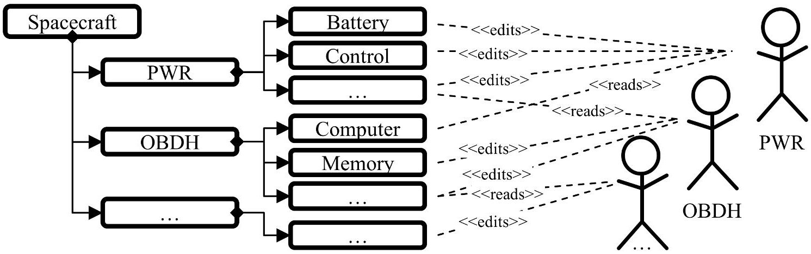
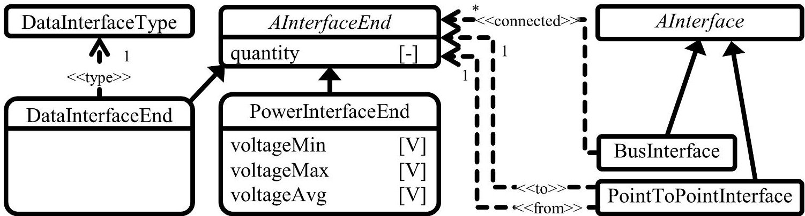
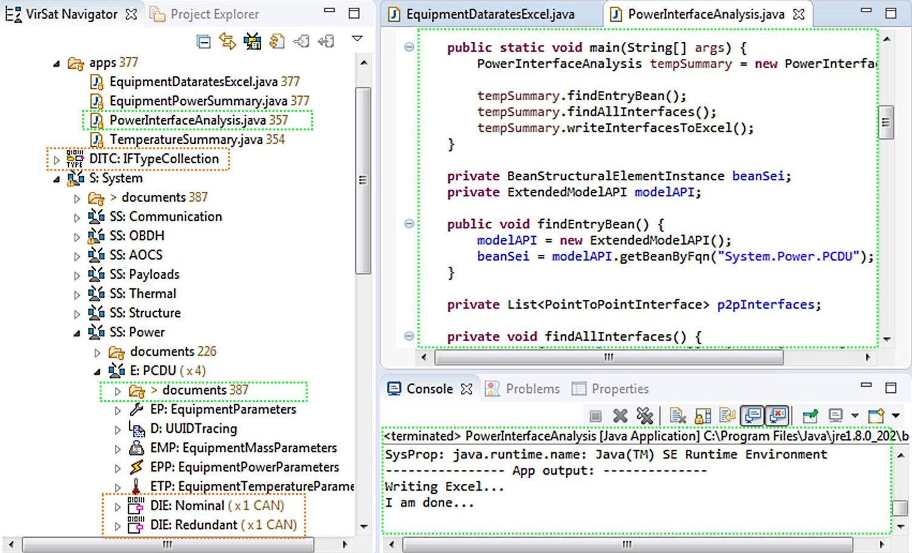

<!-- PDF_PAGE: 1 -->

# Spacecraft Interface Management in Concurrent Engineering Sessions $ ^{*} $

Philipp M. Fischer $ ^{1} $ , Caroline Lange $ ^{2} $ , Volker Maiwald $ ^{2} $ , Sascha Müller $ ^{1} $ , Andrii Kovalov $ ^{1} $ , Janis Häseker $ ^{2} $ , Thomas Gärtner $ ^{2} $ , and Andreas Gerndt $ ^{1} $

$ ^{1} $DLR (German Aerospace Center)

Software for Space Systems and Interactive Visualization

Lilienthalplatz 7, 38108 Braunschweig, Germany

{philipp.fischer,sa.mueller,andrii.kovalov,andreas.gerndt}@dlr.de

$ ^{2} $DLR (German Aerospace Center)

Institute of Space Systems

Robert-Hooke-Str. 7, 28359 Bremen, Germany

caroline.lange,volker.maiwald,janis.haeseker,thomas.gaertner}@dlr.de

November 4, 2019

## Abstract

This paper contributes to the topic of spacecraft interface and data rate management in Concurrent Engineering (CE) sessions. At DLR, CE is used together with a CE process for designing new spacecraft. The software Virtual Satellite supports this process. It provides a shared system model to the engineers to exchange design information. Until today, it supports the structural decomposition of the system and the analysis of design drivers such as the mass or power consumption of the spacecraft. During one of the S2TEP studies for a multi-mission platform it was required to have a closer look to power and data interfaces. This paper discusses the state of the art to this topic and derives a generic approach to it. This approach is customized and finally implemented in Virtual Satellite and directly applied in the S2TEP study.

Keywords: Model Based Systems Engineering, Interface Management, Concurrent Engineering, Spacecraft Engineering.

## 1 Introduction

Interface management is an essential part of spacecraft development. Traditionally, it has not been part of early design studies in Concurrent Engineering (CE) sessions. The presented work is based on handson results of the S2TEP project and the novelty of introducing interface modeling into DLR's concurrent engineering process supported by the software Virtual Satellite 4.

At DLR, new spacecraft and missions are designed and studied within the Concurrent Engineering Facility (CEF) in Bremen. The major design drivers analyzed in such a study are the overall mass, typically constrained by the launch mass, as well as the power budget of the system. Besides these two aspects, the engineers define the functional structure of the spacecraft including a selection of components to fulfill functional requirements. This process is supported by a data-model which is implemented by DLR's software Virtual Satellite. The data-model is used to share and directly analyze system information entered by the engineers. [6]

<!-- PDF_PAGE: 2 -->

Figure 1: Structural decomposition and ownership assignment

Even though analyzing the aforementioned design drivers produces a good first estimate of the spacecraft, some studies require inspecting other critical areas. One of them is about data rates of communication interfaces between components. To ensure reliable communication between, for example, the On-Board Computer (OBC) and other spacecraft components, an estimate of how much data is transferred on which interface is needed. This information is directly affecting the OBC sizing and the design of communication links. At DLR, this requires the here presented extension to the modeling capabilities provided by Virtual Satellite.

This paper discusses the current state of the art of CE and the data model at DLR. It continues on looking to other approaches dealing with interfaces and data rates including other existing data models and tools. The displayed work then elaborates on the requirements of the engineering use cases of estimating data rates, and defines the new interface extension to the data-model. The paper also provides implementation details to the extension in Virtual Satellite. The discussion finalizes on providing results of the S2TEP project where this new interface extension has been actually used.

## 2 Related work to CE process and data modeling

The preliminary design study of a spacecraft for a new mission is often conducted in CEFs such as the one at the Institute of Space Systems in Bremen. Here, the CE studies follow a well-defined process. It defines several aspects of a study, e.g: How many engineers from which domain have to be invited? What type of data model to use for information exchange? Which information has to be gathered at which time? [6]

At DLR such a study is supported by a Model Based Systems Engineering (MBSE) process. It requires inviting around twelve engineers from design critical domains. They discuss the design for usually one to sometimes three weeks. The design is shared in a common system model. This system model is provided by Virtual Satellite. The underlying Conceptual Data Model (CDM) provides modeling capabilities for actually creating the system model. An intrinsic rights management assigns ownership of modeled spacecraft components to responsible engineers. This rights management helps keeping the system model consistent. [6] Virtual Satellite constantly analyzes the system model and provides instant feedback to the engineers [2].

## 2.1 System modeling during concurrent engineering studies

During a CE study, the engineers start decomposing the system within the first days. The data-model provides a hierarchical structure of spacecraft components to support this task. The components are grouped in functional domains. As shown in Figure 1, the spacecraft is separated into functional groups of e.g. On-Board Data Handling (OBDH) and Power Management (PWR). Here the engineers can define the components they want to use. Additionally, they are assigned to their components using the intrinsic rights management. As an example, only the PWR engineer is allowed to change information on power components, but no one else. Contrary, all engineers can read all information from all other engineers. [6]

<!-- PDF_PAGE: 3 -->

Information associated with the components is stored in parameters and calculations. The engineers set a parameter such as maximum power by providing a value and a unit. Provided calculations make use of these parameters to e.g. let Virtual Satellite automatically calculate the average power consumption of a component. By convention there are parameters with a special meaning such as the parameter unit quantity. This parameter defines how often the component is built into the spacecraft, whereas mode duration and duty cycle represent the time a spacecraft remains in a specific system mode and how much of that time a component is active. The parameter unit active is important for calculating the power consumptions in case of redundancies, when not all components are turned on at the same time. [6] Visualizing the inputs and outputs of such calculations similar to UML block/interface diagrams was successfully shown in previous work [14]. A language called ICML was proposed to model signals and messages in the frame of interfaces [7].

Virtual Satellite 4 is the latest development. It is intended to support the whole lifecycle of a spacecraft. Since it is impossible to foresee all upcoming requirements on a data-model, it allows extending the data-model along the lifecycle. The Generic System Engineering Language (GSEL) allows defining new concepts for such a CDM extension. Concepts are activated when needed. A concept may contain new structural elements for decomposition, new parameters to store information and calculations to process them. The parameters are defined using an extended version of engineering categories. [5] These categories are similar to the type-object and dynamic-template pattern [8,11]. Engineers can define a category together with properties. These categories can then be instantiated on individual components at run-time, where the engineers can now define the value of the properties [13]. Based on an Eclipse and EMF infrastructure, new concepts can be shipped with additional implemented functionality and installed as new plug-ins [5].

## 2.2 Related data-models for CE and interface management

The Open Concurrent Design Tool (OCDT) is developed by the European Space Agency (ESA). It is developed for the use in CE and in ESA's Concurrent Design Facility (CDF) in particular. It provides a CDM called Space Engineering Information Model (SEIM) including capabilities for structural decomposition as well as storing information in parameters. A set of recommended parameters is defined under the name Space Engineering Reference Data Library (SERDL). Calculations are done in external tools such as Microsoft Excel. They can exchange information with the data-model by a generic REST API. [9,3]

Virtual Spacecraft Design (VSD) is another tool developed by ESA. It is designed for introducing MBSE into later project phases. It provides capabilities for hierarchical breakdown and structuring of the system, as well as adding components. On top of that, it offers configuration control mechanisms. [4] Information is stored in predefined objects such as state machines or interfaces. Designing functional electrical architecture is well supported by VSD. It allows defining InterfaceEnds on components and Interfaces connecting the InterfaceEnds. Individual information can be stored in engineering categories. [13]

SysML provides functionality to model block-diagrams together with ports and interfaces. Blocks within a block-diagram can be defined once and then reused and nested into other blocks, thus allowing a hierarchical decomposition. The blocks can communicate to other blocks through ports. There are different types of ports such as standard ports and flow ports. [12] Standard ports can either provide or consume a service. Signals and data flows should be modeled using flow ports. There is no clear cut definition when to use which one. [15]

## 2.3 Existing approaches for interface design in S2TEP

S2TEP was a project to build a small satellite platform. The plattform has been intended to be reused for several missions equipped with different payloads. [1] Such a multi-mission platform requires accurate design on the interface between spacecraft-bus and payload. The analysis of the interface focuses on functional electrical architecture. This comprises data interfaces and power interfaces. In S2TEP a special version of Virtual Satellite was initially used for later design phases after CE studies. [10] In order to handle the interface design at that time, the CDM got extended using the GSEL. The extension provides modeling capabilities for InterfaceEnds which can be assigned to some component e.g. an OBC. Additionally Interfaces allow point-to-point connections from one InterfaceEnd to another.

<!-- PDF_PAGE: 4 -->

InterfaceEnds can be refined by assigning a type. A validator proofs that both InterfaceEnd on an Interface are of the same kind. [5]

## 3 Defining a new methodology to CE interface modeling

The newly defined methodology is based on the presented work, which shows that modeling interfaces by itself is a well-researched topic. Nevertheless, introducing it for CE studies and introducing such modeling capabilities into the CDM is raising new implications and requirements such as:

1. The model has to obey the rights management and ownership on CDM level.

2. The modeling effort needs to be small to support agility of the studies.

3. The model needs to be precise enough to capture the important information.

## 3.1 Obeying ownership on CDM level

The CDM, as it has been introduced, requires that the information generated by an engineer is stored under their individual rights. Thus, others can only use it but not change it. Therefore engineers should define the connections offered by their components. Hence, the information artifact of offered connections need to be contained in the components. How these components relate to each other, meaning how they are finally connected, is not necessarily information of the same engineer. This could be modeled by someone else who is allowed to use, but not to alter the connections. Therefore, the modeling artifact for actual connections has to reference the connections on the components.

## 3.2 Conserving agility for interface modeling

The amount of time available during a CE study is limited. The engineers' main task is designing a spacecraft and not the model. This is reflected e.g. by the implicit decomposition using the unit_quantity parameter. A similar approach for interfaces is recommended. First, it will create a similar work-flow. Second, it will reduce modeling effort. Third, it will avoid data ambiguities in case of changes to interfaces. Meaning a change is applied to one interface with e.g a unit_quantity of 4, rather than changing individual instances of it four times.

## 3.3 Deriving interface types of interest

Different to signals and messages addressed with ICML, the two main types of interfaces identified in S2TEP are the power and data interfaces similar to VSD. The power engineer is interested in voltage ranges and power consumptions to size their sub-system correctly. The data engineer is interested in correct connection of types and comparison of data rates to match interface capacities.

The power consumption is already analyzed within Virtual Satellite, but power interfaces still need to be added together with parameters defining the voltage range. In early design iterations, this information helps the engineer to summarize the components with their power demands. In later iterations, the engineer can connect all components to the power sub-system and analyze whether required voltage levels and power consumptions match the sources.

The data interfaces are required for analyzing if data links provide the correct capacities. Further, it is of interest whether they are compliant to each other. This means that e.g. a CAN bus should only be connected to another CAN bus interface. The various different types need to be defined per project since some restrict their usage to a subset. Some other projects may introduce special ones, e.g. wireless interfaces. Similar to the power engineer, it is of interest which component is providing how much data. Therefore, new parameters have to be defined to store this information. The data rates depend on the quantity of the component and on how much data the component produces while it is turned on. To now verify capacities it is necessary to not only provide point-to-point interfaces such as in VSD or existing implementations of Virtual Satellite but also bus interfaces. Very often, multiple components are connected to e.g. one CAN bus. Still, other interfaces such as RS485 may require point-to-point connection from an OBC to a component. In the RS485 example, it is of main concern that the types are matching.

<!-- PDF_PAGE: 5 -->

Figure 2: Data-model extension for modeling interfaces

Storing the above discussed information in the data-model, it can be used to either automatically validate certain requirements or to read and analyze the data using the Virtual Satellite apps. The apps are a tool where engineers can access and analyze the data-model writing their own Java based programs. The advantage is, that changes to the analysis can be done by the engineers themselves during the CE studies. There is no need to build a new version of Virtual Satellite. To make such analysis-apps work correctly and to create a common understanding, a precise implementation and semantic definition of the model extension is required.

## 4 CDM implementation for interface modeling in CE

Figure 2 shows the important aspects of the extension to the data-model. Similar to VSD or SysML the extension provides ports which are called InterfaceEnds. Two specific ones for data and power are derived from the common abstract class. The abstract class contains the attribute quantity reflecting the amount of a given InterfaceEnd instantiated on a component. The PowerInterfaceEnd contains three attributes defining voltage ranges. The DataInterfaceEnds can be typed with an instance of DataInterfaceType similar to the interface description in SysML. Two different sets of interfaces are derived from the abstract class: PointToPointInterface and BusInterface. The first one connects exactly two InterfaceEnds while the second connects to a minimum of two.

The engineers can now use these new types for modeling InterfaceEnds to their component. There is no clear cut definition where the Interfaces should be modeled. One possibility is to provide a harness component for that purpose. The other alternative is that e.g. the PWR engineer takes care of modeling them and adding the relevant interfaces to some of the PWR components. To model the redundancy of interfaces, there is also no clear cut answer. One possibility is to model the InterfaceEnds and Interfaces twice. Attention has to be paid to the analysis of e.g. a redundant power interface, since it is not necessarily said that the power has to be provided twice but most likely once on either the nominal or redundant Interface. Unfortunately, this leaves room for ambiguities.

Alongside these new types, new parameters and calculations for defining the data rates are introduced based on the GSEL. The parameters are shown in Table 1 providing a short overview to their abbreviation, meaning, and if their values are manually entered (M) or a calculated (C). The corresponding calculations are shown in the following equations:

$$
D U n i t O n W M r g = D U n i t O n + \left(D U n i t O n * m r g M a t u r i t y\right)
$$

$$
D U n i t S t b y W M r g = D U n i t S t b y + \left(D U n i t S t b y * m r g M a t u r i t y\right)
$$

$$
D C o m b D u t y C y c l e = C o m p o n e n t P w r. d u t y C y c l e * d u t y C y c l e
$$

$$
D U n i t A v g W M r g = D U n i t O n W M r g * D C o m b D u t y C y c l e +
$$

$$
D U n i t S t b y W M r g * (1 - D C o m b D u t y C y c l e)
$$

$$
D A v g W M r g = D U n i t A v g W M r g * C o m p o n e n t P w r. a c t i v e U n i t s
$$

These equations are similar to the already existing power calculations. The maturity of the component used is defined in the general parameters of Virtual Satellite. The combined duty cycle needs special

<!-- PDF_PAGE: 6 -->

Table 1: New component parameters introduced for data rate calculations

<table border="1"><tr><td>Abbreviation</td><td>M/C</td><td>Meaning</td></tr><tr><td>DDutyCycle</td><td>M</td><td>Amount of time the comp. produces data when on</td></tr><tr><td>DUnitOn</td><td>M</td><td>Amount of data produced for one comp. turned on</td></tr><tr><td>DUnitStby</td><td>M</td><td>Amount of data produced for one comp. in stand by</td></tr><tr><td>DUnitOnWMrg</td><td>C</td><td>Amount of data plus the comp. design margin</td></tr><tr><td>DUnitStbyWMrg</td><td>C</td><td>Amount of data plus the comp. design margin</td></tr><tr><td>DUnitAvgWithMrg</td><td>C</td><td>Average amount of data with margin</td></tr><tr><td>DAvgWithMrg</td><td>C</td><td>Average amount of data multiplied for all comp.</td></tr></table>

Figure 3: Virtual Satellite 4 executing an app summarizing power interfaces

attention. It makes additional use of the duty cycle from the power parameters. The reason for this is that the component will only produce data in a limited time while it is turned on.

## 5 Application in the S2TEP CE system model

The above implementation has been developed during one of the S2TEP CE studies in 2018. During this study, the engineers decided to further investigate power and data interfaces. Based on the engineers' requirements, the above presented implementation has been developed and installed to Virtual Satellite. Once this new CDM extension had been used to model the first interfaces, the app engine of Virtual Satellite had been used to summarize the information and to condense it into Excel sheets.

Figure 3 shows Virtual Satellite with the original S2TEP data set. The hierarchical decomposition is on the left. It presents DataInterfaceEnds (DIE) for the PCDU component. One of the DIEs is named nominal, the other is named redundant following the aforementioned concept. Both of them are typed as CAN bus. These types are defined beforehand in the DataInterfaceTypeCollection (DITC) which is a new structural element introduced by the concept. Nevertheless, the purpose of that element is solely for data organization and has no further semantic meaning for the modeled system.

The right hand side of Figure 3 shows an app that has been implemented. Executing it, it collects

<!-- PDF_PAGE: 7 -->

all available Interfaces and InterfaceEnds and creates and overview which is stored in an Excel file. The Excel file is located in the documents folder and is therefore shared across the whole study group. It can be generated regularly during the study based on the latest information of all domain experts. Hence, it provides better insight into the current design e.g. when comparing voltage levels of power interfaces.

## 6 Summary

The work described here contributes to the question of introducing data and power interface modeling into CE studies. Looking to the state of the art, analyzing interfaces and data rates is not particularly new. Also Virtual Satellite provides some functionality for later design phases already. Other projects such as VSD from ESA address functional electrical architecture with interfaces but no data rates in particular. Still all of them, together with SysML ports and connections, have their share to the answer given here.

An important aspect is that Virtual Satellite and the data-model is tailored to the CEF process. One of the critical aspects during CE studies is time. Therefore, the data-model has to be simple to use for the engineers. As a consequence, multiple components of the same type are not explicitly modeled but indirectly reflected in a parameter stating their amount. This means that introducing interfaces should not result in extensive extra modeling effort.

The resulting extension to the CDM delivers the following parts: A new engineering category with parameters to define data rates per component, calculations that make use of these parameters, and new types such as DataInterfaceEnds and PointToPointInterfaces to actually model connections of components. Already existing concepts such as calculations of power parameters have been adopted as much as possible.

This new extension has actually been developed during one of the S2TEP CE studies and integrated into Virtual Satellite. The new types and categories have been used by the engineers to model data and interface information about the system. The PWR and OBDH engineer summarized this information for sizing their components using Virtual Satellite's app engine. This demonstrates the general flexibility of Virtual Satellite allowing to introduce new concepts quickly, even during a CE session.

Finally, this implementation is a successful extension to what Virtual Satellite provides for CE studies. Nevertheless, the topic of interfaces can be complex leaving room for ambiguities e.g. when talking about redundancies. These aspects should be addressed in future work.

## References

[1] Dannemann, F., Jetzschmann, M., Lange, C.: Enabling technologies and processes for space missions - the s2tep platform. In: 69th International Astronautical Congress (IAC). Bremen, Germany (October 2018)

[2] Deshmukh, M., Schaus, V., Fischer, P.M., Quantius, D., Maiwald, V., Gerndt, A.: Decision support tool for concurrent engineering in space mission design. In: Stjepandic, J., Rock, G., Bil, C. (eds.) Concurrent Engineering Approaches for Sustainable Product Development in a Multi-Disciplinary Environment. vol. 1, pp. 497-508. Springer London (September 2013), https://doi.org/10.1007/978-1-4471-4426-7_43

[3] ESA: Ocdt community portal. Accessed Online (2016-04-20), https://ocdt.esa.int/

[4] ESA: Virtual spacecraft design. Accessed Online (2016-04-20) (April 2013), http://www.vsd-project. org/

[5] Fischer, P.M., Lüdtke, D., Lange, C., Roshani, F.C., Dannemann, F., Gerndt, A.: Implementing model-based system engineering for the whole lifecycle of a spacecraft. CEAS Space Journal 9(3), 351 365 (September 2017), https://doi.org/10.1007/s12567-017-0166-4

[6] Fischer, P.M., Deshmukh, M., Maiwald, V., Quantius, D., Gomez, A.M., Gerndt, A.: Conceptual data model: A foundation for successful concurrent engineering. Concurrent Engineering Research and Applications 26(1), 55-76 (2018), https://doi.org/10.1177/1063293X17734592

<!-- PDF_PAGE: 8 -->

[7] Gianni, D., Schaus, V., D'Ambrogio, A., Gerndt, A., Lisi, M., de Simone, P.: Model-based interface engineering in concurrent engineering facilities: Motivations and possible applications to systems and service systems engineering. In: 6th International Conference on Systems & Concurrent Engineering for Space Applications (SECESA). Stuttgart, Germany (Oktober 2014)

[8] Johnson, R., Woolf, B.: Type object. In: Pattern languages of program design 3, pp. 47-65. Addison-Wesley Longman Publishing Co., Inc., Boston, MA, USA (1997)

[9] de Koning, H.P., Gerené, S., Ferreira, I., Pickering, A., Beyer, F., Vennekens, J.: Open concurrent design tool - esa community open source - ready to go! Accessed Online (2017-01-27) (2014), http://esaconferencebureau.com/docs/default-source/14c08_docs/ open-concurrent-design-tool---esa-community-open-source-ready-to-go!.pdf

[10] Lange, C., Grundmann, J.T., Kretzenbacher, M., Fischer, P.M.: Systematic reuse and platforming: Application examples for enhancing reuse with model-based systems engineering methods in space systems development. Concurrent Engineering Research and Applications 26(1), 77-92 (2018), https://doi.org/10.1177/1063293X17736358

[11] Lyardet, F.D.: The dynamic template pattern. In: The 4th Pattern Languages of Programming Conference. Monticello, Illinois, USA (1997)

[12] OMG: System modelling language - version 1.5. Tech. rep., Object Management Group OMG (2017)

[13] Rey, J.: Modeling with vsee: Definition of guidelines and exploitation of the models - ygt final report. Accessed Online (2016-07-19) (August 2013), http://www.vsd-project.org/download/documents/ YGT%20final%20report%20Rey%20V2.pdf

[14] Schaus, V., Müller, J., Deshmukh, M., Braukhane, A., Gerndt, A.: Bidirectional graphical modelling supporting concurrent spacecraft design. In: 6th International Conference on Systems & Concurrent Engineering for Space Applications (SECESA). Stuttgart, Germany (Oktober 2014)

[15] Weilkiens, T.: Systems Engineering mit SysML/UML: Modellierung, Analyse, Design. dpunkt.verlag GmbH, Heidelberg, Germany (2006)