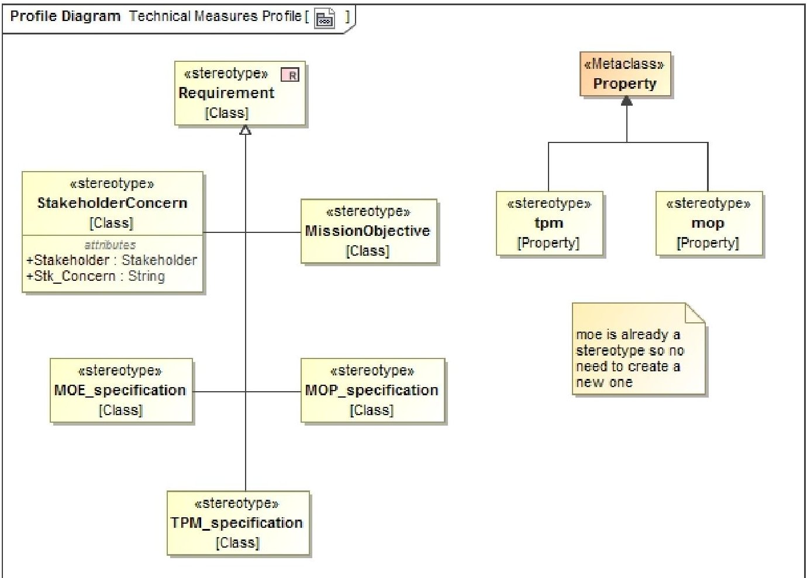
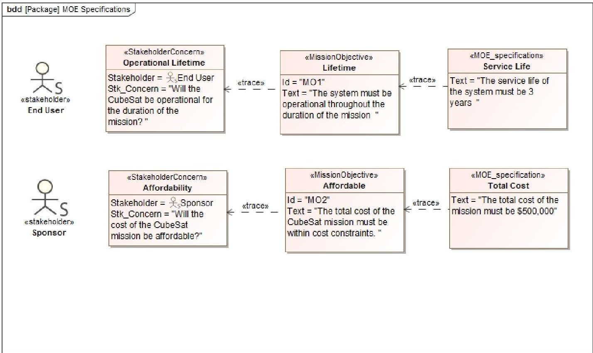
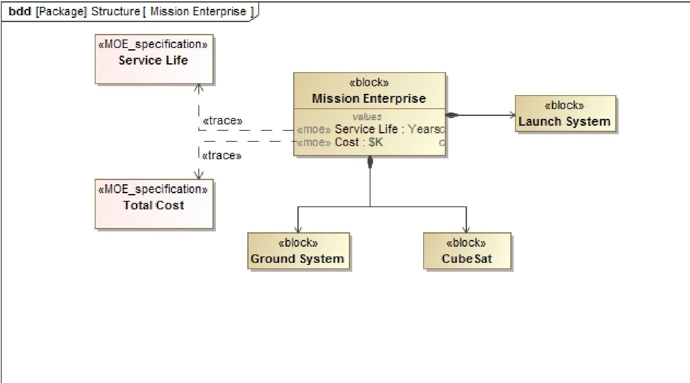
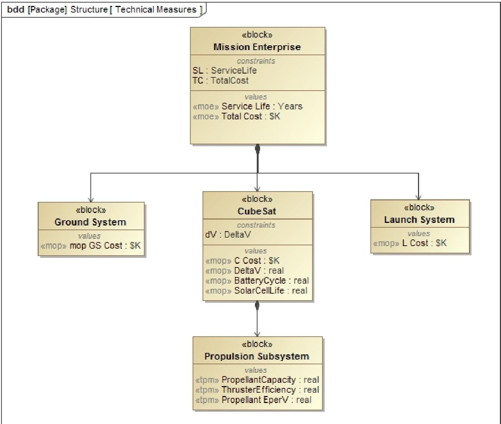
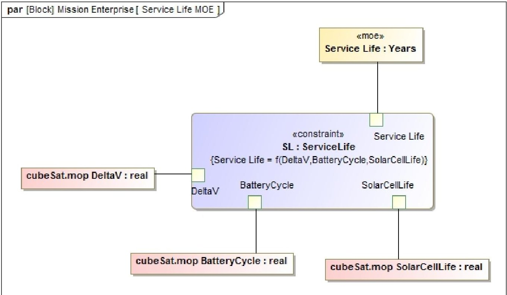
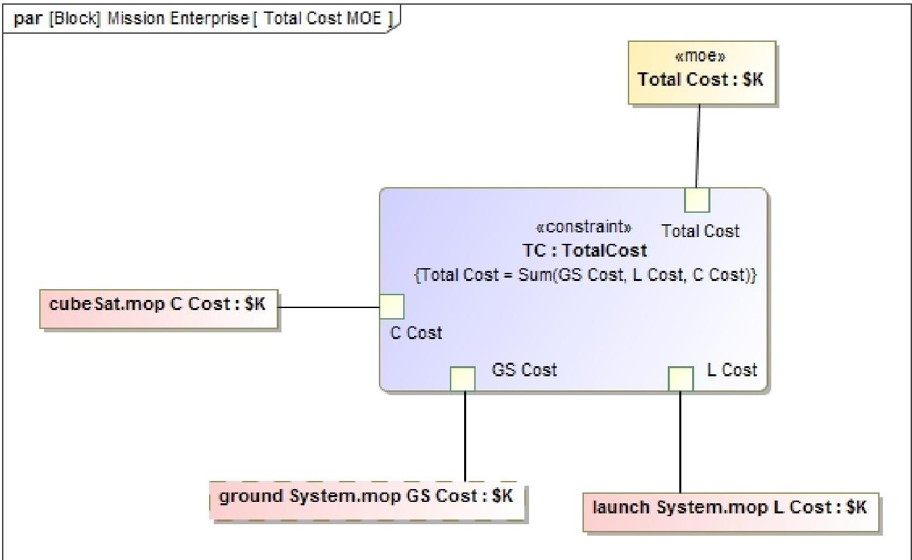
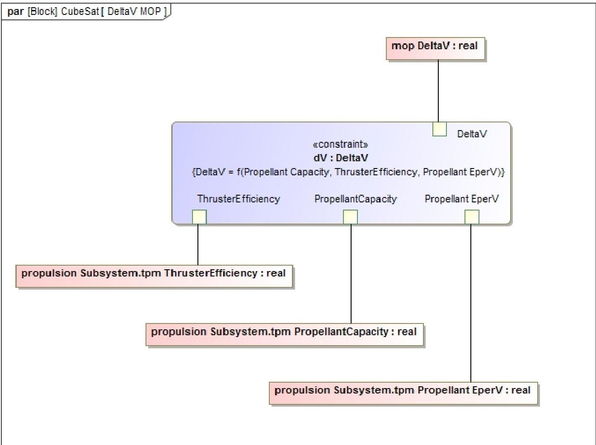

<!-- PDF_PAGE: 1 -->

# A Model-Based Systems Engineering Approach for Technical Measurement with Application to a CubeSat

David Kaslow Consultant

Berwyn, PA 19312

610-405-6685

david.kaslow@gmail.com

Bradley Ayres The Aerospace Corp. 2310 E. El Segundo Blvd. El Segundo, CA 90245 937-255-3355 x3422 bradley.ayres.ctr@afit.edu

Philip T Cahill Consultant

Bryn Mawr, PA 19010

610 787-0283

navyred@msn.com

Laura Hart The MITRE Corporation 7515 Colshire Drive McLean, VA 22102-7508 610 389-4534 lhart@mitre.org

Abstract- While much has been written about technical measurement and Model-Based Systems Engineering (MBSE), very little literature exists that ties the two together. What does exist treats the topic in a general manner and is void of details. Given the vital role that technical measurement plays in the systems engineering process, and the ever increasing adoption of the MBSE approach, there is a growing need to define how technical measurement would be implemented as part of a MBSE approach. The purpose of this paper is to address that need.

Technical measurement is defined as the set of measurement activities used to provide insight into the progress made in the definition and development of the technical solution and the associated risks and issues [1]. Technical measures are used to: determine if the technical solution will meet stakeholder needs, provide early indications if the development effort is not progressing as needed to meet key milestones, predict the likelihood of the delivered solution to meet performance requirements, monitor high risk items, and assess the effectiveness of risk mitigation actions.

MBSE is defined as the formalized application of modeling to support system requirements, design, analysis, verification, and validation activities beginning in the conceptual design phase and continuing throughout development and later life cycle phases [2]. The benefits of using an MBSE approach over a traditional document-based systems engineering approach are: enhanced communications, reduced development risk, improved quality, and enhanced knowledge transfer.

This paper defines a MBSE approach for technical measurement that begins with a set of mission objectives derived from stakeholder concerns. The objectives and concerns are represented as elements captured in the system model. Next, Measures of Effectiveness (MOEs) are derived from the mission objectives. Initially, these MOEs are captured in a special model element that allows for the MOEs to be described in a natural language format that stakeholders will understand. Those initial MOEs are then quantified and captured as value properties of the Enterprise block. The MOEs are traced back to their originating source in the mission objectives. Next, Measures of Performance (MOPs) are derived from the enterprise-level MOEs and captured as value properties of the System block. The derivation of the MOPs is captured through the development of constraint blocks and parametric diagrams. This provides for traceability between MOPs and MOEs and supports performance analysis of the MOPs to predict if the MOEs will be met. MOPs are also traced to system requirements captured in the system model. Next, the process steps at the system-level are repeated at the subsystem-level to

derive Technical Performance Measures (TPMs). These TPMs are traced back to MOPs and subsystem requirements in the same manner as described for MOPs.

Examples are provided throughout the paper which illustrate the application of this approach to a CubeSat. Using a CubeSat example is appropriate given the historically high failure rate and rapid growth of these missions and the role technical measurement could play in increasing their success.

## TABLE OF CONTENTS

1. INTRODUCTION ...1

2. TECHNICAL MEASUREMENT ...2

3. MODEL-BASED SYSTEMS ENGINEERING ...2

4. RELATED WORK ...3

5. INCORPORATING TECHNICAL MEASURES ...3

6. CONCLUSION ...8

REFERENCES ...9

BIOGRAPHY ...9

## 1. INTRODUCTION

The International Council on Systems Engineering's (INCOSE) Space Systems Working Group (SSWG) began investigating the applicability of MBSE for designing CubeSats back in 2011. The SSWG's recent effort has been focused on the development of a CubeSat Reference Model that can be used by any CubeSat development team. Reference [3] provides a history and interim status of that effort.

The SSWG's latest work has been on incorporating technical measures into the model. In support of that effort, an approach was developed to incorporate technical measures into a CubeSat Reference Model. This paper presents that approach.

Sections 2 and 3 provide an overview of technical measurement and MBSE. Section 4 discusses related work in this area and how this paper complements that work. Section 5 discusses the approach for incorporating technical measures into a system model. Examples are provided throughout this section which illustrates the application of this approach. These examples are taken from the CubeSat

<!-- PDF_PAGE: 2 -->

Reference Model. Finally, Section 6 concludes the paper with a discussion of the benefits of the approach and work that remains for future efforts.

## 2. TECHNICAL MEASUREMENT

Technical measurement is comprised of a set of measurement activities used to provide insight into the progress being made in the definition and development of the technical solution and associated risks and issues [1]. Technical measures are an established set of measures based on expectations and requirements that are tracked and assessed to determine overall system effectiveness and customer satisfaction [4]. Commonly used technical measures are Measures of Effectiveness (MOEs), Measures of Performance (MOPs), and Technical Performance Measures (TPMs). Another type of technical measure are Measures of Suitability (MOSs). This paper follows Reference [1] and considers a MOS to be a type of MOP.

## Measures of Effectiveness

## Measures of Performance

MOEs are operational measures of success closely related to the achievement of the mission objective being evaluated, in the intended operational environment under a specified set of conditions [1,4]. They are stated from the user's viewpoint and represent the most important criteria against which the quality of a solution is assessed.

MOPs are measures that characterize physical or functional attributes relating to system operation, measured or estimated under specified testing and/or operational environment conditions [1, 4]. They are stated from the developer's viewpoint and look at how well the delivered system performs, or is expected to perform, against system requirements.

## Technical Performance Measures

TPMs measure attributes of a system element to determine how well that element is satisfying, or expected to satisfy, a technical requirement [1,4]. TPMs are derived directly from MOPs [1,5]. They are used to confirm progress and identify deficiencies that might jeopardize meeting a system requirement [4].

## Relationship of MOEs, MOPs, and TPMs

Reference [1] discusses the relationships between technical measures. MOEs reflect the stakeholder's intention. They indicate an attribute a system must possess in order to meet an operational need. MOPs are derived from MOEs. MOPs are concerned with the actual performance of a system solution. They are used to assess whether the system meets requirements that are necessary to satisfy the MOEs. TPMs are then derived from MOPs. They provide a lower level view of specific aspects of the system solution.

MOEs represent stakeholder expectations and are used to validate that the system meets the users' intended needs. MOPs represent the key performance characteristics the system should have in order to satisfy the MOEs and are used to verify that the system meets the stated requirements. TPMs are derived from MOPs and represent attributes of elements of the system architecture. TPMs are used to determine progress towards meeting a technical requirement.

## 3. MODEL-BASED SYSTEMS ENGINEERING

MBSE is defined as the formalized application of modeling to support system requirements, design, analysis verification, and validation activities beginning in the conceptual design phase and continuing throughout development and later life cycle phases [2]. A traditional systems engineering approach focuses on the development of textual specifications and design documentation. This is characterized as being a "document-based" approach. In contrast, MBSE focuses on the development of a coherent system model that consists of requirements, design, analysis, and verification information and is characterized as a "modelcentric" approach. In MBSE, the model serves as a single source of truth for the development team and is the primary artifact produced by systems engineering activities Documentation becomes secondary and is generated from the system model.

In comparison to the traditional approach, MBSE provides a more rigorous method for capturing, integrating, and maintaining outputs of systems engineering activities. The benefits of using this model-centric approach include: enhanced communications, reduced development risk improved quality, and enhanced knowledge transfer [2].

Reference [2] states that a MBSE method is a method that implements all or part of the systems engineering process and produces a system model as one of its primary artifacts. That system model includes system specifications, design analysis, and verification information. The primary use of the system model is to enable the design of a system that satisfies its requirements and meets its overall objectives [2]. As such, incorporating technical measures into the system model, in this case a CubeSat Reference Model, becomes critical.

## The Systems Modeling Language (SysML)

SysML is commonly used in MBSE [6]. It is a graphical modeling language developed by the Object Management Group (OMG) to be used for modeling a wide range of systems engineering problems. It's not dependent on any single systems engineering method and is intended to support multiple methods. It is well-suited for specifying requirements, structure, behavior, allocations, and constraints on system properties to support engineering analyses. References to SysML are made throughout this paper. Reference [2] provides a thorough description of SysML and how it may be applied to modeling systems.

<!-- PDF_PAGE: 3 -->

## 4. RELATED WORK

Taking a model-based approach to technical measures is not new. Several past efforts have modeled technical measures for use in analyzing different architectural designs as part of an effectiveness analysis. This method is discussed in Reference [7]. Reference [8] applied this approach for the optimization of a disaggregated space system architecture for monitoring and detecting wildfires. Reference [9] applied this approach to the design of a space-based command, control, communications, and information architecture. However, these applications are void of a system model, the product of the MBSE approach. As such, there is no traceability between other elements of the system model such as requirements, structure, behavior, and verification.

References [2] and [10] provide an approach for incorporating technical measures into a system model. This approach defines technical measures as value properties of blocks representing different elements of the system hierarchy. Reference [2] defines MOEs as properties at the enterprise level and MOPs as properties at the system level. Reference [10] defines TPMs as properties at the system level. Additionally, Reference [2] demonstrates how constraint blocks and parametric diagrams can be used to accomplish an operational cost effectiveness analysis based on the MOEs defined at the enterprise level. However, this approach is not complete and provides no traceability to stakeholder expectations, connections between technical measures, and connections with requirements.

The approach in this paper extends the above approach to include traceability from stakeholder expectations to TPMs. It also provides for a means to capture qualitative statements of technical measures.

## 5. INCORPORATING TECHNICAL MEASURES

## Technical Measures Profile

SysML provides provisions for incorporating domainspecific language into a system model through the use of profiles. This approach to incorporating technical measures requires the creation of unique model elements that are not part of SysML. These elements are listed below:

- Stakeholder Concern. SysML does provide a means for capturing the concerns of stakeholders through the use of the "comment" model element. However, this element does not allow for traceability. As such, a new element is created that will allow for that traceability.

- Mission Objective. This is a unique element that is used to capture the broad set of goals that must be achieved to satisfy a mission need.

- MOP. Not part of SysML requiring a new model element to be created.

- MOE. Currently treated as a non-normative extension to SysML.

- TPM. Not part of SysML requiring a new model element to be created.

- MOE Specification. This approach allows for capturing textual descriptions of measures that can then be translated to properties that can be quantitatively assessed. Users may be well versed at stating the need verbally, but not at capturing value properties. The MOE Specification is a model element created for capturing a user's description of the MOE. Additionally, as Reference [1] and [11] state, MOEs may be qualitative and do not have to be quantitative. This element allows for the capture of qualitative MOEs.

- MOP Specification. This model element is used to capture qualitative descriptions of MOPs that can then be translated into properties of the system.

- TPM Specification. This model element is used to capture qualitative descriptions of TPMs that can then be translated into properties of system elements.

Figure 1 shows the model elements created as part of the technical measures profile used in this approach.

## Deriving Mission Objectives from Stakeholder Concerns

The approach starts with developing mission objectives derived from the concerns of stakeholders. This is an important first step as MOEs are subsequently derived from those objectives deemed by the stakeholder as critical for mission success [11].

In this example, there are two stakeholders identified: the end user who is concerned with successful operation of the CubeSat and the sponsor who funds the project and is concerned about affordability. Since an advantage of a CubeSat is its relatively low cost, ensuring the project does not go over budget is a logical concern for the sponsor. The concerns of these stakeholders are captured as shown in Figure 2. Additionally, the corresponding mission objectives that capture these concerns are also shown in Figure 2. The mission objectives are related to the stakeholder concerns through the use of the "trace" relationship.

## Capturing Critical Objectives as MOE Specifications

Reference [12] states that "The unquantified statement, which expresses the stakeholders views of the properties which any successful solution the need must possess, is a concept; it is associated only with the stakeholders; and it gives a direction for the verification and validation phase on which tests can be planned." In this approach, these "unquantified statements" are captured as MOE specifications. This is also shown in Figure 2.

<!-- PDF_PAGE: 4 -->

Figure 1. Technical Measures Profile

Figure 2. Deriving Specifications for MOEs

<!-- PDF_PAGE: 5 -->

The qualitative descriptions captured in the MOE specifications are now translated into value properties of the mission enterprise. The mission enterprise is defined as the aggregation of systems and users that work together to accomplish a mission objective [2]. For the purposes of this example, the mission enterprise is comprised of a ground system, launch system, and CubeSat.

For the mission enterprise, two value properties are created. The first corresponds to the service life MOE and the second to cost. These are shown in Figure 3. Note these value properties are clearly distinguished as MOEs as shown by "<<moe>>" stereotype. Traceability back to the MOE specifications is accomplished using the trace relationship. This allows for complete traceability from the quantified value properties of the mission enterprise block back to the originating stakeholder concern. This enables quickly assessing the impact of any changes to stakeholder concerns.

Once the MOEs are defined, MOPs can now be defined and quantitative relationships between the two can be established. MOPs are derived based on the technical requirements that address the MOPs that trace to mission objectives [1].

For the service life MOE, following the example provided in Reference [1], service life of the CubeSat is a function of the delta V required to maintain the orbit for the duration of the mission, battery cycles, and solar cell life. These factors are captured as MOPs of the CubeSat in the form of value properties. This is shown in Figure 4.

For the total cost MOE, total cost consists of the sum of the individual costs of the elements comprising the mission enterprise. Costs associated with each element of the mission enterprise are captured as value properties of that particular element. This is also shown in Figure 4.

Figure 3. Mission Enterprise

<!-- PDF_PAGE: 6 -->

Figure 4. Technical Measures

## Relating MOPs to MOEs

MOEs can now be determined empirically through analysis of the MOPs. In SysML, constraint blocks and parametric diagrams are used to perform this type of analysis. First, a constraint block is created that captures the empirical relationship between the MOPs and MOEs. In this example, service life is a function of delta V, battery cycles, and solar cell life. A constraint block is created to capture this function and its required parameters. A parametric diagram is created to bind the values of these parameters to the technical measures. This allows different solutions to be evaluated against the MOEs. A similar approach is taken in order to address the total cost MOE. These are shown in Figures 5 and 6.

## Deriving TPMs

TPMs are derived in much the same way as the MOPs were derived. In this example, delta V is a function of propellant

capacity, thruster efficiency, and propellant energy per volume. These are captured as value properties of the propulsion subsystem of the CubeSat. This is also shown in Figure 4. Though not shown, the same derivation for costs could be accomplished at the CubeSat subsystem level as was done for the major elements of the mission enterprise.

## Relating TPMs to MOPs

TPMs are related to MOPs in much the same way as MOPs are related to MOEs. Again, constraint blocks and parametric diagrams are used to calculate MOP values based on the TPM values. This allows for evaluation of different subsystem solutions based on their impact to the MOP. This is shown in Figure 7. Reference [13] provides a detailed discussion of how these values are calculated in the model and the types of trade studies that can be accomplished using them.

<!-- PDF_PAGE: 7 -->

Figure 5. Relating MOPs to Service Life MOE

Figure 6. Relating MOPs to Total Cost MOE

<!-- PDF_PAGE: 8 -->

Figure 7. Relating TPMs to DeltaV MOP

## 6. CONCLUSION

## Summary

This paper presented an approach for incorporating technical measures into a system model that began with the identification of stakeholder concerns and ended with the derivation of TPMs. This approach has the following benefits:

- Traceability. There is clear traceability from stakeholder concerns to TPMs allowing for the impact of any changes to be easily assessed.

- Qualitative measures. The use of textual specifications for defining technical measures broadens the scope to include all types of technical measures within the system model.

- Trade analyses. This method allows for different solutions to be assessed as to their ability to meet MOEs.

- Generalizability. This approach is not dependent on any specific tool and is general enough to be easily incorporated into many systems engineering methodologies.

## Future Work

As mentioned above, technical measures form a basis for which verification and validation can occur. Future work is needed to incorporate model elements associated with those activities and relate them to the technical measures discussed here.

<!-- PDF_PAGE: 9 -->

## REFERENCES

[1] Technical Measurement: A Collaboration Project of PSM, INCOSE, and Industry. INCOSE-TP-2003-020-01. INCOSE, 2005.

[2] S. Friedenthal, A. Moore, and R. Steiner, A Practical Guide to SysML: The Systems Modeling Language, $ 3^{\mathrm{rd}} $ ed. Morgan Kaufmann, 2015.

[3] D. Kaslow, B. Ayres, P. Cahill, L. Hart, and R. Yntema. "Developing a CubeSat Model-Based Systems Engineering (MBSE) Reference Model - Interim Status #3." Proceedings of IEEE Aerospace Conference. Big Sky, MT. 2017.

[4] NASA Systems Engineering Handbook. NASA/SP-2016- 6105 Rev2. NASA, 2016.

[5] Systems Engineering Fundamentals. Defense Acquisition University Press. DAU, 2001.

[6] L. Delligatti, SysML Distilled: A Brief Guide to the Systems Modeling Language. Addison-Wesley, 2014.

[7] Analysis of Alternatives (AoA) Handbook: A Practical Guide to the Analysis of Alternatives. 377ABW-2013- 0453. Office of Aerospace Studies, 2013.

[8] R. Thompson, J. Colombi, J. Black, and B. Ayres. "Disaggregated Space System Concept Optimization: Model-Based Conceptual Design Methods." Systems Engineering. Vol. 18, No. 6. 2015.

[9] O. Sindiy. "Model-Based System-of-Systems Engineering for Space-Based Command, Control, Communication, and Information Architecture Design." Dissertation. Purdue University. 2010.

[10] S. Friedenthal and C. Oster. "Applying SysML and a Model-Based Systems Engineering Approach to a Small Satellite Design." Advances in Systems Engineering. American Institute of Aeronautics and Astronautics, 2016.

[11] Expanded Guidance for NASA Systems Engineering Volume 1. NASA/SP-2016-6105-SUPPL. NASA, 2016.

[12] N. Sproles. "Coming to Grips with Measures of Effectiveness." Systems Engineering. Vol. 3. 1999.

[13] S. Spangelo et al. "Model Based Systems Engineering (MBSE) Applied to Radio Aurora Explorer (RAX) CubeSat Mission Operational Scenarios." Proceedings of IEEE Aerospace Conference. Big Sky, MT. 2013.

## BIOGRAPHY

David Kaslow has thirty-five years of experience at Lockheed Martin in both the technical and management aspects of developing ground mission capabilities. He has five years of experience at Analytical Graphics creating their Standard Object Catalog and pursuing Model-

Based Systems Engineering. Dave is a co-author of four chapters Cost-Effective Space Mission Operations. He is also the author and co-author of papers and presentation for INCOSE Annual International Symposiums and Workshops, the IEEE Aerospace Conference, the Small Satellite Workshop and the NDIA Systems Engineering Conference. Dave is the lead for the INCOSE Space Systems Working Group. He has participated in the Space Systems MBSE Challenge Team since its founding in 2007 and is a principal contributor to the CubeSat Challenge Team.

Bradley Ayres, Ph.D., is an Adjunct Assistant Professor of Systems Engineering, Department of Aeronautics and Astronautics at the Air Force Institute of Technology. He serves as the Aerospace Corporation Chair supporting AFIT and the Center for Space Research and Assurance. He received his

Ph.D. in Business Administration specializing in MIS from Florida State University in 2003. Dr. Ayres has degrees from University of Missouri (BS, Chemical Engineering), Webster University (M.A., Procurement and Acquisition Management) and AFIT (M.S., Software Systems Management). Dr. Ayres' research interests include management of complex systems, model-based systems engineering, and space systems engineering. His is a member of the PMI, INCOSE and AIAA.

Phil Cahill has forty-five years of experience in the Information Technology industry, as consultant, customer, and contractor for government and commercial systems. He spent thirty of those years with the Lockheed Martin Corporation,

concerned primarily in the specification and development of defense and space systems, and retired as a Lockheed Martin Fellow. Phil's professional interests center on System Engineering, particularly for Systems of Systems, but he developed a passion for Data Center Operations late in his career and maintains an active interest in that field. He received his PhD in Physics from the University of Illinois at Urbana-Champaign.

<!-- PDF_PAGE: 10 -->

Laura Hart is a Systems Engineer at The MITRE Company in Mclean VA where her focus is on the advancement and application of model-based systems engineering. Prior to that, Ms. Hart worked for Lockheed Martin as a Sr. member of the Corporate Engineering and Technology Advanced Practices group responsible for codifying,

teaching and applying MBSE best practices across the LM Corporation. She has over twenty years of industry experience covering a wide spectrum of responsibilities from requirements, design, implementation, integration and test within the DoD industry. Laura is an active member of the OMG and supports both the SysML and UPDM/UAF specification working groups.