<!-- PDF_PAGE: 1 -->

# An MBSE Conceptual Design Phase Model for Inter-Satellite Communication

Awele I. Anyanhun and William W. Edmonson

Department of Electrical and Computer Engineering

North Carolina A&T State University, Greensboro, NC, United States

Email: {aianyanh@aggies.ncat.edu, wwedmons@ncat.edu}

Abstract—Inter-Satellite Communication (ISC) is a relatively new and emerging technology for small satellite systems. The level of complexity associated with an inter-satellite communication system necessitates a Model-Based Systems Engineering (MBSE) approach towards the system design concept. Applying MBSE concepts in the early life-cycle phases of the ISC system development, will lead to a well-defined set of system requirements. In this direction, we present a model-based Concept of Operation (ConOps) for an ISC system using visible light communication (VLC). The ConOps model captures the scope definition process and the allocation of stakeholder requirements to stakeholder use cases. Also captured is the Operation Concept (OpsCon) and operational scenarios necessary for defining the system requirements.

Index terms MBSE, Inter-Satellite Communication, SysML, Operations Concepts, Concept of Operation, VLC

## I. INTRODUCTION

Model-Based System Concept development represents an approach to concept engineering [1] in which conceptual design activities and artifacts are captured by means of a model. System concepts consist of two perspectives [2]: a concept of operations (ConOps) perspective and an operational concept (OpsCon) perspective. In current systems engineering practice, these two perspectives are traditionally captured using textual documentation. This traditional approach suffers from: a lack of precision in describing system characteristics and operational scenarios, inconsistencies between related documents whose information are used in the preparation of the ConOps and difficulty in maintaining synchronization and consistency between stakeholder requirements and system level requirements. This limitations often result in inefficiencies and quality issues that only become apparent during integration and testing [3] phase.

Limitations of document-based ConOps development can be addressed by model-based systems engineering (MBSE) which is a formalized application of modeling to support system requirements, design, analysis, verification, and validation activities beginning in the conceptual design phase and continuing throughout the complete life cycle [4]. Deploying MBSE at the system concept level will enable the systems engineering team to make one complete model of the system, making it possible to trace (verify) the system design back to the stakeholder needs and goals.

In this paper we present an abridged form of the Concept of Operations Model developed for a Visible Light Communication system for inter-satellite communication between small satellites. A model based Concept of Operations (ConOps) denotes a model produced early in the requirement definition process that describes what the system will do and why by means of a model. The captured activities performed during the conceptual design phase enables the visualization of proposed solutions and processes required to achieve expected system capability. The ConOps model captures the systems operational scenarios (OpsCon) as a black box; It provides an efficient way to explore, update, and communicate system aspects to the stakeholders while significantly reducing or eliminating dependence on textual documents. Furthermore, explicit traceability between elements of the ConOps is achieved enabling better assessments of the impacts due to changes.

The rest of the paper is organized as follows. After a brief system description in Section 2, the system scope definition activities, operational concepts and operational scenarios are presented in Section 3, while the conclusion is captured in Section 4.

## II. CONCEPT OF OPERATIONS MODEL

A Concept of Operations as defined by the International Council for Systems Engineering (INCOSE) in [5] is a document (model) produced early in the requirements definition process to describe what the system will do and why. A ConOps is necessary in order to capture all required information needed for the development of system requirements and the design of the system; it places the high-level needs in context leading to a description of the systems operational usage during various mission phases in order to meet stakeholder expectations. A ConOps is treated as living document (model), subject to changes and updates as appropriate.

A model-based ConOps can be used by system architects and designers to provide better understanding of stakeholder needs at the beginning of the system design process; it should serve as the starting point of the system requirement analysis and system design phases. Capturing system concepts in a model-based way makes it possible to have a central model with systems engineering artifacts from the various life-cycle phases. The created conceptual model is representative of the most abstract description of how the mission (tasks) will be conducted when the system is available. The Scope Definition Activity represents a main task in ConOps development.

<!-- PDF_PAGE: 2 -->

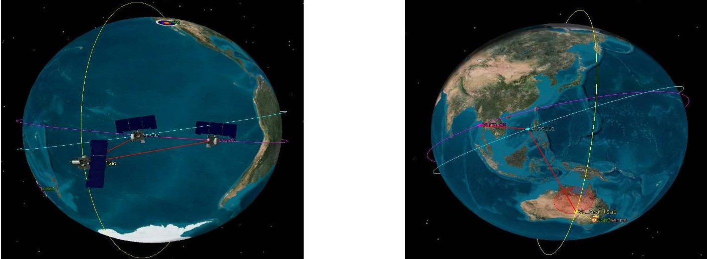

Fig. 1: Conceptual Design

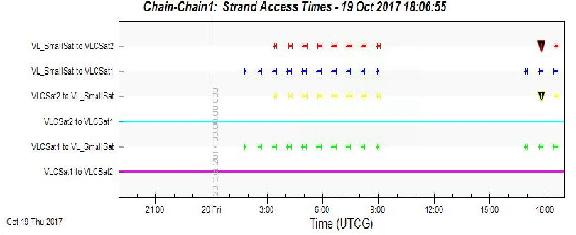

Fig. 2: Access Data for Spacecrafts

## A. System Description

Outlined in this ConOps model is the baseline strategy for relay communications between three formation flying spacecrafts deployed in low earth orbit. The network of spacecrafts comprise two (2) CubeSats (6U) and One (1) SmallSat. Shown in Fig. 1 are views of the conceptual design while Fig. 2 captures corresponding access time data. The CubeSats will orbit in equatorial low earth orbits (LEO) while the SmallSat will be deployed in a sun-synchronous low earth orbit at a slightly higher altitude than the CubeSats. The satellites will be piggyback aboard a launch vehicle which will assist them in achieving orbital insertion. They will utilize their RF-band full duplex links for initial communication with Earth prior to orbital insertion. Once the CubeSats and SmallSat have achieved orbital insertion, The a visible light (VL) transponder will be activated and they will utilize VL full duplex links for communication. Commands will be uplinked to the two formation flying CubeSats via the SmallSat Orbiter orbiting in a sun synchronous orbit.

The SmallSat will consist of a gimbaled RF (UHF or Xband) antenna pointing towards Earth. The orbiting SmallSat will communicate with the formation flying CubeSats primarily through the VL full duplex links. The CubeSats once deployed and in orbit will communicate and relay payload data via their VL-band inter-satellite links. Stringent quality of services requirements necessitate a robust relay communication system design that will be fault tolerant, hence the telecommunication subsystem will consist of a hybrid transponder system capable of visible light and RF full-duplex

communication links. The RF communication system will fulfill the role as the ancillary communication system reserved as a back-up system in the case of a fault or failure of the primary VL relay transponder system, while the VL links will be used as the primary means of communication for data relay between the CubeSats and SmallSat, respectively.

The proposed VL/RF Relay Telecommunication subsystem represents a hybrid transponder capable of providing relay services on inter-satellite links using VL full duplex communications. The use of VL full duplex links will be capable of delivering high data rates (Gbits) as well as near real-time data from the on-board payloads.

## III. SYSTEM SCOPE DEFINITION

The scope definition process provides a crucial foundation for writing good system requirements which is vital to building a successful system. Scope defining activities are concerned mainly with exclusively capturing externally visible system properties. The ability to define the system scope clearly will directly impact, positively, the quality of the written system requirements. Scoping activities prevent the capturing of incorrect requirements and the omission of key requirements [2].

Applying an MBSE approach to the project scoping process does not change the activities performed or deliverables produced during this phase of concept development. However, the significant difference in employing a model-based approach is in the primary artifact produced which is a system model [6]. An MBSE framework for developing consistent ISC system architectures was developed in [7]. The activity diagram depicted in Fig. 3 outlines the major activities involved in the system scope definition process.

These activities include defining stakeholder needs, establishing system goal(s) and objectives, developing operational concepts, developing a verification, validation & test plan alongside stating any system constraints and assumptions.

## A. Defining Project Goals

The goal(s) definition process helps define the project's outcome based on the identified need. Goals must trace to the needs of the project since they represent the big picture

<!-- PDF_PAGE: 3 -->

of what the final outcome will be [8]. Project goal(s) are a clear statement of purpose about the fundamental aim to be accomplished and should directly relate to the stakeholder need statement(s). Shown in Fig. 4 is a requirements diagram

depicting the stakeholder needs, the rationale behind each need and the relationship between the need, goals, objectives and stakeholder needs for the proposed VLC communication system. A project can have one or more goals with each

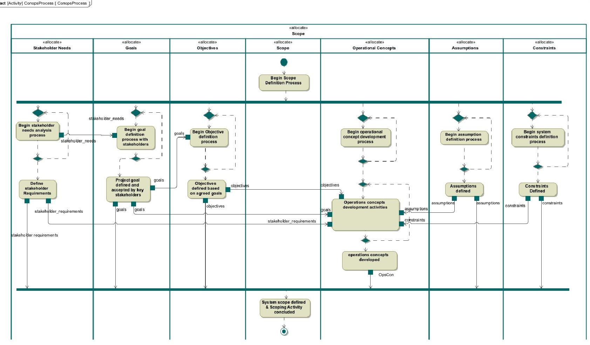

Fig. 3: Scope Definition Activity

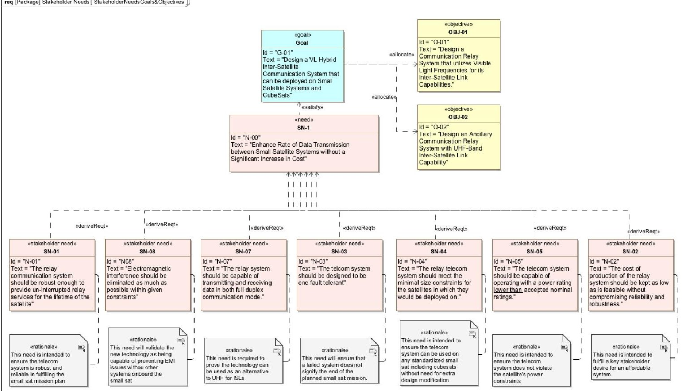

Fig. 4: Conceptual Design Goals, Objectives & Needs

<!-- PDF_PAGE: 4 -->

goal having one or more associated objectives. Based on the outcome of the need definition process, the goal of the project is to:

"Develop a VL Hybrid Inter-Satellite Communication System that can be deployed on Small Satellite Systems"

## B. Defining Project Objectives

Project objectives are specific, concrete and measurable statements representing the initiatives that will enable the implementation of the stated goal. Objectives are owned by goals and they outline the performance measures that lead towards the realization of the stated goal. Two objectives associated with the project goal are stated as:

- "Design a Communication Relay System that utilizes Visible Light Frequencies for its Inter-Satellite Link Capabilities."

- "Design an Ancillary Communication Relay System with UHF-Band Inter-Satellite Link Capability"

## C. Identify Stakeholder Needs

The stakeholder needs definition process involves activities geared towards eliciting clear and concise needs for the proposed project. In [9], a need is defined as a generic abstract concept that when put into a Context, represents something that is necessary or desirable for the subject of the Context. Care must be taken to identify all stakeholders during the elicitation process to ensure that needs which may arise throughout the life cycle of the project are all considered. Once stakeholder need statements have been elicited and modeled, they will then be further clarified and translated into more engineering-oriented language in a set of stakeholder requirements to enable proper architecture definition and requirement activities [10]. The pivotal need is captured in the need statement:

"Enhance Rate of Data Transmission between Small Satel-

## lites without a Significant Increase in Cost".

## D. Identify Stakeholder Use Cases

Identification of stakeholder use case is the next activity to be performed when defining the system/project scope. Use cases depict the expected operational capabilities of the proposed system. A use case as defined in [11] is a collection of requirements around a system usage; use cases represent coherent system functionality, they describe how a system will be used to achieve a specific goal.

The proposed Relay Communication System use cases include: Data Relay Services Use Case; Navigation Services Use Case and Timing Services Use Case. Each use case is associated with a use case description which is an informative statement that describes the scope of the use case. The Navigation Service and Timing Services use case descriptions are outside the scope of this work. Portrayed in Table. I is the use case description for Data Relay Service use case.

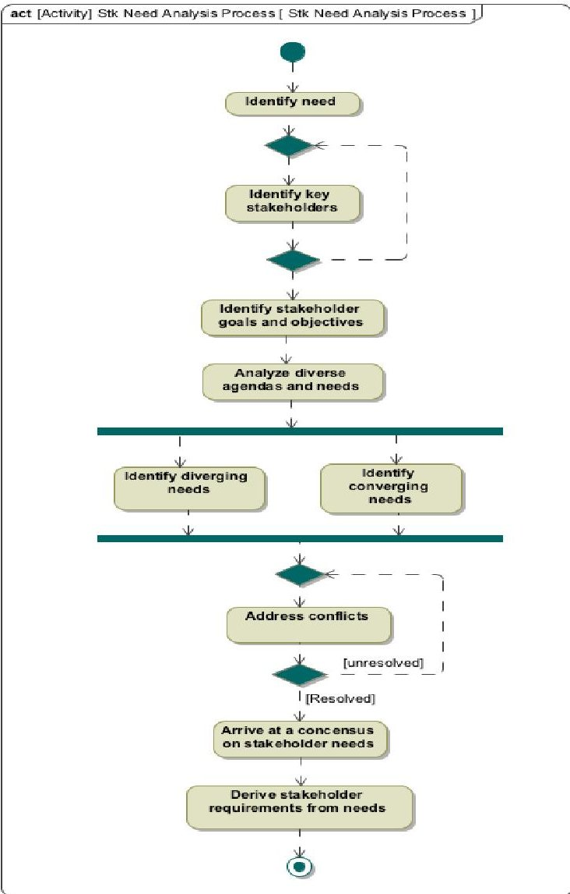

Fig. 5: Stakeholder Needs Analysis Activity

TABLE I: Provide Data Relay Services Use case Description

<table border="1"><tr><td colspan="2">DATA RELAY USE CASE DESCRIPTION</td></tr><tr><td>Name</td><td>Provide Data Relay Services</td></tr><tr><td>Goal</td><td>Provide full-duplex relay sessions with designated assets.This includes receiving and forwarding commands and payload data.</td></tr><tr><td>Summary</td><td>The relay communication system will support inter-satellite relay services via VL-band full duplex links.It will have the capability to transmit and receive payload data and commands via VL-ISL to/from any assets whenever access exists between both assets.</td></tr><tr><td>Actors</td><td>Communication Software, Transponder, Antenna</td></tr><tr><td>Pre-Condition</td><td>A LoS configuration must exist between communicating assets.Adequate storage capacity must be availableThere is available data to be transmitted/received.</td></tr><tr><td>Post-Condition</td><td>Receiving asset acknowledges receipt of data.Successful transmission of data.</td></tr><tr><td>Invariants</td><td>LoS between any two communicating assets can always be established.</td></tr></table>

<!-- PDF_PAGE: 5 -->

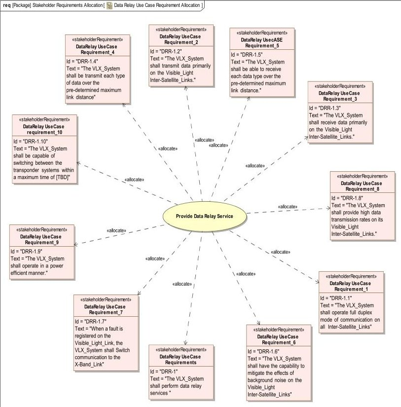

Fig. 6: Allocation of Requirements to Data Relay Use case

## E. Allocate Stakeholder Requirements to Use Cases

Following the completion of the stakeholder use case identification activity, stakeholder requirements are allocated to stakeholder use cases. Stakeholder requirements are the means by which stakeholder expectations are communicated to system designers; by allocating these requirements to use cases, traceability of system usage to requirements is enforced. The Data Relay use case and requirements allocation diagram shown in Fig. 6 portrays the stakeholder requirements that fulfill the use case. The iterative nature of the modeling process enables additional identified requirements be added and the model updated.

## F. Operations Concept (OpsCon) Definition Activity

The Operations Concept (OpsCon) development phase focuses on the end-to-end system operation from the stakeholder's perspective. Operations concept development activities aid in identifying key capabilities and assumptions of the proposed system which help to define necessary functionality and performance expectations used in the formulation of system requirements.

The operational concept model helps articulate the problem space [12], while also serving as a guide for the design and implementation of VLC Inter-Satellite Links (ISL) operations. The System context and high-level operational behavior (nominal, alt-nominal and off-nominal scenarios) are captured in a model-centric way through the use of block definition diagrams, internal block diagrams, use case diagrams, use case mission statements and behavior (sequence) diagrams. As depicted in Fig. 7, the first step in model-based operational concept development is to define the system context and system boundary.

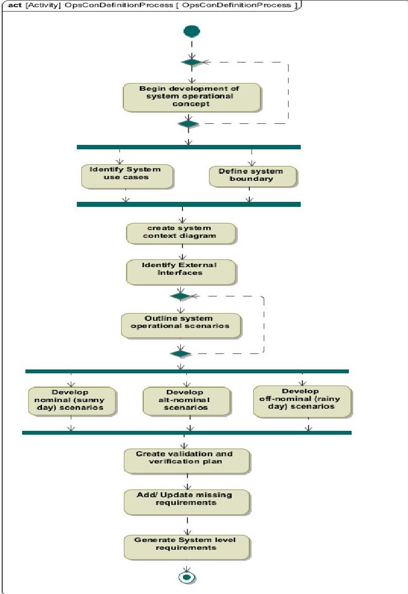

Fig. 7: Operational Concept Activities

1) System Context & Boundary Definition: The system context establishes the framework within which the system-of-interest will operate. The objective of the system context definition process is meant to focus attention on external factors that need to considered when developing the system requirements. It portrays all external entities that will interact with the system, thereby helping to define the system boundary; defining the system boundary helps identify what is external and internal to the system-of-interest; it is used as a communication tool early in the system conceptual design to get an agreement on the scope of the system requirements. The system context model is one of the most crucial parts of the system model as it captures the system's relationship with its environment while also capturing its interfaces with external systems. The system context and boundary will enable the identification of relevant system specification and architecture which form the foundation for developing all relevant requirements for the system.

A simple view [13] of the system context modeled using a use case diagram is shown in Fig. 8. In Fig. 9 a descriptive system context showing the interfaces at the boundary and between the system and actors is modeled using an Internal Block Diagram (ibd). The system context view depicts the highest level view of the system in its environment [14].

2) Identify External Interfaces: Identifying and defining all external interfaces during the concept definition phase aids in risk assessment and eliminates the need for costly system

<!-- PDF_PAGE: 6 -->

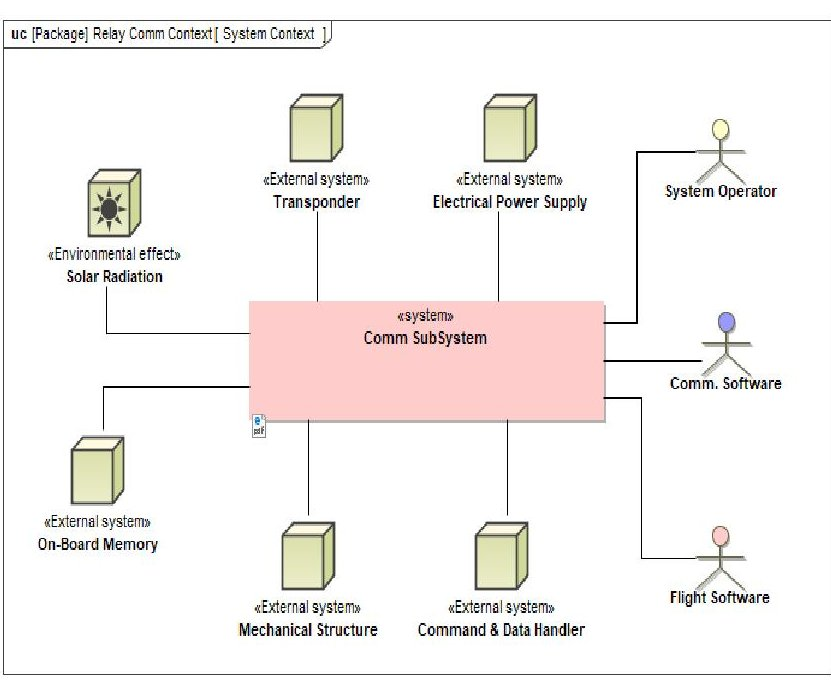

Fig. 8: System Context View

modifications due to bad interface assumptions. A system is especially vulnerable at its interfaces, therefore its extremely critical to identify external interfaces with other systems early to reduce system development cost. For most complex systems, serious problems are known to arise at interfaces. Hence early interface identification and definition help in mitigating any risks associated with our system design while ensuring compatibility and operations. The relay communication subsystem external interfaces can be identified from the Context Diagram portrayed in Fig. 9. Identifying these external interfaces early equate to identifying key drivers for the system that must be addressed in the requirements model. The Relay Communication Subsystem external interfaces include: Electrical Power Supply (EPS) system, Structural/Mechanical Support, Computer System, Flight Software, Communication Software, Transponder (of Twin CubeSat), Thermal Subsystem, On-board Storage Subsystem and System Operator (Commands).

3) Define Use Case Operational Scenarios: Following the system context definition phase, system use cases defined are then developed using behavioral diagrams to produce highlevel system scenarios. In [15] operational scenarios are described as a set of dynamic exchanges between functions that allow the system to achieve a mission or service. Operational scenarios are pivotal to operational concept development as they enable visualization and promote understanding of how the system is supposed to react under various nominal, altnominal and off-nominal usage. The sequence diagram is used to highlight operational scenarios; these scenarios provide the basis for generating comprehensive system requirements. Key system features can be omitted during system design if this phase of OpsCon development is not adequately captured in the system concept model. During operational scenario development, scenarios are broadly classified into two (2) groups: Nominal ("Sunny Day") scenarios and Off-Nominal ("Rainy Day") scenarios. A collection of nominal and non-nominal scenarios provides a more complete description of a system and is therefore more useful in analysis and verification [16].

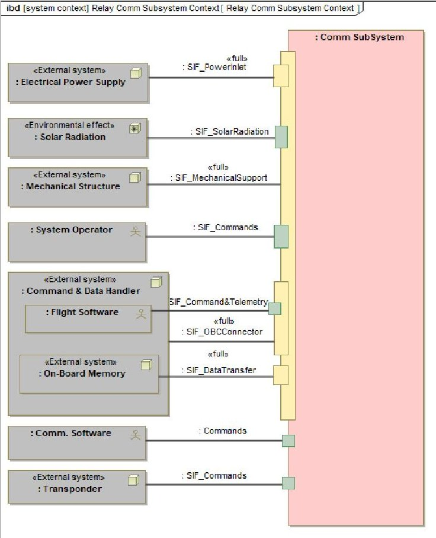

Fig. 9: Descriptive Systems Context View

For our proposed system however, scenarios are classified into three (3) groups namely: nominal, alt-nominal and off-nominal use case scenarios.

(a) Nominal Scenario: The sequence diagram shown in Fig.10 represents the data relay use case nominal scenario. This sunny day scenario depicts the standard flow of actions between the actors and the system during the execution of the data relay use case while employing the use of its VL full-duplex links. The standard flow represents the main capability provided by the system for this use case. The communication software actor (stk-Comm.SW) sends a confirm LoS Access message to trigger the system to hail the designated asset; once the hail is accepted, the system locks on to the signal and relay communication commences. The interaction operator par signifies the simultaneous relay of data on its VL full duplex links. Once the relay session is concluded the system enters into a standby state to conserve spacecraft power.

(b) Alt-Nominal Scenario: The alternate-nominal scenario for the data relay use case is modeled using the sequence diagram shown in Fig. 11. The Alt-nominal scenario represents the flow of actions other than those described in the nominal scenario that still achieve the expected outcome of data/commands relay. These scenario entails the relay of data/command using RF full-duplex links.

(c) Off-Nominal Scenario: The off-nominal scenario is captured using the sequence diagram shown in Fig. 12 and represents a scenario in which the desired goal (successful

<!-- PDF_PAGE: 7 -->

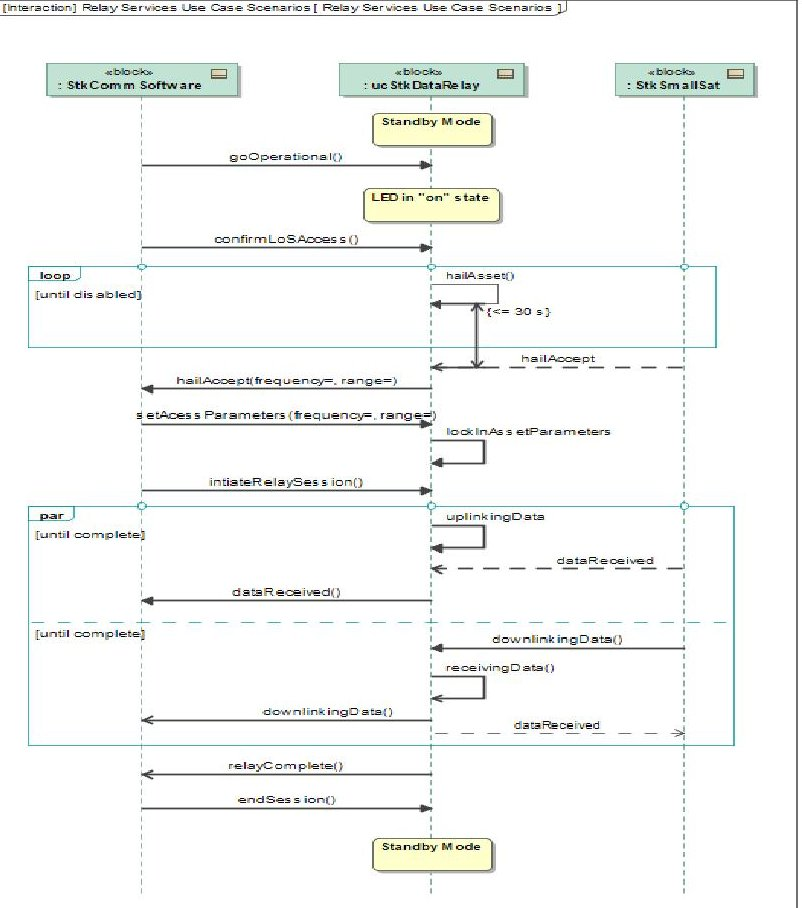

Fig. 10: Data Relay Nominal Scenario

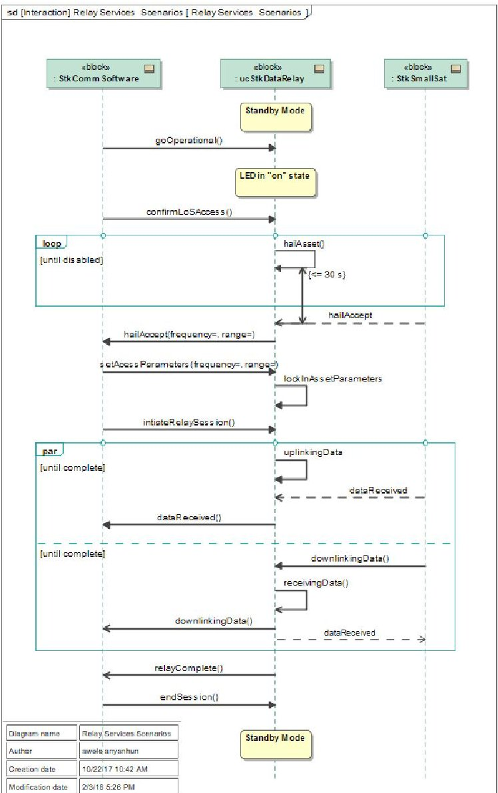

Fig. 11: Data Relay Alt-Nominal Scenario

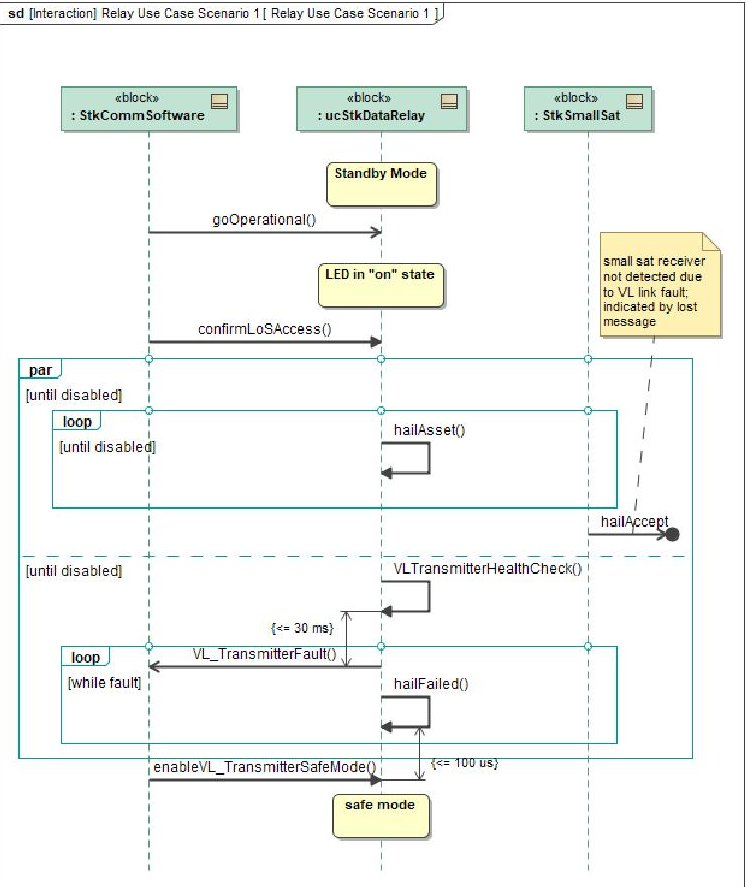

Fig. 12: Data Relay Off-Nominal Scenario

data relay) is not achieved. Modeling off-nominal scenarios enable the stakeholders and systems engineers focus on potential problems that can arise during system usage. In this scenario, the system is not able to achieve the goal of the data relay use case. A fault is registered when the system hails an asset but does not receive a response to its hailing signal signifying that it can not establish access with the designated asset.

## 4) Validation, Verification and Test Plan Creation Activity:

A Validation, Verification and Test (VV&T) plan defines the scope of work required to test, verify and validate a system. It provides guidance and establishes a comprehensive plan to communicate the nature and extent of testing necessary for a thorough evaluation of the system.

A verification, validation and test plan is created during the OpsCon definition activity. The plan created at this phase of conceptual development outlines activities that will need to be performed and the requirements for each activity [17] [18]. The VV&T as stated in [19] is not a phase or step in the lifecycle of a system, but a continuous activity throughout the entire lifecycle and as we progress through the lifecycle phases, the VV&T plan becomes more specific and detailed. The various activities performed in the preparation of the VV&T plan is portrayed in the Activity diagram shown in Fig. 13.

## G. Defining Assumptions

When dealing with complex systems, some vital decisions are usually taken with varying degrees of uncertainty. Most of these decisions are based on predefined assumptions that must

<!-- PDF_PAGE: 8 -->

act [Activity] VVTPlan [VVTPlan]

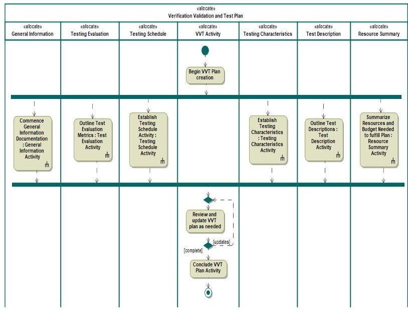

Fig. 13: Verification, Validation and Test Plan Activity

be tested during various life-cycle phases. Assumptions are self-imposed but necessary in order to permit planning/design activities to continue. Some stated assumptions captured in the ConOps model are portrayed in Table. II.

TABLE II: Stated Assumptions

<table border="1"><tr><td>ID</td><td>ASSUMPTIONS</td></tr><tr><td>A-01</td><td>Light Emitting Diodes(LEDs) capable of transmitting data over link distances of≈5km can be designed and manufactured.</td></tr><tr><td>A-02</td><td>CCSDS Space communication protocols are mature enough to be used on visible light Inter-Satellite communication links</td></tr><tr><td>A-03</td><td>All Technology needs are achievable</td></tr></table>

## H. Identifying Constraints

Designs are driven by various outside influences over which the systems engineer has no control over. Example of external drivers that impose constraints are regulations, standards, laws, communication protocols, equipment etc. The Constraints captured in the ConOps model represent restrictions on the degree of freedom available in providing a conceptual design solution for the proposed system. They are effectively global requirements that restrict the way the system is developed. Shown in Table. III is a summary of major constraints applicable to the Relay communication system.

## IV. CONCLUSION

Presented in this work is a model-based Concept of Operation model for inter-satellite communication between small satellites systems utilizing Visible light communication. The conceptual design modeled so far represents the Initial phase of the ConOps Maturation process. It describes the proposed relay communication system in its most ideal form as a black box comprising all stakeholder desired capabilities. The output of this initial phase will lead to the development of the systemlevel requirements and it will also serve as a basis for the high-level system architecture.

<table border="1"><tr><td>ID</td><td>CONSTRAINTS</td></tr><tr><td>C-01</td><td>VL-Band full-duplex links will be used only on the Cube-Sat Inter-Satellite links and the proximity link between the CubeSats and the SmallSat.</td></tr><tr><td>C-02</td><td>VL-Bands full-duplex links must lie within Fraunhofer lines[20][21]</td></tr><tr><td>C-03</td><td>The relay communication system will be deployed on Cube-Sats with standard sizes of 6U and higher</td></tr><tr><td>C-04</td><td>Satellite orbits must be constrained to ensure existence of direct Line of Site(LoS) between orbiting satellites.</td></tr></table>

## REFERENCES

[1] P. KORFIATIS and D. R. CLOUTIER, "Evaluating the application of mbse to concept engineering,"

[2] L. S. Wheatcraft and I. F. Hooks, "Scope magic," 2001.

[3] C. Cruzen, M. Schmidhuber, Y. H. Lee, and B. Kim, "Space operations: Contributions from the global community," 2017.

[4] INCOSE, "Systems engineering vision 2020," September 2007. [Online; accessed 4-April-2016].

[5] R. D. Hamelin, D. D. Walden, and M. E. Krueger, "4.4.2 incose systems engineering handbook v3.2: Improving the process for se practitioners," in INCOSE International Symposium, vol. 20, pp. 532- 541, Wiley Online Library, 2010.

[6] B. M. Selvy, C. Claver, B. Willman, D. Petravick, M. Johnson, K. Reil, S. Marshall, S. Thomas, P. Lotz, G. Schumacher, et al., "Using model based systems engineering for the development of the large synoptic survey telescope's operational plan," in Modeling, Systems Engineering, and Project Management for Astronomy VI, vol. 9911, p. 99110D, International Society for Optics and Photonics, 2016.

[7] A. I. Anyanhun and W. W. Edmonson, "Inter-satellite communication mbse design framework for small satellites," in Systems Conference (SysCon), 2017 Annual IEEE International, pp. 1-7, IEEE, 2017.

[8] J. Hummell, "Model based conceptual design," 2016.

[9] J. Holt and S. Perry, SysML for systems engineering, 2nd Edition: A model-based approach, vol. 10, chapter 11. IET, 2014.

[10] SEBoK, "Stakeholder needs and requirements — guide to the systems engineering body of knowledge (sebok), version 1.8," 2017. [Online; accessed 03 Nov 2017 16:00:57 UTC].

[11] B. P. Douglass, Agile systems engineering. Morgan Kaufmann, 2015.

[12] W. D. Ivancic, K. R. Vaden, R. E. Jones, and A. M. Roberts, "Operational concepts for a generic space exploration communication network architecture," 2015.

[13] T. Weilkiens, SYSMOD-The Systems Modeling Toolbox-Pragmatic MBSE with SysML. Lulu. com, 2016.

[14] S. Friedenthal, R. Griego, and M. Sampson, "Incose model based systems engineering (mbse) initiative," in INCOSE 2007 Symposium, 2007.

[15] SEBoK, "Operational scenario (glossary) — guide to the systems engineering body of knowledge (sebok), version 1.8," 2017. [Online; accessed 03 Nov 2017 16:03:58 UTC].

[16] J. Whittle and I. Kruger, "A methodology for scenario-based requirements capture," in Proceedings, ICSE 2004 Workshop on Scenarios and State Machines (SCESM), 2004.

[17] A. Engel, Verification, validation and testing of engineered systems, vol. 73. John Wiley & Sons, 2010.

[18] HUD, "United states department of housing & urban development, validation, verification and testing plan,"

[19] O. Balci, "Verification, validation, and testing," Handbook of simulation, vol. 10, pp. 335-393, 1998.

[20] D. Amanor, W. Edmonson, and A. Anyanhun, "Visible light communication system for inter-satellite communication of small satellites," in 4S Small Satellite Systems and Services Symposium, 2016.

[21] D. Amanor, W. Edmonson, and F. Afghah, "Utility of light emitting diodes for inter-satellite communication in multi-satellite networks," in International Conference on Wireless for Space and Extreme Environments, 2016 IEEE, IEEE, 2016.