<!-- PDF_PAGE: 1 -->

# Application of Model-Based Systems Engineering in Small Satellite Conceptual Design-A SysML Approach

Muhammad Waseem, Muhammad Usman Sadiq, Satellite Research and Development Centre, SUPARCO, Lahore, Pakistan

## INTRODUCTION

The satellite design industry has successfully accepted systems engineering (SE) since its inception, taking advantage of its methodologies and techniques to harness underlying complexities. In traditional SE approach, it becomes difficult to assess the completeness and consistency of information spread across tools and documents. In particular, it is difficult to perform traceability and assess the change impacts of certain design parameters.

Model-based systems engineering (MBSE) is an emerging technology that is providing the new horizon in the SE domain. MBSE produces a system model contained in a model repository, which includes more formal, complete, and semantically rich system specifications and design for rigorous analysis, verification, and validation since earlier phases of projects. MBSE provides a consistent and automatically traceable system design, which enhances the quality of traceability and change impact assessment.

Object Management Group (OMG) Systems Modeling Language (SysML) has been standardized by the International Council on Systems Engineering (INCOSE) as a graphical modeling language for system engineers [16]. SysML is a domain-specific modeling language used to specify, analyze, design, optimize, and verify systems and system of systems [7], [14]. We have used SysML to develop a scalable model repository for RS satellites. A parametric model-based approach has been used that allows generic models of various mission scenarios to be characterized for the study being performed. Such a parametric approach supports fast modification and analysis of new scenarios, which is essential for the real-time process. It acts as a means to establish and fix the ground rules of the design and to formalize the responsibility boundaries of each domain. Once a specific model is established, it is used to refine the design and to introduce further levels of detail.

This research was conducted to investigate the usefulness of the MBSE approach to assist the existing systems engineering process and practices for current and future space missions. The prime focuses of the work presented in this article are as follows:

## OBJECTIVES

To enhance understanding of SysML pertaining to satellite modeling for our system engineers

To show how the SysML modeling language can be used to complement the requirements engineering process, i.e., to better define, trace, and validate requirements [9]

To establish parametric relationships [10] among various design elements with parametric modeling using SysML internal block diagrams and parametric diagrams

- Seamless interface of existing system-level design tools (Satellite Tool Kit [STK], matrix laboratory [MATLAB]/ Simulink, and Microsoft Excel) with the SysML satellite model to assist on-the-fly parameter tuning

To achieve these objectives, we selected an ongoing remote sensing (RS) student satellite (NSS-1) as a case study and developed its SysML model repository. We used MagicDraw 18.1 from No Magic Inc. [16] as the modeling tool and SysML 1.4 as the modeling language.

## PREVIOUS WORK

To assist the systems engineering process for our ongoing satellite design projects, several automated applications and tools have been devised by the systems engineering team. Development of the system integrated design environment (SIDE) was one of such efforts [10]. SIDE is a spreadsheet-based integration tool, which connects various satellite system engineering design and analysis tools in a local area network.

Significant work on use of SysML has been done by Spangelo et al. [1] for CubeSat. The article reports on using MBSE and SysML to model a standard CubeSat modeling framework and applying that model to the Radio Aurora Explorer mission [6].

Sayanjali et al. [5] have used the MBSE approach using SysML for RS satellite conceptual design. The remote sensing (RS) satellite captures images in visible and infrared spectra. Block definition diagrams (BDDs) are created to specify physical architectures for

<!-- PDF_PAGE: 2 -->

systems and subsystems. By defining the parametric diagram for system sizing and efficiency measuring, a tradeoff study is explored.

Romero and Ferreira [4] have used SysML to model attitude and orbit control system (AOCS) software for a satellite using SysML. Constraints and parametric diagrams for the AOCS subsystem are depicted and explained. Physical aspects are modeled using sequence diagrams. Finally, model is refined to become a platform specific model (PSM) from software viewpoint, allowing code generation.

In the literature, the model-based approach is compared with the document-based approach. This develops a sense that the MBSE is a paradigm shift that contradicts the document-based SE approach. This is one of the reasons the model-based approach is less accepted by conventional system engineers. The document-based approach may be inefficient in certain aspects that can be improved by employing the MBSE approach, making the practice of SE more effective. We therefore advocate a hybrid modeling approach as described in subsequent sections, which is assisting our conventional SE process in the most appropriate way.

## MBSE METHODOLOGY

A methodology is defined as the collection of processes, methods, and tools used to support a specific discipline [12]. The notion of MBSE methodology can be characterized as the collection of related processes, methods, and tools used to support SE in a modelbased paradigm. Several MBSE methodologies are in practice, as surveyed in [12]. The system engineers can tailor one or more of the candidate MBSE methodologies into their internal SE process model.

## OBJECT-ORIENTED SE METHOD OVERVIEW

The object-oriented systems engineering method (OOSEM) is one of the leading MBSE methodologies. OOSEM provides an integrated framework that combines object-oriented techniques, a model-based design approach, and traditional top-down, waterfall-style SE practices. It is widely advocated as an example of MBSE best practice.

ing techniques to help design more flexible and extensible systems that can accommodate evolving technology and changing requirements. OOSEM is also intended to ease integration with object-oriented software development, hardware development, and testing.

The OOSEM integrates a top-down, model-based approach that uses OMG SysML to support the specification, analysis, design, and verification of systems. OOSEM leverages object-oriented concepts with more traditional top-down SE methods and other model-

OOSEM uses a model-based approach to represent various artifacts generated by the development activities, using OMG SysML as the predominant modeling language. As such, it enables the systems engineer to precisely capture, analyze, and specify the system and its components and ensure consistency among various system views. The modeling artifacts can also be refined and reused in other applications to support product line and evolutionary development approaches.

## ADOPTED MBSE METHODOLOGY

We have adopted an OOSEM-based hybrid approach that leverages object-oriented techniques and a SE foundation. This was chosen after numerous deliberations on candidate methodologies listed in the 2008 INCOSE survey [12], as well as some additional methodologies identified as gaps since 2008. The methodology fits with the evolutionary nature of our projects and their life cycles within the organization. Integration with object-oriented software, hardware, and other engineering methods is possible through OOSEM. In addition, the system-level reuse and design evolution is supported in OOSEM. An ample number of resources were also available in OOSEM compared to other methodologies.

OOSEM-based methodology as adopted is depicted in Figure 1, showing satellite design and development project activities, along with corresponding modeling artifacts used.

Phase 0 and phase A are mission definition and requirement analysis phases. After these phase requirements, baseline is the final outcome. MBSE artifacts used during this process are SysML requirement diagrams and use-case diagrams. Phase B involves the preliminary design and finalization of technology choices. The outcome of phase B is the baseline system design definition. SysML BDDs, use-case diagrams, and parametric diagrams are frequently used in phase B. Phase C involves detailed design and manufacturing of the engineering and/or qualification models of the satellite, which is supported by artifacts for functional and performance models of the satellite subsystems or units, such as SysML state machine diagrams, activity diagrams, and sequence diagrams. Finally, in phase D, the unit, subsystem, and system are integrated for final delivery of the product. This phase involves testing under

<!-- PDF_PAGE: 3 -->

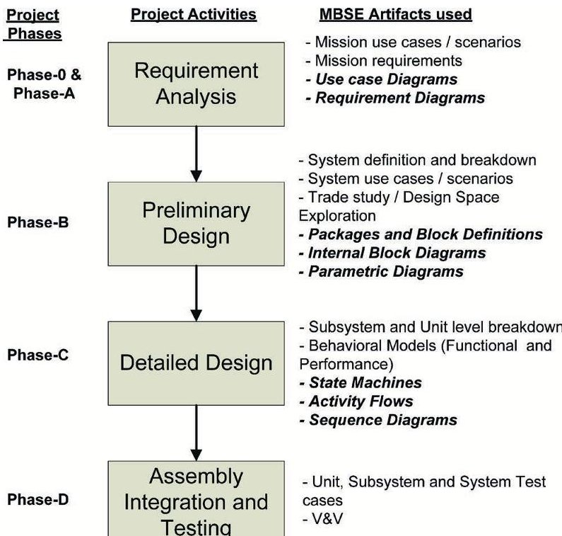

Figure 1.

Satellite design project activities and MBSE artifacts.

various circumstances and scopes. Certain testing activities during the assembly integration and testing phase are supported by SysML diagrams, enabling test-case design and tracing them back toward the requirements for conformance.

## MODELING APPROACH

The promoters of MBSE advocate the benefits of using SysML and similar modeling paradigms. However, in practice, we have found that the aerospace industry is less familiar with the inherent advantages and usefulness of the MBSE approach. Aerospace system engineers mostly have electrical and mechanical engineering backgrounds. They are inherently less familiar with software engineering and object-oriented programming (OOP) model.

Aerospace system engineers usually prefer conventional ways of doing SE through the tools they are most familiar with, such as the Microsoft Office tool chain (Excel, Word, and Visio), STK, and MATLAB. Enabling our system engineers to adopt SysML is the foremost challenge for us. To fill the gap between the traditional document-based approach and the model-based approach, we devised a two-step modeling approach for current and future projects in the Pakistan National Student Satellite Program (PNSSP) as shown Figure 2. In the first stage, the NSS-1 model repository is developed, in which we partially incorporate the model-based approach, along with integration of existing SE resources (documents and tools). Meanwhile, the system engineers are being taught about MBSE methodologies, modeling languages, and tools. In the next stage, NSS-2 will fully incorporate the MBSE approach.

## DMG SYSML

OMG SysML is a unified modeling language (UML)-based standard graphical language for modeling systems. SysML is composed of graphical notations and an information model that emphasizes the formal capture, description, and communication of systems specifications. Diagrams can be constructed to describe various systems based on structure and behavior.

## SYSML DIAGRAMS

Systems engineers use common drawing tools for diagrams in which precise meanings are not associated with each type of arrows and blocks. The purpose of the diagram is to support a paragraph or a document. The information model distinguishes SysML from conventional drawing and simulation tools in the following ways:

A formal information model is given for underlying diagrams.

The SysML model of a system can be tested to ensure that the models are complete and consistent.

The SysML diagrams have robust semantics and details captured for formal specifications.

The SysML model can be used to interface and interoperate with other tools and data sources. This also assists the integrated product development process [9].

## ASSOCIATED CHALLENGES

Although MBSE has a long history [11], it has not yet fully taken hold within satellite SE. One of the reason is that MBSE needs some other disciplines' knowledge, particularly from modeling and software engineering, which is usually absent among conventional system engineers belonging to core engineering disciplines (electrical and mechanical). Conventional system engineers are inherently uncomfortable with SysML diagrams and follow conventional ways of writing design documents.

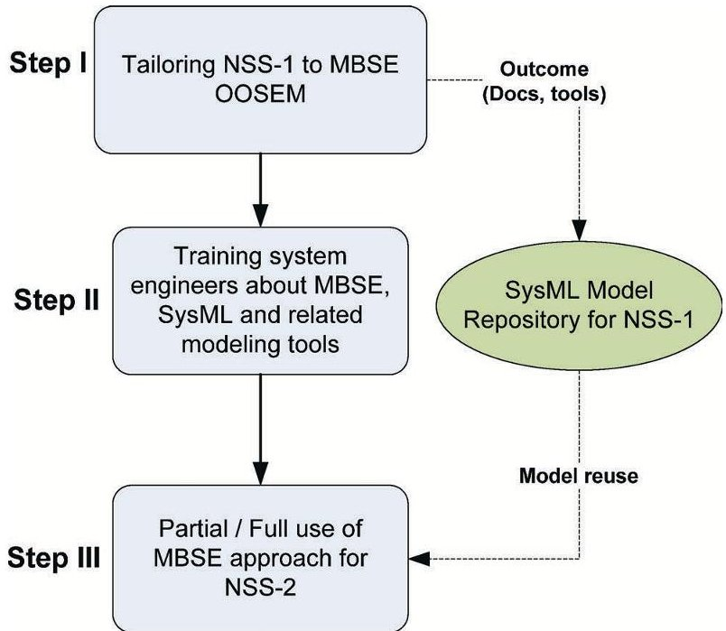

Figure 2.

Modeling approach adopted for PNSSP.

<!-- PDF_PAGE: 4 -->

Another important aspect of complexity is that the MBSE approach requires not only a language such as SysML to represent the system but also a method that defines the activities and artifacts and a tool to implement the modeling language and method. The language, method, and tool each introduces its own concepts and must be learned for the engineer to master MBSE. This skill must then be applied to a particular domain, such as designing a spacecraft. Additional modeling challenges are associated with scaling the modeling effort to larger projects and in the context of a diverse development environment.

There are many types of models involved in the MBSE effort beyond the SysML model, such as a multitude of analysis models, hardware models, and software models. Integration among the models and tools, and other engineering artifacts, is another challenge associated with MBSE.

## SYSML MODEL OF THE NSS-1 SATELLITE

SE tasks have been performed using a conventional approach and heritage knowledge-based tools and documents. This approach inherently involves a lot of manual procedures, which are error prone because of parametric mismatch. We therefore decided to benefit from the model-based approach to address these problems.

## NSS-1 SATELLITE AND SYSTEM ENGINEERING

## MODEL REPOSITORY FOR NSS-1

NSS-1 is a RS student satellite. The design philosophy of NSS-1 is conceived in such a way that all SE-related tasks are performed by an independent systems engineering team, while design and development of various satellite units are undertaken by university students. Throughout this process, the system engineering team has to work iteratively in the system-level documents, design, and analysis tools to tune and freeze the design parameters as early as possible.

We reused some model elements from the FireSat SysML model, which is a case study provided in [8]. The NSS-1 modeling group consists of experts from multidisciplinary areas of our local aerospace industry setup and some principle investigators from academia. The modeling repository uses SysML to capture common design patterns of the typical nanosatellite class: managing values, describing scenarios, and describing functions, parts, and subsystems, as well as the relationships among these design patterns.

The repository illuminates a path to an integrated model-based engineering environment, including interoperability with existing SE models ready in existing analysis tools such as Microsoft Excel, MATLAB, and STK. This NSS-1 model repository demonstrates the possibility of a diverse set of analysis applications that are provided with information about the space system from the system model to accomplish analysis driven by a formal description of the mission, flight, and ground systems.

The following major modeling elements have been introduced in the NSS-1 model that were not found in the FireSat model [8]:

- Modeling elements for standard International System of Units (SI) units have been identified and created in the NSS-1 repository.

Mass, power, and reliability budgets have been incorporated.

State machine diagrams are used for the satellite's operational modes and their transitions at system and subsystem levels.

A description of the satellite bus (controller area network [CAN]) protocol is available via the SysML sequence diagram.

The NSS-1 model is developed using diverse SysML diagrams. We describe each type of diagram used in the NSS-1 context in the following paragraphs.

## Package Diagram

The SysML package diagram is used to organize the model elements contained in the model. Figure 3 shows the package diagram for the NSS-1 satellite model, including packages for requirements, behavior, architecture, and parametrics. Package diagrams also assist navigating through the model.

## Requirement Diagram

The requirement diagram defines requirements, traceability, and the test cases that verify each requirement. Figure 4 shows the requirements contained in the requirements package to specify the NSS-1 system. For demonstration purposes, some requirements are suppressed to save space.

The relationships among the requirements and other model elements are important aspects of requirement diagrams. These include relationships for defining a requirements hierarchy, deriving requirements, satisfying requirements, verifying requirements, and refining requirements. Being able to ask a modeling tool to generate requirement traceability and verification matrices, and to perform an automated impact analysis when the requirements change, is an important time-saving feature for systems engineering. SysML requirement diagrams in this context are quite helpful to assess NSS-1 requirement specifications and their verification and validation (V&V).

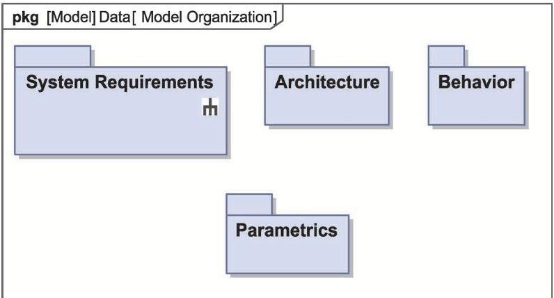

Figure 3. NSS-1 model organization.

<!-- PDF_PAGE: 5 -->

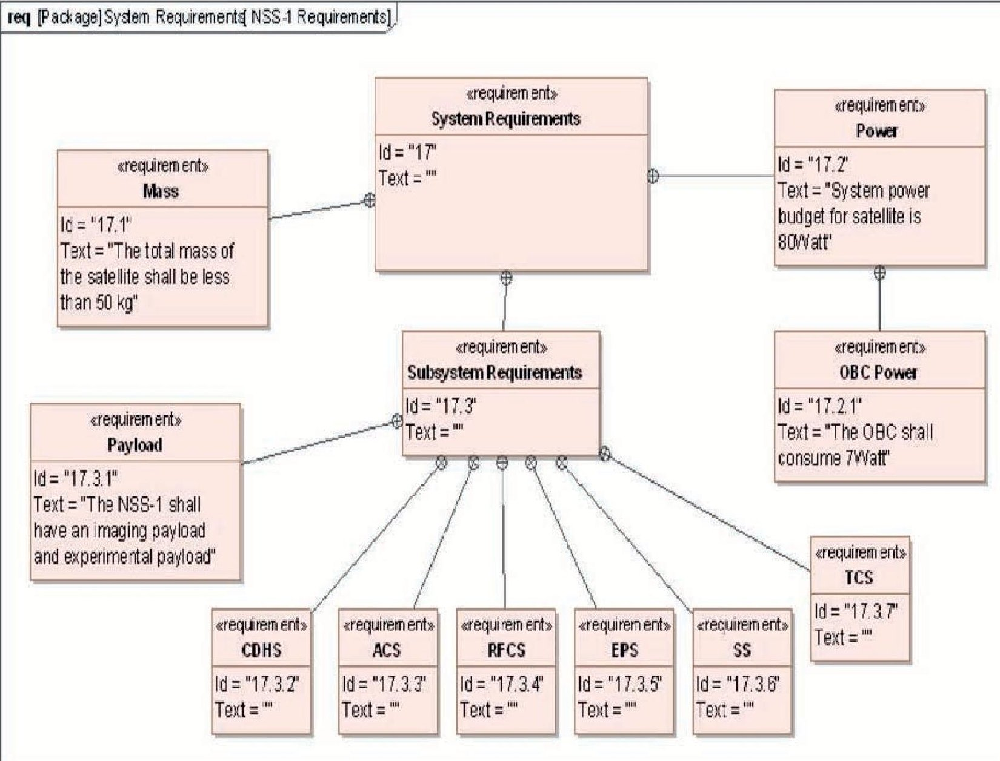

Figure 4. NSS-1 requirement diagram.

## Block Definition Diagram

The BDD defines the physical architecture of the system. We have displayed various model elements and relationships between NSS1 design elements on a BDD to express information about spacecraft architecture. We have also adopted design techniques for creating extensible system structures. This practice reduced the model development time. In the future, this will also reduce the cost to change the design as the stakeholders' needs evolve [2].

The top-level block diagram of the NSS-1 is depicted in Figure 5. SysML diagrams have underlying semantics for each of the modeling elements. The diamond-ended arrow indicates the directed composition relationship between the blocks. The diagram may be interpreted as "the NSS-1 system is composed of a space segment, a ground segment, and associated launch services." The BDD of the NSS-1 satellite is given in Figure 6, showing internal parts of each subsystem as SysML blocks.

## Internal Block Diagram

The internal block diagram shows the interconnection and external interfaces between the system and its external user and environment. They formally describe the qualitative flows between model elements. Internal block diagrams are created for each block of a BDD, which represents its internal parts in the form of instances connected with one another and the environment through ports in a specific context. As an example, Figure 7 shows the internal block diagram of the payload subsystem, which consists of a narrowview camera (NVC), wide-view camera (WVC), an experimental payload for lightening detection, a payload processing unit (PPU), and the payload data transmitter (PLTx). The NVC and WVC send the raw image data to the PPU via the LVDS (Low-voltage differential signaling) and $ \mathrm{I}^{2} \mathrm{C} $ (Inter-integrated circuit) interface, respectively. The lighting detection unit sends lighting data to the PPU through the RS-422 interface. The PPU processes, compresses, and packetizes all payload data and sends them to the PLTx for onward transmission to the ground station. The telemetry and telecommand control of the payload subsystem is carried out through the CAN bus with the main OBC (On-board computer).

## Use-Case Diagram

SysML use-case diagrams are similar to standard UML use-case diagrams. Use-case view shows what a system subsystem or unit

<!-- PDF_PAGE: 6 -->

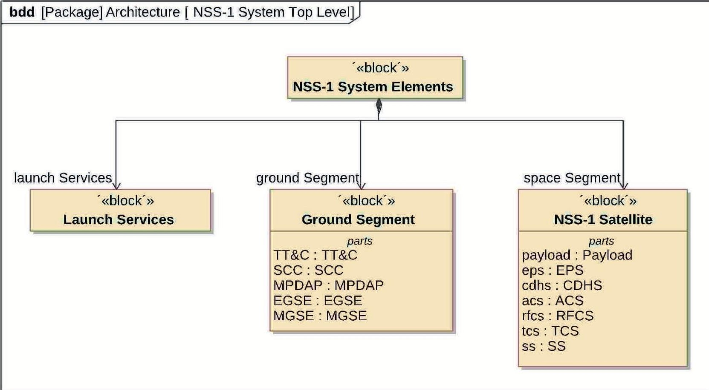

Figure 5. NSS-1 top-level BDD.

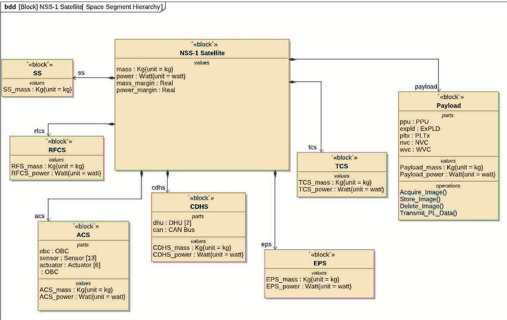

Figure 6.

Space segment BDD.

<!-- PDF_PAGE: 7 -->

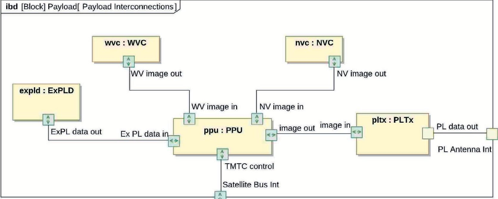

Figure 7. Internal block diagram of payload subsystem.

does, but it does not specify how it is internally performing its functionality. Use-case diagrams depict the overall functional capability of the system. Users, project managers, analysts, developers, quality-assurance engineers, and anyone else interested in the system as a whole can inspect these diagrams and understand what the system is supposed to accomplish.

A use case is a description of a set of actions, called scenarios, that a system performs to yield an observable result to an actor. An actor is anything that interacts with the system and exchanges data and information. It can be a user, external hardware, or another system.

Figure 8 shows a high-level use-case diagram of service-oriented onboard software architecture proposed for NSS-1. The main actors involved in onboard software are various components at the ground station. System-level scenarios of onboard software include satellite telemetry processing, telecommand processing,

failure detection isolation and recovery, attitude control system (ACS) algorithms, and payload management. These application scenarios are represented as an application software package. The application scenarios use packet utilization standard services [13] and spacecraft onboard interface services (SOISs) represented as a static library package. To support applications, a low-level application programming interface for device drivers and real-time operating system are accessible to SOISs for providing abstraction to application software.

## SysML Parametrics

SysML parametric diagrams provide a way to integrate engineering analysis models described in mathematical equations and constraints. A parametric diagram is a restricted form of an internal block diagram. The parametric diagram may contain constraint

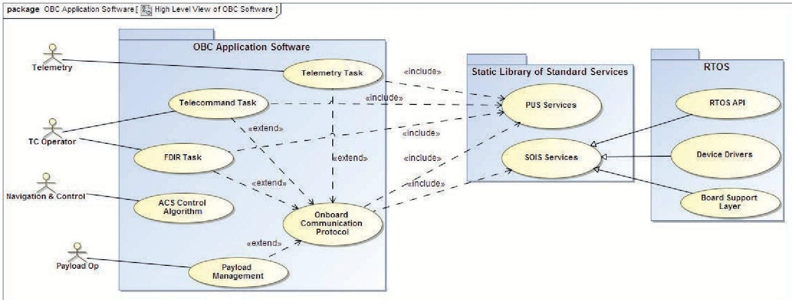

Figure 8. Top-level use-case diagram of NSS-1 onboard software.

<!-- PDF_PAGE: 8 -->

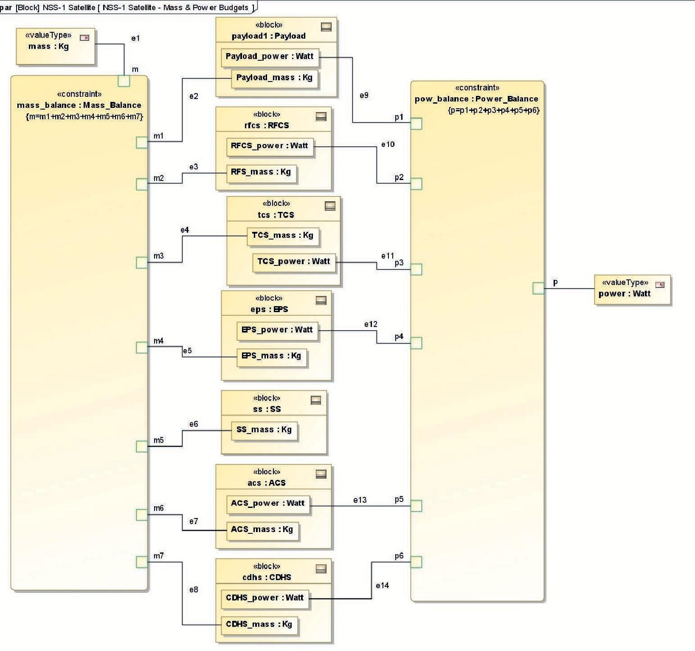

Figure 9. Parametric diagram for mass and power budgets.

properties and their parameters, along with other properties from within the internal block context. In this way, the parametric diagram can show how constraint blocks are combined in a particular usage as a set of constraint properties.

A constraint block in SysML is a modeling element (a special kind of block) that defines a Boolean constraint expression evaluating to either true or false. It is a mathematical relationship that is used to constrain value properties of blocks. The variables in a constraint expression are called constraint parameters. They generally represent quantities, so they are typed most often by value types.

For demonstration of SysML parametrics, we have modeled mass and power budgets of NSS-1 in this article and used the ParaMagic plug-in of MagicDraw for dynamic analysis. The corresponding parametric diagram is shown in Figure 9. The procedure starts with requirement diagrams in which the constraint blocks have been created to calculate the mass and power margins in the budgets, keeping in view the mass and power requirement by the user. This scenario is depicted in the SysML requirement diagram with the verify relationship.

A test case or other named element can be used in a similar fashion to represent any standard verification method, such as re-

<!-- PDF_PAGE: 9 -->

view, inspection, test, or analysis. NSS-1 is composed of seven subsystems. Each subsystem has a mass, and there is a total mass budget for the satellite of 50 kg. The ACS (Attitude control subsystem), CDHS (Command and data handling subsystem), payload, TCS (Thermal control subsystem), and RFCS (Radio frequency communication subsystem) subsystems draw electrical power from the EPS (Electrical power subsystem), which can supply a maximum of 80 W. Given the masses of all subsystems and the power requirements of five subsystems, we calculated the total mass and power demand for the satellite and compare it against the requirement.

To meet the mass and power constraints, the parametric diagram is created from the NSS-1 satellite block as shown in Figure 9. Each block in this diagram corresponds to a satellite subsystem modeled in the BDD (Figure 6). The constraint blocks implement the mass and power budget constraint formulas. After connecting the parameter ports to respective inputs and outputs, we validated the model using ParaMagic.

The following solvers are supported by ParaMagic for mathematical analysis: Mathematica, Modelica, and MATLAB satisfiability modulo theory (SMT). For our analysis, we used the local MATLAB SMT solver to analyze and tune mass and power allocations to various subsystems. After assigning causalities and values to all parameters, MATLAB SMT is invoked within the ParaMagic to solve for unknown and target parameters. In our case, margins of safety (MoSs) for power and mass are target (output) parameters,

whereas satellite mass is the unknown parameter to be computed through the following trivial equation:

$$
m _ {\mathrm {S a t}} = m _ {\mathrm {t c s}} + m _ {\mathrm {s s}} + m _ {\mathrm {p l}} + m _ {\mathrm {c d h s}} + m _ {\mathrm {a c s}} + m _ {\mathrm {e p s}} + m _ {\mathrm {r f c s}}
$$

The power constraint on EPS subsystem is computed based on power demanded by electronic subsystems. The following equation is specified in the constraint block to compute the power budget:

$$
P _ {\mathrm {e p s}} = P _ {\mathrm {t c s}} + P _ {\mathrm {p l}} + P _ {\mathrm {c d h s}} + P _ {\mathrm {a c s}} + P _ {\mathrm {r f c s}}
$$

A snapshot of the parameters settings and ongoing solution by the MATLAB SMT solver is depicted in Figure 10, in which four parameters (mass, pPow, mass_MOS, and power_MOS) are being calculated based on valued parameters listed in the right-most column, named values.

The values of these parameters can be given directly or may be imported from Microsoft Excel worksheets. The mass budget tool was earlier created and enhanced within the Microsoft Excelbased SE platform [20]. In the SysML model repository, the tool has enhanced capabilities to trace down the requirements, which in turn are useful for change impact and V&V of the requirements.

The resulting values of the parameters can be seen on the same dialog after the solution is complete. The values of all parameters after the calculation are updated to the SysML instance, which

<table class="table table-bordered"><thead><tr><th>Name</th><th>Qualified Name</th><th>Type</th><th>Causality</th><th>Values</th></tr></thead><tbody><tr><td>SatelliteSystem</td><td>NSS-1_Satellite::Instance...</td><td>SatelliteSys...</td><td></td><td></td></tr><tr><td>mass</td><td></td><td>kg</td><td>undefined</td><td>?????</td></tr><tr><td>mass_MOS</td><td></td><td>Real</td><td>target</td><td>?????</td></tr><tr><td>power_MOS</td><td></td><td>Real</td><td>target</td><td>?????</td></tr><tr><td>acs</td><td>NSS-1_Satellite::Instance...</td><td>ACS</td><td></td><td></td></tr><tr><td>mCon</td><td></td><td>kg</td><td>given</td><td>7.8</td></tr><tr><td>pCon</td><td></td><td>watt</td><td>given</td><td>12</td></tr><tr><td>cdhs</td><td>NSS-1_Satellite::Instance...</td><td>CDHS</td><td></td><td></td></tr><tr><td>mIns</td><td></td><td>kg</td><td>given</td><td>4.5</td></tr><tr><td>pIns</td><td></td><td>watt</td><td>given</td><td>5</td></tr><tr><td>eps</td><td>NSS-1_Satellite::Instance...</td><td>EPS</td><td></td><td></td></tr><tr><td>mPow</td><td></td><td>kg</td><td>given</td><td>15</td></tr><tr><td>pPow</td><td></td><td>watt</td><td>target</td><td>?????</td></tr><tr><td>payload</td><td>NSS-1_Satellite::Instance...</td><td>Payload</td><td></td><td></td></tr><tr><td>mPro</td><td></td><td>kg</td><td>given</td><td>18.6</td></tr><tr><td>pPro</td><td></td><td>watt</td><td>given</td><td>25.4</td></tr></tbody></table>

Figure 10.

Solving budget equations using SysML parametrics.

appear as in Figure 11. For brevity, we have only shown the analysis for four subsystems.

We can see that mass and power budget margins are calculated to be positive (mass_MOS=0.082 and power_MOS=0.47), which verify the mass and power requirements as given in the requirement diagram (Figure 12). We have demonstrated only mass and power budgets in this article. In addition, the NSS-1 model repository contains the following analysis tools implemented in the form of constraint blocks and parametric diagrams:

Sensor field-of-view analysis

Reliability budget

Orbital analysis

Tradeoff analysis for ACS configurations

## INTERFACE WITH EXISTING SE TOOLS

One of the main objectives of this work was to establish seamless interfaces between our existing SE design and analysis tools and the SysML repository. With the help of MagicDraw plug-ins, we are

<!-- PDF_PAGE: 10 -->

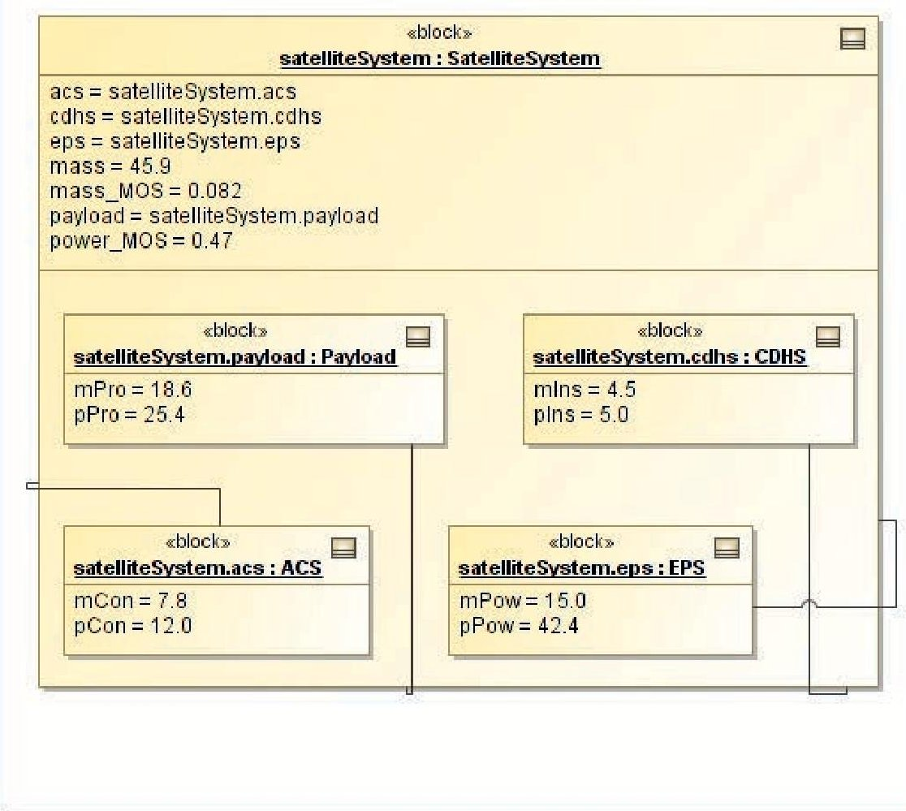

Figure 11. Mass and power budget instance after solution.

able to communicate between existing engineering analysis tools with the NSS1 model repository as follows.

## Interface with Microsoft Excel

MagicDraw provide an interface to import and export data between the SysML model and Microsoft Excel files. In our NSS-1 case study, we have computed some parameters using spreadsheets, read these values in ParaMagic to populate SysML instance slot values, solved the SysML model using ParaMagic, and exported solved values back to spreadsheets.

## Interface with MATLAB

One of the main objectives of this work was to transfer mathematical expressions from MATLAB source code into the NSS-1 model repository. This was seamlessly achieved using the InterCAX plug-in integrated within MagicDraw. The plug-in treats MATLAB functions and scripts as constraints in SysML parametric diagrams. When the SysML product calls MATLAB, the subject MATLAB function or script runs locally on the user's machine and creates an output text file that is automatically read back into the SysML model. Simulink models can also be accessed through an intermediary MATLAB script.

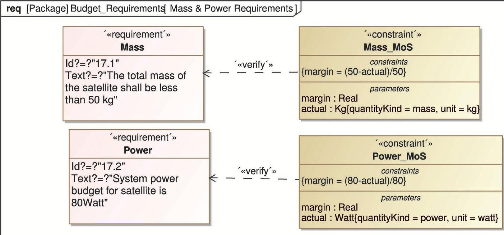

Figure 12.

Verification of mass and power budget requirements for NSS-1.

<!-- PDF_PAGE: 11 -->

## Automatic Report Generation

An important aspect of the MBSE is automatic documentation generation from the model. Specifically, from SysML models, an allocation table, a requirement table, and coverage analysis are generated automatically from the model repository. Similar to UML, we can also generate the corresponding code structure for the SysML model in popular object-oriented programming languages, such as Java, C++, or C#. This code can be used to develop prototype models for simulation of the system. For software-based models, the code structure can be directly used for implementation of operations and functions by software developers.

## FUTURE WORK

The work presented in this article is an initial study and modeling to evaluate the effectiveness of the MBSE approach for our satellite design projects. In the future, we envisage training our system engineers about the SysML, its development environment, and the underlying object-oriented paradigm for system modeling.

The outcomes would be incorporated into a future mission, using partial or full utilization of the MBSE approach. An indirect link between STK and SysML can be established using a Microsoft Excel spreadsheet as an intermediate tool. A direct interface between a SysML model and AGI (Analytical Graphics Inc.) components was demonstrated in the INCOSE MBSE workshop [16]. The interface was developed using systems lifecycle management (SLIM) methodology [3]. In the future, we wish to incorporate SLIM to interface STK and the SysML model repository.

## CONCLUSION

The model-based approach is found to be promising for a reduced development risk, improved quality, and increased productivity. The NSS-1 model repository developed during this phase can be used effectively for knowledge transfer. After this research, the following key advantages of MBSE using SysML have been identified:

Project documentation becomes more consistent.

Well-structured models and clear separation between structure and behavior are possible.

The SysML model and diagrams can point out missing design information, and relevant information about a particular design element can easily be found.

The approach opens the way to automated SE through automatic document generation, traceability, assisted design verification, and system behavioral simulation.

Diagrams may be misinterpreted if SysML modeling is not learned beforehand.

Nevertheless, the following risks have also been foreseen:

The SysML learning curve is steep. It may require considerable knowledge of software engineering and OOP by satellite system engineers before its advantages come out.

## REFERENCES

[1] Spangelo, S. C., Kaslow, D., Delp, C., Cole, B., Anderson, L., Fosse, E. et al. Applying model based systems engineering (MBSE) to a standard CubeSat. In Proceedings of the IEEE Aerospace Conference, 2012, 1-20.

[2] Bell, K. D., and Hsu, L. A. Balancing performance and cost for cost-effective satellite systems design using an integrated cost engineering model. Aerospace Corporation, Aerospace Rep. TOR-95(5409)-2, Air Force Material Command under Contract F0470 1-93-C-0094, 18 Dec. 1994.

[3] Bajaj, M., Zwemer, D., Peak, R., Phung, A., Scott, A., and Wilson, M. (2011). Satellites to supply chains, energy to finance—SLIM for model-based systems engineering. Part 1: Motivation and concept of SLIM. In Proceedings of the 21st Annual INCOSE International Symposium, Denver, CO, June 20-23, 2011.

[4] Romero, A. G., and Ferreira, M. G. V. Modeling an attitude and orbit control system using SysML. Presented at the 2nd Workshop in Space Technology and Engineering, 2011.

[5] Sayanjali, M., and Nabdel, O. Remote sensing satellite design using model based system engineering. Journal of Science and Engineering, vol 1 (1), 43-54, ORIC Publications, 2013.

[6] Bahcivan, H., and Cutler, J. W. Radio Aurora Explorer: Mission science and radar system. Radio Science, 47, 2 (2012), RS2012. Available: http://dx.doi.org/10.1029/2011RS004817.

[7] Weilkiens, T. (2006). Systems Engineering with SysML/UML, Modeling, Analysis, Design. London, United Kingdom: Elsevier, 2006.

[8] Larson, W. J., and Wertz, J., (2005). Space Mission Analysis and Design. London, United Kingdom: Kluwer Academic Publishers, 2005.

[9] Dos Santos, W. A., Leonor, B. B. F., and Stephany, S. A Knowledgebased and model-driven requirements engineering approach to conceptual satellite design. In Proceedings of the 28th International Conference on Conceptual Modeling, 2009, 487-500.

[10] Muhammad, W., Sadiq, M. U., Ahmed, I., and Muzammil, F. Development of an integrated design environment to assist conceptual satellite design. In Proceedings of the Asia Pacific Council on Systems Engineering Conference, Yokohama, Japan, Sept. 2013.

[11] Wymore, A. W. Model Based Systems Engineering. CRC Press, Boca Raton, Florida, USA, 1993.

[12] Estefan, J. Survey of model-based systems engineering (MBSE) methodologies, Rev B. International Council on Systems Engineering (INCOSE), INCOSE-TD-2007-003-02. Seattle, WA, 2008.

[13] Space Engineering: Ground Systems and Operations—Telemetry and Telecommand Packet Utilization. ECSS-E-70-41A, 2003.

[14] Object Management Group. OMG SysML, http://www.omgsysml.org.

[15] No Magic Inc., http://www.nomagic.com.

[16] International Council on Systems Engineering. INCOSE SE standards, http://www.incose.org/AboutSE/SEStandards.

[17] OMG MBSE Wiki. Space Systems Modeling, http://www.omgwiki.org/MBSE/doku.php?id=mbse:space 2013.