<!-- PDF_PAGE: 1 -->

# Battery-aware scheduling in low orbit: the GomX-3 case

Morten Bisgaard $ ^{1} $ , David Gerhardt $ ^{1} $ Holger Hermanns $ ^{2} $ , Jan Krcál $ ^{2} $ , Gilles Nies $ ^{2} $ and Marvin Stenger $ ^{2} $

$ ^{2} $ Saarland University - Computer Science, Saarland Informatics Campus, Saarbrücken, Germany

Abstract. When working with space systems the keyword is resources. For a satellite in orbit all resources are scarce and the most critical resource of all is power. It is therefore crucial to have detailed knowledge on how much power is available for an energy harvesting satellite in orbit at every time—especially when in eclipse, where it draws its power from onboard batteries. The challenge is to maximise operational performance of a satellite, while providing hard guarantees that critically low battery levels are avoided, taking into account these power restrictions. Classic approaches to workload scheduling and analysis are not suitable, because of heterogeneity, interdependencies and system dynamics involved. This paper addresses this problem by a two-step procedure to perform task scheduling for low-earth-orbit satellites exploiting formal methods. It combines time-bounded cost-optimal reachability analyses of priced timed automata networks with a realistic kinetic battery model capable of capturing capacity limits as well as stochastic fluctuations. We also discuss how the time-bounded analysis can be embedded into a workflow that exploits in-orbit current and voltage measurements so as to perpetuate the task scheduling. The core procedure has been exercised in-orbit for the automatic and resource-optimal day-ahead scheduling of GOMX-3, a power-hungry 3-unit nanosatellite. We explain how this approach has overcome existing problems, has led to improved designs, and has provided new insights.

Keywords: Battery-aware scheduling, Model predictive control, Kinetic battery model, State of charge estimation Kalman filter, Nanosatellite

## 1. Introduction

The GOMX-3 CubeSat is a 3 kg nanosatellite designed, delivered, and operated by Danish satellite manufacturer GomSpace. GOMX-3 is the first ever In-Orbit Demonstration (IOD) CubeSat commissioned by ESA. The GOMX- 3 system uses Commercial-off-the-shelf (COTS) base subsystems to reduce cost, enabling to focus on payload development and testing. GOMX-3 was launched from Japan aboard the HTV-5 on August 19, 2015. It successfully berthed to the ISS a few days later. GOMX-3 was deployed from the ISS on October 5, 2015.

<!-- PDF_PAGE: 2 -->

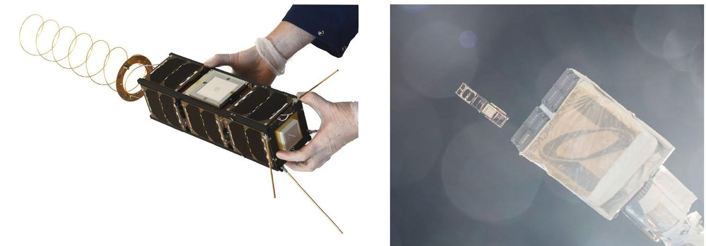

Fig.1. The final GOMX-3 nanosatellite (left) and its deployment from the ISS (right) together with AAUSAT5 (picture taken by Astronaut Scott Kelly)

Figure 1 shows the satellite and its deployment. Both GomSpace and ESA are interested in maximizing the functionality of their nanosatellite missions. As such, GOMX-3 has been equipped with a variety of technically challenging payloads and components, among them: (i) 3-axis rotation and pointing, (ii) in-flight tracking of commercial aircrafts, (iii) monitoring signals from geostationary INMARSAT satellites, and (iv) high-speed downlinking to stations in Toulouse (France) or Kourou (French Guiana).

For a satellite in orbit all resources are scarce and the most critical resource of all is power. Power is required to run the satellite, to maintain attitude, to communicate, to calculate, to perform experiments and all other operations. Detailed knowledge on the power budget is thus essential when operating a satellite in orbit. Furthermore, in a satellite not all power is used as it is generated. The satellite passes into eclipse each orbit and during those periods it must draw power from its batteries. This challenge is especially apparent for nanosatellites where not only the actual satellite but also the resources are very small. An operator of such a spacecraft is thus faced with a highly complex task when having to manually plan and command in-orbit operations constantly balancing power and data budgets. Manual operation was used prior to this work.

In this paper we report on our joint activities, part of the EU-FP7 SENSATION project, to harvest formal modelling and verification technology, so as to provide support for commanding in-orbit operations while striving for an efficient utilization of spacecraft flight time. Concretely, we have developed a toolchain to automatically derive battery-aware schedules for in-orbit operation. Heterogeneous timing aspects, especially the aperiodic occurrences and variable durations of tasks, as well as the experimental nature of the application domain make it impossible to use traditional workload scheduling approaches, like RMS (Rate Monotonic Scheduling) and EDF (Earliest Deadline First) for periodic tasks.

The schedules we derive are tailored to maximize payload utilisation while minimizing the risk of battery depletion. The approach is flexible in the way it can express intentions of spacecraft engineers with respect to the finer optimisation goals. It comes as an automated two-step procedure, and provides quantifiable error bounds.

For the first step, we have developed a generic model of the GOMX-3 problem characteristics in terms of a network of priced timed automata (PTA) $ [ \mathrm{B F H}^{+}0 1 ] $ . This model is subjected to a sequence of analyses with respect to cost-optimal reachability (CORA) with dynamically changing cost and constraint assignments. We use UPPAAL CORA for this step. The latter is a well understood and powerful tool to find cost optimal paths in PTA networks [BLR05]. Note that CORA is limited to linear systems, therefore a simplified first order battery model is used. Any schedule generated in this step has a risk of not being safe when used in-orbit, running on a real battery and with real payload.

To account for this problem, a second step validates the generated schedule on a much more accurate model of the on-board battery, a model that includes nonlinearities and also accounts for the influence of stochastic perturbations of load or battery state. For this step, we employ a stochastic enhancement [HKN17] of the kinetic battery model [MM93] (KiBaM) with capacity bounds. As a result it is possible to discriminate between schedules

<!-- PDF_PAGE: 3 -->

according to their quantified risk of depleting the battery. Low risk schedules are shipped to orbit and executed there. $ ^{1} $ The satellite behaviour is tightly monitored and the results gained are used to improve the model as well as the overall procedure.

The entire toolchain has been developed, rolled out, experimented with, and tailored for in-the-loop use when operating the GOMX-3 satellite. We report on experiences gained and lessons learned, and highlight the considerable prospect behind this work, in light of the future development in the space domain.

Organisation of the paper. The paper starts off by introducing relevant formalisms, models and algorithms in Sect. 2. Section 3 describes a model of GOMX-3 capturing its power-relevant properties. A simple workflow consisting of a schedule synthesis-validation loop is presented in Sect. 4. The results of, and lessons learned by three separate test-runs on GOMX-3 are depicted and discussed in Sect. 5. In Sect. 6 we propose an improved, receding-horizon approach to schedule synthesis using Kalman Filters in order to incorporate measured quantities into the scheduling step. A proof of concept is delivered in Sect. 7, where this improved workflow is first evaluated on synthetic data, followed by a rudimentary experiment on real data collected during the GOMX-3 mission. Section 8 offers a collection of related work while Sect. 9 concludes the paper with a discussion of the value of the work presented and an outlook of future ventures.

This paper is a substantially extended version of a FM 2016 conference publication $ [ \mathrm{B G H}^{+}1 6 ] $ . We in particular extend over that version by a detailed account on how the scheduling approach can be perpetuated with improved performance, profiting from in-orbit measurements of voltage and current in a model-predictive control approach.

## 2. Preliminaries

This section reviews the necessary background for the models we develop. We sometimes refer to diagonal matrices using the notation diag(x, y) for the matrix with entries x and y on the main diagonal, i.e.:

$$
\operatorname {d i a g} (x, y) = \left[ \begin{array}{c c} x & 0 \\ 0 & y \end{array} \right]
$$

Priced timed automata. The model of Timed Automata (TA) [AD94] has been established as a standard modelling formalism for real time systems. A timed automaton is an extension of finite state machines with non-negative real valued variables called clocks in order to capture timing constraints. Thus, a timed automaton is an annotated directed graph over a set of clocks C with vertex set (called locations) L and edge set E. Edges and locations are decorated with conjunctions of clock constraints of the form c $ \bowtie $ k where c $ \in $ C, k $ \in $ $ \mathbb{N} $ and $ \bowtie $ $ \in $ {<, $ \leq $ ,=, $ \geq $ ,>}. For edges such constraints are called guards, for locations they are called invariants. Edges are additionally decorated with reset sets of clocks. Intuitively, taking an edge causes an instantaneous change of location and a reset to 0 for each clock in the reset set. However an edge may only be taken if its guard and the target location's invariant evaluate to true. If this is not the case the current location remains active, if it's invariant permits, and clocks increase continuously with their assigned rates, thus modelling the passing of time.

In order to reason about resources, TAs are enriched with non-negative integer costs and non-negative cost rates in the form of annotations for edges and locations respectively $ [ \mathrm{B F H}^{+}0 1 ] $ . The result are priced timed automata (PTA). The intuition is that cost accumulates continuously in a proportional manner to the sojourn time of locations and increases discretely upon taking an edge as specified by the respective annotations.

Definition 2.1 (Priced Timed Automata) Let C be a set of clocks and $ \mathbb{B} (C) $ be the set of all clock constraints as described above. A priced timed automaton is a tuple $ \langle L, E, \ell_{0}, \mathrm{inv}, \mathrm{price} \rangle $ where L is a set of locations, $ E \subseteq L \times \mathbb{B} (C) \times 2^{C} \times L $ is a set of edges, $ \ell_{0} $ is the initial location, $ \mathrm{inv}: L \rightarrow \mathbb{B} (C) $ assigns invariants to locations, and price: $ L \cup E \rightarrow \mathbb{N} $ assigns costs and cost rates to edges and locations respectively.

To meet space requirements we omit the formal semantics of PTA, and instead refer to $ [ \mathrm{B F H}^{+}0 1] $ for a complete development.

<!-- PDF_PAGE: 4 -->

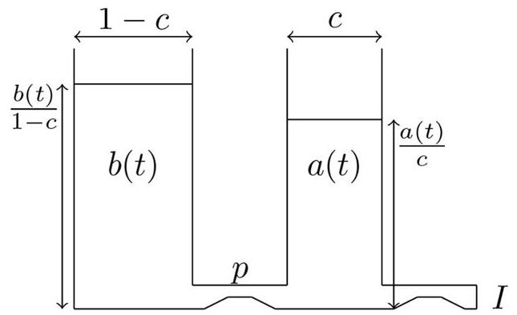

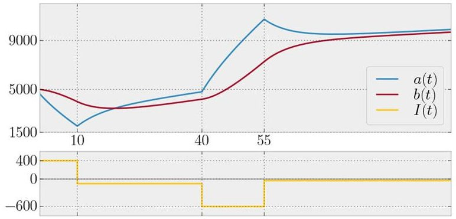

Fig. 2. The two-wells depiction of the KiBaM (left) and a SoC evolution trace over time under a piecewise constant load (right)

A common problem to consider in the context of PTA is that of computing the minimum cost to reach a certain target location in a given PTA. This so-called cost-optimal reachability analysis (CORA) receives dedicated attention in the literature [BLR05, LBB $ ^{+} $ 01] and is well-known to the community. The CORA is implemented in a number of tools, most prominently UPPAAL CORA [upp05]. As input UPPAAL CORA accepts networks of PTAs extended by discrete variables, and thus allows for modular formalisation of individual components. The set of goal states is characterised by temporal formulae over the variables in the network of PTAs.

Kinetic battery model. Real-life batteries exhibit two non-linear effects widely considered to be the most important ones to capture: the rate-capacity effect and the recovery effect. The former refers to the fact that if continuously discharged, a high discharge rate will cause the battery to provide less energy before depletion than a lower discharge rate. Thus a battery's effective capacity depends on the rate at which it is discharged. The latter effect describes the battery's ability to recover some usable charge to some extent during periods of no (or very little) discharge. Intuitively this is because the charge is consumed from the cathode edge of the battery and this causes a local ion concentration drop. If unused, the charge tends to equilibrate over time, partially flattening out the concentration drop. We introduce the kinetic battery model (KiBaM) as the simplest model capturing these effects. It is known to provide a good approximation of the battery state of charge (SoC) across various battery types [HKN17]. For a survey on battery models providing a context for the KiBaM we refer to [JH09, Jon10].

The KiBaM divides the stored charge into two parts, the available charge and the bound charge. When the battery is strained only the available charge is consumed instantly, while the bound charge is slowly converted to available charge by diffusion. For this reason the KiBaM is often depicted by two wells holding liquid, interconnected by a pipe, as seen in Fig. 2.

The diffusion between available and bound charge can take place in either direction depending on the amount of both types of energy stored in the battery. Both non-linear effects are rooted in the relatively slow conversion of bound charge into available charge or vice versa. The KiBaM is characterized by two coupled differential equations:

$$
\dot {a} (t) = - I (t) + p \left(\frac {b (t)}{1 - c} - \frac {a (t)}{c}\right), \quad \dot {b} (t) = p \left(\frac {a (t)}{c} - \frac {b (t)}{1 - c}\right).
$$

Here, the functions a(t) and b(t) describe the available and bound charge at time t respectively, $ \dot{a} (t) $ and $ \dot{b} (t) $ their time derivatives, and I(t) is a load on the battery. We refer to the parameter p as the diffusion rate between both wells, while parameter c $ \in $ [0,1] corresponds to the width of the available charge well, while 1-c is the width of the bound charge well. Intuitively, a(t)/c and b(t)/(1-c) are the level of the fluid stored in the available charge well and the bound charge well, respectively. Figure 2 shows a SoC trace of the KiBaM ODE system. We shall denote the KiBaM SoC at time t as $ [a_{t};b_{t}]$ and consider I(t) to be piecewise constant. The KiBaM does by itself not capture capacity degradation effects caused by accumulated wear over large numbers of usage cycles or by partial disintegration of the internal components' physical and chemical properties rooted in fast, deep discharging.

<!-- PDF_PAGE: 5 -->

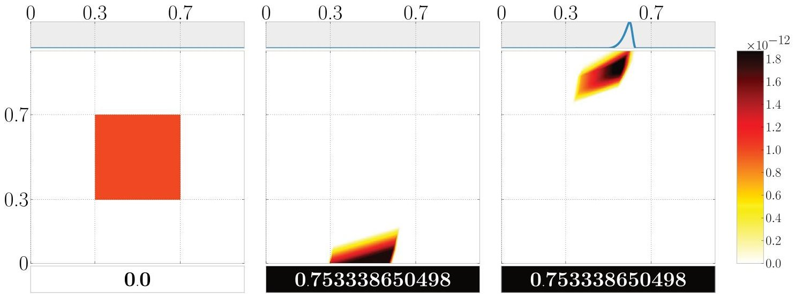

Fig. 3. An exemplary battery with $ \bar{a}=\bar{b}=5\cdot10^{6} $ $ c=0.5 $ $ p=0.0003 $ with an initially uniform SoC density over the area [0.3, 0.7] $ \bar{a}\times $ [0.3, 0.7] $ \bar{b} $ (left), subjected to a task sequence (500, $ \mathcal{U} $ [3000, 3600]), (600, $ \mathcal{U} $ [ $ -3900,-3300 $ ]) with $ \mathcal{U} $ denoting uniform distribution. Roughly 75% of the SoC density flows into the depletion area (negative available charge) after powering the first task and is thus accumulated in z (middle). The remaining 25% are considered alive and transformed further. Some of it even reaches the capacity limit $ \bar{a} $ of the available charge (right)

The KiBaM has been extended with capacity limits (say $ \bar{a} $ for the available charge and $ \bar{b} $ for the bound charge), as well as with means to incorporate stochastic fluctuations in the SoC and in the load imposed on the battery [HKN17]. Both extensions come with their own set of technical difficulties. In this setting SoC distributions may not be absolutely continuous, because positive probability may accumulate in the areas $ \{[0; b]\mid 0 < b < \bar{b}\} $ where the available charge is depleted and $ \{[\bar{a}; b]\mid 0 < b < \bar{b}\} $ where the available charge is full. Therefore, one works with representations of the SoC distribution in the form of triples $ \langle f,\bar{f},z\rangle $ where

- $ f $ is a joint density over $ ]0,\bar{a}[\times ]0,\bar{b}[ $ , which represents the distribution of the SoC in the area within the limits,

- $ \bar{f} $ is a density over $ \{\bar{a}\}\times ]0,\bar{b}[ $ and captures the bound charge distribution while the available charge is at its limit $ \bar{a} $

- $ z\in[0,1] $ , the cumulative probability of depletion.

It is possible to analytically express an under-approximation of the SoC distribution $ \langle f_{T},\bar{f}_{T},z_{T}\rangle $ after powering a task ( T,g) when starting with the initial SoC distribution $ \langle f_{0},\bar{f}_{0},z_{0}\rangle $ , where T is a real time duration and g is the probability density function over loads. We omit the derivation of these expressions due to their lengthiness and instead refer to [HKN17] for a complete and rigorous development. We only mention that these depletion bounds are not found by Monte Carlo simulation, but by proper under-approximation of the battery SoC in certain cases as well as conservative discretisation. The values computed are thus proper upper bounds of the real depletion probabilities. Sequences of tasks can be handled iteratively, by considering the resulting SoC distribution after powering a task to be the initial SoC distribution for powering the next task.

Figure 3 displays the SoC distributions while powering an exemplary task sequence. Each distribution $ \langle f,\bar{f},z\rangle $ is visualized as three stacked plots: f is represented in the heatmap (middle) with the available charge on the y-axis and the bound charge on the x-axis, the curve of $ \bar{f} $ in the small box (top), z in the small box as a colour-coded probability value representing the cumulative depletion risk (bottom).

## 3. Modelling the GomX-3 nanosatellite

GOMX-3 is a 3 L $ ( 3 0 \times1 0 \times1 0 $ cm, 3 kg) nanosatellite launched in October 2015 from the ISS. It's mission payloads are threefold: Tracking of ADS-B beacons emitted by commercial airplanes, testing a high-rate X-Band transmitter module for in-space adequacy, and monitoring spot-beams of geo-stationary satellites belonging to the INMARSAT family, via an L-Band receiver. In addition, it features a UHF software defined radio module for downlinking collected data to, and uplinking new instructions from, the GomSpace base station in Aalborg,

<!-- PDF_PAGE: 6 -->

Denmark. In the sequel, we refer to the operation of one of these payloads as a job. Each job comes with its own set of satellite attitude configurations (specifying its orientation in 3-dimensional space), making an advanced 3-axis attitude control system indispensable. This attitude determination and control system (ADCS) uses reaction wheels and magnetorquers to enable the satellite to slew into any dedicated position. The ADCS is especially power-hungry.

As an earth-orbiting satellite, GOMX-3 naturally enters eclipse. To continue operation, it draws the necessary power to sustain its operation from an onboard battery system. These batteries are, in turn, charged by excess energy harvested during insolation periods by solar panels that cover any non-occupied surface. The solar intake in general depends on the so called $ \beta $ - angle, determining the degree of insolation per orbit and thus the portion in which the spacecraft is exposed to sunlight. Every attitude (as well as each transition phase between attitudes, i.e. slewing) has a constant assigned to it which represents a constant energy intake collected by the solar panels during insolation periods.

Special care needs to be taken when reasoning about battery performance, as the latter depends, among others, on ambient temperature. During eclipse, temperatures may fall below the operational limits of Li-ion batteries (according to manufacturer specification). To maintain a safe operating range, the GOMX-3 batteries are coated in heater foil enabling active temperature regulation (mostly during eclipse), at the cost of higher power consumption. A rich pool of diagnostic data from the earlier GOMX-1 mission however shows that the onboard batteries stay within the range of $ - 7 $ to $ 1 7 $ $ ^{\circ} C $ . As a consequence the battery heaters in GOMX-3 are not used, and remains disabled at all times. Another aspect of concern is that of gradual battery capacity degradation due to frequent, deep or very fast (dis)charge cycles. We work with the assumption that the scheduling horizon is so short that the battery will not degrade and thus retains a constant capacity limit along a schedule. Degradation can however be accounted for by gradually reducing the capacity along the lifetime of the mission, as the accumulated usage cycles increase. Since its launch, GOMX-3's follows the orbit of (and below) the ISS. Therefore, insolation periods as well as operational windows for the different jobs are well predictable over the time horizon of about a week ahead, yet they are highly irregular. Exploiting the pre-determined attitude configurations per mode of operation, the net power balance of every job can be predicted in conjunction with the GomSpace in-house POWERSIM tool. This tool provides orbit trajectory predictions including $ \beta $ - angle estimations. The aggregated information is considered trustworthy and captures the essence of the power-relevant behaviour of GOMX-3 and serves as input to the scheduling approaches described in later sections. In order to understand their joint implications for the energy budget of GOMX-3, it is important to accurately model these power-relevant aspects of the satellite components, and their interplay.

## 3.1. Objectives

In broad terms, the main mission goal of GOMX-3 is to maximize the amount of jobs carried out without depleting the battery. The concrete objectives spelled out by GomSpace engineers changed several times along the mission. This meant that the models have to have the necessary flexibility needed to reflect the requirements once they are made formal, not only during the design phase but especially during flight.

GOMX-3 switches to Safe Mode if the battery SoC falls below a given threshold. For GOMX-3 this threshold is at 40% of the battery's capacity. In Safe Mode, all non-essential hardware components are switched off, preventing the satellite from being productive. Only UHF radio, ADCS and the onboard computer remain operational. The primary objective is thus to avoid Safe Mode, while maximizing secondary objectives. Several such secondary objectives need to be taken into account.

- Whenever possible the UHF connection to the GomSpace base station must be scheduled and maintained throughout the entire operational window in order to enable monitoring the status of GOMX-3 and to uplink new instructions if need be. This is crucial to maintain control over the satellite and thus considered vital for the success of the mission.

- Independent of the satellite attitude, the ADS-B helix antenna is able to receive ADS-B beacons. Thus this hardware module will be active at all times, thereby constantly collecting data of airplane whereabouts.

- The X-Band windows are small, as the downlink connection can only be established if the satellite is in line of sight and close enough to the receiving ground station. The corresponding downlink rate, however, is relatively high.

<!-- PDF_PAGE: 7 -->

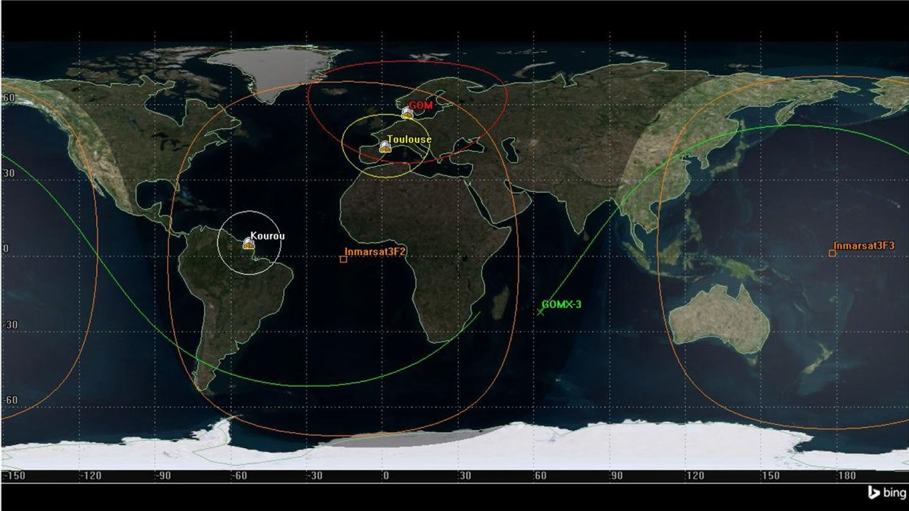

Fig.4. The ground track of GOMX-3. X-Band operational windows are induced when the satellite trajectory crosses the Kourou or Toulouse area, L-Band jobs can be carried out in the Inmarsat3F2/3 areas. The GOM area represents the line of sight of the GomSpace station in Aalborg, Denmark

- L-Band jobs have highly variable durations depending on how the satellite crosses the field of visibility of the INMARSAT, and will collect a lot of data if successful. The variations in window lengths can be observed in Sect. 5, where actual schedules are visualized.

- L-Band jobs are to become as balanced as possible across the available INMARSATs.

- Jobs filling their entire job window are most valuable. Jobs that have been aborted early or started late are not considered interesting.

- L-Band and X-Band jobs are mutually exclusive, as they require different attitudes. UHF jobs may be scheduled regardless of the current attitude, even when L-Band or X-Band jobs are currently executed.

- Only downlinked data are useful, thus the time spent on data collection payloads (L-Band, ADS-B) and downlink opportunities (X-Band) needs to be balanced in such a way that only a minimal amount of data needs to be stored temporarily in the satellite's memory. This induces the need to weigh the data collection rate and the downlink speed against each other. Based on these observations and the expertise of GomSpace engineers, it was deemed that two fully executed X-Band jobs are enough to downlink the data of one successful L-Band job together with the ADS-B data collected in the meanwhile.

The ground track of GOMX-3 visualising its orbit and operational windows, is depicted in Fig. 4.

## 3.2. PTA modelling

As the central modelling formalism PTAs are employed when modelling the behaviour of GOMX-3, with special emphasis being put on flexibility w.r.t. the optimization objective. In order to allow for easy extensibility, the modelling was purposely kept modular and generic. Notably, the TA formalism is not expressive enough for the nonlinearities of the kinetic battery model. Therefore we use a simple linear model (intuitively corresponding to a single well holding liquid) instead, and account for this discrepancy later. The component models belong to the following categories.

Background load comprises the energy consumption of modules that are always active, including the ADS-B module for tracking airplanes, the reaction wheels and magnetorquers (even though not at full power) for keeping the attitude invariant.

<!-- PDF_PAGE: 8 -->

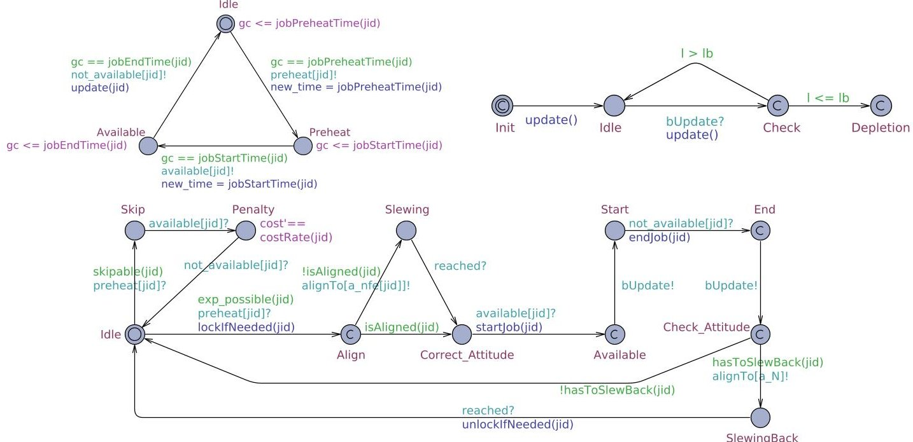

Fig. 5. The JobProvider automaton (top left), the Job instance automaton (bottom) and the Battery automaton (top right)

Attitude represents the predetermined attitude requirements of each job and the worst case slewing time of 5 min. However, preparing the ADCS and actual slewing can be abstracted into one single warm-up period, since both stages consume the same amount of energy. Thus, the worst-case warm-up time before entering the visibility range of any job window requiring slewing was raised to 10 min.

Jobs are dealt with in a generic way, so that only the common characteristics are modelled. A job has a finite time window of operation, it may be skipped, it may require an a priori warm-up time (to ramp up the physical modules related to the job, especially the ADCS) as well as a specific attitude, it may need to activate a set of related modules inducing piecewise constant loads.

Battery represents a relatively simple linear battery which can support piecewise constant loads. It keeps track of its (one-dimensional) state of charge and updates that based on the (dis)charge rate and the time until the load changes again. Since the battery is modelled as an automaton, the system can monitor and take decisions based on the remaining battery charge.

Sun is a simple two-location automaton (representing insolation and eclipse) based upon the predicted insolation times, triggering a constant energy infeed from the solar panels which in turn depends on the satellite's attitude. The automaton includes that upon changing location, i.e. entering or exiting eclipse, extra load arises from battery heaters being switched on, respectively off (not used however).

The accumulative power consumption/infeed of GOMX-3 in mW is summarized in the following table.

<table border="1"><tr><td>Background load</td><td>Warm-up</td><td>X-Band</td><td>L-Band</td><td>UHF</td><td>Solar infeed</td></tr><tr><td>2989</td><td>1406</td><td>11945</td><td>3863</td><td>2630</td><td>[5700,6100]</td></tr></table>

Among these components, the PTAs modelling the battery and the job aspects are the most interesting. They are depicted in Fig. 5 and explained in more detail below.

JobProvider: This automaton provides the interface between multiple arrays representing the job opportunities as well as their implied preheating times, and the actual Job automaton. It waits for a job window, discriminating whether the job needs preheating or not, and broadcasts signals triggering the actual decision making. In the Idle location, being initial, it waits for the global clock gc to hit a certain job preheat time event (stored in the array jobPreheatTime), sets the time variable to the current time, and notifies the Job automaton to start preheating over a dedicated preHeat[jid] channel, where jid uniquely identifies a certain job type. Upon this notification it switches into the PreHeat location and waits for the actual job to start, i.e. the global time reaching the expected start time of the job identified by jid, consequently transitioning into location

<!-- PDF_PAGE: 9 -->

Available, where, in turn it waits for completion of the job (gc reaching jobEndTime[jid]], switching into location Idle yet again, all the while notifying its environment on the respective dedicated channels.

Job: This automaton represents the execution or skipping of a job. It starts in its Idle location, waiting to be notified of impending preheating duties. At this point the take-or-skip decision is taken, as witnessed by the two outgoing transitions into locations labelled Skip and Align. A job is either skipped because it is not optimal to take it, or because the attitude requirements don't match the current attitude of the satellite because of an already ongoing job. If the job is skipped, cost is accumulated with rate costRate(jid) over the duration of the job, effectively returning into location Idle. If it is taken, attitude requirements of the scheduled job are checked via the guard isAligned(jid), upon which the satellite starts slewing (location Slewing) to the correct attitude (location Correct_Attitude) if need be. Upon notification, the job is executed (Start $ \rightarrow $ End $ \rightarrow $ Check_Attitude) triggering the battery via channel bUpdate to update its SoC, and finally checks whether it has to change attitude to minimize atmospheric drag using guards hasToSlewBack(jid) to finally return eventually to location Idle.

Battery: This model represents a simple linear battery with capacity that can be (dis)charged with piecewise constant loads. It is notified of load changes via channel bUpdate, upon which it computes the length of a constant load interval via global integer variables new_time and old_time, and subtracts the result multiplied by load from its internal SoC soc, upon which it ends up in location Check. A check is performed whether the SoC fell below a lower bound lb, upon which we either transition into (and stay in) the Depletion location or return to Idle to power another task.

## 3.3. Cost model and reachability objectives

In the following we explain how the objectives derived by GomSpace engineers were turned into constraints and cost parameters of the PTA model.

The Safe Mode threshold is kept variable and must be set before scheduling. It appears as 1b (for lower bound) in the automata models. Depending on the degree of aggressiveness of the intended schedule, it can either be set close to the real Safe Mode threshold of 40% or it can be set higher, for example to 55%, thereby adding an implicit safety margin.

UPPAAL CORA computes cost-minimal schedules. Therefore, we interpret the price annotations of PTA transitions as penalties for skipped jobs. Likewise, cost rates in states accumulate penalty per time unit a job window is left unused. An optimal schedule will then have the property that a minimal portion of important job windows was left unexploited.

An immediate consequence of this setup is that UHF jobs have a high penalty if skipped, as they are supposed to be scheduled every time they are possible. For L-Band and X-Band jobs, the number of jobs scheduled should result in an average ratio of 1/2, according to the GomSpace directives. To arrive there, we proceed as follows. Let $ \Delta_{X} $ and $ \Delta_{L} $ denote the job windows length expectations of X-Band and L-Band jobs, respectively. Then the cost rate for skipping L-Band and X-Band window portions is set $ 2\cdot\Delta_{X} $ and $ \Delta_{L} $ , respectively. Likewise, the L-Band jobs on different INMARSAT are internally viewed as different jobs. Their cost rates for skipping should be set equal.

In order to generate an optimal schedule from the network of PTAs up to a certain time horizon (treated as an orbiting count), we need to define the goal set of states to be used in a reachability objective as supported by UPPAAL CORA. The tool's query language is a subset of timed computation tree logic (TCTL) [LPY97] and thus consists of path and state formulae. A state formula is a simple expression over the variables of the system and is evaluated using a state's valuation of said variables. Path formulae come in different flavours, yet for this work only reachability path formulae are relevant. Reachability properties are of the form $ \exists \diamond \varphi $ and ask whether there exists ( $ \exists $ ) a path that eventually ( $ \diamond $ ) reaches a state which satisfies the state formula $ \varphi $ . We introduce a small automaton that counts the orbits already scheduled for and manages this number globally, say in a variable n. A query for a schedule of 20 orbits can then easily be formulated as $ \exists \diamond (n=20) $ .

<!-- PDF_PAGE: 10 -->

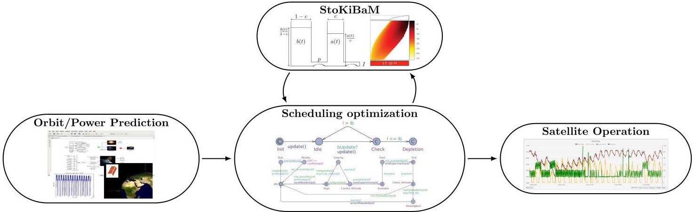

Fig. 6. Scheduling workflow

## 3.4. Model quality assurance

In light of the high overall significance of the GOMX-3 mission, it was from the start deemed important to assure the adequacy of the formal models used to represent and to eventually manoeuvre the satellite. For this reason, a series of dedicated workshops were organized in the context of the SENSATION project, comprising, among others, the authors of this paper. On these occasions, presentations of varying technical detail were delivered by both sides, so as to expose the formal approach, the set of concrete problems, as well as possible solutions thereof. In later stages, collaborative work was organised via Google docs and Skype, which indeed provided an effective way to communicate feedback in both directions. This altogether made it possible to effectively crossfertilize the domain expertise of the GomSpace engineers with the modelling and verification experience at Saarland University, so as to assure a high quality model. In the same vein, the design of the entire scheduling workflow (explained next) was a consensus decision.

## 4. The scheduling workflow

The scheduling workflow, depicted in Fig. 6, loops through a two-step procedure of schedule generation and schedule validation. The latter is needed to account for the inaccuracies of the simple linear battery model, which is used for schedule generation, relative to real battery kinetics. Therefore any generated schedule is validated along the stochastically enhanced KiBaM known to be sensitive to such effects. If the validation does not exhibit good enough guarantees in the eyes of the GomSpace engineers, the current schedule is discarded and excluded from the generation step, and a new schedule is computed. Otherwise it will be accepted, upon which we break the loop and ship the schedule to orbit.

## 4.1. Operational windows

The operational windows are the main source of variability in the scheduling workflow. They are determined by GomSpace engineers just before the start of the actual scheduling period. In this way, changing mission parameters and temporary unavailability of certain jobs is accounted for. The operational windows are delivered as csv (comma separated values) files based on the POWER SIM orbit prediction. If an experiment is unavailable during an certain timespan, the tables will not contain operational windows for this experiment intersecting it.

Each csv file contains a list of job opportunities of a certain type, for example L-Band (see below), given by two date-time strings representing the start time and the end time of the job window respectively, the implied duration of the time points, as well as a flag (Scheduled) that shows whether the opportunity should be taken. This column is filled in after a schedule has been computed. One such file could be read as follows:

<!-- PDF_PAGE: 11 -->

<table border="1"><tr><td>Access</td><td>Start time(UTCG)</td><td>Stop time(UTCG)</td><td>Duration(s)</td><td>Scheduled</td></tr><tr><td>1</td><td>17Nov.201500:38:38.922</td><td>17Nov.201501:09:42.642</td><td>1863.720</td><td>--</td></tr><tr><td>2</td><td>17Nov.201502:16:24.134</td><td>17Nov.201502:45:23.914</td><td>1739.781</td><td>--</td></tr><tr><td>$\vdots$</td><td>$\vdots$</td><td>$\vdots$</td><td>$\vdots$</td><td>$\vdots$</td></tr><tr><td>15</td><td>17Nov.201523:41:20.490</td><td>18Nov.201500:12:38.983</td><td>1878.493</td><td>--</td></tr></table>

## 4.2. Schedule generation

The mission times to be considered for automatic scheduling span between 24 and 72 h, i.e. the range of 15-47 orbits. Longer durations are not of interest since orbit predictions are highly accurate only for a time horizon of a handful of days, and because GOMX-3 is as a whole an experimental satellite, requiring periods of manual intervention. However, even a 24 h schedule computation constitutes a challenge for plain CORA, since the number of states grows too large to fit in memory, due to the natural state space explosion when facing model checking problems. $ ^{2} $

The dominating contributor to the state space growth is the large number of L-Band operational windows. GOMX-3 passes several of them each orbit, invoking a take-or-leave decision for each such window. This issue is made worse as other jobs (i.e. UHF) could be taken at the same time as their attitude requirements are not mutually exclusive. Especially rhese circumstances induce an exponential growth of states in the scheduling horizon size.

Heuristics. The state-space explosion can, to certain extend, be remedied by using heuristics, i.e. exclusion of certain schedules at the risk of losing optimality. Here is a brief overview of heuristics used:

1. Take every job if battery is almost full. Job opportunities will be taken if the battery is close to being full, since the battery cannot store more energy anyway. This minimizes the risk of not being able to harvest energy due to a full battery.

2. Force discard of schedules on depletion. This simple, yet effective heuristic forces the PTA network into a dedicated deadlock location (Depletion) whenever the battery automaton reaches a non positive SoC, resulting in the schedule to be dropped.

The following heuristics are specific to objectives expressed by the engineers.

3. An L-Band job precedes two X-Band jobs. To avoid storage of large amounts of data on the satellite, we bound the ratio of data collection and downlink jobs. A ratio $ r_{\mathrm{X}}/r_{\mathrm{L}} $ can be approximated greedily by adding a global variable r (initially 0) as well as guards to the Job automaton such that X-Band jobs are scheduled only if $ r\geq r_{\mathrm{L}} $ and L-Band jobs are scheduled only if $ r<(r_{\mathrm{X}}+r_{\mathrm{L}})\cdot r_{\mathrm{X}} $ . Upon scheduling an X-Band and L-Band job, we set $ r:=r-r_{\mathrm{L}} $ and $ r:=r+r_{\mathrm{X}} $ respectively. With $ r_{\mathrm{X}}:=2 $ and $ r_{\mathrm{y}}:=1 $ schedules never start with an X-Band job and in the long run, the ratio of X-Band and L-Band jobs stays between 1 and 2/1.

4. Keep L-Band jobs in balance across INMARSATs. Similarly to the realization of the above heuristic we bound the difference among L-Band jobs on the relevant INMARSATs to at most 2.

5. Always schedule UHF jobs. Instead of penalizing skipped UHF jobs by annotations of large costs (to enforce their scheduling), we enforce them on the automaton level, omitting any cost annotation.

6. Impose upper bound on discharging loads. This heuristic does what it says, and is meant to somewhat counteract the rate-capacity effect of batteries.

Especially heuristic 6 proves useful in several ways. First, the KiBaM used in the validation step yields less energy before depletion if subjected to high loads due to the rate-capacity effect (that is not captured by the linear battery model). Second, high loads are reached when UHF jobs are scheduled in addition to an L- or X-Band job. Such situations seem lucrative to UPPAAL CORA, given that they don't accumulate much cost. Yet, they often result in schedules that leave the battery (almost) empty. Third, the bound can be chosen such that parallel experiments, and thus high loads, occurs only during insolation, but not in eclipse.

<!-- PDF_PAGE: 12 -->

Each heuristics impacts the computational efficiency (runtime, memory) as well as the schedule quality (accumulated cost), as it essentially prunes the state space. To illustrate this, we synthesized a schedule, deactivating one heuristic at a time, and report on some diagnostic quantities of the modelchecking procedure in the following table. The scheduling horizon was split into two parts and later conjoined in order to actually arrive at a schedule.

<table border="1"><tr><td>Heuristics used</td><td>Total CORA time</td><td>States explored</td><td>Accumulated cost</td></tr><tr><td>all</td><td>2.6</td><td>172,452</td><td>262,792</td></tr><tr><td>all but 1</td><td>10.2</td><td>700,429</td><td>262,792</td></tr><tr><td>all but 2</td><td>80.7</td><td>5,474,775</td><td>262,792</td></tr><tr><td>all but 3</td><td>8.9</td><td>592,233</td><td>258,081</td></tr><tr><td>all but 4</td><td>3.7</td><td>224,517</td><td>262,792</td></tr><tr><td>all but 5</td><td>2.7</td><td>175,191</td><td>262,792</td></tr><tr><td>all but 6</td><td>86.1</td><td>6,029,126</td><td>243,269</td></tr></table>

It becomes apparent that heuristic 2 and 6 are the most effective. Most of the combinations studied induce the schedule depicted below, where job windows of a certain type, i.e L-Band on different INMARSATS $ ( L_{1}, L_{2} ) $ X-Band $ ( X ) $ and UHF, are displayed as black (grey) bars if they were indeed taken (skipped).

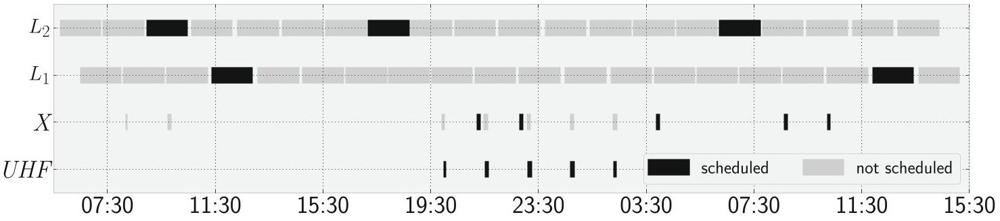

At first sight, dropping heuristics 3 or 6 lead to superior solutions. Without heuristic 3, one more X-Band job can indeed be scheduled, explaining why this schedule is cheaper in terms of accumulated penalty. It is however scheduled before the first L-Band job, rendering it useless because there is nothing to downlink. As expected, without heuristics 6, UPPAAL CORA predominately schedules UHF jobs parallel to X- or L-Band jobs, thereby straining the battery. The large number of states explored indicates that the state space exploration in this case is often misguided into eventual battery depletion.

Dynamic scheduling. Another issue is that UPPAAL CORA's optimization criterion is static, i.e. the prices cannot be updated based on the schedule generated so far. This is contrasted by the GomSpace engineering intention of having a dynamic scheduling approach. The need for dynamic change of scheduling parameters during mission time was driven by initial uncertainty concerning the requirements to be faced and by the intention to try out operational limits, to experiment with the potential of GOMX-3 attitude control and thereby to gather experience for subsequent missions and future use case scenarios.

We take care of this by viewing the PTA network as being parameterised, i.e. as templates that need to be instantiated by concrete values. This enables us to divide the scheduling interval into disjoint subintervals that can be scheduled individually, with distinct scheduling objectives and prices, all the while carrying over resulting quantities as initial values to the subsequent subinterval to be scheduled. Important quantities that need to be passed on are the resulting battery state, the number of individual jobs already scheduled and the state of the PTA network at the end of the previous subinterval. This information allows us to adjust the prices and scheduling objective at the end of each subinterval, depending on the requirements previously fixed. The subschedules are then conjoined to a schedule for the actual time interval. This line of action is a trade-off between optimality and being dynamic, as it implements a greedy heuristics.

Given the back-to-back nature of this approach, it is undesired to start with an almost empty battery after a scheduling interval. We require the battery to have a certain minimum charge at the end of the schedule, greater than the Safe Mode threshold. This requirement translates directly to a reachability query on the PTA network: $ \exists \diamond (n=20\wedge 1\geq 75000000), $ where 1 is the global variable representing the battery SoC.

<!-- PDF_PAGE: 13 -->

## 4.3. Schedule validation

As mentioned, UPPAAL CORA's expressiveness does not allow for direct modelling of the KiBaM as a PTA. Instead the schedule computed is based on the simple linear model, that is known to not capture important effects that can be observed from measurements of real batteries. In order to validate whether the computed schedule truly doesn't violate the constraints we imposed, we need to validate the schedule along the above mentioned stochastic KiBaM with capacity limits. In fact, such a schedule can be seen as a sequence of tasks $ \left( T_{j}, I_{j} \right) $ , which can immediately be used as input to the method to bound the cumulative risk of premature battery depletion of the computed schedule. The initial KiBaM SoC distribution is assumed to be a truncated 2D Gaussian around the initial battery state given to the PTA network and white noise is added to the loads of the tasks. If the validation step exhibits a low enough depletion risk, the computed schedule is accepted, otherwise the schedule is excluded and another schedule is computed. This happened only once. Across the schedules evaluated "low enough" was interpreted as "below 0.2" though much stricter guarantees were actually at hand in two of the three cases.

## 4.4. Implementation

The tool workflow has been implemented as follows. The operational windows for jobs are provided by GomSpace based on their inhouse tool POWERSIM as csv files. In addition to the interval to be scheduled, they serve as input to a Python script, which wraps the scheduling and validation parts. The python script (i) preprocesses the csv tables provided by GomSpace, (ii) instantiates the PTA templates with those numbers, (iii) calls UPPAAL CORA on the PTA instances, (iv) postprocesses the optimal trace output by UPPAAL CORA to extract a schedule, (v) calls a simplified version of the StoKiBaM tool, written in C++, to validate the schedule, (vi) complements each operational window in the csv tables with the taken-or-skipped information, as dictated by UPPAAL CORA, (vii) and finally, produces plots of the generated schedule as well as the resulting SoC distribution, including the depletion risk, for visual inspection.

The preprocessing step is mainly conversion of absolute date-time objects (i.e.17 Nov. 2015 00:38:38.922) to UPPAAL CORA-compatible relative unix timestamps (0 being the starting point of the scheduling interval) represented as integers, as well as the selection of operational windows actually contained in the scheduling interval.

Postprocessing includes parsing of UPPAAL CORA's textual format of a trace, filtering it to remove intermediate states and, finally, the conversion back to date-time objects to decide which operational windows were actually taken.

The Scheduled column of each csv file is filled in with 1 (the job opportunity was scheduled) or 0 (the job opportunity was skipped) accordingly. The csv tables, and optionally the plots, are subsequently sent to GomSpace, translated into GOMX-3-friendly instructions and uplinked via the UHF Aalborg connection.

The tool including the templates, the models, a few operational window tables and the necessary executables (except for UPPAAL CORA, which has to be acquired separately) can be accessed under

## https://www.powver.org/gomx3-supplementary-material/

The tool we make available is almost "push-button". It is preconfigured with meaningful parameter defaults for the GOMX-3 mission, so that passing start and end point of the scheduling interval should result in usable schedules that could be uplinked. No expert knowledge of UPPAAL CORA is required, as its model checking related arguments are fixed and passed by the python wrapper. The arguments passed to the wrapper are mostly instantiations of place holders in the PTA template, and thus reflect requirements concerning the schedule, but not the model-checking routine. Using the default parameters of the tool, a schedule of 24 h consisting of a total of 6 UHF, 10 X-Band and 26 L-Band operational windows was synthesized on a laptop. The modelchecker UPPAAL CORA needed 5.374 s to explore 349,191 states in order to find the optimal trace, inducing a task sequence of length 76. The StoKiBaM validation needed 4.903 s to compute the SoC density along this sequence. The runtime and space requirements of UPPAAL CORA grow exponentially with the scheduling horizon, while the StoKiBaM validation runtime and memory increase is linear in the task sequence length but quadratic in the discretisation constant.

<!-- PDF_PAGE: 14 -->

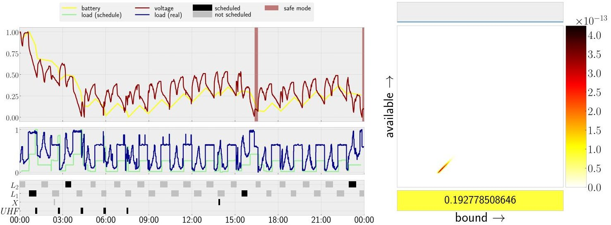

Fig. 7. Schedule November 17, 2015 midnight to November 18, 2015 midnight

<table border="1"><tr><td>Experimentdd.mm.yyhh:mm</td><td>Duration(h)</td><td>InitialSoC(%)</td><td>DepletionThreshold(%)</td><td>Min.SoC(%)</td><td>Depletionrisk(%)</td><td>Safe modeentered(nr.)</td></tr><tr><td>17.11.1500:00</td><td>24</td><td>85</td><td>40</td><td>40.3</td><td>19.3</td><td>2</td></tr><tr><td>14.02.1600:00</td><td>36</td><td>90</td><td>55</td><td>69</td><td>&lt;10^{-50}$</td><td>0</td></tr><tr><td>20.03.1607:00</td><td>60</td><td>90</td><td>55</td><td>55.9</td><td>&lt;10^{-2}$</td><td>0</td></tr></table>

Table 1. A summary of the test runs performed on GOMX-3 on three different occasions. It reports on the value chosen as internal depletion threshold to the battery automaton, the initial SoC provided to UPPAAL CORA, the minimal SoC along the schedule generated by UPPAAL CORA, the depletion risk as calculated by the stochastic KiBaM validation step and how often GOMX-3 actually entered Safe Mode during schedule execution.

## 5. Empirical results

A number of successful experiments have been carried out on GOMX-3 in-orbit, so as to evaluate and refine our method, focussing on the determination of schedules to be followed for the days ahead. These in-orbit evaluations have successfully demonstrated the principal feasibility and adequacy of the approach, as we will discuss in this section.

In Figs. 7,8 and 9 three representative in-orbit experiments are summarized. The schedules are visualised as three stacked plots of data against a common time line (left). The bottom ones are Gantt charts showing which jobs are scheduled (black bars) and which job windows are skipped (grey bars) respectively. The plots in the middle display the loads imposed by the jobs as predicted (light green) and as actually measured (dark blue) on GOMX-3. The top plots presents the battery SoC of the linear battery (yellow) as predicted by UPPAAL CORA as well as the actual voltage (dark red) logged by GOMX-3. Voltage and SoC are generally not comparable. However, both quantities exhibit similar tendencies during the (dis)charging process. The battery, voltage and load curves have all been normalized to the interval [0,1] for comparison reasons.

On the right, the three components of the SoC density resulting from the validation step are displayed, obtained by running the generated schedule along the stochastic KiBaM with capacity limits. It is to be interpreted as in Fig. 3. The most crucial part is at the bottom part of the plot, quantifying the risk of entering Safe Mode as specified by the GomSpace engineers (40%). The data is summarized in Table 1.

November 2015. The schedule presented in Fig. 7 spans November 17, 2015. It is a schedule that optimizes for maximum L-Band payload operations, yielding 4 L-Band operations and 1 X-Band operation together with the 5 UHF groundstation passes. The battery SoC and the measured battery voltage show a close correspondence. GomSpace reported that GOMX-3 entered Safe Mode twice, if only for a short period of time. It later surfaced that an improper SoC-to-voltage conversion was used to determine the Safe Mode threshold.

<!-- PDF_PAGE: 15 -->

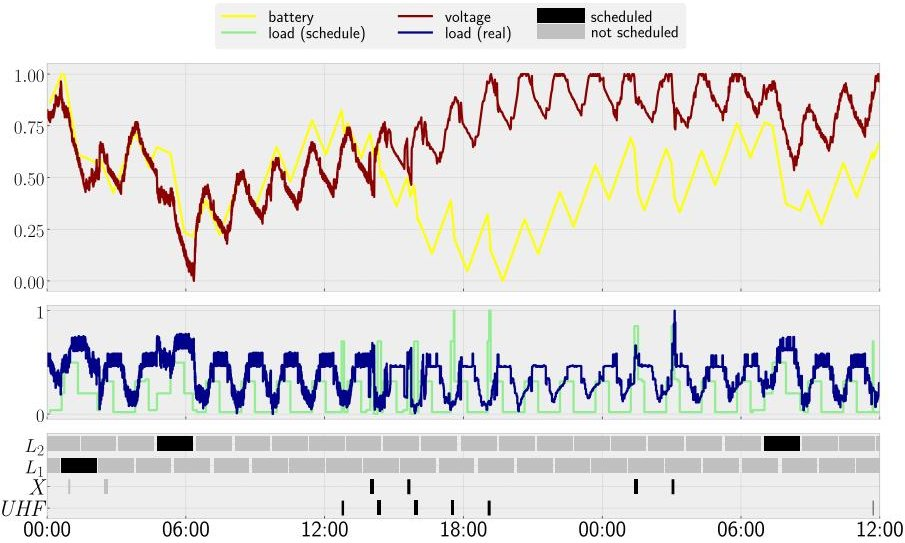

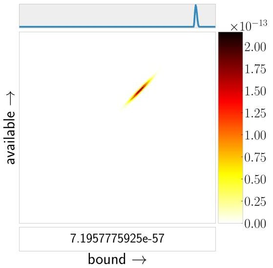

Fig. 8. Schedule February 14, 2016 midnight to February 15, 2016 noon

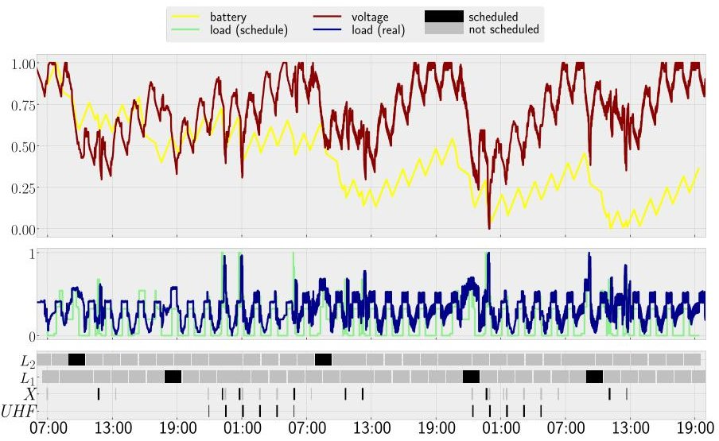

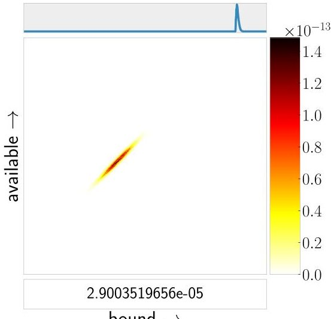

Fig. 9. Schedule March 20, 2016 7 AM to March 22, 2016 7 PM

February 2016. Figure 8 presents a schedule spanning one and a half day, starting on February 14, 2016. Before this experiment, GomSpace engineers gave notice that L-Band jobs shall receive special treatment from now on: (i) Generally, the hardware modules related to L-Band jobs shall remain active for one whole orbit duration, once such a job is scheduled. (ii) The ACDS needs 30 min of warm-up time to prepare for the L-Band job.

This instance illustrates how optimized scheduling can be utilized to not only take power limitations into consideration but also handle secondary constraints like data generation and data downlinking balance via L-Band and X-Band tasks. The initial SoC and the internal depletion threshold were communicated to us as 90% and 55%, as the SoC-to-voltage conversion was corrected. The plot exhibits a drift between battery SoC and measured voltage around 3 PM of the first day, after initially showing a close correspondence, indicating that the battery is in a better state relative to our pessimistic predictions. The GomSpace engineers were able to track down this drift to a mismatch in the initial net power balance estimate provided by POWERSIM which are used as input to the toolchain, together with discrepancies in power draw for certain third-party modules. Deviations between power consumption values reported in data sheets and actual power draws were detected and sorted out.

March 2016. The third schedule we present (Fig. 9) is the longest in duration, spanning from March 20 at 7 AM to March 22 at 7 PM. We were notified that GOMX-3 was supposed to test a simple, mission time prolonging adjustment: After each job, GOMX-3 should return to the so-called nominal attitude to minimize drag that would slowly decelerate the satellite, thereby shortening its mission time. Thus, each scheduled job opportunity that requires a non-nominal attitude automatically had a 10 min ADCS cool-down phase appended.

<!-- PDF_PAGE: 16 -->

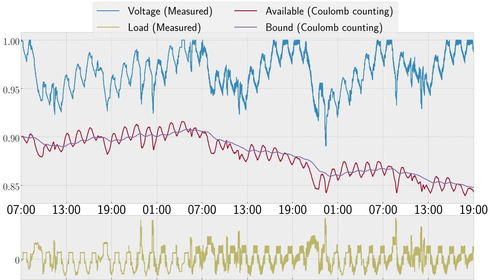

Fig. 10. Given the current and voltage measurements of the March 20 experiment, we perform simple Coulomb counting using the KiBaM $ ( c=0.2,p=0.0001) $ with initial SoC of $ [ a_{0}; b_{0} ]=[ 90\% ;\ 90\% ] $ and compare to the measured voltage

The energy consumption of cool-down and warm-up phases agree. After initial close correspondence of SoC and voltage, around 18 h into the test run we observe a slight but continuous drift between predicted battery SoC and measured voltage, yet not as steep as in the February test run.

## 6. Receding-horizon scheduling using model predictive control

Considering the results from Sect. 5, it becomes apparent that the predicted SoC and the actual voltage behaviour drift apart further and further as time progresses. The SoC curve indicates a downwards tendency over time, in contrast to the voltage curve, that appears to recover to nominal voltage again and again. Figure 10 tracks the effects of the sequence of actually measured (not of predicted) satellite loads on the KiBaM SoC, a technique also known as Coulomb counting, Ampere hour counting or Current integration method [PPJ01]. It shows a similar pattern, the SoC is driven closer and closer to the Safe Mode threshold, while the voltage indicates that the battery does not. The choice of the initial SoC is crucial, as Coulomb counting is not able to rectify an optimistic nor a pessimistic initialization over the course of time. The latter is indeed observable in Fig. 10.

Voltage and SoC are quantities that are clearly related, yet it is unclear what the exact relation is. Despite this fact, widespread consensus is that voltage and SoC are somehow proportional in tendency in the following sense: If the measured voltage is close to nominal voltage of a battery cell, it seems very unlikely that SoC is close to depletion, or put differently, time series of measured voltage values carry information about a batteries state of charge. Naturally the idea arises to incorporate measured voltage data from the satellite into the scheduling process as corrective measure to the SoC estimation. This paradigm is well known in the field of Model Predictive Control (MPC).

Periodic receding-horizon scheduling. Our goal is thus to incorporate logged (current and) voltage data from GOMX-3 into the scheduling mechanism as soon as they become available. At the same time, we want to perpetuate the thus far time-bounded scheduling approach, on the basis of the data we see.

<!-- PDF_PAGE: 17 -->

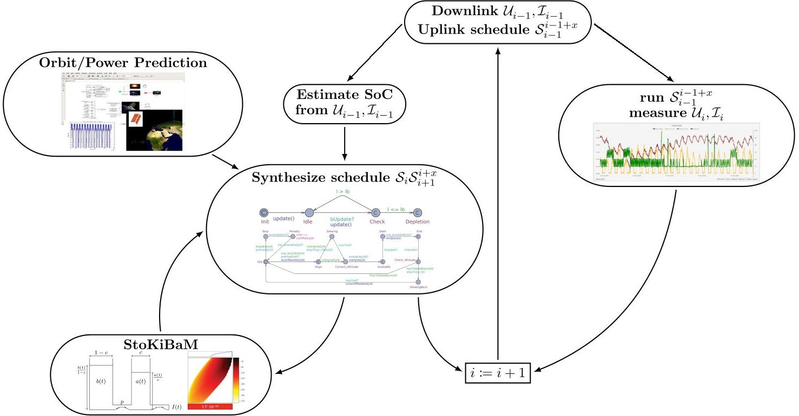

Fig. 11. Receding-horizon scheduling workflow

To explain our approach, let us for the moment assume for simplicity that GOMX-3 passes over the base station each orbit and is able to downlinks its logged data in passing. We furthermore assume that orbits begin when passing the base station, that GOMX-3 is currently at the beginning of its i-th overall orbit, and that it already has schedules $ S_{i},\dots,S_{i+x} $ to follow, altogether spanning x orbits. We refer to the overall schedule as $ S_{i}^{i+x}. $ Hence it has just finished downlinking the voltage $ \mathcal{U}_{i-1} $ and current data $ \mathcal{I}_{i-1} $ from the $ (i-1) $ -st orbit to the base station. The following will be repeated in parallel.

Satellite: The satellite executes the first orbit as scheduled by $ S_{i} $ while measuring voltage $ \mathcal{U}_{i} $ and current $ \mathcal{I}_{i} $ . Once it ends the orbit by contacting the base station, it downlinks its measured data and it receives a schedule $ S_{i+1}^{i+1+x} $ for the next x orbits.

Base station: Using $ \mathcal{U}_{i-1} $ and $ \mathcal{I}_{i-1} $ , an estimate of the initial state of charge $ SoC_{i} $ of the $ i $ -th orbit is computed. As the satellite will behave according to $ S_{i} $ , we can predict the initial state of charge $ SoC_{i+1} $ of the $ (i+1) $ -st orbit as well (by propagating the $ SoC_{i} $ along the predicted schedule loads). Based on this estimate a new schedule $ S_{i+1}^{i+1+x} $ for orbits $ i+1 $ to $ i+1+x $ is computed. If there is a job in $ S_{i} $ scheduled to run across the boundary of orbit $ i $ and $ i+1 $ , schedule $ S_{i+1} $ needs to take this into account, by basically finishing what was started. Once the satellite ends the $ i $ -th orbit, the base station uplinks the computed schedule $ S_{i+1}^{i+1+x} $ and receives $ \mathcal{U}_{i},\mathcal{I}_{i}. $

This method thus creates overlapping schedules for the next x orbits each. Each time the satellite passes the ground station, measured data is used to more accurately estimate the battery SoCs. Hence, it can be expected that SoC estimation and actually measured voltage data do not diverge in the long run. As before, each schedule is (apart from the logged date) based on the orbit predictions delivered by the GomSpace engineers and needs to pass the additional validation step using the stochastic KiBaM, just as before. This workflow is depicted in Fig. 11.

Aperiodic receding-horizon scheduling. In reality, the satellite is unable to contact the base station every orbit, thus $ x $ must be chosen large enough to guarantee operation, even if the link to the base station does not materialize for some time. So, let us assume that GOMX-3 is unable to connect to the base station for n orbits, where $ n < x $ but establishes connection at the end of its $ (i+n) $ -th orbit. In this case, it will behave as indicated by $ S_{i}^{i+n+1} $ , and downlink $ \mathcal{U}_{i}^{i+n} $ as well as $ \mathcal{I}_{i}^{i+n} $ upon contact with the base station. The base station, in the meantime, propagates

<!-- PDF_PAGE: 18 -->

$ So C_{i} $ through the next n orbits using the predicted schedule loads, and uses this as initial SoC to compute the next schedule from. This schedule then covers the next x orbits starting at orbit $ i+n+1. $

Projecting KiBaM onto the linear battery model. In order to make use of the estimated KiBaM SoC in the scheduling synthesis, we have to convert it to a SoC of a linear battery model. It is not clear how to design such a mapping in a safe way. Nevertheless, several ideas come to mind.

Let [a; b] be a KiBaM SoC with capacity limits $ [\bar{a};\bar{b} ] $ with given $ c\in ]0,1] $ and $ p\in \mathbb{R}. $ We convert the SoC to a one-dimensional SoC of a linear model with capacity limit cap $ \mathrm{:=}\bar{a}+\bar{b} $ by (i) $ \frac{a}{c}+\frac{b}{1-c}, $ or (ii) $ a / \bar{a}\cdot $ cap, meaning by either aggregating both dimensions of the KiBaM SoC in an appropriate way, or by considering only the upscaled level of the available charge. In both suggestions, the linear model is neither an over—nor underapproximation of the KiBaM.

## 6.1. SoC estimation using Kalman filters

So far, we have not discussed how to perform the estimation of the battery's (unmeasurable) SoC based on measurable data like voltage and current. This section reviews Kalman filters $ [ \mathrm{K}^{+}60] $ , one of the established means to tackle such kinds of problems.

In principle, the battery can be represented by a dynamical system, like the KiBaM, whose SoC can be considered as an internal quantity, since it cannot be directly measured. Hence, the only chance we have is to consider series of (possibly noisy) measured data, that relate to this internal state in some way or another. From this knowledge, we aim to estimate the internal state of the model in an optimal way.

Kalman filters. This family of problems is known to be solvable by Kalman filters in a theoretically optimal and practically efficient way. Essentially, a Kalman filter forms a kind of feedback loop in two steps, a prediction and a correction step. In the prediction step, the Kalman filter projects the $ k-1 $ -st state estimate ahead, using the dynamical model underlying it, into a preliminary $ k $ -th state estimate. In the correction step, it incorporates the $ k $ -th measured data as feedback into its preliminary prediction and corrects it accordingly, to get the definitive $ k $ -th state estimate. Formally, the Kalman filter addresses the general problem of estimating a state $ x \in \mathbb{R}^{n} $ of a discrete time, possibly controlled process given by the difference equation:

$$
x _ {k} = F _ {k} x _ {k - 1} + B _ {k} u _ {k} + w _ {k} \quad \mathrm {w i t h m e a s u r e m e n t s} y \in \mathbb {R} ^ {m} \mathrm {g i v e n b y} \quad y _ {k} = H _ {k} x _ {k} + v _ {k}, \quad \mathrm {a n d w h e r e}
$$

- $ F_{k} $ is the (time-discrete) $ n\times n $ state transition matrix of the k-th step induced by the underlying dynamical process.

- $ B_{k} $ is the $ n\times l $ control matrix of the k-th step, relating (optional) control input to state variables.

- $ u_{k} $ is the k-th control variable, with $ u_{k} \in \mathbb{R}^{l}. $

- $ w_{k} $ represents process noise in the k-th step, where $ w_{k}\sim \mathcal{N}[0, Q_{k}]. $ $ Q_{k} $ is the process noise covariance in the k-th step.

- $ H_{k} $ is the $ m\times n $ measurement matrix of the k-th step, relating state with measurements.

- $ v_{k} $ represents measurement noise in the k-th step, where $ v_{k}\sim \mathcal{N}[0,R_{k}]. $ $ R_{k} $ is the measurement noise covariance in the k-th step.

The Kalman filter, being a recursive scheme, needs to be initialized with an initial estimate of the internal state $ x_{0} $ as well as with an initial state variance matrix $ P_{0} $ reflecting the confidence in the initial state. Intuitively speaking, the higher this initial state variance is chosen, the more a Kalman filter will trust the measurements in the beginning stages of the estimation. Process and measurement noise in each step are assumed to be pairwise mutually independent. From the difference equation it becomes apparent that Kalman filters do not need the entire history in order to start estimating state. It rather only needs the systems previous state and the current measurement, making it memory efficient and fast (and thus even suitable for hard real time applications).

The computational details of how a Kalman filter recursively estimates state are well documented and understood and certainly beyond the scope of this paper $ [ \mathrm{K}^{+}60] $ . It should however be mentioned, that the Kalman filter is the optimal linear filter if the model matches the real system exactly and if the noise is uncorrelated white noise with known covariances.

<!-- PDF_PAGE: 19 -->

Casting KiBaM to Kalman filtering. The idea of performing SoC estimation using Kalman filters is not new [Ple02, HYC12, HXZ $ ^{+} $ 11], yet most approaches lack a suitable dynamical model [LNC07]. This work is the first to propose the KiBaM to fill this gap.

The Kalman filter operates in discrete time, but just like many other systems the (time-continuous) KiBaM does not. We thus we have to cast it into the necessary form. A simple way of doing this is to discretise the defining ODEs of the KiBaM SoC (Eq. 1) to difference equations

$$
a _ {k + 1} = a _ {k} - i _ {k} \cdot \Delta t + p \cdot \Delta t \cdot \left(\frac {b _ {k}}{1 - c} - \frac {a _ {k}}{c}\right) \quad b _ {k + 1} = b _ {k} + p \cdot \Delta t \cdot \left(\frac {a _ {k}}{c} - \frac {b _ {k}}{1 - c}\right),
$$

where $ \Delta t $ is the length of a discrete time step and $ i_{k} $ is the load on the battery at time k throughout a time step. In matrix-vector notation we get

$$
\left[ \begin{array}{l} a _ {k + 1} \\ b _ {k + 1} \end{array} \right] = \mathcal {D} \cdot \left[ \begin{array}{l} a _ {k} \\ b _ {k} \end{array} \right] + \left[ \begin{array}{c c} \Delta t & 0 \\ 0 & 0 \end{array} \right] \cdot \left[ \begin{array}{l} i _ {k} \\ 0 \end{array} \right] \quad \mathrm {w h e r e} \quad \mathcal {D} := \left[ \begin{array}{c c} 1 - \frac {p \cdot \Delta t}{c} & \frac {p \cdot \Delta t}{1 - c} \\ \frac {p \cdot \Delta t}{c} & 1 - \frac {p \cdot \Delta t}{1 - c} \end{array} \right].
$$

$ \mathcal{D} $ is called the diffusion matrix that gathers terms depending on the KiBaM parameters c and p. This exactly matches the form of the first Kalman Filter equation. Thus by identification, we set

$$
F _ {k} := \mathcal {D}, \quad x _ {k} := \left[ \begin{array}{c} a _ {k} \\ b _ {k} \end{array} \right], \quad B _ {k} := \left[ \begin{array}{c c} \Delta t & 0 \\ 0 & 0 \end{array} \right], \quad u _ {k} := \left[ \begin{array}{c} i _ {k} \\ 0 \end{array} \right] \quad \mathrm {a n d} w _ {k} := \mathbf {0}
$$

In this way we use the load on the battery as control input. This is realistic in a scheduling setting, as we select the tasks to perform, which in turn determines the load on the battery. We will henceforth refer to this instantiation of the Kalman filter as the KiBaM filter.

## 7. Empirical evaluation

This section discusses empirical results concerning the perpetuated scheduling approach depicted in Fig. 11, in particular with respect to the KiBaM filtering aspects.

Unfortunately, GOMX-3 reached its mission end in October 2016 by tumbling into the atmosphere of the earth, thereby vaporizing. On February 1st 2018, GomSpace has launched a successor mission, a formation of two 6U satellites, called GOMX-4A and GOMX-4B into orbit. Once the mission is deemed successful, we aim to conduct experiments to assess the improvements resulting from the use of the receding-horizon scheduling approach, especially with respect to the schedule quality.

Evaluation of the filter on synthetic data. As a proof of concept, we instead consider synthetic data, and show that the KiBaM filter is robust against wrong choices of initial battery SoC levels and can indeed conjoin information from observed quantities with model predictions of the SoC.

We assume that we received a sequence of available charge measurements perturbed with white noise with known standard deviation $ \sigma $ . In fact, such data can easily be synthesized by adding white noise to available charge traces generated by tracing a KiBaM SoC along arbitrary loads. As a running example for the purpose of visualization, we essentially adopted the data from Fig. 2(right).

Formally, assume $ v_{k} := [\tilde{a}_{k};0] $ where $ \tilde{a}_{k}\sim \mathcal{N}[0,\sigma^{2}]. $ Mapping measurements into the state space is the identity mapping on the first component. Thus, we conclude

$$
H _ {k} := \operatorname {d i a g} (1, 0) \quad \text {a n d} \quad R _ {k} := \operatorname {d i a g} \left(\sigma^ {2}, 0\right).
$$

Figure 12 shows how the KiBaM filter can indeed very accurately estimate both available and bound charge quantities from just a noisy sequence of available charge values. We vary sample frequencies and confidence in the initial state. The filter assumes an initial SoC of [9000; 9000], which is vastly different to the actual initial SoC of [5000; 5000]. We observe that the filter quickly recognizes its severely wrong assumption if $ P_{0} $ suggests large initial state variance and corrects the estimation downwards quickly, since it "trusts" the measurements. Once it feels "confident" enough about its estimated state, it is unfazed by the stochastic fluctuations since the system dynamics do not allow for such quick changes. It becomes apparent that the Kalman estimates converge to the true system state quicker if running with a higher measurement frequency and higher initial state variance. Independently of the sample frequency, the estimates and the true state will not deviate again once they are close.

<!-- PDF_PAGE: 20 -->

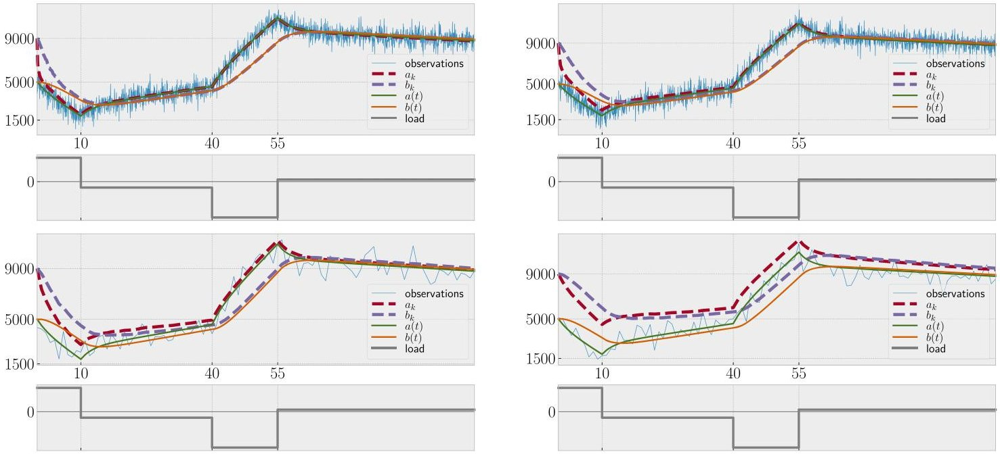

Fig.12. The KiBaM filter $ ( c=0.5,p=0.04) $ estimating the SoC without capacity limits from a series of noisy available charge measurements $ (\sigma=600) $ at every time step $ \Delta t=0.01 $ , assuming an initial state of $ x_{0}=[9000;9000] $ for different number of samples and initial state variance matrices $ P_{0} $ involving the diagonal matrix $ \mathbb{D}_{\sigma,c}:=\mathrm{d i a g}(\sigma^{2}c,\sigma^{2}(1-c)) $ . Top left: We consider every 10-th sample $ (\Delta t:=0.1) $ and $ P_{0}:=\mathbb{D}_{\sigma,c}. $ Top right: We consider every 10-th sample $ (\Delta t:=0.1) $ and $ P_{0}:=\frac{1}{5}\mathbb{D}_{\sigma,c}. $ Bottom left: We consider every 200-th sample $ (\Delta t:=2) $ and $ P_{0}:=\mathbb{D}_{\sigma,c}. $ Bottom right: We consider every 200-th sample $ (\Delta t:=2) $ and $ P_{0}:=\frac{1}{5}\mathbb{D}_{\sigma,c}. $

The KiBaM dynamical system as presented thus far does not incorporate capacity limit knowledge. It is however easy to incorporate such limits into the KiBaM filter approach. Let $ \bar{a} $ and $ \bar{b} $ be the limits on available and bound charge, respectively. If in any time step k the KiBaM filter predicts a SoC violating either bound, we reset the corresponding component of the SoC estimate to its maximum, i.e. if for any k we have $ a_{k}>\bar{a} $ then $ a_{k}:=\bar{a} $ and analogously for $ b_{k} $ . In principle, we would have to redo the last filtering step, since the difference equations are coupled, which leads to a slight overapproximation of the bound charge in the k-th step. However, theses errors will be very small since the time step $ \Delta t $ is small. In addition the KiBaM filter will implicitly detect these deviations over the course of time and adjust its estimates, thereby preventing error accumulation. Notably, and in contrast to the exact KiBaM, in the linearised version it is possible for the bound charge to reach its limit before the available charge does, if $ \Delta t $ is too large.

Figure 13 shows how the KiBaM Filter performs when we make it aware of battery capacity limits. Essentially, the estimation quality remains unchanged or actually becomes better, the reason being that the upper capacity limits do not allow for arbitrarily large SoCs while charging. The plots show that a KiBaM filter can indeed handle the capacity limits very well.

Using real data. The data in the previous section has been synthetic. We now consider real measurements, and show that the accuracy and robustness against wrong initialisation transfer well from the idealised setting. The main differences in this setting are twofold. (i) The abstract quantity of battery load is instantiated by actually measured current values, simply by identification. (ii) The available charge of the battery can not be measured, and hence we need to rely on other measurable quantities of batteries. One such quantity is the internal voltage. In this regard, there is however no known relation between a battery voltage and its state of charge. However, in related work SoC prediction schemes use learning techniques to fit a relation between a one-dimensional battery SoC and measured voltage data [HW05].

<!-- PDF_PAGE: 21 -->

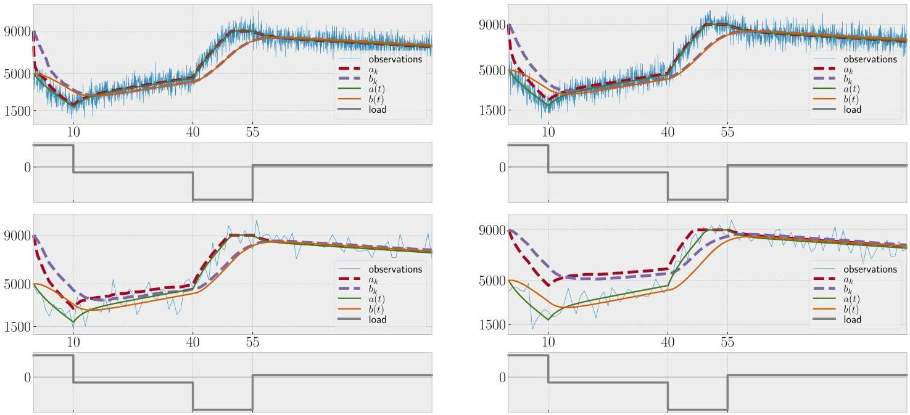

Fig. 13. The KiBaM filter ( $ c=0.5 $ , $ p=0.04 $ ) estimating the SoC with capacity limits $ [\bar{a};\bar{b}]=[9000;9000] $ from a series of noisy available charge measurements ( $ \sigma=600 $ ) at every time step $ \Delta t=0.01 $ , assuming an initial state $ x_{0}=[9000;9000] $ for different number of samples and initial state variance matrices $ P_{0} $ , again involving $ \mathbb{D}_{\sigma,c}:=\mathrm{diag}(\sigma^{2}c,\sigma^{2}(1-c)) $ . Top left: We consider every 10-th sample $ (\Delta t:=0.1) $ and $ P_{0}:=\mathbb{D}_{\sigma,c} $ . Top right: We consider every 10-th sample $ (\Delta t:=0.1) $ and $ P_{0}:=\frac{1}{5}\mathbb{D}_{\sigma,c} $ . Bottom left: We consider every 200-th sample $ (\Delta t:=2) $ and $ P_{0}:=\mathbb{D}_{\sigma,c} $ . Bottom right: We consider every 200-th sample $ (\Delta t:=2) $ and $ P_{0}:=\frac{1}{5}\mathbb{D}_{\sigma,c} $

In this section, we argue that measured voltage data and the available charge state of KiBaM are roughly proportional if considered over time. If the voltage samples exhibit a near nominal level over an extended period of time, it is highly unlikely that the batteries SoC is near depletion. To the contrary, it is likely that the SoC (or at least its available charge part) is near nominal capacity as well. The voltage is however a more volatile quantity than any of the two KiBaM quantities we are interested in estimating. This becomes apparent when the sign of the load we put on a battery switches from positive to negative or vice-versa, i.e. from charging to discharging or the other way around. In these cases heavy voltage drops, respectively peaks arise, that are presumably rooted in internal battery resistance phenomena [Inc16]. By and large, however, the voltage recovers fast after experiencing such a drop/jump and follows a more regular trace. Apart from such short transient effects and apart from jitter, a time series of voltage measurements appears to contain noisy information about the KiBaMs available charge over time, a setting that suits a Kalman filter well, as we have seen already in the previous section.

Thus, in line with the receding-horizon scheduling approach, we intend to study voltage measurements obtained in-orbit as a basis for estimating the KiBaM available charge. GOMX-3 flies a battery pack with a nominal capacity of cap = 149,760,000 mJ and nominal voltage of 16,400 mV. As underlying dynamical model we chose a KiBaM with c=0.2, p=0.0001 and a time unit $ \Delta t=1 $ , hence $ \bar{a}=0.2 $ cap. We assume that the voltage measurements are mixed with white noise of standard deviation $ \sigma=200 $ (since the maximal measured voltage was just below 16,600 mV), so $ R_{k} \coloneqq \operatorname{diag}(\sigma^{2},0). $ We map state into the measurement space using $ H_{k} \coloneqq \operatorname{diag}(16,600 / \bar{a},0). $ The mapping of control variables (the measured current) onto the state is given by the control matrix $ B_{k} \coloneqq \operatorname{diag}(\Delta t,0)=\operatorname{diag}(1,0). $ The voltage and current data measured by GOMX-3 are not spaced equidistantly in the time domain, yet are placed at multiples of unit time $ \Delta t=1. $ If there is no measurement available for a time point $ t $ we simply adopt the measured value from the previous time step.

In Fig. 14 we depict the performance of a KiBaM filter estimating the SoC from measured voltage and current data compared to simple Coulomb counting. We observe that a KiBaM Filter can indeed correct a pessimistic SoC initialization over the course of time, if the measured data suggest so. At the end of the experiment, the final SoCs produced via KiBaM filtering is 11% higher than the one obtained by Coulomb counting.

<!-- PDF_PAGE: 22 -->

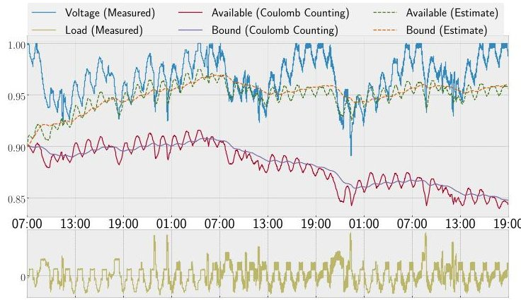

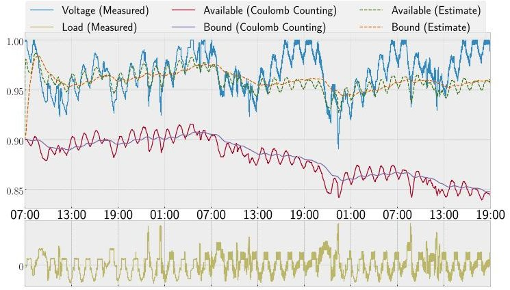

Fig. 14. Given the current and voltage measurements of the March 20 experiment, we compare the SoC estimates produced by Coulomb counting and a KiBaM filter. For both methods, we assume an initial SoC of 0.9 $ [\bar{a};\bar{b} ] $ , yet the voltage suggests a nearly fully charged battery. Left: We assume an initial state variance of $ P_{0} $ : $ = \operatorname{diag}(\bar{a},\bar{b}) $ . Right: We assume an initial state variance of $ P_{0} $ : $ = 100\cdot\operatorname{diag}(\bar{a},\bar{b}) $

Schedule Improvements. Of course, it is most interesting to see in how far the better estimates lead to schedules that exploit the satellites resources in a more cost-effective manner.

As already mentioned, there is currently no satellite in orbit on which we can perform such a study. However, we can rudimentary demonstrate the potential of the improved scheduling approach on old GOMX-3 data, i.e. the data of the March 20 experiment. We can only use the data early in this experiment, because once we decide to deviate from the present schedule (to harvest the better estimates for improved cost-effectivity), we no longer have matching measurement data in the logs. This is unfortunate, because the early data will be affected overproportionally by the transient phase in which the filter calibrates itself to the circumstances.

Nevertheless, assume that GOMX-3 behaves just as the schedule (in Fig. 9) indicates until it executes the 5-th UHF job (the second-to-last of the first batch, where SoC-voltage drift has already set in) at around 21/03/2016 05:48 UTCG. We assume that the satellite succeeded in downlinking all the voltage and current logs to the base station. The KiBaM filter $ ( P_{0} \ :=\ 1 0 \cdot \mathrm{d i a g} (\bar{a}, \bar{b})) $ returns a KiBaM SoC of $ [0.9762; 0.9698]\cdot[\bar{a};\bar{b}] $ . The SoC variable 1 of the PTA network exhibits a SoC of 119,783,040 mJ at the same time, which is a SoC level of just below 75%. After projecting the KiBaM SoC onto one dimension via one of the two methods sketched above, we end up with a SoC of 97.11% and 97.62% respectively, either of which constitutes a significant improvement. Propagating the KiBaM SoC using the predicted loads of the schedule until after the X-Band job that is scheduled simultaneously to the Aalborg connection, yields a SoC of $ [0.9588; 0.9724]\cdot[\bar{a};\bar{b}] $ with projections to a linear model SoC of 96.97 and 95.88%, either of which leads to the same schedule.

Figure 15 visualises how the schedule after this critical UHF job improves thanks to an updated schedule that is computed on the basis of this new SoC estimate. We assume that in the 6-th UHF job GOMX-3 was able to receive its update schedule and in the meantime it continued operation as dictated by the original schedule. Indeed, this update makes it possible to increase the overall number of scheduled X-Bands jobs from 5 to 7 and of L-Band jobs from 3 to 4.

## 8. Related work

Variants of scheduling problems for earth-observing satellites have been considered in the scientific literature, with a focus on maximizing the operational efficiency of an orbiting satellite. The problem was tackled by partial enumeration methods [HPP99], dynamic programming (with heuristics and bounding procedures) [HM94], conversions into constraint satisfaction problems (enabling greedy search to find good solutions or Branchand-Bound techniques to find optimal solutions) [AB95], and knapsack formalisations of the problem set (with tabu search algorithms as means of finding feasible schedules) [VH01]. These works solely focus on maximizing payload throughput and do not consider dynamic power-relevant constraints.

<!-- PDF_PAGE: 23 -->

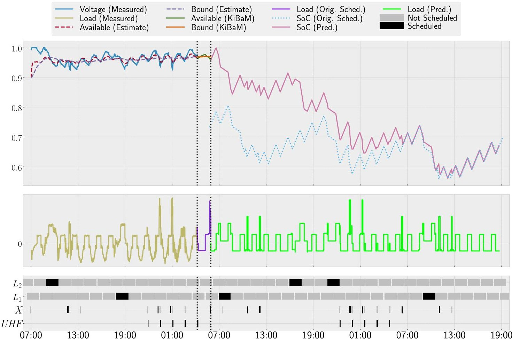

Fig. 15. A schedule showing the potential of the KiBaM filter SoC estimation method. Left of the dotted vertical lines, the KiBaM filter $ ( c=0.02, p=0.0001, [ a_{0}; b_{0} ]=0.9\cdot[\bar{a}; \bar{b} ] ) $ is applied on the measured data to estimate the SoC up until the 5-th Aalborg connection, with initial state variance of $ P_{0} $ $ \mathrm{=} 1 0 \cdot\operatorname{diag}(\bar{a},\bar{b}). $ Between the dotted vertical lines, the KiBaM and the predicted loads of the original schedule are used to propagate the estimated SoC. All the computations needed take place in this period. The effect of the updated schedule is shown right of the dotted vertical lines. We use the propagated SoC as initial SoC ( 95.88% ) of our predictions using a linear battery model. The corresponding part of the original SoC trace from Fig. 9 is presented as a blue dotted plot to allow for visual comparison. The updated schedule lets GOMX-3 carry out two more X-Band jobs and one more L-Band job

A constraint-based technique using heuristic search with constraint propagation also focussing on renewable resources like battery power or memory has been studied as well [PG01], but with linear energy storage model.

Recently, a statistical model checking approach to battery-aware scheduling has been proposed [WHL14] that uses UPPAAL SMC and a hybrid automaton model to capture kinetic battery dynamics, together with a synthetic example inspired by the satellite domain.

The scheduling workflow exercised in this work is very close in spirit to the approach developed in $ [\mathrm{MBU}^{+}10] $ where a simulation-based analysis of computed schedules is used to validate or refute cost-optimal schedules, under a model with stochastic breakdowns and repairs of production machinery. Apart from the different application domain, the main conceptual distinction is that the validation step in our work is not based on simulation, but on the calculation of proper upper bounds of the quantities of interest.

## 9. Discussion and conclusion

This paper has presented a battery aware scheduling approach for low-earth orbiting nano satellites. The heterogeneous timing aspects and the experimental nature of this application domain pose great challenges, making it

<!-- PDF_PAGE: 24 -->

impossible to use traditional scheduling approaches for periodic tasks. Our approach harvests work on schedulability analysis with (priced) timed automata. It is distinguished by the following features: (i) The TA modelling approach is very flexible, adaptive to changing requirements, and particularly well-suited for discussion with space engineers, since it is easy to grasp. (ii) A dynamic approach to the use of cost decorations and constraints allows for a split scheduling approach optimising over intervals, at the (acceptable) price of potential sub-optimality of the resulting overall schedules. (iii) A linear battery model is employed while scheduling, but prior to shipping, all computed schedules are subjected to a quantitative validation on the vastly more accurate Stochastic KiBaM, and possibly rejected.

The GOMX-3 in-orbit experiments have demonstrated a great fit between the technology developed and the needs of the LEO satellite sector. It became apparent that relative to a manual scheduling approach as otherwise employed by GomSpace, the presented method synthesizes better quality schedules with respect to (i) number of experiments performed, (ii) avoidance of planning mistakes, (iii) scheduling workload, and (iv) battery depletion risk provided. At the same time, the availability of scheduling tool support flexibilises the satellite design process considerably, since it allows the GomSpace engineers to obtain answers to what-if questions, in combination with their in-house POWER SIM tool. This helps shortening development times and thus time-to-orbit. We have furthermore embedded our contribution into a perpetuated scheduling workflow that harvests in-orbit measurement to adjust and correct the KiBaM model in such a way that schedules are continuously based on the most recent and most precise information at hand.

Future work in this area is partly driven by the application domain. State of the art technology and very rapid development cycles will continue to be a crucial part of the nanosatellite market. They are the roots of a steady stream of novel scientific challenges. In fact, GomSpace has launched a 2 spacecraft constellation (GOMX-4 A and B) on February 1st 2018 and is actively pursuing several projects with much larger constellations. Deploying constellations of a large number of satellites (2-1000) brings a new level of complexity to the game, which in turn asks for a higher level of automation to be used than has previously been the case in the space industry. The technology investigated here is beneficial in terms of optimization and planning of satellite operations, so as to allow for more efficient utilization of spacecraft flight time. A spacecraft operator is faced with a highly complex task when having to plan and command in-orbit operations constantly balancing power and data budgets. For larger constellations tools for optimization, automation and validation are not only a benefit, but likely a necessity for proper operations.

The proposed battery-aware scheduling approaches can be improved in several dimensions, the first being to fully implement and integrate the receding-horizon approach into the present tool. Another venture consists of extending the single satellite scheduling approach to conjoined scheduling of satellite constellations. Alternative schedule synthesis formalisms come to mind for potential exploration, preferably formalisms that handle several cost variables at once, so as to optimize for more complex objective functions. Among the tools of interest are (i) the MODEST toolset which supports the computation of reward-optimal time-bounded properties of Markov Decision Processes [HH16], (ii) newer versions of the UPPAAL toolset performing Pareto optimal reachability analyses on simple priced timed automata $ [Z N L^{+}1 7] $ , or (iii) OPTIMATHSAT [ST15], an efficient and highly flexible OMT (Optimisation Modulo Theories) solver from an emerging field currently getting a lot of attention. A major challenge is the direct integration of non-linear continuous dynamics into the scheduling step itself, in order to synthesise plans with respect to the kinetic battery model. Lifting state of the art hybrid systems tools, such as HYPRO $ [S A M K17] $ or SPACEEX $ [F G D^{+}1 1] $ from verification to synthesis could be one way to achieve this task. However, even efficient verification of linear hybrid systems is known to be a difficult problem set. In addition, investigating and modelling temperature dependent performance properties of batteries as well as battery wear grows more and more important with larger mission times and should therefore not be neglected.

## Acknowledgements

This work has received support from the EU 7th Framework Programme Project 318490 (SENSATION), by the European Space Agency under contract number RFP/NC/IPL-PTE/GLC/as/881.2014, by the ERC Advanced Investigators Grant 695614 (POWVER), and by the CDZ Project 1023 (CAP). We are grateful to Boudewijn Haverkort and Marijn Jongerden (both from Universiteit Twente), Kim Larsen, Marius Mikučonis, Erik Ramsgaard Wognsen (all from Aalborg University), and all further participants of SENSATION as well as experts at GomSpace for very fruitful discussion and support.

<!-- PDF_PAGE: 25 -->

## References

[AB95] Agn JC, Bensana E (1995) Exact and approximate methods for the daily management of an earth observation satellite [AD94] Alur R, Dill DL (1994) A theory of timed automata. Theor Comput Sci 126:183-235

[BFH $ ^{+} $ 01] Behrmann G, Fehnker A, Hune T, Larsen KG, Pettersson P, Romijn J, Vaandrager FW (2001) Minimum-cost reachability for priced timed automata. In: Di Benedetto MD, Sangiovanni-Vincentelli AL (eds) Hybrid systems: computation and control, 4th international workshop, HSCC 2001, Rome, Italy, March 28-30, 2001, proceedings, volume 2034 of lecture notes in computer science. Springer, pp 147-161

[BGH $ ^{+} $ 16] Bisgaard M, Gerhardt D, Hermanns H, Krcal J, Nies G, Stenger M (2016) Battery-aware scheduling in low orbit: The gomx-3 case. In: Fitzgerald JS, Heitmeyer CL, Gnesi S, Philippou A (eds) FM 2016: formal methods—21st international symposium, Limassol, Cyprus, November 9-11, 2016, proceedings, volume 9995 of lecture notes in computer science, pp 559-576

[BLR05] Behrmann G, Larsen KG, Rasmussen JI (2005) Optimal scheduling using priced timed automata. ACM SIGMETRICS Perform Eval Rev 32(4):34-40

[FGD $ ^{+} $ 11] Frehse G, Le Guernic C, Donzé A, Cotton S, Ray R, Lebeltel O, Ripado R, Girard A, Dang T, Maler O (2011) Spaceex: Scalable verification of hybrid systems. In: Gopalakrishnan G, Qadeer S (eds) Computer aided verification-23rd international conference, CAV 2011, Snowbird, UT, USA, July 14-20, 2011, proceedings, volume 6806 of lecture notes in computer science. Springer, pp 379-395

[HH16] Hahn EM, Hartmanns A (2016) A comparison of time- and reward-bounded probabilistic model checking techniques. In: Fränzle M, Kapur D, Zhan N (eds) Dependable software engineering: theories, tools, and applications-2nd international symposium, SETTA, Beijing, China, November 9-11, 2016, proceedings, volume 9984 of lecture notes in computer science. pp 85-100

[HKN17] Hermanns H, Krčal J, Nies G (2017) How is your satellite doing? Battery kinetics with recharging and uncertainty. Leibniz Trans Embed Syst 4(1):04-1-04:28

[HM94] Hall NG, Magazine MJ (1994) Maximizing the value of a space mission. Eur J Oper Res 78(2):224-241

[HPP99] Harrison SA, Price ME, Philpott MS (1999) Task scheduling for satellite based imagery. In: Proceedings of the eighteenth workshop of the UK planning and scheduling special interest group, volume 78. University of Sanford, UK, pp 64-78

[HW05] Hansen T, Wang C-J (2005) Support vector based battery state of charge estimator. J Power Sources 141(2):351-358

[HXZ $ ^{+} $ 11] He H, Xiong R, Zhang X, Sun F, Fan J (2011) State-of-charge estimation of the lithium-ion battery using an adaptive extended kalman filter based on an improved thevenin model. IEEE Trans Veh Technol 60(4):1461-1469

[HYC12] Hu C, Youn BD, Chung J (2012) A multiscale framework with extended kalman filter for lithium-ion battery soc and capacity estimation. Appl Energy 92:694-704

[Inc16] Texas Instruments Incorporated (2016) Tms570 active cell-balancing battery-management design guide

[JH09] Jongerden MR, Haverkort BR (2009) Which battery model to use? IET Softw 3(6):445-457

[Jon10] Jongerden MR (2010) Model-based energy analysis of battery powered systems. Ph.D. Thesis, Enschede, December 2010 $ [\mathrm{K}^{+}60] $ Kalman RE et al (1960) A new approach to linear filtering and prediction problems. J Basic Eng 82(1):35-45

[LBB $ ^{+} $ 01] Larsen K, Behrmann G, Brinksma E, Fehnker A, Hune T, Pettersson P, Romijn J (2001) As cheap as possible: Effcient cost-optimal reachability for priced timed automata. In: Computer aided verification. Springer, pp 493-505

[LNC07] Lee J, Nam O, Cho BH (2007) Li-ion battery SOC estimation method based on the reduced order extended Kalman filtering. J Power Sources 174(1):9-15

[LPY97] Larsen KG, Pettersson P, Yi W (1997) Uppaal in a nutshell. Int J Softw Tools Technol Transf (STTT) 1(1):134-152

[MBU $ ^{+} $ 10] Mader A, Bohnenkamp H, Usenko YS, Jansen DN, Hurink J, Hermanns H (2010) Synthesis and stochastic assessment of cost-optimal schedules. Int J Softw Tools Technol Transf 12(5):305-318

[MM93] Manwell JF, McGowan JG (1993) Lead acid battery storage model for hybrid energy systems. Sol Energy 50(5):399-405

[PG01] Pemberton JC, Galiber F (2001) A constraint-based approach to satellite scheduling. DIMACS Ser Discrete Math Theor Comput Sci 57:101-114

[Ple02] Plett GL (2002) Kalman-filter soc estimation for lipb hev cells. In: Proceedings of the 19th international battery, hybrid and fuel cell electric vehicle symposium and exhibition (EVS19). Busan, Korea, pp 527-538

[PPJ01] Piller S, Perrin M, Jossen A (2001) Methods for state-of-charge determination and their applications. J Power Sources 96(1):113-120

[SAMK17] Schupp S, Abrahám E, Makhlouf IB, Kowalewski S (2017) Hypro: a C++ library of state set representations for hybrid systems reachability analysis. In: Barrett C, Davies M, Kahsai T (eds) NASA formal methods-9th international symposium, NFM 2017, Moffett Field, CA, USA, May 16-18, 2017, proceedings, volume 10227 of lecture notes in computer science, pp 288-294

[ST15] Sebastiani R, Trentin P (2015) Optimathsat: a tool for optimization modulo theories. In: Kroening D, Pasareanu CS (eds) Computer aided verification-27th international conference, CAV, San Francisco, CA, USA, July 18-24, 2015, proceedings, Part I, volume 9206 of lecture notes in computer science. Springer, pp 447-454

[upp05] UPPAAL CORA (2005) http://people.cs.aau.dk/~adavid/cora/introduction.html

[VH01] Vasquez M, Hao J-K (2001) A "logic-constrained" knapsack formulation and a tabu algorithm for the daily photograph scheduling of an earth observation satellite. Comput Optim Appl 20(2):137-157

[WHL14] Wognsen ER, Hansen RR, Larsen KG (2014) Battery-aware scheduling of mixed criticality systems. In: International symposium on leveraging applications of formal methods, verification and validation. Springer, pp 208-222

[ZNL $ ^{+} $ 17] Zhang Z, Nielsen B, Larsen KG, Nies G, Stenger M, Hermanns H (2017) Pareto optimal reachability analysis for simple priced timed automata. In: Duan Z, Ong L (eds) Formal methods and software engineering—19th international conference on formal engineering methods, ICFEM, Xi'an, China, November 13-17, proceedings, volume 10610 of lecture notes in computer science. Springer, pp 481-495

## Received 7 September 2017

Accepted in revised form 11 June 2018 by Constance Heitmeyer, Ana Cavalcanti, John Fitzgerald, and Stefania Gnesi Published online 4 July 2018