<!-- PDF_PAGE: 1 -->

# Early validation of system requirements and design through correctness-by-construction

Emmanouela Stachtiari, Anastasia Mavridou, Panagiotis Katsaros, Simon Bliudze, Joseph Sifakis

## To cite this version:

Emmanouela Stachtiari, Anastasia Mavridou, Panagiotis Katsaros, Simon Bliudze, Joseph Sifakis. Early validation of system requirements and design through correctness-by-construction. Journal of Systems and Software, 2018, 145, pp.52-78. <10.1016/j.jss.2018.07.053>. <hal-01873999>

HAL Id: hal-01873999

https://hal.science/hal-01873999v1

Submitted on 5 Oct 2018

HAL is a multi-disciplinary open access archive for the deposit and dissemination of scientific research documents, whether they are published or not. The documents may come from teaching and research institutions in France or abroad, or from public or private research centers.

L'archive ouverte pluridisciplinaire HAL, est destinée au dépôt et à la diffusion de documents scientifiques de niveau recherche, publiés ou non, émanant des établissements d'enseignement et de recherche français ou étrangers, des laboratoires publics ou privés.

<!-- PDF_PAGE: 2 -->

# Early Validation of System Requirements and Design Through Correctness-by-Construction

Emmanouela Stachtiari $ ^{a} $ , Anastasia Mavridou $ ^{b} $ , Panagiotis Katsaros $ ^{a} $ , Simon Bliudze $ ^{c} $ , Joseph Sifakis $ ^{d} $

$ ^{a} $ Department of Informatics, Aristotle University of Thessaloniki, Greece $ ^{b} $ Robust Software Engineering Group SGT Inc., NASA Ames Research Center Moffett Field, CA, USA $ ^{c} $ INRIA Lille-Nord Europe, France $ ^{d} $ Verimag, Universite Grenoble Alpes, France

## Abstract

The early validation of requirements aims to reduce the need for the high-cost validation testing and corrective measures at late development stages. This work introduces a systematic process for the unambiguous specification of system requirements and the guided derivation of formal properties, which should be implied by the system 's structure and behavior in conjunction with its external stimuli. This rigorous design takes place through the incremental construction of a model using the BIP (Behavior-Interaction-Priorities) component framework. It allows building complex designs by composing simpler reusable designs enforcing given properties. If some properties are neither enforced nor verified, the model is refined or certain requirements are revised. A validated model provides evidence of requirements' consistency and design correctness. The process is semi-automated through a new tool and existing verification tools. Its effectiveness was evaluated on a set of requirements for the control software of the CubETH nanosatellite and an extract of software requirements for a Low Earth Orbit observation satellite. Our experience and obtained results helped in identifying open challenges for applying the method in industrial context. These challenges concern with the domain knowledge representation, the expressiveness of used specification languages, the library of reusable designs and scalability.

Keywords: rigorous system design, requirements formalization, model-based design, correctness-by-construction

## 1. Introduction

## 1.1. Problem statement

The design problem in systems engineering concerns with defining the architecture, modules, interfaces and data for a system, in order to meet given requirements [20]. Initially, requirements are high-level statements (conditions or capabilities that are also called stakeholder or mission requirements) [30], from which the system requirements are derived that define what the system must do to satisfy stakeholder requirements [36]. In this article, we focus specifically on system requirements; when we refer to stakeholder requirements we do so explicitly.

In [71] and [12], two perspectives of rigorous system design are introduced. The term "rigorous" refers to a formal model-based process that leads from requirements to correct implementations. In particular, the focus is on the design problem for systems that continuously interact with an external environment; such systems usually involve concurrent execution and emergent behaviors. The design process can be decomposed into two phases. During the first phase, which in [71] is called proceduralization, the declarative system requirements are transformed into a procedure, i.e., a model prescribing how the anticipated functionality can be realized by executing sequences of elementary functions. During the second phase, which is called materialization, the procedure is implemented in a system that meets all extra-functional requirements by using available resources cost-effectively.

<!-- PDF_PAGE: 3 -->

In this article, we introduce a model-based approach for the proceduralization phase, which aims to the systematic development of a design solution for a set of system requirements. The design problem is well-defined, only if the requirements fulfill essential properties, i.e., if they are complete, consistent, correct (valid for an acceptable solution), and attainable. However, requirements provide in principle only a partial specification, which according to the current industrial practice (even for critical systems) is stated using a simplified controlled natural language (i.e. restricted in syntax and/or lexical terms); natural language is ambiguous [69] and it is not tied to a formal semnatics. Thus, none of the essential properties can be easily proved.

## 1.2. Research objectives

The main objectives of our approach is to provide the means for:

- unambiguous specification of requirements;

- early assurance of consistency between the requirements and design correctness;

- use of correct-by-construction techniques to limit the need for a posteriori model checking.

- use of correct-by-construction techniques to limit the need for a posteriori model checking. Some of the aforementioned objectives are related to the requirements formalization challenge [7, 58] that refers to the transformation of requirements into formal properties. These property specifications should be implied by the system's structure and behavior in conjunction with its external stimuli [79].

We provide a systematic stepwise design approach for transforming declarative system requirements into procedures (proceduralization). This happens by incrementally building a formal and executable model of a design solution (design model), i.e., a blueprint of the system's structure and behavior. The design model provides early evidence of design correctness and consistency. If the properties derived from the requirements cannot be fulfilled by the design model, a different design should be pursued or certain unsatisfied requirements have to be revised. Such an approach incurs extra cost to be paid towards delivering early evidence that the requirement specifications are realizable; on the other hand, late-stage validation, relying on testing and requiring high-cost corrective measures, can be drastically reduced.

## 1.3. Context and contributions

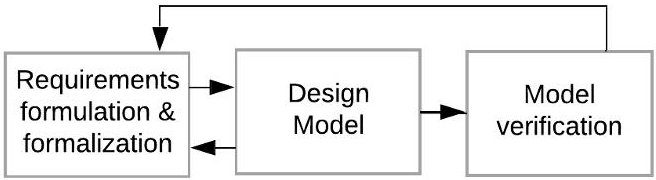

Figure 1: The model-based approach

Figure 1 outlines the proposed approach, where our research objectives are attained in three consecutive phases. In the Requirements formulation and formalization phase, we formulate requirements by instantiating textual templates, called boilerplates (like in [2, 50, 51]), which are filled with catalogued concepts of the system's context. The formalization of requirements as properties occurs in a semi-automated way, based on a predefined mapping of boilerplates to formal property patterns and a user-defined association of requirements' concepts to events of the design model. Through precisely stating how the boilerplates and concepts of requirements are transformed into properties using predefined and user-defined mappings, we achieve the unambiguous specification of requirements, since they are ensured to have a consistent interpretation with respect to the design model.

In the Design model building phase, the system's components are treated as blocks of established functionality; they have to be coordinated while they are progressively assembled and integrated so as to fulfil the system requirements. We adopt the main principles of [71]:

- a component-based modeling framework for enhanced productivity through reuse of model artifacts;

- the modeling language BIP (Behavior - Interaction - Priorities) [8], which provides an expressive component framework adequate for a semantically coherent process; any BIP model can be formally analyzed and simulated with the BIP tools $ ^{1} $;

<!-- PDF_PAGE: 4 -->

- correctness-by-construction based on property enforcement and property composability, while integrating the model components; to this end, we utilize recent theoretical results [5] together with proper automation support. In the Model verification phase, we formally verify the obtained design model to check that the non-enforceable properties are fulfilled. Verification takes place, as a final step, after correct-by-construction techniques have been applied. If the properties cannot be fulfilled, a different design should be pursued or certain unsatisfied requirements have to be revised.

The concrete research contributions of this article are:

i. The model-based process for the early validation of system requirements and design.

ii. The technical approach for the formalization of requirements. This includes the natural-like template languages for specifying requirements and formal properties, as well as the associations between templates, for the derivation of properties.

iii. A library of BIP models for simple designs [55, 56] and their associations with patterns for properties that can be enforced using our correctness-by-construction approach. These BIP models, called architectures, were adequate to enforce all safety properties for two industrial studies through correct-by-construction model transformations.

iv. A brief account of the tool-support for the automation of the process, including a new tool called RERD.

v. A report on the early validation of requirements in two studies: the control software of the CubETH nanosatellite [55, 56], and an extract of software requirements for the telecommand management of a low orbit earth observation satellite.

In the remaining of the paper, Section 2 provides necessary background on BIP modelling and BIP architectures. Related work is surveyed in Section 3. Section 4 discusses the overview of the model-based process steps, which are thoroughly seen in Sections 4.1, 4.2, 4.3 and 4.4 together with the corresponding technical approaches. In Section 5, we refer to the tool-support and in Section 6 we provide a brief report on the results from the two case studies. The paper concludes with a discussion on the identified benefits and limitations, as well as on the further development of our model-based process and its tool-support.

## 2. Background

BIP [8] is a formal framework for building complex models by coordinating the behavior of a set of atomic model components. Behavior is defined as a transition system, extended with data and functions in C/C++. The description of coordination between components is layered. The first layer describes the interactions between components. The second layer describes dynamic priorities between interactions. BIP has a clean operational semantics that describes the behavior of a composite component as the composition of the behaviors of its atomic ones [9]. This allows a direct relation between the underlying semantic model (transition systems) and its implementation.

The atomic components are finite-state automata having transitions labeled with ports and extended with data stored in local variables. Ports form the interface of a component and are used to define interactions with other components. States denote control locations at which the components await for interaction. A transition is an execution step from a control location to another. It might be associated with a boolean condition (guard) and a computation defined on local variables. The model's global state at each execution step is given as the current control locations and the values of local variables of all atomic components.

Connectors relate ports from different subcomponents by assigning to them a synchronization attribute, which may be either trigger (represented by a triangle, Figure 2a) or synchron (represented by a bullet, Figure 2a). A connector defines a set of interactions, i.e., a non-empty set of ports. The set of interactions of each connector is based on the synchronization attributes it assigns. Given a connector involving a set of ports $ \{p_{1},\dots,p_{n}\} $ , the set of its interactions is defined as follows: an interaction is any non-empty subset of $ \{p_{1},\dots,p_{n}\} $ which contains some port that is assigned to a trigger (Figure 2c); otherwise, (if all ports are assigned to synchrons) the only possible interaction is the maximal one that is, $ \{p_{1},\dots,p_{n}\} $ (Figure 2b). The same principle is recursively extended to hierarchical connectors, where one interaction from each subconnector is used to form an allowed interaction according to the synchron/trigger typing of the connector nodes (Figure 2d). For instance, in the third hierarchical connector shown in Figure 2d, port p is assigned to a trigger, whereas the binary subconnector $ q-r $ is assigned to a synchron. Thus this hierarchical connector allows the singleton interaction p and any interaction that combines p with some interaction of the binary subconnector. Since the latter defines interactions q and qr, the resulting set of interactions is p, pq, and pqr.

<!-- PDF_PAGE: 5 -->

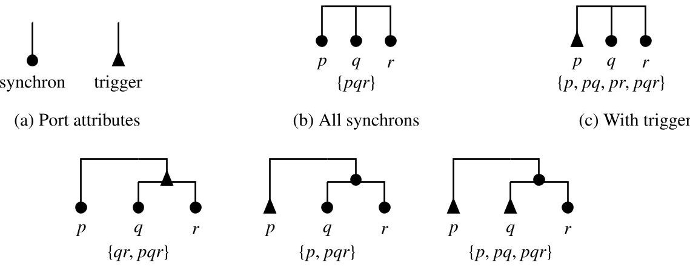

(d) Hierarchical connectors

Figure 2: BIP connectors and their associated interaction sets

The meaning of a BIP interaction is synchronization of ports. Recall that transitions are labelled with ports. Thus an interaction p..q defines synchronization constraints on the execution of the corresponding transitions that are labelled with ports p..q. A BIP interaction is enabled for execution if all the corresponding transitions are enabled for execution, i.e., the current control locations of components include these transitions as outgoing transitions and all corresponding transition guards evaluate to true. The operational semantics of BIP is as follows. During the execution of a BIP interaction, all components that participate in the interaction, i.e., have an associated port that is part of the interaction, must execute their corresponding transitions simultaneously. All components that do not participate in the interaction, do not execute any transition and thus remain in the same control location.

Later in the paper, we consider that BIP connectors purely define synchronization constraints regarding component execution. Generally, BIP connectors may additionally provide guards and data transfer, i.e., respectively, enabling conditions and data exchange across the ports involved in each interaction. Nevertheless, in our case studies we do not model data transfer, which can be very expensive for verification purposes. Thus, we omit the explanation of the BIP data transfer mechanism, for which a detailed description can be found in [16].

## 2.1. Architecture-based design in BIP

An architecture in BIP is a model that characterizes the structure of the interactions between a set of component types. Such an architecture is defined with respect to a set of parameter components and a set of coordinators. The structure is specified as a relation, i.e. connectors between component ports. The components to which an architecture is applied are the operands that replace the architecture's parameters.

Figure 3 shows a BIP model for mutual exclusion between two tasks. Each component on the two outer sides models a task, which enters its critical section (i.e., the control location work) only when its corresponding port $ b_{i} $ （ $ i=1,2 $ ）is invoked and leave it when port $ f_{i} $ （ $ i=1,2 $ ）is invoked. The model has also one coordinator component C that allows the execution of $ b_{i} $ ports only when itself is in the free control location. The coordinator is in free after a task has left its critical section. Four binary connectors are used for the aforementioned coordination. Two connectors synchronize each of $ b_{1}, b_{2} $ ports with the t port and two others synchronize each of the $ f_{1}, f_{2} $ ports with the r port. The connectors essentially constrain the behavior of the system so that whenever the shared resource, managed by the coordinator, is taken by e.g., the first task, it cannot be accessed by the second task unless it is first released by the first task. Initial control locations of the components are indicated with an arc and show that both tasks are outside their critical section. Figure 4 shows an architecture that enforces the mutual exclusion property on two parameter components with interfaces $ \{b_{1}, f_{1}\} $ and $ \{b_{2}, f_{2}\} $

Composition of architectures is the conjunction of the induced synchronisation constraints. It takes the form of an associative, commutative and idempotent architecture composition operator $ \oplus $ [5], as illustrated by an example in [55]. If two architectures $ \mathcal{A}_{1} $ and $ \mathcal{A}_{2} $ respectively enforce the safety properties $ \Phi_{1} $ and $ \Phi_{2} $ , the composed architecture $ \mathcal{A}_{1}\oplus \mathcal{A}_{2} $ enforces the property $ \Phi_{1}\wedge \Phi_{2} $ , that is, both properties are preserved by architecture composition. Combined application of architectures can generate deadlocks and the resulting model has to be checked for deadlock-freedom.

<!-- PDF_PAGE: 6 -->

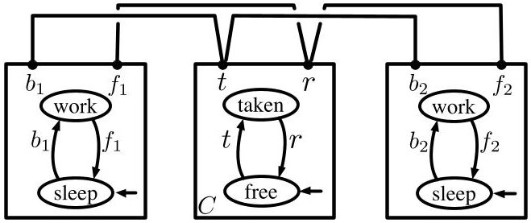

Figure 3: Mutual exclusion model in BIP

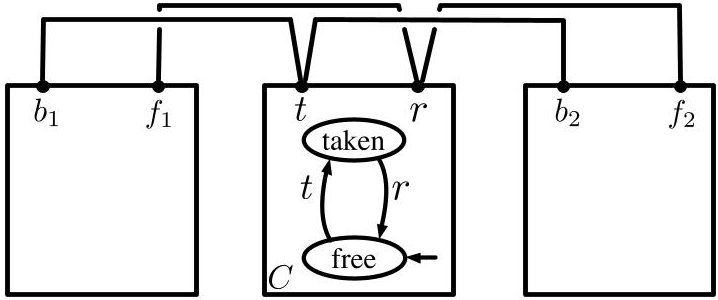

Figure 4: Mutual exclusion architecture

Although the architecture in Figure 4 can be applied to precisely two components, it is clear that an architecture of the same style—with n parameter components and 2n connectors—could be applied to n operand components satisfying the interface assumptions. We specify such architecture styles with architecture diagrams [52]. An architecture diagram consists of a set of component types with cardinality constraints for the expected number of instances and a set of connector motifs. Connector motifs are non-empty sets of port types. Each port type has a cardinality constraint representing the expected number of port instances per component and two additional constraints: multiplicity and degree, represented as a pair m:d. Additionally, each port type is typed as either trigger or synchron.

Figure 5 shows the architecture style of the architecture in Figure 4. The unique—due to the cardinality being 1—coordinator component, Mutex manager, manages the shared resource, while n parameter components of type B can access it. The connector motifs have multiplicities of 1 (i.e., in 1:_) in all port types, denoting that all connectors are binary. The degrees of 1 (i.e., in 1) require that each port instance of a component of type B is attached to a single connector with the coordinator. Similarly, the degrees of n require that each port instance of the coordinator is attached to n connectors. The behaviors of the two component types enforce that once the resource is acquired by a component of type B, it can only be released by the same component. This happens because the begin port of a B component interacts with the take port of Mutex Manager leading the latter to the control location taken. Afterwards, no other B component can fire begin, until Mutex Manager returns to the control location free ,which happens when the finish port of the former B component is fired.

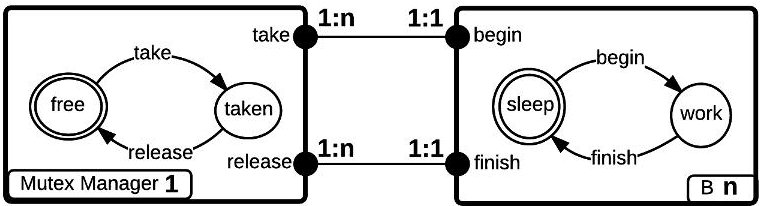

Figure 5: Mutual exclusion style

Cardinalities, multiplicities and degrees may also be intervals. Let us consider, a port type p with its multiplicity defined as interval. By the interval attributes 'sc[x,y]' (single choice) and 'mc[x,y]' (multiple choice), we mean that the same (resp. a different) multiplicity is applied to each port instance of p, provided that it lies in the interval.

## 3. Related Work

The early validation of system requirements and its design using formal methods has attracted the interest of noteworthy industrial research initiatives [58,19]. On the other hand, the principles of correctness-by-construction in system design have been introduced in [12] and [71]. In all technical approaches for correct-by-construction system design it is assumed that requirements and early design coevolve through iterative cycles [77], and the process converges into a design model, which (provably) fulfills all formal properties that are derived from the requirements. Existing works following the principles in [12] advocate a top-down hierarchical decomposition of the system into components. Correctness-by-construction is based on assume-guarantee contracts, where assumptions are either assertions on component inputs or invariants, and guarantees correspond to component requirements. Such top-down design flows [77,59,60,18] are concerned with the allocation of system requirements to system components (as in [37]), so that higher level requirements are established. System decomposition leads to the decomposition of contracts through a formal refinement relation [23]. When allocating requirements to a component, it should be ensured that the assumptions made for its environment (assertions or invariants) can be fulfilled. Developing assumptions manually is hard and the advantages when compared with monolithic verification have been questioned [24].

<!-- PDF_PAGE: 7 -->

Our work aims at a bottom-up rigorous design flow [71]. Important differences from the top-down approaches are: (i) we focus on requirements formalization, rather than their allocation to components, (ii) we aim at the transformation of system requirements into a procedure, as opposed to the ad hoc design of components that should meet their contracts. Architectures in BIP drive the choice of system decomposition, component coordination and behavior transformation. In the top-down design flows, these choices should be validated through a posteriori verification; finding a solution in such approaches has a non-negligible complexity [24].

The use of natural language boilerplates in the formalization of requirements is not new. In [17], the authors target the specification and analysis of stakeholder requirements, referred to as early requirements [30]. Our approach for the use of boilerplates resembles those in [42,75] and the CESAR reference technology platform [2]. CESAR introduces the Requirements Specification Language (RSL) that combines boilerplates of three clauses, namely the prefix, the main part and the suffix. Boilerplate attributes are defined in an attribute ontology and their placeholders must be filled with concepts from a domain-specific ontology. In [25], the authors introduce contracts with assumptions and guarantees built up from instances of RSL property patterns. A tool called DODT [29] allows for projectional requirement editing and for checking pairwise ontology-related contradictions [39] among requirements. Finally, properties are specified based on a recommendation of patterns with formal semantics, although no exact association of boilerplates with patterns is proposed.

The Easy Approach to Requirements Syntax (EARS) [50, 51] has introduced a set of structural rules (templates) for natural language requirements. The authors of EARS admit that their technique is mostly suitable for high-level stakeholder requirements and it is not applicable to all types of system requirements. Empirical evidence from industrial application showed improvement or, in some cases, complete elimination of problems related to ambiguity, vagueness, omissions and others. The EARS-CTRL tool [45] aims to ensure well-formedness in EARS requirements by construction and checks whether a controller can be synthesized from the provided set of requirements. If a controller cannot be synthesized, possibly conflicting requirements exist. The tool allows for projectional requirements' editing, based on a glossary defined on the domain of controller synthesis. Requirements are analyzed as LTL (Linear Temporal Logic) formulas. The analysis' effectiveness depends on user-defined semantic information (e.g. simple predicates) for the given glossary. Moreover, model synthesis is limited to a fragment of LTL that involves the universal path quantifier (G), the next-step operator (X) and the weak until temporal operator (W) [22]. Synthesis for such specifications is in PSPACE, whereas full LTL synthesis is intrinsically complex (2EXPTIME-complete).

Instead of automated model synthesis, we opt for incremental system construction that maintains the traceability of requirements up to the final design solution that discharges the derived properties. In this incremental process, designers can (re-)use "ready-made" solutions formally encoded in BIP architectures, which have been proven correct practically and theoretically. In essence, the architectures represent design patterns (e.g. for mutual exclusion, clock synchronization, scheduling, resource management, security) that are defined independently of the components which make up the system. We can thus ensure correctness-by-construction with respect to properties, while avoiding computationally expensive techniques that imply state explosion.

The importance of software architecture has been greatly acknowledged by the industry and academia. As a result, there has been an increasing interest in defining languages that support the architecture-based approach, e.g. UML [73] and architecture description languages (ADLs) [57, 78]. All these works rely on the distinction between behaviors of individual components and their coordination in the overall system organization. These languages, however, often lack formal semantics [73, 65, 74]. As a result, analysis is carried out on models that cannot be rigorously related to system development formalisms. This introduces gaps in the design process which reduce productivity and limit the ability for ensuring correctness. In fact, in a survey conducted in the industrial sector regarding architecture description languages, it is stated that practicing architects nowadays emphasize the need to reconcile informal notations with more formal and analysable ones [48].

Similarly to the aforementioned approaches, BIP architectures also provide a clear separation of concerns between functional and coordination aspects. BIP architectures have rigorous semantics; the underlying theory of components and their interactions is inspired from the BIP framework [10]. In essence, BIP architectures are operators restricting component behavior for enforcing a characteristic property. Their composition has some similarities with architecture composition in architecture languages with CSP-like semantics, e.g., Wright ADL [4]. Nevertheless, in contrast to these approaches application of BIP architectures does not require any modification of the components it is applied on. Additionally, as explained above, BIP architectures are tightly related with characteristic properties, which are preserved through composition.

<!-- PDF_PAGE: 8 -->

## 4. The model-based process

Any system under design is intended to accomplish a set of functions with each of them defining a stateful processing of input. The system's functional architecture is a top-down decomposition of its functions (using e.g. function trees [32]). The functions must fulfill certain requirement specifications, i.e. statements that delimit the problem of system design. In effect, this is only a partial specification which assumes some common and often tacit knowledge for the problem domain (domain knowledge [49]), such as physical laws for the system's external stimuli [38], standardized protocols, services and libraries.

On the side of the design solution space, a design is defined based on a hierarchical description (using e.g. product trees [33]) of the system's hardware and software components, known as physical architecture. The functions and their associated requirements are then allocated to the components of the physical architecture.

For the specification of requirements and properties, we employ two natural-like languages with precisely defined semantics. Requirements are specified using composable boilerplates[36], i.e., semi-complete specifications, with placeholders to be filled with concepts that adhere to a conceptual model of the system under design. The conceptual model encodes the relationships among the concepts used in the placeholders. With proper tool-support, the engineer avoids indeterminate references and maintains links between concepts that exist in requirements. In order to derive the properties that capture each requirement, we have mapped each boilerplate to one or more property patterns, that are also natural-like language templates with placeholders. These patterns associate the properties with a formal representation in a logic language.

If requirements (and derived properties) are simultaneously satisfied by the design model, then early assurance of consistency and correctness is provided (we do not cope though with inconsistencies between requirements at the specification level, which are treated e.g. in [47] and other works). The design model is incrementally built using correct-by-construction model transformations, which integrate reusable BIP architectures [5]. The integrated architectures provably discharge the specified properties through coordinating the model components. This is an automated step aiming to preserve the previously established properties. Only the properties that cannot be enforced by design need to be verified by model checking.

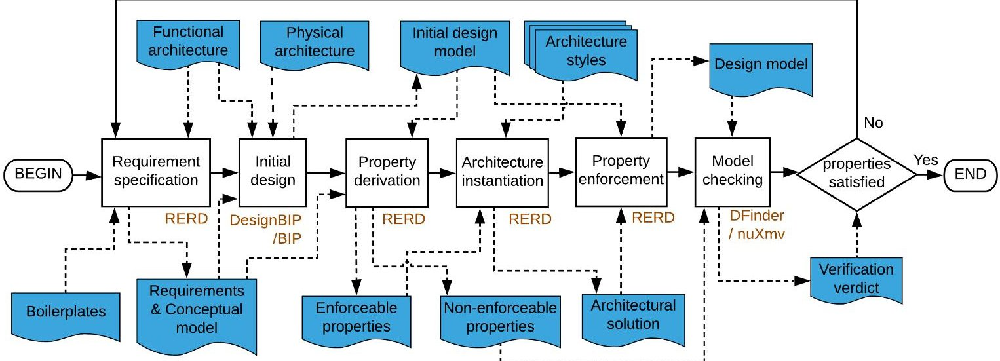

Figure 6: The model-based process for the formalization of requirements and design

Figure 6 introduces the overall process by showing the steps along with their input and output data: Input: (i) the functional architecture

(ii) the physical architecture

Output: a design model satisfying the derived properties OR requirements that are not satisfied

Step 1 Requirement specification: Requirements for each function of the functional architecture are specified based on predefined boilerplates (cf. Section 4.1).

Step 2 Initial design: An initial design model is manually built with BIP components representing the physical architecture (cf. Section 4.2). BIP components implement behavior for the actions performed by the allocated

<!-- PDF_PAGE: 9 -->

functions; the interactions among the components encode the invocation of actions.

Step 3 Property derivation: Properties are derived from the specified requirements (cf. Section 4.3). To this end, we have associated each boilerplate with the predefined property patterns that can formally capture it. Then, for each requirement, properties are derived by filling in the patterns with elements of the design model that represent the concepts used in the boilerplate.

Step 4 Architecture instantiation: Properties which can be enforced by design are identified; every such property is provably enforced by a BIP architecture. The architecture to be used is instantiated (cf. Section 4.4) by defining the operands of an existing architecture style [53, 55], i.e., components of the design model in place of the style parameters, which fulfill assumed properties.

Step 5 Property enforcement: The architectures are incrementally applied to the design model (cf. Section 4.4) [5]. The properties assumed by definition for the operands of an architecture are verified locally by inspecting the corresponding components, before the architecture is applied to the design model. If an assumed property is not satisfied, the component behavior will have to be refined to ensure property satisfaction.

Step 6 Model checking: Properties that could not be enforced using existing architecture styles are verified on the final design model. If these properties are satisfied, then so is the whole set of requirements; otherwise, the design model should be refined or certain unsatisfied requirements have to be revised.

The steps 1,3,4 and 5 are supported by the RERD tool, which is described in Section 5. The BIP design model is compiled and simulated with the BIP tools [14], whereas its deadlock freedom is checked with the D-Finder tool [11]. DesignBIP $ ^{2} $ [54] is a web-based graphical editor for BIP models, which can be used for the creation of the initial design model. For the verification of properties (Step 6) by model checking, it is possible to use the the nuXmv model checker [21]. Additionally, safety properties can be expressed as observer automata [35], which are then verified with the BIP tools. Three engineering roles are involved in the process, namely the Requirement Engineer for the specification of requirements (Step 1), the System Software Engineer for the system design (Steps 2, 4, 5) and the Verification Engineer for the property derivation and model checking (Steps 3, 6).

## 4.1. Requirement specification

One of the main objectives of our approach is to tackle the ambiguity of natural language requirement specifications through the use of boilerplates in combination with a conceptual model. According to [2], a boilerplate consists of attributes and fixed syntax elements, such as:

<function> shall <action>

where "shall" is a fixed syntax element, while $ \langle function \rangle $ and $ \langle action \rangle $ are attributes of placeholders for user input.

Table 1: Conceptual classes

<table border="1"><tr><td>Class</td><td>Definition</td></tr><tr><td>function</td><td>A function of the functional architecture</td></tr><tr><td>action</td><td>A processing step of a function</td></tr><tr><td>state</td><td>A condition that enables/disables actions</td></tr><tr><td>state-set</td><td>A set of mutually exclusive states</td></tr><tr><td>event</td><td>A nominal or failure effect of an action or an external stimulus</td></tr></table>

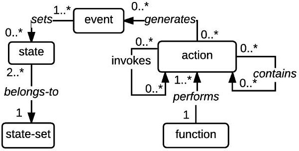

Figure 7: Conceptual diagram of classes.

In order to avoid indeterminate values in boilerplate attributes, we link these values with uniquely identified concepts from the conceptual model, where each concept is an instance of a class with precisely defined relationships. The conceptual classes are defined in Table 1 and the essential relationships for supporting the modeling steps of the process are shown in Figure 7. Each function performs actions in order to interact with other functions or the environment. In particular, actions can invoke actions of other functions or generate events. Moreover, actions are

<!-- PDF_PAGE: 10 -->

of different granularity, hence some actions are action containers i.e. their execution involves the execution of more fine-grained actions. Events are either generated as the effect of actions or by the environment. Specifically, an event occurs upon the end of one of its associated actions. The occurrence of ceratin events triggers a change (set) in the state of one or more state-sets. Notice that the diagram doesn't show two reasonable constraints for the actions, i.e., that they can invoke only actions of other functions and that they can contain only actions of their own function. Also, a constraint for the states is that they are set by events generated by actions and not by external stimuli.

Our boilerplate language is similar to the one used in [2,28], where a boilerplate consists of at most three clauses: (i) the prefix clause, which specifies a stimulation or a condition, (ii) the main clause, which specifies an expected system action or state and (iii) the suffix clause, which specifies various additional constraints. Moreover, each boilerplate attribute is associated with a specific class of our conceptual model. The definition of boilerplates as a sequence of different clauses offers modularity, simplifies the problem of boilerplate definition and their interpretation using formal properties.

Example 1. Let us consider the following natural language requirement:

Log-001 Every time a hardware error is detected,

it shall be stored in a memory region in the RAM.

This requirement is expressed in active voice, using a prefix and a main clause for defining the triggering event and the system's action, respectively, as follows:

Log-001 Prefix: If <event: a hardware error is detected by a function >,

Main: <function: the function > shall <action: store the error in a memory region in the RAM >.

Table 2: Prefix clauses

<table border="1"><tr><td>ID</td><td>Template</td></tr><tr><td>P1</td><td>if $\langle event \rangle$</td></tr><tr><td>P2</td><td>if $\langle event \rangle$ and $\langle state \rangle$</td></tr><tr><td>P3</td><td>while $\langle state \rangle$</td></tr></table>

Table 3: Main clauses

<table border="1"><tr><td>ID</td><td>Template</td></tr><tr><td>M1</td><td>function shall action</td></tr><tr><td>M2</td><td>function shall action(and action)+</td></tr><tr><td>M3</td><td>function shall state</td></tr></table>

<table border="1"><tr><td>ID</td><td>Template</td></tr><tr><td>S1</td><td>before $\langle event \rangle$</td></tr><tr><td>S2</td><td>sequentially</td></tr></table>

Table 3 defines the syntax for the main clauses of our boilerplate language, whose subject is a function, that may (i) execute an action (M1), or (ii) execute a sequence of actions (M2), or (iii) be in a certain state (M3). The main clause is mandatory; it is the core of the requirement.

Prefixes (Table 2) refer to hypothetical conditions on events and/or states. They specify conditions for the main specification, i.e., for the action, the sequence of actions or the state observation mentioned in the main clause. According to the prefixes, the main clause shall occur: (i) if an event has occurred (P1), (ii) if an event has occurred and a state is observed (P2), or (iii) throughout an interval, where a state can be observed (P3). The conditions that involve events are necessary and sufficient, while those consisting only of states simply represent a necessity.

A suffix is used to constrain the main specification. The suffix clauses shown in Table 4 specify that each time the main specification (action, sequence of actions or state observation) is activated, it shall: (i) have ended before an event occurs (S1), or (ii) occur sequentially i.e., consecutive activations do not overlap in time (S2).

Let us consider the boilerplate consisting of the P1, M1 and S2 templates, specifying that "if event, function shall action sequentially". Such a boilerplate expresses that: (i) event is a necessary and sufficient precondition for one action occurrence and (ii) consecutive action occurrences are constrained to be executed sequentially. The remaining prefix-suffix combinations are interpreted accordingly.

During the specification of each requirement, the conceptual model is enriched with new concepts, if the existing concepts are not sufficient. At the end of the specification step, the conceptual model will contain the concepts used in the requirements and additional concepts that are related to them. For example, events used in the requirements will be related to their generating actions, even if these actions are not explicitly mentioned in requirements. The conceptual model's quality is a responsibility of the Requirement Engineer. This matter has been examined in related works [43,41] that are further discussed in Section 6.3.

<!-- PDF_PAGE: 11 -->

Example 2. Let us consider the requirements in Table 5, which have been defined for the function that handles the housekeeping of the payload (PL) subsystem (abbreviated as HK PL). The concepts in requirements and other concepts related to them are depicted in the conceptual model of Figure 8, which shows that:

Table 5: Requirements for the HK PL function

<table border="1"><tr><td>ID</td><td>Requirement</td></tr><tr><td>HK-02</td><td>P2: if event-e003: [TBD] sec pass and state-s003: HK collection is enabled for PL
M1: function: HK PL shall action-a004: handle HK data from the PL</td></tr><tr><td>HK-03</td><td>P3: if state-s002: PS3 for PL is not enabled
M1: function: HK PL shall action-a002: transmit HK data through the TC/TM service</td></tr><tr><td>HK-04</td><td>P3: while state-s001: PS for PL is enabled
M1: function: HK PL shall action-a001: write HK data to the flash memory</td></tr><tr><td>HK-05</td><td>P1: if event-e004: a PL failure persists for [TBD] sec
M1: function: HK PL shall action-a003: contact the EPS for a restart of the PL</td></tr></table>

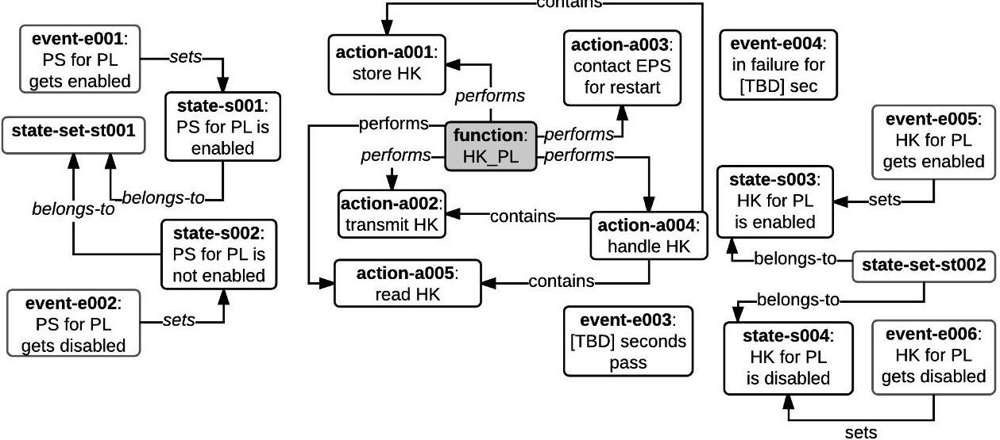

Figure 8: Conceptual model for the requirements of the HK PL function

- states s001 and s002 belong to the state-set st001, thus, only one of them can be observed at a given instant. Each of these states is set by the events e001 and e002, respectively (states s003 and s004 are similarly related).

- the used action a004 represents an action container that consists of a001, a002 and a005.

- events e003 and e004 are neither generated by an action nor do they set any states.

For brevity, Figure 8 omits the invokes relationships that relate these actions to actions of other functions. These relationships are shown at later steps of the running example.

The templates in Tables 2,3 and 4 in no way form a complete set of boilerplates adequate for all kinds of system requirements, since the boilerplate language is not the primary goal of this article. Thus, our prefixes can only express necessary and sufficient conditions based on one state or event, even though requirements are often subjected to more complex conditions (e.g. based on two events) or to conditions that are either necessary or sufficient. However, we opted to keep the boilerplate language simple enough for illustrating the main principles behind its design, while covering the specification needs of the two case studies in Section 6. Our considerations for the evolution of the current language are discussed in Section 6.3.

<!-- PDF_PAGE: 12 -->

## 4.2. Initial design

The initial design step generates the design model in its initial form, which is a manually built blueprint of the system's functional behavior. All the concepts of actions and events mentioned in the requirements should be traceable in ports of the initial design model.

The model consists of BIP components that implement functions of the functional architecture. Each action of the conceptual model, which is an identifiable block of functionality within a function, is represented by a list of ports of a component. Events that are generated by actions are also represented by the action's ports, whereas environmental events are non-deterministic inputs which are not explicitly modeled. Components may enclose one or more atomic subcomponents in order to enable ports within separate threads of control. The number of atomic components to be used and the placement of actions is a design choice that depends on possible order dependencies among the actions. For instance, actions which are executed alternatively should be enabled at the same control location of a component, whereas actions that are independent with each other should be placed in different components.

The invocation of actions, which is reflected by the "invokes" relationship of the conceptual model, is represented by component interactions. Separate interactions are included for issuing an invocation and receiving the output. Rendezvous connectors can model synchronous invocations, where the caller has to wait for the output. For asynchronous invocations, an additional atomic component should be used for buffering the output before the caller can get it. Actions may return a nominal output or potential failures. The caller may receive all outputs with the same port or using different ports, if it needs to distinguish among them (e.g. if it should be transferred to different control locations).

The design choices at this step incur a limited complexity and risk to the whole process, since components of the initial design model should have elementary behaviors. More complex behaviors are only built with architecture instantiation in a controlled and rigorous way.

Example 3. The initial design model shown in Figure 9 corresponds to the requirements in Table 5. It includes the following three components of the physical architecture:

- the HK PL, which handles the Housekeeping for the PL subsystem function;

- the I2C_sat, which handles the communication through the I2C bus [64] function;

- the Flash Memory, which handles the flash memory data management function.

Figure 8 shows the actions of the function allocated to the HK PL component. The other two components are included in the model since their actions are invoked by HK PL. The HK PL actions have been placed into two atomic subcomponents of the HK PL, namely the HK PL read, which reads Housekeeping data, and the HK PL restart, which activates a restart of the PL subsystem. Actions are mapped to lists of ports as follows:

$$
a 0 0 1 \rightarrow [ \mathrm {m e m} _ {\mathrm {w r i t e}} _ {\mathrm {r e q}}, \mathrm {m e m} _ {\mathrm {r e s}} ]
$$

$$
a 0 0 2 \rightarrow [ \mathrm {I 2 C} _ {-} \mathrm {a s k} _ {-} \mathrm {T T C}, \mathrm {I 2 C} _ {-} \mathrm {r e s} _ {-} \mathrm {T T C} ]
$$

$$
a 0 0 3 \rightarrow [ \mathrm {I 2 C} _ {-} \mathrm {a s k} _ {-} \mathrm {E P S}, \mathrm {I 2 C} _ {-} \mathrm {r e s} _ {-} \mathrm {E P S} ]
$$

$$
a 0 0 4 \rightarrow [ \mathrm {b e g i n H K}, \mathrm {f i n i s h e d} ]
$$

$$
a 0 0 5 \rightarrow [ \mathrm {I 2 C} _ {-} \mathrm {a s k} _ {-} \mathrm {P L}, \mathrm {I 2 C} _ {-} \mathrm {r e s} _ {-} \mathrm {P L}, \mathrm {I 2 C} _ {-} \mathrm {f a i l} _ {-} \mathrm {P L} ]
$$

The use of two atomic components is driven by existing dependencies among actions. For example, in HK PL read, the action of reading housekeeping data (a004) should precede their transmission (a002) or storage (a001). On the other hand, subsystem's reset (a0005) occurs independently of other actions.

In Figure 9 a simplified presentation of BIP connectors is shown by using the diamond shapes in component interfaces. Each diamond is attached with ports that participate in one action's invocation and the receipt of the result/failures and the link between two diamonds denotes that BIP connectors exist between these ports. All actions of the HK PL function invoke actions of the I2C_sat and Flash Memory components $ ^{4} $ . Specifically, the action of subsystem communication of the I2C_sat is invoked by three actions that need to contact other subsystems:

- a004, which reads housekeeping data from the PL subsystem;

- a002, which submits data to the TC subsystem for transmission to the ground;

- a005, which contacts the EPS subsystem for the restart of the PL subsystem.

Moreover, the memory write action of the Flash Memory is invoked by a003 for writing the data to the flash memory storage. Note here that a failure in reading the housekeeping data from PL leads to a different control location than the nominal output and it is therefore received by a different port (i.e. I2C_fail_PL) than the port receiving the nominal

<!-- PDF_PAGE: 13 -->

output (i.e. I2C_res_PL). In contrast, both outputs of the memory write action can be received with the mem_res port, since they lead to the same control location.

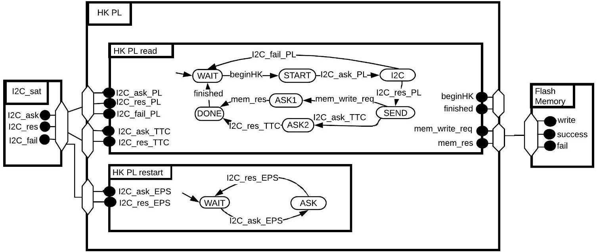

Figure 9: Initial design model example

## 4.3. Property derivation

Formal properties are bound to a unique interpretation specified in an analyzable language. For design models in BIP, we usually use the Computational Tree Logic (CTL) [6] for behavioral properties and configuration logics [53] for architectural properties. However, since we aim at a general approach for specifying properties, we use the specification framework of [27] with patterns that are formally defined in CTL and in other languages $ ^{5} $ . These patterns have been found expressively sufficient to capture requirements written with our boilerplates.

Each property specification consists of two templates, a scope and a pattern. The pattern defines an expected occurrence or the order of one or more events. The scope selects the subset of the model state-space, where the pattern is expected to hold true. For the rest of the state-space, the property is undefined. For the set of our boilerplates, it suffices to derive properties using the existence, absense, precedence and response patterns of [27]. Also we needed two scopes, namely the Global scope or the Between...And scope that refers to a part of the state-space. The templates for the patterns and the scopes are shown in Table 6. Their placeholders are filled with logical propositions (beh), that are specified as follows:

- Atomic propositions are defined over firings of component ports: a port p of a component A is denoted by A.p and holds true at any global state in which the port has fired.

- Logical connectives & (and), | (or) combine atomic propositions with their usual meaning.

- Temporal modalities are used to build more complex propositions. In particular, with the next operator (X) in front of a beh, we refer to the next global state after beh occurs (the next operator can be formally expressed in CTL as AX).

We derive properties from requirements, based on a mapping from the requirement's boilerplate to combinations of scope and pattern templates that are shortly referred as "property patterns". This association, which is shown in Table 7, refers to a set of symbols, which map the boilerplate attributes to beh propositions. The mappings have to be manually created by the System Software Engineer, as follows:

- The beg (and end) symbols map actions to the beh propositions that define their beginning (resp. ending). For instance, the beginning of an action is the port with which it can be invoked and its ending is the port of sending its response or a disjunction of ports (e.g. when alternative endings exist).

<!-- PDF_PAGE: 14 -->

Table 6: Templates for scopes and patterns

<table border="1"><tr><td>ID</td><td>Template</td><td>Description</td></tr><tr><td>Global Between...And</td><td>globally, between $\langle beh \rangle$ and $\langle beh \rangle$</td><td>throughout the whole execution from a $\langle beh \rangle$ to another $\langle beh \rangle$</td></tr><tr><td>Existence</td><td>$\langle beh \rangle$ exists</td><td>a $\langle beh \rangle$ is observed</td></tr><tr><td>Absense</td><td>$\langle beh \rangle$ is absent</td><td>a $\langle beh \rangle$ is not observed</td></tr><tr><td>Precedence</td><td>$\langle beh \rangle$ precedes $\langle beh \rangle$</td><td>a $\langle beh \rangle$ is observed before another $\langle beh \rangle$</td></tr><tr><td>Response</td><td>$\langle beh \rangle$ responds to $\langle beh \rangle$</td><td>a $\langle beh \rangle$ is observed after another $\langle beh \rangle$</td></tr></table>

- The occ symbols map events to beh propositions that define each event's occurrence. An internal event is generated by one or more action(s), hence a beh is the disjunction of end symbols of alternative actions generating the event. The occurrence of an external event is a port that generates external stimuli. Such ports are not part of the initial model; instead, we consider them as "virtual ports" of a "virtual component" named Environment, in order to assign them to occ symbols in property derivation.

- The obs symbols map states to ports, which are enabled when the design model is in each particular state. These ports are not part of the initial model; instead, they are placed in coordinating components of architectures that are added during property enforcement. Hence, we consider them as "virtual ports" in property derivation.

In addition to the aforementioned symbols, the beg(M) and end(M) symbols (see the footnote $ ^{b} $ in Table 7) are automatically evaluated based on the used main clause template.

The semantics for M1 and M3 templates, alone, do not yield any correctness properties. On the other hand, M2 specifies a sequential execution of N actions, which is expressed by the conjunction of properties, M2.1.i (see Table 7), defined for each action a[i] in the sequence (except for the last one). The property expresses that:

- the end of action a[i] enables the beginning of action a[i+1], i.e., "globally, a[i] should end before a consecutive beginning of a[i+1]", formulated as:

M2.1.i: globally, end(a[i]) precedes beg(a[i+1]).

Another example is the P2 prefix template, from which patterns P2.1 and P2.2 are derived. The patterns express that:

- the observation of an event while being in a state enables beg(M), i.e., "globally, the event and the state are observed at some time instant before beg(M)”，formulated as:

$$
P 2. 1: \mathrm {g l o b a l l y}, o b s (\mathrm {e} 1) \wedge o b s (\mathrm {s} 1) \mathrm {p r e c e d e s} b e g (\mathrm {M})
$$

- the observation of an event while being in a state triggers beg(M), i.e., "globally, beg(M) follows the observation of the event and the state at some time instant", formulated as:

$$
P 2. 2: \mathrm {g l o b a l l y}, b e g (\mathrm {M}) \mathrm {r e s p o n d s t o} o c c (\mathrm {e 1}) \wedge o b s (\mathrm {s 1})
$$

The rationale of the other derived properties is discussed in Appendix A.

Example 4. Let us consider the requirement HK-02 of our running example, which is captured by the P2.1 and P2.2 property patterns. For these patterns, the following symbols have to be assigned with ports:

- occ(e1), is assigned with the "virtual port" Environment.HKPL_TBDpass modeling the occurrence of the external event e1;

- obs(s1) is assigned with the "virtual port" HK_PL.enabledHK_PL modeling the observation of the state s1;

- *beg(a1)* is assigned with the HK_PL.beginHK port modeling the begining of action a1.

<!-- PDF_PAGE: 15 -->

Table 7: Boilerplate templates and their associated property patterns

<table border="1"><tr><td>Boilerplate</td><td>Derived patterns</td></tr><tr><td>$P1:if e1，...^{a}$</td><td>$P1.1:globally，occ(e1)precedes beg(M)^{b}$
$P1.2:globally，beg(M)responds to occ(e1)$</td></tr><tr><td>$P2:if e1and s1，...$</td><td>$P2.1:globally，occ(e1)\land obs(s1)precedes beg(M)$
$P2.2:globally，beg(M)responds to occ(e1)\land obs(s1)$</td></tr><tr><td>$P3:while s1，...$</td><td>$P3.1:globally，obs(s1)precedes beg(M)$</td></tr><tr><td>$M1:f1shall a1$</td><td>-</td></tr><tr><td>$M2:f1shall a1and...and aN$</td><td>$M2.1.i:globally，end(a[i])precedes beg(a[i+1])$</td></tr><tr><td>$M3:f1shall s2$</td><td>-</td></tr><tr><td>$S1:...beforee2$</td><td>$S1.1:betweenobs(P)和beg(M)，occ(e2)isabsent^{c}$</td></tr><tr><td>$S2:...sequentially$</td><td>$S2.1:betweenbeg(M)和beg(M)，end(M)exists$</td></tr></table>

$ ^{a} $ The enumerated fi, ai, ei and si denote a function, action, event and state mentioned in the requirement.

$ ^{b} $ beg(M) and end(M) are replaced according to the used main clause M as follows:

$$
b e g (M) = \left\{ \begin{array}{l l} b e g (a 1) & \text {i f M = M 1 o r M = M 2} \\ o b s (s 2) & \text {i f M = M 3} \end{array} \right. \quad e n d (M) = \left\{ \begin{array}{l l} e n d (a 1) & \text {i f M = M 1} \\ e n d (a N) & \text {i f M = M 2} \\ \neg o b s (s 2) & \text {i f M = M 3} \end{array} \right.
$$

$ ^{c} obs (P) $ is replaced according to the used prefix P as follows:

$$
o b s (P) = \left\{ \begin{array}{l l} o c c (e 1) & \text {i f P = P 1} \\ o c c (e 1) \wedge o b s (s 1) & \text {i f P = P 2} \\ o b s (s 2) & \text {i f P = P 3} \end{array} \right.
$$

## 4.4. Architecture instantiation and property enforcement

Nine architecture styles from those introduced in [55, 56] were adequate to enforce the safety properties of our case studies. In this section, we outline how property enforcement is achieved using four out of these nine styles, namely:

- the Action flow, which enforces an ordering of actions;

- the Mode management, which restricts the set of actions performed in a mode (state);

- the Event monitoring, which reports upon monitored events;

- the Mutual exclusion management, which ensures mutually exclusive access to a critical section.

While these styles represent recurring patterns of satellite on-board software, we believe that they are not tied to the given problem domain.

In order to apply an architecture, the architecture style's parameters have to be defined. Then, the architecture is instantiated and combined with other architectures that have already been applied to the same operand components (using the $ \oplus $ operator as described in Section 2). In our design process this is an automated step, which merges the connectors of architectures applied on common ports. The result of applying multiple architectures to the design model has to be verified for deadlock-freedom.

## 4.4.1. Action flow

The Action flow architecture style, shown in Figure 10, enforces a sequential flow on N actions allocated to n components of type B, using an Action Flow Manager coordinator component. Assuming that $ n_{a} $ actions of the flow belong to one component, the component has $ n_{a} $ instances of the actBegin and actEnd port types, which represent the beginning and end of each action. The coordinator resets the action flow only after the N-th action has ended. Connector degrees imply that each action can only be involved in one action flow.

The Action flow style is used to enforce a collection of properties of the M2.1.i pattern $ (i=1,\dots,N) $ derived from the same requirement. Such patterns specify that, given a set of actions a[1]...a[N], the end of action a[i]

<!-- PDF_PAGE: 16 -->

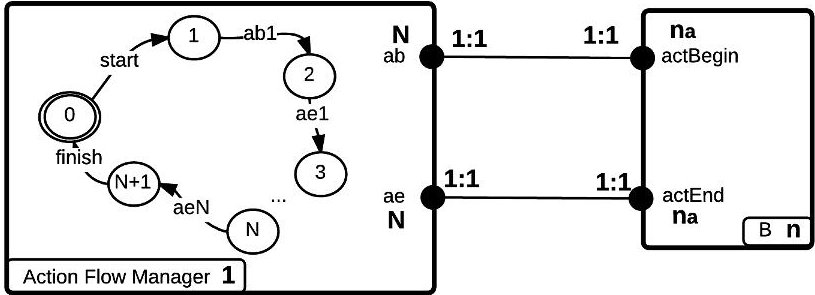

Figure 10: Architecture diagram of the Action flow style

enables the beginning of a[i+1]. For each a[i], the port instances that should be mapped to each actBegin[i] (resp. actEnd[i] ) are the port(s) that correspond to the beg(a[i]) (resp. end(a[i])) :

$$
\mathrm {a c t B e g i n} [ \mathrm {i} ] \rightarrow b e g (a [ \mathrm {i} ])
$$

$$
\mathrm {a c t E n d} [ \mathrm {i} ] \rightarrow e n d (a [ i ])
$$

Example 5. Let us consider the requirement CDMS-02 of the CubETH case study:

P1: <e1: if [TBD] seconds pass >

M2: <f1: CDMS_status> shall <a1: reset the internal and external watchdogs> and <a2: contact the EPS subsystem with a "heartbeat">

from which the following property of the M.2.1 pattern is derived:

## CDMS-02-M.2.1: globally, end(a1) precedes beg(a2)

Let us assume that actions a1 and a2 are placed in the Watchdog reset and the Heartbeat components, respectively. For the enforcement of the property, an Action flow architecture was instantiated using the two components as operands of type B. Table 8 shows the mapping of their ports for actions a[1] and a[2] to port type parameters. Figure 11 presents the result of applying the architecture, which adds the coordinator and two connectors shown with dashed lines. Since the coordinator represents the Heartbeat component (i.e., all its ports are synchronized with ports of the coordinator), the latter is removed as redundant. Moreover, any symbols that refer to the removed component's ports are updated to refer to the ports of the the coordinator.

Table 8: Action flow architecture style parameters

<table border="1"><tr><td></td><td>a[1]</td><td>a[2]</td></tr><tr><td>actBegin</td><td>Watchdog_reset.internal_watchdog</td><td>Heartbeat.send</td></tr><tr><td>actEnd</td><td>Watchdog_reset.done</td><td>Heartbeat.res,Heartbeat.fail</td></tr></table>

## 4.4.2. Mode management

The Mode management architecture style (Figure 12) restricts the set of actions which can be executed (i.e., enabled actions) based on a set of modes. It consists of one coordinator of type Mode Manager, n parameter components of type B1 and k parameter components of type B2. Each B2 component triggers the transition of the Mode Manager to a specific mode. B1 components have actions that should be enabled in specific mode(s) of the Mode Manager. Mode Manager has one control location for each mode, one port type toMode with cardinality k and k port types inMode with cardinality 1. Each toMode port is connected with the changeMode port of a dedicated B2 component.

B1 has k port types modeBegin with cardinality mc[0,1]. In other words, a component instance of B1 might have any number of port instances of modeBegin from 0 to k. B1 has also a modeEnd port type with cardinality k. m[i]b stands for "mode i begin" and indicates that an action that is enabled in mode i has begun its execution. The m[i]e ports stand for "mode i end" and indicate that an action that is enabled in mode i has ended. Such ports are

<!-- PDF_PAGE: 17 -->

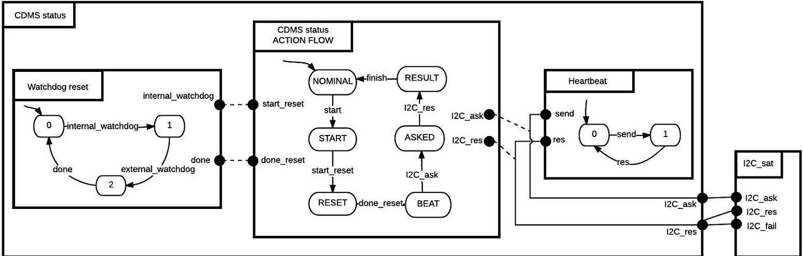

Figure 11: Application of an Action flow architecture

exported as modeEnd in the interface of the B1 components. Each inMode port instance of the Mode Manager must be connected with the corresponding m[i]b port instances of all B1 components through an n-ary connector, where a different multiplicity in the interval [1,n] is considered for each port instance.

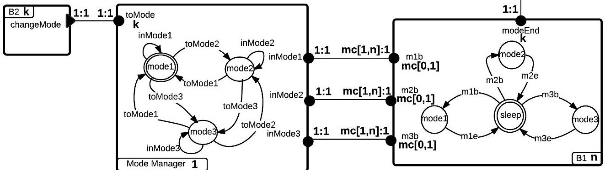

Figure 12: Architecture diagram of the Mode management style (component behavior is shown for k=3)

This architecture style enforces sets of properties of the P3.1 pattern that refer to states of the same state-set. According to each such property, "the main specification shall begin only if a state is observed". The style is parameterized by setting k equal to the number of states in the state-set. To identify instances of m[i]b ports, we use a new symbol enforce_beg(M), which is evaluated as follows:

- if $M = M1$ or $M = M2$, enforce_beg(M)=beg(M)

- if $M = M3$, in which case $beg(M) = obs(s2)$, enforce_beg(M) is the beg of each action that triggers state s2;

these actions are found in conceptual model by backward tracing the relationships action $ \xrightarrow{generates} $ event $ \xrightarrow{sets} $ state. The second evaluation case reflects that the restriction of being in a state can only be ensured by restricting the event of entering in that state. Operands of type B1 are the components having the ports mapped to the m[i]b ports. The changeMode port type is mapped to the ports of the occ of each event that sets the state. Operands of type B2 are the components having these ports. After having applied a mode management architecture, each "virtual port" assigned to the obs of the represented states is replaced by an inMode[i] port of the Mode Manager.

The Mode management style is also used in combination with the Event monitoring style to enforce the P2.1 pattern. Specifically, we apply the Mode management after having applied the Event monitoring, by mapping the m[i]b port type to the port of the event monitoring coordinator that observes the event.

Example 6. Let us consider the requirements HK-03 and HK-04 in Table 5, from which the following two properties are respectively derived:

HK-03-P3.1: globally, obs(s002) precedes beg(a002)

<!-- PDF_PAGE: 18 -->

HK-04-P3.1: globally, obs(s001) precedes beg(a001)

States s001 and s002 belong to the same state-set, hence, they can be enforced through a single Mode management architecture in which k = 2. The style parameters shown in Table 9 associate state s001 with mode[1] and state s002 with mode[2]. The m[1]b and m[2]b port types are mapped to the beg(M) of each pattern, namely the beg(a001) (evaluated as HK_PL_read.mem_write_req) and beg(a002). Since Figure 8 shows that each mode is set by the events e001 and e002, respectively, the changeMode port type is mapped to the ports assigned to the occ(e001) (evaluated as s15_1.PL) and the occ(e002) (evaluated as s15_2.PL). The result of architecture application is presented in Figure 13, where the added connectors are shown with dashed lines.

<table border="1"><tr><td></td><td>mode[1]</td><td>mode[2]</td></tr><tr><td>changeMode</td><td>s15_1.PL</td><td>s15_2.PL</td></tr><tr><td>m[i]b</td><td>HK_PL_read.mem_write_req</td><td>HK_PL_read.I2C_res_TTC</td></tr></table>

Table 9: Mode management architecture style parameters

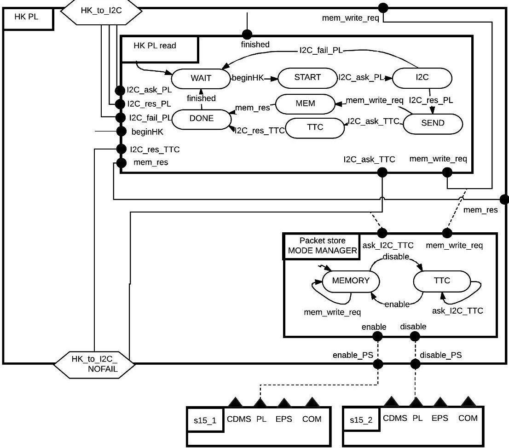

Figure 13: Application of a Mode management architecture

## 4.4.3. Event monitoring

The Event monitoring architecture style, shown in Figure 14, provides a coordinator component of type Event Monitor that tracks events of n components of type B and reports them to a component of type service. Each B component has an instance of the sndEvent port type, while the service component has an instance of the getRep port type.

The event monitoring architecture style is used to enforce the P1.1 and P2.1 patterns, according to which "the main specification shall begin only if a certain event occurs". For each such pattern, a separate architecture is applied,

<!-- PDF_PAGE: 19 -->

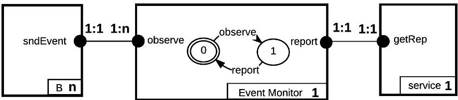

Figure 14: Architecture diagram of the Event monitoring style

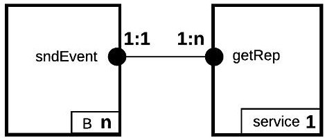

Figure 15: Architecture diagram of the bipartite connectors' simplification

where the getRep port type is mapped to the ports assigned to enforc_beg(M) and the sndEvent port type is mapped to the set of ports given in the occ of the event. Moreover, the P2.1 pattern requires the additional application of a mode management architecture, as it has been already explained in Section 4.4.2.

Under the assumption that the action is enabled whenever the event is observed, the coordinator's behavior is reduced to a single control location and the transitions observe, report are seen as indivisible (replaced by a single port). For simplicity, the coordinator is omitted, and it is replaced by bipartite rendezvous connectors between the port(s) of the event occurrence and the action's beginning. Figure 15 shows the architecture diagram of the bipartite connectors' simplification.

Example 7. Let us consider the requirement HK-01 in Table 5, from which the following property is derived: HK-02-P2.1: globally, occ(e003) $ \wedge $ obs(s003) precedes beg(a004)

The property is enforced through a combination of an event monitoring and a mode management architecture, but here we focus on the event monitoring. The used parameters are shown in Table 10. The getRep port is mapped to the enforc_beg(M), namely the beg(a004) (evaluated as HK_PL_read.beginHK). The sndEvent is mapped to the occ(e003) (evaluated as Environment.HKPL_TBDpass).

<table border="1"><tr><td>sndEvent</td><td>Environment.HKPL_TBDpass</td></tr><tr><td>getRep</td><td>HK_PL_read.beginHK</td></tr></table>

Table 10: Event monitoring architecture style parameters

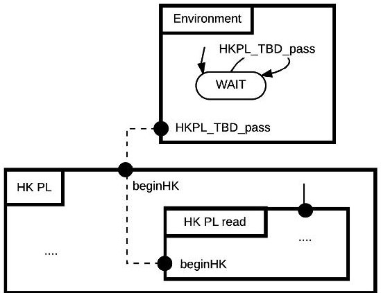

Figure 16: Application of the bipartite connectors' simplification of the Event monitoring architecture

In this example, the event represented by the port Environment.HKPL_TBDpass can be reported anytime after a deadline expires. Hence, the assumption that the reporting action is enabled whenever the event occurs is true and the bipartite connector simplification is used without affecting event occurrences (Figure 16).

## 4.4.4. Mutual exclusion management

The Mutual exclusion management architecture style, shown in Figure 5, has a coordinator component of type Mutex Manager, which ensures that the actions of n parameter components of type B are executed in a mutually exclusive manner. The beginning and end of actions are represented by the begin and finish port types of B components.

<!-- PDF_PAGE: 20 -->

Mutual exclusion management is used to enforce the S2.1 pattern, according to which "consecutive executions of the main specification occur in a sequential manner". The style is parameterized by mapping the begin and finish ports to the set of ports in enforc_beg(M) and the set of ports in end(M).

Example 8. A mutual exclusion architecture applied to the Flash Memory component is used to enforce that the read and write requests should be processed in a mutually exclusive manner. The parameters for the architecture are those in Table 11. The begin is mapped to the ports for the invocation of a read/write request and the finish is mapped to their results. The obtained model is shown in Figure 17.

<table border="1"><tr><td>begin</td><td>Flash_Memory.read,Flash_Memory.write</td></tr><tr><td>finish</td><td>Flash_Memory.return,Flash_Memory.fail</td></tr></table>

Table 11: Mutual exclusion management architecture style parameters

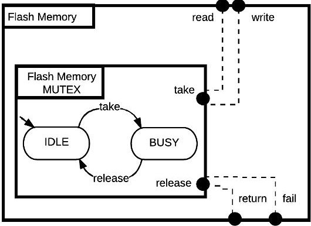

Figure 17: Application of a Mutual exclusion management architecture

## 4.4.5. Liveness

In general, the enforcement of liveness properties requires additional assumptions of fair execution scheduling. Furthermore, in order to guarantee the preservation of liveness properties by architecture composition, one has to verify the architectures' pair-wise non-interference [5].

However, liveness properties of the patterns P1.2 and P2.2, can, indeed, be enforced by the bipartite connectors' simplification of the Event monitoring architecture style. Let us consider the safety property "the main specification begins atomically upon the occurrence of event e", formulated as follows:

$$
P 1. 2 ^ {\prime}: \mathrm {b e t w e e n o c c} (\mathrm {e}) \mathrm {a n d} \mathbf {X} o c c (\mathrm {e}), b e g (\mathrm {M}) \mathrm {e x i s t s}. ^ {6}
$$

It can be easily shown that P1.2 is implied by P1.2', which can be enforced by the bipartite connectors' simplification if the assumptions for its application hold (cf Section 4.4.3).

Another way to indirectly enforce P1.2 through the Event monitoring architecture style is by considering the following safety property: "after an occurrence of event e, another such event does not occur before the beginning of the main specification", formulated as follows:

$$
P 1. 2": \text {b e t w e e n o c c (e) a n d o c c (e)}, b e g (\mathrm {M}) \text {e x i s t s.} ^ {7}
$$

It can be easily shown that P1.2", which is enforceable by the Event monitoring architecture style, implies P1.2, if it can be verified or assumed that occ(e) occurs infinitely often:

$$
P 1. 2. a s m: \mathrm {g l o b a l l y}, o c c (\mathrm {e}) \mathrm {r e s p o n d s t o} o c c (\mathrm {e})
$$

<!-- PDF_PAGE: 21 -->

## 4.4.6. Decision flows for property enforcement

Finding the suitable approach for enforcing a given property involves a decision-making process. Algorithm 1 introduces such a process for properties of the P1.1 pattern. The first conditional (line 1) checks whether the bipartite connector simplification can be applied, the second conditional (line 3) checks whether Event monitoring is necessary, and the else statement (line 6) is reached if the property should be verified, through inspection or model checking.

Algorithm 1 Decision-making process for the P1.1 pattern

Require: occ(e), beg(M)

Ensure: P1.1 is either enforced or should be verified

1: if occ(e) is allocated to a different atomic component than beg(M) then

2: P1.1 is enforced by the bipartite connectors' simplification of the Event monitoring style

3: else if occ(e) is allocated to the same atomic component with beg(M) and P1.1 does not hold by inspection then

4: P1.1 is enforced by the Event monitoring style

5: else

6: P1.1 should be verified

7: end if

The direct or indirect enforcement of the P1.2 pattern is guided by the process shown in Algorithm 2. The flow takes into account the architecture that enforces P1.1, if such an architecture has been applied. The decision of the flow is either that the P1.2 property has been enforced by the architecture, or that it has to be verified through model checking. Similar processes are followed for the remaining patterns.

Algorithm 2 Decision-making process for the P1.2 pattern

Require: the applied architecture that enforces P1.1, if any

Ensure: P1.2 is either enforced or has to be verified through model checking

1: if the Event monitoring style has been applied and the P1.2.asm is verified then

2: P1.2 is enforced by the Event monitoring style

3: else if the bipartite connectors' simplification has been applied then

4: P1.2 is enforced by the the bipartite connectors' simplification

5: else

6: P1.2 has to be verified through model checking

7: end if

## 5. Tool support

The RERD tool supports the requirement specification, property derivation, architecture instantiation and property enforcement, i.e. the steps 1, 3, 4 and 5 of the model-based process, whereas in step 6 the D-Finder tool is used and the nuXmv model checker [21], if there is need for verifying CTL properties. For step 1, the Requirements Engineer selects among the predefined boilerplate clauses and then inserts in each placeholder a textual description referring to a uniquely identified concept. The concept can be selected from the previously defined concepts (search support is provided) or if a new concept is needed it is entered along with its relationships. The conceptual model is stored, shared and is accessed through an underlying ontology architecture, whose design does not need to be known to the Requirement Engineer (the concept classes in Figure 7 suffice for specifying requirements).

Figure 18 shows the Requirement Editing screen of the RERD tool. The upper part of the screen allows selecting among the available boilerplate clauses, which are displayed in separate tables. In the middle part, requirements are shown in an editable form, that is, their placeholders and additional information for the requirement (e.g. id, category) can be filled in this panel. The lower part of the screen is used for browsing and searching requirements that match string(s) given in a search box. The table displays the requirements returned by each search (all requirements match an empty string), with buttons attached to each row for editing/deleting them.

<!-- PDF_PAGE: 22 -->

The RERD tool also stores the user-defined values for the symbols used in patterns. Specifically, the System Software Engineer assigns ports to the symbols that are necessary for the properties of the specified requirements. These symbols may be reused in more than one property. Hence, when the Verification Engineer uses the tool during the property derivation (step 3), the necessary properties are automatically created by retrieving the values of symbols.

For architecture instantiation and property enforcement (steps 4 and 5), the System Software Engineer can choose among the available architecture styles and parameterize them for creating architectures that enforce a set of properties. The architectures are then automatically applied to their operand components and the design model is updated as appropriate.

DesignBIP [54] is a web-based graphical editing tool, which can be used for the specification of BIP models and BIP architectures. The tool can assist the creation of the initial design model in step 1. Moreover, it allows for the creation of new architecture styles to be integrated in the RERD tool, whenever RERD is extended with new boilerplates (and enforcement opportunities).

The D-Finder tool [11] is used by the Verification Engineer for verifying the deadlock-freedom of the design model (step 6). D-Finder is capable of analyzing very large BIP models using compositional verification on an overapproximated set of reachable states. For model checking CTL properties, the BIP model has to be transformed with the BIP-to-NuSMV tool into the input language of the nuXmv model checker.

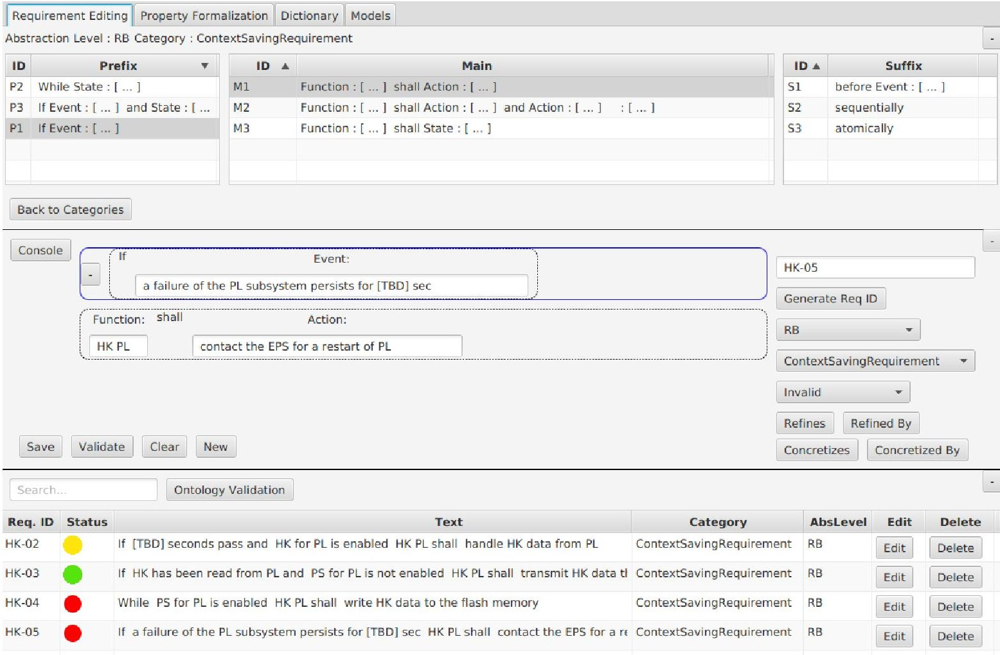

Figure 18: RERD's screen for Requirements Editing.

<!-- PDF_PAGE: 23 -->

## 6. Evaluation case studies

## 6.1. CubETH case study

The CubETH nanosatellite [70] is comprised of: the electrical power subsystem (EPS), the command and data management subsystem (CDMS), the telecommunication subsystem (COM), the attitude determination and control subsystem (ADCS) and the payload (PL). Our early validation study is focused on the software for the following subcomponents of the CDMS subsystem (cf. AppendixB.1): 1) the CDMS status that resets internal and external watchdogs; 2) the Payload that is in charge of payload operations; 3) three Housekeeping components that recover engineering data from the EPS, PL and COM subsystems; 4) the CDMS Housekeeping which is internal to the CDMS; 5) the I2C_sat that implements the $ I^{2} C $ bus protocol; 6) the Flash memory management that implements a non-volatile flash memory and its read-write protocol; 7) the s3_5, s3_6, s15_1 and s15_2 services that activate or deactivate the housekeeping component actions; 8) the Error Logging that implements a shared RAM region. The case study comprises 38 requirements, from which 57 properties were derived. The complete BIP model can be found in AppendixB.5.

Table 12 summarizes statistics that characterize the property enforcement step. In total, the integrated architectures for enforcing safety properties that were derived from our boilerplates' requirements are 1 Action Flow, 11 Mode management, 5 Event monitoring, 10 Mutual Exclusion Management and 3 Failure Monitoring. Since safety properties enforced by each architecture are preserved by architecture composition (see Section 2), these safety properties are satisfied by the design model by construction.

Table 12: Statistics of requirement formulation and property enforcement

<table border="1"><tr><td>Model</td><td>Flow</td><td>Mode</td><td>Event</td><td>Mutex</td><td>Failure</td><td>Requir.</td><td>Deriv. Prop.</td><td>Assum. Prop.</td><td>Enforced</td><td>By inspect.</td></tr><tr><td>Payload</td><td>0</td><td>2</td><td>0</td><td>4</td><td>0</td><td>12</td><td>16</td><td>0</td><td>16</td><td>0</td></tr><tr><td>HK PL</td><td>0</td><td>2</td><td>1</td><td>1</td><td>1</td><td>4</td><td>6</td><td>0</td><td>6</td><td>0</td></tr><tr><td>HK EPS</td><td>0</td><td>2</td><td>1</td><td>1</td><td>1</td><td>4</td><td>6</td><td>0</td><td>6</td><td>0</td></tr><tr><td>HK COM</td><td>0</td><td>2</td><td>1</td><td>1</td><td>1</td><td>4</td><td>6</td><td>0</td><td>6</td><td>0</td></tr><tr><td>HK CDMS</td><td>0</td><td>2</td><td>1</td><td>1</td><td>0</td><td>3</td><td>4</td><td>0</td><td>4</td><td>0</td></tr><tr><td>Flash Memory</td><td>0</td><td>1</td><td>0</td><td>1</td><td>0</td><td>8</td><td>13</td><td>4</td><td>3</td><td>10</td></tr><tr><td>CDMS status</td><td>1</td><td>0</td><td>0</td><td>0</td><td>0</td><td>1</td><td>3</td><td>0</td><td>3</td><td>0</td></tr><tr><td>Error Logging</td><td>0</td><td>0</td><td>1</td><td>1</td><td>0</td><td>2</td><td>3</td><td>0</td><td>3</td><td>0</td></tr><tr><td>Total</td><td>1</td><td>11</td><td>5</td><td>10</td><td>3</td><td>38</td><td>57</td><td>4</td><td>47</td><td>10</td></tr></table>

Combined application of architectures can generate deadlocks. We verified the deadlock-freedom of the design model using the D-Finder tool [11]. D-Finder's compositional analysis is sound, but incomplete: due to the employed over-approximation of reachable states, it can produce false positives, i.e., potential deadlock states that are in fact unreachable in the concrete system. However, our design model was found to be deadlock-free without any potential deadlocks. Thus, no additional reachability analysis was needed. The verification of deadlock-freedom was completed in 12 seconds, for our model consisting of 46 atomic components and 155 connectors.

The key advantage of our architecture-based approach is that the burden of verification is shifted from the final design to architectures, which are considerably smaller in size and can be reused. In particular, we managed to enforce 47 out of 57 derived properties using our simple architecture styles. The remaining 10 derived properties were verified by inspection and 4 fairness assumptions were left for verification using the nuXmv model checker.

Table 13 summarizes the duration of each process step for the input of the problem size shown in each row; the three roles of the process were performed by an engineer who was fully familiar with the process's tool support. The property derivation and property enforcement steps are not shown, since they are fully automated and the time needed was negligible. We note that the time spent is not evenly distributed across the steps and it tends to be less towards the end of the process. Also, it is essential to clarify for the shown times that the architecture styles had already been configured in the RERD tool and the input forms for the style parameters had been defined. This takes 1-2 hours per style. Much greater effort was needed, though, to create the taxonomy of our architecture styles which took about 1

<!-- PDF_PAGE: 24 -->

man-month. However, this taxonomy serves as a knowledge base in abstract form that we have acquired, and which can be also reused to build other models of satellite on-board software.

Table 13: Durations and input sizes of the process steps

<table border="1"><tr><td>Step</td><td>Duration</td><td>Input size</td></tr><tr><td>Requirement specification</td><td>8 hours</td><td>38 requirements</td></tr><tr><td>Initial design</td><td>5 hours</td><td>12 components</td></tr><tr><td>Architecture instantiation</td><td>3 hours</td><td>47 enforced properties</td></tr><tr><td>Verification of deadlock freedom</td><td>12 seconds</td><td>46 components</td></tr></table>

## 6.2. Telecommand Management of an earth observation satellite

In a second case study, our model-based approach was also applied to an extract of 29 software requirements for the Telecommand Management function of a low orbit earth observation satellite. The requirements and the BIP model of this study cannot be disclosed, due to confidentiality liability terms. We derived 58 properties from the requirements and 34 (58%) of them were eventually enforced through architectures.

More specifically, during this case study we identified the need for and formulated an architecture style for Priority Management [56]. In overall, the integrated architectures were 10 Action Flows, 3 Mutual Exclusion Management, 13 Mode management and 1 Priority Management. The number of components in the BIP model was 25.

## 6.3. Discussion

The applicability of our approach in an industrial context depends on a number of factors that we discuss henceforward. First, we assume the availability of a conceptual model like the one depicted in Figure 8. Such a model represents the structural elements and their conceptual constraints comprising the problem domain [31]; its adequacy and completeness determines the range of available concepts and relationships for the boilerplate attributes, the initial design, and the property derivation steps. We consider that conceptual modeling is performed by the Requirement Engineers in cooperation with the domain experts in charge of system design. This activity also includes capturing the domain assumptions, i.e., common and often tacit knowledge for the problem domain, and in spite of the system under design [49, 44]. The so-called domain knowledge (cf. Section 4) may concern with standardized protocols, services, libraries or physical laws, and can provide additional semantic information about the nature of the concepts in question. This information is essential, in order to conclude e.g. that certain events or data ranges that respect the conceptual model syntactically, are not relevant semantically. Some assumptions may be related to physics, e.g. "mass cannot be negative", and some assumptions may be mission-specific, e.g. "the temperature within the orbiting range of the spacecraft cannot rise above N degrees". Elicitation of domain knowledge, as a collaborative effort, could be facilitated by the use of templates for each ontology class [3].

The conceptual model and all assumptions related to domain knowledge are encoded into domain-specific and system-specific ontologies, which are accessed through the RERD tool. New concepts may be created from within the tool and the user is notified for violations of constraints related to the model integrity (e.g. undefined relationships). The model quality (syntactic, semantic, pragmatic) [43,41] is a responsibility of the Requirement Engineers, who should aim for models that can be reused to significant extent in multiple projects. Certainly, the reusability depends on the abstraction level of design, since the requirements are usually specified at different abstraction levels along the development lifecycle (for space systems we have the spacecraft, avionics and software levels) and a conceptual model is pertinent only to a specific level [46]. The aforementioned problems and the right ontology in relation to our model-based design process need to be further researched in future work.

A second important issue is the expressiveness of the boilerplate language, and whether it can be sufficient for specifying the full range of requirement types found in the design of, say, space systems. This of course depends on the expressiveness of the property patterns, and on the analyzability of BIP models with extended semantics for the various property types, because correctness-by-construction does not vanish the need for a posteriori verification. The structure of the boilerplate language in Section 4.1 resembles that of RSL in the CESAR reference technology platform [2]. We currently support fewer templates than RSL for the prefix, main and suffix clauses, but this set of

<!-- PDF_PAGE: 25 -->

templates was sufficient for expressing the requirements of the case studies. Moreover, the RERD tool was designed such that new templates may be added; the only prerequisite is that the additional templates must be associated with property patterns, as in Table 7. The adopted framework of patterns from [27] is well-established and stems from industrially-relevant studies, but it only covers functional property specifications. We certainly foresee the need for boilerplates with templates for non-functional aspects, which call for support by e.g. timing patterns [68] and probabilistic patterns [34]. Here, it is worth to note:

- the extension of BIP [62] that allows specifying probabilistic aspects of BIP components, while providing a stochastic semantics for the parallel composition of components through interactions and priorities;

- the RT-BIP extension for modeling timing constraints as a timed automaton, and a real-time engine for computing the schedules meeting the timing constraints, given the underlying platform's real-time clock [1].

ing the schedules meeting the timing constraints, given the underlying platform's real-time clock [1]. These extensions are accompanied by advanced verification tools, some of which implement scalable compositional verification techniques [67].

However, a matter of vital importance is how expressive can be a boilerplate language with a controlled vocabulary for the attributes with respect to today's industrial practice of natural language specifications. The loss of expressiveness is inevitable, though necessary to avoid ambiguity; the true question is whether it is still possible and whether we really need to cover the same system aspects with those in today's specifications. This question also matters for languages like EARS [50, 51], which insist on natural language specifications using a fixed set of structural rules (though the EARS-CTRL analysis works with a user-defined glossary of terms). From our experience with the case studies, which were based on natural language requirements, we believe that only a subset of them needs to be validated. This set includes requirements that are suspected for consistency issues and have to be established or checked with respect to the system's structure and behavior. The Requirement Engineers tend to classify the requirements in project documentation into categories (e.g. at the software level of space systems there are various classes of interface requirements, performance requirements, functional requirements and design/construction requirements). Any boilerplate language is considered adequate only if it can express all representative forms of natural language requirements that need to be validated, for all categories of requirements in project documentation (e.g. the design/construction requirements is not necessary to be expressed using boilerplates). This may imply changes to the scope of individual requirements (e.g. a natural language requirement may be broken into multiple boilerplate requirements). To this end, the RERD tool displays the set of applicable boilerplates, for each category of requirements found in a user-defined catalogue of categories (Figure 18).

Our emphasis lies on precisely capturing the requirements by properties whichideally—can be enforced through BIP architectures or—if not enforced—could be verified. As we aim to a semi-automated formalization of requirements, we are intentionally limited to specific types of requirements and templates. Our approach can accommodate additional templates for requirement boilerplates, provided that they are associated with property patterns, for which it is known how they can be enforced or verified.

The applicability of the correctness-by-construction approach throughout our model-based process depends on a library of BIP architecture styles for enforcing a worthwhile set of properties in the different categories of requirements. We have implicitly adopted the commonly accepted perception that the requirement specification and the system's architectural design are in some sense intertwined [72, 63]. While specifying system requirements, the Requirement Engineers have in mind the overall structure of the system under design (functional and physical architecture inputs shown in Figure 6), whereas a significant part of their specifications comes from adapting requirements found in previous projects. Our notion of architecture styles provides the means to formally capture common solutions to recurring design problems in an abstract and reusable form. This certainly incurs a non-negligible investment cost towards developing adequate and organized libraries of architecture styles, especially since the set of property patterns that they can enforce has to be precisely defined. The set of styles in this article was derived by identifying commonalities in the base of natural language requirements of the case studies. Additional effort is required to this respect, whereas a recent research work opens prospects for defining styles which enforce quantitative properties [66].

Another important issue is the scalability and the effort needed for applying our model-based process. Indicative figures for problems of the size of our case studies have been previously mentioned. We acknowledge that in industrial problems of moderate size additional challenges may arise. More specifically, it may be trickier to identify and uniquely determine—on a team basis—the concepts for specifying requirements, as well as to verify properties against a large-scale design model. The a posteriori verification with model checking does not scale well and it can be rendered infeasible for large-scale models. With the architecture-based design a key advantage is, in particular, that the burden

<!-- PDF_PAGE: 26 -->

of verification is shifted from the final design to architectures, which can be reused. Moreover, as was illustrated in the case studies, the verification of deadlock freedom—which is essential when combining architectures—with the compositional approach of D-Finder is very fast. However, when a non-enforceable property is not verified in Step 6 of our process, identifying a relevant sub-model for corrective action is complex. An important issue is how to present the resulting BIP model to engineers in a cognisable manner. In any case, the complexity of locating a design error is not inherent to the process proposed in the present paper: it arises for any design process involving verification. In that sense, our proposal, improves the current state of practice by reducing the number of properties that must be verified. Although additional techniques could be applied to better identify the source of an error, such as fault localisation [76] and reduction [61] techniques for BIP models, or analysis techniques similar to that used for the cone-of-influence reduction [26] $ ^{9} $ , we consider this direction as out of scope of the present paper and leave it for future research.

## 7. Conclusion

We presented a model-based approach for the formalization of system requirements, and their early validation with respect to system design. Our model-based process constitutes a novel approach built on top of correctness-by- construction techniques, which open a new perspective in the field. The incrementally built design model in BIP provides evidence of design correctness and consistency or else it can guide the revision of requirements. It can also form a baseline for formal refinement [40] towards introducing requirements/properties at a lower design abstraction level, while ensuring that the already established requirements and properties are preserved. Significant challenges remain to be addressed, if our approach is to be adopted in a realistic industrial context. However, although difficulties remain, which might be addressed in future work, the process presented in the paper is an advance towards reducing the validation testing during the late stages of development.

## Acknowledgements

The work presented in this paper was partially funded by the ESA CSSP project (contract no. 4000112344/14/NL/FE). We would like to thank Andreas Jung, Marcel Verhoef and Marco Panunzio for the instructive discussions in the framework of this project, which have contributed to the clarification of some of the ideas realized in this case study. The authors are strongly indebted to Nick Bassiliades and to Anton Ivanov, whose collaboration was crucial to the realization of the project.

## References

[1] Tesnim Abdellatif, Jacques Combaz, and Joseph Sifakis. Rigorous implementation of real-time systems - from theory to application. Mathematical Structures in Computer Science, 23(4):882-914, 2013.

[2] Ajitha Rajan and Thomas Wahl, editors. CESAR - Cost-efficient Methods and Processes for Safety-relevant Embedded Systems. Springer Vienna, 2013.

[3] Azadeh Alebrahim, Maritta Heisel, and Rene Meis. A structured approach for eliciting, modeling, and using quality-related domain knowledge. In Beniamino Murgante, Sanjay Misra, Ana Maria A. C. Rocha, Carmelo Torre, Jorge Gustavo Rocha, Maria Irene Falcão, David Taniar, Bernady O. Apduhan, and Osvaldo Gervasi, editors, Proc. of the 14th Int. Conf. on Computational Science and Its Applications (ICCSA 2014), Part V, volume 8583 of Lecture Notes in Computer Science, pages 370-386, 2014.

[4] Robert Allen and David Garlan. A formal basis for architectural connection. ACM Transactions on Software Engineering and Methodology (TOSEM), 6(3):213-249, 1997.

[5] Paul Attie, Eduard Baranov, Simon Bliudze, Mohamad Jaber, and Joseph Sifakis. A general framework for architecture composability. Formal Aspects of Computing, 28(2):207-231, 2016.

[6] C. Baier and J.-P. Katoen. Principles of Model Checking (Representation and Mind Series). The MIT Press, 2008.

[7] Deborah Anne Baker. The Use of Requirements in Rigorous System Design. PhD thesis, University of Southern California, Los Angeles, CA, USA, 1982.

[8] A. Basu, B. Bensalem, M. Bozga, J. Combaz, M. Jaber, T. H. Nguyen, and J. Sifakis. Rigorous component-based system design using the bip framework. IEEE Software, 28(3):41-48, May 2011.

$ ^{9} $According to Biere et al., cone of influence reduction seems to have been discovered and utilized by a number of people independently [13]. We cite here the work by Darvas et al., which is closest in spirit to the present paper.

<!-- PDF_PAGE: 27 -->

[9] Ananda Basu, Saddek Bensalem, Marius Bozga, Paraskevas Bourgos, Mayur Maheshwari, and Joseph Sifakis. Component assemblies in the context of manycore. In Bernhard Beckert, Ferruccio Damiani, Frank S. de Boer, and Marcello M. Bonsangue, editors, 10th Int. Symp. on Formal Methods for Components and Objects (FMCO 2011), volume 7542 of Lecture Notes in Computer Science, pages 314-333, 2013.

[10] Ananda Basu, Saddek Bensalem, Marius Bozga, Jacques Combaz, Mohamad Jaber, Thanh-Hung Nguyen, and Joseph Sifakis. Rigorous component-based system design using the BIP framework. IEEE Software, 28(3):41-48, May 2011.

[11] Saddek Bensalem, Andreas Griesmayer, Axel Legay, Thanh-Hung Nguyen, Joseph Sifakis, and Rongjie Yan. D-Finder 2: towards efficient correctness of incremental design. In Proceedings of the $ 3^{rd} $ international conference on NASA Formal methods, NFM'11, pages 453-458, Berlin, Heidelberg, 2011. Springer-Verlag.

[12] Albert Benveniste, Benoît Caillaud, Dejan Nickovic, Roberto Passerone, Jean-Baptiste Raclet, Philipp Reinkemeier, Alberto Sangiovanni Vincentelli, Werner Damm, Tom Henzinger, and Kim Guldstrand Larsen. Contracts for Systems Design: Theory. Research Report RR-8759, Inria Rennes Bretagne Atlantique ; INRIA, July 2015.

[13] Armin Biere, Edmund Clarke, Richard Raimi, and Yunshan Zhu. Verifying safety properties of a PowerPC microprocessor using symbolic model checking without BDDs. In Nicolas Halbwachs and Doron Peled, editors, Computer Aided Verification, pages 60-71, Berlin, Heidelberg, 1999. Springer Berlin Heidelberg.

[14] BIP tools. http://www-verimag.imag.fr/BIP-Tools,93.html.

[15] Simon Bliudze, Alessandro Cimatti, Mohamad Jaber, Sergio Mover, Marco Roveri, Wajeb Saab, and Qiang Wang. Formal verification of infinite-state BIP models. In 13th International Symposium on Automated Technology for Verification and Analysis (ATVA '15), volume 9364 of LNCS, pages 326-343, November 2015.

[16] Simon Bliudze, Joseph Sifakis, Marius Dorel Bozga, and Mohamad Jaber. Architecture internalisation in bip. In Proceedings of the 17th international ACM Sigsoft symposium on Component-based software engineering, pages 169-178. ACM, 2014.

[17] Martin Böschen, Ralf Bogusch, Anabel Fraga, and Christian Rudat. Bridging the gap between natural language requirements and formal specifications. In Joint Proceedings of REFSQ-2016 Workshops, Doctoral Symposium, Research Method Track, and Poster Track co-located with the 22nd International Conference on Requirements Engineering: Foundation for Software Quality (REFSQ 2016), Gothenburg, Sweden, March 14, 2016., 2016.

[18] M. Bozzano, A. Cimatti, A. Fernandes Pires, D. Jones, G. Kimberly, T. Petri, R. Robinson, and S. Tonetta. Formal design and safety analysis of air6110 wheel brake system. In Daniel Kroening and Corina S. Păsăreanu, editors, Computer Aided Verification: 27th International Conference, CAV 2015, San Francisco, CA, USA, July 18-24, 2015, Proceedings, Part I, volume 9206 of Lecture Notes in Computer Science, pages 518-535, 2015.

[19] Marco Bozzano, Alessandro Cimatti, Joost-Pieter Katoen, Panagiotis Katsaros, Konstantinos Mokos, Viet Yen Nguyen, Thomas Noll, Bart Postma, and Marco Roveri. Spacecraft early design validation using formal methods. Reliability Engineering & System Safety, 132:20 - 35, 2014.

[20] D.M. Buede and W.D. Miller. The Engineering Design of Systems: Models and Methods. Wiley Series in Systems Engineering and Management. Wiley, 2016.

[21] Roberto Cavada, Alessandro Cimatti, Michele Dorigatti, Alberto Griggio, Alessandro Mariotti, Andrea Micheli, Sergio Mover, Marco Roveri, and Stefano Tonetta. The nuXmv symbolic model checker. In Armin Biere and Roderick Bloem, editors, Computer Aided Verification, volume 8559 of Lecture Notes in Computer Science, pages 334-342. Springer International Publishing, 2014.

[22] Chih-Hong Cheng, Yassine Hamza, and Harald Ruess. Structural synthesis for GXW specifications. In Computer Aided Verification - 28th International Conference, CAV, pages 95-117, 2016.

[23] A. Cimatti, M. Dorigatti, and S. Tonetta. Ocra: A tool for checking the refinement of temporal contracts. In 2013 28th IEEE/ACM International Conference on Automated Software Engineering (ASE), pages 702-705, Nov 2013.

[24] Jamieson M. Cobleigh, George S. Avrunin, and Lori A. Clarke. Breaking up is hard to do: An evaluation of automated assume-guarantee reasoning. ACM Trans. Softw. Eng. Methodol., 17(2):7:1-7:52, May 2008.

[25] Werner Damm, Hardi Hungar, Bernhard Josko, Thomas Peikenkamp, and Ingo Stierand. Using contract-based component specifications for virtual integration testing and architecture design. In DATE, pages 1023-1028. IEEE, 2011.

[26] Dániel Darvas, Borja Fernandez Adiego, András Vörös, Tamás Bartha, Enrique Blanco Viñuela, and Víctor M. González Suárez. Formal verification of complex properties on PLC programs. In Proc. of the 34th Int. Conf. on Formal Techniques for Distributed Objects, Components, and Systems (FORTE 2014), volume 8461 of Lecture Notes in Computer Science, pages 284-299. Springer, 2014.

[27] Matthew B. Dwyer, George S. Avrunin, and James C. Corbett. Patterns in property specifications for finite-state verification. In Proceedings of the 21st International Conference on Software Engineering, ICSE '99, pages 411-420, New York, NY, USA, 1999. ACM.

[28] Andreas Mitschke et al. Requirements specification language and requirements meta model. Technical Report D_SP2_R2.1_M1, CESAR - Cost efficient methods and processes for safety relevant embedded systems, 2010.

[29] Stefan Farfeleder, Thomas Moser, Andreas Krall, Tor Stålhane, Herbert Zojer, and Christian Panis. Dodt: Increasing requirements formalism using domain ontologies for improved embedded systems development. In Rolf Kraemer, Adam Pawlak, Andreas Steininger, Mario Schölzel, Jaan Raik, and Heinrich Theodor Vierhaus, editors, DDECS, pages 271-274. IEEE Computer Society, 2011.

[30] Ariel Fuxman, Lin Liu, John Mylopoulos, Marco Pistore, Marco Roveri, and Paolo Traverso. Specifying and analyzing early requirements in tropos. Requirements Engineering, 9(2):132-150, May 2004.

[31] Sol Greenspan, John Mylopoulos, and Alex Borgida. On formal requirements modeling languages: Rml revisited. In Proceedings of the 16th International Conference on Software Engineering, ICSE '94, pages 135-147, Los Alamitos, CA, USA, 1994. IEEE Computer Society Press.

[32] ECSS-E-ST-10C Working Group. ECSS-E-ST-10C - System engineering general requirements. European Cooperation for Space Standardization (ECSS), ESA Publications, pages 1-100, March 2009.

[33] ECSS-M-ST-10C Working Group. ECSS-M-ST-10C - Space project management: Project planning and implementation. European Cooperation for Space Standardization (ECSS), ESA Publications, pages 1-50, March 2009.

[34] Lars Grunske. Specification patterns for probabilistic quality properties. In Proceedings of the 30th International Conference on Software Engineering, ICSE '08, pages 31-40, New York, NY, USA, 2008. ACM.

[35] Nicolas Halbwachs, Fabienne Lagnier, and Pascal Raymond. Synchronous observers and the verification of reactive systems. In Proceedings

<!-- PDF_PAGE: 28 -->

of the Third International Conference on Methodology and Software Technology: Algebraic Methodology and Software Technology, AMAST 93, pages 83-96, London, UK, UK, 1994. Springer-Verlag.

[36] Elizabeth Hull, Ken Jackson, and Jeremy Dick. Requirements Engineering. Springer-Verlag New York, Inc., New York, NY, USA, 3rd edition, 2010.

[37] Michel D. Ingham, John Day, Kenneth Donahue, Alexander Kadesch, Andrew Kennedy, Mohammed Omair Khan, Ethan Post, and Shaun Standley. A model-based approach to engineering behavior of complex aerospace systems. In Infotech@Aerospace 2012, Garden Grove, California, USA, June 19-21, 2012, 2012.

[38] Michael Jackson. Problem analysis and structure. In Engineering Theories of Software Construction (Proceedings of the NATO Summer School. IOS Press, 2000.

[39] Haruhiko Kaiya and Motoshi Saeki. Ontology based requirements analysis: Lightweight semantic processing approach. In Proceedings of the Fifth International Conference on Quality Software, QSIC '05, pages 223-230. IEEE Computer Society, 2005.

[40] R. Kurki-Suonio. A Practical Theory of Reactive Systems: Incremental Modeling of Dynamic Behaviors. Springer Publishing Company, Incorporated, 1st edition, 2010.

[41] F. Leung and N. Bolloju. Analyzing the quality of domain models developed by novice systems analysts. In Proceedings of the 38th Annual Hawaii International Conference on System Sciences, pages 188b-188b, Jan 2005.

[42] Jinxin Lin, Mark S. Fox, and Taner Bilgic. A requirement ontology for engineering design. Concurrent Engineering, 4(3):279-291, 1996.

[43] Odd Ivar Lindland, Guttorm Sindre, and Arne Sølvberg. Understanding quality in conceptual modeling. IEEE Softw., 11(2):42-49, March 1994.

[44] Liana Barachisio Lisboa, Vinicius Cardoso Garcia, Eduardo Santana de Almeida, and Silvio Romero Meira de Lemos. Toolday: A tool for domain analysis. Int. J. Softw. Tools Technol. Transf., 13(4):337-353, August 2011.

[45] Levi Lucio, Salman Rahman, Chih-Hong Cheng, and Alistair Mavin. Just formal enough? automated analysis of EARS requirements. In NASA Formal Methods - 9th International Symposium, NFM 2017, Moffett Field, CA, USA, May 16-18, 2017, Proceedings, pages 427-434, 2017.

[46] N. Mahmud, C. Seceleanu, and O. Ljungkrantz. Resa: An ontology-based requirement specification language tailored to automotive systems. In 10th IEEE International Symposium on Industrial Embedded Systems (SIES), pages 1-10, June 2015.

[47] Nesredin Mahmud, Cristina Seceleanu, and Oscar Ljungkrantz. Specification and semantic analysis of embedded systems requirements: From description logic to temporal logic. In Alessandro Cimatti and Marjan Sirjani, editors, Software Engineering and Formal Methods: 15th International Conference, SEFM 2017, Trento, Italy, September 4-8, 2017, Proceedings, volume 10469 of Lecture Notes in Computer Science, pages 332-348, 2017.

[48] Ivano Malavolta, Patricia Lago, Henry Muccini, Patrizio Pelliccione, and Antony Tang. What industry needs from architectural languages: A survey. IEEE Transactions on Software Engineering, 39(6):869-891, 2013.

[49] M. Mannion, B. Keepence, and D. Harper. Using viewpoints to define domain requirements. IEEE Software, 15(1):95-102, Jan 1998.

[50] Alistair Mavin and Philip Wilkinson. Big ears (the return of "easy approach to requirements engineering"). In RE 2010, 18th IEEE International Requirements Engineering Conference, pages 277-282, 2010.

[51] Alistair Mavin, Philip Wilkinson, Adrian Harwood, and Mark Novak. Easy approach to requirements syntax (ears). In Proceedings of the 2009 17th IEEE International Requirements Engineering Conference, RE, RE '09, pages 317-322. IEEE Computer Society, 2009.

[52] Anastasia Mavridou, Eduard Baranov, Simon Bliudze, and Joseph Sifakis. Architecture diagrams: A graphical language for architecture style specification. In Proceedings 9th Interaction and Concurrency Experience (ICE), volume 223 of EPTCS, pages 83-97, 2016.

[53] Anastasia Mavridou, Eduard Baranov, Simon Bliudze, and Joseph Sifakis. Configuration logics: Modeling architecture styles. Journal of Logical and Algebraic Methods in Programming, 86(1):2-29, 2017.

[54] Anastasia Mavridou, Joseph Sifakis, and Janos Sztipanovits. Designbip: A design studio for modeling and generating systems with bip. In Simon Bliudze and Saddek Bensalem, editors, Proceedings of the 1st International Workshop on Methods and Tools for Rigorous System Design, Thessaloniki, Greece, 15th April 2018, volume 272 of Electronic Proceedings in Theoretical Computer Science, pages 93-106. Open Publishing Association, 2018.

[55] Anastasia Mavridou, Emmanouela Stachtiari, Simon Bliudze, Anton Ivanov, Panagiotis Katsaros, and Joseph Sifakis. Architecture-based Design: A Satellite On-board Software Case Study. In Proceedings of the 13th International Conderence of Formal Aspects in Component Software, 2016.

[56] Anastasia Mavridou, Emmanouela Stachtiari, Simon Bliudze, Anton Ivanov, Panagiotis Katsaros, and Joseph Sifakis. Architecture-based Design: A Satellite On-Board Software Case Study. Technical Report 221156, EPFL, September 2016. https://infoscience.epfl.ch/record/221156.

[57] Nenad Medvidovic and Richard N Taylor. A classification and comparison framework for software architecture description languages. IEEE Transactions on software engineering, 26(1):70-93, 2000.

[58] Steven P. Miller, Alan C. Tribble, Michael W. Whalen, and Mats P. E. Heimdahl. Proving the shalls: Early validation of requirements through formal methods. Int. J. Softw. Tools Technol. Transf., 8(4):303-319, August 2006.

[59] Anitha Murugesan, Mats P.E. Heimdahl, Michael W. Whalen, Sanjai Rayadurgam, John Komp, Lian Duan, Baek-Gyu Kim, Oleg Sokolsky, and Insup Lee. From requirements to code: Model based development of a medical cyber physical system. Fourth International Symposium on Software Engineering in Healthcare workshop (SEHC 2014), 2014.

[60] Anitha Murugesan, Michael W Whalen, Sanjai Rayadurgam, and Mats PE Heimdahl. Compositional verification of a medical device system. ACM SIGAda Ada Letters, 33(3):51-64, November 2013.

[61] Mohamad Noureddine, Mohamad Jaber, Simon Bliudze, and Fadi A. Zaraket. Reduction and abstraction techniques for BIP. In 11th Int. Symp. on Formal Aspects of Component Software (FACS 2014), volume 8997 of Lecture Notes in Computer Science, pages 288-305. Springer, 2015.

[62] Ayoub Nouri, Saddek Bensalem, Marius Bozga, Benoit Delahaye, Cyrille Jegourel, and Axel Legay. Statistical model checking qos properties of systems with sbip. Int. J. Softw. Tools Technol. Transf., 17(2):171-185, April 2015.

[63] Bashar Nuseibeh. Weaving together requirements and architectures. Computer, 34(3):115-117, March 2001.

<!-- PDF_PAGE: 29 -->

[64] NXP. Um10204: I2c-bus specification and user manual, June 2007.

[65] Mourad Oussalah, Adel Smeda, and Tahar Khammaci. An explicit definition of connectors for component-based software architecture. In Engineering of Computer-Based Systems, 2004. Proceedings. 11th IEEE International Conference and Workshop on the, pages 44-51. IEEE, 2004.

[66] Paulina Paraponiari and George Rahonis. On weighted configuration logics. In José Proença and Markus Lumpe, editors, Formal Aspects of Component Software, pages 98-116, Cham, 2017. Springer International Publishing.

[67] Souha Ben Rayana, Marius Bozga, Saddek Bensalem, and Jacques Combaz. Rtd-finder: A tool for compositional verification of real-time component-based systems. In Tools and Algorithms for the Construction and Analysis of Systems - 22nd International Conference, TACAS 2016, Held as Part of the European Joint Conferences on Theory and Practice of Software, ETAPS 2016, Eindhoven, The Netherlands, April 2-8, 2016, Proceedings, pages 394-406, 2016.

[68] Philipp Reinkemeier, Ingo Stierand, Philip Rehkop, and Stefan Henkler. A pattern-based requirement specification language: Mapping automotive specific timing requirements. In Software Engineering 2011 - Workshopband (inkl. Doktorandensymposium), Fachtagung des GI-Fachbereichs Softwaretechnik, 21.-25.02.2011, Karlsruhe, pages 99-108, 2011.

[69] Allan Berrocal Rojas and Gabriela Barrantes Sliesarieva. Automated detection of language issues affecting accuracy, ambiguity and verifiability in software requirements written in natural language. In Proceedings of the NAACL HLT 2010 Young Investigators Workshop on Computational Approaches to Languages of the Americas, YIWCALA '10, pages 100-108, Stroudsburg, PA, USA, 2010. Association for Computational Linguistics.

[70] S. Rossi, A. Ivanov, G. Soudan, V. Gass, C. Hollenstein, and M. Rothacher. CubETH magnetotorquers: Design and tests for a CubeSat mission. In Advances in the Astronautical Sciences, volume 153, pages 1513-1530, 2015.

[71] Joseph Sifakis. Rigorous system design. Foundations and Trends in Electronic Design Automation, 6(4):293-362, 2013.

[72] William Swartout and Robert Balzer. On the inevitable intertwining of specification and implementation. Commun. ACM, 25(7):438-440, July 1982.

[73] Unified modeling language specification, version 2.5.1. http://www.omg.org/spec/UML/2.5.1/.

[74] Rob Van Ommering, Frank Van Der Linden, Jeff Kramer, and Jeff Magee. The koala component model for consumer electronics software. Computer, 33(3):78-85, 2000.

[75] D. A. Wagner, M. B. Bennett, R. Karban, N. Rouquette, S. Jenkins, and M. Ingham. An ontology for state analysis: Formalizing the mapping to sysml. In 2012 IEEE Aerospace Conference, pages 1-16, March 2012.

[76] Qiang Wang, Simon Bliudze, Yan Lei, and Xiaoguang Mao. Automatic fault localization for BIP. In 1st Symp. on Dependable Software Engineering Theories, Tools and Applications (SETTA 2015), volume 9409 of Lecture Notes in Computer Science, pages 277-283. Springer, October 2015.

[77] M. W. Whalen, A. Gacek, D. Cofer, A. Murugesan, M. P. E. Heimdahl, and S. Rayadurgam. Your "what" is my "how": Iteration and hierarchy in system design. IEEE Software, 30(2):54-60, March 2013.

[78] Eoin Woods and Rich Hilliard. Architecture description languages in practice session report. In Software Architecture, 2005. WICSA 2005. 5th Working IEEE/IFIP Conference on, pages 243-246. IEEE, 2005.

[79] Pamela Zave and Michael Jackson. Four dark corners of requirements engineering. ACM Trans. Softw. Eng. Methodol., 6(1):1-30, January 1997.

<!-- PDF_PAGE: 30 -->

## AppendixA. Derived Property Patterns

AppendixA.1. Prefixes

The prefixes that contain events define necessary and sufficient preconditions that trigger beg(M). States are used in prefixes as additional necessary preconditions that enable beg(M).

P1: if e1, ... From the P1 template, the properties P1.1 and P1.2 are derived, expressing that

- the observation of the event enables beg(M), i.e., "globally, the event should be observed before an observation of beg(M), formulated as:

## P1.1: globally, occ(e1) precedes beg(M)

- the observation of the event triggers beg(M), i.e., "globally, beg(M) is observed after the observation of the event", formulated as:

P1.2: globally, beg(M) responds to occ(e1)

P3: while s2, ... From the P3 template, the property P3.1 is derived, expressing that the state is a necessary precondition, i.e., "beg(M) is observed only whenever the state is observed", formulated as:

P3.1: between beg(M) and X beg(M),obs(s1) exists

AppendixA.2. Suffixes

Suffixes impose additional constraints to the occurrence of beg(M).

S1: ...before e2. From the S1 suffix, which should be used always in combination with a prefix, the S1.1 property is derived, expressing that event e2 is a deadline for the occurrence of beg(M), i.e., "after an observation of the prefix, the event e2 is not observed before beg(M).", which is formulated as:

S1.1: between obs(P) and beg(M), occ(e2) is absent

S2: ...sequentially. From the S2 suffix, the S2.1 property is derived, expressing that the main specification is executed in a sequential manner, i.e., "after the observation of beg(M), end(M) is observed before a consecutive observation of beg(M)." , which is formulated as:

S2.1: between beg(M) and beg(M), end(M) exists

## AppendixB. Case study

Appendix B.1. Functional architecture

- CDMS status: CDMS's status reporting to the EPS subsystem

- HK PL: HK data generation for the PL subsystem

- HK COM: HK data generation for the COM subsystem

- HK EPS: HK data generation for the EPS subsystem

- HK CDMS: HK data generation for the CDMS internals

- Payload: payload operations' management

- Error Logging: hardware errors' logging

- Flash Memory: data management in flash memory

- I2C_sat: communication through I2C_sat bus

## Appendix B.2. Physical architecture

The physical architecture for the case study is identical to the functional architecture (cf. AppendixB.1).

<!-- PDF_PAGE: 31 -->

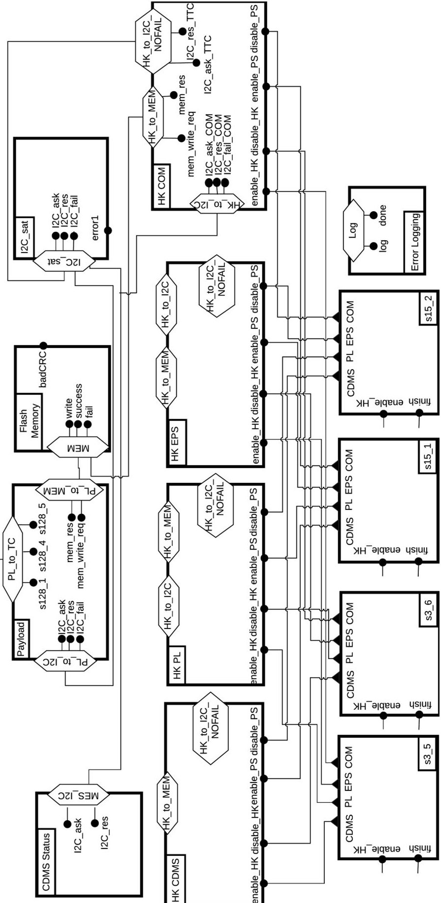

Figure B.19: The high level initial design model for the CubETH case study.

<!-- PDF_PAGE: 32 -->

## AppendixB.3. Initial design model

Figure B.19 shows a high level view of the initial design model. Such a high level design model depicts the component ports and their in-between connectors.

AppendixB.4. Requirements and properties of the running example

We present here the requirements and the derived properties of the CubETH running example.

M1:〈f1: HK PL〉shall〈a1: handle HK data from PL〉

## Derived Properties:

HK-02-P2.1 globally, occ(e1) $ \wedge $ obs(s1) precedes beg(a1)

HK-02-P2.2 globally, beg(a1) responds to occ(e1) $ \wedge $ obs(s1)

## Attribute values based on the resulting model:

occ(e1): Environment.HKPL_TBD_pass ,

beg(a1): HK_PL.beginHK

## HK-03: ' While the PS for the PL subsystem is not enabled, HK_PL shall transmit the HK data of the PL subsystem

HK-03: ' While the PS for the PL subsystem is not enabled, HK_PL shall transmit the HK data of the PL subsystem through the TC/TM service. '

P3: while <s1: PS for PL is not enabled >

M1: <f1: HK PL > shall <a1: transmit HK data through the TC/TM service >

Derived Properties:

HK-03-P3.1 globally, obs(s1) precedes beg(a1)

HK-03-P3.2 globally, beg(a1) responds to obs(s1)

Attribute values based on the resulting model:

obs(s1): HK_PL.disabledPS_PL,

beg(a1): HK_PL.ask_I2C_TTC

## HK-04: ' HK_PL shall write HK data to the flash memory, if PS for the PL subsystem is enabled. '

HK-04: ' HK_PL shall write HK data to the flash memory, if PS for the PL subsystem is enabled. P3: while <s1: PS for PL is enabled >

M1: <f1: HK PL > shall <a1: write HK data to the flash memory >

Derived Properties:

HK-04-P3.1 globally, occ(e1) precedes beg(a1)

HK-04-P3.2 globally, beg(a1) responds to obs(s1)

Attribute values based on the resulting model:

obs(s1): HK_PL.enabledPS_PL,

beg(a1): HK_PL.mem write req

*beg*(a1): HK_PL.mem_write_req

HK-05: ' HK_PL shall contact the EPS for a restart of the PL subsystem after a failure persists for [TBD] sec.' P1: if <e1: a failure of subsystem * persists for [TBD] sec >,

M1: <f1: HK PL > shall <a1: contact the EPS for a restart of PL >

## Derived Properties:

HK-05-P1.1 globally, occ(e1) precedes beg(a1)

HK-05-P1.2 globally, beg(a1) responds to obs(s1)

## Attribute values based on the resulting model:

occ(e1): Environment.HKPL_failurePers beg(a1): HK_PL.I2C_ask_EPS and their properties

<!-- PDF_PAGE: 33 -->

Figure B.20: The high level final design model for the CubETH case study.

In the high level view of the final design model, compared to that of the initial design in Figure B.19, additional connectors have been added for property enforcement. Specifically, these connectors were added between the Error Logging component and other components of the model.

<!-- PDF_PAGE: 34 -->

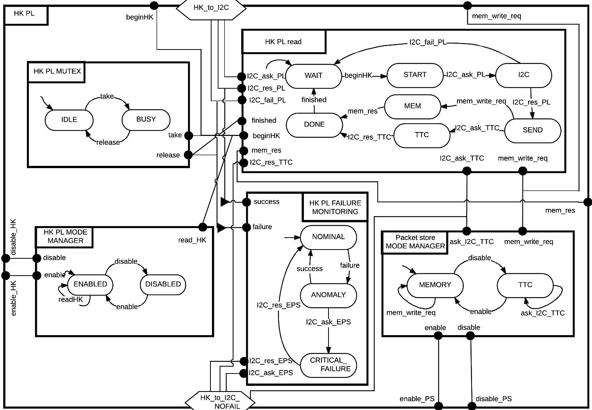

Figure B.21: The HK PL component (The HK COM and HK EPS are also like HK PL)

The requirements for the HK PL component are shown in Section AppendixB.4.

<!-- PDF_PAGE: 35 -->

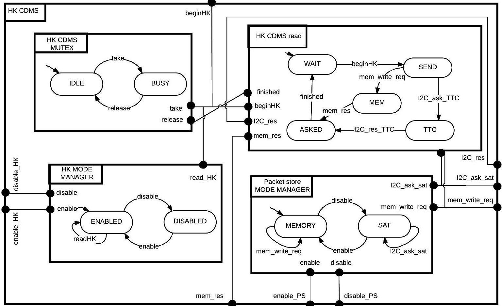

Figure B.22: The HK CDMS component

The requirements for the HK CDMS component are similar to the HK-02, HK-03 and HK-04 requirements (of HK PL component) shown in Section AppendixB.4.

<!-- PDF_PAGE: 36 -->

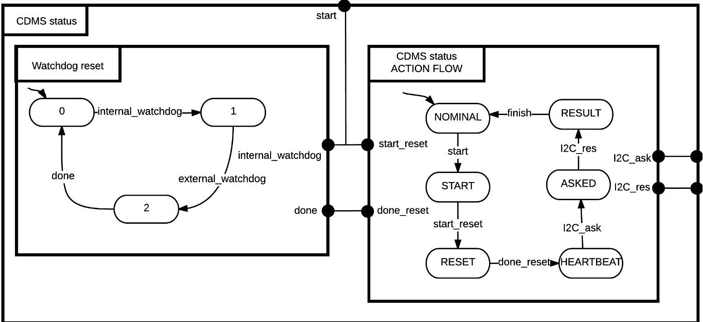

Figure B.23: The CDMS status component

CDMS-02: ' The CDMS_status shall periodically reset the internal and external watchdogs and contact the EPS subsystem with a "heartbeat".

P1: <e1: if [TBD] seconds pass >

M2: <f1: CDMS_status> shall <a1: reset the internal and external watchdogs> and <a2: contact the EPS subsystem with a "heartbeat">

<!-- PDF_PAGE: 37 -->

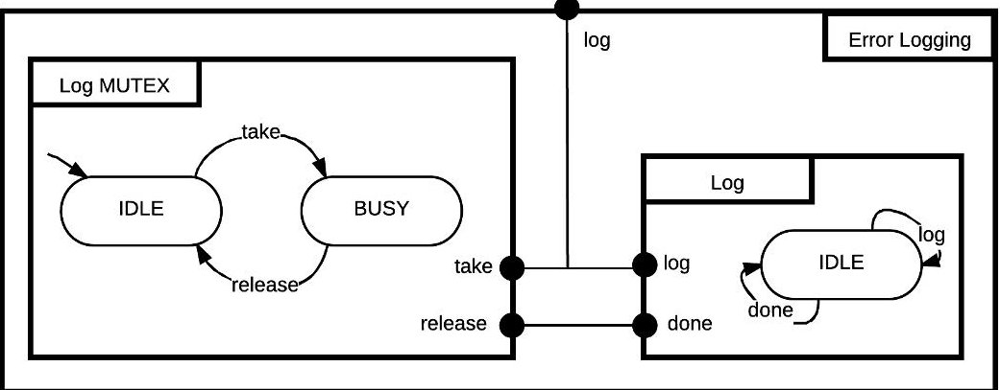

Figure B.24: The Error Logging component

Log-02: ' Error_logging shall log each hardware error to the RAM.'

P1: if <e1: a hardware error is produced >

M1: <f1: Error_logging > shall <a1: log the error to the RAM >

Log-03: ' Error_logging shall not log two errors simultaneously.

M1: <f1: Error_logging > shall <a1: log the error to the RAM >

S3: sequentially

<!-- PDF_PAGE: 38 -->

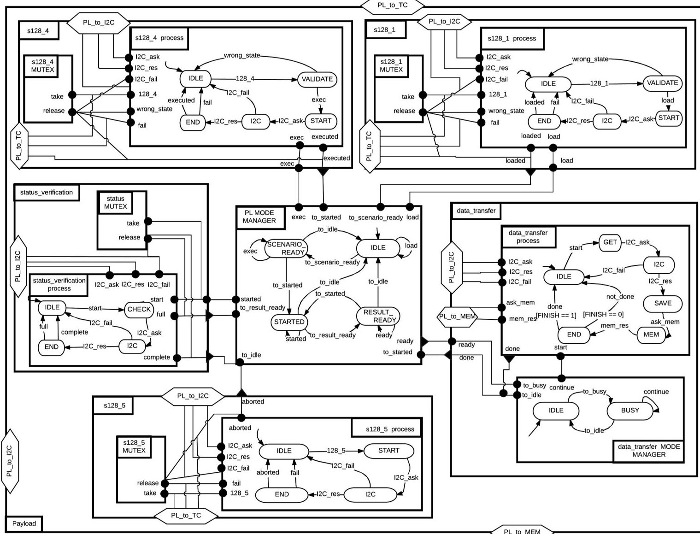

Figure B.25: The Payload component

PL-01: ' When in IDLE mode, PL shall load a scenario to the board. '

P3: while <s1: in IDLE mode>

M1: <f1: PL > shall <a1: load a scenario to the board >

PL-02: ' In SCENARIO _ READY, PL has loaded a scenario to the board.

P1: if <e1: PL has finished loading a scenario to the board >

M3:〈f1: PL〉shall〈s2: be in SCENARIO _ READY mode〉

PL-03: ' In SCENARIO _ READY, PL shall execute a scenario to the board. '

P3: while <s2: in SCENARIO _ READY mode >

M1: <f1: PL > shall <a12: execute a scenario to the board >

PL-04: ' In STARTED mode, a PL scenario has been executed. '

P1: if <e2: PL has finished executing a scenario >

M3: <f1: PL > shall <s3: be in STARTED mode >

PL-05: ' In STARTED mode, PL shall check the status of the board's internals. '

P3: while <s3: in STARTED mode>

M1: <f1: PL > shall <a3: check the status of the board's internals >

<!-- PDF_PAGE: 39 -->

<table border="1"><tr><td>PL-06:‘If the board status is full,PL shall be in the RESULT_READY mode. ’P2:if e3:the board status is found full ands5:there is data to be transferred from the boardM3:f1:PLshalls4:be in RESULT_READY mode</td></tr><tr><td>PL-07:‘In RESULT_READY,PL shall transfer data from the board to the flash memory. ’P3:whiles4:in RESULT_READYM1:f1:PLshalls4:transfer data from the board to the flash memory</td></tr><tr><td>PL-08:‘PL shall be back to IDLE mode,whenever PL aborts a board operation. ’P1:if e4:PL has finished aborting a board operationM1:f1:PLshalls1:be in IDLE mode</td></tr><tr><td>PL-09:‘PL shall not be processing two(128,1)telecommands simultaneously. ’M1:f1:PLshalls6:process(128,1)telecommandsS2:sequentially</td></tr><tr><td>PL-10:‘PL shall not be processing two(128,4)telecommands simultaneously. ’M1:f1:PLshalls7:process(128,4)telecommandsS2:sequentially</td></tr><tr><td>PL-11:‘PL shall not be processing two(128,5)telecommands simultaneously. ’M1:f1:PLshalls8:process(128,5)telecommandsS2:sequentially</td></tr><tr><td>PL-12:‘PL shall not perform two status verification tests simultaneously. ’M1:f1:PLshalls9:perform status verification tests</td></tr></table>

M1: <f1: PL > shall <a9: perform status verification tests >

S2: sequentially

<!-- PDF_PAGE: 40 -->

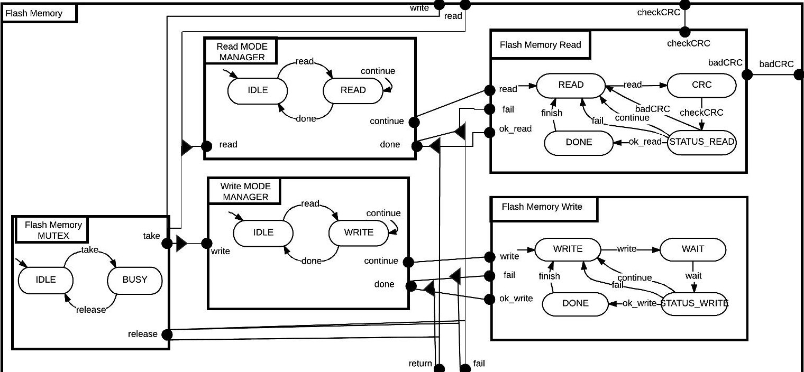

Figure B.26: The Flash Memory component

Mem-01: ' Flash memory shall process read and write operations sequentially. '

M1: <f1: Flash_memory > shall <a1: process operations >

S2: sequentially

Mem-02: 'For a write operation, the flash memory writes blocks of data the device, until all data has been written. '

P3: while <s1: a write operation is being processed>

M1: <f1: Flash_memory> shall <a2: write data to the device>

Mem-03: ' For a read operation, the flash memory reads each block of data from the device and performs the Cyclic redundancy check (CRC), until all data has been read. '

P3: while <s2: a read operation is being processed >

M2: <f1: Flash_memory > shall <a3: read data from the device > and <a6: perform the CRC >

Mem-04: ' Each read operation returns its finishing status.

P1: if <e1: a read operation begins>

M1: <f1: Flash_memory > shall <a4: return the operation's finishing status >

S1:before <e4: it has finished >

Mem-05: ' Each write operation returns its finishing status.'

P1: if <e2: a write operation begins>

M1: <f1: Flash_memory > shall <a5: return the operation's finishing status >

S1:before <e5: it has finished >

Mem-07: ' If CRC fails, the Flash memory shall reread the data from the flash memory, as long as the number of read attempts is less or equal to [MAX_FM_READS]. '

P2: if <e3: CRC fails > and <s3: the same data has been read [MAX_FM_READS] times or less >

M1: <f1: Flash_memory > shall <a6: continue reading data from the device >

Mem-08: ' If CRC fails, the Flash memory shall abandon the reading operation, as long as the number of read attempts exceeds [MAX_FM_READS]. '

P2: if <e3: CRC fails > and <s4: the same data has been read more than [MAX_FM_READS] times >

M1: <f1: Flash_memory_read > shall <a7: abort the read operation >

<!-- PDF_PAGE: 41 -->

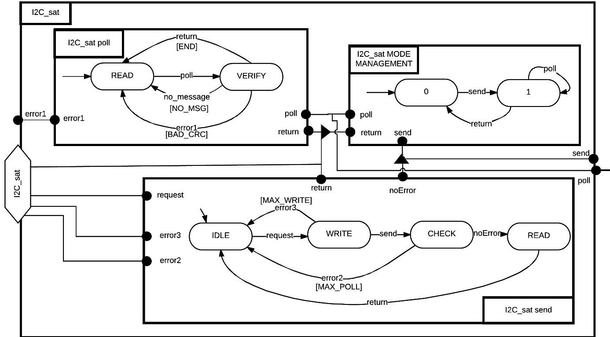

Figure B.27: The I2C _sat component

The funcitonality of the I2C_sat component is taken into account in the model, though it is not specified in the requirements. The component implements the I2C protocol, which is specified in [64].