<!-- PDF_PAGE: 1 -->

# Model-Based (MBSE) System Architecture Development for a Hybrid Inter-Satellite Communication System

Awele Ifeyinwa Anyanhun

North Carolina A&T State University

A dissertation submitted to the graduate faculty in partial fulfillment of the requirements for the degree of DOCTOR OF PHILOSOPHY

Department: Electrical and Computer Engineering Major: Electrical Engineering

Major Professor: Dr. William W. Edmonson Greensboro, North Carolina

2018

<!-- PDF_PAGE: 2 -->

ProQuest Number:10786669

All rights reserved

INFORMATION TO ALL USERS The quality of this reproduction is dependent upon the quality of the copy submitted.

In the unlikely event that the author did not send a complete manuscript and there are missing pages, these will be noted. Also, if material had to be removed, a note will indicate the deletion.

ProQuest

ProQuest 10786669

Published by ProQuest LLC (2018). Copyright of the Dissertation is held by the Author.

This work is protected against unauthorized copying under Title 17, United States Code Microform Edition © ProQuest LLC.

ProQuest LLC.

789 East Eisenhower Parkway

P.O. Box 1346

Ann Arbor, MI 48106-1346

<!-- PDF_PAGE: 3 -->

The Graduate College North Carolina Agricultural and Technical State University This is to certify that the Doctoral Dissertation of

# Awele Ifeyinwa Anyanhun

# has met the dissertation requirements of North Carolina Agricultural and Technical State University

Greensboro, North Carolina 2018

Approved by:

Dr. William W. Edmonson

Major Professor

Dr. Tonya Smith-Jackson

Committee Member

Dr. Clinton Lee

Committee Member

Dr. Zhijian Xie

Committee Member

Dr. Tony Graham

Committee Member

Dr. Fatemeh Afghah

Committee Member

Dr. John Kelly

Department Chair

Dr. Sanjiv Sarin

Dean, The Graduate College

<!-- PDF_PAGE: 4 -->

<!-- PDF_PAGE: 5 -->

Awele Ifeyinwa Anyanhun was born in Benin City, Nigeria. She received her Diploma in Computer Engineering, Bachelors of Engineering degree in Electrical/Electronic Engineering, and her Masters of Engineering degree in Electronics and Telecommunications from the University of Benin in 1999, 2005 and 2010 respectively. She worked as a lecturer in the Electrical Engineering Department at the University of Benin from 2009 to 2013.

She began her doctoral studies in Electrical and Systems Engineering at the North Carolina Agricultural and Technical State University in 2014. She was a Samuel Langley program fellow from 2015 until her graduation. She received a a mini-research grant award from the Graduate Student Advisory Council at North Carolina A&T State University. She pursued her research in the areas of Inter-Satellite Communication for Small Satellite Systems and Model-Based Systems Engineering under the direction of Dr. William W. Edmonson during which time she interned at the Jet Propulsion Laboratory, NASA Station, Pasadena, California.

The following publications are a result of work conducted during her doctoral study:

1. A. Anyanhun, and W. Edmonson "An MBSE Operational Concept Model for an Inter-Satellite Communication System", IEEE Transactions on Aerospace and Electronic Systems.

2. A. Anyanhun, and W. Edmonson "An MBSE Conceptual Design Phase Model of a VLC System for Inter-Satellite Communication", IEEE International Systems Conference, Vancouver, Canada, April 23-27 2018.

3. A. Anyanhun, and W. Edmonson "Inter-satellite communication MBSE design framework for small satellites", IEEE International Systems Conference, Montreal Canada, April 24 - 27 2017.

4. D. Amanor, W. Edmonson, and A. Anyanhun, "Visible Light Communication System for Inter-Satellite Communication of Small Satellites", Small Satellites Systems and Services Symposium, Malta, May 30-June 3, 2016.

<!-- PDF_PAGE: 6 -->

## Dedication

This research work is dedicated to God Almighty, My creator and Maker. Without Him it would have been impossible. I give Him the Glory.

<!-- PDF_PAGE: 7 -->

## Acknowledgements

I would like to express my special thanks and appreciation to my research advisor Dr. William W. Edmonson, Langley Professor and Head of the Small Satellite Systems Research Center (S3RC). You provided me with an invaluable opportunity to begin and complete this research work; Thank you for the guidance, encouragement and mentoring you provided throughout my time as your student. You groomed me into becoming a better researcher. Thank you.

I would especially like to thank all my committee members, Dr. Clinton Lee, Dr. Tonya Smith-Jackson, Dr. Zhijian Xie, Dr. Fatemeh Afghah and Dr. Tony Graham for their immense and invaluable support, and for the privilege of having each of you serve as a member of my committee. I could not have asked for a more experienced and finer group of faculty members and mentors. Thank you.

I would also like to thank Mr Eubanks of the Electrical Engineering Department at NCAT, and the late Dr. Gary Lebby who always had a word of encouragement for me and who helped me believe in myself.

My sincere appreciation goes to past and current members of the 3SRC lab at NCAT, Dr. Radhika Radhakrishnan, Dr. David Amanor, Milad Hamidi Moghassem, Mohammad Mahdi Karimi and Rafiya Chowdoury. Allan Anzagira and Nadew Kribet, I can’t thank you enough for the countless hours you spent trying to help me figure things out! I could not ask for better friends.

To my friends, Dr. Emmanuel Oleka, Samuel Jackson, Nnamdi Eyinna, Jeffrey Asumda, Thanks for all your support and all the hours spent in discourse as I navigated the treacherous road of defining my research area and scope. To Norbert Agana, Travis Williams, Bola Onagoruwa and Rita Kayode-Alabi, thanks for being friends that I could count on.

Dr. Paul Akangah, Col. MLD Saraso, Rev. Chika Ossai-Ugbah, Dr. Kingsley Momodu, Rev. Tunde Adenola - Great men with great hearts, thank you so much for cheering me on.

I am extremely grateful to my parents Michael and Prisca Onwuemene for their love,

<!-- PDF_PAGE: 8 -->

support, prayers and sacrifices throughout this incredible journey. Thanks for the countless hours of babysitting my kids; you gave me the freedom and peace of mind I needed to pursue my research work, God bless you. I also want to say a special thank you to my father-in-law and mother-in-law Thomas and Anna Anyanhun who believed in me. To my brother and his family, Chiedu and Toyosi Onwuemene, and Uchenna Onwuemene thank you for your unwavering support.

Finally to Dr. Gandhi Anyanhun, the love of my life, the wind beneath my wings, you have given me the freedom to soar; I am eternally grateful and blessed to have you as my husband, you are a rare gem. To my kids and crowning jewels, Amarise E.C Anyanhun and Jedidiah E.C Anyanhun, Thank you for being so patient and understanding, and for being my greatest fans; I love you very much.

<!-- PDF_PAGE: 9 -->

## Table of Contents

List of Figures . . . . .

<!-- PDF_PAGE: 10 -->

2.2.2 Systems Modeling Language 25

2.2.3 MBSE Modeling Tools 28

2.2.4 MBSE System Model 29

2.3 Architectural Frameworks 30

2.3.1 Brief Overview of Architectural Frameworks 31

2.3.2 Defense Based Architectural Frameworks 33

2.3.3 Enterprise Architectural Framework 34

2.3.4 Space-based system of systems 34

2.3.5 Reference Architecture for Space Data Systems (RASDS) 34

2.3.6 MBSE - Based Architectural Framework 35

2.3.6.1 Viewpoint 36

2.3.6.2 Views 36

2.3.6.3 Perspective 36

2.4 Evolution of Small-Satellite Systems 36

2.4.1 Small Satellite Trends & Challenges 37

2.4.2 ISC in Small Satellite Systems 38

2.4.3 Open System Interconnection (OSI) Reference Model 39

CHAPTER 3. ISC Architectural Framework 42

3.1 Introduction 42

3.2 MBSE Based Architectural Framework Development 43

3.3 ISC Architectural Framework for Small Satellite Systems 43

3.3.1 ISC-AF Context View 45

3.3.2 ISC-AF Viewpoint Relationship View 47

3.3.3 ISC-AF Ontology Definition View 50

3.3.3.1 Ontology for the ISC Architecture Concept 50

3.3.3.2 Ontology for the ISC Requirement Concept 52

3.3.3.3 Ontology for the ISC System Concept 53

<!-- PDF_PAGE: 11 -->

3.3.4 ISC-AF Viewpoint Definition View 55

3.3.5 ISC-AF Rule Definition View 56

3.3.6 Chapter Summary 56

CHAPTER 4. ISC Domain Specific Profile 58

4.1 Introduction 58

4.2 MBSE & Domain Specific Profiles 58

4.3 Profile Requirements 59

4.3.1 Profile Requirements for Requirement Constructs 60

4.3.2 Profile Requirements for Behavior Constructs 61

4.3.3 Profile Requirements for Structural Constructs 61

4.3.4 Profile Requirements for Link Budget Modeling 63

4.4 ISC-VL System Domain Specific Profile 63

4.4.1 Stereotypes that Support Modeling of System Requirements 65

4.4.2 Stereotypes that Support Modeling the Systems Behavior 68

4.4.3 Stereotypes that Support Modeling the Systems Structure 69

4.4.4 Stereotypes that Support Modeling of System Constraints 72

4.5 Conformance to Profile Modeling Requirements 73

4.6 Chapter Summary 73

CHAPTER 5. ISC Concept Engineering Phase 74

5.1 Introduction 74

5.1.1 Model based Systems Engineering 74

5.1.2 MBSE Life-Cycle Model 75

5.2 Concept Engineering 76

5.2.1 Model Based System Concept Development 77

5.3 Concept of Operations Model 78

5.3.1 Mission Description 79

5.4 Project Scope 81

<!-- PDF_PAGE: 12 -->

5. 4.1 Identify Stakeholder Needs . . . . .

<!-- PDF_PAGE: 13 -->

5.6.8 Add/Update Missing Requirements 111

5.6.9 Defining Assumptions 112

5.6.10 Identifying Constraints 112

5.7 ConOps Maturation and Phases 113

5.8 Chapter Summary 113

CHAPTER 6. ISC Requirements Engineering Phase 115

6.1 Introduction 115

6.2 Requirements Engineering 116

6.2.1 Requirements 117

6.2.2 Characteristics of Good Requirements 118

6.3 Model-Based Requirements Specification Using SysML Diagrams 120

6.3.1 Requirements Table 121

6.3.2 Requirements Diagram 121

6.3.3 Requirements Relationships 122

6.4 ISC Requirements Engineering 123

6.4.1 General Requirements Analysis 124

6.4.1.1 System-Level General Requirement Specification 125

6.4.1.2 System Derive Requirement Matrix 126

6.4.1.3 Stakeholder General Requirements Relation Map 127

6.4.2 Provide Data Relay Use Case Requirements Analysis 128

6.4.2.1 System Requirement Specification 129

6.4.2.2 Data Relay System Derive Requirement Matrix 130

6.4.2.3 Data Relay Requirement Relation Map 131

6.4.3 Perform Ranging Service Use Case Requirements Analysis 132

6.4.3.1 System Requirement Specification 133

6.4.3.2 System Derive Requirement Matrix 133

6.4.3.3 Ranging Requirement Relation Map 134

<!-- PDF_PAGE: 14 -->

6.4.4 Timing Service Use Case Requirements Analysis 135

6.4.4.1 System Requirement Specification 136

6.4.4.2 System Derive Requirement Matrix 137

6.4.4.3 Timing Service Requirement Relation Map 137

6.4.5 ISC Requirements Glossary 138

6.4.6 Chapter Summary 139

# CHAPTER 7. High-Level ISC Architecture Design 140

7.1 Introduction 140

7.1.1 Overview 141

7.2 Small Satellite Systems 141

7.2.1 OSI Framework for ISC 142

7.2.1.1 End systems: 142

7.2.1.2 Intermediate Systems: 143

7.2.2 The MBSE ISC Design Approach 143

7.3 ISC High-Level System Model 145

7.3.1 High-Level System Functional Analysis Phase 145

7.3.1.1 High-Level Use Case 145

7.3.1.2 Transmit & Receive Use Case Functional Flow 147

7.3.1.3 Transmit & Receive Use Case Scenario 148

7.3.1.4 Transmit & Receive Use Case State Machine 151

7.3.2 High-Level System Architectural Design 152

7.3.2.1 ISC High-Level Architecture (BDD) 153

7.3.2.2 ISC High-Level Architecture IBD 155

7.4 Communication Subsystem Model 157

7.4.1 VLX System Functional Analysis Phase 157

7.4.1.1 VLX System Use Case Context 157

7.4.1.2 VLX System Scenario Analysis 158

<!-- PDF_PAGE: 15 -->

7. 4.1.3 VLX System Functional Flow Analysis . . . . .

<!-- PDF_PAGE: 16 -->

## List of Figures

Figure 1 Inter-Satellite Communication between Small Satellites 4

Figure 2 System Architecture Tetrad [48] 8

Figure 3 Limitations of Document-Centric SE Approach [60] 10

Figure 4 MBSE V-Model of System Development Life Cycle 12

Figure 5 The Vee Model [3] 18

Figure 6 The Spiral Model [119] 19

Figure 7 The Incremental Model [40] 20

Figure 8 The Hybrid Model [40] 21

Figure 9 The Harmony aMBSE Delivery Process [40] 26

Figure 10 SysML Taxonomy 27

Figure 11 Collage of SysML Diagrams [136] 29

Figure 12 Various Views of a System Model [137] 30

Figure 13 DoDAF Framework [39] 33

Figure 14 CCSDS Reference Architecture for Space Data System (RASDS) [116]) 35

Figure 15 CubeSat sizes of 1U, 1.5U, 2U, and 3U [100] 38

Figure 16 Inter-satellite Communication between Small Satellites 39

Figure 17 The OSI Model for Small Satellites (adapted from [130]) 40

Figure 18 The ISC-AF Viewpoints (adapted from [62]) 45

Figure 19 Context View showing the ISC-AF Context viewpoint 46

Figure 20 Viewpoint Relationship View showing the ISC-AF Perspective (adapted from [62]) 47

Figure 21 Viewpoint Relationship View showing the ISC-AF Requirement Perspective 49

Figure 22 Viewpoint Relationship View showing the ISC-AF System Perspective 50

Figure 23 Ontology Definition View for the AF Concept 51

Figure 24 Ontology Definition View for the ISC Requirement Concept 52

<!-- PDF_PAGE: 17 -->

Figure 25 Ontology Definition View for the ISC System Concept . . . . .

<!-- PDF_PAGE: 18 -->

Figure 51 Data Relay Off-Nominal Scenario 99

Figure 52 Activity Diagram for Data Relay Use Case 100

Figure 53 Stakeholder Requirements Allocation 102

Figure 54 Ranging Service Nominal Scenario 103

Figure 55 Ranging Service Off-Nominal Scenario 104

Figure 56 Activity Diagram for Ranging Use Case 105

Figure 57 Allocation of Requirements to Timing Services Use case 107

Figure 58 Timing Service Nominal Scenario 108

Figure 59 Timing Service Off-Nominal Scenario 109

Figure 60 Timing Service Activity Diagram 110

Figure 61 Verification, Validation and Test (VVT) Plan Activity Diagram 111

Figure 62 Deficient Requirements Engineering [64] 117

Figure 63 Model-based Requirements Engineering 120

Figure 64 SysML Requirement Model Element 122

Figure 65 SysML Requirement Relationships 123

Figure 66 Stakeholder General Requirements 125

Figure 67 General Requirements Derive Matrix 127

Figure 68 General Requirements Relation Map 128

Figure 69 Data Relay Use case Requirements 129

Figure 70 Data Relay Derive Matrix 131

Figure 71 Data Relay Relation Map 132

Figure 72 Ranging Service Use Case Requirements 133

Figure 73 Ranging Service Derive Requirement Matrix 134

Figure 74 Ranging Service Relation Map 135

Figure 75 Timing Service Use case Requirements 136

Figure 76 Timing Service Derive Matrix 137

Figure 77 Timing Service Relation Map 137

<!-- PDF_PAGE: 19 -->

Figure 78 Small Satellite Systems Taxonomy . . . . .

<!-- PDF_PAGE: 20 -->

## List of Tables

Table 1 Model Quality 6

Table 2 Comparison Between Model-Centric and Document-Centric SE [59] 11

Table 3 NASA Project/System Life-Cycle Phases [21] 17

Table 4 System Architecture Model vs. Analytical Model [59] [34] 31

Table 5 NASA Small spacecraft classifications 37

Table 6 NASA Small spacecraft classifications 39

Table 7 ISC-AF Viewpoint Definition View 55

Table 8 System Requirements Profile Stereotypes 67

Table 9 Profile Requirement Stereotypes 67

Table 10 Profile Behavior Stereotype Types 68

Table 11 System Behavior Profile Stereotypes 69

Table 12 System Structure Profile Stereotypes 70

Table 13 Profile Structure & Data Stereotype Types 71

Table 14 System Constraints Profile Stereotypes 72

Table 15 Concept of Operations Standards & Definitions) 77

Table 16 Provide Data Relay Services Use case Description 95

Table 17 Provide Navigation Services Use case Description 101

Table 18 Timing Services Use case Description 106

Table 19 Stated Assumptions 112

Table 20 Summary of Constraints 113

Table 21 Requirement Table 121

Table 22 General Requirements Specification 126

Table 23 Data Relay Requirements Specification 130

Table 24 Ranging Requirements Specification 134

<!-- PDF_PAGE: 21 -->

Table 25 Timing Service Requirements Specification 136

Table 26 ISC Requirements Glossary 138

Table 27 Transmit Data Use Case Description 146

Table 28 Receive Data Use Case Description 147

Table 29 VLX-Subsystem Functions & Behavior Allocation 161

<!-- PDF_PAGE: 22 -->

## Abstract

Small satellite systems are fast becoming very attractive for space science exploration especially in low earth orbit due to their more cost-effective benefits. However, the constraints placed on these satellites in terms of their form factor, mass and power requirements, limit their usefulness and effectiveness for highly complex missions. Furthermore, the limited capability of the communication system of these satellites remains the most significant hurdle to their optimal utilization. Confronted with these challenges, our goal is to develop a system architectural model based on model-based systems engineering (MBSE) approach and principles, that can be used to capture, analyze and describe the communication system design equipped with inter-satellite communication capability for high-speed data relay. In this dissertation, we develop a high-level system architectural model for inter-satellite communication among a constellation of small satellites utilizing a hybrid visible light and X-band communication system. First, a model-based architectural framework is developed for defining the behavioral and structural aspects of an ISC system architecture to ensure a rigorous architectural design process is adhered to. Second, a domain-specific profile that extends the Systems Modeling Language (SysML) is developed for enabling the capture of ISC system domain information with a higher degree of precision, leaving less room for interpretation. Third, a high-level system architecture model is developed consisting of a conceptual phase design model capturing the concept of operations for the proposed ISC system; a system-level requirements model defining unambiguous, consistent, attainable and verifiable ISC system requirements that are located in the central model repository. Finally, following the definition of ISC system requirements, the high-level system architecture model is developed; the communication system model is defined for the communication-oriented layers (physical, data-link and network layers) of the Open System Interconnection (OSI) reference model. The developed system architecture model captures the system behavior, structure and parametric. The high-level architecture model lays the groundwork for our future work which entails the development of models for the detailed design phase of the design life-cycle.

<!-- PDF_PAGE: 23 -->

## CHAPTER 1

## Introduction

There is an emerging trend towards the use of small spacecraft to perform science, surveillance and engineering demonstration mission [120]. This emerging trend is due largely, to a growing interest among the science community in using distributed systems of small satellites to enhance observations for earth and space science [85]. The concept of deploying multiple small spacecraft with inter-satellite communication (ISC) capabilities is a step towards realizing the potentials previously accomplished by larger monolithic spacecraft. Inter-satellite communication between formation flying small spacecraft in low earth orbit (LEO) can be realized using visible light communication (VLC) [6]. However, it is not technically wise nor economically practical to build a communication system without first creating a system architectural model that when implemented will not violate the size, mass, and power (SMaP) constraints of the small spacecraft. Standardized CubeSats have strict size, power and mass constraints due to their form factor [105].

Defining a systems architecture is a critical step in the development of any complex system. System Architecture - depending on the context in which it is used, refers to either the Architecture of a System - i.e a model used to describe or analyze a system or System Architecting - the method or process used to build the architecture of a system. The purpose of system architecture activities is to define a comprehensive solution based on principles, concepts, and properties logically related, and consistent with each other [11]. This process helps to describe consistently and design efficiently complex systems. Systems architecting is a response to the conceptual and practical difficulties associated with the description and design of complex systems [53]; failure to accurately define a systems architecture prior to build often results in unwanted emergent system characteristics that will impact system cost significantly.

The creation of an architectural model that will describe the system architecture of an inter-satellite communication system will provide a way to effectively understand, design and

<!-- PDF_PAGE: 24 -->

manage the communication system. Currently, visible light communications for space systems is a new and emerging trend necessitating the need to develop a system architecture that can adequately define the structure, properties, behavior, relationships (between elements) and multiple views of the system. Developing a comprehensive system model that captures the systems architecture will provide stakeholders with the ability to visualize the entire system, assess different options and communicate designs more clearly before taking on risks - (technical, financial, or otherwise) of actual construction.

This research presents a System Architecture Model for an inter-satellite communication system between small satellite systems utilizing visible light communications and radio frequency communications based on a model-based systems engineering approach. In particular, this research focuses on four phases of the system development life-cycle; these phases include the Conceptual Design Phase, Requirements Analysis Phase, High-Level Architecture Phase and a subset of the Detailed Design Phase. Furthermore, given the complex nature of the communication system to be developed, a model based inter-satellite communication architectural framework (ISC-AF) is developed. This framework can be regarded as a set of guidelines, patterns or rules used to delineate the architecture of an ISC system; It specifies the way and manner in which the fundamental organization of the ISC system architecture can be presented. Accordingly, a domain specific (DS) profile is also created to support high-level abstractions of the system architecture and enable reusability by transforming system concepts into a collection of self-contained modules.

## 1.1 Overview

1. 1.1 Inter - Satellite Communication The desire for Visible Light Communications is driven by the desire for better communication performance. VLC technology is an emerging green technology in the field of wireless communication using visible light. It is a subset of optical wireless Communication (OWC) and as a communication medium, uses the visible light portion of the electromagnetic spectrum (750THz) or 400nm to (428 THz) or 700nm for transmission. LEDs are used as transmitters in this communication technology while photodiodes or image sensors are used as receivers. VLC technology opens the door for many new applications to be realized because

<!-- PDF_PAGE: 25 -->

of some amazing advantages it possesses such as a free and unregulated spectrum band, significantly less power consumption per given transmission due to the utility of LEDs and substantially higher data rates than radio frequency (RF). Also, visible light signals pose no electromagnetic interference to other onboard electronics.

Current research and development for implementing inter-satellite communication links (ISLs) consist of either laser technology or RF. Currently VLC using LEDs has been successfully demonstrated between satellite and ground as captured in [90], but not much has been done in utilizing VLC as an alternative to RF and laser technologies for short ISLs. Substantive work has been done in capturing the Open System Interconnection (OSI) physical layer design of a VLC system for ISC in [6] [4] [5]. This work demonstrates the feasibility of implementing VLC for communication among small satellites using LEDs as portrayed in Figure 1. However, a systematic and rigorous approach has not been taken in developing a comprehensive architecture for an inter-satellite communication system between small satellites that can utilize visible light via LEDs, and that can be analyzed and assessed for implementation.

1. 1.2 System Architecture Modeling The term MBSE describes an approach to Systems Engineering that emphasizes a system architecture model as the primary work artifact throughout

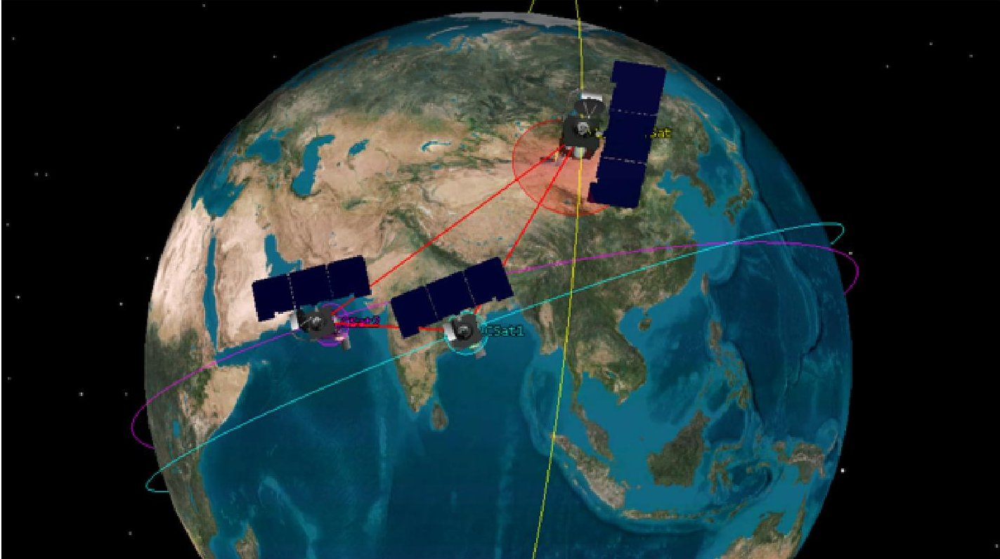

Figure 1. Inter-Satellite Communication between Small Satellites

<!-- PDF_PAGE: 26 -->

the system development life-cycle. The International Council of Systems Engineers (INCOSE) defines MBSE as "the formalized application of modeling to support system requirements, design, analysis, verification, and validation activities beginning in the conceptual design phase and continuing throughout development and later life cycle phases [32]." MBSE combines traditional systems engineering practices with rigorous modeling techniques.

Currently considered as a best practice approach to the specification, design, analysis and verification of a complex system [98]; it leads to early identification of requirement issues oversight, enhanced system design integrity and improved specification of allocated requirements to both hardware and software. Employing an MBSE approach to the design of any complex system will ensure that there will be fewer errors during integration and testing while also providing more rigorous requirements traceability. Furthermore, with the MBSE approach, all diagrams and auto-generated artifact are merely views of the underlying system model and not the model itself [35]. When using a model-based approach, the modeling language is used to define the requirements architecture, system design, and system architecture. MBSE provides a structured approach for the development of system models; Its current focus is on the use of architecture models (functional architecture and physical architecture) as a basis for the development of physical system models and operational system models. The methodologies employed by MBSE utilize the process of creating artifacts that describe the system-of-interest from an architectural perspective. This research work intends to employ a model-based approach to the system architecting activity and for capturing the architecture of the system.

Development of a systems architecture involves defining key aspects of the proposed system. An architecture is a stable, high-level mapping of functions to form that embodies the concept of a system [117]; this process begins with the transformation of a set of needs and goals into an architecture for the system. System architecture provides an effective way to understand, manage and overcome the challenges complexity introduces to the system design process. The architecture of a system can be represented in many ways through the use of models and modeling languages [125]. A model as defined by the authors in [83], is an approximation, representation

<!-- PDF_PAGE: 27 -->

Table 1. Model Quality

<table border="1"><tr><td>GOAL</td><td>DEFINITION</td></tr><tr><td>Correctness</td><td>Adhering to language syntax, rules, style, naming guidelines and semantic correctness relative to the domain.</td></tr><tr><td>Completeness</td><td>Defined as having all necessary information that is relevant, and being detailed enough to support the purpose of the model. Requirement and analysis models are defined as complete when they specify all the black-box behavior of the modeled entity.</td></tr><tr><td>Consistency</td><td>The model should have no contradictions. It covers consistency between views or diagrams that belong to the same level of abstraction or development phase (horizontal consistency), and between models or diagrams that represent the same aspect, but at different levels of abstraction or in different development phases (vertical consistency).It also covers semantic consistency between models; i.e., the same element does not have multiple meanings in different diagrams or models.</td></tr><tr><td>Comprehensibility</td><td>The Model should be understandable by the intended users, either human or tools.Aspects that impact comprehensibility include aesthetics of diagrams, organization of a model, model simplicity or complexity, using concepts familiar for the users or selected from the domain ontology, and finally using the correct type of diagram for the intended audience.</td></tr><tr><td>Confinement</td><td>Defined as the ability to maintain the right abstraction level;A model is a description from which detail has been removed intentionally;a confined model does not have unnecessary information and is not more complex or detailed than necessary</td></tr><tr><td>Changeability</td><td>Defined as the ability to support changes or improvements so that models can be changed or evolved rapidly and continuously.</td></tr></table>

or idealization of selected aspects of the structure, behavior, operation or other characteristics of a real-world process, concept or system. Models can also be described as a collection of all the artifacts that describe a system [20]. A vital feature of a model is that it is an abstraction and hence can be represented in many forms. Model quality can be ascertained by following a set of six goals commonly referred to as the 6 C's of MBSE [88]; These model quality goals portrayed in Table 1 were addressed during the development of the VLC system architecture model.

Maintaining design consistency is critical to the design of complex systems, a lack of consistency can lead to budget and scheduling overruns.

## 1.2 Motivation

Small satellite communication subsystems are becoming increasingly complex, particularly with the emergence of more challenging small satellite mission architectures. Current mission architectures necessitate the need for inter-satellite communication between small satellites; These communication system architectures are challenging to model, design, and optimize because they

<!-- PDF_PAGE: 28 -->

are highly restricted by the Satellite's form factor, must operate under uncertain environmental conditions and accomplish ambitious goals. There is the need for rigorous and automated system-level modeling and simulation capabilities to support the design of an ISC system concept. Described in this research work is an executable MBSE system architecture model which is a structured representation that focuses on the overall system requirements, behavior, structure, properties, and interconnections for a VLC system for inter-satellite communication between small satellites.

This section highlights the theoretical and practical relevance of developing an executable system architecture model with emphasis on the conceptual design, requirements analysis and high-level system architecture phases of development using an MBSE approach. The focus then turns to the challenges of the traditional Document Based Systems Engineering (DBSE) approach in developing a VLC communication system architecture for small satellites. The system architecture model developed in this research work is a direct response to these challenges.

1. 2.1 Relevance of MBSE to System Architecture Definition The goal of MBSE is to simplify the complexity of developing and managing complex systems by the use of models. Defining a systems architecture with MBSE processes provides the system designer with a rigorous means for capturing and integrating system requirements, design analysis, and verification information. It also fosters communication between team members, enhanced system design analysis, increased reuse, and early detection of errors.

The MBSE process emphasizes a system architecture model as the primary work artifact of the system design life-cycle as portrayed in Figure 2; the model represents both physical and logical perspectives of the system, and model visualization is provided by appropriate diagrams defined in the OMG Systems Modeling Language (OMG SysML $ ^{\mathrm{TM}} $ ). MBSE through the application system modeling is used to define a robust system architecture and predict the emergent behavior and properties of a design [97]. In [50], the benefits system architecting activities derive from an MBSE approach are listed. They include:

## Enhanced Communication

<!-- PDF_PAGE: 29 -->

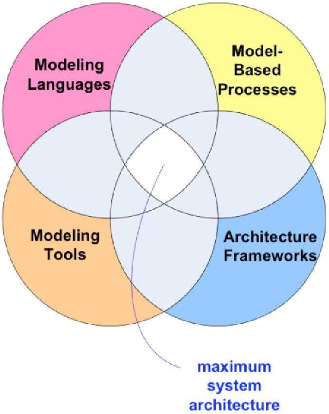

Figure 2. System Architecture Tetrad [48]

A major benefit derived from using MBSE is that it provides an avenue to clearly communicate the system design using a language that all stakeholders can understand. MBSE employs the use of models and a common system language as a way to mitigate ambiguity and promote consistency across the whole team. It enhances communication by providing a complete representation of the system in a single data repository. Furthermore, it helps to manage complexity by viewing the system at various levels of abstraction and provides the ability to integrate views of the system from multiple perspectives.

## Reduced Development Risk

The MBSE process and supporting tools help system designers develop a cohesive and coherent system design that is quantifiable and easily shared by a variety of stakeholders; it also supports continuous and ongoing requirements validation and design verification activities. This provides a baseline architecture design that helps to mitigate risks associated with system development. MBSE has also been shown to provide more accurate cost estimates to develop the system [125].

<!-- PDF_PAGE: 30 -->

## Improved Quality

MBSE facilitates rigorous traceability between requirements, design, and analysis which corresponds to an improvement in the quality of the system architecture. The inherent traceability leads to a more complete and unambiguous system model. Also MBSE enhances design integrity by the use of a single model repository which eliminates redundancy and model inconsistency.

## Increased Productivity

A major advantage of using an MBSE approach for system architecting is the ease with which a design change can be implemented. It allows for immediate feedback on change assessments or impact analyses. A benefit that also improves overall productivity is the potential for reuse of existing models to support design evolution. MBSE provides automated document generation so the current state of the design can instantly be captured with emphasis placed on developing the system instead of formatting the documentation [125].

This research work explores a model-based approach to defining a systems architecture with application to a Visible Light Communication System for inter-satellite communication between small satellites. Its purpose is to look at considerations required for a system level design.

1. 2.2 Limitations of Document-Based SE in System Architecture Definition Systems engineering since its inception has found its application in solving complex engineering problems. Traditionally, systems engineering has relied on document-centric methods and approach to solving complex problems. The underlying principle of such an approach is to use documents as an avenue of communication between stakeholders and also between members of the system design team. However, as the nature of systems engineering challenges change significantly and systems increase in complexity the document-centric approach has proven to be grossly inadequate in solving complex systems engineering problems as depicted in Figure 3. Some major limitations of this approach include:

- Difficulty maintaining consistency among documents especially during the stakeholder

<!-- PDF_PAGE: 31 -->

requirement definition phase, the requirement analysis and high-level architecture phases considering that changes are inevitable during this phases of the system development life-cycle.

- Extracting useful information from a pile of documents is tedious and time-consuming.

- Management of design information becomes cumbersome due to large amounts of information being spread across multiple documents.

- Documents are the highest source of information concerning the requirements, constraints, architecture, designs, decisions and other information about the system. But documents can become outdated, disconnected, or even contradictory.

- Most document-based system engineering approaches that focus on distributing and performance requirements are subject to significant cost and schedule overruns.

Limitations of Document Approach

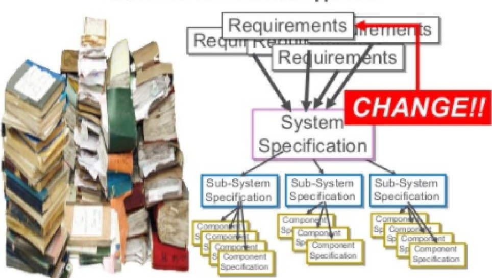

Once the first wave of specifications have been generated, changes are very painful. As such, specifications are never revised. Instead, an avalanche of "TQ"s (technical queries) ensues.

Figure 3. Limitations of Document-Centric SE Approach [60]

A comparison between the model-centric and document-centric approach to defining system architectures is portrayed in [59]; Table 2 outlines these differences. The need for reduced development cycle time, lower development cost, and increased reliability necessitates the

<!-- PDF_PAGE: 32 -->

mandatory application of system architecture models throughout the system design process [16]. The overriding need for defining the architecture of new technological concepts using system models while avoiding the limitations and drawbacks of a document-based approach forms the motivation for this research work.

Table 2. Comparison Between Model-Centric and Document-Centric SE [59]

<table border="1"><tr><td></td><td>DOCUMENT BASED</td><td>MBSE BASED</td></tr><tr><td>Information</td><td>Mostly TextAdd Hoc DiagramsAdd Hoc Diagramsrepeated in multiple documents</td><td>Visual and TextualConstructs Defined once and re-usedShared across DomainsConsistent notation in diagramsDefined relationships</td></tr><tr><td>Information Views</td><td>By Document</td><td>Provides ViewpointsFilters By Domain, Problem Space, etc.</td></tr><tr><td>Measuring Change Impact</td><td>Spans across Multiple DocumentsOften Text Requirements are isolated from Structure and Behavior</td><td>Relationships define traceability pathsNatural part of the modeling processProgrammatically Automated</td></tr><tr><td>Measuring Integrity, Completeness, Quality &amp; Accuracy</td><td>By manual inspection.</td><td>Programmatically AutomatedAnimation of Specification</td></tr></table>

## 1.3 Research Scope

The system architecture definition process occurs within the context of a larger system development life cycle. A system life-cycle can be described as a view of a system that addresses all phases of its existence from the system conception phase through design and development, production, maintenance, retirement and system phase-out, and disposal [92]. Figure 4 depicts a modified version of the "V-model of the system development life-cycle termed the "MBSE

<!-- PDF_PAGE: 33 -->

V-model" life cycle design process. This diagram incorporates elements from the INCOSE systems engineering handbook [58], Forsberg [89], Blanchard [24], Forder [47]. The MBSE V-model is a representation of the life-cycle processes that can be applied to the development of a complex system based on MBSE principles.

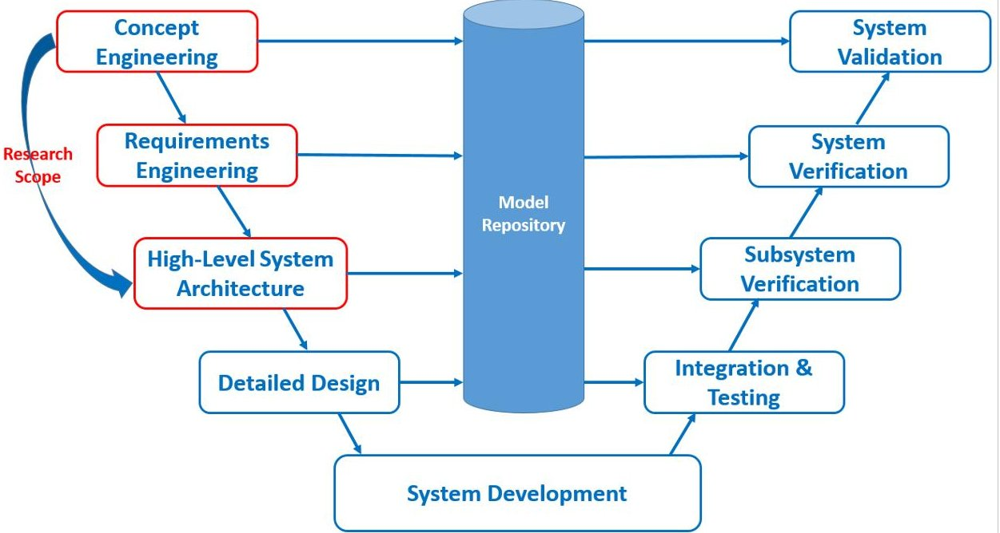

Figure 4. MBSE V-Model of System Development Life Cycle

System development begins in the upper left with concept engineering definition phase and concludes at the upper right with system commissioning, operation, and support. Each phase of the left side of the V beginning at the concept engineering phase up to the detailed design phase is captured rigorously through modeling, the created models act as the primary data source and are centrally stored in a model repository. Each life-cycle phase is iterative, and as stakeholders, systems engineers and designer trade between desired capabilities and technical constraints, the ability to effect these changes and measure their impact across the system's life-cycle is considered facile. System development, testing, verification, and validation occur on the right side of the V as the system takes shape.

Defining the system architecture of the VLC system early in the life-cycle can improve requirements traceability, enhance communication, and augment the decision-making process. In designing a systems architecture, it is imperative to focus on how to choose an architecture

<!-- PDF_PAGE: 34 -->

that meets stakeholder needs, integrate easily and evolve flexibly. Therefore the primary focus of this research work encompasses the first three life-cycle phases of the left side of the MBSE V-model with the aim of defining a system architecture for a visible light communication system for inter-satellite communication between small satellites that will capture the overall system requirements, behavior, structure, properties, and interconnections.

## 1.4 Dissertation Contribution

Our primary objective is to develop a system architecture for a visible light communication system for inter-satellite communication between small satellites. Currently, there is no system architecture model created using a model-based approach that defines the conceptual design, requirement specification and high-level system architecture of a VLC system as a single artifact in a model repository, which is the focus of this dissertation. The initial focus of our work is on applying MBSE principles to the design of a communication system for inter-satellite communication. The unique contributions of this dissertation are listed below.

- Develop a generic model-based systems engineering inter-satellite communication architectural framework (ISC-AF) that can be applied to model ISC system architectures for small satellites (CubeSats). We define the ISC-AF as a set of Viewpoints and an Ontology. The ISC-AF is regarded as a set of guidelines, patterns or rules used to delineate the architecture of an ISC system. It provides the structure necessary for describing ISC system and subsystem architectures. It is essentially made up of five Viewpoints that conform to the ISC-AF Ontology. It enables a model-based expression of elements and relationships which are the defined by the framework. The developed AF is generic and modular in design such that it is capable of supporting a variety of ISC system architectures.

- Create an MBSE domain specific profile for modeling visible light communication systems. We develop a domain-specific profile based on the Systems Modeling Language (SysML). The profile transforms specific system concepts into a collection of self-contained modules that enable reusability resulting in a deriving a great number of architecture solutions without

<!-- PDF_PAGE: 35 -->

the need for a complete system redesign.

- Create a high system architecture model based on the ISC-AF for inter-satellite communication between small satellites. We develop as the primary artifact of the MBSE approach, an integrated, coherent and consistent system model stored in a model repository. This model captures the ISC system requirements specification, the high-level system architecture design in terms of its structure and behavior; it also includes system analysis provided through parametric diagrams and system verification through simulations. The system model provides a traceable system design which facilitates traceability and change impact assessments.

## 1.5 Dissertation Outline

The remainder of this dissertation is outlined as follows: Chapter 2 presents a review of literature relevant to this work. Necessary background information required to grasp basic concepts of systems engineering, MBSE, architectural models, architectural frameworks, small satellites systems and the OSI reference model will be covered in this section. Chapter 3 presents the inter-satellite communication architectural framework (ISC-AF) in detail. The ISC-AF is regarded as a set of guidelines, patterns or rules that delineate the architecture of an ISC system. Defined in the framework are a set of views that are required for describing an ISC architecture between small satellites. Presented in Chapter 4 is a customized domain specific SysML profile developed for the VLC system domain. The developed profile provides a series of constructs that support the modeling of the VLC system requirements, structure, behavior and parametric. In Chapter 5, the conceptual engineering phase activities and artifacts for the VLC system are presented. These include a model-based concept of operations capturing the scope definition activities. Conclusion and Future work is presented in Chapter 6.

<!-- PDF_PAGE: 36 -->

## CHAPTER 2

## Literature Review

## 2.1 Systems Engineering Principles

Systems Engineering (SE) is an interdisciplinary field that emerged as an effective way to manage complexity and change in systems. System engineering is considered a process necessary to successfully design and operate a complex system. It is based on a holistic perspective of problems and design. It focuses on customer needs and required functionality [79]. Systems engineering involves system specification, development and verification activities. It provides system-level oversight during the development of a complex system and hence is distinct from discipline-specific engineering. A key point to note is that despite the fact that systems engineering may define requirements allocated to these specific engineering disciplines, It does not specify the design or technology used within them except, perhaps at a high level. Systems engineering is defined in the Systems Engineering Book of Knowledge (SEBOK) [11] as an "interdisciplinary approach and means to enable the realization of successful (engineered) systems [32]. It focuses on holistically and concurrently understanding stakeholder needs, exploring opportunities, documenting requirements and synthesizing, verifying, validating and evolving solutions while considering the complete problem. SE concentrates on defining and documenting system requirements in the early development phase, preparation of the system design, and the verification of the system. The holistic approach used by SE as against specific disciplines also involves obtaining solutions to problems that emerge only as a result of the newly developed system [132]. The SE perspective is based on systems thinking.

2. 1.1 Systems Thinking Systems thinking is a unique perspective on reality - a perspective that sharpens the awareness of wholes and how the parts within those wholes interrelate. When a system is considered as a combination of system elements, systems thinking acknowledges

<!-- PDF_PAGE: 37 -->

the primacy of the whole (system) and the primacy of the relation of the interrelationships of the system elements to the whole [70]. Systems thinking is an essential skill set shared with many disciplines and provides a vital intellectual underpinning for systems engineering. It uses models to make sense of complex problems. According to [69], Systems thinking enables a system engineer look at problems from different viewpoints. It is considered a skill set that enables a better understanding of the deep roots of complex system behavior to better predict and adjust their outcomes. Since uncertainty is an inevitable attribute of a complex system, system thinking provides a platform that enables system engineers deal with uncertainty in complex systems. In [10] systems thinking is defined as a system in itself. They describe system thinking as a "system of thinking." Systems thinking is a necessity for everyone in a decision making role. The term systems thinking was coined by Barry Richmond in 1981 [104].

2. 1.2 System life Cycle Phases The project life-cycle is broken down into life-cycle phases. Every system has life-cycle phases that encompass the sequential phases of requirements identification, development, production, use and retirement. A system life cycle is the sum of all activities of the different phases. In [108], The four phases of a generic system life cycle include:

(a) Phase 1 - pre-acquisition: In this phase business needs are confirmed and supported by a business case. Research & Development (R&D) funds are spent in this phase.

(b) Phase 2 - Acquisition Phase: This phase is focused on bringing the system into being. Business, stakeholder and system requirements are defined in this phase.

(c) Phase 3 - Utilization Phase: The engineered system is operated and supported during this phase. The system can also undergo modifications in this phase depending on its stated capability or the need to adjust its usage.

(d) Phase 4 - Retirement Phase: This phase comes into being when the system is no longer cost effective or if there is no further use of the system.

The NASA systems life-cycle consists of seven phases [92] The phases of the systems life-cycle are shown in Table. 3 The life-cycle begins with phases associated with designing (the

<!-- PDF_PAGE: 38 -->

formulation phases) and includes Pre-Phases A through C. Phase B ends with a preliminary design of a single system, and marks a turning point in the process where significant resources and design effort will be required to complete the design and the remainder of the project phases. The design is completed in Phase C. The latter part of Phase C through Phase F are associated with realizing the physical product - so are called implementation phases - beginning with the procurement and fabrication, assembly of subsystems from components and parts, integration of subsystems to create the system, and continuing on through operations and onto phase-out [21].

Table 3. NASA Project/System Life-Cycle Phases [21]

<table border="1"><tr><td>PHASE</td><td>PHASE TITLE</td><td>PURPOSE</td><td>END of PHASE REVIEW</td></tr><tr><td>Pre-Phase A</td><td>Concept Studies</td><td>Produce a broad spectrum of concepts and ideas, establish mission objectives and draft system-level requirements</td><td>Mission Concept Review(MCR)</td></tr><tr><td>Phase A</td><td>Concept and Technology Development</td><td>From multiple approaches develop a single system concept for the mission, with system requirements and architecture. Perform trade studies and identify needed technologies.</td><td>System Definition Review(SDR)</td></tr><tr><td>Phase B</td><td>Preliminary Design and Technology Completion</td><td>Establish a preliminary design, with subsystem requirements, interfaces, and with technology issues resolved.</td><td>Preliminary Design Review(PDR)</td></tr><tr><td>Phase C</td><td>Final design and Fabrication</td><td>Complete the design and drawings, purchase or manufacture parts and components, code software.</td><td>Critical Design Review(CDR)</td></tr><tr><td>Phase D</td><td>System Assembly, Integration and Test Launch</td><td>Assemble subsystems, integrate subsystems to create systems, test to verify and validate performance, deploy the system.</td><td>Readiness Review(RR)</td></tr><tr><td>Phase E/F</td><td>Operations and Sustainment/Close out</td><td>Operate System,decommissioning, disposal</td><td>Decommissioning Review</td></tr></table>

2. 1.3 Systems Engineering Process The systems engineering process (SEP) is a comprehensive, iterative and recursive problem-solving process that includes both management and technical processes. A process is defined as a logical sequence of tasks performed to achieve a particular objective. This life cycle process is achieved by applying a set of life-cycle building blocks which are the fundamental building blocks for engineering any kind of complex system

<!-- PDF_PAGE: 39 -->

irrespective of the specific life cycle methodology used. In each life cycle phase, SE teams follow processes to define complex systems. These process usually begin with requirement analysis and culminate in the certification and validation of the system. Several alternative processes exist for organized system engineering development and management. Life-cycle process models describe the engineering process across a systems life-cycle. Some common life-cycle process models include the Vee, spiral [119], incremental [40] and hybrid [40] life-cycle models.

(a) The Vee Life Cycle Model: The Vee model and its variants address the basic set of systems engineering (SE) activities. The model portrayed in Figure 5 depicts the levels of development as a system evolves from the concept of operations (CONOPS) and user requirement identification stage, through detailed design and verification to final system validation. The Vee Model encompasses the first three life cycle stages listed in the "Generic Life Cycle Stages" table of the INCOSE Systems Engineering Handbook: exploratory research, concept, and development (INCOSE 2012).

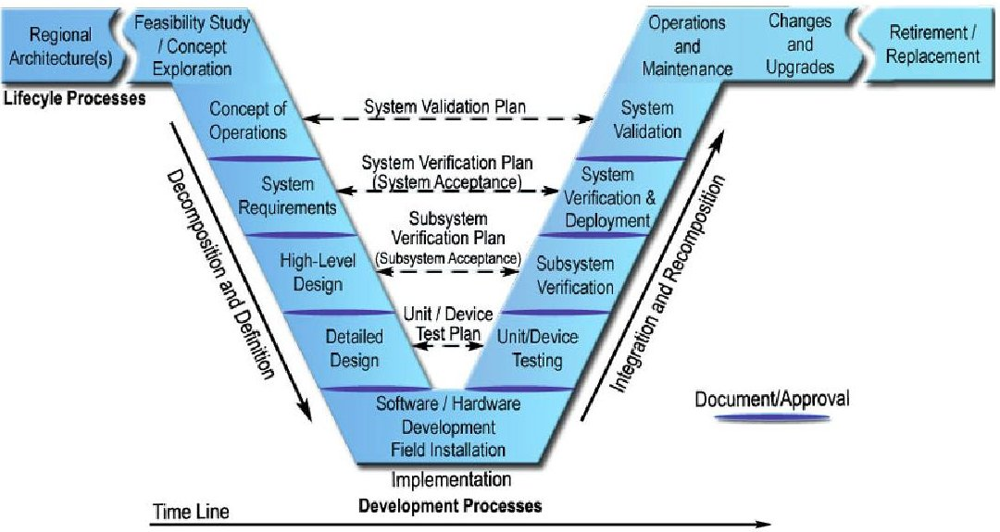

Figure 5. The Vee Model [3]

(b) The Spiral Life Cycle Model: The spiral life-cycle model is a system development method that can be made up of the same phases as the Vee model but explicitly accounts for risk and re-evaluation. Defined by Barry Boehm in his 1988 article titled "A Spiral Model of Software Development and Enhancement [25] , the spiral model emphasizes risk analysis with regard

<!-- PDF_PAGE: 40 -->

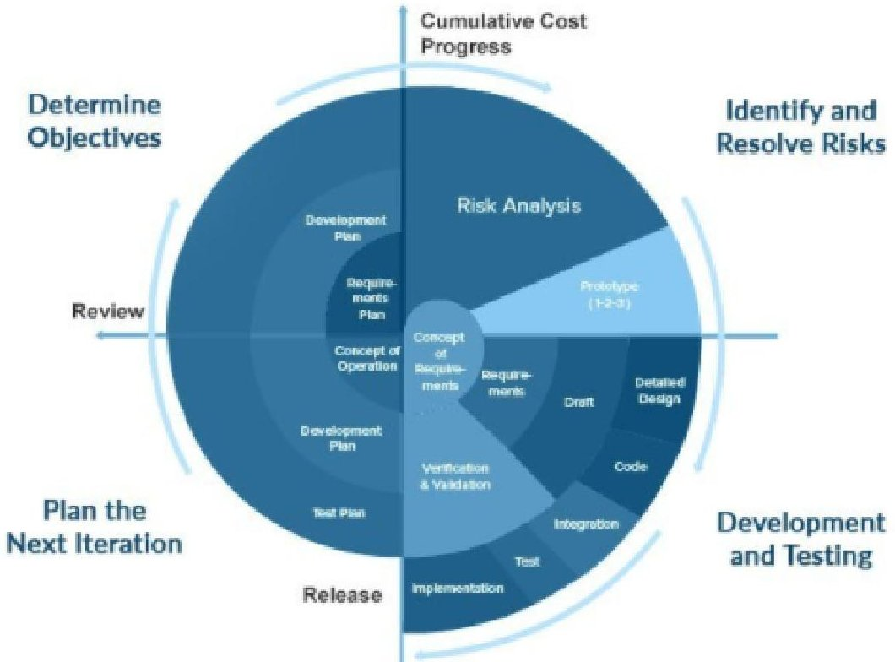

Figure 6. The Spiral Model [119]

to systems engineering activities. The generic spiral model consists of four phases: Planning, Risk analysis, Engineering, and Evaluation. The general spiral development model illustrated in Figure 6 consists of four phases of systems engineering activities: planning, risk analysis, engineering and customer review. System projects repeatedly pass through these four phases of iterations (called spirals). This life cycle model is ideal for large projects because it is capital intensive and hence will prove too costly for smaller projects. It is also well fitted for projects where the requirements are complicated and require continuous clarification. A key characteristic of this systems engineering process is the benefit of faster and shorter development periods.

(c) The Incremental Life Cycle Model: This model features a "depth-first approach " meaning a relatively narrow slice of system functionality which is based on a set of requirements is taken through all design activities to produce a version of the system that is verified and validated before incrementally adding the next slice of system functionality. This method is based on two assumptions:

<!-- PDF_PAGE: 41 -->

(a) The use cases implemented in one iteration are independent from those in other unrealized use cases.

(b) The amount of work necessary to re-factor existing designs and implementation to accommodate the new functionality is much less than to implement the new functionality,

For mechanical or electronic engineering systems, the presence of real-world constraints (such as weight, mass and power) makes this model less suitable because of long lead times needed to create physical parts [40]. An example of the Model is illustrated in Figure 7

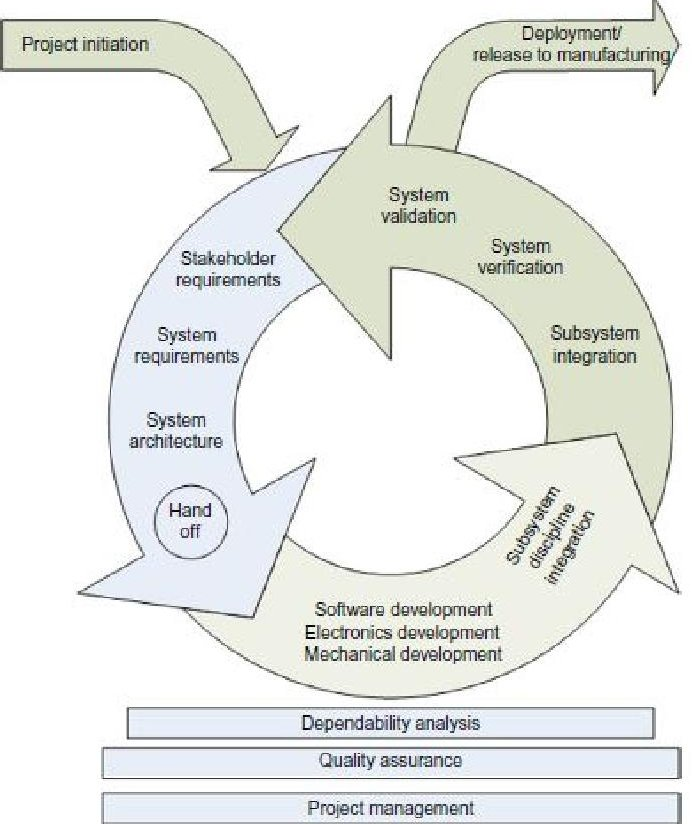

Figure 7. The Incremental Model [40]

(d) The Hybrid Life Cycle Model: The hybrid life cycle model shown in Figure 8 consists of three interconnected cycles with hand-offs between them. The nature of the system being developed and its associated risk determines the number of system specification cycles that will be performed. With this model, system engineers can continue to work on the next system iteration while downstream engineers design and implement the current iteration,

<!-- PDF_PAGE: 42 -->

and test engineers verify and validate the previous iteration [40].

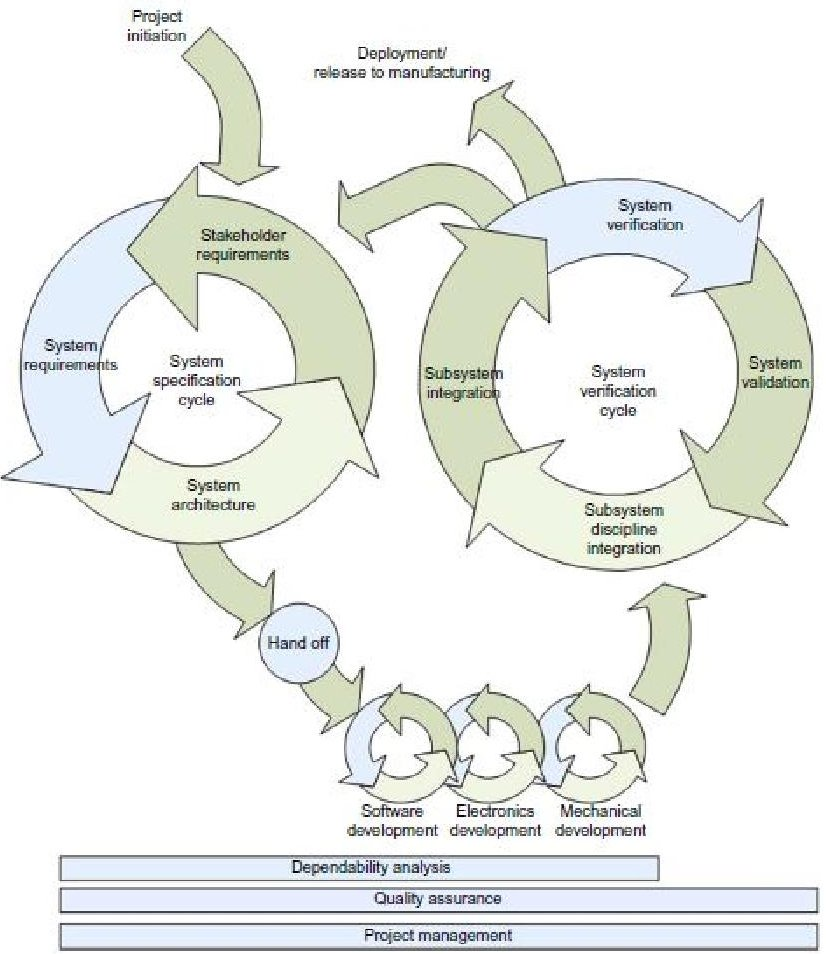

Figure 8. The Hybrid Model [40]

2. 1.4 System Related Concepts In systems engineering, a System can be broadly defined as an integrated set of elements that accomplish a defined objective. It comprises of system elements, interconnections (interactions) between elements and an external system boundary. From a systems engineering perspective, A system is said to result from a deliberate design and must be managerially and operationally independent. The international standard organization ISO 15288 -systems and software engineering life cycle processes [1] defines a system as "a combination of interacting elements organized to achieve one or more stated purposes. The INCOSE definition of a system is taken directly from this standard. The United States Department of Defense (DoD) also define a system as a "functionally, physically and or behaviorally related group of regularly interacting or interdependent elements; that group of elements forming a unified whole. Elements are the building blocks of systems, and they can comprise of hardware, software, personnel,

<!-- PDF_PAGE: 43 -->

policies, facilities documents, and databases. In the systems engineering domain, a system is also defined as one that delivers an operational capability. A system can be divided into a hierarchy of sets of elements that include subsystems, components, subcomponents and parts. Some system related concepts include:

2. 1.4.1 System-of-Interest (SoI) At a conceptual level, a system can be considered as a System of Interest (SOI). The International Council for Systems Engineering (INCOSE) [32] defines a system of interest as "The system whose life cycle is under consideration. According to [131], an SOI is defined as "the system consisting of a mission system and its support system(s) assigned to perform a specific objective. Furthermore, ISO/IEC/IEEE 15288 [1] takes a hierarchical view by describing it as "the top system in the system structure which also consists of lower-level systems. Hitchins in [76] provides a definition by stating that a system of interest "contains intra-connected subsystems which are systems in their own right existing within their own environment."

2. 1.4.2 System-of-Systems (SOS) Another system related concept is the emerging system-of-systems concept which is defined as the large-scale integration of many independent, self-contained systems in order to satisfy a global need. A system of systems is defined by INCOSE as an interoperating collection of components systems that produce results unachievable by the individual systems alone. In the US Department of Defense DoD guidelines, a system of systems (SoS) is defined as "A set or arrangement of systems that result when independent and useful systems are integrated into a larger system that delivers unique capabilities. The generalization relationship exists between a system and a SoS according to the US DoD definition. This relationship is elaborated by the statement "although a system-of-systems is a system, not all systems are system-of-systems." [18] Also a SoS can be described as the bringing together of a set of systems to perform a specific task or group of tasks that can not be performed by each individual system on its own [1].

<!-- PDF_PAGE: 44 -->

## 2.2 Model Based Systems Engineering

The concept of applying a model-based approach to the practice of Systems Engineering (SE) brought about the advent of model-based systems engineering. The growing complexity in all areas of system development has increased the need for the systems engineering discipline; however, in order to be effective, systems engineering must provide an organized, repeatable, iterative and convergent approach to developing complex systems [80]. An apt and simplified definition of SE given in [38] states that "Systems Engineering can be defined as the practice of engineering from the systems viewpoint ". Extending this definition, we can define MBSE as the practice of engineering from a systems viewpoint using models. MBSE has as its main artifact a system model that contains all relevant information required to completely and consistently describe, verify and validate a system. This system model which can be better qualified as computer-interpretable models as stated in [103] forms the distinguishable difference between the document-centric approach and model-centric approach to the practice of systems engineering.

As accurately stated in [62], to get a good understanding of MBSE, one must of necessity have a good and unambiguous definition of systems engineering. Based on the definition of SE by INCOSE, the realization of successful systems should be the expected outcome. INCOSE goes further to define MBSE as "The formalized application of modeling to support system requirements, design, analysis, verification & validation activities beginning in the conceptual design phase and continuing throughout development and later life cycle phases ". Paraphrasing the above definition to concisely capture our expectation, we define MBSE as the "Formalized application of modeling to enable the realization of successful systems ". The benefits of implementing an MBSE approach in either defining an Architectural Framework (AF) or in the development of successful systems include the realization of a model that comprises a coherent and consistent set of views that reflect multiple viewpoints of the system [62]. Other benefits associated with the application of effective MBSE include: automatic generation and maintenance of system documents, complexity control, and management, consistency of information, inherent traceability, simpler access to information, improved communication regarding language, concept and terminology and increased

<!-- PDF_PAGE: 45 -->

understanding between stakeholders. According to [35], MBSE is made up of three pillars: a modeling language, a modeling method, and a modeling tool.

2. 2.1 MBSE Methodology A modeling methodology refers to a documented set of design tasks that are performed in order to create a system model. In [45], a comprehensive survey of MBSE methodologies is provided. The author defines a methodology as a collection of related processes, methods and tools [86]. Considering modeling methods span all stages of the systems engineering life cycle and, not all stages are necessary for every project, modeling methods will need to be tailored to meet specific needs [35]. A modeling methodology is necessary for guiding the development of a system model by providing a roadmap (set of design tasks) for all team members to ensure that consistency, guidance, and fidelity is built into the system model. Examples of MBSE methodology include The "INCOSE Object-Oriented Systems Engineering Method and "IBM Rational Unified Process for Systems Engineering."

2. 2.1.1 Object Oriented Systems Engineering Method (OOSEM) The Object-Oriented Systems Engineering Method (OOSEM) integrates a top-down model-based approach that uses OMG SysML to support the specification. design and verification of systems. OOSEM leverages object-oriented concepts to help architect more flexible and extensible systems. OOSEM is also intended to ease integration with object-oriented software development, hardware development and test. OOSEM includes the following development activities:

- Analyze Stakeholder Needs

- Define System Requirements

- Define Logical Architecture

- Synthesize Candidate Allocated Architectures

- Optimize and Evaluate Alternatives

- Validate and Verify the System

2. 2.1.2 Rational Unified process for Systems Engineering (RUP SE) The Rational Unified Process for Systems Engineering (RUP SE) is a methodology that is both a process

<!-- PDF_PAGE: 46 -->

framework and a process product. RUP was created to address the needs of systems engineering projects with an objective to apply discipline and best practices of the RUP for software development to the challenges of system specification, analysis, design and development [27]. The goal of RUP is to help organizations improve the quality of systems being built by reducing associated risk and cutting costs. Its design enables teams systematically define, organize, communicate and manage requirements in a timely manner.

2. 2.1.3 Agile Model-Based Systems Engineering (aMBSE) Method Though the Agile methodology has its origin in software development, in recent times the agile methodology has become as much a systems engineering method as a software development method. Agile methods emphasize optimizing product quality alongside engineering efficiency; the primary goal of agile systems engineering is to develop specifications that can drive downstream engineering to create a system that meets the customer's needs [40]. The agile MBSE methodology is one that emphasizes the SE-process, which should be flexible regarding rethinking and modifying solutions and concepts and so adapting them to recent developments and findings [56]. Agile MBSE is about being efficient, focusing on delivering quality in the work and being adaptive to change. The Harmony agile MBSE (aMBSE) delivery process is shown in Figure 9. Bruce Douglas in his book Agile Systems Engineering [40] lists key benefits of agile methods to systems engineering:

- Improved quality of engineering data

- Improved engineering efficiency

- Early return on investment (ROI)

- Satisfied stakeholders

- Increased project control

- Responsiveness to change

- Earlier and greater reduction in project risk

2. 2.2 Systems Modeling Language The Object Management Group (OMG) Systems Modeling Language (SysML) [96] is a specialized UML (Unified Modeling Language) profile

<!-- PDF_PAGE: 47 -->

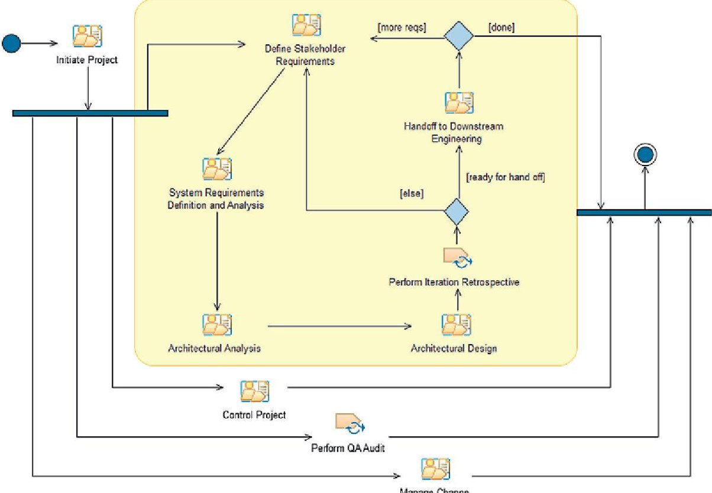

Figure 9. The Harmony aMBSE Delivery Process [40]

targeted at systems engineering and is used as a domain-specific graphical modeling language for MBSE. As a general graphical modeling language, it supports the analysis, design, and verification of complex systems and system-of-systems (SOS) including hardware, software, information, personnel, procedures, and facilities in a graphical notation. SysML enables the practice of MBSE, it is method independent and is used in the creation of system models irrespective of the particular methodology employed. As a key enabler for MBSE, SysML is the Architectural Description language (ADL) of choice and the standardized medium of communication for systems engineers [35]. Furthermore, as a modeling language, SysML provides graphical representations based on a semantic foundation for modeling system requirements, structure, behavior and parametric elements which are used to integrate with other engineering analysis models. According to [121] SysML can be distinguished from conventional drawing and simulation tools in three specific ways:

- SysML accommodates the capture and description of numerical values and qualities through the use of international organization for standardization (ISO) quantities, units, values and

<!-- PDF_PAGE: 48 -->

dimension standards.

- The strength of SysML is in its robust semantics and detailed capture of formal specifications.

- Once a system is rendered in SysML, the model provides a coherent body of knowledge about the system.

The SysML diagram taxonomy is shown in Figure 10. It provides a good overview of the categories and relationships between SysML diagrams. The generalization relationship conveys information about the diagrams. It illustrates that Activity Diagrams, Sequence Diagrams, State Machine Diagrams and Use Case Diagrams are types of behavior diagrams. Block Definition Diagrams, Internal Block Diagrams and Package Diagrams. Parametric Diagrams are type of ibd. Requirement Diagrams are a type of SysML diagrams. SysML uses the concept of the "block" as the basic unit structure of representation.

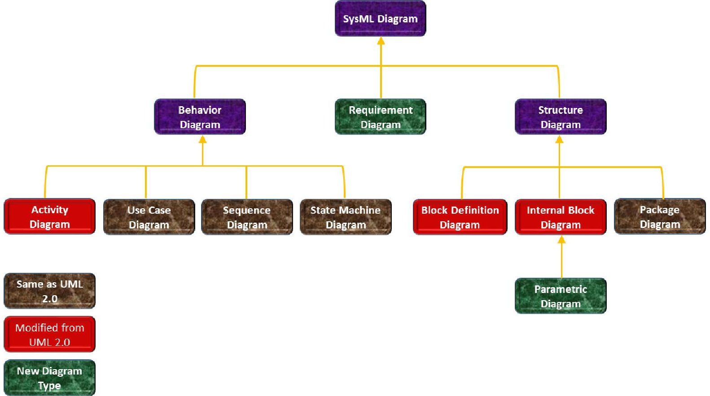

Figure 10. SysML Taxonomy

The SysML Diagrams includes:

(a) SysML Use Case Diagram: Conveys the use cases that a system performs.

<!-- PDF_PAGE: 49 -->

(b) SysML Activity Diagram: Specify system behavior with a focus on the flow of data and control between activities

(c) SysML Sequence Diagram: Specify system behavior with a focus on interactions between collaborating parts of the system

(d) SysML State Machine Diagram: Specify system behavior with a focus on identifying system states and the transitions occurring in response to events in the system

(e) SysML Block Definition Diagram: Displays elements such as blocks and value types and relationships between those elements.

(f) SysML Internal Block Diagram: Specifies the internal structure of a block, showing the connections between internal parts and the interfaces between them.

(g) SysML Requirements Diagram: Identifies requirements hierarchies and derivation. Satisfy and verify relationships allow a requirement to be related to a model element that satisfies or verifies the requirements. This diagram acts as the connection between typical requirements management tools and system models.

(h) SysML Parametric Diagram: Identifies constraints on system property values such as performance, reliability and mass properties. It provides the ability to integrate the specification and design models with engineering analysis models.

An Allocation Relationship is also supported within SysML which represents allocating functions to components, logical to physical components, and software to hardware.

2. 2.3 MBSE Modeling Tools Modeling tools are a special class of tools that are designed and implemented to comply with the rules of one or more modeling languages [113], enabling you to construct well-informed models in those languages. Modeling tools are distinct from diagramming tools in that diagramming tools help create diagrams with no model underlying those diagrams that can ensure automated consistency between them. In contrast, modeling tools such as MagicDraw [82], Papyrus [42] and IBM Rational Rhapsody [68] are used to create models which comprise a set of elements and relationships between elements as portrayed in collage shown in the Figure 11. With modeling tools, when an element on a diagram is modified the tool modifies

<!-- PDF_PAGE: 50 -->

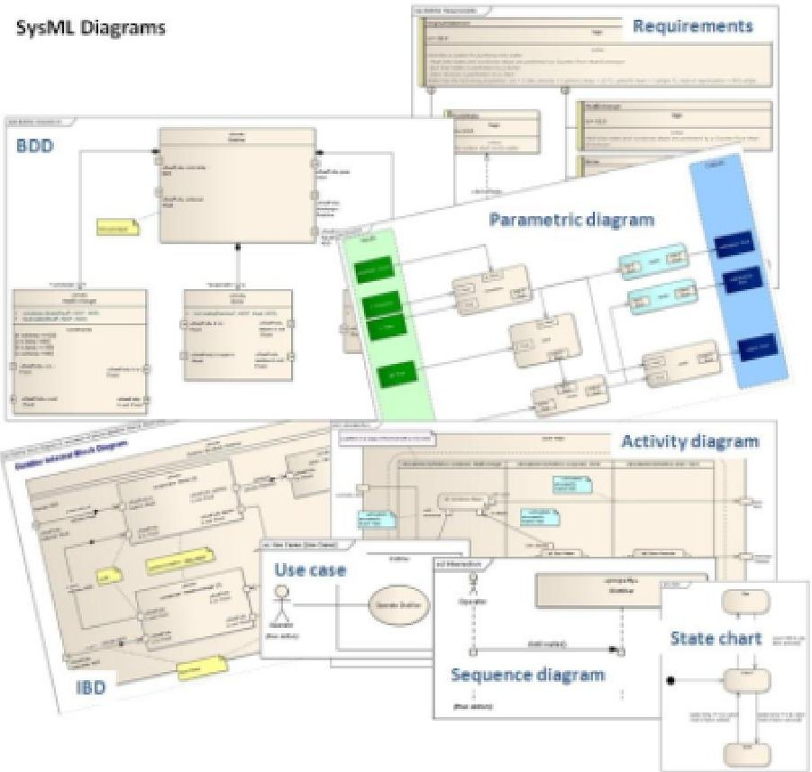

Figure 11. Collage of SysML Diagrams [136]

the element not only on the diagram but also in the underlying model. The modeling tool then instantaneously updates all other diagrams that display that same element. This powerful capability illustrates the difference between modeling tools and diagramming tools.

2. 2.4 MBSE System Model An MBSE system model can be described as a structured representation of a system with a focus on the overall system requirements, behavior, structure, properties, and interfaces. A system model provides a hub for data integration and analysis and provides insight into architectural and system level decisions [59]. A system model created using a model-based systems engineering approach serves as a single source of information at the system level.

The system model serves as a guide for system development and provides a reference for detailed design to reduce system failure during development. In [41] a system model is described as an interconnected set of model elements that represent four aspects of system design namely: the structure, behavior, requirements and parametric captured in a single model as depicted in Figure 12. Also represented, are the logical relationships between key system concepts such as

<!-- PDF_PAGE: 51 -->

design, analysis, verification, and validation. In [34] a comparison of analytical and systemic approaches to system design is provided. The author states that though both approaches (model) are more complementary than opposed, yet neither is reducible to the other. Developing analytical models is more suited for homogeneous systems which are composed of similar elements that have weak interactions among them. This approach is inadequate for highly complex systems; highly complex systems consist of diverse elements linked by strong interactions and as such an approach that considers such a system in its totality is required. The fundamental difference that exists between system models and analytical models are captured in Table.4.

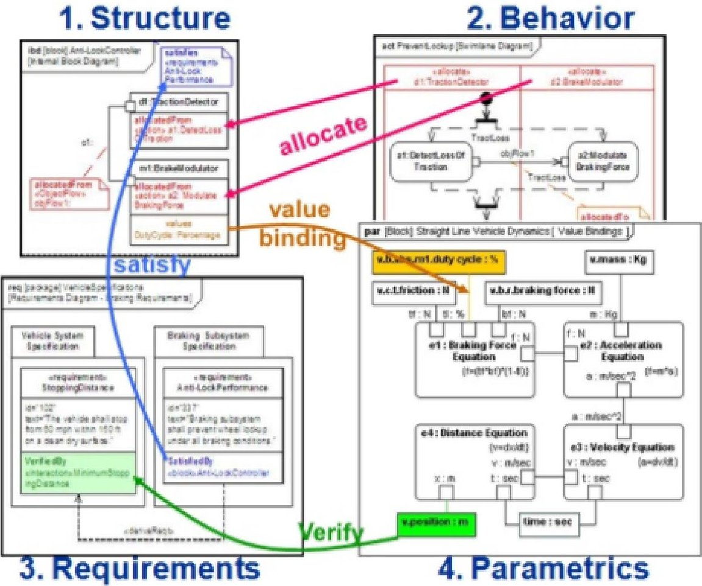

Figure 12. Various Views of a System Model [137]

## 2.3 Architectural Frameworks

Central to the SE and MBSE practice is the concept of architectural frameworks and architectures. These MBSE enabling concepts prove beneficial in the design and management of complex systems. ISO/IEC/IEEE 42010 [72] Systems and software engineering is an International

<!-- PDF_PAGE: 52 -->

Table 4. System Architecture Model vs. Analytical Model [59] [34]

<table border="1"><tr><td>System Architecture Model</td><td>Analytic Model</td></tr><tr><td>Emphasize how pieces fit together into a consistent whole</td><td>Emphasize specific aspects of performance consistent with the Architecture Model</td></tr><tr><td>Repository-based to support capture of inter-relationships</td><td>Mathematically-based to computation or simulation</td></tr><tr><td>Used to capture - functions, behavior - structure, components - objects, info flow interfaces, ports, Interactions, scenarios</td><td>Reduce risks through analysis, validation and optimization of: MoM, MOE, MOP, KPP, TPM timing, probability of hit/survival reliability/availability, MTBF cost, total cost of ownership</td></tr><tr><td>Emphasizes global perception</td><td>emphasizes the precision of details</td></tr><tr><td>Unifies and concentrates on the interaction between elements</td><td>Isolates, then concentrates on the elements</td></tr><tr><td>Validates facts through comparison of the behavior of the model with reality</td><td>Validates facts by means of experimental proof within the body of a theory</td></tr><tr><td>has an efficient approach when interactions are nonlinear and strong</td><td>Has an efficient approach when interactions are linear and weak</td></tr><tr><td>uses models that are insufficiently rigorous to be used as bases of knowledge but are useful in decision and action</td><td>uses precise and detailed models that are less useful in actual operation</td></tr></table>

Standard for architecture descriptions of systems and software. It is an Information source for architectures, architecture descriptions & architecture frameworks. According to ISO/IEC 42010, an architectural framework is defined as "Conventions, principles and practices for the description of architectures established within a specific domain of application and/or community of stakeholders." It defines an architecture as "The fundamental concepts or properties of a system in its environment embodied in its elements, relationships and in the principles of its design and evolution ".

2. 3.1 Brief Overview of Architectural Frameworks An Architectural Framework (AF) refers to a standard set of elements that enable and facilitate the description of architectures in a

<!-- PDF_PAGE: 53 -->

complete, consistent, homogeneous and unambiguous way and provides guidance on how to create such descriptions [30]. As stated in [62] an AF is not in itself an architecture, but it defines a set of views that are required to describe an architecture. Furthermore, an AF helps provides clarity about how a system in a specific domain is developed. In [61] it is aptly stated that the fundamental goal for developing an architectural framework is to promote interoperability and to codify a common set of architectures to prevent the need to re-invent the wheel each time an architecture is required to guide the design of a system. Put forward in [15] are a set of common goals for architectural frameworks. These goals include:

(a) Architecture Process - employ a well-defined process to guide the construction of architecture.

(b) Architecture Evolution Support - employ a framework that supports systems evolution.

(c) Architecture Analysis - provide a set of viewpoints to guide the collection and analysis of information for making architecture choices.

(d) Architecture Models - provide consistent standards to document architecture specifications for the planning, management, communication and execution of activities related to system development.

(e) Design Trade-offs - select a design from more than one design choices by resolving multi-dimensional conflicting requirements.

(f) Design Rationale - document reasons behind design decisions for verification, i.e. "architect for a reason" ([Bass et al. 2003]).

(g) Standardization - ensure development and architectural standards are maintained.

(h) Architecture Knowledge Base - provide consistent representation and repository of design and architecture design rationale.

(i) Architecture Verifiability - provide sufficient information or explanation in the architecture design for review and verification.

These goals aid in providing an actual set of guidelines for the selection and use of architectural frameworks. As such, resulting architecture models produced by architectural frameworks would

<!-- PDF_PAGE: 54 -->

provide consistent representation of architecture models [124]. A few Examples of existing AFs based on utility are outlined:

2. 3.2 Defense Based Architectural Frameworks Defense-based AF are designed to support defense operations and activities. The most common defense-based AF is the United State Department of Defense AF (DoDAF) [127]. The DoDAF provides a foundational framework for developing and characterizing architecture descriptions. DoDAF incorporates three views: Operational View (OV), Systems and Services View (SV), and Technical Standards View (TV). These views are depicted in Figure 13 and provide the basis for deriving measures of performance and interoperability. The command, control, communication and computer Intelligence Surveillance and Reconnaissance (C4ISR) defense group first adopted the idea of implementing an AF for their activities. Other defense organizations around the world have also adopted the defense based AF paradigm and have developed their standards. Other defense-based AFs include The UK Ministry of defense (MODAF) standard [87], NATO defense standard (NAF) [93], AGATE AF from France, Canada's DNDAF, MDAF from Italy and ADOAF from Australia.

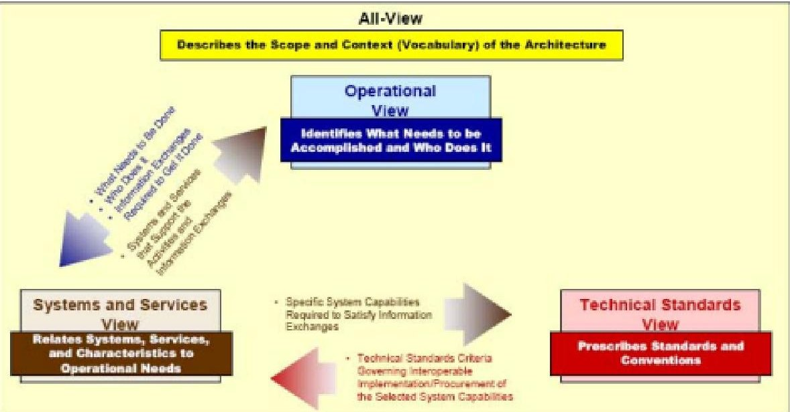

Figure 13. DoDAF Framework [39]

<!-- PDF_PAGE: 55 -->

2. 3.3 Enterprise Architectural Framework The Open Group Architectural Framework (TOGAF) [126] is an enterprise based architectural framework developed by the Open Group. It is a proven enterprise architecture methodology and framework used by the world's leading organizations to improve business efficiency. TOGAF represents a set of supporting resources for developing an Enterprise Architecture.As an architecture standard, it also ensures consistent standards, methods, and communication among enterprise architecture professionals. The Zachman AF [138] is an enterprise framework invented by John Zachman in 1980. The framework borrows from business design principles in architecture and manufacturing and provides a way of viewing an enterprise and its information systems from different perspectives, showing how the components of the enterprise are related. The Zachman framework provides a means of classifying an organization's architecture [78].

2. 3.4 Space-based system of systems European Space Agency-Architectural Framework (ESA-AF) [52] is an AF developed to address engineering needs in the Systems-of-Systems (SoS) domain. It was developed to fill the gap generated by increasing levels of complexity in the space domain. The ESA-AF introduces new concepts, viewpoints, and views for the representation of European and space-specific characteristics and provides an infrastructure for methodology evolution which supports feedback from the European space industry.

2. 3.5 Reference Architecture for Space Data Systems (RASDS) In the space industry, an architecture for space data systems has been developed by the Consultative Committee for Space Data Systems (CCSDS) [29]. CCSDS is an international, consensus-based, space system standards organization whose members consist of NASA, ESA, JAXA and all other major space agencies. The Reference Architecture for space data systems (RASDS) [116] was developed by the CCSDS Systems Architecture Working Group (SAWG). RASDS provides a standard way for describing architectures of different space data systems by using multiple views to describe the architecture of a space data system. These views depicted in Figure 14 include: Enterprise, Connectivity, Functional, Information and Communications Views. These views though slightly

<!-- PDF_PAGE: 56 -->

modified, are derived from the viewpoints defined in the Reference Model of Open Distributed Processing (RM-ODP) [71]. A principal motivation for developing an AF is to establish a reliable framework based on best practices and methods that can be used to generate system architectures in a coherent manner such that they can be easily understood, analyzed and implemented.

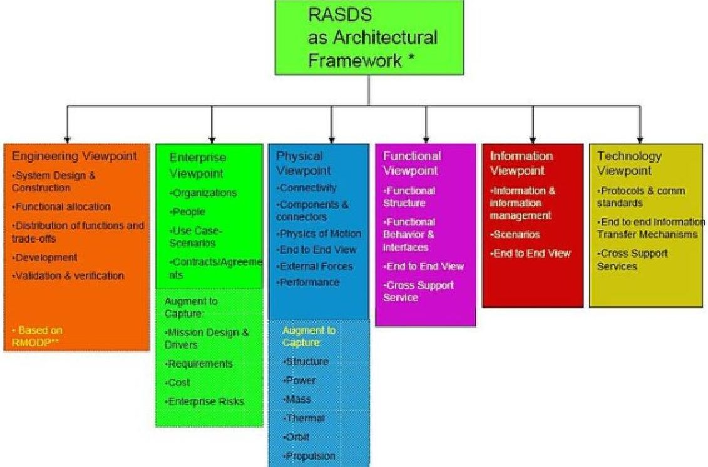

Figure 14. CCSDS Reference Architecture for Space Data System (RASDS) [116])

2. 3.6 MBSE - Based Architectural Framework Architectures and Architectural Frameworks are now considered to be fundamental to model-based systems engineering. An MBSE - based Architectural Framework (MBSE-based AF) describes from an MBSE perspective, the conventions, principles, and practices for the description of architectures established within a specific domain. An Architectural Framework based on an MBSE approach is defined as a set of one or more Viewpoint and an Ontology and is used to structure an architecture from the point of view of a specific industry, Stakeholder Role set, or Organization [62]. The MBSE-based AF is designed to meet the Needs defined by one or more Architectural Framework Concern and is created such that it complies with industry standards. Based on the work done in [62], an MBSE-based AF is made up of a number of Viewpoints that define the information that can be presented; the framework

<!-- PDF_PAGE: 57 -->

also consists of Rules which are defined to ensure consistency between and within viewpoints. Similarly, the Needs for each Viewpoint defined as part of an architectural framework must also be understood.

2. 3.6.1 Viewpoint Viewpoint modeling is an effective approach for dealing with the inherent complexity of systems. A Viewpoint Provides the framework for defining the content and structure of a view. The content and structure of a Viewpoint use the concepts and terms from the Ontology via one or more Viewpoint Element that make up the Viewpoint. It defines the perspective from which a View is taken. It also represents the vantage point that determines what is depicted in a given View. Each Viewpoint is defined so that it meets the needs defined by one or more Viewpoint Concern. A Viewpoint defines the information that can be presented; it is a definition of what can be produced when an Architecture is based on an Architectural Framework.

2. 3.6.2 Views A View can be described as the representation of a system architecture from the perspective of a defined Viewpoint. It corresponds to the visualization of part of the architecture of a system that conforms to the structure and content defined in a Viewpoint. A View is made up of one or more View Element. It is an artifact, produced as part of an architecture and it describes an aspect of that architecture. If the architecture is created using an architectural framework, then every View will conform to a Viewpoint in the architectural framework.

2. 3.6.3 Perspective A Perspective is used as the organizational schema for Views with a common purpose. It represents a collection of one or more View (and hence also one or more defining Viewpoint) that are related by their purpose. That is, one or more View which address the same architectural needs, rather than being related in some other way, such as by mode of visualization.

## 2.4 Evolution of Small-Satellite Systems

Small Satellite Systems are fast becoming the face of future space technology. They are proving to be the best solution for accomplishing mission objectives in the face of limited resources. A primary driver for the advancement of small satellite technology is the desire of entrepreneurs,

<!-- PDF_PAGE: 58 -->

technology companies, the intelligence community and educational institutions to develop and deliver satellite-based services. In [57], new innovative applications for small satellites have been generated by NASA, and many mission directories are relying on small satellites to meet their goals.

Table 5. NASA Small spacecraft classifications

<table border="1"><tr><td>Type of satellite</td><td>Mass(Kg)</td></tr><tr><td>Mini-satellite</td><td>180-100Kg</td></tr><tr><td>Micro-satellite</td><td>100-10Kg</td></tr><tr><td>Nano-satellite(CubeSat)</td><td>10-1Kg</td></tr><tr><td>Pico-satellite</td><td>1-0.01Kg</td></tr><tr><td>Femto-satellite</td><td>0.01-0.001Kg</td></tr></table>

Small Satellites Systems (SmSS) are artificial satellites with an overall mass of 180kg and below. These class of satellites are divided into six sub-groups: mini-satellites (100- 180kg), micro-satellites (10-100kg), nano-satellites (1-10kg), pico-satellites (0.01-1kg) and femto-satellites (0.001-0.01kg) [81] as shown in Table 5. A subclass of the nano-satellite sub-group known as CubeSats has become the most popular group class of small satellites in recent times due to various advantages they offer such as their standardized specifications. CubeSats are standardized satellites with a fixed size and form factor of One Unit (i.e. "1U"), measuring 10 x 10 x 10cm extend-able to larger sizes of 1.5U, 2U, 3U, 6U, 12U, and 27U [81]. Figure 15 depicts the skeleton chassis for various CubeSat sizes. Due to low cost and rapid development times associated with these group of satellites, as technological advancements increase, these satellites will become endowed with the ability and potential to overcome their Size Mass and Power (SMaP) limitations. A major reason for the great advancements already recorded with small satellite technology is due to an increasing number of countries becoming space-faring nations.

2. 4.1 Small Satellite Trends & Challenges Small satellites serve as a platform for the development of new space technologies [102]. Adapting small satellites for applications required

<!-- PDF_PAGE: 59 -->

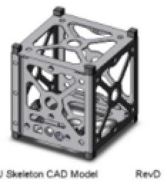

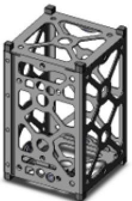

1. 5U Skeleton CAD Model

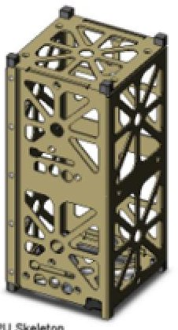

2U Skeleton Chassis Assy

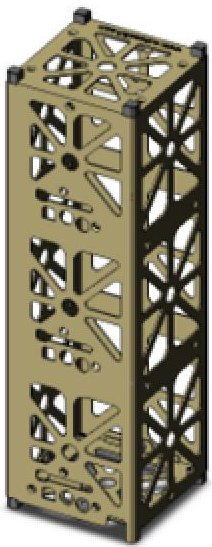

3U Skeleton CAD Model

Figure 15. CubeSat sizes of 1U, 1.5U, 2U, and 3U [100]

of large monolithic satellites remains the most significant challenge with small satellite utilization. Some characteristic difficulties associated with small satellites include their limited capacity in terms of the size of payload they can accommodate and the limited capabilities of the on-board communication system. Also, the risks associated with flying new technologies before they have been extensively proven also raises the question of reliability with these class of satellites. To harness the most out of small satellites, the effects of various limiting constraints such as small form factor (size) and low power requirements have to be mitigated.

The full potential of these satellites is currently limited by the constraints imposed on them by their Size, Mass and Power (SMaP) requirements which is a limiting factor in their current usage. Shown in Table 6 are a list of benefits and limitations associated with small satellites.

2. 4.2 ISC in Small Satellite Systems The lack of high-speed Inter-Satellite Links (ISL) between CubeSats limits the realization of the immerse advantages small satellites can deliver to the military, the intelligence community, space agencies and educational research facilities. Small satellite capabilities can be significantly enhanced if they possess networking capabilities to enable them operate as a wireless sensor network as shown in Figure 16. Extending the communication capabilities of small satellites is a necessity which can be achieved by deploying a large number of SmallSats to act as a wireless sensor network. As stated in [102], a large number of heterogeneous

<!-- PDF_PAGE: 60 -->

## Table 6. NASA Small spacecraft classifications

<table border="1"><tr><td>Benefits</td><td>Limitations</td></tr><tr><td>Low production cost</td><td>Limited Capacity(SMaP)</td></tr><tr><td>Short time to scientific return</td><td>Limited Control</td></tr><tr><td>Versatility</td><td>Short Lifetime</td></tr><tr><td>Rapid Development Time</td><td>Marginal Reliability</td></tr><tr><td>Revitalized Scientific Community</td><td>Marginal Profitability</td></tr></table>

small satellites can be deployed in space as a network using Inter-Satellite Communications (ISC) to enable command, control, communication and information processing with real time or near real time communication capabilities. A multi-small satellite solution will prove highly economical in addressing some of the limitations associated with small satellites; it will also increase the benefits by providing improved spatial and temporal resolutions of targets. Enabling ISC between a network of small satellites can lead to various critical and significant operations such as autonomous operations, fractionated spacecraft, distributed processing and servicing & autonomous operations.

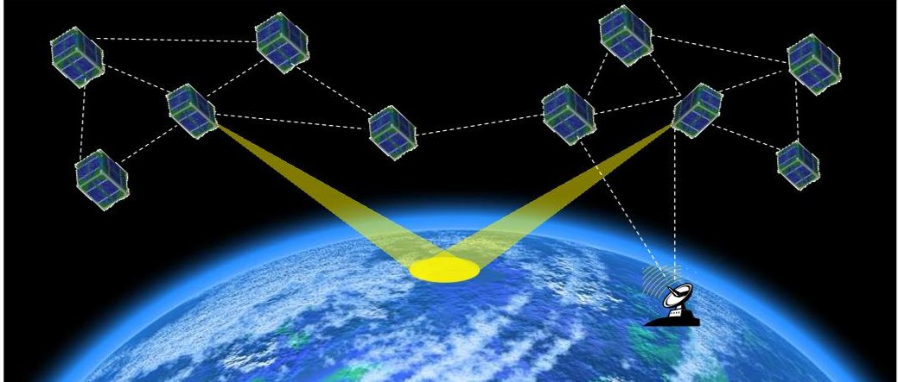

Figure 16. Inter-satellite Communication between Small Satellites

2. 4.3 Open System Interconnection (OSI) Reference Model The Open System Interconnection (OSI) reference model [2] defines a layered approach for data communication

<!-- PDF_PAGE: 61 -->

between communication systems without regard for the internal structure implemented by the communication systems. As a conceptual framework, It aids in enabling understanding of the complex interactions which occur within a communication network. The layer-based OSI model partitions the communication system network architecture into seven layers which, from top to bottom are the Application, Presentation, Session, Transport, Network, Data-link and Physical layers respectively. The OSI model implements protocols (i.e. a set of rules that govern data communication) used in the exchange of data between communication systems in a network. Each layer provides services to the layer above it and receives services from the layer below it.

Inter-Satellite Communication networks for Small-Satellite Systems (SmSS) is based on the network and protocol layering concepts of the OSI model and as stated in [123], requirements levied on inter-satellite communication systems will be compatible with the basic tenets of networking. An extensive survey on applying the three lower layers of the OSI framework for ISC of SmSS was carried out in [102].

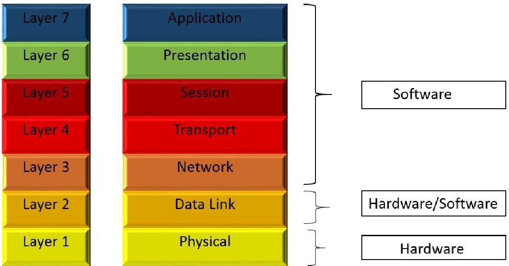

Figure 17. The OSI Model for Small Satellites (adapted from [130])

Applying the modular approach of the OSI model to the ISC network architecture allows the complex communication process involved with ISC be decomposed into a more tractable process which can be handled in a flexible and scalable manner. Applying the modular approach of the OSI model to the ISC network architecture allows the complex communication process involved with

<!-- PDF_PAGE: 62 -->

ISC be decomposed into a more tractable process which can be handled in a flexible and scalable manner. For small satellite systems, the functionalities of the upper three layers (Application, Presentation & Session) of the OSI model can be merged and implemented using software as shown in Figure 17 programs [130].

<!-- PDF_PAGE: 63 -->

## CHAPTER 3

## ISC Architectural Framework

## 3.1 Introduction

Developing an architectural framework for the definition of an inter-satellite communication system architecture is a desirable starting point for this research because an architectural framework is essential for the successful design and implementation of any system. For the system architecture to be useful, it is crucial that a rigorous architectural design process is adhered to, and this can only be realized when the architecture conforms to a well defined architectural framework. A well defined architectural framework represents an embodiment of a minimum set of guidelines, practices, and requirements for artifacts that describe a system's architecture and support the definition of architectures. Defining architectural frameworks for the development of system architectures has become a fundamental part of systems engineering practice. There is a utility to defining and implementing a model-centric approach based on MBSE as it enables the development of a framework essential for the realization of robust system architectures which meet the needs of stakeholders and customers.

The objective of this chapter is to present a model-based systems engineering (MBSE) architectural framework design for defining small-satellite systems inter-satellite communication (SmSS-ISC) architectures. The framework is shown as a model comprising of a set of views which conform to viewpoints to which an ISC system architecture must conform. Section 3.1 introduces the concept of an MBSE architectural framework and the inherent value in developing a framework on which system architectures can be based. In Section 3.2, the ISC-AF for ISC system architectures is described. A summary of the chapter is presented in Section 3.3.

<!-- PDF_PAGE: 64 -->

## 3.2 MBSE Based Architectural Framework Development

The value of initiating the system design process with the development of a framework is embodied in the many benefits with which an MBSE based approach impacts the system design process. Firstly, utilizing models in the development of an architectural framework aid in complexity management because models can be measured and controlled. The ability to automatically measure the outputs of a model and thereby control its results enables the management of the model's complexity and hence that of the developed architectural framework. In particular, the use of a model results in ensuring consistent and coherent information across the whole architectural framework. Utilization of a coherent and consistent model provides improved communication by way of defining an Ontology that defines all related and relevant concepts and terminology used as the basis for all views that make up the model. Consequently, all knowledge about the architectural framework is represented coherently by the model ensuring consistency and traceability between model elements and guaranteeing simpler access to information for users of the framework.

A well defined architectural framework must allow for the definition of architectures that model both the behavioral and structural aspects of a system thereby establishing the value of the framework and its impact on the system architecture. Guidelines established in [62] and are adhered to in this research work buttress the fact that an architectural framework must be defined regarding a series of Viewpoints and have pre-defined set of rules that are defined to ensure consistency.

## 3.3 ISC Architectural Framework for Small Satellite Systems

The Inter-Satellite Communication - Architectural Framework (ISC-AF) for Small Satellite Systems can be regarded as a set of guidelines, patterns or rules that delineate the architecture of an ISC system. The ISC-AF specifies the way and manner in which the fundamental organization of the ISC system architecture can be presented. Given that this research is focused on an MBSE approach towards the development of an ISC system, though there exist a varied number of architectural framework definitions in literature, the definition and viewpoints that best characterize

<!-- PDF_PAGE: 65 -->

and demonstrates our framework requirements and is used in the development of the ISC-AF are adapted from [62].

We define the ISC architectural framework as a set of Viewpoints and an Ontology constrained by well defined rules that ensure consistency across the framework spectrum. The ISC-AF provides the structure necessary for describing ISC system architectures.This structure allows ISC system architectures be defined in a way that models both the structural aspects and behavioral aspects of every system being represented by the architecture. An Ontology is essential whenever a framework is defined in terms of a set of viewpoints; it serves as an element of the architectural framework that defines all the concepts and terms that relate to any architecture structured according to the architectural framework. Consequently, our ISC-AF is essentially made up of five viewpoints that conform to our defined ontology. Viewpoints provide conventions, and languages for constructing, presenting and analyzing views. These viewpoints depicted on the block definition diagram (bdd) in Figure 18 are defined in a systematic manner to ensure that they conform to the ISC-AF ontology. The viewpoints used to define the architectural framework are represented using the following views:

## (a) The ISC-AF Context View

This viewpoint defines the context for ISC-AF. It represents the concerns that the framework must address. The context viewpoint is visualized using a use case diagram and consists of a boundary, stakeholders and use cases. It captures the needs that must be addressed by the AF.

## (b) The ISC-AF Ontology Definition View

This viewpoint defines the Ontology for the ISC-AF. The ontology viewpoint is derived from the AF context viewpoint and it defines all the concepts that appear on each of the AF viewpoints. Defining an Ontology viewpoint for the ISC-AF helps ensure consistency is enforced between all AF concepts and relationships. This viewpoint is visualized using a block definition diagram

## (c) The ISC-AF Viewpoint-Relationship View

<!-- PDF_PAGE: 66 -->

This viewpoint captures all the viewpoints of the ISC-AF; It portrays how each of these viewpoints are related and groups them into perspectives. This viewpoint is visualized using a block definition diagram.

## (d) The ISC-AF Viewpoint-Definition View

This viewpoint is used to define a particular ISC-AF viewpoint. It must conform to the ISC-AF ontology by showing which ontology elements can appear on a given viewpoint. The Viewpoint-Definition viewpoint must be capable of supporting the definition of any ISC-AF viewpoint content and must be consistent with the needs of the particular viewpoint it defines. Visualization of this viewpoint can be achieved using either textual documentation or a block definition diagram

## (e) The ISC-AF Rules Definition View

Defined by this viewpoint are the rules used to constrain the ISC-AF. Defining rules to which the ISC-AF must conform is necessary in order to ensure consistency of both the AF and the architectures that will be created based on the AF.

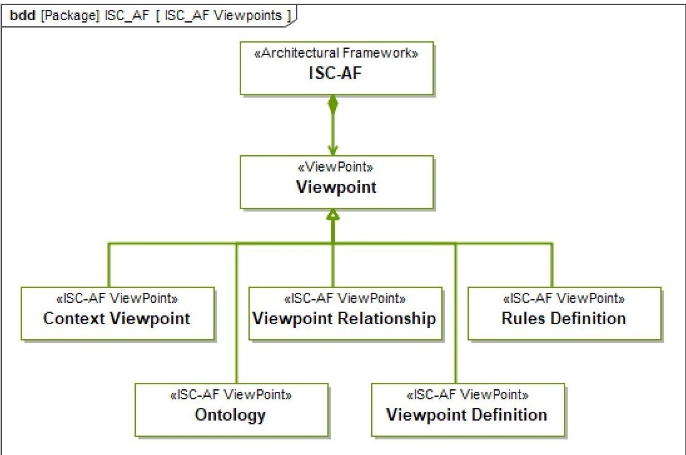

Figure 18. The ISC-AF Viewpoints (adapted from [62])

<!-- PDF_PAGE: 67 -->

3. 3.1 ISC-AF Context View The ISC-AF viewpoint is used to define the context for the inter-satellite communication architectural framework. The view which conforms to this viewpoint describes in context the concern which the ISC-AF is designed to address. Shown on the CV diagram in Figure 19 is the ISC-AF Context View. From the diagram it can be seen that the main concern which the ISC-AF is developed to address is to Provide an architectural framework for modeling ISC systems for SmSS. In order for this requirement to be fulfilled, there are other concerns that must be met and these are shown by the Include relationship. This means that the main concern depicted by the central use case Provide an architectural framework for modeling ISC systems for SmSS is considered incomplete without fulfilling the concerns depicted by the use cases:

- Provide guidelines and a generic platform to support and describe a robust ISC architecture

- Model a communication system based on the OSI framework

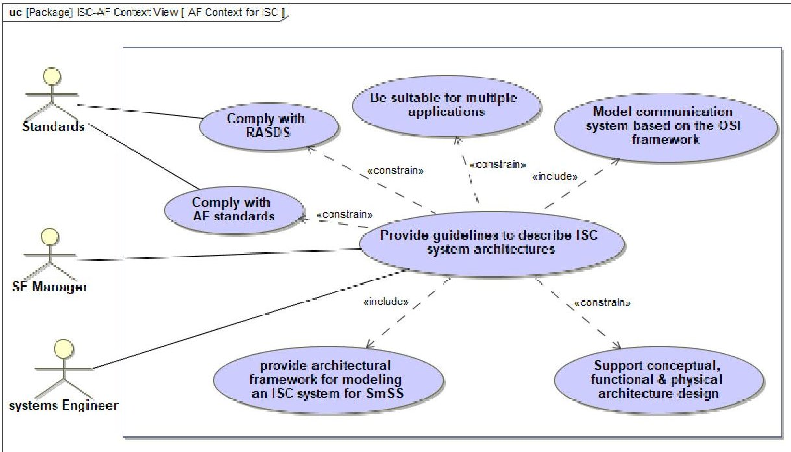

Figure 19. Context View showing the ISC-AF Context viewpoint

The architectural framework must also be able to provide critical support for the modeling of an ISC system as shown by the use cases which constrain the main concern. These requirements are:

<!-- PDF_PAGE: 68 -->

- Support conceptual, functional & physical architecture design- The AF must be able to support the modeling of both the structure and behavior of an ISC system architecture.

- Be suitable for multiple applications- The framework must be generic enough to support different types of ISC architectures.

- Comply with AF standards- The AF must comply with best practice standards for the development of coherent ISC architectures.

- Comply with RASDS- Designing the AF with compliance to specific aspects of RASDS architecture ensures it complies with the space industry best practice standards.

3. 3.2 ISC-AF Viewpoint Relationship View The Viewpoint Relationships View conforms to the Viewpoint Relationships Viewpoint. This viewpoint is used to depict the relationships between perspectives and the viewpoints which are grouped together to make up the ISC-AF perspectives. A perspective can be defined as a collection of related views. The ISC-AF consists of three perspectives which address the required concepts related to the ISC-AF Ontology. The ISC-AF perspectives include:

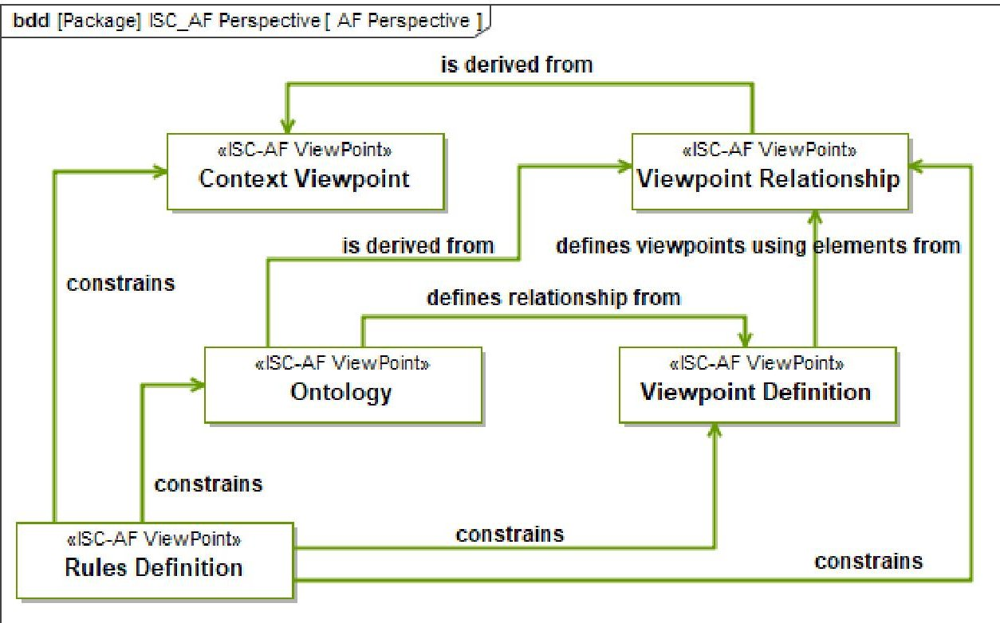

Figure 20. Viewpoint Relationship View showing the ISC-AF Perspective (adapted from [62])

<!-- PDF_PAGE: 69 -->

## (a) The ISC-AF Perspective:

The ISC-AF perspective is made up of the viewpoints to which the views depicted in this work belong. This perspective can be viewed as the meta-model to which all ISC architectures created must conform to. Since this perspective represents the architectural framework viewpoints and views, its viewpoints will not be a part of any existing architecture developed using the ISC-AF. Shown on the VRV in Figure 20 is the ISC-AF perspective depicting its different viewpoints and their relationships. The AF perspective viewpoints which are used to define the ISC-AF are:

- ISC-AF Context Viewpoint

- Viewpoints Relationships Viewpoint

- ISC Ontology Definition Viewpoint

- Viewpoint Definition Viewpoint

- Rules Definition Viewpoint

## (b) The Requirement Perspective:

The Requirement perspective defines viewpoints that allow the requirements of the ISC system to be captured. The relationships between the viewpoints captured in the requirement perspective are shown on the VRV in Figure 21.

The requirement perspective viewpoints include:

- Requirement Traceability Viewpoint - This viewpoint describes the decomposition of the ISC system requirements and also captures the relationship between requirements and system elements that satisfy them.

- Requirement Description Viewpoint - This viewpoint defines a structured description of high-level system requirements.

- Requirement Context Viewpoint - This viewpoint is used to define the requirements in a given context.

- Requirement Source Viewpoint - This viewpoint is used to define the origin of a requirement.

<!-- PDF_PAGE: 70 -->

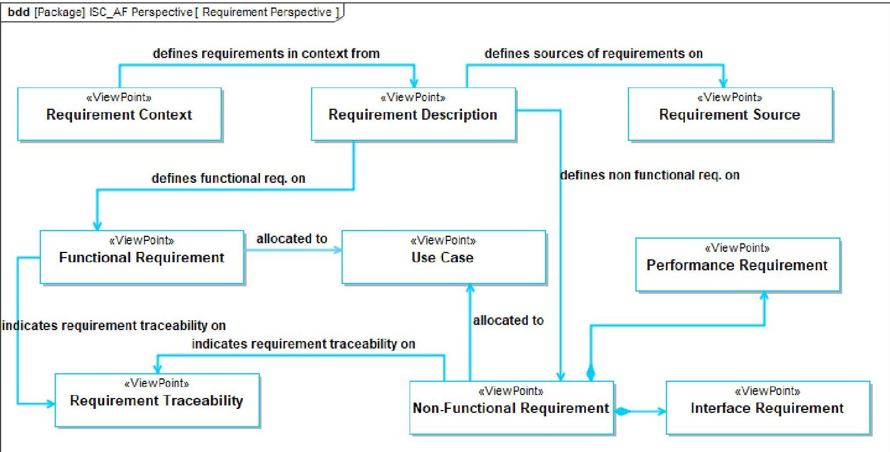

Figure 21. Viewpoint Relationship View showing the ISC-AF Requirement Perspective

- Functional Requirement Viewpoint - This viewpoint defines the functional/logical requirements.

- Non-Functional Requirement Viewpoint - This viewpoint defines the non-functional requirements.

## (c) The System Perspective:

The System Perspective defines viewpoints that allow aspects of an ISC system's structure and behavior to be captured. The concepts in this perspective form the basis for the existence of the ISC-AF. The viewpoints described in this perspective comply with those found in RASDS [115] and the relationship between them is depicted on the VRV in Figure 22.

The viewpoints are:

- Functional Viewpoint- This viewpoint describes the functional/logical structure of the ISC link.

- Connectivity Viewpoint - This viewpoint defines the physical elements that make up the ISC system and connectivity between them.

<!-- PDF_PAGE: 71 -->

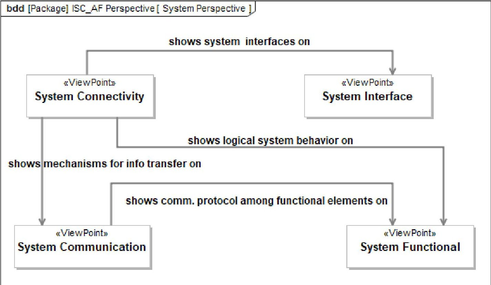

Figure 22. Viewpoint Relationship View showing the ISC-AF System Perspective

- Communication Viewpoint - This viewpoint describes the ISC link system communication protocols that support communication between small satellites.

- Interface Viewpoint - This viewpoint is used to define ISC system interfaces.

3. 3.3 ISC-AF Ontology Definition View The ISC Ontology Definition Viewpoint is used to define all concepts that belong to the ISC domain. These concepts, their definitions, and the relationships between them are portrayed in the ISC-AF Ontology Definition View; The Ontology view is divided into three groups with each group corresponding to the AF, Requirement and System concepts views respectively. The ODV showing the various ontology terms and corresponding relationships is depicted in Figure 23, Figure 24 and Figure 25, while a complete view of the ISC-AF ontology showing the relationship between all three concepts is portrayed in Figure 26.

3. 3.3.1 Ontology for the ISC Architecture Concept The ISC-AF Ontology viewpoint is visualized with the block definition diagram shown in Figure 23. Portrayed on the bdd are the ISC-AF domain concepts and the relationships that exist between the ISC-AF ontology elements.

- ISC Architectural Framework: A defined set of one or more viewpoints and an ontology. It

<!-- PDF_PAGE: 72 -->

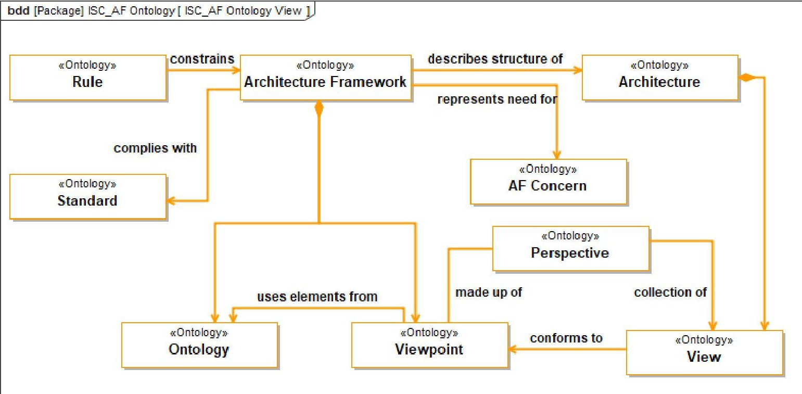

Figure 23. Ontology Definition View for the AF Concept

specifies how an ISC system architecture should be organized and the kind of information that can be presented.

- ISC Architecture: Is a description of an ISC system consisting of a set of views which conform to corresponding viewpoints. An ISC architecture is based on the ISC-AF.

- Viewpoint: A viewpoint provides the framework for defining the content and structure of a view. A view is based on a viewpoint.

- View: A view is a representation or visualization of the ISC system architecture from the perspective of a defined viewpoint. A view can only conform to a single viewpoint and it is an artifact that describes an aspect of the architecture.

- Perspective: A perspective is a collection of views which are grouped together based on a common purpose.

- Rule: A rule is a construct that constrains the architectural framework and corresponding architecture.

- Standard: A Standard represents a set of best practices that the AF must adhere to.

- Ontology: Defines all the terms and concepts which relate to ISC system architecture structured according to the ISC-AF.

- AF Concern: An AF concern refers to a requirement which the AF must address.

<!-- PDF_PAGE: 73 -->

3. 3.3.2 Ontology for the ISC Requirement Concept The ontology for ISC requirement concept shown in Figure 24 portrays the various ISC domain ontological elements and the relationships between these elements.

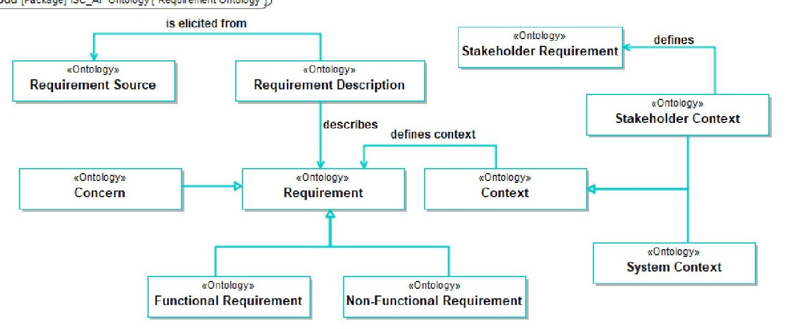

Figure 24. Ontology Definition View for the ISC Requirement Concept

- Requirement: Is a desired feature, property or behavior of a system that is either needed or wanted by an ISC system.

- Requirement Description: Is a tangible description of the services required by the system and the constrains under which it must operate.

- Requirement Source: The origin of a requirement.

- Concern: Is a requirement whose context will represent an architecture, or a viewpoint.

- Context: A context can be defined as a 'point of view' from which a requirement or system can be understood or assessed.

- Functional Requirement: It defines a function a system should provide, something the system should do.

- Non-Functional Requirement: Is a property or attribute that a system must possess, a condition the system must meet or a constraint under which the system must operate or be developed.

- System Context: A 'point of view' from which the whole/part of the system can be understood.

- Stakeholder Context: A 'point of view' from which a stakeholder role is understood.

<!-- PDF_PAGE: 74 -->

3. 3.3.3 Ontology for the ISC System Concept The ISC system concept ontology view depicted in Figure 25 portrays all ontological elements associated with the ISC system concept; the relationships that exist between the elements are also displayed.

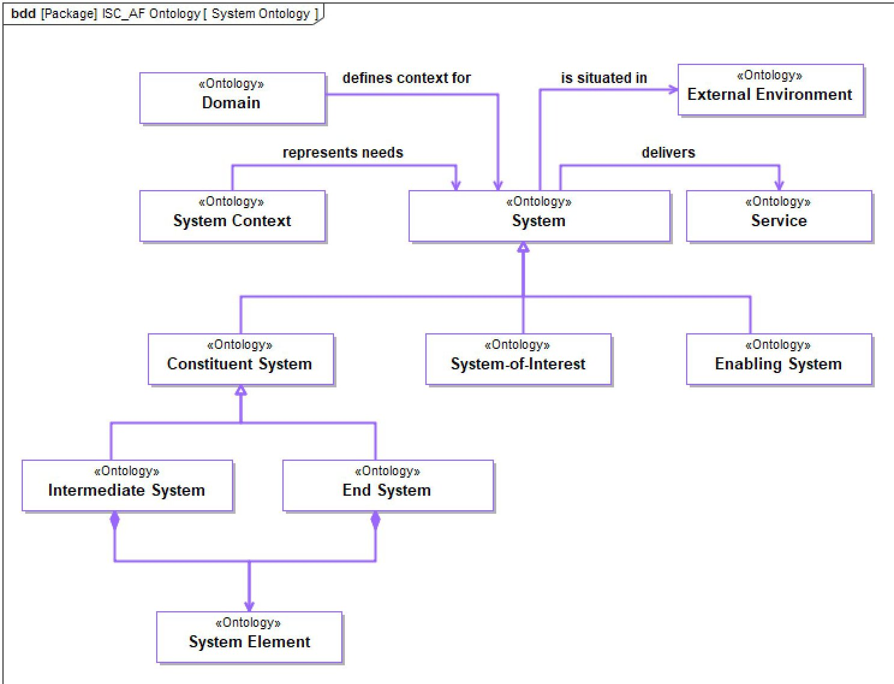

Figure 25. Ontology Definition View for the ISC System Concept

- System: A set of interacting elements organized to satisfy one or more 'system context'.

- Constituent System: A type of system whose elements are one or more system elements.

- System-of-Interest: A type of system that describes the system being developed.

- System Element: A basic part of a constituent system.

- Enabling System: A type of system that interacts with the system-of-interest yet sits outside its boundary.

- End System: A type of system that generates information and may directly forward it to another end system or rely on intermediate systems for this service.

<!-- PDF_PAGE: 75 -->

- Intermediate System: A type of system that is mainly involved in forwarding received information. It may or may not modify the information being forwarded.

- External Environment: Refers to the environment in which the system must operate.

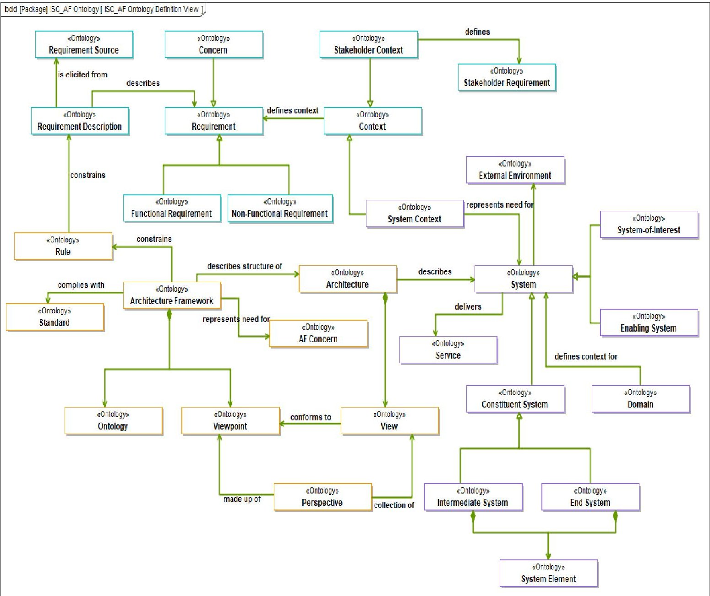

Figure 26. Ontology Definition View showing the complete ISC-AF Ontology

Figure 26 depicts the complete ISC-AF ontology view. In this view, the relationships between the ISC-AF concepts, consisting of the requirements concept, the system concept and the architecture concepts are demonstrated. This viewpoint captures all concepts that can appear on a viewpoint. As new concepts for the ISC domain are defined they will be added to the ISC ontology elements group.

<!-- PDF_PAGE: 76 -->

3. 3.4 ISC-AF Viewpoint Definition View The Viewpoint Definition view realizes the Viewpoint Definition Viewpoint, this view is used to define the various viewpoints within the perspectives that make up the ISC-AF.

Table 7. ISC-AF Viewpoint Definition View

<table border="1"><tr><td>PERSPECTIVE</td><td>VIEWPOINT</td><td>PURPOSE</td></tr><tr><td rowspan="5">ISC-AF Perspective</td><td>AF Context Viewpoint</td><td>Used to define the context for the ISC-AF. This context defines the needs the ISC-AF is trying to address.</td></tr><tr><td>ISC-AF Ontology Definition Viewpoint</td><td>Used to identify and define concepts and terms to be used for the ISC framework.</td></tr><tr><td>ISC-AF Viewpoint Relationship Viewpoint</td><td>Used to show relationships between viewpoints that make up the ISC-AF and groups them into perspectives.</td></tr><tr><td>ISC-AF Viewpoint Definition Viewpoint</td><td>Used to define a particular viewpoint</td></tr><tr><td>ISC-AF Rules Definition Viewpoint</td><td>Used to define the rules that constrain the ISC-AF</td></tr><tr><td rowspan="7">ISC-AF Requirements Perspective</td><td>ISC System Requirement traceability Viewpoint</td><td>Used to show the relationship between requirements and the model elements that satisfy, verify, refine.</td></tr><tr><td>ISC System Functional Requirements Viewpoint</td><td>Used to define the ISC systems functional requirements which will be required of the system</td></tr><tr><td>ISC System Non-Functional Requirements Viewpoint</td><td>Used to define any system requirements that are not functional based and which put a constrain on the ISC system</td></tr><tr><td>Requirement Source Viewpoint</td><td>Used to define and show the origin of each requirement</td></tr><tr><td>Requirement Context Viewpoint</td><td>Used to define the needs from a specific point of view by putting the into context.</td></tr><tr><td>Requirement Description Viewpoint</td><td>Used to provide a high level abstract description of a requirement.</td></tr><tr><td rowspan="4">ISC-AF System Perspective</td><td>ISC System Connectivity Viewpoint</td><td>Used to identify and define the structure of an ISC system showing the system elements, their properties and behaviors.</td></tr><tr><td>ISC System Communication Viewpoint</td><td>Used to define the layered sets of communication protocols based on the OSI model that support ISC. It describes mechanisms for information transfer between small satellite systems.</td></tr><tr><td>ISC System Functional Viewpoint</td><td>Used to define the ISC systems functional structure and how functions interact with each other.</td></tr><tr><td>ISC System Interface Definition Viewpoint</td><td>Used to define interfaces between systems and between system elements within an ISC system.</td></tr></table>

In this view, the viewpoint elements within a given viewpoint can be identified and also the relationships between the elements. Shown in Table. 7 is a summary of the ISC-AF perspectives

<!-- PDF_PAGE: 77 -->

and their accompanying viewpoints.

3. 3.5 ISC-AF Rule Definition View The ISC-AF Rules Definition View conforms to The Rules Definition Viewpoint. This viewpoint is used to define all the rules that constrain the ISC-AF.

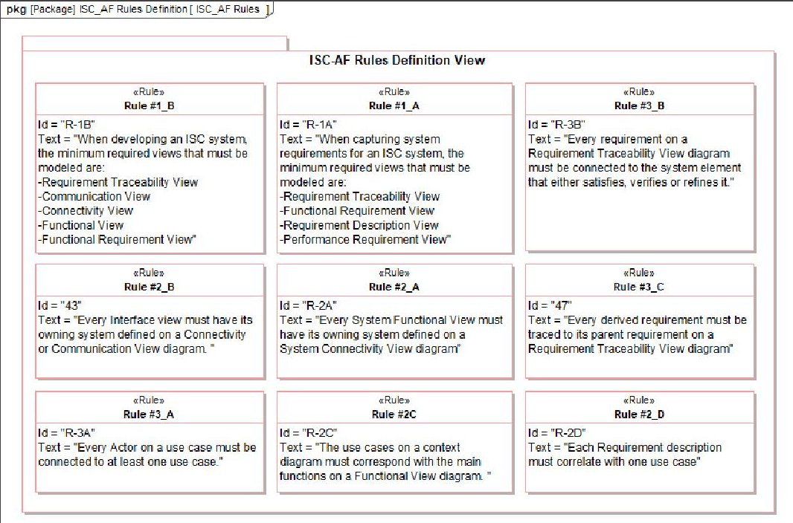

Figure 27. Rule Definition View showing some ISC-AF Rules

Depicted in the ISC-AF rules definition view are various rules that are used to constrain aspects of the AF. The rules defined in this view are established in order to ensure consistency in the AF and the corresponding architecture which will be created based on the AF.

There are three rule types adapted from [62] that are defined for the ISC-AF:

Rule #1: Rules that define the minimum set of views that have to be present in an architecture based on the architectural framework.

Rule #2: Rules that define consistency checks between viewpoints and the views based on them.

Rule #3: Rules that define consistency checks within viewpoints and the views based on them.

Some of the ISC-AF rules corresponding to the three rule types stated above are depicted in the RDV diagram shown in Figure 27

<!-- PDF_PAGE: 78 -->

3. 3.6 Chapter Summary An architectural framework establish the basis for creating, interpreting and analyzing architectures within a domain. In this chapter we presented an architectural framework design for Inter-Satellite Communication (ISC) between Small Satellite Systems (SmSS) based on an MBSE approach. The Systems Modeling Language (SysML) was used as the modeling tool to aid in the development process. The architectural framework (AF) designed provides a standard framework for modeling an ISC system architecture. The AF enables the representation of an ISC system architecture based on viewpoints which are realized by a set of views. The AF is presented as a set of views conforming to viewpoints which focus on specific concerns regarding the ISC-AF. The defined ISC-AF ontology enforces consistency and rigor in the system architectures that are defined based on the ISC-AF.The ISC-AF views are represented using bdds and use case diagrams.

<!-- PDF_PAGE: 79 -->

## CHAPTER 4

## ISC Domain Specific Profile

## 4.1 Introduction

Communication between stakeholders, system engineers, and design teams can be particularly challenging due to gaps in knowledge, vocabulary and understanding [23]. Employing the use of modeling languages to capture system design improves communication through better presentation and increased information consistency. Towards this end, a SysML profile for modeling an ISC system architectures is created. The profile models common system concepts that capture the structure, requirements, behavior and parametric information of an ISC system. Through increased traceability and integration, the profile allows for greater consistency between VLC information and system design information and will aid in communicating this information to stakeholders and project teams. The profile specifies common terminology for core communication concepts; key benefits of extending UML/SysML for defining a domain-specific profile include The ability to capture information with a higher degree of precision, leaving less room for interpretation.

Section 4.1 gives an overview of domain-specific profiling in the context of model-based systems engineering. Next, in Section 4.2 we establish the requirements that the developed profile must satisfy to be considered a valid domain-specific profile. In Section 4.4, the domain-specific profile designed for the ISC domain is presented. The profile defines domain-specific stereotypes for capturing ISC system requirements, structure, behavior and system constraints. Conformance of the profile to the stated requirements is discussed in Section 4.5 while the chapter is summarized in Section 4.6.

## 4.2 MBSE & Domain Specific Profiles

MBSE supports the underlying and pivotal aim of the systems engineering practice by introducing the concept of capturing all phases of the systems engineering life-cycle using models.

<!-- PDF_PAGE: 80 -->

Key benefits of this method include better communication between stakeholders, enhanced system integration and the ability to quickly reuse designs [95].

SysML is a general-purpose graphical modeling language used to support the practice of system modeling [51]. The capabilities of SysML are augmented by providing better semantics with which to represent and capture concepts relevant to the domain of interest when a domain-specific profile is defined. The SysML meta-model is used as the foundation for defining Domain Specific Languages (DSL) [75]. A SysML profile is developed by extending the SysML meta-model and introducing domain-specific concepts into it in the form of stereotypes. A stereotype represents an extension to the SysML/UML meta-classes and may be parametrized with properties known as tagged values. A stereotype may also contain constraints written in object constraint language (OCL) specifying the structure and/or behavior restrictions of a stereotype in a well-formed model [73]. In the context of MBSE, a model representing a system and its environment is a basis of communication among stakeholders from different domains [31], hence creating models customized for a specific domain of interest will lead to enhanced communication and understanding between stakeholders and system developers while supporting the description of static and dynamic aspects of the system. Creating a domain-specific profile is the first step towards creating models that support efficient information sharing. Shown in Figure 28 is the high-level diagram of the domain-specific profile package.

## 4.3 Profile Requirements

This section presents an overview of the SysML profile for the proposed VLC System. Presently, the profile mainly supports the conceptual and high level architecture of the system including the physical layer and parts of the data link layer of the OSI communication model. The domain-specific profile created using SysML must satisfy certain requirements in order to be considered a valid profile. The profile requirements constitute a set of necessary conditions that constrain the VLC SysML profile and which determine how the profile should be developed and its expected characteristics. The process employed in [22] is used as a guide in specifying the requirements for the VLC domain-specific profile. The profile requirements provides a series

<!-- PDF_PAGE: 81 -->

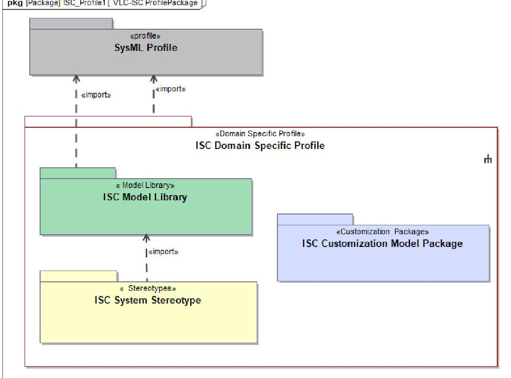

Figure 28. High Level Profile Package

of constructs that support the modeling of the requirements, behavior and structure for a VL Communication system. These requirements are grouped into: Profile Requirements for System Requirements Modeling, System Structural Modeling, System Behavioral Modeling and System Parametric Modeling.

4. 3.1 Profile Requirements for Requirement Constructs The requirements for a VLC ISL network can be organized into two main categories: functional and non-functional requirements. The functional requirements for our proposed system define a specific function or behavior of the system or any of its component while non-functional requirements describe or specify criteria on how the system should operate. These different requirements need to be organized and modeled. The following requirements are proposed to model VLC system requirements:

- Profile Requirement R.1: The language shall define a number of requirement types to model the functional requirements of the system.

- Profile Requirement R.2: The language shall define a number of requirement types to model the non-functional requirements of the system.

<!-- PDF_PAGE: 82 -->

- Profile Requirement R.3: The language shall provide support for defining specific properties/attributes of define requirements.

4. 3.2 Profile Requirements for Behavior Constructs The primary task of the physical layer of the VLC ISL system is consolidating the hardware requirements of a VLC network to enable the successful transmission of data. The physical layer is the first and lowest layer of the seven-layer OSI model; It provides the optical wireless link for transmitting data between satellites and also performs services requested by the data link layer of the VLC system. The VLC ISL system physical layer is responsible for the wireless optical relay of data using the visible light band. The system ensures data to be transmitted is converted into an optical signal and transmitted via the LED-Array front-end. The system also ensures that data/commands are received via its receiver front-end after which the data goes through several processes at the physical layer before the data is retrieved and forwarded to higher layers. The following requirements are proposed to support the modeling of these tasks:

- Profile Requirement B.1: The language shall support the modeling of the data relay process between two satellites. The relay process involves the transmission of data between two satellites deployed in a direct LoS configuration.

- Profile Requirement B.2: The language shall provide support for the modeling of the channels behavior processes.

- Profile Requirement B.3: The language shall provide support for the modeling of data transformation process. The data transformation process involves transforming received data from a visible light optical signal to digital form. This process involves software & hardware processes.

4. 3.3 Profile Requirements for Structural Constructs The physical layer structure of a multi-satellite system utilizing Visible Light technology is a full duplex system architecture consisting of various end-to-end building blocks that make up the transponder structure. The LED-based VLC transponder consists of a transmitter and receiver subsystem which are made

<!-- PDF_PAGE: 83 -->

up of various components such as the receiver front-end and transmitter LED array which are the distinguishing features in this proposed system technology. To support the modeling of the physical layer system structure, the following requirements are proposed:

- Profile Requirement S.1: The language shall support the modeling of a VLC transponder and its characteristics. An LED-based VLC transponder has characteristics that are determined by the designer and manufacturer such as the transceiver commercial name and type of optical front-end.

- Profile Requirement S.2: The language shall support the modeling of a VLC transmitter and its characteristics. An LED front-end transmitter has characteristics determined by the designer or manufacturer such as transmitter name, width etc. It also has characteristics determined by the system designer such as the required system bandwidth.

- Profile Requirement S.3: The language shall support the modeling of a VLC receiver and its characteristics. A VLC receiver has characteristics determined by the designer or manufacturer such as its commercial name, brand and its specific optical front-end.

- Profile Requirement S.4: The language shall support the modeling of the transmitter front-end and its characteristics (e.g. type of LEDs, structure of LED Array, emitted LED Array power).

- Profile Requirement S.5: The language shall support the modeling of the receiver front-end and its characteristics(e.g. type of concentrator, narrow-band filter etc.) It shall also support the modeling of the photo detector and its characteristics. A photo detector has characteristics determined by the designer or manufacturer such as its signal-to-noise ratio.

- Profile Requirement S.6: The The language shall define modeling constructs for the specification of all internal components that make up the transmitter such as modulator type, pulse shaper characteristics etc. and allow for processing of data.

- Profile Requirement S.7: The The language shall define modeling constructs for the specification of all internal components that make up the receiver such as trans-impedance amplifier type, band-pass filter characteristics and allow for processing of data.

<!-- PDF_PAGE: 84 -->

- Profile Requirement S.8: The language shall define modeling entities to represent the communication link and its characteristics. A communication link represents the wireless channel through which two satellites communicate and has characteristics such as bit error rate(BER), signal-to-noise ratio (SNR), link distance, data rate.

4. 3.4 Profile Requirements for Link Budget Modeling The major constraint that exists in a communication system is that of the link budget. A link budget is a method used to quantify the link performance and by extension the overall system performance for a telecommunication system. For a VLC link to exist between multiple small satellites, the received power at any given satellite must be higher than the minimum received signal after path loss has been subtracted. The performance and reliability of a VLC network for space communication hinges on the system's link budget. Hence modeling of the link budget constraint is important. The following requirements are proposed for the system link budget modeling:

- Profile Requirement P.1: The language shall define modeling entities for the specification of link budget parameters.

- Profile Requirement P.1: The language shall define modeling entities for other system constraints.

## 4.4 ISC-VL System Domain Specific Profile

An overview of the VLC System Domain-Specific Profile Package is presented in this section. The profile package consists of the sub-packages: VLC Model Library, VLC Stereotypes Package and the VLC Customization Model Package. Contained within the profile model library are domain-specific ValueTypes; the system consists of value properties that are typed by specific ValueTypes contained in the model library. The stereotype package holds all domain-specific stereotypes (VLC system stereotypes) which are extended from the UML and SysML meta-classes. A VLC stereotype specializes a SysML stereotype. These stereotypes are created within a special kind of package called a profile, and they are used as the customization target when creating customization model elements.

<!-- PDF_PAGE: 85 -->

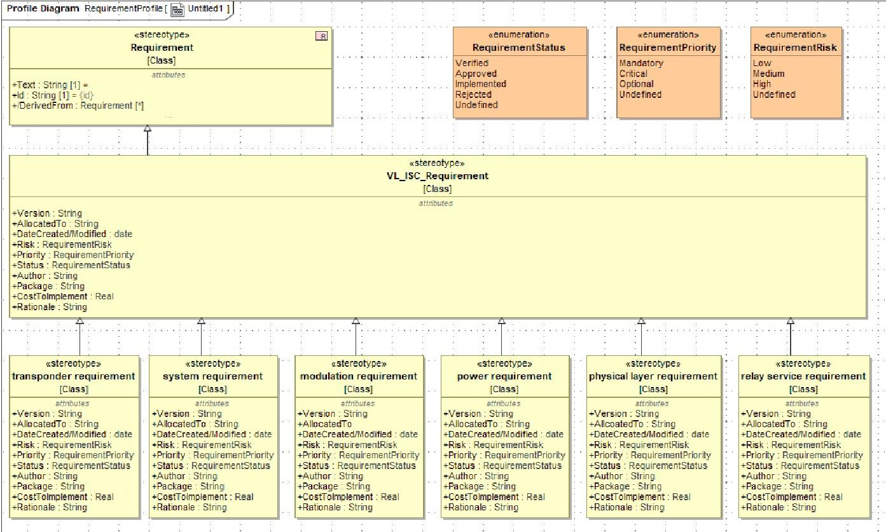

Figure 29. A Subset of SysML Profile Requirement Stereotypes

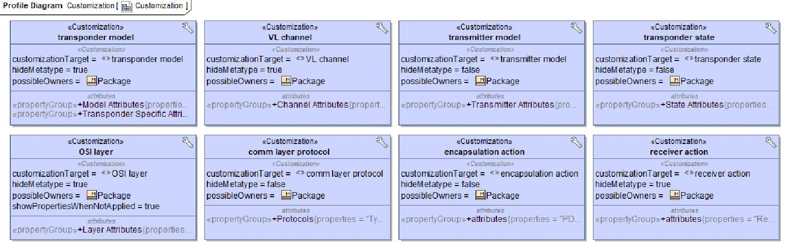

Figure 30. Subset of the Customization Profile Package

The customization model package stores all customization model elements used in creating the domain specific language (DSL). The customization model is created within a special package called a profile and customization data created in the model is represented on the DSL model element. Figure 29 depicts a subset of the requirement stereotypes defined in the VLC profile while Figure 30 depicts a subset of the customization model for some structural and behavioral constructs while Figure 31 captures the model library package.

<!-- PDF_PAGE: 86 -->

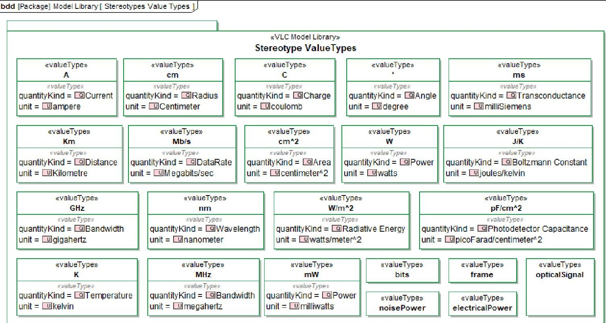

Figure 31. VLC Physical Layer Stereotype ValueTypes

4. 4.1 Stereotypes that Support Modeling of System Requirements In order to accurately capture and model the VLC system requirements, a series of requirement stereotypes are defined. These stereotypes enable the precise description of system level and subsystem level requirements. The defined SysML profile requirements are created by extending the SysML Requirement meta-class. Table. 8 portrays a subset of the DS-Profile requirement stereotypes created to support the specification of different types of functional and non-functional system requirements for the VLC system. Also defined for each requirement stereotype are a set of DS requirement attributes. These attributes are descriptive properties which aid in objective decision making. The listed requirement attributes used to manage the requirements for the ISC - VLC system are:

a) Author: Refers to the user/stakeholder who made the most recent revision to the requirement

b) AllocatedTo: Refers to the subsystem, assembly or component to which the requirement is allocated.

c) CostToImplement: Refers to cost of implementing a given requirement

d) DateCreated/Modified: Refers to the date of the most recent revision to the requirement.

<!-- PDF_PAGE: 87 -->

e) Package: Refers to the package in which the requirement is located.

f) Priority: Indicates system priority. The three levels indicated are: Mandatory, Critical, Optional

g) Risk: Refers to the level of risk involved if the requirement is not met. The three levels are: Low, Medium, High

h) Status: Indicates the stage at which the requirement is: Verified, Approved, Implemented, Rejected

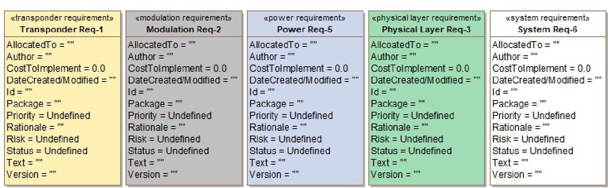

Figure 32. Stereotypes Requirement Types

Overall, the profile contains twenty one (21) requirement stereotype types, each of which corresponds to a VLC system requirement concept. Also defined within the profile are stereotypes that aid with adequate capturing of conceptual design concepts such as: goal stereotype, objective stereotype, need stereotype, stakeholder stereotype. A complete list of requirement stereotypes is depicted in Table. 9; Examples of some VLC-ISC system customized requirements are portrayed in Figure 32.

<!-- PDF_PAGE: 88 -->

Table 8. System Requirements Profile Stereotypes

<table border="1"><tr><td colspan="3">Requirement Stereotypes</td></tr><tr><td rowspan="14">LEDArray Requirement</td><td>Extension</td><td>none</td></tr><tr><td>Generalization</td><td>SysML::Requirements::Requirement</td></tr><tr><td>Attributes</td><td>none</td></tr><tr><td>Author</td><td>String</td></tr><tr><td>Version</td><td>String</td></tr><tr><td>AllocatedTo</td><td>String</td></tr><tr><td>Priority</td><td>String</td></tr><tr><td>Package</td><td>String</td></tr><tr><td>Status</td><td>String</td></tr><tr><td>CostToImplement</td><td>Real</td></tr><tr><td>Rationale</td><td>String</td></tr><tr><td>Risk</td><td>Sting</td></tr><tr><td>DateCreated</td><td>Date</td></tr><tr><td rowspan="14">PowerRequirement</td><td>Extension</td><td>none</td></tr><tr><td>Generalization</td><td>SysML::Requirements::Requirement</td></tr><tr><td>Attributes</td><td>none</td></tr><tr><td>Author</td><td>String</td></tr><tr><td>Version</td><td>String</td></tr><tr><td>AllocatedTo</td><td>String</td></tr><tr><td>Priority</td><td>String</td></tr><tr><td>Package</td><td>String</td></tr><tr><td>Status</td><td>String</td></tr><tr><td>CostToImplement</td><td>Real</td></tr><tr><td>Rationale</td><td>String</td></tr><tr><td>Risk</td><td>String</td></tr><tr><td>DateCreated</td><td>Date</td></tr></table>

Table 9. Profile Requirement Stereotypes

<table border="1"><tr><td colspan="2">Requirement Stereotype Types</td></tr><tr><td>-System Requirement</td><td>-LinkPerformance Requirement</td></tr><tr><td>-Subsystem Requirement</td><td>-frequency band requirement</td></tr><tr><td>-Transponder Requirement</td><td>-LEDArray Requirement</td></tr><tr><td>-Transmitter Requirement</td><td>-Relay Service Requirement</td></tr><tr><td>-Receiver Requirement</td><td>-Physical Layer Requirement</td></tr><tr><td>-Power Requirement</td><td>-General Requirement</td></tr><tr><td>-Modulation Requirement</td><td>-Data-link Layer Requirement</td></tr><tr><td>-Network Layer Requirement</td><td>-Functional Requirement</td></tr><tr><td>-Navigation Service Requirement</td><td>-Non-functional Requirement</td></tr><tr><td>-Timing Service Requirement</td><td>-Performance Requirement</td></tr><tr><td>-QoS Requirement</td><td></td></tr></table>

<!-- PDF_PAGE: 89 -->

4. 4.2 Stereotypes that Support Modeling the Systems Behavior In order to create domain specific VL-ISC system behavior models, stereotypes that support the systems dynamic behavior such as States, Actions, etc. have been defined in the profile. These system behavior stereotypes describe certain behavioral aspects of the VLC system. Overall, the profile defines a total of ten (10) behavior stereotypes that support system behavior modeling; these stereotypes are outlined in Table. 10. Some examples of stereotypes needed to support system behavior modeling are portrayed in Figure 33 and Figure 34. The stereotypes defined include- TransmitSignalAction and ReceiverSignalEvent stereotypes, EncapsulationAction and DecapsulationAction stereotypes, and the TransponderState stereotype. The TransmitSignalAction stereotype represents an action that creates an outgoing signal while the ReceiveSignalEvent stereotype represents an action that consumes an incoming signal. Shown in Table 11 are a subset of the DS SysML Profile behavior stereotypes.

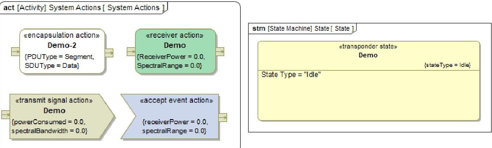

Figure 34. System Behavior Stereotypes

Figure 33. System Behavior Stereotypes

Table 10. Profile Behavior Stereotype Types

<table border="1"><tr><td colspan="2">Behavior Stereotype Types</td></tr><tr><td>-TransponderState</td><td>-DecapsulateAction</td></tr><tr><td>-TransmitSignalAction</td><td>-EncapsulateAction</td></tr><tr><td>-ReceiveSignalAction</td><td>-TransmitterAction</td></tr><tr><td>-TransmitterRequirement</td><td>-ReceiverAction</td></tr><tr><td>-ReceiverRequirement</td><td>-TransponderAction</td></tr></table>

<!-- PDF_PAGE: 90 -->

Table 11. System Behavior Profile Stereotypes

<table border="1"><tr><td colspan="3">System Behavior Stereotypes</td></tr><tr><td rowspan="4">TransmitSignalAction</td><td>Extension</td><td>UML4SysML:: Action</td></tr><tr><td>Generalization</td><td>none</td></tr><tr><td>AttributesLEDPeakWavelengthpowerConsumed spectralBandwidth</td><td>nmWGHz</td></tr><tr><td>Extension</td><td>UML4SysML:: Action</td></tr><tr><td rowspan="3">ReceiveSignalAction</td><td>Generalization</td><td>none</td></tr><tr><td>AttributespowerReceived spectralRange</td><td>Wnm</td></tr><tr><td>Extension</td><td>UML4SysML:: Action</td></tr><tr><td rowspan="3">EncapsulateAction</td><td>Generalization</td><td>none</td></tr><tr><td>AttributesPDUTypeSDUType</td><td></td></tr><tr><td>Extension</td><td>UML4SysML:: Action</td></tr><tr><td rowspan="3">DecapsulateAction</td><td>Generalization</td><td>none</td></tr><tr><td>AttributesPDUTypeSDUType</td><td></td></tr><tr><td>Extension</td><td>UML4SysML:: State</td></tr><tr><td rowspan="2">TransponderState</td><td>Generalization</td><td>none</td></tr><tr><td>AttributesStateName</td><td></td></tr></table>

4. 4.3 Stereotypes that Support Modeling the Systems Structure Shown in Table.12 are a subset of stereotypes that support the modeling of the VLC system structure. The stereotypes presented in our proposed profile include the following: the LayerType stereotype, this stereotype represents a defined layer such as the Physical or Data Link layer of the OSI model or any other communication reference model. The TransponderModel Stereotype which is also defined in the profile represents a certain make of transponder e.g. a VL Hybrid transponder. We also defined the TransmitterModel and ReceiverModel stereotypes. This stereotypes represent a certain specific make or model of transmitter and receiver which may be custom built based on a specific design for a particular mission. The OSILayer stereotype supports the modeling of specific layers as structural elements representing a domain of interest during system design.

<!-- PDF_PAGE: 91 -->

Table 12. System Structure Profile Stereotypes

<table border="1"><tr><td colspan="3">System Structural Stereotypes</td></tr><tr><td rowspan="3">LayerType</td><td>Extension</td><td>none</td></tr><tr><td>Generalization</td><td>SysML::Blocks::Block</td></tr><tr><td>Attributes
typeName</td><td>String</td></tr><tr><td rowspan="7">TransponderModel</td><td>Extension</td><td>none</td></tr><tr><td>Generalization</td><td>SysML::Blocks::Block</td></tr><tr><td>Attributes
commercialName</td><td>String</td></tr><tr><td>brand</td><td>String</td></tr><tr><td>length</td><td>mm</td></tr><tr><td>width</td><td>mm</td></tr><tr><td>height</td><td>mm</td></tr><tr><td rowspan="7">TransmitterModel</td><td>Extension</td><td>none</td></tr><tr><td>Generalization</td><td>SysML::Blocks::Block</td></tr><tr><td>Attributes
commercialName</td><td>String</td></tr><tr><td>brand</td><td>String</td></tr><tr><td>length</td><td>mm</td></tr><tr><td>width</td><td>mm</td></tr><tr><td>height</td><td>mm</td></tr><tr><td rowspan="7">ReceiverModel</td><td>Extension</td><td>none</td></tr><tr><td>Generalization</td><td>SysML::Blocks::Block</td></tr><tr><td>Attributes
commercialName</td><td>String</td></tr><tr><td>brand</td><td>String</td></tr><tr><td>length</td><td>mm</td></tr><tr><td>width</td><td>mm</td></tr><tr><td>height</td><td>mm</td></tr><tr><td rowspan="7">LEDType</td><td>Extension</td><td>none</td></tr><tr><td>Generalization</td><td>SysML::Blocks::Block</td></tr><tr><td>Attributes
typeName</td><td>String</td></tr><tr><td>ledViewingAngle</td><td></td></tr><tr><td>ledColor</td><td>String</td></tr><tr><td>ledShape</td><td>String</td></tr><tr><td>ledSize</td><td>String</td></tr><tr><td rowspan="5">VLChannel</td><td>Extension</td><td>UML4SysML::Connector</td></tr><tr><td>Generalization</td><td>none</td></tr><tr><td>Attributes
bitErrorRate</td><td>float</td></tr><tr><td>dataRate</td><td>float</td></tr><tr><td>signalToNoiseRatio</td><td>float</td></tr></table>

The stereotype customized model element comm layer protocol is used to define a communication layer protocol structure and its characteristics, it has ProtocolName as one of its

<!-- PDF_PAGE: 92 -->

specified attributes, this attribute allows a specific communication protocol to be defined during system design. Figure 35 portrays some examples using the profile stereotypes that support structural modeling. Also captured is the VLChannel stereotype which can be used to represent a VL wireless communication channel. It has characteristics such as the bit error rate and data rate and it constitutes the channel between the transmitter and receiver of two communicating satellites.

The profile contains a total of eighteen (18) stereotypes that support both structural and data system design modeling as depicted in Table. 13. This list of stereotypes is by no means exhaustive as updates to the profile will continue to be implemented throughout the design phase.

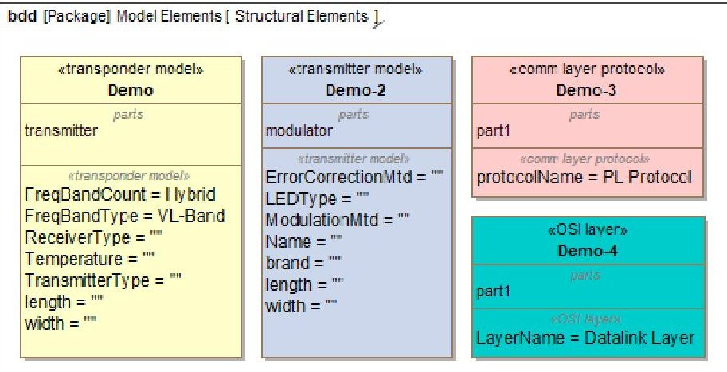

Figure 35. System Structure Stereotypes

Table 13. Profile Structure & Data Stereotype Types

<table border="1"><tr><td colspan="2">Structure&amp;Data Stereotype Types</td></tr><tr><td>-Domain</td><td>-System</td></tr><tr><td>-Subsystem</td><td>-System-of-Interest</td></tr><tr><td>-Communication Protocol</td><td>-External System</td></tr><tr><td>-LayerType</td><td>-Data-link Layer Requirement</td></tr><tr><td>-TransponderModel</td><td>-TransmitterModel</td></tr><tr><td>-VLChannel</td><td>-ReceiverModel</td></tr><tr><td>-ReceiverFEType</td><td>-LEDType</td></tr><tr><td>-PhysicalLayer</td><td>-Data</td></tr><tr><td>-DataLinkLayer</td><td>-NetworkLayer</td></tr></table>

<!-- PDF_PAGE: 93 -->

4. 4.4 Stereotypes that Support Modeling of System Constraints In Table.14 the stereotypes needed to support the modeling the system's link budget are shown. In order to support the various link budget parameter requirements, we defined the following constraint stereotypes: TransmitPowerConstraint, NoiseVarianceConstraint, ReceivedPowerConstraint, SNRConstraint and LinkLossConstraint. These are constraints whose modeling information have to be captured on parametric diagrams in order to determine the systems link budget requirements. Other system constraint stereotypes specified include the DataRateConstraint stereotype, BitErrorRateConstraint stereotype and ModulationConstraint stereotypes.

Table 14. System Constraints Profile Stereotypes

<table border="1"><tr><td colspan="3">System Constraint Stereotypes</td></tr><tr><td rowspan="4">NoiseVarianceConstraint</td><td>Extension</td><td>none</td></tr><tr><td>Generalization</td><td>SysML::Constraints::ConstraintBlock</td></tr><tr><td>Parameters
totalInputNoiseVariance
shotNoise
thermalNoise</td><td>float
W
W</td></tr><tr><td>Extension</td><td>none</td></tr><tr><td rowspan="4">SNRConstraint</td><td>Generalization</td><td>SysML::Constraints::ConstraintBlock</td></tr><tr><td>Parameters
receivedPower
detectorResponsivity
shotNoise
thermalNoise</td><td>W
float
W
W</td></tr><tr><td>Extension</td><td>none</td></tr><tr><td>Generalization</td><td>SysML::Constraints::ConstraintBlock</td></tr><tr><td rowspan="3">BitErrorRateConstraint</td><td>Parameters
bitErrorRate
signalToNoiseRatio</td><td>float
float</td></tr><tr><td>Extension</td><td>none</td></tr><tr><td>Generalization</td><td>SysML::Constraints::ConstraintBlock</td></tr><tr><td rowspan="3">DataRateConstraint</td><td>Parameter
dataRate
electricalBandwidth</td><td>Mb/s
MHz</td></tr><tr><td>Extension</td><td>none</td></tr><tr><td>Generalization</td><td>SysML::Constraints::ConstraintBlock</td></tr><tr><td rowspan="3">ReceivedPowerConstraint</td><td>Parameter
receivedPower
transmitPower
voltageGain</td><td>W
W
float</td></tr><tr><td>Extension</td><td>none</td></tr><tr><td>Generalization</td><td>SysML::Constraints::ConstraintBlock</td></tr></table>

<!-- PDF_PAGE: 94 -->

## 4.5 Conformance to Profile Modeling Requirements

The VL-ISC System DS-Profile conforms to and satisfies all modeling requirements listed in section 3. The profile provides various structural stereotypes which are used in modeling the structure of the system. When these stereotypes are instantiated in the model, the modeler is able to input the various characteristics of the specified stereotype. Shown in Figure 35 is an example of the TransmitterModel stereotype, when this stereotype is instantiated by the system designer, he is able to include certain model specific characteristics of the TransmitterModel such as the Name, brand, dimensions and certain instance specific characteristics. From the table for structural stereotypes it can be observed that the profile satisfies all the language structural requirements because it provides specific stereotypes for the modeling of both functional and non-functional VL-ISC system requirements. The profile also satisfies the listed requirements needed to support the modeling of the system behavior. Specified in the DS-Profile are various behavioral stereotypes that can be used to model certain aspects of the system behavior as shown in Table.11 and Figure 33 and Figure 34. The profile satisfies the VLC system requirements and link budget constraint requirements as shown in Table.8 and Table.14. The creation of a DS-Profile for a VL-ISC System is an iterative and ongoing process subject to updates as the VLC system design matures. The profile does not need to provide specific constructs to capture model elements for which SysML semantics is sufficient.

## 4.6 Chapter Summary

Presented in this chapter is a Domain Specific Profile developed in other to support the modeling of an Inter-satellite Communication System utilizing visible light communication via LEDs. The DS-Profile is created using both UML and SysML metamodels which imports in order to extend the modeling language for the ISC domain. Also enumerated in this chapter are sets of requirements which the profile must and does satisfy in order to support the modeling of the ISC system's Requirements, Structure, Behavior and parametric information. The DS-Profile satisfies the stated profile requirements and is capable of supporting an ISC system design

<!-- PDF_PAGE: 95 -->

## CHAPTER 5

## ISC Concept Engineering Phase

## 5.1 Introduction

In this chapter, we present the conceptual design model for an inter-satellite communication system to be utilized for three formation-flying small satellites in low-earth orbit. The conceptual model is developed during the concept engineering phase of system design. The design artifact produced during this phase is referred to as the Concept of Operations. In this Section, we briefly reiterate the benefits of applying MBSE principles to the system design effort and present the MBSE life-cycle V-model. This chapter we address the first life-cycle building block - Concept Engineering. Next, we introduce the term - concept engineering and give a brief background on model-based concept development in Section 5.1. Section 5.2 is devoted to describing the concept of operations model which entails outlining the mission description. The project scope activities which include scope definition, stakeholder need analysis, defining mission goals and system context are described in Section 5.3. In Section 5.4, we present the operational concept model for the ISC system, design drivers in the form of identified constraints are also presented. Section 5.6 outlines the ConOps maturation phases while the chapter summary is presented in Section 5.7.

5. 1.1 Model based Systems Engineering MBSE formalizes the practice of systems development through the use of models [49]; It enhances the ability to capture, analyze, share and manage the information associated with the complete specification of a system. The principles of model-based systems engineering provide the framework needed to select a set of interrelated models to help characterize and analyze a system and document the design, acquisition and sustainment process. The models created provide increased ability to manage system complexity by enabling the system model to be viewed from multiple perspectives and to analyze the impact of

<!-- PDF_PAGE: 96 -->

changes. Models can be validated, queried, reasoned about, and used to create documentation and operational artifacts. The selection and use of common models throughout and across a systems life cycle will help to improve communications between stakeholders, system engineers, and developers by providing a common ground for discussion [49] [80]. The successful implementation of MBSE across a wide range of systems engineering problems proves there are significant benefits to be derived from the use of models as the basis for systems engineering [114].

5. 1.2 MBSE Life-Cycle Model A system life-cycle model can be described as a view of a system that addresses all phases of its existence from the system conception phase through design and development, production, maintenance, retirement/system phase-out, and disposal [97]. All Systems Engineering models and processes are organized around the concept of a system life-cycle model. The V-Model (Verification & Validation) shown in Figure 36 is a graphical representation of the life cycle processes that can be applied to the development of a complex system based on MBSE principles. Each phase of the systems design life-cycle is modeled, and the models which act as the primary data source are centrally stored in a model repository. Each life-cycle phase is iterative, and as modifications/updates are made to the systems design, the ability to effect these changes and measure their impact across the system's life-cycle is considered facile.

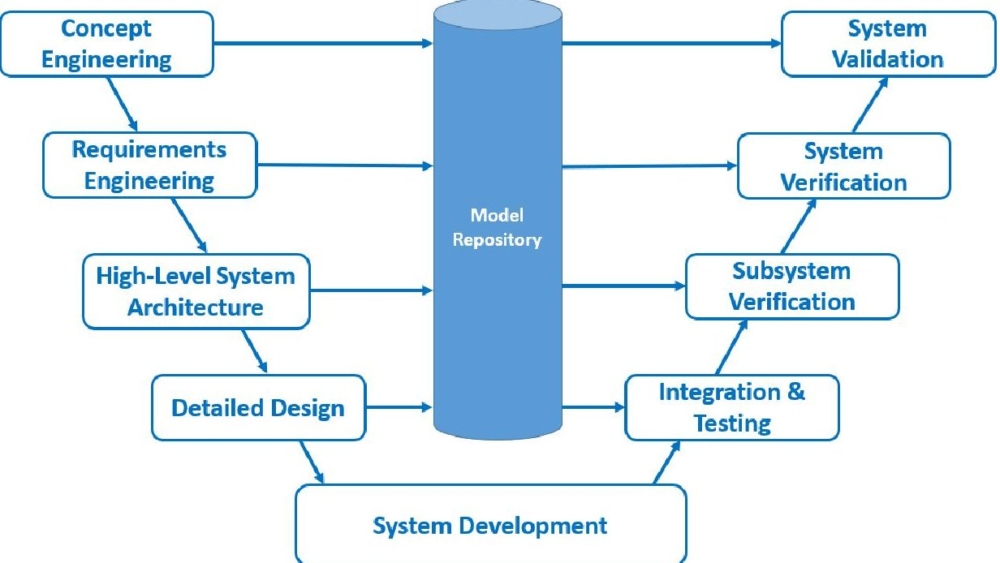

Figure 36. MBSE Life-Cycle V-Model [Adapted from [47]]

<!-- PDF_PAGE: 97 -->

## 5.2 Concept Engineering

The term Concept Engineering was first used by the authors of [77] to describe the activities performed in the early phase of a complex systems life cycle. In various sectors such as defense, aerospace, and automotive industries, different terminology exists which describe the life-cycle phase, crucial activities performed during this phase and expected outcomes. The Department of Defense (DoD) description of concept engineering as stated in [19] describes it as the phase of systems engineering life-cycle prior to requirements elicitation, system architecting and design, during which the developer "rapidly elucidate the needs, explore solutions, develop a concept of operations and derive requirements for material solutions." In the Space and Aerospace industry, the term "Concept and Technology Development " is used to describe the set of activities that are performed during the early phase of the system life-cycle [91]. In the Systems Engineering Book of Knowledge (SEBoK) [13], "Conceptual Design " is the term used to describe the early phase of systems engineering activities.

A key deliverable from the concept engineering phase of the system life-cycle process is the Concept of Operations (ConOps) document. A CONOPS (document) as defined by INCOSE in [32] "is a document (model) produced early in the requirements definition process to describe what the system will do and why, It should also define critical, top-level performance requirements or objectives ". A ConOps describes the desires, operational need and user expectations of the proposed system without requiring it to be stated in a formal way or requiring the provision of a testable specification. This document (model) bridges the gap between all stakeholders by communicating to them an agreed upon perspective of the operational boundaries, the measures of effectiveness, standards of acceptance and system design. Shown in Table. 15 are various organizational standards that have defined guidelines for the development of a ConOps.

The primary reason for engaging in conceptual design activities is to establish conceptual integrity through out the system definition and development process. Conceptual integrity is defined in [67] as the enforcement of a single conceptual model and the absolute compliance with that model by all development personnel. During the concept development phase, the

<!-- PDF_PAGE: 98 -->

system/project need, is captured alongside the system goals, objectives and stakeholder needs.

Table 15. Concept of Operations Standards & Definitions)

<table border="1"><tr><td>Organization</td><td>Standard Name</td><td>CONOPS Definition</td></tr><tr><td>ISO</td><td>ISO/IEC/IEEE 29148</td><td>A ConOps is a user-oriented document that describes system characteristics for a proposed system from the users viewpoint. It is used to communicate overall quantitative and qualitative system characteristics to the user.</td></tr><tr><td>ANSI/AIAA</td><td>G-043A-2012</td><td>A ConOps is document that explains how a system will be employed. It communicates the system user&#x27;s needs and expectation to the system developer, the system purchaser and other stakeholders.</td></tr><tr><td>NASA</td><td>NPR 7123.1B</td><td>A ConOps describes how the system will be operated during the lifecycle phases to meet stakeholder expectations.It describes the system characteristics from an operational perspective.</td></tr><tr><td>INCOSE</td><td>INCOSE Handbook (2010)</td><td>A ConOps describes the way a system works from the operator&#x27;s perspective.The ConOps includes the user description and summarizes the needs, goals,and characteristics of the system&#x27;s user community.</td></tr></table>

5. 2.1 Model Based System Concept Development Model-based system concept development is an approach to system concept development in which models are used to capture the concept development phase activities of a proposed system. System concepts consist of two perspectives [134]: a concept of operations (ConOps) perspective and an operational concept (OpsCon) perspective. In systems engineering practice, these two perspectives have traditionally been captured using textual documents. This traditional approach suffers from: a lack of precision in describing system characteristics and operational scenarios, inconsistencies between related documents whose information are used in the preparation of the ConOps and difficulty in maintaining synchronization and consistency between stakeholder requirements and system level requirements. This limitation often result in inefficiencies and quality issues that only become apparent during integration and testing [33] phase. Deploying MBSE at the system concept level will enable the systems engineering team to make one complete model of the system, making it possible to trace (verify) the system design back to the stakeholder needs and goals.

<!-- PDF_PAGE: 99 -->

A model based Concept of Operations (ConOps) can be defined as a model produced early in the requirement definition process which describes what the system will do and why. It clearly defines the needs of the stakeholders and the operational boundaries of the high-level system design. Deploying MBSE at the system concept level enables the systems engineering team make one complete model of the system thereby making it possible to trace (verify) the system design back to the stakeholder needs and goals.

In the practice of MBSE it is vital that the modeling activities support the who systems engineering life cycle, this will inevitably include the concept development phase hence this research work aims to capture the system concept development phase using a model-based approach. Modeling the concept development phase improves communication between stakeholders as it enables the visualization of proposed solutions and the processes required to achieve expected system capability. A key benefit of conceptual development modeling as stated in [66] is that it keeps the focus on the concept alone and aids in answering the question "Why am I developing this system?". The ConOps model captures the systems operational scenarios (OpsCon) as a black box; It provides an efficient way to explore, update, and communicate system aspects to the stakeholders while significantly reducing or eliminating dependence on textual documents. Furthermore, explicit traceability between elements of the ConOps is achieved enabling better assessments of the impacts due to changes.

## 5.3 Concept of Operations Model

A Concept of Operations is defined by the INCOSE in [58] as a document (model) produced early in the requirements definition process to describe what the system will do and why. A ConOps is necessary in order to capture all required information needed for the development of system requirements and the design of the system; It places the high-level needs in context leading to a description of the systems operational usage during various mission phases in order to meet stakeholder expectations. A ConOps is treated as a living document (model), subject to changes and updates as appropriate.

A model-based ConOps, can be used by system architects and designers to provide a better

<!-- PDF_PAGE: 100 -->

understanding of stakeholder needs at the beginning of the system design process; it should serve as the starting point of the system requirement analysis and system design phases. Capturing system concepts in a model-based way makes it possible to have a central model with systems engineering artifacts from the various life-cycle phases. The created conceptual model is representative of the most abstract description of how the [mission] tasks will be conducted when the system is available. The Scope Definition Activity represents the primary task in ConOps development.

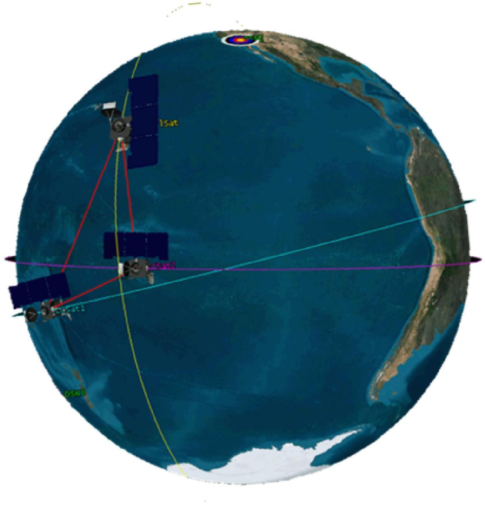

Figure 37. Conceptual Design

<!-- PDF_PAGE: 101 -->

5. 3.1 Mission Description Outlined in this ConOps model is the baseline strategy for relay communications between three formation flying spacecraft deployed in low earth orbit. The network of spacecraft comprises two (2) CubeSats (6U) and One (1) SmallSat. Shown in Figure 37 is a view of the conceptual design while Fig. 38 captures corresponding access time data modeled using the System Tool kit (STK) [54]. The CubeSats will orbit in equatorial low earth orbits (LEO) while the SmallSat will be deployed in a sun-synchronous low earth orbit at a slightly higher altitude than the CubeSats. The satellites will be piggyback aboard a launch vehicle which will assist the CubeSats in achieving orbital insertion. They will utilize their RF-band full duplex links for initial communication with Earth prior to orbital insertion. Once the CubeSats and SmallSat have achieved orbital insertion, the VL transponder will be activated, and they will utilize VL-band full duplex links for communication. Commands will be uplinked to the two formation flying CubeSats via the SmallSat Orbiter orbiting in a sun synchronous orbit. The ISC system will consist of a Hybrid ISC VLX Transponder system capable of full-duplex communication employing the use of either Visible Light (utilizing LEDs) or RF (utilizing X-band) Inter-Satellites Links (ISLs).

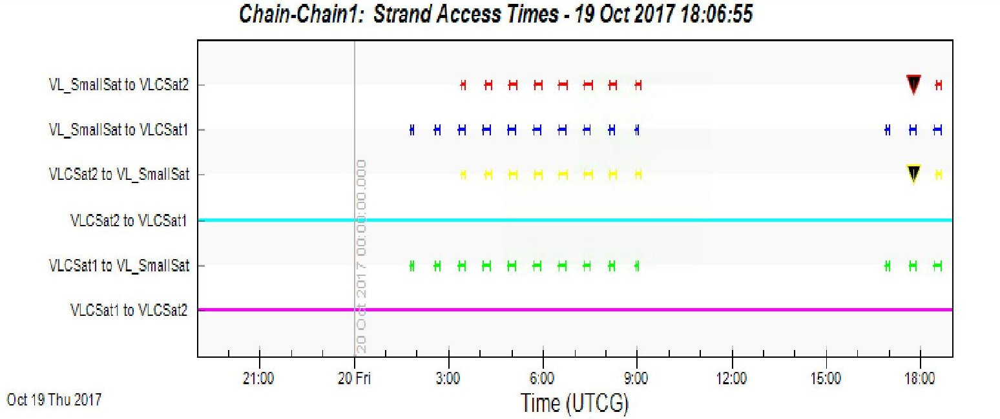

Figure 38. Access Data for Spacecrafts

<!-- PDF_PAGE: 102 -->

## 5.4 Project Scope

The scope definition process provides a crucial foundation for writing proper system requirements which is vital to building a successful system. Scope defining activities are concerned mainly with exclusively capturing externally visible system properties. The ability to define the system scope clearly will directly impact positively the quality of system requirements written. Scoping activities prevent the capturing of incorrect requirements and avoid the omission of key requirements [134].

Applying an MBSE approach to the project scoping process does not change the activities performed or deliverables produced during this phase of concept development. However, the significant difference in employing a model-based approach is in the primary artifact produced which is a system model [114]. The activity diagram depicted in Figure 39 outlines the major activities involved in the project scope definition process. The scope definition action flows into a fork node and is split into multiple concurrent actions using as depicted in the figure. The set of activities that ensue and define the project scope include defining the stakeholder needs, outlining the goals of the project which meet the stakeholder needs; delineating objectives that are specific, concrete, measurable and are associated to goals; developing operational concept along with stating any constraints and assumptions associated with the proposed project.

<!-- PDF_PAGE: 103 -->

act [Activity] ConopsProcess [ConopsProcess]

<table border="1"><tr><td colspan="6">&lt;allocate&gt;Scope</td></tr><tr><td>&lt;allocate&gt;Stakeholder Needs</td><td>&lt;allocate&gt;Goals</td><td>&lt;allocate&gt;Objectives</td><td>&lt;allocate&gt;Scope</td><td>&lt;allocate&gt;Operational Concepts</td><td>&lt;allocate&gt;Assumptions</td><td>&lt;allocate&gt;Constraints</td></tr><tr><td></td><td></td><td></td><td>Begin Scope Definition Process</td><td></td><td></td><td></td></tr><tr><td>Begin stakeholder needs analysis process</td><td>stakeholder needs</td><td>Begin goal definition process with stakeholders</td><td>goals</td><td>Begin operational concept development process</td><td>Begin assumption definition process</td><td>Begin system constraints definition process</td></tr><tr><td>Define stakeholder Requirements</td><td>stakeholder requirements</td><td>Project goal defined and accepted by key stakeholders</td><td>Objectives defined based on agreed goals</td><td>Operations concepts development activities</td><td>Assumptions defined</td><td>Constraints Defined</td></tr><tr><td>stakeholder requirements</td><td>stakeholder requirements</td><td>goals</td><td>objectives</td><td>operations concepts developed</td><td>assumptions</td><td>constraints</td></tr><tr><td></td><td></td><td></td><td>stakeholder requirements</td><td>OpsCon</td><td>assumptions</td><td>constraints</td></tr><tr><td></td><td></td><td></td><td>System scope defined &amp; Scoping Activity concluded</td><td></td><td></td><td></td></tr></table>

Figure 39. Scope Definition Activity

<!-- PDF_PAGE: 104 -->

5. 4.1 Identify Stakeholder Needs The stakeholder needs definition process involves activities geared towards eliciting clear and concise needs for the proposed project. In [62] a need is defined as a generic abstract concept that, when put into a Context, represents something that is necessary or desirable for the subject of the Context. Care must be taken to identify all stakeholders during the elicitation process to ensure that needs which may arise through out the life cycle of the project are all considered. The various activities performed during the Stakeholder Needs Analysis Phase are captured using the Activity Diagram portrayed in Figure 40 depicts the Once stakeholder need statements have been elicited and modeled, they will then be further clarified and translated into more engineering-oriented language in a set of stakeholder requirements to enable proper architecture definition and requirement activities [112]. The output of the stakeholder need definition activity which are the resulting stakeholder requirements are fed as an input into the operations concept activity. The pivotal stakeholder need is captured in the statement:

- SN-100: "Enable and support a growth path for Inter-Satellite Communication among Formation_Flying SmallSats and CubeSats in Low Earth Orbit".

5. 4.2 Stakeholder Defined Missions Inter-satellite communication architectures require a comprehensive set of functional capabilities to accomplish a range of stakeholder missions. The stakeholder missions depicted below portray capabilities that the baseline ISC system architecture must be capable of performing.

- SM-100: "Support Earth Observation activities in Low Earth Orbit"

- SM-200: "Support Earth Mission activity in Low Earth Orbit"

- SM-300: "Support Commercial Human Spaceflight activity in Low Earth Orbit"

5. 4.3 Defining Project Goals The goal(s) definition process helps define the project's outcome based on the identified need. Goals must trace to the needs of the project since they represent the big picture of what the final outcome will be [66]. Project goal(s) are a clear statement of purpose about the fundamental aim to be accomplished and should directly relate

<!-- PDF_PAGE: 105 -->

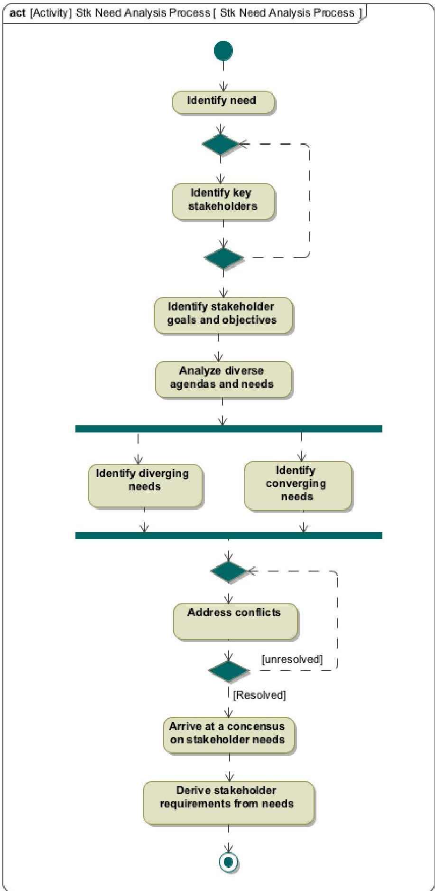

Figure 40. Stakeholder Needs Analysis Activity

<!-- PDF_PAGE: 106 -->

to the stakeholder need statement(s). A project can have one or more goals with each goal having one or more associated objectives. Based on the outcome of the need definition process, the goal of the project is to:

- G-100: "Develop a Hybrid Inter-Satellite Communication System that can be deployed on Small Satellite Systems"

5. 4.4 Defining Project Objectives Project objectives are specific, concrete and measurable statements representing the initiatives that will enable the implementation of the stated goal. Objectives are owned by goals and they outline the performance measures that lead towards the realization of the stated goal. Two objectives associated with the project goal are stated as:

- O-100: "Design a Communication Relay System that utilizes Visible Light Frequencies for its Inter-Satellite Link Capabilities."

- O-200: "Design an Ancillary Communication Relay System with X-Band Inter-Satellite Link Capability"

Shown in Figure 41 is a Requirement Diagram req depicting the relationships between the mission(s), goal, objectives and stakeholder needs that necessitate the need for the proposed ISC system [62] [66]. The stakeholder needs are constrained by the specific mission(s) as shown on the req diagram. The containment relationship connotes the decomposition of the main need into atomic sub-need statements.

<!-- PDF_PAGE: 107 -->

req [Package] Stakeholder Needs [ Mission Concept ]

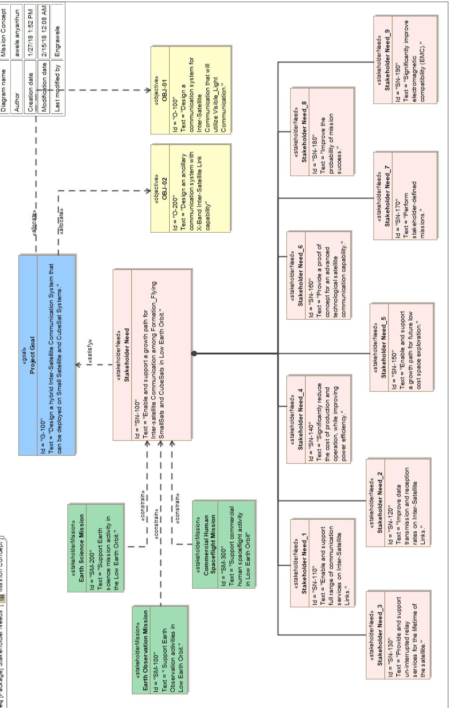

Figure 41. Conceptual Design Missions, Goals, Objectives & Needs

<!-- PDF_PAGE: 108 -->

5. 4.5 Stakeholder Use Case Description Identifying the required use cases for the ISC system is crucial to defining stakeholder requirements. Use cases depict the expected operational capabilities of the proposed system from the point of view of the stakeholders. They represent coherent system functionality, describing how the communication system will be used to achieve the mission's goal. In [40], a use case is defined as a collection of requirements around a system usage. Portrayed in Figure 42 is a use case diagram depicting the stakeholder use cases for the VLX communication system.

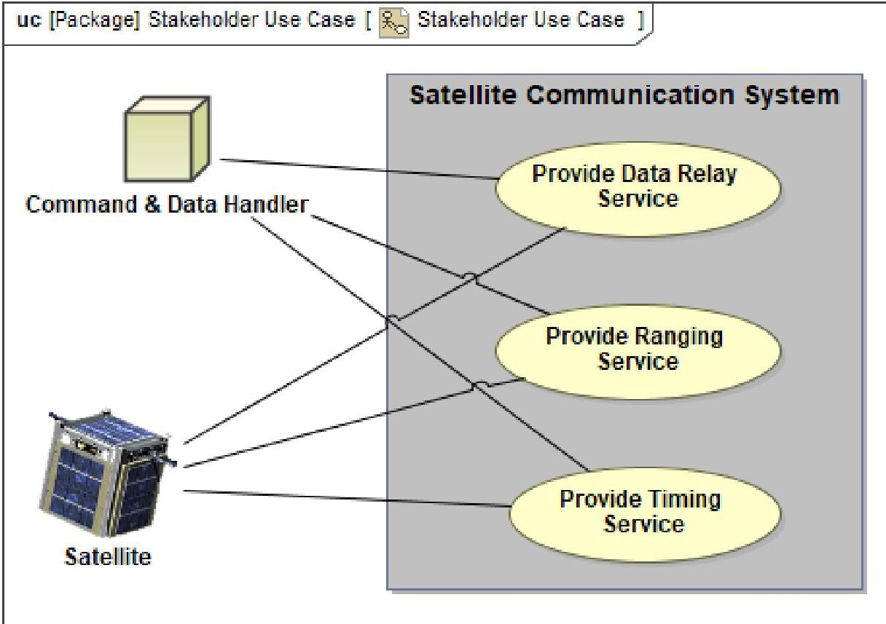

Figure 42. Stakeholder Use Cases

Each identified use case is associated with a use case description. The use case description is an informative statement that describes the scope of the use case. The three identified Stakeholder use cases for the ISC system are stated as: Provide Data Relay Services, Perform Ranging Services and Provide Timing Services. Each use case description portrayed in Tables. 16,17 and 18 each consist of:

- Name - serves as a unique identifier for the use case

- Purpose - briefly describes what the stakeholders intend to achieve with the use case;

<!-- PDF_PAGE: 109 -->

- Summary - a brief overview that captures the quintessence of the use case

- Actors - represent a role played by a user or subsystem that interacts with the proposed system

- Pre-Condition - conditions /assumptions that must be true of the state of the system to initiate the use case

- Post-Condition - these are conditions that will be true of the state of the system after the use case has been completed

- Invariants - conditions that will remain unchanged.

5. 4.6 Allocate Stakeholder Requirements to Use Cases Following the completion of the stakeholder use case identification activity, stakeholder requirements are allocated to stakeholder use cases. Stakeholder requirements are the means by which stakeholder expectations are communicated to system designers; by allocating these requirements to use cases, traceability of system usage to requirements is enforced. The iterative nature of the modeling process enables additional identified requirements be added and the model updated.

The allocation matrix shown in Figure 43 is used to trace each of the stakeholder requirements to system use cases. Developing the matrix helps ensure that each stakeholder requirement is covered by a use case, thereby aiding the validation process.

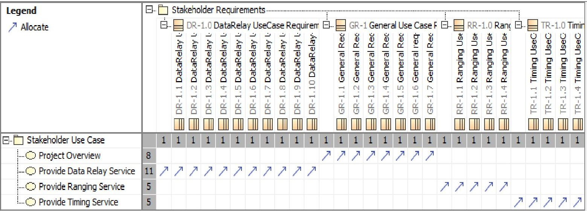

Figure 43. Use Case Traceability Matrix

<!-- PDF_PAGE: 110 -->

## 5.5 System Effectiveness Measures

Defining the system scope represents the starting point for determining effectiveness measures [55]. Measures of Effectiveness (MOE) and Measures of Performance (MOP) represent two effectiveness measurements utilized in systems engineering for tracking important and essential performance parameters. Measure of Effectiveness are a measure of how well an operational task is accomplished through using a system, it represents the operational measures of success that are closely related to the achievement of the mission or operational objectives being evaluated. They reflect mission level performance requirements [128] [106]. In [94], MOEs are referred to as measures designed to correspond to accomplishment of mission objectives and achievement of desired results. An MOE can represent an aggregation of MOPs implying that MOEs may be further decomposed into Measures of Performance (MOP). Measure of Performance is the measure that characterizes physical or functional attributes relating to the system operation, measured or estimated under specified testing and/or operational environment conditions. They are derived from dimensional parameters. The MOPs are used to determine whether the system meets performance requirements necessary to satisfy the MOE.

Measures of Effectiveness provide quantifiable benchmarks against which the system concept and implementation can be compared. Choosing incorrect MOEs will result in a system that does not meet customer expectations [55]. The author in [122] suggested that Measures of Effectiveness are required to answer the question "Does this system meet my need?" and defined MOE as "standards against which the capability of a solution to meet the needs of a problem may be judged." MOEs can be captured using a parametric diagram. Figure 44 depicts a parametric diagram modeled to capture a high-level MOE. The diagram shows the relationship between the high-level MOE - Communication System Effectiveness, and the lower-level MOEs - Probability of Continuous Connectivity, Data Security, Robustness and Resilience. Furthermore, the MOPs aggregated to form some of the lower-level MOEs are also captured in the parametric model.

<!-- PDF_PAGE: 111 -->

par [Block] System Effectiveness Analysis [ System Effectiveness Analysis ]

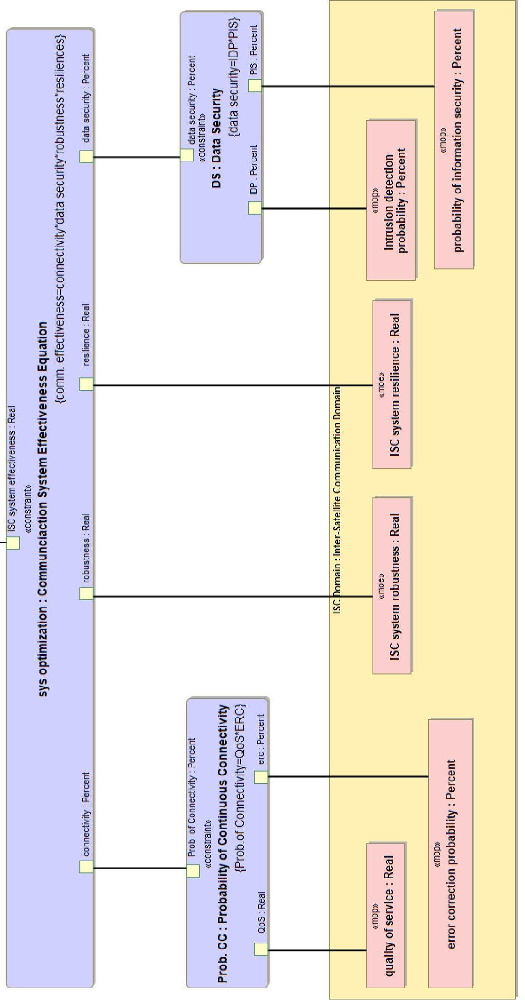

Figure 44. Measure of Effcetiveness Analysis

<!-- PDF_PAGE: 112 -->

## 5.6 Operation Concept Model

The Activity Diagram outlined in Figure 45 captures the process and activities performed during the development of the VLX communication system operational concept model.

The proposed VLX communication system consists of a Hybrid Visible Light (via LEDs) and RF (X-Band) Transponder capable of providing communication services via Inter-Satellite Links. The VLX system will be capable of delivering high data rates (Gbits) as well as near real-time data from the satellite payload. The system as a whole provides a long life-time capability guarantee due to the durability and reliability of light emitting diodes.

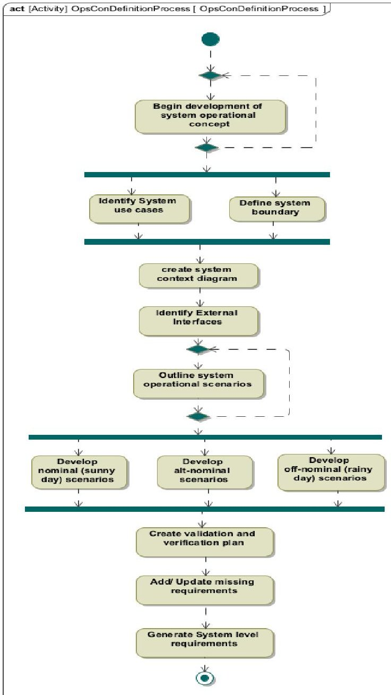

Figure 45. Operational Concept Activity

<!-- PDF_PAGE: 113 -->

The orbiting SmallSat will communicate primarily with the formation flying CubeSats via the Visible Light (VL-Band) full duplex links. The CubeSats once deployed and in orbit will communicate and relay payload and engineering data via their VL-band inter-satellite links to the SmallSat for onward relay to earth. The communication system shall employ the use of Light Emitting Diodes (LEDs) for the transmitter optical frontEnd. Stringent quality of services requirements necessitate a robust relay communication system design that will exhibit single fault tolerance; hence the ISC system RF (X-band) full-duplex communication link system will fulfill the role of an ancillary communication system reserved as a back-up system in the case of a fault or failure of the primary VL-ISL.

5. 6.1 System Context and Boundary Definition The system context establishes the framework within which the system-of-interest will operate. The objective of the system context definition process is meant to focus attention on external factors that need to considered when developing the system requirements. It portrays all external entities that will interact with the system thereby helping to describe the black box functional view and define the system boundary. Defining the system boundary helps identify what is external and internal to the system-of-interest and is used as a communication tool early in the system conceptual design to get an agreement on the scope of the system requirements. The system context model is one of the most crucial parts of the system model as it captures the system's relationship with its environment while also capturing its interfaces with external systems. A simplified view of the system context modeled using a use case diagram is shown in Figure 46 [133].

5. 6.2 Identify External Interfaces Identifying and defining all external interfaces during the concept definition phase aids in risk assessment and eliminates the need for costly system modifications due to bad interface assumptions. A system is especially vulnerable at its interfaces, therefore it is extremely critical to identify external interfaces with other systems early to reduce system development cost. Identifying these external interfaces early equate to identifying key drivers for the system that must be addressed in the requirements model. The communication system external interfaces can be identified from the Context Diagram portrayed in Figure 47.

<!-- PDF_PAGE: 114 -->

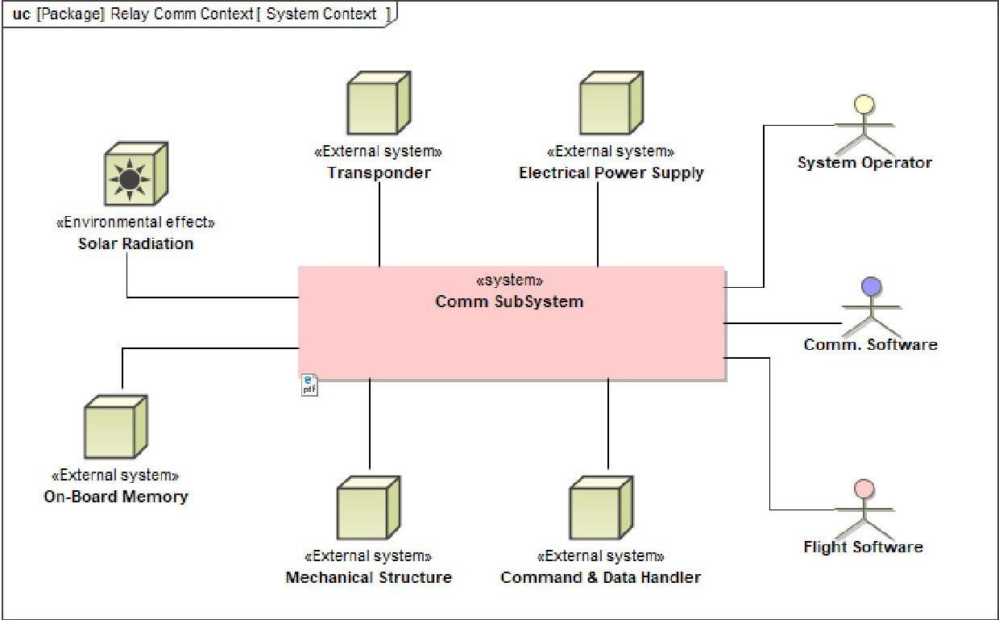

Figure 46. ISC System Context View

The Relay Communication Subsystem external interfaces include Electrical Power Supply (EPS) system, Structural Support, Command & Data Handling (C&DH) system, Communication Software, Transponder, Onboard Storage system.

5. 6.3 Use Case Operational Scenarios Defined stakeholder use cases are developed using behavioral diagrams to produce high-level system scenarios. In [14], operational scenarios are described as a set of dynamic exchanges between functions that allow the system to achieve a mission or service. Operational scenarios are pivotal to operational concept development as they enable visualization and promote understanding of how the system is supposed to react under various nominal, alt-nominal and off-nominal usage. The sequence diagram is used to highlight operational scenarios; these scenarios provide the basis for generating comprehensive system requirements. Key system features can be omitted during system design if this phase of OpsCon development is not adequately captured in the system concept model. During operational scenario development, scenarios are broadly classified into two (2) groups: Nominal ("Sunny Day") scenarios and Off-Nominal ("Rainy Day") scenarios. A collection of nominal and non-nominal scenarios provides a more complete description of a system and is, therefore, more useful in analysis

<!-- PDF_PAGE: 115 -->

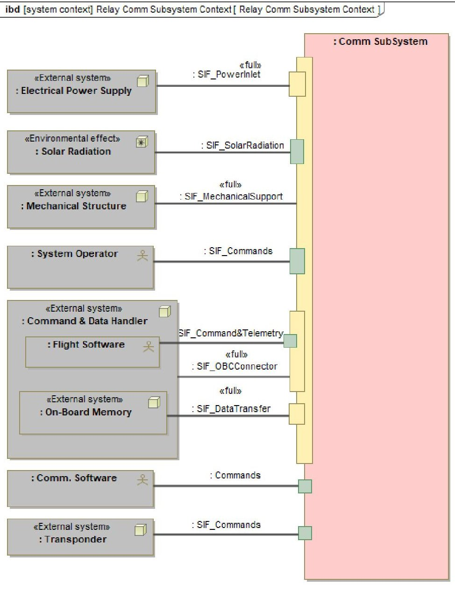

Figure 47. Descriptive ISC System Context View

and verification [135]. For our proposed system, however scenarios are classified into two (2) or three (3) groups namely: nominal, alt-nominal and off-nominal depending on the stakeholder use case.

## 5.6.4 Provide Data Relay Services Use Case

5. 6.4.1 Data Relay Use Case Description: The Provide Data Relay use case description for the proposed ISC system is outlined in Table.16. The description conveys the scope of the use case with regard to system usage.

5. 6.4.2 Stakeholder Requirements Allocation: As stated in [40], allocating stakeholder requirements to use cases provides one of many avenues for visualizing requirements. Allocating

<!-- PDF_PAGE: 116 -->

Table 16. Provide Data Relay Services Use case Description

<table border="1"><tr><td colspan="2">DATA RELAY USE CASE DESCRIPTION</td></tr><tr><td>Name</td><td>Provide Data Relay Services</td></tr><tr><td>Goal</td><td>Provide full-duplex relay sessions with designated assets.This includes receiving and forwarding commands and payload data.</td></tr><tr><td>Summary</td><td>The relay communication system will support inter-satellite relay services via VL-band full duplex links.It will have the capability to transmit payload and house keeping data via VL-ISL to any assets whenever access exists between both assets.It will also have the capability to receive payload and house keeping data its inter-satellite links.</td></tr><tr><td>Actors</td><td>Communication Software, Transponder, Antenna</td></tr><tr><td>Pre-Condition</td><td>1. A LoS configuration must exist between communicating assets2. Adequate storage capacity must be available3. There is available data to be transmitted/received.</td></tr><tr><td>Post-Condition</td><td>1. Receiving asset acknowledges receipt of data2. Successful transmission of data.</td></tr><tr><td>Invariants</td><td>LoS between any two communicating assets can always be established.</td></tr></table>

requirements in this manner enforces traceability of requirements to system usage by ensuring that each stated stakeholder requirement is satisfied by the "to be built" system via its allocation to a stakeholder use case. The data relay use case and requirements allocation diagram shown in Figure 48 portrays the use case that fulfills the specific stakeholder requirements.

5. 6.4.3 Data Relay Use Case Scenarios: The data relay use case scenarios are captured using sequence diagrams. The three sequence diagrams portrayed in Figure 49, Figure 50 and Figure 51 describe the interactions between the actors and the ISC system as it executes the data relay use case. The actors involved in interactions with the system are: communication software, transponder and antenna.

a) Nominal Scenario: The sequence diagram shown in Figure 49 represents the data relay use case nominal scenario. This sunny day scenario depicts the standard flow of actions between the actors and the system during the execution of the data relay use case while employing the

<!-- PDF_PAGE: 117 -->

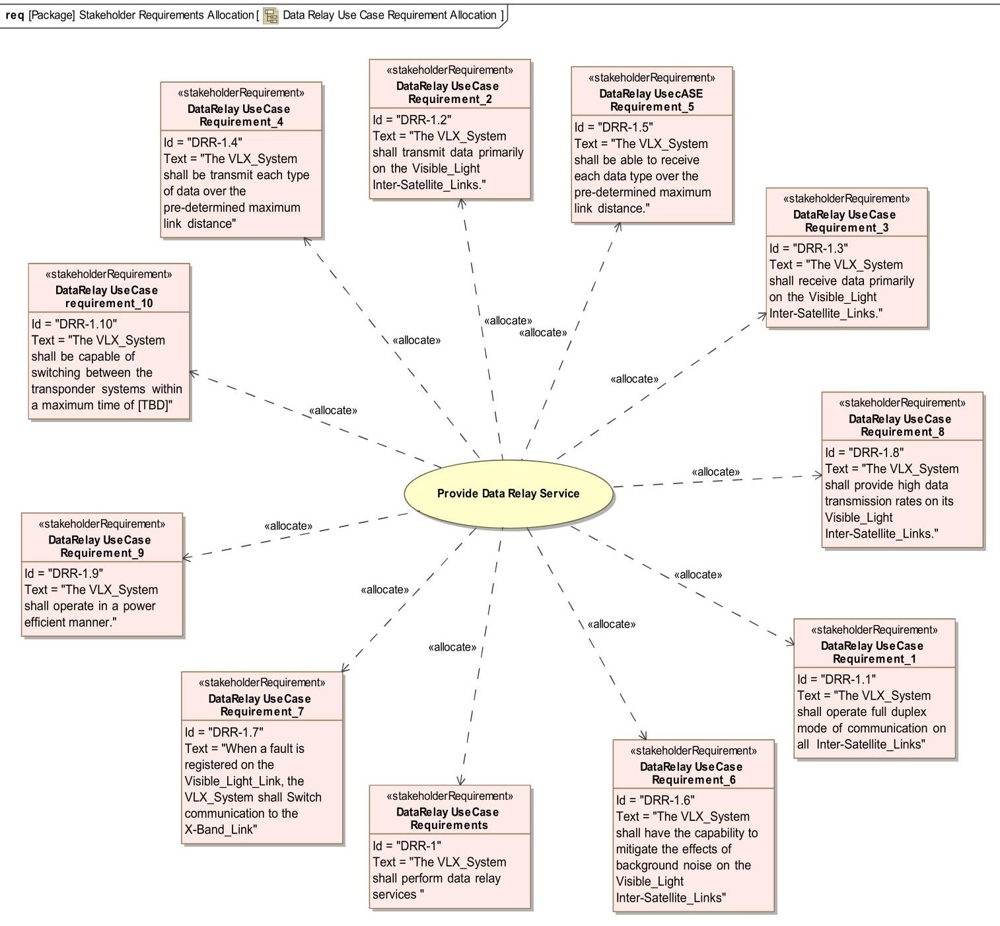

Figure 48. Stakeholder Requirements Allocation

use of its VL full-duplex links. The standard flow represents the main capability provided by the system for this use case. The communication software actor (stkComm.SW) sends a confirm LoS Access message to trigger the system to hail the designated asset; once the hail is accepted, the system locks on to the signal and relay communication commences. The interaction operator par signifies the simultaneous activities of transmission and reception of data on its VL full duplex links. Once the relay session is concluded the system enters into a standby state to conserve spacecraft power.

<!-- PDF_PAGE: 118 -->

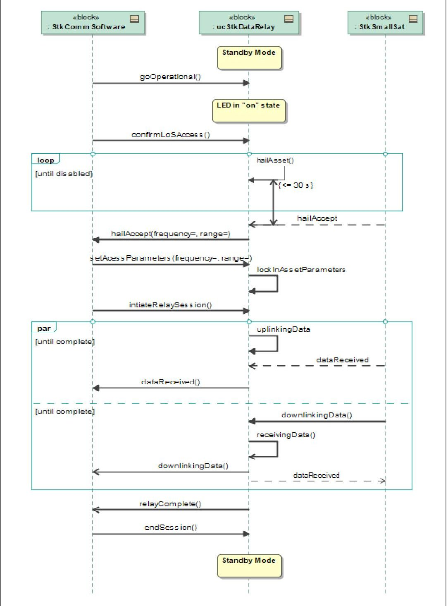

Figure 49. Data Relay Nominal Scenario

b) Alt-Nominal Scenario: The Alt-nominal scenario represents the flow of actions other than those described in the nominal scenario that still achieve the expected outcome of data/commands relay. These scenario entails the relay of data/command using RF full-duplex links. The alternate-nominal scenario for the data relay use case is modeled using the sequence diagram shown in Figure 50.

<!-- PDF_PAGE: 119 -->

Figure 50. Data Relay Alt-Nominal Scenario

c) Off-Nominal Scenario: Modeling off-nominal scenarios enable us focus on potential problems that can arise during system usage. In this scenario, the system is not able to achieve the goal of the data relay use case. A fault is registered when the system attempts to hail an asset but is not successful signifying that it can not establish access with the designated asset. The off-nominal scenario captured using the sequence diagram shown in Figure 51 represents a scenario in which the desired goal (successful data relay) is not achieved.

<!-- PDF_PAGE: 120 -->

Figure 51. Data Relay Off-Nominal Scenario

5. 6.4.4 Data Relay Activity: The activity diagram portrayed in Figure 52 captures the behavior of the system as it executes the data relay use case. The executable model emphasizes the actions that are executed during the data relay use case activities and models the control flow of actions being executed. The activity begins with an initiate data relay action from the flight software actor stkFlightSoftware. the system hails the designated asset by sending a hail signal. Once the hail accept signal is received back from the asset, the stkFlightSoftware is alerted. The fork node duplicates the control flow coming from the begin communication action unto the outgoing flows that lead to the actions of transmitting and receiving.

<!-- PDF_PAGE: 121 -->

act [Activity] DataRelayUseCase [ DataRelayUseCase ]

Figure 52. Activity Diagram for Data Relay Use Case

5. 6.5 Perform Ranging Use Case In order to fulfill the navigation requirements for the formation flying satellites, ranging services are required on the inter-satellite links (ISLs). Maintaining a continuous LoS between the CubeSats requires acquiring continuous ranging data

<!-- PDF_PAGE: 122 -->

for orbit determination and correction.

5. 6.5.1 Ranging Use Case Description: The Provide Ranging Services use case description for the proposed ISC system is outlined in Table.17. The description conveys the goal of the ranging service to be performed. It lists the actors involved in performing the use case, the pre- and post- conditions associated with the ranging use case.

Table 17. Provide Navigation Services Use case Description

<table border="1"><tr><td colspan="2">PERFORM RANGING USE CASE DESCRIPTION</td></tr><tr><td>Name</td><td>Provide Navigation Services</td></tr><tr><td>Goal</td><td>To provide knowledge of spacecraft asset positions and improve navigation of asset.</td></tr><tr><td>Summary</td><td>The Relay communication communication system will be capable of providing navigation services by collecting ranging data when in contact with other assets.</td></tr><tr><td>Actors</td><td>Flight Software, Transponder</td></tr><tr><td>Pre-Condition</td><td>Ranging capability and 1-way Doppler tracking is available with visible light</td></tr><tr><td>Post-Condition</td><td>Navigation data is reliable to be used in steering spacecraft assets.</td></tr><tr><td>Invariants</td><td></td></tr></table>

5. 6.5.2 Ranging Requirements Allocation: The stakeholder requirements allocated o the perform ranging use case are depicted on the requirement diagram shown in Figure 53. Capturing the requirement-use case allocation in the OpsCon model ensures traceability between system usage and stakeholder requirements.

<!-- PDF_PAGE: 123 -->

Figure 53. Stakeholder Requirements Allocation

5. 6.5.3 Ranging Use Case Scenarios The ranging use case represents the interactions between actors and the system with the aim of fulfilling a specific use case (goal) of the system. The actors in this use case are the flight software and a designated spacecraft asset (CubeSat or SmallSat) transponder. The ranging use case scenarios (Nominal & Off-Nominal) are presented using the sequence diagrams in Figure 54 and Figure 55. The sequence diagrams represent the interaction between the actor- CommSW & stkSmallSat or CubeSat transponder and the ISC system as it performs the functions necessary to fulfill the use case.

a) Nominal Scenario: In the use case scenario shown in Figure 54, inter-satellite ranging use case is initiated by the flight software (stkFlightSoftware) sending a message to the system to compute the range between two communicating assets. The system then proceeds to generate pseudo-random noise code ranging signal which is modulated unto the carrier. The transmitted signal is detected, regenerated, re -modulated and re -transmitted. The

<!-- PDF_PAGE: 124 -->

re-transmitted carrier is detected by the sending system after which the range is measured.

Figure 54. Ranging Service Nominal Scenario

b) Off-Nominal Scenario: The off-nominal scenario for the navigation service use case is depicted in the sequence diagram shown in Figure 55. A fault with the LED transmitter occurs when the system is in operation causing the carrier not to be transmitted to the assets for which it needs to determine its range and distance.The system detects the fault and alerts the on-board computer via the flight software.

<!-- PDF_PAGE: 125 -->

Figure 55. Ranging Service Off-Nominal Scenario

5. 6.5.4 Ranging Use Case Activity: The activity diagram depicted in Figure 56 represents the ranging use case activity. The high-level activity diagram is a black box view of the system behavior and portrays the different actions allocated to the actors system use case as the ranging behavior activity is performed. The receipt of the command input parameter by the CommSW causes the actor to execute the initiate inter-sat ranging action. The activity diagram shows the

<!-- PDF_PAGE: 126 -->

input and output to certain actions and the sequence of actions that are executed as the ranging use case activity progresses. This executable behavior model represents a high-level view of the ISC system activity as it executes the use case.

Figure 56. Activity Diagram for Ranging Use Case

## 5.6.6 Provide Timing Services Use Case

5. 6.6.1 Timing Use Case Description: The Provide Timing Services use case description for the proposed ISC system is outlined in Table.18. The description conveys the scope of the use case with regard to system usage, stating the pre-conditions that must exist in order to execute the use case and the post-conditions that are expected to occur once the use case is executed. The goal of this use case is to provide time correlation activities by ensuring all transfer frames are time-stamped.

<!-- PDF_PAGE: 127 -->

Table 18. Timing Services Use case Description

<table border="1"><tr><td colspan="2">TIMING SERVICES USE CASE DESCRIPTION</td></tr><tr><td>Name</td><td>Provide Timing Services</td></tr><tr><td>Goal</td><td>Provide service for time correlation activities by the collection of time stamped data for both transmitted and received data.</td></tr><tr><td>Summary</td><td>The Relay Communication system will be used to provide time correlation activities for both transmitted and received data. It will accomplish this by ensuring every data frame transmitted or received is time stamped. This service requires the use of a communication protocol that provides the mechanism for time correlation and for transferring time between communicating assets based on the propagation delay of the speed of light.</td></tr><tr><td>Actors</td><td>Communication Software, On-board Storage, transponder</td></tr><tr><td>Pre-Condition</td><td>1. The communication protocol supports time correlation activities (time stamping the departure &amp; arrival time of transfer frames)
2. Asset clock stability is ensured to support accurate time stamping.</td></tr><tr><td>Post-Condition</td><td>Time stamped transfer frames will be available for down-link to earth.</td></tr><tr><td>Invariants</td><td>Spacecraft assets will be deployed with spacecraft clocks.</td></tr></table>

5. 6.6.2 Timing Requirements Allocation Stakeholder timing requirements are allocated to the timing service use case via the allocate relationship as depicted in the req diagram shown in Figure 57. Performing this activity ensures that each initial stakeholder timing requirement is allocated to the systems timing service use case.

5. 6.6.3 Timing Services Use Case Scenarios The nominal and off nominal scenarios describe the interaction between the system and actors as time stamping activities are performed by the communication system. The timing service use case entails the transmitting and receiving of time-stamped data frames by the communication system. The collection of time stamped data frames supports time correlation activities.

<!-- PDF_PAGE: 128 -->

Figure 57. Allocation of Requirements to Timing Services Use case

a) Nominal Scenario: The nominal scenario for the Provide timing Services use case is portrayed in Figure 58. In this scenario, the relay system supports the collection of time stamped data for both transmitted and received data frames. The time stamp provides an accurate way to assign a relative time to each telemetry frame. The actor (comm. software) signals the system to initiate data frame time stamping activity. The time stamping can occur in parallel on both transmitted and received data frames hence the use of the par operand. The received time stamp data frames are then stored in the On-board storage for further analysis when needed.

<!-- PDF_PAGE: 129 -->

Figure 58. Timing Service Nominal Scenario

b) Off-Nominal Scenario: The Timing Service off-nominal scenario shown in Figure 59 indicates a fault with the time stamping mechanism (protocol) used on-board the spacecraft. An error occurs when received or transmitted data frames are not time stamped or when it is perceived that the time stamp is off by a large margin. A fault status is registered and sent to communication software (actor).

<!-- PDF_PAGE: 130 -->

Figure 59. Timing Service Off-Nominal Scenario

5. 6.6.4 Timing Services Activity: The timing service use case activity behavior is represented by the activity diagram portrayed in Figure 60. The executable behavior model depicts the time-stamping activity and the respective actions that are executed as transfer frames are time-stamped. the on-board time is time-stamped on both transmitted and received data frames.

<!-- PDF_PAGE: 131 -->

**act** [Activity] TimingService UseCase [ TimingService UseCase ]

Figure 60. Timing Service Activity Diagram

5. 6.7 Validation, Verification and Test Plan Creation Activity A Validation, Verification, and Test (VV&T) plan define the scope of work required to test, verify and validate a system. It provides guidance and establishes a comprehensive plan to communicate the nature and extent of testing necessary for a thorough evaluation of the system.

A verification, validation and test plan is created during the OpsCon definition activity. The plan created at this phase of conceptual development outlines activities that will need to be performed and the requirements for each activity [44] [65]. VV&T as stated in [17] is not a phase or step in the life-cycle of a system, but a continuous activity throughout the entire life-cycle and

<!-- PDF_PAGE: 132 -->

as we progress through the life-cycle phases, the VV&T plan becomes more specific and detailed. The various activities performed in the preparation of the VV&T plan is portrayed in the Activity diagram shown in Figure 61.

Figure 61. Verification, Validation and Test (VVT) Plan Activity Diagram

5. 6.8 Add/Update Missing Requirements Modeling scenarios using sequence diagrams leads to the identification of missing stakeholder requirements. The Creation of use case scenarios facilitate discussions with stakeholders concerning their expectations of the systems desired capability; this usually leads to the addition of one or more requirements. The creation of both nominal and off-nominal scenarios for our relay communication system has lead to the identification of some missing requirements and also the addition of some requirements based on desired system capability. One of such requirements requires faults to be detected within 30 microseconds of the occurrence of the fault. For safety critical systems it is desired that faults be detected as early as possible. As earlier stated, an iterative life-cycle process is applied to the design allowing the design to occur in stages.

<!-- PDF_PAGE: 133 -->

5. 6.9 Defining Assumptions Defining Assumptions Activity focuses on defining assumptions that might affect the success, functionality or operate-ability of the relay communication system. When dealing with complex systems, some vital decisions are usually taken with varying degrees of uncertainty. Most of these decisions are based on predefined assumptions that must be tested during various life-cycle phases. Assumptions are statements about some characteristic of the proposed system that underlies the current design, and they are treated as valid until proven otherwise. Assumptions are self-imposed but necessary in order to permit planning/design activities to continue. Some stated assumptions captured in the ConOps model are portrayed in Table.19.

Table 19. Stated Assumptions

<table border="1"><tr><td>ID</td><td>ASSUMPTIONS</td></tr><tr><td>A-01</td><td>Light Emitting Diodes(LEDs) capable of transmitting data over link distances of≈5km can be designed and manufactured.</td></tr><tr><td>A-02</td><td>CCSDS Space communication protocols are mature enough to be used on visible light Inter-Satellite communication links</td></tr><tr><td>A-03</td><td>All Technology needs are achievable</td></tr></table>

5. 6.10 Identifying Constraints An important activity during the ConOps and scope definition process is delineating the constraints on the system being designed. Designs are driven by various outside influences over which we have no control. Example of external drivers that impose constraints are regulations, standards, laws, communication protocols, equipment etc. During the conceptual development phase, identifying constraints imposed by external drivers enables us to assess their impact on the system during the early phase of system development.

A constraint is defined in [99] as a limitation or implied requirement that constrains the design or implementation of the systems engineering process. The Constraints captured in the ConOps model represent restrictions on the degree of freedom available in providing a conceptual design solution for the proposed system. They are effectively global requirements that restrict the way the system is developed. Constraints can present as a decision by key stakeholders that restricts

<!-- PDF_PAGE: 134 -->

the way the system should be developed, they can also be technical, economic, environmental, or pertain to the target environment or the system itself. Shown in Table. 20 is a summary of major constraints applicable to the relay communication system and captured in the ConOps Model.

Table 20. Summary of Constraints

<table border="1"><tr><td>ID</td><td>CONSTRAINTS</td></tr><tr><td>C-01</td><td>VL-Band full-duplex links will be used only on the CubeSat Inter-Satellite links and the proximity link between the CubeSats and the CubeSat.</td></tr><tr><td>C-02</td><td>VL-Bands full-duplex links must lie within Fraunhofer lines</td></tr><tr><td>C-03</td><td>The relay communication system will be deployed on CubeSats with standard sizes of 6U and higher</td></tr><tr><td>C-04</td><td>Satellite orbits must be constrained to ensure existence of direct Line of Site (LoS) between orbiting satellites.</td></tr></table>

## 5.7 ConOps Maturation and Phases

The ConOps as stated earlier is regarded as a living document that should be drafted before the proposed system design and updated throughout the systems engineering life-cycle such that as the system matures, the ConOps becomes more definite and precise with portraying higher levels of detail. ConOps Maturity Phases adapted from [43] for this work include: The ConOps Initial Phase, ConOps Discovery Phase and ConOps Deployment Phase.

The conceptual design modeled so far represents the Initial phase of the ConOps Maturation process. This maturation phase describes the proposed relay communication system in its most ideal form as a black box comprising all stakeholder desired capabilities. The output of this initial phase leads to the development of the system-level requirements, and it will also serve as a basis for the design of the high-level system architecture.

## 5.8 Chapter Summary

Presented in this chapter, is a model-based Systems concept model for inter-satellite communication between small satellites systems utilizing a hybrid Visible light -RF communication

<!-- PDF_PAGE: 135 -->

system. The conceptual design modeled so far represents the Initial phase of the ConOps Maturation process. Also presented as part of the systems concept model is the operational concept model. Operational concept development is a critical activity performed during the conceptual design phase of a systems life-cycle. It portrays the initial high-level view of the desired operational capability of the proposed system, and provides the basis for system validation. MBSE principles are utilized in capturing the operations of the proposed hybrid Visible-Light/Radio-Frequency (VLX) ISC system. The developed system concept model provides a visual description of the system in its most ideal form as a black box comprising all stakeholder desired capabilities. The output of this initial phase will lead to the development of the system-level requirements and will serve as a basis for the high-level system architecture.

<!-- PDF_PAGE: 136 -->

## CHAPTER 6

## ISC Requirements Engineering Phase

## 6.1 Introduction

The ability to accurately define and capture requirements for a complex system is arguably the most important factor in determining the success or failure of the finished system. This assertion is made based on the direct impact a well articulated and structured requirements specification has on the quality of the finished product and every phase of the system's life-cycle. System requirements are used to specify particular conditions or capabilities that must be satisfied by the developed system; they are also used to specify essential performance conditions which the system must achieve. According to [11], system requirements are all of the requirements at the system level that describe the functions which the system should fulfill to satisfy stakeholder needs and requirements. They constitute a collection of needs expressed by stakeholders stating specific constraints under which the system must operate [118]. Requirements engineering constitutes the branch of system engineering that bridges the gap between the informal world of stakeholder needs and the formal world of system behavior [129].

Requirements specification is the product of the requirements engineering phase. The system requirements specification is the by-product of this phase and plays a critical role in the overall systems engineering process; the specification forms the basis for system architecture design activities, and system integration and verification activities. They represent the reference point for validation and stakeholder acceptance and provide a means of communication between members of the design and development team [11].

Current practices in requirements engineering involve the capture and documentation of requirements largely in textual format. This method of requirement specification documentation is fraught with numerous challenges such as inconsistencies and difficulty in maintaining synchronization between stakeholder requirements and system level requirements. Configuration

<!-- PDF_PAGE: 137 -->

management becomes a herculean task in the face of multiple versions of textual specifications. This limitation often result in inefficiencies and quality issues that only become apparent during the integration and testing phase [33]. The limitations encountered with text-only requirement specification documentation can be addressed by utilizing a model-based approach to requirements engineering. Model-based requirements engineering entails the development of a requirements model that captures the requirements on all levels of the requirement hierarchy and the relationships that exist between them [51]. The model becomes the "single source of truth" and forms the basis of all generated requirement artifacts. The requirements model is stored in a central repository alongside the models relating to other phases of the system design life-cycle.

This chapter focuses on capturing the system requirement specification for the VLX communication system. Section 6.1 outlines the characteristics of good requirements and the sentence structures required for capturing good textual requirements. The concept of model-based requirements engineering is addressed in section 6.2, and this concept forms the basis for the ISC requirements engineering analysis which is described in Section 6.3. The chapter is summarized in Section 6.4.

## 6.2 Requirements Engineering

The term Requirements Engineering (RE) is used to describe the set of activities that translate stakeholder needs into engineered requirements. Requirements engineering is defined in [37] as the "subset of systems engineering concerned with discovering, developing, tracing, analyzing, qualifying, communicating and managing the requirements that define the system at successive levels of abstraction." RE plays a crucial role in every phase of the system development life-cycle.

A vital activity performed during RE is requirement traceability; requirement traceability focuses on transforming high-level requirements, goals, objectives, and needs into system-level and low - level requirements; It also aids in management and assessment of the impact of change across the system development life-cycle. Key RE activities include requirements elicitation, requirement analysis, requirement specification, requirement verification, validation and

<!-- PDF_PAGE: 138 -->

requirement management. It is of vital importance that all RE activities be performed in a consistent and correct manner to ensure validation of the developed system. Poorly performed RE will result in a system that cannot be validated by the stakeholders. An example of the consequences of poor RE activities is portrayed in Figure 62.

Figure 62. Deficient Requirements Engineering [64]

6. 2.1 Requirements Requirements capture the desired capability of a system. The International Council of Systems Engineering (INCOSE) defines a requirement as "A statement that identifies a system, product or process, operational or functional, or design characteristic or constraint, which is unambiguous, clear, unique, consistent, stand-alone and verifiable, and is deemed necessary for stakeholder acceptability [32]." Systems are designed and built to meet the requirements of stakeholders; consequently, as stated in [63], requirements are a property of a system that is either needed or wanted by a stakeholder. Requirements can be classified based on the "Type" or Level of "Abstraction" [111]. Classification according to Type

<!-- PDF_PAGE: 139 -->

of Requirement refers to the nature of the requirement i.e business requirements, functional requirements, non-functional requirements (performance, interface, operational, usability etc.); classifying requirements according to Levels of Abstraction refers to defining requirements based on the specific levels to which they belong within the requirement definition process. Examples of defining requirements based on levels of abstraction include stakeholder, system, subsystem and component level requirements.

6. 2.2 Characteristics of Good Requirements The importance of developing a good requirement specification cannot be over-emphasized, primarily because requirements form the basis for the development of any given project or system. A system is constructed so that the requirements can be met. Poorly captured requirements make it impossible to satisfy the need of the stakeholders. Well-articulated requirements enable the management of risks from the earliest possible point in development [37]. Requirements can be classified as either good (well written) or bad (poorly written) requirements. Characteristics of good requirements based on [74], [107] and [28] [36] include:

a) Necessary: The system to be built should be incapable of functioning in the desired way without the specific requirement. A requirement is not necessary if it can not be traced back to a high-level requirement or need.

b) Appropriate: The specific intent and detail of the requirement should be appropriate to the level to which it refers.

c) Unambiguous: Each requirement should have only one interpretation. The requirement must be stated in a way that leaves no doubt as to the intended meaning.

d) Complete: The stated requirement must be descriptive enough to stand alone.

e) Singular: The requirement statement must include only one requirement statement, be concise and clear.

f) Verifiable: A stated requirement is verifiable if it states something that can be verified by examination, test, analysis or demonstration.

<!-- PDF_PAGE: 140 -->

g) Attainable: The stated requirement must be achievable and must be technically feasible within cost, schedule, legal, and safety constraints.

h) Conforming: The requirement statement must conform to an appropriate standard pattern and style.

The INCOSE guide to writing requirements [36] encourages the use of style guides in writing requirement statements. A style guide promotes consistency across all written requirements and helps set the context within which all other good requirement practices can take effect. An appropriate style guide for requirements writing must contain:

- The definition of the structure of each requirement statement.

- The definition of the structure of requirement sets.

- The definition of the attributes to be used and appended to each of the requirement statements.

Two rules are defined by INCOSE to guide the construction of requirement statement structures. The first states that "the statements must be a single sentence, implying that each requirement should express a single thought in a simple manner." The second rule states that "each requirement statement should be as short as possible." Defined in [107] are three simple sentence structure types used in defining the structure of requirement statements.

1. Requirement Statement Sentence Structure:

[Subject] + [Priority] + [Verb] + [Object]

This simple sentence structure represents the baseline structure for a simple sentence that can be used to express a given requirement statement.

2. Requirement Statement Sentence Structure:

[Condition] + [Subject] + [Priority] + [Verb] + [Object]

This sentence structure can be used in capturing requirement statements in which the subject acts only under certain conditions.

<!-- PDF_PAGE: 141 -->

3. Requirement Statement Sentence Structure:

$$
[ \mathrm {C o n d i t i o n} ] + [ \mathrm {S u b j e c t} ] + [ \mathrm {P r i o r i t y} ] + [ \mathrm {V e r b} ] + [ \mathrm {O b j e c t} ] + [ \mathrm {Q u a l i f i c a t i o n} ]
$$

This sentence structure is used in expressing requirement statements in which it also becomes necessary to provide some qualification to the action.

## 6.3 Model-Based Requirements Specification Using SysML Diagrams

Model Based Systems Engineering (MBSE) represents an approach to systems engineering where the model forms the basis of all of the system artifacts. Some benefits of employing a model-based approach as listed in [63] include:

- A true model results in consistent and coherent views across the whole system architecture.

- When the model is correct, traceability between all the system artifacts and across all life-cycle stages, is inherent in the model.

- There is a true centralized "master" model of the system that will exist, potentially, from all requirements through to low-level design, implementation and, indeed, over the whole life cycle.

Figure 63. Model-based Requirements Engineering

<!-- PDF_PAGE: 142 -->

Model based requirements engineering is an approach to requirements engineering in which all stated requirements beginning from the stakeholder needs, objectives, goals and high-level requirements down to the lower-level requirements are all captured in a central repository alongside the system model as portrayed in Figure 63.

The Systems Modeling Language (SysML) is a general-purpose graphical modeling language designed for engineering applications. Textual requirements can be captured in SysML using requirement tables, matrices and diagrams. As a modeling language, SysML provides graphical representations for the effective modeling of a system's requirements and offers the benefit of verification and validation of the system by allowing system model elements be traced to system requirements [9]. A behavioral model which represents the captured requirements can then be verified through model execution and formal analysis [40].

6. 3.1 Requirements Table In SysML, requirements and their relationships can be represented using requirements tables. This form of representation outlines the various requirements of a system, its relationships and properties in a tabular format. A standard requirements table includes properties to specify the Requirements Unique Identifier which holds a property used to identify a particular requirement, the Requirements Name and Requirements Text which holds the detailed requirements text in separate columns. Depicted in Table 21 is an example of a standard SysML requirements table representation used in detailing the various system requirements, their attributes and relationships.

Table 21. Requirement Table

<table border="1"><tr><td>#</td><td>Id</td><td>△ Name</td><td>Text</td><td>Refined By</td><td>Source</td><td>Satisfied By</td><td>Derived From</td><td>Verified By</td></tr><tr><td>1</td><td>R-01</td><td>R-01 Demo</td><td></td><td></td><td></td><td></td><td></td><td></td></tr><tr><td>2</td><td>R-02</td><td>R-02 Demo_1</td><td></td><td></td><td></td><td></td><td></td><td></td></tr></table>

6. 3.2 Requirements Diagram Requirements diagrams help in creating a defined structure for how requirements need to be specified and the defined semantics to use. The graphical model contains fields for inputing the requirements unique identifier, name, descriptive text and any

<!-- PDF_PAGE: 143 -->

other domain-specific attributes that may be required. Requirement diagrams are used to specify requirements and their relationships. SysML allows the representation of requirements as model elements, allowing them to be defined as part of the system architecture [20]. Shown in Figure 64 are two SysML requirement model elements. A domain-specific "system requirement" stereotype has been applied to one while the other represents a generic SysML requirement element.

Figure 64. SysML Requirement Model Element

6. 3.3 Requirements Relationships Requirements relationships are used to relate the requirements of a proposed system to each other and to other model elements. A major advantage of SysML requirements modeling is that it allows for the concept of requirements reuse across various system models. Six requirement relationships are defined in SysML and they each connote a specific meaning with regard to their usage. Figure 65 portrays a requirement diagram depicting various requirement relations and examples of their usage.

- «Derive» Relation: is used to link a derived requirement back to their source requirement.

- 《Satisfy》 Relation: is used to show that a certain model element satisfies a specific requirement.

<!-- PDF_PAGE: 144 -->

- 《Refine》 Relation: describes how a requirement or model element can be used to further refine a given requirement.

- «Verify» Relation: shows how a specific test case is used to verify a requirement.

- 《Trace》Relation: is used to show that a model element can be traced to a requirement and vice versa.

- «Contain» Relation: provides a means of decomposing abstract or non-atomic requirements into more concrete parts.

Figure 65. SysML Requirement Relationships

## 6.4 ISC Requirements Engineering

The ISC stakeholder requirements result in one or more corresponding system-level requirements. These requirements are captured at a finer level of granularity as decomposition is performed capturing more detailed interfaces, functions and performance expectations of the VLX communication system. The captured system-level requirements represent atomic, unambiguous feasible, understandable, verifiable and correctly derived statements of the VLX

<!-- PDF_PAGE: 145 -->

communication system properties. The identified stakeholder use cases are utilized as the organizational schema for the stakeholder requirements and all subsequent lower-level derived requirements. All requirement analysis activities are performed based on the characterized use cases of the proposed communication system. The main focus of the ISC requirements engineering phase is on the functional, performance and interface requirements of the communication system. These requirements do not capture the internal structure or technology of the system but are rather captured as "black box" requirements. The various requirement views used in portraying the requirements were developed in [7] and conform to the architectural framework for defining ISC system architectures. The views conforming to the architectural framework viewpoints include the: Requirement Description View, Requirement Context View and Requirement Traceability View.

6. 4.1 General Requirements Analysis The stakeholder general requirements refer to requirements that are not captured under any specific use case but are necessary for the proper functioning of the system. The stakeholder general requirements portrayed in Figure 66 refer to requirements concerned with the overall system and are needed for the system to operate as required. The captured general requirements are statements of expected system property or usage and they focus on the general features required by the stakeholders and specify the capabilities the system must satisfy and key performance conditions which they expect the system to achieve. The system-level general requirements are derived from these requirements.

<!-- PDF_PAGE: 146 -->

Figure 66. Stakeholder General Requirements

6. 4.1.1 System-Level General Requirement Specification The system-level general requirements are portrayed in the Requirements Description View captured in Table 22. These system level requirements are derived from the stakeholder general requirements. The captured requirements constitute both functional and non-functional (performance) requirements and must possess the characteristics of being unambiguous, attainable and verifiable. The system-level general requirements constitute requirements that are not overtly stated in the stakeholder requirements but yet are required to satisfy the stakeholder general requirements.

<!-- PDF_PAGE: 147 -->

Table 22. General Requirements Specification

<table border="1"><tr><td>#</td><td>Id</td><td>△ Name</td><td>Text</td></tr><tr><td>1</td><td>SR-1.1</td><td>General Requirement</td><td>The VLX is a satellite communication system for use in enabling inter-satellite communication. The VLX is intended for earth observation, earth science and future commercial space missions in the low earth orbit.The VLX is equipped with a hybrid Visible_Light and X-Band transponder called the VLX_Transponder.The VLX will utilize Visible_Light as the primary Inter-Satellite_Link(ISL) while the X-Band Link will serve as the ancillary ISL.The VLX is a power efficient, radiation tolerant, low cost and robust communication system.</td></tr><tr><td>2</td><td>SR-1.1.1</td><td>General Req_1</td><td>The VLX_System shall provide Inter-Satellite_Communication between the satellites in the Network.</td></tr><tr><td>3</td><td>SR-1.1.2</td><td>General Req_2</td><td>The VLX_System shall withstand temperatures[greater than OR equal to-125℃]AND[less than OR equal to120℃].</td></tr><tr><td>4</td><td>SR-1.1.3</td><td>General Req_3</td><td>The VLX_System shall consist of the hybrid Visible_Light AND X-BAnd_Transponder.</td></tr><tr><td>5</td><td>SR-1.1.4</td><td>General Req_4</td><td>The VLX_System shall consist of Radiation-Hardened Components.</td></tr><tr><td>6</td><td>SR-1.1.5</td><td>General Req_5</td><td>The VLX_System shall forward receivedEngineering_Data to the C&DH_Subsystem.</td></tr><tr><td>7</td><td>SR-1.1.6</td><td>General Req_6</td><td>The VLX_System shall forward Telemetry_Data to the C&DH_Subsystem.</td></tr><tr><td>8</td><td>SR-1.1.7</td><td>General Req_7</td><td>The VLX_System shall forward Command_Data to the C&DH.</td></tr><tr><td>9</td><td>SR-1.1.8</td><td>General Req_8</td><td>The VLX_System Radiation-Hardened components shall withstand radiation doses greater than100krad for Total_Ionizing_Dose.</td></tr><tr><td>10</td><td>SR-1.1.9</td><td>General Req_9</td><td>The VLX_System shall forward Ranging_Data AND Positioning_Data to the C&DH_Subsystem.</td></tr><tr><td>11</td><td>SR-1.1.10</td><td>General Req_10</td><td>The VLX_System shall exhibit Radiation-Hardening for Single_Event_Effects.</td></tr><tr><td>12</td><td>SR-1.1.11</td><td>General Req_11</td><td>The VLX_System shall have an interface with the C&DH_Subsystem.</td></tr><tr><td>13</td><td>SR-1.1.12</td><td>General Req_12</td><td>The VLX_System shall maintain constant Line_Of_Sight access with the VLX_System of the twin CubeSat.</td></tr><tr><td>14</td><td>SR-1.1.13</td><td>General Req_13</td><td>The VLX_System shall consist of one redundant VLX_Transponder.</td></tr><tr><td>15</td><td>SR-1.1.14</td><td>General Req_14</td><td>The VLX_System FrontEnd shall consist of the Optical_FrontEnd AND the X-Band_FrontEnd.</td></tr><tr><td>16</td><td>SR-1.1.15</td><td>General Req_15</td><td>The VLX_System of each CubeSat shall establish Line_Of_Sight access with the SmallSat VLX_System for each pre-determined Pass_Duration.</td></tr><tr><td>17</td><td>SR-1.1.16</td><td>General Req_16</td><td>The VLX_System shall have a mass[greater than][TBD]kg AND[less than][TBD]kg.</td></tr><tr><td>18</td><td>SR-1.1.17</td><td>General Req_17</td><td>The VLX_System architecture shall be modular in design.</td></tr><tr><td>19</td><td>SR-1.1.18</td><td>General Req_18</td><td>The VLX_System shall have an interface with the EPS_Subsystem.</td></tr></table>

6. 4.1.2 System Derive Requirement Matrix The Derive Requirement Matrix portrayed in Figure 67 is used to map the system-level general requirements to the stakeholder requirement from which it was derived. The matrix provides a graphical view of which system-level general requirements are derive from the individual stakeholder requirements. Capturing this view in the model allows for linkage of high-level requirements with the system-level requirements.

<!-- PDF_PAGE: 148 -->

Figure 67. General Requirements Derive Matrix

6. 4.1.3 Stakeholder General Requirements Relation Map The relation map portrayed in Figure 68 gives a different traceability view of the stakeholder general requirements decomposition. At a glance it reveals which system-level requirements are derived from each stakeholder requirement. A key benefit of capturing requirements using the relation map view is its ability to display multiple depths of requirement decomposition at a single glance. The relation map depicts the transformation of high-level requirements into lower-level requirements. Establishing and portraying these relationships engenders greater reflection on how objectives are satisfied [37].

<!-- PDF_PAGE: 149 -->

Figure 68. General Requirements Relation Map

6. 4.2 Provide Data Relay Use Case Requirements Analysis Analysis of the stakeholder requirements for the communication system data relay use case leads to the generation of system-level data relay use case requirements. If the captured requirements are incorrect, errors emanating from them will propagate throughout the development cycle, hence adequate measures must be taken to ensure correctness and consistency of these stakeholder requirements. During the requirements analysis activity, stakeholder requirements pertaining to the communication system functions regarding the relay of data are identified and allocated to the provide data relay use case. The stakeholder data relay use case requirements are refined by the data relay use case as portrayed in the requirement context view shown on the req diagram in Figure 69.

<!-- PDF_PAGE: 150 -->

Figure 69. Data Relay Use case Requirements

6. 4.2.1 System Requirement Specification System requirements are defined as all of the requirements at the system level that describe the functions which the system as a whole should fulfill to satisfy the stakeholder needs and requirements [111]. During the requirements analysis phase, stakeholder requirements allocated to the provide data relay use case are analyzed and transformed into more specific system-oriented, solution-domain requirement specifications. These system requirements categorized as functional, performance or interface requirements are derived from the stakeholder-level requirements, and they form the overall requirements for the communication system. The Requirement Description View portrays the system-level functional, performance and interface requirements for the data relay use case in a tabular format as shown in the requirement table in Table 23. Twenty-Five system-level requirements have been derived from the first iteration of requirements engineering activity; following more rigorous system modeling

<!-- PDF_PAGE: 151 -->

activities, more derived requirements may be uncovered which will be added to the system-level requirements. The captured requirements are used to drive the development of the high-level system architecture.

Table 23. Data Relay Requirements Specification

<table border="1"><tr><td>#</td><td>Id</td><td>Name</td><td>Text</td></tr><tr><td>1</td><td>SR-1.2</td><td>DataRelay Requirement</td><td>The VLX_System shall consist of functional and performance requirements for the Data_Relay Use_Case Requirement.</td></tr><tr><td>2</td><td>SR-1.2.1</td><td>DataRelay Req_1</td><td>The VLX_System shall transmit AND receive Data using full duplex Visible_Light Inter-Satellite links.</td></tr><tr><td>3</td><td>SR-1.2.2</td><td>DataRelay Req_2</td><td>When in OPERATING mode,the VLX_System shall receive Data from each satellite primarily on the Visible_Light Inter-Satellite links.</td></tr><tr><td>4</td><td>SR-1.2.3</td><td>DataRelay Req_3</td><td>When the Visible_Light link system goes into FAIL mode,the VLX_System shall activate SAFE mode within[TBD] seconds.</td></tr><tr><td>5</td><td>SR-1.2.4</td><td>DataRelay Req_4</td><td>The VLX_System shall switch from SAFE mode to X-Band communication mode within[TBD] seconds</td></tr><tr><td>6</td><td>SR-1.2.5</td><td>DataRelay Req_5</td><td>The VLX_System X-Band Inter-Satellite links shall operate within a maximum distance of[TBD]±50km</td></tr><tr><td>7</td><td>SR-1.2.6</td><td>DataRelay Req_6</td><td>The vLX_System Visible_Light Inter-Satellite links shall operate within a maximum distance of[TBD]±10km.</td></tr><tr><td>8</td><td>SR-1.2.7</td><td>DataRelay Req_7</td><td>The VLX_System shall consist of:the hybrid VLX_Transponder AND the redundant hybrid VLX_System Transponder AND the Optical_FrontEnd AND the MGA AND the Receiver Optical_FrontEnd.</td></tr><tr><td>9</td><td>SR-1.2.8</td><td>DataRelay Req_8</td><td>The VLX_System shall be capable of mitigating background noise effects from the Sun on the Visible_Light Inter-Satellite links.</td></tr><tr><td>10</td><td>SR-1.2.9</td><td>DataRelay Req_9</td><td>The VLX_System shall be powered continuously once orbital insertion is achieved until the end of the mission.</td></tr><tr><td>11</td><td>SR-1.2.10</td><td>DataRelay Req_10</td><td>When in OPERATING Mode,the VLX_System shall transmit Data to each satellite primarily on the Visible_Light Inter-satellite links.</td></tr><tr><td>12</td><td>SR-1.2.11</td><td>DataRelay Req_11</td><td>The VLX_System shall route each command to the C&DH_Subsystem.</td></tr><tr><td>13</td><td>SR-1.2.12</td><td>DataRelay Req_12</td><td>When the X-Band Inter-Satellite links are in the ON mode transmitting OR receiving,the VLX_System shall switch back to the Visible_Light Inter-Satellite links after receiving the command from the C&DH_Subsystem.</td></tr><tr><td>14</td><td>SR-1.2.13</td><td>DataRelay Req_13</td><td>The VLX_System shall achieve a Data_Rate of[TBD]Gbps on the Visible_Light Inter-Satellite links.</td></tr><tr><td>15</td><td>SR-1.2.14</td><td>DataRelay Req_14</td><td>The VLX_System shall utilize the CCSDS Communication_Protocol for Visible_Light communication.</td></tr><tr><td>16</td><td>SR-1.2.15</td><td>DataRelay Req_15</td><td>The VLX_System shall utilize the CCSDS USLP_Protocol for X-Band Communication.</td></tr><tr><td>17</td><td>SR-1.2.16</td><td>DataRelay Req_16</td><td>The VLX_System shall use X-Band Communication as the Command interface for Ground_Testing.</td></tr><tr><td>18</td><td>SR-1.2.17</td><td>DataRelay Req_17</td><td>The VLX_System shall receive Payload_Data from the C&DH_Subsystem for onward transmission on the Inter-Satellite links to the satellite designated by the C&DH_Subsystem</td></tr><tr><td>19</td><td>SR-1.2.18</td><td>DataRelay Req_18</td><td>The VLX_System shall receive Engineering_Data from the C&DH_Subsystem for onward transmission on the Inter-Satellite links to the satellite designated by the C&DH_Subsystem.</td></tr><tr><td>20</td><td>SR-1.2.19</td><td>DataRelay Req_19</td><td>When in Field_Of_View of the SmallSat,The VLX_System shall Relay Payload_Data OR Engineering_Data to the SmallSat during the Pass_Duration.</td></tr><tr><td>21</td><td>SR-1.2.20</td><td>DataRelay Req_20</td><td>The VLX_System shall forward received Payload_Data from each designated satellite to the C&DH_Subsystem.</td></tr><tr><td>22</td><td>SR-1.2.21</td><td>DataRelay Req_21</td><td>The VLX_System shall forward received Engineering_Data from each designated satellite to the C&DH_Subsystem.</td></tr><tr><td>23</td><td>SR-1.2.23</td><td>DataRelay Req_22</td><td>The VLX_System shall reset the VL_Transmitter[TBD] seconds after a fault is detected</td></tr><tr><td>24</td><td>SR-1.2.24</td><td>DataRelay Req_23</td><td>The VLX_System shall reset the VL_Receiver[TBD] seconds after a fault is detected.</td></tr><tr><td>25</td><td>SR-1.2.25</td><td>DataRelay Req_24</td><td>The VLX_System shall return the Health_Check_Status to the C&DH_Subsystem within[TBD] seconds.</td></tr></table>

6. 4.2.2 Data Relay System Derive Requirement Matrix Once system-level requirements have been derived from corresponding stakeholder requirements, traceability between the different level requirements is established by the creation of a Derive Requirement Matrix. The derive matrix for the data relay use case requirements portrayed in Figure 70 depicts traceability between requirements corresponding to the first two levels of the requirement hierarchy. The two levels

<!-- PDF_PAGE: 152 -->

of requirements hierarchy captured in the matrix correspond to the stakeholder and system-level requirements, depicting which system-level requirements were derived from each stakeholder requirement. As further decomposition of system-level requirements is performed, corresponding requirement derive matrices will be created to enforce downward and upward traceability of requirements.

Figure 70. Data Relay Derive Matrix

6. 4.2.3 Data Relay Requirement Relation Map Developing the Requirement Relation Map represented by the Requirement Traceability View portrayed in Figure 71 suitably guarantees the bi-directional traceability from high-level (stakeholder) requirements to low-level (system) requirements. The relation map created for the data relay use case requirements allows the review and quick analysis of the relationships that exist between the two-levels of requirements. It represents a great tool for visualizing requirement relationships at different levels of decomposition.

<!-- PDF_PAGE: 153 -->

Figure 71. Data Relay Relation Map

6. 4.3 Perform Ranging Service Use Case Requirements Analysis The Requirement Context View depicting the refinement of stakeholder requirements the perform ranging use case is portrayed in Figure 72. Depicting requirements in this form aids in identifying and giving insight into the interactions between requirements and stakeholder use cases and the consequences of these interactions. The stakeholder ranging requirements indicate the need for the communication system to perform ranging services on its inter-satellite links. The ability of the VLX communication system to achieve this capability is vital to the implementation of inter-satellite communication between small satellite systems (SmSS). Stringent Line-of-Sight (LoS) configuration requirements

<!-- PDF_PAGE: 154 -->

are required for visible light communication (VLC). Performing requirement analysis activities for the ranging use case will reveal any missing requirements that have not yet been captured.

Figure 72. Ranging Service Use Case Requirements

6. 4.3.1 System Requirement Specification The system-level ranging requirements specify the expected functionality and constraints placed on the VLX communication system with regards to its ability to perform ranging activities. In order for the system to support ranging services it must be capable of sending and receiving ranging signals which will be forwarded to the Command and Data Handling System. Depicted in Table. 24 is the Requirements Description View portraying the Provide Ranging Requirements Specification.

6. 4.3.2 System Derive Requirement Matrix Modeling of textual requirements gives expression in outlining how various requirements are related to each other. Capturing requirements using the derive requirement matrix is fundamental to the successful development of the proposed system. The matrix portrayed in Figure. 73 depicts the mapping of the high-level ranging services requirements to the system-level requirements and this information is stored in the model repository.

<!-- PDF_PAGE: 155 -->

Table 24. Ranging Requirements Specification

<table border="1"><tr><td>#</td><td>Id</td><td>Name</td><td>Text</td></tr><tr><td>1</td><td>SR-1.3</td><td>Ranging Requirements</td><td>The VLX_System shall consist of functional and performance requirements for the Ranging Use_Case Requirement.</td></tr><tr><td>2</td><td>SR-1.3.1</td><td>Ranging Req_1</td><td>The VLX_System shall provide One-Way_Ranging OR Two-Way_Ranging</td></tr><tr><td>3</td><td>SR-1.3.2</td><td>Ranging Req_2</td><td>The VLX_System shall perform Optical_Ranging on its Visible_Light Inter-Satellite</td></tr><tr><td>4</td><td>SR-1.3.3</td><td>Ranging Req_3</td><td>The VLX_System shall receive autonomously generated Optical_Ranging signals from each satellite in the network.</td></tr><tr><td>5</td><td>SR-1.3.4</td><td>Ranging Req_4</td><td>The VLX_System shall forward Ranging_Data to the C&amp;DH.</td></tr><tr><td>6</td><td>SR-1.3.5</td><td>Ranging Req_5</td><td>The VLX_System shall transmit autonomously generated Optical_Ranging signals to each satellite in the network.</td></tr><tr><td>7</td><td>SR-1.3.6</td><td>Ranging Req_6</td><td>The VLX_System shall achieve Optical_Ranging accuracy less than OR equal to[TBD]cm.</td></tr><tr><td>8</td><td>SR-1.3.7</td><td>Ranging Req_7</td><td>The VLX_System shall achieve X-Band_Ranging accuracy less than OR equal to[TBD]cm.</td></tr><tr><td>9</td><td>SR-1.3.8</td><td>Ranging Req_8</td><td>The VLX_System shall generate the Pseudo_Random noise code.</td></tr><tr><td>10</td><td>SR-1.3.9</td><td>Ranging Req_9</td><td>The VLX_System shall transmit the carrier signal modulated with the Pseudo_Random noise code.</td></tr><tr><td>11</td><td>SR-1.3.10</td><td>Ranging Req_10</td><td>The VLX_System shall measure the Pseudo_Range to each satellite in the network.</td></tr><tr><td>12</td><td>SR-1.3.11</td><td>Ranging Req_11</td><td>When the Visible_Light Inter-satellite links are Non_Functional,the VLX_System shall utilize X-Band Inter-Satellite for a ranging purposes.</td></tr><tr><td colspan="4">LegendDeriveReqt</td></tr><tr><td colspan="4">RR-1.0 Ranging UseCase Requirements</td></tr><tr><td colspan="4">RR-1.1 Ranging UseCase Req_1</td></tr><tr><td colspan="4">RR-1.2 Ranging UseCase Req_2</td></tr><tr><td colspan="4">RR-1.3 Ranging UseCase Req_3</td></tr><tr><td colspan="4">RR-1.4 Ranging UseCase Req_4</td></tr></table>

Figure 73. Ranging Service Derive Requirement Matrix

6. 4.3.3 Ranging Requirement Relation Map Establishing traceability links among different levels of requirements and also between requirements and design artifacts impacts design analysis and helps identify the effects and impact a change in any requirement can have on other requirements and on the system [109]. The Requirement Traceability View depicted in Figure 74 portrays the perform ranging service relation map showing the relationship between the stakeholder ranging requirements and their respective derived system-level requirements.

<!-- PDF_PAGE: 156 -->

Figure 74. Ranging Service Relation Map

6. 4.4 Timing Service Use Case Requirements Analysis Timing service requirements capture the expectation of the stakeholders with regard to the VLX communication system's capability to support time-stamping activities on all transfer frames, and the collection of timing data. The need for timing services by the stakeholders of the communication system gives rise to the timing service use case. In order to obtain a more precise representation of the timing service requirements a refine relationships is used to depict the refinement of the stakeholder timing requirements by the stakeholder timing service use case. The Requirement Context View depicting the allocation of stakeholder timing requirements to the provide timing services use case is portrayed in Figure 75.

<!-- PDF_PAGE: 157 -->

Figure 75. Timing Service Use case Requirements

6. 4.4.1 System Requirement Specification A good set of stakeholder requirements can provide a concise non-technical description of what is being developed. However, the non-technical description must be transformed into a more technical specification of what the system will do to meet the expectations of all key stakeholders. The System-level timing service requirements are precise, testable statements of observable system properties and they are portrayed utilizing the Requirement Description View depicted in Table.25.

Table 25. Timing Service Requirements Specification

<table border="1"><tr><td>#</td><td>Id</td><td>Name</td><td>Text</td></tr><tr><td>1</td><td>SR-1.4</td><td>Timing Requirements</td><td>The VLX_System shall consist of functional and performance requirements for the Timing Use_Case Requirement.</td></tr><tr><td>2</td><td>SR-1.4.6</td><td>Timing Req_6</td><td>The CCSDS protocol shall ensure accurate time synchronization between each network satellite.</td></tr><tr><td>3</td><td>SR-1.4.5</td><td>Timing Req_5</td><td>The VLX_System shall achieve a Time_Stamp accuracy of [TBD] seconds for each Data_Frame.</td></tr><tr><td>4</td><td>SR-1.4.4</td><td>Timing Req_4</td><td>The VLX_System shall Time_Stamp each frame of each received ranging at the time of reception.</td></tr><tr><td>5</td><td>SR-1.4.3</td><td>Timing Req_3</td><td>The VLX_System shall Time_Stamp each frame of each transmitted ranging at the time of transmission.</td></tr><tr><td>6</td><td>SR-1.4.1</td><td>Timing Req_1</td><td>The VLX_System shall Time_Stamp each frame of each transmitted signal at the time of transmission.</td></tr><tr><td>7</td><td>SR-1.4.2</td><td>Timing Req_2</td><td>The VLX_System shall Time_Stamp each received Data_Frame on reception.</td></tr></table>

<!-- PDF_PAGE: 158 -->

6. 4.4.2 System Derive Requirement Matrix The Derive Requirement Matrix for the timing service use case is depicted in the Requirement Traceability View shown in Figure 76. The matrix captures timing service system-level requirements derived from the stakeholder requirements.

Figure 76. Timing Service Derive Matrix

6. 4.4.3 Timing Service Requirement Relation Map The timing service use case relation map provides a good traceability and relation view of the stakeholder and system level requirements that have been captured during the first iteration of requirement modeling. The Requirement traceability View is depicted in Figure 77. Traceability relationships such as the one portrayed in the relation map are used to capture the dependencies between levels of requirements.

Figure 77. Timing Service Relation Map

<!-- PDF_PAGE: 159 -->

Table 26. ISC Requirements Glossary

<table border="1"><tr><td>#</td><td>△Term</td><td>Description</td></tr><tr><td>1</td><td>C&amp;DH_Subsystem</td><td>Command and Data handling subsystem on board a satellite.</td></tr><tr><td>2</td><td>Command_Data</td><td>Instructions uplinked to a satellite from ground stations operators</td></tr><tr><td>3</td><td>Communication_Protocol</td><td>Defines the rules for communication between two communicating satellites.</td></tr><tr><td>4</td><td>CubeSat</td><td>Miniaturized satellite made up of multiples of 10x10x10cm cubic units.</td></tr><tr><td>5</td><td>Data_Relay</td><td>The process of forwarding data to an orbiting satellite for onward transmission</td></tr><tr><td>6</td><td>DR</td><td>Data Relay Requirement</td></tr><tr><td>7</td><td>Electromagnetic_Compatibility</td><td>Ability of multiple electronic components to operate without mutual interference.</td></tr><tr><td>8</td><td>Engineering_Data</td><td>Data relevant to the maintenance of the satellite,its health and safety status.</td></tr><tr><td>9</td><td>EPS_Subsystem</td><td>Electrical Power Supply subsystem on board a satellite</td></tr><tr><td>10</td><td>Field_Of_View</td><td>The angle through which the receiver is sensitive to the visible_light signal</td></tr><tr><td>11</td><td>Formation_Flying</td><td>Multiple satellites working together in a synchronized,predetermined manner to accomplish the objective of a large monolithic satellite</td></tr><tr><td>12</td><td>GR</td><td>General Requirement</td></tr><tr><td>13</td><td>Health_Check_Status</td><td>Result gotten from performing a system health check.</td></tr><tr><td>14</td><td>Inter-Satellite communication</td><td>Communication between satellites.</td></tr><tr><td>15</td><td>Inter-Satellite_Links</td><td>A direct link between communicating satellites.</td></tr><tr><td>16</td><td>LED_Array</td><td>A group of LEDs set in a specific pattern and formatted to be operated at a specific voltage.</td></tr><tr><td>17</td><td>Light_Emitting_Diode</td><td>Two-lead semiconductor light source</td></tr><tr><td>18</td><td>Line_Of_Sight</td><td>A unobstructed straight line view between two communicating satellites.</td></tr><tr><td>19</td><td>Link_Distance</td><td>The distance between two communicating satellites.</td></tr><tr><td>20</td><td>Low_Earth_Orbit</td><td>An orbit around the earth with 400km to 2000km altitude above the earth surface.</td></tr><tr><td>21</td><td>Optical_FrontEnd</td><td>Refers to the optical(LED-Array) portion of the transmitter circuit.</td></tr><tr><td>22</td><td>Optical_Ranging</td><td>Performing ranging activities utilizing visible light communication via LEDs.</td></tr><tr><td>23</td><td>Pass_Duration</td><td>The period during which a satellite is in the visibility region of another satellite.</td></tr><tr><td>24</td><td>Payload_Data</td><td>Data collected from on board scientific instruments.</td></tr><tr><td>25</td><td>Radiation_Hardened</td><td>Making electronic components resistant to damage or malfunctions caused by ionizing radiation encountered in space.</td></tr><tr><td>26</td><td>Ranging_Data</td><td>Data received from satellite ranging activities.</td></tr><tr><td>27</td><td>RR</td><td>Ranging Requirement</td></tr><tr><td>28</td><td>Single_Event_Effects</td><td>Radiation effect caused by a single,energetic particle.</td></tr><tr><td>29</td><td>SM</td><td>Stakeholder Mission</td></tr><tr><td>30</td><td>SmallSat</td><td>A satellite with a mass and size under 500kg</td></tr><tr><td>31</td><td>SN</td><td>Stakeholder Need</td></tr><tr><td>32</td><td>SR</td><td>System Requirement</td></tr><tr><td>33</td><td>Time_Stamp</td><td>A digital record of the date and time of occurrence of a particular event.</td></tr><tr><td>34</td><td>Total_Ionizing_Dose</td><td>Cumulative damage of the semiconductor lattice caused by ionizing radiation over the exposition of time.</td></tr><tr><td>35</td><td>TR</td><td>Timing Requirement</td></tr><tr><td>36</td><td>Two_Way_Ranging</td><td>A cooperative method for determining the range between two satellites.</td></tr><tr><td>37</td><td>Use_Case</td><td>It is a named capability of the system being developed</td></tr><tr><td>38</td><td>Visible_Light</td><td>A range of visible light frequencies in the range of 250 to 4000GHz</td></tr><tr><td>39</td><td>Visible_Light_Communication</td><td>Data communication using visible light frequencies via light emitting diodes(LEDs) for the communication link.</td></tr><tr><td>40</td><td>VL_Receiver</td><td>The satellites visible light communications receiver</td></tr><tr><td>41</td><td>VL_Transmitter</td><td>The satellites visible light communications transmitter using LEDs</td></tr><tr><td>42</td><td>VLX_System</td><td>An hybrid visible-light and X-band Communication system for inter-satellite communication between small satellites</td></tr><tr><td>43</td><td>VLX_Transponder</td><td>A hybrid visible light- radio frequency electronic device which combines a transmitter and</td></tr><tr><td>44</td><td>X-band</td><td>A range of microwave radio frequencies in the neighborhood of 7.0 to 12GHz.</td></tr><tr><td>45</td><td>X-Band_Transponder</td><td>Transponder component utilizing X-band frequencies</td></tr></table>

<!-- PDF_PAGE: 160 -->

6. 4.5 ISC Requirements Glossary Developing a requirements glossary for terms specific to the domain-of-interest is an essential and critical activity during the requirements engineering phase of system development. The ISC Requirements Glossary serves to provide definitions of terms used in the requirements specification document for the Data Relay, Ranging and Timing Service system use cases. A properly prepared requirements glossary ensures that all stakeholders, systems engineers and system designers understand what is meant by the terminology, acronyms, and phrases that are present in the requirements specifications. Using the same words consistently when writing requirements helps reduce ambiguity and facilitates a clear understanding of the meaning and import of each requirement statement. The ISC Requirement Glossary portrayed in Table. 26 is a living document that is constantly being updated with new words, phrases and acronyms defined in the requirements specifications. This continuous process endeavors to reduce ambiguity with regards to each requirement statement.

6. 4.6 Chapter Summary In this chapter, we have generated the first iteration of ISC system requirements based on the stakeholder requirements analysis and operational concept activities from Chapter 5 and utilizing the architectural framework views developed in Chapter 3. The domain-specific stereotypes created in Chapter 4 are used to extend the systems modeling language (SysML) to enable the capture of domain specific requirements.

The requirements engineering phase is an important and critical phase of a systems life-cycle. The requirements specification derived during this phase is used to drive all other aspects of the systems design and development. The requirement specification consists of unambiguous, consistent, coherent, exhaustive and verifiable requirement statements that can be validated and which meet the expectations of the stakeholders.

The requirements specification for the inter-satellite communication system presented in this chapter were generated and developed using a model-based approach. SysML requirement diagrams, requirement tables, requirement matrices and relation maps were utilized in developing the ISC system requirements specification.

<!-- PDF_PAGE: 161 -->

## CHAPTER 7

## High-Level ISC Architecture Design

## 7.1 Introduction

In this chapter, we develop the high-level ISC system architecture. We describe the application of MBSE principles to the creation of artifacts that describe the system-of-interest from an architectural perspective. It describes and outlines the high-level system architectural model developed for the communication-oriented layers of a satellite communication system based on the Open System Interconnection (OSI) reference model. The system model captures the behavior, structure and parametric at a high level of abstraction. It forms the basis for the subsequent step of detailed design modeling. The conceptual design model, system requirements specification and the architectural framework to which the system architecture conforms lay the ground work for the developed ISC model.

A system architectural model represents an abstract, conceptualization-oriented and global view of the proposed system [12]. The development of a systems architecture involves defining key aspects of the proposed system; the developed architectural model provides an effective way to understand, manage and overcome the challenges which system complexity introduces to the system design process. The architecture of a system can be represented in many ways through the use of models and modeling languages [97].

When using a model-based approach, the modeling language is used to define the requirements architecture, system design and system architecture based on a referenced methodology. Model Based Systems Engineering (MBSE) provides a structured approach for the development of system models; Its current focus is on the use of architecture models (functional architecture and physical architecture) as a basis for the development of physical system models and operational system models.

<!-- PDF_PAGE: 162 -->

7. 1.1 Overview The rest of the chapter is organized as follows. In Section 7.1, we present the intermediate communication system structure based on the OSI reference model and present the abstraction levels for the ISC model. In Section 7.2, the high-level ISC domain architecture is presented; Executable models are developed to analyze the high-level system behavior and consequent high-level architecture design. For the next layer of system abstraction that exposes finer granularity of the system, we present in Section 7.3 the black box model for the communication system subsystems. We summarize this chapter in Section 7.4.

## 7.2 Small Satellite Systems

Formation-flying missions are typically more cost effective in the long term due to the economies of scale enabled by large production runs of small satellites, the adaptability of the system and the ability to reduce launch costs through use of smaller secondary launch opportunities [139]. Developing ISC capabilities between CubeSats and SmallSats will enable more complex space mission be accomplished at a fraction of the cost of deploying large monolithic satellites for similar space missions. ISC provides support for high data transmission and data-rate capacity, real-time data delivery and interoperability among satellites within a given network [101].

The need for Inter-Satellite Communication (ISC) between Small Satellite Systems (SmSS) necessitates the need for the development of a satellite communication system architecture with ISC capability. However, limiting constraints imposed on their form factor, power and mass requirements limit their applicability for most advanced missions. ISC between SmSS operating in Low Earth Orbit (LEO) will enable autonomous transfer of data between satellites thereby eliminating the need for extensive ground-based relay system. CubeSats capability to engage in formation flying activities is limited by the capabilities of the on-board communication subsystem. Depicted in Figure 78 is the architectural layout for small-satellite systems showing its various subsystem and payload types. The classification of the communication links of the subsystem fall into two categories: 1) satellite-to-ground links and 2) Inter-satellite links.

<!-- PDF_PAGE: 163 -->

Figure 78. Small Satellite Systems Taxonomy

7. 2.1 OSI Framework for ISC Inter-Satellite Communication for Small-Satellite Systems (SmSS) is based on the network and protocol layering concepts of the OSI reference model [123]. The Open System Interconnection (OSI) reference model [2] defines a layered approach for data communication between communication systems; It implements protocols (i.e a set of rules that govern data communication) used in the exchange of data between communication systems in a network. The OSI model modular approach permits the communication process to be decomposed into a more tractable process which can be handled in a flexible and scalable manner. In [101], an extensive survey on ISC for SmSS based on the OSI model framework was discussed. Satellites which implement ISC can be characterized as either an End System or an Intermediate System [46] based on their specific roles in the communication process.

7. 2.1.1 End systems: End systems are communication systems involved in the end-to-end (source-to-destination) data communication exchange. These communication systems specifically implement protocols on all seven layers of the OSI model as shown in Figure 79. Data to be transmitted usually originates from an end system and they are the final recipients of transmitted data.

<!-- PDF_PAGE: 164 -->

Figure 79. OSI Framework for End Systems

7. 2.1.2 Intermediate Systems: Intermediate systems are communication systems that utilize only a subset of the OSI model layers (protocol stack) in executing their communication services. The communication systems implement the subset of the protocol stack corresponding to the communication-oriented layers of the OSI model.

The Physical, Data-link and Network layers constitute the communication-oriented layers of the OSI model as shown in Figure 80; these layers are also known as the network support layers. They are responsible for ensuring the smooth transition of error-free data from a source satellite to a destination satellite or ground station. This research work is focused on communication within these three layers.

7. 2.2 The MBSE ISC Design Approach Deploying MBSE as a model-centric approach to the design of the ISC system offers great advantages to the overall design process since models help describe the problem domain and portray how the proffered solution fits the problem. The developed model also represents a simplification of reality though care must be taken in the simplification process so as not to distort reality. Perhaps the most obvious advantage a system model offers the design effort is enabling designers understand the problem by offering simplified

<!-- PDF_PAGE: 165 -->

Figure 80. OSI Framework for Intermediate Systems

high-level representation of system designs. Models aid in harnessing the complexity of a system by representing it at varying levels of abstraction. These levels of abstraction allow for the separation of concerns with regard to different aspects of the system. Modeling based on abstraction represents a means of reducing complexity by hiding details which are not relevant for a given perspective.

In [26] modeling on higher levels of abstraction is seen to offer the advantage of providing greater support for high complexity system designs. The ISC system for small satellites is regarded as a complex system based on the required functionality of providing reliable space-based communication between satellites which it has to implement. A correct and consistent system model for ISC is modeled at varying levels of abstraction by applying an MBSE approach. This approach aids in harnessing complexity by initially hiding details that are not relevant during the high-level design and elaborating them as we progress to finer levels of system granularity. In dealing with complexity, the ISC system is modeled at varying levels of decomposition where each level corresponds to a valid viewpoint of the overall system as shown in Figure 81. The high-level ISC system is decomposed into individual communication system (subsystems). The communication subsystem can be considered as a system itself and further decomposed into subsystems (OSI layers) which are the main building blocks of the communication system.

<!-- PDF_PAGE: 166 -->

Figure 81. Abstraction Levels for an ISC System Model

## 7.3 ISC High-Level System Model

The system model for the ISC conceptual design portrayed in Figure 37 is outlined in this section. The model constitutes a high-level black box view of the required ISC infrastructure for the "Provide Data Relay Use Case". A conceptual design model and requirements analysis model have been developed in previous works [8]. The current phases of system development outlined here are the functional analysis and high-level architectural design phases. The system functional analysis phase comprises the decomposition of functional requirements into a description of system functions while the system architecture design phase entails the allocation of these functions to a physical architecture. The evolving artifacts produced from various iterations of the design process constitute the high-level system model.

7. 3.1 High-Level System Functional Analysis Phase The high-level functional analysis phase specifies the transformation of system requirements into a high-level functional architecture. During this phase, a description of the systems operations are defined and established in a coherent manner leading to the creation of a use case executable black box model.

7. 3.1.1 High-Level Use Case The Use Case Context View is depicted on the use case diagram shown in Figure 82. The scope and description of the transmit data use case and receive

<!-- PDF_PAGE: 167 -->

data use case are captured in the use case mission descriptions shown in Table. 27 and Table. 28. The interface between the system use cases transmit data and receive data and actor Command & Data Handler are modeled using proxy ports. Defining the behavior of the system as it executes the use cases marks the next step of use case analysis. This behavior is depicted in the use case functional views realized using sequence, activity and state machine diagrams.

Figure 82. Data Relay Use Case Context

Table 27. Transmit Data Use Case Description

<table border="1"><tr><td colspan="2">TRANSMIT DATA USE CASE DESCRIPTION</td></tr><tr><td>Name</td><td>Transmit Data</td></tr><tr><td>Purpose</td><td>This use case provides the capability to transmit data from the CubeSats or SmallSat via the an inter-satellite link.</td></tr><tr><td>Summary</td><td>Data obtained from the on-board memory is processed through the communication-oriented layers after which sequences of raw bits are transmitted over ISC links.</td></tr><tr><td>Pre-Condition</td><td>The communication system is powered-on and there is data available for transmission from the upper layers or from a network satellite.</td></tr><tr><td>Post-Condition</td><td>Data is transmitted via an ISC link to the receiving node and on completion, an acknowledgment of a successful transmission is received from the receiving satellite.</td></tr><tr><td>Invariants</td><td>Power is continuously made available to the communication subsystem from the electrical power system through out the duration of data transmission.</td></tr></table>

<!-- PDF_PAGE: 168 -->

Table 28. Receive Data Use Case Description

<table border="1"><tr><td colspan="2">RECEIVE DATA USE CASE DESCRIPTION</td></tr><tr><td>Name</td><td>Receive Data</td></tr><tr><td>Purpose</td><td>This use case provides the capability for data reception by the CubeSats or SmallSat via an ISL.</td></tr><tr><td>Summary</td><td>Data transmitted via an ISL is received as a data signal at the lowest of the communication-oriented layers(Physical layer)from which it undergoes decapsulation as it travels through the data-link and network layers.</td></tr><tr><td>Pre-Condition</td><td>The communication subsystem is powered and an established ISL exists with the transmitting node.</td></tr><tr><td>Post-Condition</td><td>Transmitted data is received at the receiving satellite via an ISL.</td></tr><tr><td>Invariants</td><td>Power is continuously made available to the communication subsystem from the electrical power system through out the duration of data reception.</td></tr></table>

7. 3.1.2 Transmit & Receive Use Case Functional Flow The black box activity diagram shown in Figure 83 describes the transmit & receive use case functional flow. The high-level activity diagram aims to identify the various flows of behavior of the system; It depicts the functions the ISC system performs as it executes the system use cases by capturing the functional flow information. This activity diagram groups the systems high-level functional requirements into actions and activities and shows how each of these actions are connected together.

The system behavior captured in the use case activity diagram begins with the initialize dataflow function by the actor (comm.sw) on the receipt of a data input parameter. The fork node duplicates the control flow coming from the initialize dataflow action unto two parallel flows in which the LoS Check action is performed in one flow and a detect incoming signal action in the parallel flow. On completion of these actions, a decision node is reached in each case. The presence of a direct LoS configuration will cause the guard condition $ [LoS=true] $ to execute. Control flows to another fork node from which the two system functions select channel and process data are performed simultaneously. On completion of both actions a send signal action - "data signal" portrays the transmission of the data signal. In the case of the second parallel flow, if the guard condition [successful] is true a ready to receive action is performed after which the system begins receiving the incoming data signal. The receipt of the data signal by the receiving satellite is depicted on the activity diagram by the accept signal event - "receiving data signal"; the signal

<!-- PDF_PAGE: 169 -->

undergoes signal processing as depicted by the process received data action. The activity ends once the activity final node is reached.

Figure 83. Transmit & Receive Use Case Activity Diagram

7. 3.1.3 Transmit & Receive Use Case Scenario A key benefit to the use of sequence diagrams in capturing system behavior is its ability to show the flow of communication among system elements in a particular scenario.

Once the use case context has been defined, scenarios which represent the requirements flow are defined and captured in the The System Communication View which is realized using sequence

<!-- PDF_PAGE: 170 -->

Figure 84. Transmit Data Use Case Scenario

diagrams. The scenario based use case analysis helps in giving a good understanding of the VLX communication system requirements. The scenario shown in Figure 84 delineates the functional flow through the transmit data use case. The sequence of message flow (interaction) between the actor (C& DH) and the system use case is captured. The C& DH logically initiates the interaction

<!-- PDF_PAGE: 171 -->

once there is data available for transmission.

Captured in Figure 85 is the scenario for the receive data use case. As shown in the previous scenario for the transmit data use case, this scenario portrays the sequence of interactions between the comm. software and receive data use case. The functional flow through the receive data use case is described through the sequence of message flows. As can be seen from the sequence diagram, an alternative(alt) combined fragment is used as well as an interaction use. The alt combined fragment is used to illustrate the alternative processes that can occur depending on whether the system is an intermediate system or an end system. The destination address (dest address) of the packet is checked and verified, if the dest address corresponds to the address of the current satellite, the packet is decapsulated and the data segment forwarded to the Transport Layer. However, if the dest address is not the same as that of the receiving node, the packet is re-transmitted. This behavior is illustrated using the interaction use with the keyword ref. The ref keyword conveys the fact that the receive data use case scenario diagram references the transmit data use case scenario diagram whenever the receiving node acts as an intermediate system.

<!-- PDF_PAGE: 172 -->

Figure 85. Receive Data Use Case Scenario

7. 3.1.4 Transmit & Receive Use Case State Machine The System Communication View shown in Figure 86 defines the high-level state-based behavior of the ISC system and its system elements. This view is realized using a state machine diagram. The state machine shows the ISC system states and the events that trigger transitions from one state to another. A state describes

<!-- PDF_PAGE: 173 -->

the happenings in a system at any given time. The ISC system state machine consists of a composite state. The communicating state is a concurrent composite state as can be seen from the figure. A composite state allows states to be modeled that have internal behavior that can be further decomposed into states themselves [62]. The communicating composite state has an entry behavior - "dataflow" which triggers the transmitting and receiving states concurrently implying each CubeSat or SmallSat is capable of full-duplex communication. The transmitting and receiving states transition to the standby state when the event transmit/receive complete are triggered. When an event instance is dispatched, the state machine responds by performing actions [110]. The transmitting and receiving states once initialized enter into the standby state. The transition triggered by the event data_available has a guard link established = yes. This means that the transition can only fire if the guard link established evaluates to true.

Figure 86. High-Level ISC State Machine Diagram

7. 3.2 High-Level System Architectural Design The architectural design phase focuses on the development of a physical architecture which can be hardware and/or software capable of performing the required functions within the level of prescribed performance and constraints [84]. A top-down approach is utilized in the development of the ISC system architecture. Outlined

<!-- PDF_PAGE: 174 -->

in [7] is an inter-satellite communication architectural framework (ISC-AF) for defining ISC system architecture. The system views utilized in portraying the various aspects of the ISC system are based on those outlined in the framework.

The System Connectivity View [7] defines the high-level structure of the ISC system. It captures the systems elements and the relationship which exists between these elements and their corresponding system properties. This view is realized using a Block Definition Diagram (bdd) and an Internal Block Diagram (ibd).

7. 3.2.1 ISC High-Level Architecture (BDD) The System Connectivity View shown in Figure 87 is used to capture the high-level ISC structure. This view is realized using a bdd. The bdd portrays the systems structure and its relationship with the main system elements. Stereotyped blocks which represent design-time specification of the system [40] are used to represent both the ISC system and the system elements. The ISC system is seen to be composed of three VLX communication systems. The composition relationship existing between the ISC system and the VLX communication system indicates that the VLX communication system has a single composite owner which is the ISC system. A composite relationship also exists between the ISC system and the ISC link illustrating that all ISLs are owned at a high-level by the inter-satellite communication system. Also modeled is an aggregation relationship between the ISC system and the Data system element. This relationship signifies that the communication system shares part ownership of the Data with other satellite subsystems such as the Command & Data Handler (C&DH) Subsystem which processes and stores the data. The Data model element is seen to be composed of the command data, engineering or housekeeping data and payload data. Video, image, voice or text data-types which are all a subtype of the more general payload data class.

<!-- PDF_PAGE: 175 -->

bdd [Package] ISC_Context[ ISC_Structure]

Figure 87. Connectivity View showing the High-Level ISC Architecture

<!-- PDF_PAGE: 176 -->

An aggregation relation is used to model the relationship between the Electrical Power System (EPS) and the communication system signifying that the EPS (modeled as an external system), is not owned by the ISC domain but supplies power to the communication system. The composition relation used between the communication system and communication protocol also signifies that they are owned by the communication system. These protocols represent the rules that govern how the communication system functions and how data moves through the system. The NL protocol, DL protocol and PL protocol are all types of the communication system protocol and each of them represent the guiding rules for communication in each of the subsystems (layers).

7. 3.2.2 ISC High-Level Architecture IBD The System Connectivity View shown in Figure 88 is realized using an ibd. The ibd is owned by the Inter-Satellite Communication Domain block and it portrays how the ISC system is configured based on its structure, and the configuration of the system elements together with the interfaces that exist between them. The communication systems cubesat_1, cubesat_2, smallsat and the ISC link Inter-Satellite Communication Link are instance specifications which represent parts of the ISC system. The proxy ports represent connection points to the communication system blocks and are typed by interface block ibComm_Interface. The interface block ibComm_Interface specifies the services and flow properties which the proxy ports provide and which the VLX communication system implements. The flow of data is represented by the conveyed information - data along the inter-satellite communication link.

The high-level architectural design phase ends with having a high-level system model whose correctness and completeness can be checked through model execution. Further decomposition of the system leads to a more detailed requirement capture where the high-level requirements, behavior and structure are further decomposed into subsystem requirements and linked to system elements that satisfy or verify the stated requirements.

<!-- PDF_PAGE: 177 -->

ibd [Block] [ISC_High Level Context] [ISC_HighLevel]

Figure 88. Connectivity View Showing the ISC System Interfaces and Ports

<!-- PDF_PAGE: 178 -->

## 7.4 Communication Subsystem Model

The VLX communication system represents the main building block for inter satellite communication between SmSS. In order to better manage the inherent complexity of designing a communication system for inter-satellite communication, the system requirements are further decomposed in order to characterize the internal parts of the communication system. At this level of system decomposition, the internal parts of the system up to the subsystem level are exposed and the interactions between these subsystems can be mapped to the subsystems that perform them. However, at this level, the behavior within each subsystem is considered a black-box. The system model created at this level represents a more detailed system design in comparison to the high-level design. Here, the high-level use cases of the ISC system are further decomposed to enable more detailed analysis.

7. 4.1 VLX System Functional Analysis Phase The use case functional analysis phase for the communication system model is used as a key approach to understand the requirements of the VLX communication system derived from the high-level ISC system and to verify their acceptability. Performing functional analysis at this level enables a concrete understanding of the system requirements and helps identify missing, inconsistent and incomplete requirements. It also leads to defining the logical architecture of the VLX communication system. The process involves the specification of logical interfaces. System behavior is captured using scenarios, activity diagrams and state machine diagrams.

7. 4.1.1 VLX System Use Case Context The first step in carrying out the system functional analysis at this level of system abstraction is to define the use case context. This entails translating each communication system use case into a model in which the basic requirements are then verified and validated. The Use Case Context View is realized using a use case diagram. The transmitData and receiveData use cases are further decomposed as shown in Figure 89. The interface between the system use cases transmit data and receive data and actor - comm. software are modeled using proxy ports.

<!-- PDF_PAGE: 179 -->

Figure 89. VLX-System Use Case Context

7. 4.1.2 VLX System Scenario Analysis The System Communication View depicting the interaction between subsystems is realized using sequence diagrams. The diagrams shown in Figure 90 and Figure 91 represent the white box sequence diagrams which have been decomposed from the black box sequence diagrams. They are used to identify and define the interfaces of the subsystems (layers). The communication system life-lines representing the transmitData use case is split into its respective subsystem lifelines corresponding to the physical, data-link and network layers. The decomposition of the communication system life line into the various layers is done in such a way to ensure consistency between system-level and subsystem-level scenarios. The series of messages exchanged between the actor and system use case are also decomposed to show the direct interaction between the actor and the individual subsystems and also the interactions between subsystems. The receiveData scenario modeled in Figure 91 makes use of an alternative combined fragment. The alt combined fragment consists of a frame divided into two compartments one for each alternative scenario. In the first scenario, when the guard [destAddr = true] holds then the first alternative takes place. In this scenario, the comm.sw sends a checkDestAddr message to the network layer. The network layer verifies the network address then sends a forwardSegment message to itself after which a SDU_Segment message is forwarded. In the second scenario,

<!-- PDF_PAGE: 180 -->

when the guard [destAddr = false] holds, the second alternative takes place. In this scenario, the VLX_Transmit Interaction sequence diagram is referenced using an interaction use with the keyword ref signifying that the sequence of interactions in the VLX_Transmit Interaction sequence diagram occur in this scenario.

Figure 90. VLX-System Transmit Data Scenario

<!-- PDF_PAGE: 181 -->

Figure 91. VLX-System Receive Data Scenario

Depicted in Table. 29 is a list of owned operations performed by the VLX-subsystems and

<!-- PDF_PAGE: 182 -->

their owned behaviors. Grouping these functions and behavior into cohesive units lead to a potential subsystem architecture [40]. Capturing this view enables the identification of any missing functions and aids in establishing model consistency.

Table 29. VLX-Subsystem Functions & Behavior Allocation

<table border="1"><tr><td>#</td><td>Name</td><td>Owned Operation</td><td>Owned Behavior</td></tr><tr><td>1</td><td>Comm. SW</td><td>queuedpackets
monitorComingSignal
monitorIncomingSignal</td><td>Comm.SW
Comm(classifier behavior)</td></tr><tr><td>2</td><td>DataLink Layer Subsystem</td><td>enableFlowControl
computeErrorControlCode
performFrameSync
performRandomizing
processFrame
deRandomizePacket
attachFrameSync
validateFrame
deRandomizeFrame</td><td>DL Encapsulation(classifier behavior)
DL_Time Stamping
DL_Encoding
DL_Randomizing
DL_Synchronizing
DL_Multiplexing
DL_Sensing
DL_Idle
DL_Fowarding</td></tr><tr><td>3</td><td>Inter-Satellite Link</td><td></td><td>Inter-Satellite Link(classifier behavior)
ISL_Act</td></tr><tr><td>4</td><td>Network Layer Subsystem</td><td>processIncomingSegment
computeRoutingInfo
computeLogicalAddr()
verifyNetworkAddr
checkDestAddr
forwardSegment
updateHeader</td><td>NL Encapsulation(classifier behavior)
NL_Addressing
NL_Foward
NL_Fowarding
NL_Idle
NL_Routing
NL_Sensing</td></tr><tr><td>5</td><td>Physical Layer Subsystem</td><td>encodeFrame
ModulateBits
retrievingFrame
demodulateSignal
receivingSignal
forwardFrame
retrieveFrame</td><td>PL Encapsulation(classifier behavior)
PL_Signaling
PL_Shaping
PL_Modulating
PL_Idle
PL_Sensing
PL_Encoding
PL_Fowarding</td></tr><tr><td>6</td><td>VLX Communication System</td><td></td><td>VLX_Transmit Activity(classifier behavior)
VLX_Receive Activity(context VLX_Activity)
VLX_Receive Interaction
VLX_Transmit Interaction</td></tr></table>

7. 4.1.3 VLX System Functional Flow Analysis The white-box sequence diagram is complemented by defining the white-box activity diagrams for the subsystems as can be seen in

<!-- PDF_PAGE: 183 -->

Figure 92 and Figure 93. The VLX_Transmit Activity diagram is partitioned with each partition representing a subsystem layer. Also the VLX_Receive Activity diagram is modeled with the functions allocated to each of the subsystem layers using swimlanes. The diagrams model functional flow as the system executes the transmit and receive use cases. This executable white box model is used to verify that the system design adheres to system requirements. As we map the use case scenarios to the physical architecture, the associated parts and interface are defined for each subsystem layer.

Figure 92. VLX-System Transmit Data Functional Flow

<!-- PDF_PAGE: 184 -->

act [Activity] VLX_Receive Activity [ VLX_Receive Activity ]

Figure 93. VLX-System Receive Data Functional Flow

7. 4.1.4 VLX System State-Based Analysis The System Communication View depicted in Figure 94, Figure 95 and Figure 96 represent executable state machines built for the transmitData behavior of the communication subsystems. The state machines captured represent the network layer, Data-link layer and physical layer subsystems of the VLX Communication system. They capture the states of each subsystem and are strongly connected to the system interface and sequence diagrams.

The NL Encapsulation state machine consists of five states: sensing, routing, addressing, forwarding and standby. The state machine shown in Figure 94 depicts the various states the

<!-- PDF_PAGE: 185 -->

communication system transitions through as it executes the NL Encapsulation behavior. The state machine begins by executing the do activity of the sensing state. The receipt of the segment_available signal causes the state machine to transition from the sensing state to the routing state; while in the routing state, the system appends the necessary routing information to the received segment. Transition of the state machine to the addressing state occurs once the routing info has been successfully appended. From the addressing state the system transitions through the remaining states in the state machine. Once the packet has been forwarded, the state machine transitions to the standby state.

Figure 94. NL Encapsulation State Machine

The DL Encapsulation state machine consists of eight states: sensing, multiplexing, time_stamping, encoding, randomizing, synchronizing, forwarding and standby. The state machine shown in Figure 95 depicts the various states the communication system transitions through as it executes the DL Encapsulation behavior. On receipt of the packet from the network layer, the system transitions to the multiplexing state from the sensing state; it then proceeds to perform the do activity - "DL_timeStamping" once it transitions to the time stamping state. The completion

<!-- PDF_PAGE: 186 -->

of the do activity generates the time stamped signal which causes the state machine to transition to the encoding state. From the encoding state the system transitions through the randomizing, synchronizing and forwarding states as it executes the system function of - "transmitData". Once the packet has been encapsulated, the resulting frame is forwarded to the physical layer and the state machine transitions to the standby state.

Figure 95. DL Encapsulation State Machine

The PL Encapsulation state machine consists of six states: sensing, encoding, modulating, pulse shaping, forwarding and standby. The state machine shown in Figure 96 depicts the various states the communication system transitions through as it executes the PL Encapsulation behavior. On receipt of the frame from the data link layer, the system transitions to the encoding state were the subsystem proceeds to perform the do activity - encoding. The completion of the do activity generates the encoded_frame signal which causes the state machine to transition to the modulating state. From the modulating state the system transitions through the remaining states in the state machine. Once the signal has been transmitted, the state machine goes into the standby state.

<!-- PDF_PAGE: 187 -->

Figure 96. PL Encapsulation State Machine

7. 4.2 VLX System Architectural design Phase The architectural design phase for the VLX communication system deals with the identification of subsystem elements, their responsibilities and logical interfaces. The design process involves the integrated combination of hardware and software for the implementation of system functions and properties. The processes involved in this phase entails the allocation of system requirements to identified subsystems. Furthermore, the communication system level use cases are also decomposed along with their relevant system functions and allocated to the identified subsystems.

The VLX communication system for an intermediate satellite node is composed of the physical, data-link and network layers (subsystems). These subsystems correspond to the three lower layers of the OSI model. The OSI model constitutes a list of protocols divided between seven layers with each layer having a different set of functions. The modular nature of the OSI model aids with the separation of concerns and in defining the design of each of the subsystems protocols.

<!-- PDF_PAGE: 188 -->

7. 4.2.1 VLX Communication Architecture (BDD) The System Connectivity View shown in Figure97 depicts the structure of VLX communication system showing the system elements it is composed of. This view is realized using a bdd. The composition relationship existing between the communication system and the VLX_End System and VLX_Intermediate System signify the designation of the VLX Communication System as either an end system or an intermediate system. The designation of the VLX system as an intermediate system signifies that the operational layers of the communication system when it acts as an intermediate system are the physical, data-link and network layers.

Figure 97. System Connectivity View Showing Comm. System Structure

7. 4.2.2 VLX Communication Architecture (IBD) The Connectivity View depicted in Figure98 has been realized using an ibd and it represents the internal parts and connections (logical & physical) of the VLX communication system illustrating that the VLX communication system is actually configured based on its structure, together with the interfaces between them (system elements). All ports depicted on the ibd are proxy ports. The physical layer block PL interfaces

<!-- PDF_PAGE: 189 -->

Figure 98. System Connectivity View showing VLX System IBD

with the ISC link block via the communication system block CubeSat1 to execute the command transmitData. The proxy port which interfaces with the inter-satellite link pLink is typed by the interface block ibLink. To ensure interface compatibility, the interface blocks are conjugated at one end.

7. 4.2.3 VLX Communication Interface Diagram The subsystems are characterized by explicitly specifying the (first cut) interfaces as shown in the connectivity view portrayed in Figure99. This view depicted on an ibd represents the VLX subsystems and their external and internal interfaces. The proxy ports are all typed by interface blocks as portrayed on the diagram. The interface blocks include: ibComm.SW, ibNL_SDU, ibDL_SDU, ibPL_Signal and ibPower. The operations (functions) performed by the network, data-link and physical layer subsystems are displayed in the operations compartment as seen in the diagram while the value properties of each subsystem are shown in the values compartment of each subsystem.

<!-- PDF_PAGE: 190 -->

ibd [Block] Comm_Structure [ Comm System Interface Diagram ]

Figure 99. VLX Subsystem Interface Definition

<!-- PDF_PAGE: 191 -->

7. 4.2.4 VLX Communication Parametric Diagram The VLX system parametric diagram shown in Figure 100 portrays the mathematical relationships that represent certain performance constraints imposed on the system. The constraint properties of the VLX system are specified in the constraints compartment of the VLX communication system Block and these constraint properties are typed by constraint blocks. The constraint blocks depicted in the diagram are used to constrain the properties of the VLX communication system block. Some system level constraints properties defined at this stage of system design include the TID constraint property which is typed by the Total Ionizing Dose constraint block; this constraint precisely defines and constrains the Total Ionizing Dose (TID) levels to which the VLX communication system must be designed to withstand. The Life Time constraint property typed by the Design Lifetime constraint block constrains the life time of the communication system to be developed. This performance constrain implies that the VLX system must be capable of working without faults for a minimum of three (3) years.

The correctness and completeness of the system architecture model are checked through model execution. Once the model functionality is verified, the architectural design is analyzed with regard to the performance requirements.

<!-- PDF_PAGE: 192 -->

Figure 100. VLX System Parametric Diagram

<!-- PDF_PAGE: 193 -->

## 7.5 Chapter Summary

The work presented in this paper outlines the high-level architectural model for a small satellite communication system to be utilized for ISC. Employing MBSE principles and approach to the design, provides a systematic way of dealing with system complexity while ensuring consistency, precision and traceability of the system design. MBSE also provides a means of verifying and validating the developed system model. The modeled communication system architecture corresponds to the three lower layers of the OSI reference model. The system design artifacts which make up the system model were derived from the use case functional analysis and architecture design phases. The modeled views conform to the prescribed views outlined for an ISC system model based on an ISC architectural framework. The systems modeling language (SysML) was used as the modeling language to aid in the design process.

<!-- PDF_PAGE: 194 -->

## CHAPTER 8

## Conclusion & Future Work

## 8.1 Conclusion

This dissertation presents an MBSE high-level system architecture model for an inter-satellite communication system for a constellation of small satellite systems. The goal of this work is to develop a system architecture model for a hybrid visible-light and RF (VLX) communication system that will form the basis for the detailed design model as well as physical system models and operating models.

An architectural framework for inter-satellite communication (ISC) between small satellites constitutes the first contribution of this research work. The framework addressed the need for a model-based SE architectural framework that can be used as a basis for ISC system architecture design which we have not found in literature. This framework specifies the way and manner in which the fundamental organization of an ISC system architecture can be presented. The framework will be applied to develop the proposed system architecture model for a VLC system for ISC.

The proposed domain-specific SysML profile which will be employed to support the VLC system modeling activities establishes the second contribution of this research work. The profile enables the modeling of common system concepts specific to VLC which is the domain of interest. Applying the profile for the development of a system model will allow for greater consistency between VLC domain information and the system design information. This profile facilitates the capture of design information with a higher degree of precision.

The final contribution of this dissertation is the development of the high-level architectural model for an inter-satellite communication system that will utilize visible-light and radio frequency (X-Band) communication. This contribution is presented in Chapters 5-7. In Chapter 5, the development of a model-based Concept of Operations model for the proposed system is presented. The model-based ConOps serves as the starting point of the system requirement analysis and system

<!-- PDF_PAGE: 195 -->

design phases. Capturing system concepts in a model-based way makes it possible to have a central model with systems engineering artifacts from the various design life-cycle phases. The created conceptual model is representative of the most abstract description of how the (mission) tasks will be conducted when the system is available. In Chapter 6, we presented the requirements engineering phase activities and outcomes of the system design life-cycle based on the operational concept activities performed in Chapter 5. The requirements engineering model is located in the central model repository alongside other system design artifacts. The captured ISC requirements specification consists of unambiguous, consistent, attainable and verifiable system requirements that form the foundation for the high-level architecture design. The proposed high-level system architecture model was presented in Chapter 7. The system-level model corresponds to and is representative of the lower three layers of the OSI reference model framework. The high-level architecture model features a modular design, allowing for the separation of concerns, and utilizing the benefits of abstraction modeling. This high-level communication system model captures the desired system architecture for the proposed VLX communication system and provides the basis for predictable systems engineering by providing a view of system-wide impacts of the given architectural choice.

The system model which is verified via model execution fosters confidence in the correctness of the model and the system architecture which it represents. It aids in managing system complexity and risk, and allows for the visualization of the entire communication system at a high-level. A key benefit of the ISC system architecture model is the resulting consistent and coherent views that exist across the whole system architecture and the inherent traceability between all system artifacts across the system design life-cycle.

## 8.2 Future Work

This research presented the development of a High-level system architecture model for ISC between small satellites in the context of model-based systems engineering. Emanating from the groundwork laid in this research are several areas of possible extension and future direction in the context of architecting small satellite systems based on MBSE principles.

<!-- PDF_PAGE: 196 -->

8. 2.1 Develop the Subsystem Architecture An important area for future work extension is the development of the ISC subsystem-level architecture. Modeling the Physical, Data-link, and Network Layer Subsystem architectures will provide system designers with a comprehensive system architecture model that can be employed directly in developing a prototype for the ISC system. The physical layer subsystem model will enable us capture the physical architecture of the ISC system which entails the hardware components and the corresponding connections between them. Furthermore, modeling the physical layer will involve developing a parametric model that can be used to constrain the system. Adding constraints to the system model will ensure that the system design cannot be altered during the design or development process.

8. 2.2 Application to other Small Satellite Subsystems The concept of operations model developed for the small satellite communication system can be extended to capture the necessary information for the development of all onboard subsystems of the SmallSat and CubeSats. Operational concept models detailing the operational scenarios as each subsystem performs their various operations should be addressed. Further work should investigate extending the framework for all subsystems of the satellite as specified in the SmSS taxonomy depicted in Chapter 7, Figure. 78. This Framework will enable the development of the architectures of the various subsystems.

8. 2.3 Application to Architecting System of Systems Models The architectural framework and domain-specific profile developed for the communication system can be extended and developed into a generic model-based architectural framework for the description of architectures established within the system of systems (SoS) domain. The resulting framework can be tailored to specific SoS for which a domain-specific profile can also be developed. This concept will facilitate quick design and development of system models. Furthermore, the step-by-step process of developing a model-based concept of operations, operational concept, requirement specification and high-level architecture can be applied as a generic step-by-step process for the development of SoS model-based system architecture models.

<!-- PDF_PAGE: 197 -->

[1] ISO/IEC/IEEE 15288:2015. Systems and software engineering - system life cycle processes. 2015. [Online; accessed 06-May-2017].

[2] ISO/IEC 7498-1. Information technology open systems interconnection basic reference model: The basic model. 2017. [Online; accessed 27-April-2017].

[3] Federal Highway Adminstration. Systems engineering for intelligent transportation systems.

[4] D Amanor, W Edmonson, and F Afghah. Utility of light emitting diodes for inter-satellite communication in multi-satellite networks. In International Conference on Wireless for Space and Extreme Environments, 2016 IEEE. IEEE, 2016.

[5] D Amanor, W Edmonson, and F Afghah. Link performance improvement via design variables optimization in led-based vlc system for inter-satellite communication. In International Conference on Wireless for Space and Extreme Environments, 2017 IEEE. IEEE, 2017.

[6] D Amanor, W Edmonson, and A Anyanhun. Visible light communication system for inter-satellite communication of small satellites. In 4S Small Satellite Systems and Services Symposium, 2016.

[7] Awele Anyanhun and William Edmonson. Inter-satellite communication mbse design framework for small satellites. In Proceedings of the 11th Annual IEEE Systems Conference, 2017.

[8] Awele I Anyanhun and William W Edmonson. An mbse conceptual design phase model for inter-satellite communication. In Systems Conference (SysCon), 2018 Annual IEEE International. IEEE, 2018.

<!-- PDF_PAGE: 198 -->

[9] Andrius Armonas. Requirements writing in sysml, 2011.

[10] Ross D Arnold and Jon P Wade. A definition of systems thinking: a systems approach. Procedia computer science, 44:669-678, 2015.

[11] SEBoK authors. System requirements — guide to the systems engineering body of knowledge (sebok), version 1.6, 2016. Online; accessed 07 Jun 2016 19:07:06 UTC.

[12] SEBoK authors. Architectural model definition — guide to the systems engineering body of knowledge (sebok), version 1.8.2017. [Online; accessed 03 Nov 2017 17:45:38 UTC].

[13] SEBoK authors. Concept definition — guide to the systems engineering body of knowledge (sebok), version 1.8, 2017. [Online; accessed 03 Nov 2017 17:45:38 UTC].

[14] SEBoK authors. Operational scenario (glossary) — guide to the systems engineering body of knowledge (sebok), version 1.8, 2017. [Online; accessed 03 Nov 2017 16:03:58 UTC].

[15] Muhammad Ali Babar, Liming Zhu, and Ross Jeffery. A framework for classifying and comparing software architecture evaluation methods. In Software Engineering Conference, 2004. Proceedings. 2004 Australian, pages 309-318. IEEE, 2004.

[16] Loyd Baker, Paul Clemente, Bob Cohen, Larry Permenter, Byron Purves, and Pete Salmon. Foundational concepts for model driven system design. INCOSE Model Driven System Design Interest Group, 16, 2000.

[17] Osman Balci. Verification, validation, and testing. Handbook of simulation, 10:335-393, 1998.

[18] Kristen Baldwin. Systems Engineering Guide for Systems of Systems. Department of Defense, 2008.

[19] Kristen Baldwin. Acquisition modeling & simulation update: Ndia m&s committee. MDIA M&S Committee, 2010.

<!-- PDF_PAGE: 199 -->

[20] Laurent Balmelli, David Brown, Murray Cantor, and Michael Mott. Model-driven systems development. IBM Systems Journal, 45(3):569, 2006.

[21] David Beale. Systems engineering (se) aA $ \check{A} \S $ the systems design process. 2016. [Online; accessed 06-May-2017].

[22] Yann Ben Maissa and Salma Mouline. A sysml profile for wireless sensor networks modeling. In I/V Communications and Mobile Network (ISVC), 2010 5th International Symposium on, pages 1-4. IEEE, 2010.

[23] Geoffrey Biggs, Takeshi Sakamoto, and Tetsuo Kotoku. A profile and tool for modelling safety information with design information in sysml. Software & Systems Modeling, 15(1):147-178, 2016.

[24] Benjamin S Blanchard, Wolter J Fabrycky, and Walter J Fabrycky. Systems engineering and analysis, volume 4. Prentice Hall Englewood Cliffs, NJ, 1990.

[25] Barry W. Boehm. A spiral model of software development and enhancement. Computer, 21(5):61-72, 1988.

[26] Peter Braun and Martin Rappl. Abstraction levels of embedded systems, 2011.

[27] Murray Cantor. Rational unified process $ ^{\circledR} $ for systems engineering, rup se $ ^{\circledR} $ version 2.0. IBM Rational Software white paper, IBM Corporation, 2003.

[28] Ronald S Carson, Erik Aslaksen, George Caple, Paul Davies, Regina Gonzales, Ron Kohl, and Abd-El-Kader Sahraoui. 5.1. 3 requirements completeness. In INCOSE International Symposium, volume 14, pages 930-944. Wiley Online Library, 2004.

[29] CCSDS/ASRC. Consultative committee for space data systems. 2016. [Online; accessed 16-December-2016].

[30] HG Chalé Góngora, T Gaudré, and S Tucci-Piergiovanni. Towards an architectural design framework for automotive systems development, 2013.

<!-- PDF_PAGE: 200 -->

[31] Bjorn Cole, Greg Dubos, Payam Banazadeh, Jonathan Reh, Kelley Case, Yeou-Fang Wang, Susan Jones, and Frank Picha. Domain-specific languages and diagram customization for a concurrent engineering environment. In Aerospace Conference, 2013 IEEE, pages 1-12. IEEE, 2013.

[32] HE Crisp. Systems engineering vision 2020. Seattle, Washington, 2007.

[33] Craig A Cruzen, Michael Schmidhuber, Young H Lee, and Bangyeop Kim. Space Operations: Contributions from the Global Community. Springer, 2017.

[34] J de Rosnay. Analytic vs. systemic approaches. 1997. [Online; accessed 24 Nov 2017 13:10:38 UTC].

[35] Lenny Delligatti. SysML distilled: A brief guide to the systems modeling language. Addison-Wesley, 2013.

[36] J Dick, M Ryan, L Wheatcraft, R Zinni, K Baksa, JL Fernandez, GR Smith, and C Unger. Guide to writing requirements, international council on systems engineering (incose) document no. Technical report, INCOSE-TP-2010-006-01, retrieved from http://www. incose. org/ProductsPubs/products/guideforwritingrequirements. aspx on 12 Feb, 2013.

[37] Jeremy Dick, Elizabeth Hull, and Ken Jackson. Requirements engineering. Springer, 2017.

[38] Charles Dickerson and Dimitri N Mavris. Architecture and principles of systems engineering. CRC Press, 2016.

[39] DOD. Department of defense architecture framework, May 28, 2009.

[40] Bruce Powel Douglass. Agile systems engineering. Morgan Kaufmann, 2015.

[41] Daniel L. Dvorak. Model-centric engineering part1: An introduction to model-based systems engineering. 2013.

[42] Eclipse. papyrus modeling tool. [Online; accessed 4 February 2018].

<!-- PDF_PAGE: 201 -->

[43] Robert Edson and Jaime Frittman. Illustrating the concept of operations (conops) continuum and its relationship to the acquisition lifecycle. Technical report, ANSER ARLINGTON VA, 2010.

[44] Avner Engel. Verification, validation and testing of engineered systems, volume 73. John Wiley & Sons, 2010.

[45] Jeff A Estefan et al. Survey of model-based systems engineering (mbse) methodologies. Incose MBSE Focus Group, 25(8), 2007.

[46] Gorry Fairhurst. The osi reference model. 2001. [Online; accessed 4-April-2016].

[47] Robbie Forder and Hazel Woodcock. What is model based systems engineering. 2012. [Online; accessed 05 Nov 2017 15:44:38 UTC].

[48] SyML Forum. What is the relationship between mbse and sysml. 2017. [Online; accessed 23 Nov 2017 15:44:38 UTC].

[49] Sanford Friedenthal, Regina Griego, and Mark Sampson. Incose model based systems engineering (mbse) initiative. In INCOSE 2007 Symposium, 2007.

[50] Sanford Friedenthal, Alan Moore, and Rick Steiner. Omg systems modeling language (omg sysmlâDc) tutorial. In INCOSE International Symposium, volume 18, pages 1731-1862. Wiley Online Library, 2008.

[51] Sanford Friedenthal, Alan Moore, and Rick Steiner. A practical guide to SysML: the systems modeling language. Morgan Kaufmann, 2014.

[52] Daniele Gianni, Niklas Lindman, Joachim Fuchs, and Robert Suzic. Introducing the european space agency architectural framework for space-based systems of systems engineering. In Complex Systems Design & Management, pages 335-346. Springer, 2012.

[53] Boris Golden. A unified formalism for complex systems architecture. PhD thesis, Ecole Polytechnique X, 2013.

<!-- PDF_PAGE: 202 -->

[54] Analytical Graphics. Systems tool kit (stk). [Online; accessed 24 November 2017].

[55] John M Green. Establishing system measures of effectiveness. Technical report, RAYTHEON SYSTEMS CO SAN DIEGO CA NAVALAND MARITIME SYSTEMS, 2001.

[56] Reinhard Haberfellner and Olivier Weck. 10.1. 3 agile systems engineering versus agile systems engineering. In INCOSE International Symposium, volume 15, pages 1449-1465. Wiley Online Library, 2005.

[57] Loura Hall. Nasa establishes the small spacecraft systems virtual institute. October 2016. [Online; accessed 10-May-2017].

[58] R Douglas Hamelin, David D Walden, and Michael E Krueger. 4.4. 2 incose systems engineering handbook v3. 2: Improving the process for se practitioners. In INCOSE International Symposium, volume 20, pages 532-541. Wiley Online Library, 2010.

[59] Laura E Hart. Introduction to model-based system engineering (mbse) and sysml. In Delaware Valley INCOSE Chapter Meeting, Ramblewood Country Club, Mount Laurel, New Jersey, 2015.

[60] David Hetherington. Using model-based systems engineering for rig-level safety automation. 2015.

[61] R Hilliard. The role of architecture frameworks: Lessons learned from iso/isc/ieee 42010. In Proceedings of the IST-115 Symposium on Architecture Definition & Evaluation, Toulouse, France, 2013.

[62] Jon Holt and Simon Perry. SysML for systems engineering, 2nd Edition: A model-based approach, volume 10, chapter 11. IET, 2014.

[63] Jon Holt, Simon A Perry, and Mike Brownsword. Model-based requirements engineering volume 2. IET, 2012.

<!-- PDF_PAGE: 203 -->

[64] John Hraster. Requirements management. In NASA Project Management Conference, 2004.

[65] HUD. Validation, verification and testing plan.

[66] James Hummell. Model based conceptual design, 2016.

[67] Joseph Iaquinto. The conceptual design featuring the concept of operations, May 2012. [Online; accessed 05 Nov 2017 15:44:38 UTC].

[68] IBM. Ibm rational rhapsody. [Online; accessed 4 February 2018].

[69] INCOSE International Concil for Systems Engineering. What is systems thinking. 2015. [Online; accessed 06-May-2017].

[70] INCOSE International Concil for Systems Engineering. About systems engineering. 2017. [Online; accessed 06-May-2017].

[71] ISO/IEC10746. Reference model-open distributed processing. 2016. [Online; accessed 16-December-2016].

[72] ISO/IEC/IEEE42010. Systems & software engineering- architectural description. 2011. [Online; accessed 16-December-2016].

[73] Vaibhav Jain, Anshul Kumar, and Preeti Ranjan Panda. A sysml profile for development and early validation of tlm 2.0 models. In ECMFA, pages 299-311. Springer, 2011.

[74] Pradip Kar and Michelle Bailey. Requirements management working group: characteristics of good requirements. In INCOSE International Symposium, volume 6, pages 1225-1233. Wiley Online Library, 1996.

[75] Aleksandr A Kerzhner and Christiaan JJ Paredis. Using domain specific languages to capture design synthesis knowledge for model-based systems engineering. In Proceedings of the 2009 ASME International Design Engineering Technical Conferences & Computers and Information in Engineering Conference, ASME, Paper, number 87286, 2009.

<!-- PDF_PAGE: 204 -->

[76] Andrew Kinder, Vishal Barot, Michael Henshaw, and Carys Siemieniuch. System of systems: aA IJdefining the system of interestaA I. In System of Systems Engineering (SoSE), 2012 7th International Conference on, pages 463-468. IEEE, 2012.

[77] PETER KORFIATIS and DR ROBERT CLOUTIER. Evaluating the application of mbse to concept engineering.

[78] Stan Loche. The zachman enterprise framework. 2007.

[79] Brian London. A model-based systems engineering framework for concept development. PhD thesis, Massachusetts Institute of Technology, 2012.

[80] David Long and Zane Scott. A primer for model-based systems engineering. Lulu. com, 2011.

[81] Elizabeth Mabrouk. What are smallsats and cubesats. May 2016. [Online; accessed 4-April-2016].

[82] No Magic. Magicdraw modeling tool by no magic. [Online; accessed 4 February 2018].

[83] MW Maier and E Rechtin. The art of system architecturing, 2002.

[84] Enrico Mancin. How model based systems engineering streamlines the development of complex systems. In CIISE, pages 59-71. Citeseer, 2014.

[85] Anne Dorothy Marinan. From CubeSats to constellations: systems design and performance analysis. PhD thesis, Massachusetts Institute of Technology, 2013.

[86] James N Martin. Systems engineering guidebook: a process for developing systems and products, volume 10. Crc press, 1996.

[87] M .o. D Minstry of Defence. Mod architectural framework. 2016. [Online; accessed 19-December-2016].

<!-- PDF_PAGE: 205 -->

[88] Parastoo Mohagheghi, Vegard Dehlen, and Tor Neple. Definitions and approaches to model quality in model-based software development-a review of literature. Information and Software Technology, 51(12):1646-1669, 2009.

[89] Harold Mooz and Kevin Forsberg. 1 installing and maintaining a system engineering culture across distributed teams. In INCOSE International Symposium, volume 9, pages 933-940. Wiley Online Library, 1999.

[90] Atsushi Nakajima, Nobutada Sako, Masato Kamemura, Yuuki Wakayama, Arata Fukuzawa, Hironori Sugiyama, and Naoki Okada. Shindaisat: a visible light communication experimental micro-satellite. In Proceedings of the International Conference on Space Optical Systems and Applications, pages 12-1, 2012.

[91] NASA NASA. Systems engineering handbook. Systems Engineering, 6105:360, 2007.

[92] SE NASA. Nasa systems engineering handbook. National Aeronautics and Space Administration, NASA/SP-2007-6105 Rev1, 2007.

[93] N. A. T. O North Atlantic Treaty Organisation. Nato architectural framework. 2013. [Online; accessed 19-December-2016].

[94] DAU Acquisition Notes. Measures of effectiveness. [Online; accessed 20 January 2018].

[95] Dustin Nottage and Steve Corns. Sysml profiling for handling army base camp planning. Procedia Computer Science, 6:63-68, 2011.

[96] OMG. The sysml language. 2011. Accessed February 2018.

[97] Paul Pearce and Sanford Friedenthal. A practical approach for modelling submarine subsystem architecture in sysml. In Proceedings from the 2nd Submarine Institute of Australia (SIA) Submarine Science, Technology and Engineering Conference, pages 347-360, 2013.

<!-- PDF_PAGE: 206 -->

[98] Paul Pearce and Matthew Hause. Iso-15288, oosem and model-based submarine design. 2012.

[99] Kar Pradip and Bailey Michelle. Characteristics of good requirements. Proceedings of INCOSE 1996, 2, 1996.

[100] Inc Pumpkin. 3d models of the cubesat kit, 2013.

[101] Radhika Radhakrishnan, William W Edmonson, Fatemeh Afghah, Ramon Martinez Rodriguez-Osorio, Frank Pinto, and Scott C Burleigh. Survey of inter-satellite communication for small satellite systems: Physical layer to network layer view. IEEE Communications Surveys & Tutorials, 18(4):2442-2473, 2016.

[102] Radhika Radhakrishnana, William Edmonsona, Fatemeh Afghahb, R Rodriguez-Osorioc, Frank Pinto Jr, and Scott Burleighd. Survey of inter-satellite communication for small satellite systems: Physical layer to network layer view. arXiv preprint arXiv:1609.08583, 2016.

[103] Axel Reichwein and Christiaan JJ Paredis. Overview of architecture frameworks and modeling languages for model-based systems engineering. In ASME 2011 International Design Engineering Technical Conferences and Computers and Information in Engineering Conference, pages 1341-1349. American Society of Mechanical Engineers, 2011.

[104] Barry Richmond and Steve Peterson. An introduction to systems thinking. High Performance Systems., Incorporated, 2001.

[105] Robert M Robinson and Therese Moretto. Small satellites for space weather research. Space Weather, 6(5), 2008.

[106] Garry J Roedler and Cheryl Jones. Technical measurement. a collaborative project of psm, incose, and industry. Technical report, ARMY ARMAMENT RESEARCH DEVELOPMENT AND ENGINEERING CENTER PICATINNY ARSENAL NJ, 2005.

<!-- PDF_PAGE: 207 -->

[107] Mike Ryan. Requirements writing. In UNSW Australia (The University of New South Wales), 2017.

[108] Mike Ryan and Ian Faulconbridge. Introduction to systems engineering. 2016. [Online; accessed 16-December-2016].

[109] Mehrdad Saadatmand, Antonio Cicchetti, and Mikael Sjödin. Uml-based modeling of non-functional requirements in telecommunication systems. In The Sixth International Conference on Software Engineering Advances (ICSEA 2011). Barcelona, Spain: The Institute of Electrical and Electronics Engineers, Inc., 2011.

[110] Miro Samek. A crash course in uml state machines. Embedded. com, 2009.

[111] SEBoK. System requirements -sebok, 2015. [Online; accessed 16-February-2018].

[112] SEBoK. Stakeholder needs and requirements — guide to the systems engineering body of knowledge (sebok), version 1.8, 2017. [Online; accessed 03 Nov 2017 16:00:57 UTC].

[113] Brian M Selvy, Charles Claver, and George Angeli. Using sysml for verification and validation planning on the large synoptic survey telescope (lsst). In Modeling, Systems Engineering, and Project Management for Astronomy VI, volume 9150, page 91500N. International Society for Optics and Photonics, 2014.

[114] Brian M Selvy, Charles Claver, Beth Willman, Don Petravick, Margaret Johnson, Kevin Reil, Stuart Marshall, Sandrine Thomas, Paul Lotz, German Schumacher, et al. Using model based systems engineering for the development of the large synoptic survey telescope's operational plan. In Modeling, Systems Engineering, and Project Management for Astronomy VI, volume 9911, page 99110D. International Society for Optics and Photonics, 2016.

[115] Peter Shames. Modeling space data systems architectures rasds and sysml. 2010.

<!-- PDF_PAGE: 208 -->

[116] Peter Shames and Takahiro Yamada. Reference architecture for space data systems. In International Telemetering Conference Proceedings. International Foundation for Telemetering, 2003.

[117] Willard Lennox Simmons. A framework for decision support in systems architecting. PhD thesis, Massachusetts Institute of Technology, 2008.

[118] Michel dos Santos Soares and Jos Vrancken. Model-driven user requirements specification using sysml. Journal of Software, 3(6):57-68, 2008.

[119] Helius Software. The spiral life cycle process model, 2017.

[120] Sara C Spangelo, James Cutler, Louise Anderson, Elyse Fosse, Leo Cheng, Rose Yntema, Manas Bajaj, Chris Delp, Bjorn Cole, Grant Soremekum, et al. Model based systems engineering (mbse) applied to radio aurora explorer (rax) cubesat mission operational scenarios. In Aerospace Conference, 2013 IEEE, pages 1-18. IEEE, 2013.

[121] Sara C Spangelo, David Kaslow, Chris Delp, Bjorn Cole, Louise Anderson, Elyse Fosse, Brett Sam Gilbert, Leo Hartman, Theodore Kahn, and James Cutler. Applying model based systems engineering (mbse) to a standard cubesat. In Aerospace Conference, 2012 IEEE, pages 1-20. IEEE, 2012.

[122] Noel Sproles. The difficult problem of establishing measures of effectiveness for command and control: A systems engineering perspective. Systems engineering, 4(2):145-155, 2001.

[123] R Sun, D Maessen, J Guo, and E Gill. Enabling inter-satellite communication and ranging for small satellites. In 9th Symposium on Small Satellites Systems and Services, Funchal, Portugal, volume 31, 2010.

[124] Antony Tang, Jun Han, and Pin Chen. A comparative analysis of architecture frameworks. In Software Engineering Conference, 2004. 11th Asia-Pacific, pages 640-647. IEEE, 2004.

<!-- PDF_PAGE: 209 -->

[125] Nadia A Tepper. Exploring the use of Model-based Systems Engineering (MBSE) to develop systems architectures in naval ship design. PhD thesis, 2010.

[126] TOGAF. The open group architectural framework. 2009. [Online; accessed 19-December-2016].

[127] D. o. D United States Department of Defence. Department of defence architectural framework. 2010. [Online; accessed 19-December-2016].

[128] John Hopkins University. Explaining kpps, ksas, moes, and mops - john hopkins university. [Online; accessed 20 October 2017].

[129] Yves Vanderperren and Wim Dehaene. Sysml and systems engineering applied to uml-based soc design. In Proc. 2nd UML for SoC Design Workshop, 42nd DAC, 2005.

[130] Tanya Vladimirova, Christopher P Bridges, Jean R Paul, Saad A Malik, and Martin N Sweeting. Space-based wireless sensor networks: Design issues. In Aerospace Conference, 2010 IEEE, pages 1-14. IEEE, 2010.

[131] Charles S Wasson. System Engineering Analysis, Design, and Development: Concepts, Principles, and Practices. John Wiley & Sons, 2015.

[132] Tim Weilkiens. Systems engineering with SysML/UML: modeling, analysis, design. Morgan Kaufmann, 2011.

[133] Tim Weilkiens. SYSMOD-The Systems Modeling Toolbox-Pragmatic MBSE with SysML. Lulu. com, 2016.

[134] Louis S Wheatcraft and Ivy F Hooks. Scope magic, 2001.

[135] Jon Whittle and I Kruger. A methodology for scenario-based requirements capture. In Proceedings, ICSE 2004 Workshop on Scenarios and State Machines (SCESM), 2004.

[136] Wikipedia. Systems modeling language, 2017.

<!-- PDF_PAGE: 210 -->

[137] Incose MBSE Workshop. System modleing using sysml diagrams, May 22, 2014. [Online; accessed 20 January 2018].

[138] John A Zachman. John zachman's consise definition of the zachman framework. 2008.

[139] RG Zencik and Kimberly Kohlhepp. Gps micro navigation and communication system for clusters of micro and nanosatellites. In Aerospace Conference, 2001, IEEE Proceedings., volume 5, pages 2515-2522. IEEE, 2001.