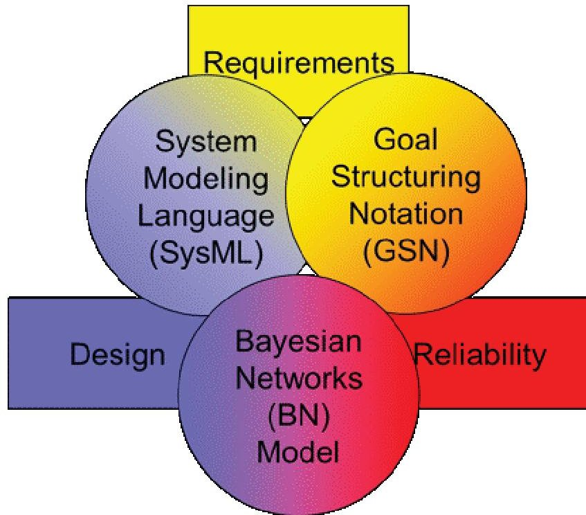
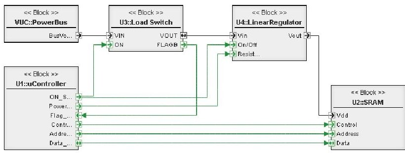
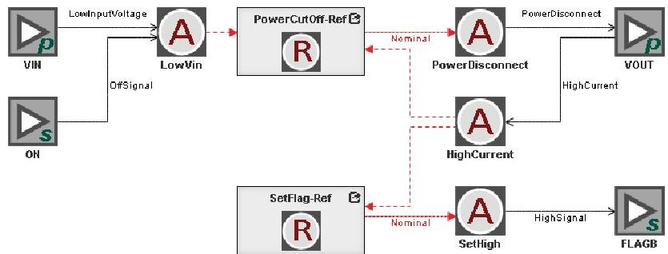
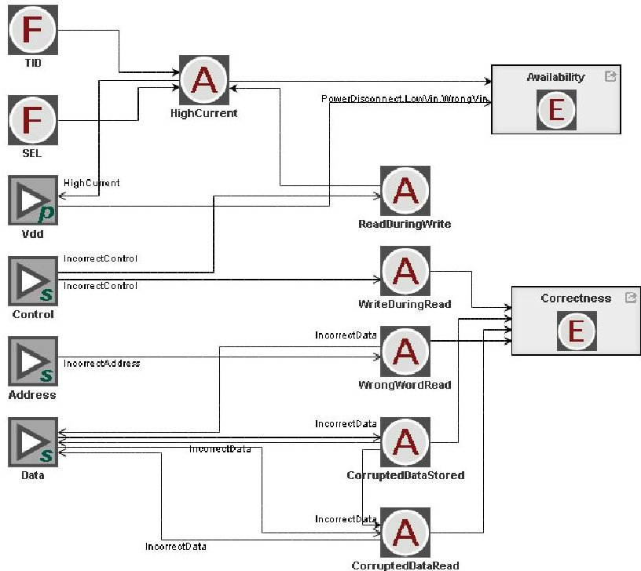
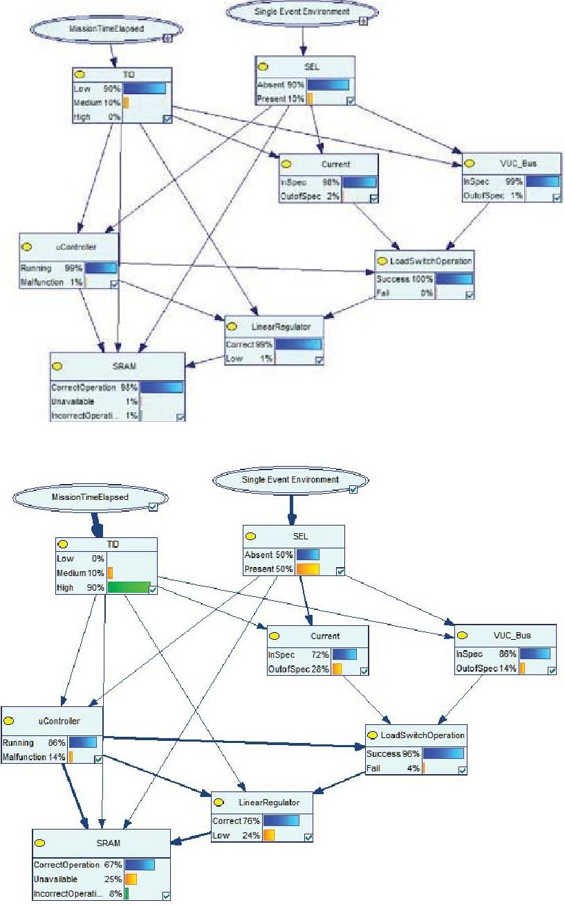
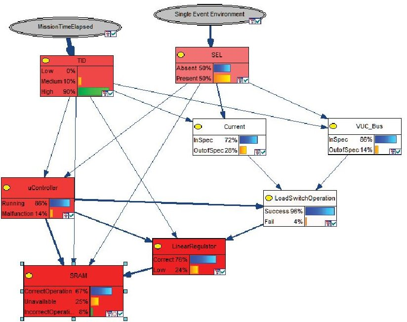
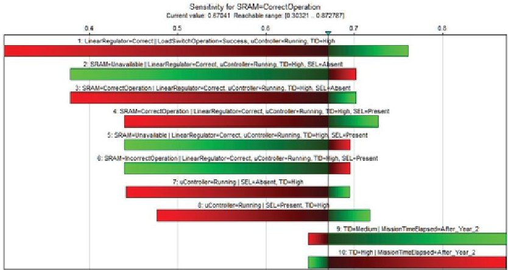
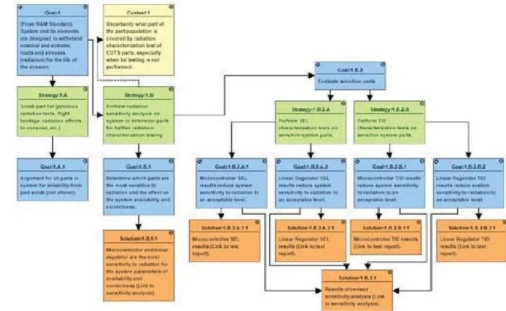

<!-- PDF_PAGE: 1 -->

# Radiation Assurance of CubeSat Payloads Using Bayesian Networks and Fault Models

Rebekah A. Austin, Vanderbilt University

Nagabhushan Mahadevan, Vanderbilt University

Arthur F. Witulski, PhD, Vanderbilt University

John Evans, PhD, NASA

Key Words: COTS, CubeSat, Goal Structuring Notation, Radiation Hardness Assurance, Fault Models, Bayesian Networks

## SUMMARY & CONCLUSIONS

Commercial off-the-shelf (COTS) electronics are used in satellites that span the size, cost, and acceptable risk spectrum. At one extreme the CubeSat, a platform originally created for university-based spacecraft design, is often constructed only from COTS electronics. At the other extreme, even highbudget NASA spacecraft use COTS electronics in non-mission critical circuits, especially when no radiation-hardened alternatives exist or the radiation-hardened parts do not meet the system requirements. There is significant uncertainty in the radiation test results of COTS electronics; hence additional means of assessing risk and radiation hardness are needed. In this work we construct a fault-propagation model of a CubeSat payload in a SysML platform, and then develop a Bayesian network from the fault model of the system. The sensitivity of the system to variations in component radiation response can be evaluated quantitatively, within the limits of the assumptions and available data. This sensitivity study then informs the structure and content of the overall radiation-reliability assurance case.

## 1 INTRODUCTION

Commercial off-the-shelf (COTS) electronic parts are being used in satellites because radiation hardened components may not meet mission performance requirements and may not be at the state-of-the-art [1]. Inclusion of COTS parts in a satellite requires careful consideration of how the part will respond to the space radiation environment. One common method for evaluation of the radiation-reliability of parts is lot testing. For COTS parts, it is often difficult or impossible to secure parts from a single "lot." Manufacturers may not make available information about the wafer lot and packaging facility. Thus, parts with the same part number could come from multiple wafers and parts from the same wafer could be packaged at multiple assembly sites. If "lot" testing is not possible, a larger amount of variability must be assumed for part radiation test results. This paper describes a model-based approach for how a system can be evaluated for sensitivity to the part radiation response variability, without

using conventional lot testing or relying on radiation-hardened components.

Figure 1- Model-Based Assurance Case + (MBAC+) process diagram. The modeling languages in the circles connect the engineering disciplines in the rectangles and enable an integrated modeling approach to radiation hardness assurance.

An existing CubeSat science payload was selected as an example for this study. The payload was designed to record the number of radiation-induced single event upsets (SEUs), a bit flip in the memory, in a commercial 28nm static random access memory (SRAM) in low-Earth orbit for 1 year. In order to accomplish the mission objective, the surrounding electronics must tolerate the space radiation environment for the duration of the mission. The approach described in the paper involves 1) creating a System Modeling Language (SysML) model of the CubeSat payload, 2) adding radiation-induced fault-propagation models accounting for impact on expected functionality, and 3) constructing a Bayesian

<!-- PDF_PAGE: 2 -->

network model from the fault model that evaluates the system performance ("correctness" and "availability" of SRAM) based on probabilistic dependency between the radiation environment, component health and functionality. Finally, the insights and results from the Bayesian analysis are then incorporated into a Goal Structuring Notation (GSN) assurance case. The assurance case for the radiation-tolerance of the payload was developed according to the NASA Reliability and Maintainability (R&M) Standard [2]. A software tool based on the Web-based Generic Modeling Environment (WebGME) [3] serves as the modeling framework for the SysML functional requirement model, the system architecture model, the fault propagation model, and the GSN model.

## 2 INTEGRATED APPROACH TO SYSTEM SENSITIVITY OF RADIATION-INDUCED FAULTS

NASA is creating a Model-Based Mission Assurance (MBMA) paradigm to incorporate reliability into the Model-Base System Engineering (MBSE) paradigm. This work uses the Model-Based Assurance Case + (MBAC+) process and the System Engineering and Assurance Models (SEAM) tool set to support the modeling activities of requirements, design, and reliability engineering [4]. In Figure 1, the integrated approach is presented. Goals derived from mission objectives and environment and how they are met in the system design are captured in System Modeling Language (SysML) functional decomposition and block diagram models. The graphical argument that the goals lead to a reliable system is done using the Goal Structuring Notation (GSN) standard. While the SysML and GSN models are linked in the SEAM tool set, the underlying fault propagation model is used to construct the Bayesian network model. The Bayesian network model is then used to study the sensitivity of the design to radiation which supports the evidence for the goals that argue for the radiation reliability of the system. These three modeling standards and the process of creating and linking them form the MBAC+ process.

Figure 2 - SysML Block Diagram model of load switch SRAM subsystem of CubeSat experiment board.

## 2.1 Construction of SysML Model

The SysML model of the CubeSat payload is constructed from the SysML models of the individual parts. The parts are connected together to describe the energy and signal flow throughout the system, as well as the propagation of faults. Figure 2 shows a simplified system model of the CubeSat

experiment board that includes just power bus, load switch, linear regulator, microcontroller, and the SRAM. The power ports and their associated connections are in black, while the signal ports and their associated connections are in green.

## 2.2 Construction of Radiation-Induced Fault Models

The internals of the component models include fault models that capture the component faults induced by radiation effects such as total-ionizing dose (TID), single-event latch-up (SEL), and single-event transients (SET), which are described in [5], and the propagation of the fault effects both within the component and across the system. The model describes root cause of the fault (failure modes such as TID, SEL, SET), the resulting effects such as anomalies, functionality degradation, and any mitigation response to anomalies. The model also describes the fault-effects propagating into and out of the component using labeled edges connected to the ports.

Figure 3-Fault model for Load switch. The load switch is part of the system mitigation strategy. High current anomalies that come into the part cause the part to respond by disconnecting power and setting the flag high.

Figure 4-Fault model of the SRAM. Radiation induced faults of TID, SEL, and SET cause anomalies data in the SRAM.

Figures 3 and 4 show the fault models for the load switch and SRAM, respectively. In these figures, the power ports are represented by nodes with label "p", signal ports by "s",

<!-- PDF_PAGE: 3 -->

failure modes by "F", anomalies by "A" node, functional degradation effects by "E", component response to anomalies by "R". The edges represent cause-effect relationships. The labeled edges connected to the ports represent the failure-effects propagating into and out of the components.

Figure 5 - Top: Bayesian Network model with inference results when Mission Time < 1 year and Single Event Environment is High Rate corresponding to Normal. Bottom: Bayesian Network model with inference results when Mission Time > 2 years and Single Event Environment is High Rate corresponding to South Atlantic Anomaly.

The fault model of the load switch, Figure 3, shows that an external high current failure-effect, edge labeled HighCurrent from the Vout power port, leads to a PowerCutoff response, thereby containing and mitigating the fault effect. The load switch model indicates a similar response to low input voltage, LowVin.

power port. This effects propagates through the linear regulator to the load switch and then is mitigated by the response modeled in the load switch in Figure 3. Multiple different anomalies, like IncorrectControl, cause anomalies like WriteDuringRead which then effect the data in the SRAM and flow back out through the data ports of the SRAM as the anomaly can also affect the microcontroller.

The fault model for the SRAM, Figure 4, indicates that a TID or SEL failure mode could lead to increased supply current anomaly, HighCurrent, that propagates out of the SRAM through the edge labeled HighCurrent to the Vdd

The SRAM fault model additionally captures the effects of the SRAM functionality to system parameters. The "availability" of the SRAM for mission experiment is affected when there is failure-effect related to power disconnection, low input voltage, or incorrect input voltage. The "correctness" of the SRAM data for the mission experiment are affected when there are incorrect controls or incorrect data fed to the SRAM due to faults external to SRAM or due to SET on the control, address, or data ports.

## 2.3 Construction of Bayesian Net from System Fault Model

The nodes and edges in the Bayesian network structure are identified by traversing all the fault paths in the system model. The nodes include faults, functional effects, mitigation functions, and observable anomalous conditions captured in the system fault model. Edges are added between the nodes if a fault path or functional dependency is identified. The structure is refined by grouping the radiation-induced failure modes as environment nodes. Also, wherever possible, anomalies, degradation, and mitigation responses are abstracted into component nodes whose states correspond to the health of the component or functionality of the component. The graph is further simplified based on expert knowledge. Figure 5 shows the refined Bayesian net for the load switch SRAM system for the best and worst case environments.

Top-level nodes are introduced to capture the mission operation time as well as the mission environment. These nodes influence the nodes related to radiation effects (TID, SEL). The states of these nodes represent the probability of the presence of a fault (SEL) or the strength of the radiation effect (TID). Because TID is an effects that builds up over time while SEL is a random, temporary effect, that is affected by the location of the experiment in its orbit, this network shows the sensitivity of the system at a particular time and place in the system's life cycle.

The nodes bearing the component names, LoadSwitch, Microcontroller, LinearRegulator, and SRAM, reflect the health and performance of these components. The states in these nodes correspond to the correct or incorrect operation of the component. In the case of the SRAM, the "correct operation" and "incorrect operation" states represents whether the SRAM experiment correctly captured the SEU that occurred during a five minute experiment. The "unavailable" state represents the cases when SRAM is not available for operation either because of system reset related to mitigation or malfunctioning of other components.

The bars for each node of the Bayesian Network show the computed posterior probability, based on Bayesian Inference algorithm, of each state for the case when "Mission Time Elapsed" is set to less than one year for best case and longer

<!-- PDF_PAGE: 4 -->

than 2 years for worst case, corresponding to low and high TID respectively, and "Single Event Environment" is set to "Normal" or "South Atlantic Anomaly" region where the SEE rates are lowest and highest for the mission respectively.

## 2.4 Revision of GSN Assurance Case from Bayesian Analysis

The Bayesian model evaluates the impact of the radiation environment on the performance (availability and correctness) of the CubeSat payload. It assesses the performance degradation of individual components in the context of radiation environment as well as impact of degradation of other components. For instance, the node related to LoadSwitch performance takes into account radiation effects as well as faults on control lines from the microcontroller. Likewise, the performance of the linear regulator to supply correct input voltage to the SRAM is affected by radiation faults internal and externally on the control lines from the microcontroller. Finally, the SRAM correctness and availability for the mission experiment depends on the radiation level and performance of microcontroller and the linear regulator.

The conditional probability tables for each node in the Bayesian network model take into account the impact of radiation as well as the impact of "degraded" performance of related components in the system. The Bayesian network sensitivity analysis helps reveal the relative strength of parameters in the conditional probability table to influence the target nodes like the system operation or performance of a specific component. This could be useful in performing more directed testing and design changes to improve the overall system performance.

Figure 6 - Sensitivity Analysis for SRAM target. Sensitivity is shown in terms of "redness" of the node.

correctness graphically shown in Figure 7. The correctness and availability of SRAM is also greatly influenced by correct operation of the linear regulator and microprocessor. It would be useful to better characterize the performance of the linear regulator and microprocessor to get a reliable assessment of the SRAM operation. Figure 8 presents an example GSN model that shows this argument. Goal 1.B.1 is the original sensitivity analysis with Solution 1.B.1.1 being the result of the analysis. These results guide which parts are chosen for evaluation in Goals 1.B.2 and prescribe the radiation tests that should be performed. Solution 1.B.2.1 is a place-holder for the revised sensitivity analysis that results from the updated Bayesian net that includes the results from the radiation characterization tests.

Sensitivity analysis targeting the outcome of the SRAM node reveals that the correctness and availability of the SRAM operation are sensitive to impact of radiation effects (TID, SEL) directly on the SRAM, visually shown in Figure 6 and

Figure 7 - Top results for Bayesian Network Sensitivity analysis results for SRAM correctness. The red color corresponds to a decrease in probably of the target variable, and green corresponds to an increase in probability of the target variable.

Figure 8-GSN model with results of sensitivity analysis and suggested tests and analysis activities from sensitivity analysis.

## 3 RESULTS FROM INTEGRATED APPROACH

The integrated approach presented in this paper creates a system level radiation-induced fault model from the fault model of individual parts, taking into account functionality degradation and mitigation measures. The fault model helps create the structure of both the GSN assurance case model and

<!-- PDF_PAGE: 5 -->

the Bayesian network model by identifying the possible fault paths and related effects on functionality. The results from the Bayesian network analysis are useful in understanding the sensitivity of system performance to radiation effects in specific parts, thereby providing additional information to prioritize parts testing, adjust radiation margins, and update the design to add radiation-effects mitigation.

This approach does require a significant modeling effort upfront to create the libraries necessary for this analysis, but subsequent designs should see this modeling effort decrease. The results of the sensitivity analysis are only as good as the data used to create the distributions. This process is still being researched, including how to map test results to discrete Bayesian nets.

The presented modeling approach shows how the radiation reliability of the individual parts can be evaluated at a system-level and how to quantify the reliability of the system based on the system design, not just the reliability of the individual parts. This approach also allows us to see the system sensitivity to uncertainty in our radiation characterization tests and thus helping to determine which part populations should be better understood to increase the reliability of our system.

## ACKNOWLEDGEMENTS

This work was supported by NASA Grant #NNX16AR25G. Thanks to Dr. Brian Sierawski, Dr. Gabor Karsai, Dr. Ron Schrimpf, Dr. Robert Reed, and Ken LaBel for guidance and support in the development of the model and methodology.

## REFERENCES

1. K. A. LaBel et al., "Emerging radiation hardness assurance (RHA) issues: a NASA approach for space flight programs," in IEEE Transactions on Nuclear Science, vol. 45, no. 6, pp. 2727-2736, Dec 1998.

2. F. J. Groen et al., "A vision for spaceflight reliability: NASA's objectives based strategy," Reliability and Maintainability Symposium (RAMS), 2015 Annual, pp. 1-6, 2015.

3. M. Maroti et al., "Next generation (meta)modeling: web and cloud-based collaborative tool infrastructure," 8th Multi-Paradigm Modeling Workshop, 2014.

4. SEAM (Systems Engineering and Assurance Modeling) [Online]. Available: https://modelbasedassurance.org.

5. R. A. Austin et al., "A CubeSat-Payload Radiation-Reliability Assurance Case using Goal Structuring Notation," 2017 Reliability and Maintainability Symposium (RAMS), Orlando, FL, 2017.

## BIOGRAPHIES

Rebekah A. Austin Vanderbilt University Nashville, TN 37235

Electrical Engineering from Vanderbilt University in 2014 and 2016. She is a part of the Radiation Effects and Reliability Group at Vanderbilt University as a graduate student focusing the design of CubeSat experiments to evaluate space radiation environment models. She is also a Pathways Intern with the NASA Goddard Space Flight Center since 2014.

email: rebekah.a.austin@vanderbilt.edu

Rebekah Austin received her B.E. and M.S. degrees in

Nagabhushan Mahadevan Institute for Software Integrated Systems Department of Electrical Engineering and Computer Science Vanderbilt University 1025 16th Av. South Suite 102 Nashville TN 37212

## email: nag.mahadevan@vanderbilt.edu

Nagabhushan Mahadevan earned his M.S. in Computer Engineering and Chemical Engineering from the University of South Carolina, Columbia, SC. He is a Systems Architect at the Institute for Software Integrated Systems, where he supports research and technology development geared towards resilient cyber-physical systems, model-based systems health management, real-time diagnosis, verification and validation of diagnosis systems and paradigms for assessing performance degradation and system reliability in radiation environments.

Arthur F. Witulski, PhD

Institute of Space and Defense Electronics

Department of Electrical Engineering and Computer Science

Vanderbilt University

1025 16th Avenue South, Suite 200

Nashville, TN 37212

## email: arthur.f.witulski@vanderbilt.edu

Art Witulski earned his Ph.D. in Electrical Engineering from the University of Colorado, Boulder. He is currently a Research Associate Professor at Vanderbilt, where he specializes in research on the effects of radiation on electronic power circuits and devices, modeling the system-level effects of radiation of robots in nuclear disaster areas and spacecraft, and radiation reliability paradigms for systems with majority commercial electronic parts.

John Evans, PhD

Office of Safety and Mission Assurance

NASA

300 E St SW

Washington, DC, 20546, USA

## e-mail: john.w.evans@nasa.gov

John Evans earned his PhD in Materials Science and Engineering from Johns Hopkins University, and is the Program Manager for Reliability and Maintainability and Program Executive for the NASA Electronic Parts and Packaging Program at NASA HQ Office of Safety and Mission Assurance. He has authored or coauthored 3 textbooks, a book chapter on electronic materials and over 50 publications.