<!-- PDF_PAGE: 1 -->

# SIMULATING CUBESAT STRUCTURE DEPLOYMENT DYNAMICS

Joseph R. Blandino $ ^{1} $ Virginia Military Institute, Lexington, VA 24450

Brant Ross $ ^{2} $ , Nelson Woo $ ^{3} $ and Zachary Smith $ ^{3} $ MotionPort, LLC, St. George, UT, 84790

and

Eric McNaul $ ^{4} $ MMA Design, LLC, Boulder, CO, 80301

This paper presents the development of a general automated process using multibody dynamics software (RecurDyn), to efficiently take a detailed hinge assembly model and simulate its range of motion while retrieving stiffness information for all degrees of freedom and use that data to define a simple but accurate, nonlinear point-to-point force for use in a solar array assembly model. A vertical software application is presented that characterizes and simplifies the hinge model and allows the simplified model to be integrated easily into a solar array system model. The flexible hinges connect nonlinear flexible body representations of the solar panels in an array. The example application is the simulation of CubeSat structures, which are typically large compared to the spacecraft body. The utility of the vertical application is demonstrated through the successful simulation of the e-Hawk solar array (MMA Design). The described techniques and vertical application can also be applied to a wide range of deployable space structures.

## I. Introduction

Modeling the nonlinear dynamics of spacecraft structures during and post deployment is critical for mitigating risk during spacecraft development. Reducing the difficulty and time required to develop simulations for characterizing the dynamics of deployable structures is beneficial to spacecraft developers. This is especially true for the developers of smaller spacecraft such as small sats, cubesats, and microsats because as deployable structures, primarily the solar arrays, are relatively large compared to the size of the spacecraft body. This paper presents the development of a general automated process using multibody dynamics software (RecurDyn), to efficiently take a detailed hinge assembly model and simulate its range of motion while retrieving stiffness information for all degrees of freedom and use that data to define a simple but accurate, nonlinear point-to-point force for use in the solar array assembly model. Included in the paper will be data from the simulation of the e-Hawk solar array (MMA Design). The e-Hawk deployable CubeSat solar array is a high performance power harvesting system designed for use on 6U and larger platforms. Simulations for a deployed cubesat solar array model, based on the e-Hawk, were used to determine the maximum tumbling rates that can be tolerated before the solar array becomes unstable, meaning the hinge forces can't keep components in contact with bump stops. Simulating the nonlinear dynamics of the e-Hawk, a commercially available deployable solar array, demonstrates the utility and benefits that can be achieved from the automated modeling process described in subsequent sections of this paper.

<!-- PDF_PAGE: 2 -->

## II. Background

There is high value in time, money and most importantly safety and reliability in simulating the nonlinear dynamics of stowing, deploying, and performance of deployable space structures, especially given the profound limitations of physical testing. Dynamic simulation mitigates the risk of developing new deployable space structures, including solar arrays, by predicting transient motions and loads during stowage, deployment, and mission-related maneuvers [1,2]. Dynamic simulation can also be used to assess the efficacy of using motion control to lessen the effect of accelerations on the response of the space structure [3].

One of the earliest investigations that recognized the potential of multibody dynamics software for analyzing the dynamics of spacecraft solar arrays was accomplished by Young and Pack $ ^{4} $ . Since this study, the application of multibody dynamics software to analyze spacecraft structures has been somewhat limited. In 1996 Tadikonda et. al. $ ^{5} $ simulated the deployment of a flexible spacecraft structure using a multibody dynamics approach. Banerjee $ ^{6} $ presents an overview of the early application of multibody dynamics analysis for spacecraft structures. More recently Sinn and Vasile $ ^{7} $ modeled biologically inspired smart space structures using a multibody dynamics code developed by the authors. The structure under study was a multi-cell inflatable structure. The use of multibody dynamic analysis to predict the behavivior of spacecraft structures has been somewhat limited due to the availability of commercial software that can accurately predict both rigid and flexible body behavior. The focus of the study presented in this paper is deployable solar arrays for cubesats, but the application of multibody dynamics software for analyzing spacecraft structures has broader applications.

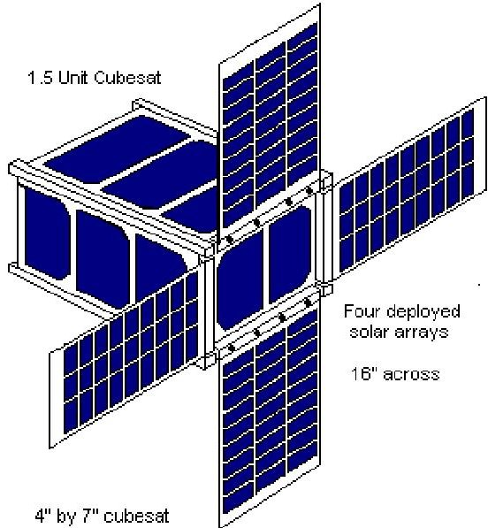

Figure 1. Example Cubesat with Deployed Solar Arrays

MotionPort LLC has successfully demonstrated the benefits of simulation for large solar arrays in the 300 kW class as described in ref [1]. There is also an ongoing need for better understanding the behavior of relatively large deployable space structures that are used with smaller spacecraft, such as the cubesat configuration shown in fig. 1 [8]. Additionally, design tools for developers of these spacecraft must include dynamic simulation capabilities in order to increase deployment reliability and predictability. The dynamic behavior of deployable space structures for smallsats is significant because the mass of each structure is relatively large compared to the overall mass of the smallsat.

In addition, there is substantial interest in the aerospace community in reducing the difficulty and required time to develop simulation models for characterizing the dynamics of smallsat structures. Past efforts improved the efficiency of modeling split-tube (or roll-out) solar arrays as summarized in the technical paper referenced in [2]. A key modeling issue with solar arrays comprised of stiff panels is to properly represent the stiffness and stored energy of the hinge assemblies (typically including a spring) that are used to connect and deploy the panels. The hinge assemblies may be comprised of parts with highly variable and complex geometry. The proper modeling of such assemblies would typically require two detailed finite element meshes of the two halves of the hinge geometry. The simulation of the solar array assembly with meshes for the panels as well as all of the connections could require significant computer resources and time. A method to represent the connections simply and accurately is highly desirable in order to have fast run times for the solar array simulation. The simplification of the hinges is especially important because the solar panels need to be represented as nonlinear flexible bodies in order to account for the stiffness and momentum effects of the panels as they are deployed and also as the spacecraft is rotated.

There is an ongoing need for a better understanding of the behavior of relatively large deployable structures that are attached to relatively small spacecraft bodies. The overall goal of the work described in this paper is to create a vertical software application using multibody dynamics software to improve model creation and reduce the run time of simulations. To achieve this goal two objectives were met. The first is the development of a general automated process to efficiently take a detailed hinge assembly model and simulate its range of motion while retrieving stiffness information for all degrees of freedom and convert that data to define a simple but accurate nonlinear point-to-point force for use in the solar array assembly model. The second objective is the development and simulation of a high-

<!-- PDF_PAGE: 3 -->

fidelity system-level model of the deployment dynamics of a commercial deployable solar array that was designed for use with a 6U cubesat. The deployed cubesat solar array model will also undergo simulated tests to determine the maximum tumbling rates that can be tolerated before the deployed solar array configuration becomes unstable (hinge forces can't keep components in contact with bump stops). The development of the vertical software application is described in detail below.

## III. Vertical Software Application for Hinge Simulation

A. Motivation for a computationally efficient hinge model.

The e-HaWK deployable CubeSat solar array is a high performance power harvesting system designed to fit 6U and larger spacecraft platforms. The deployable is designed as a two wing system, symmetric around the center of the spacecraft as shown below in Figure 2. Each wing is a tri-fold design where three panels stow within each other with the center main panel on top and the two side panels folded underneath.

The solar array substrates use a unique morphing panel technology which enables the solar array to stow in a flat condition and then "morph" into a V-panel configuration for higher deployed stiffness. Panel-to-panel hinges group each morphing panel together allowing them to fold at $ 1 8 0^{\circ} $ . Panel-to-panel kinetics are actuated by a multifunctional torsion spring hinge mechanism which spans between two hinge locations mounted at the inflection point on each substrate.

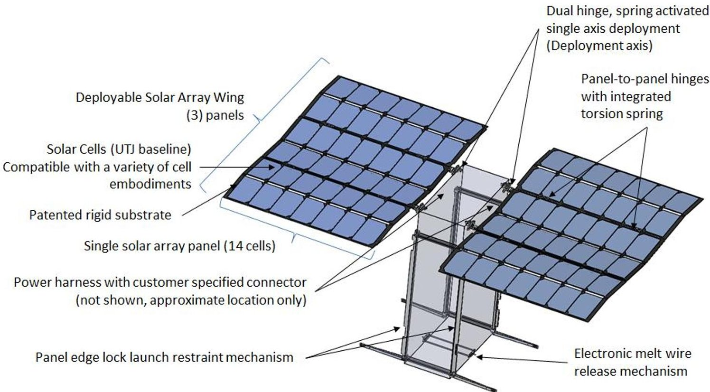

Figure 2. The e-HaWK Deployable CubeSat Solar Array from MMA Design

The torsion springs are designed to handle $ 2 7 0^{\circ} $ of rotation so that the end of travel force is not zero, but rather $ 1 / 3 \cdot\mathrm{F}_{\mathrm{starting force}} $ This is done to preload each panel hinge into a hard stop to increase deployed stiffness. Root wing hinges operate in a similar fashion, but use coil springs and only displace through $ 9 0^{\circ} $ of rotation. The Preload force assumption is identical to the panel-to-panel hinges in that $ 1 / 3 \cdot\mathrm{F}_{\mathrm{starting force}} $ remains in the root hinge components to effectively preload the mechanism for high deployed stiffness.

The system's launch restraint is a highly effective mechanism that engages the edges of the solar array stack and by using a mechanical lever arm morphs the V-panel into a flat configuration and presses against the spacecraft bus. The

<!-- PDF_PAGE: 4 -->

lever arm when rotated down into a locked position mates with the melt rod assembly. The melt rod assembly holds the stowed solar array in place and releases it on command from the end user.

## B. Hinge characterization simulations.

The two types of hinges, one with embedded torsion springs and one without, used in the subject solar array are shown in fig. 3. The vertical development simplifies the hinge model and automates the hinge simulation tasks. The simplification is done for each hinge type using the same function. First a detailed model of the hinge assembly will be constructed, using finite element meshes to define portions of the hinge components as flexible, and including any necessary contacts between those components. The vertical application then presents a dialog to the user to enable him or her to set-up the model quickly for stiffness testing. The application then carries out a series of automated simulations to test the stiffness of the hinge and also rotates the hinge 90 degrees to capture the same information with the hinge in the vertical orientation. Once the simulations are done the vertical application will sort through the output data to calculate the hinge's stiffness for each DOF, and that information will be used to define a RecurDyn userfunction Screw force entity that is an efficient point-to-point force. The formulation of the Screw force will perform interpolation between the horizontal and vertical hinge positions to determine the hinge stiffnesses throughout the range of motion of the hinge.

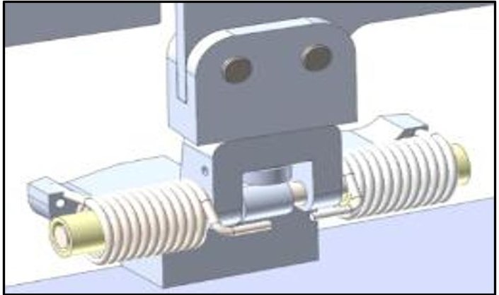

a) Hinge with embedded springs

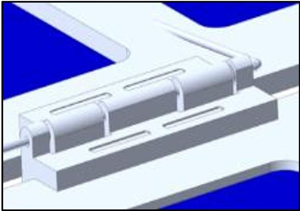

b) Hinge without springs

Figure 3. Hinge types used in the e-Hawk solar array

The RecurDyn multibody dynamics software allows the use of both flexible and rigid bodies within a model, which allows hinge behavior to be predicted accurately. To prepare the hinge model to be characterized automatically within the vertical software application the hinge should be modeled beforehand with meshed flexible bodies representing the areas where deflection is expected to occur. The flexible bodies are connected to a rigid body that will serve as a stable base for applying constraints and forces. The hinge is modeled in the horizontal position. Reference markers are created beforehand at key locations in the model to make the model setup easier to perform using the vertical application. Figure 4 shows an example of a mesh used for the flexible bodies of a rotational hinge. A marker is created at the location of the hinge pivot center. This marker serves as the reference frame when applying the forces and torques to the action side of the hinge.

<!-- PDF_PAGE: 5 -->

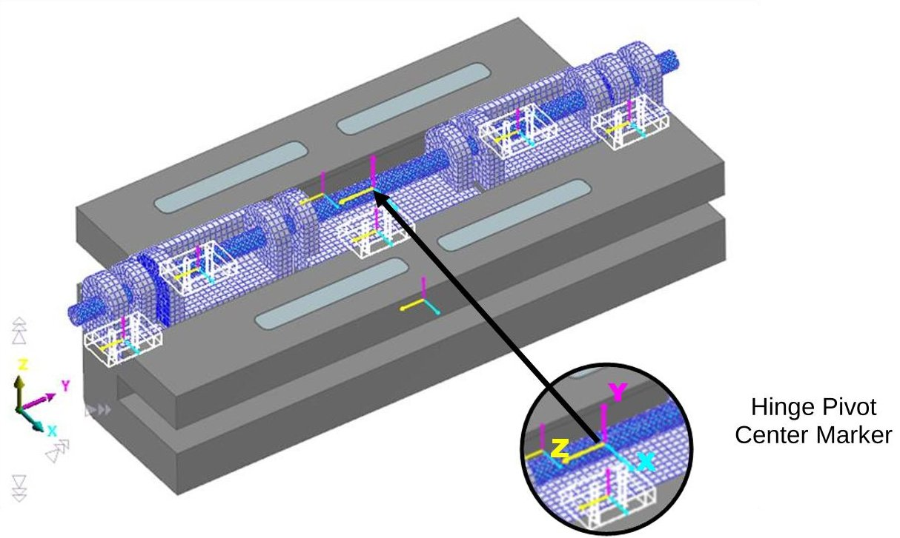

Figure 4. Meshed flexible bodies and reference marker used to orient applied forces and torques.

The vertical application is executed through three tasks. These are 1) the Run Hinge Simulation task, 2) the Review Hinge Simulation Results task, and 3) the Create Simplified Hinge Force task. Each task is executed through a dialog box. When the user executes the Run Hinge Simulation task the dialog box shown in fig. 5 is displayed. The dialog allows the user to define the base and action bodies as well as specify which simulations, to run. The user can also specify the peak force or torque applied for each simulation. The Set Up and Run button commands the vertical application to run the simulations specified by the user. For each simulation, the force(s) or torque(s) will be applied with magnitudes that vary between the positive and negative values of the max force or torque specified in the dialog box. The general pattern of an applied force is shown in fig. 6. For each direction that a force or torque is applied the simulation is run with the hinge in both the horizontal and vertical position, as shown in fig. 7. During the simulation the displacement of the action side of the hinge is predicted and force vs. displacement or torque vs. rotation information is stored as a spline in the hinge model database.

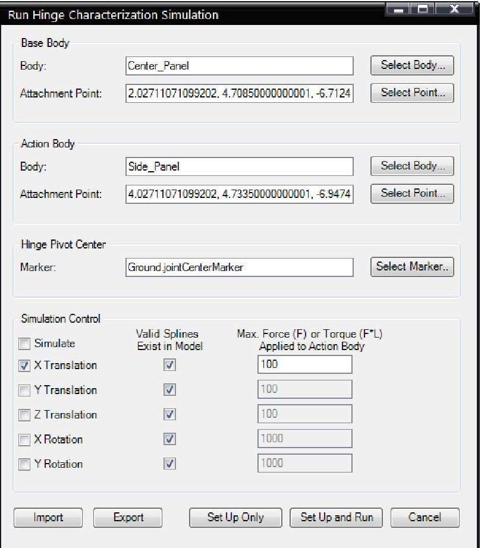

Figure 5. Dialog box for Run Hinge Simulation task.

<!-- PDF_PAGE: 6 -->

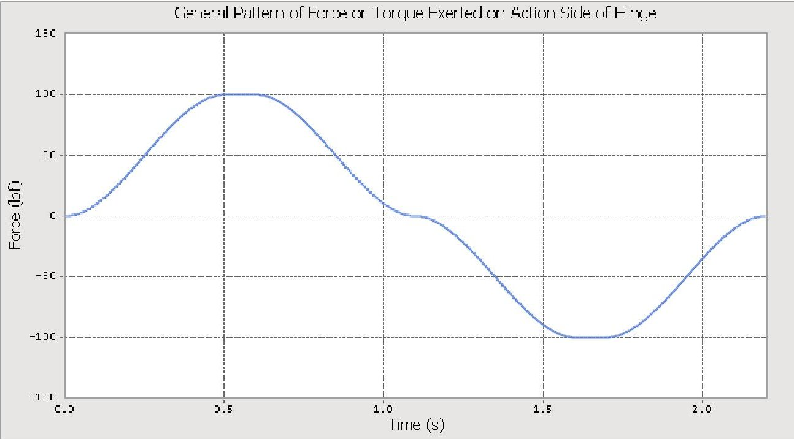

Figure 6. General pattern of force or torque applied to action side of hinge

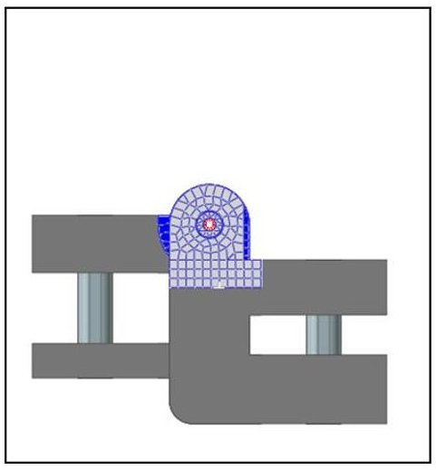

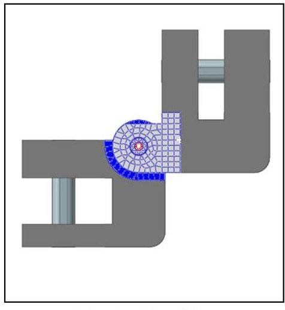

Figure 7: Two hinge positions used in each simulation.

<!-- PDF_PAGE: 7 -->

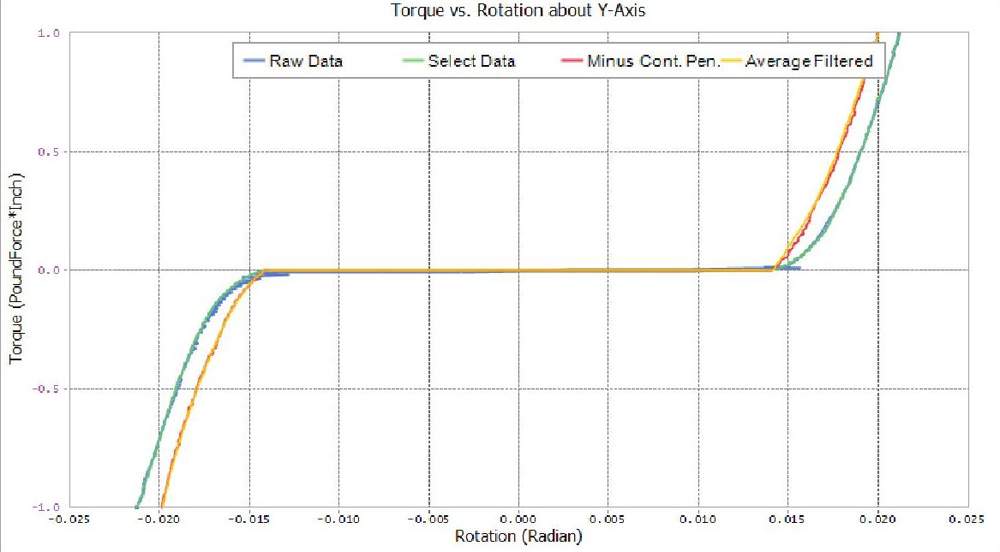

Figure 8. Example of hinge characterization data

The spline information can be displayed using the Review Hinge Simulation task. This opens a dialog box that allows the user to display a graph of any of the simulations that were run previously, as well as the animation results. An example of torque vs. rotation data is shown in fig. 8.

The final task is the Create Simplified Hinge force in System Model task. This task allows the user to command the vertical development application to integrate the hinge characterization simulation data into a system level model. To execute the task, the Create Simplified Hinge Force icon is chosen from the ribbon menu in RecurDyn. When the user clicks on this icon, the dialog shown at right in Figure 9 is displayed. The dialog enables the user to easily select from the modeling window the bodies that will connect to the simplified hinge force, as well as the locations of those connections and intended orientations of the hinge halves.

When the user clicks on the Apply button, the vertical application will create a new subsystem within the system level model that contains the simplified hinge force, as shown below in Figure 10. The subsystem, shown in Figure 11, will contain a base and action dummy body that are connected with a RecurDyn Screw Force, which can exert forces or torques from one body to another in all six degrees of freedom, with each force or torque being defined by an expression. The vertical application will align the subsystem with the base marker selected by the user, and the action dummy body within the subsystem will be oriented to align with the action marker selected by the user. A fixed joint will be created between the base body in the system level model and the base dummy body within the subsystem, as well as between the action body in the system level model and the action dummy body within the subsystem. The subsystem can be exported to a file which can be stored and imported into a different model. This capability allows the user to develop a library of hinges.

<!-- PDF_PAGE: 8 -->

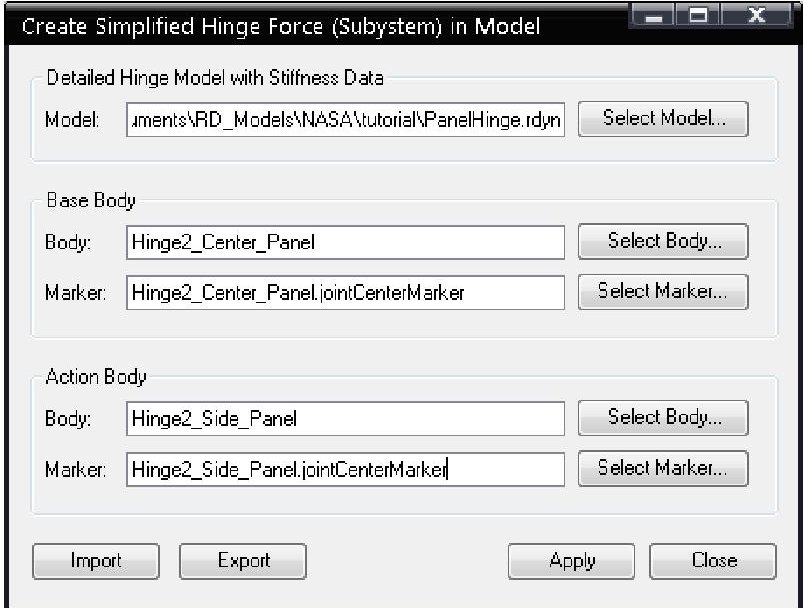

Figure 9. Create Simplified Hinge Force (Subsystem) in Model.

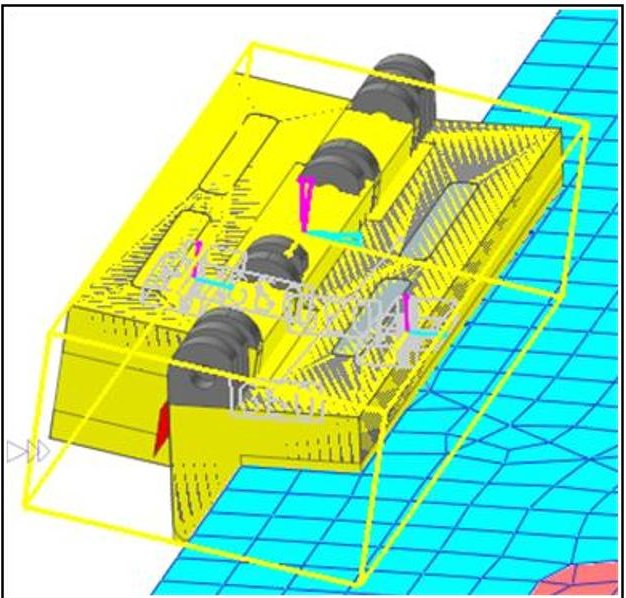

Figure 10. Subsystem added to model.

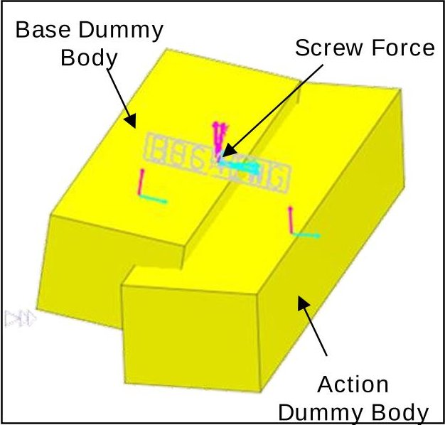

Figure 11. Contents of subsystem.

The expressions controlling the component forces and torques of the screw force were formulated to simulate the reaction force of the hinge, based on the hinge characterization simulations. The formulation enforces radial behavior so that both x- and y-axis translation are considered simultaneously and not independently when calculating the reaction forces. (The same consideration is made for x- and y-axis rotation.) This is needed because a gap typically exists between hinge components, allowing for free movement of the components before any deflection begins. To demonstrate this, in Figure 12 below, a translational force of constant magnitude but rotating direction is applied to the action body shown in red, in order to take the action body through its path of free motion. With a non-radial formulation, the path of motion is erroneously square and overestimates the amount of gap at the diagonal positions. But with the radial formulation, the path of motion is correctly circular in shape.

<!-- PDF_PAGE: 9 -->

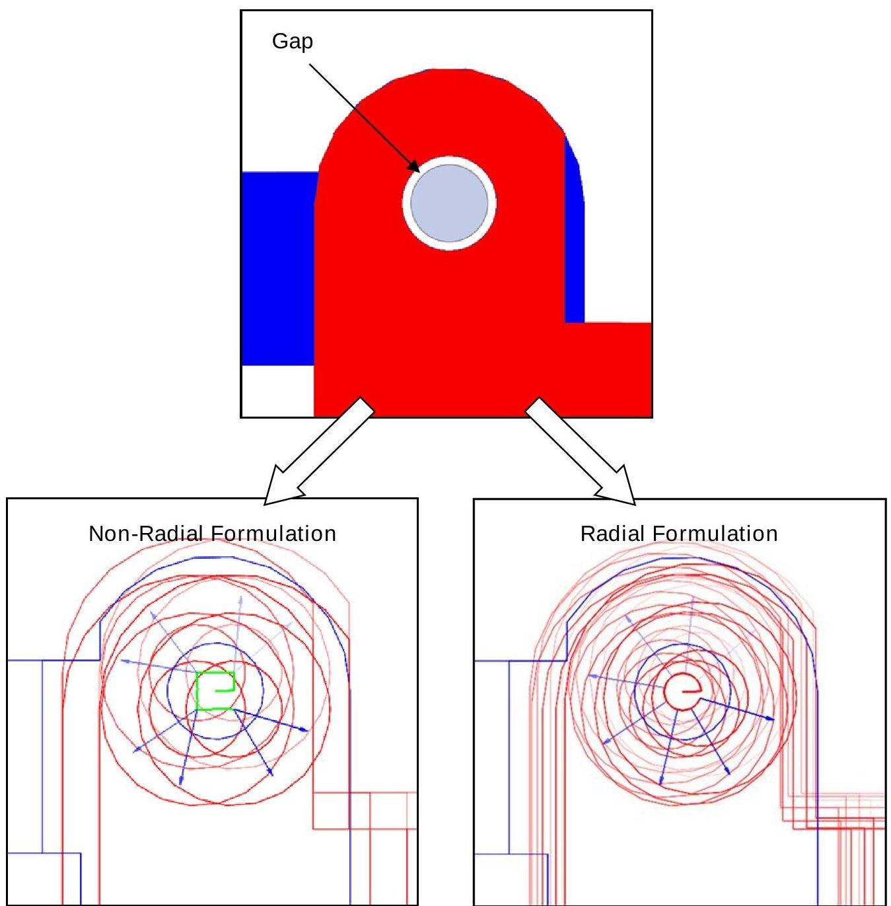

Figure 12. Importance of radial formulation for modeling a gap between parts.

The formulation also performs interpolation of the hinge stiffness when the hinge is between the horizontal and vertical positions tested.

## IV. Integration of Simplified Hinge Model into the e-Hawk System Model

A system level model of the e-HaWK solar array was constructed in RecurDyn. This model was used to characterize the deployment process and evaluate the sensitivity of the design to various input parameters. This process was broken up into the following steps; 1) flexible body representation of the solar panels, 2) storage, 3) deployment characterization, and 4) simulation trials. A mesh based upon shell elements was made to represent the solar panels of the solar array. This mesh accounts for the frame geometry, solar cells, and mounting considerations. The solar array substrates use a unique morphing panel technology which enables the solar array to stow in a flat condition then "morph" into a V-panel configuration for higher deployed stiffness. Accurate simulation of deployment required starting the simulation from its prestressed state. This was the stowed configuration. The deployment event was simulated and evaluated to determine the ability of the model to accurately characterize the deployment process. Once deployed, additional dynamic events are evaluated. A series of 11 trials were simulated to assess the overall predicted behavior of the solar wing representation.

<!-- PDF_PAGE: 10 -->

## A. Flexible Body Representation of the Solar Panels

The first step in the development of the system level model was to make a flexible body representation of the solar panels. One wing of the solar array consists of 3 panels as seen previously in fig. 2. The two side panels are identical and are represented using a single mesh. A second mesh was made for the center panel which has a slightly different geometry from the side panels. The mesh consists of a single layer of shell elements as seen in Figure 13. The mesh takes into consideration the frame geometry and solar cells by applying different material properties to the frame, the solar cells, and the region where these two overlap.

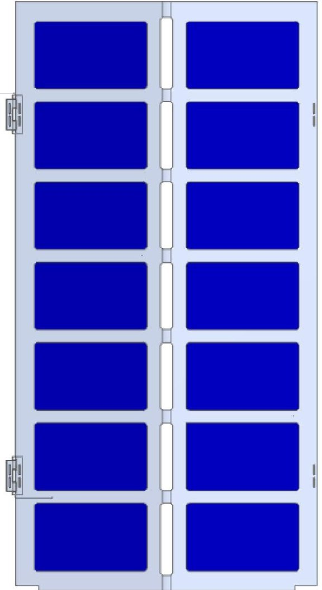

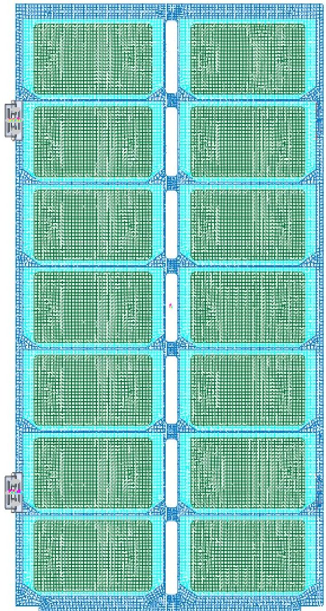

Figure 13. Rigid body representation (left) and flexible body representation (right) of the side panel

The panel mesh was fixed to the hinges using RecurDyn Force Distributing Rigid (FDR) elements (equivalent to Nastran RBE2 elements) using the nodes immediately surrounding the hinge. This was then tested using a 1g drop test to determine the viability of the mesh and the attachment to the hinge. The hinges were fixed to ground and the panel dropped 20 degrees before impacting the bump stops. The first impact with the bump stops is shown in Figure 14. In this image it can be seen that the majority of the stress is distributed through the frame as expected. Stress concentrations occur near the hinges where the load is being applied and in the middle where the frame narrows to a small cross section. This was determined to be an acceptable mesh for the system level model.

<!-- PDF_PAGE: 11 -->

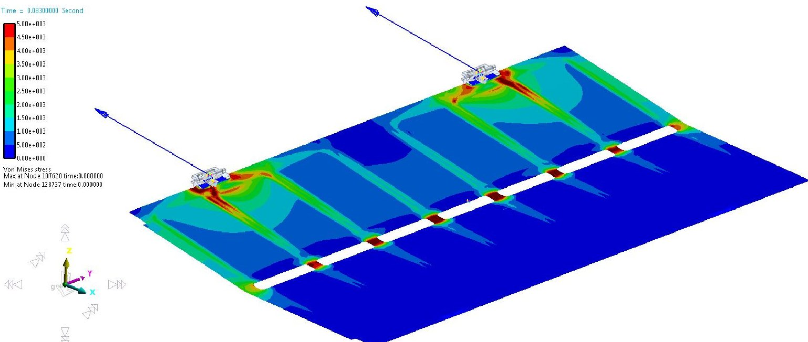

Figure 14. Peak stresses during initial impact with the bump stops during a 1g drop test. Stress units are lbf/in $ ^{2} $

## B. Storage

During actual operation, the solar array is stored in a prestressed state. Two launch bars flatten the v-shaped panels until an electronic melt wire releases the system. Accurate characterization of the deployment process requires that the solar array starts in this prestressed state. This was achieved in two steps. First, the system was folded with all contacts inactive. Second, the contacts were activated and the system was given time to settle. The stored solar array with the panels in a prestressed state can be seen in Figure 15.

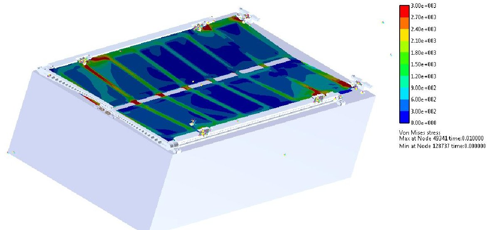

Figure 15. The prestressed state of the stored solar array panels. Stress units are Ibf/in $ ^{2} $

## C. Deployment Characterization

With the solar array stored in a prestressed state the model was ready to simulate deployment in a zero-g environment. There were three main impacts during the deployment process. First, the root hinge impacted the bump stops as the center panel extended to 90 degrees. Second, the panel-to-panel hinges on the right hand side impacted the bump stops as the right panel extended to 180 degrees as seen on the left side of Figure 4. Finally, the panel-to-panel hinges on the left hand side impacted the bump stops as the left panel extended to 180 degrees as seen on the right side of fig. 16.

<!-- PDF_PAGE: 12 -->

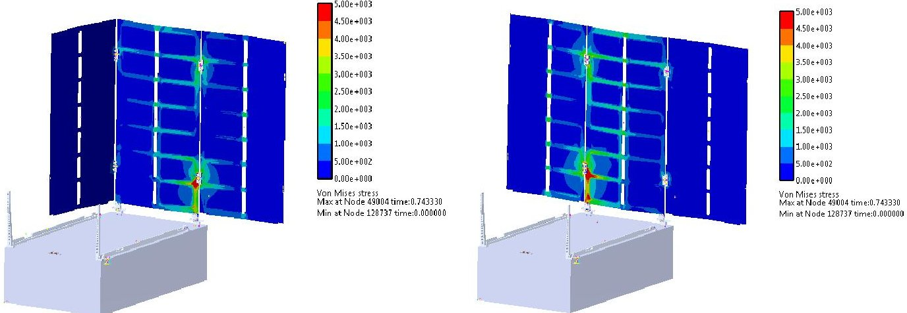

Figure 16. Panel-to-panel hinge hard stop impact during solar array deployment. Stress units are lbf/in $ ^{2} $

This process can also be visualized using the position data of the revolute joints at the hinges as seen in fig.17. In the first 0.5 seconds some instability can be seen as the panels release from their prestressed state and begin to unfold. After approximately 1 second the center panel has extended 90 degrees and the root hinges impact the bump stops. Very little vibration is seen as the panel-to-panel hinges impact the bump stops. The solar array is fully deployed in 1.9 seconds and after 2.6 seconds the residual motion in the material has dampened out. The amount of vibration at impact is highly dependent upon the damping parameter at the contact. If necessary, this parameter can be adjusted to match results in a validation study.

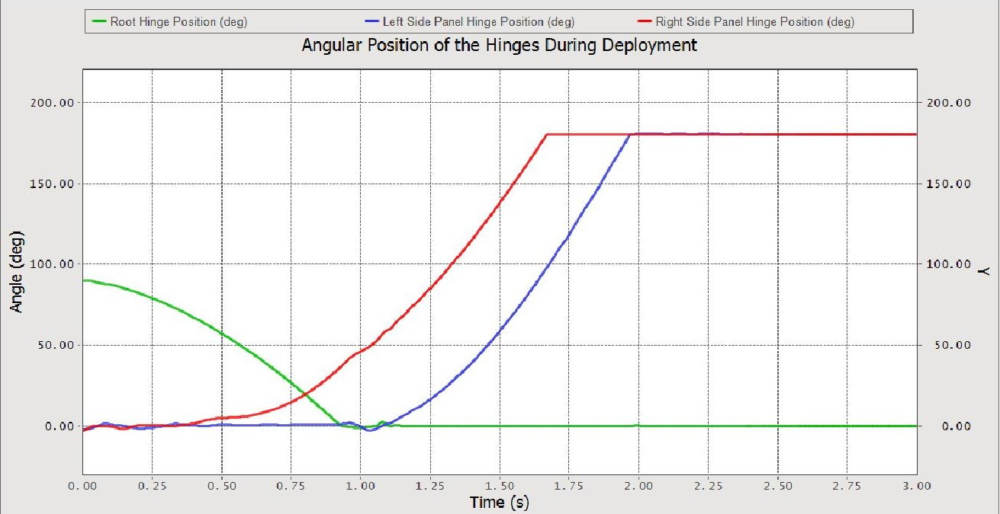

Figure 17. Angular position of hinge action body during deployment.

Additional simulations can be performed in a fully deployed condition to further characterize potential dynamic events for the solar array. Information on characterization parameters such as linear and angular acceleration and fundamental frequency are obtained easily from the simulations. Figures 18-21 show examples of data that is obtained for these parameters from the simulations. Figure 18 shows the linear acceleration. It is of interest to note the maximum thrust force that can be applied before the wing decouples from the hard stops. The moment the wing decouples from the hard stops is measured by tracking when the contact force between the hard stops drops to 0. Results from a gradually increasing linear acceleration are shown in fig. 21. The wing decoupled from the hard stop at a linear acceleration of $ 2 6. 5 \mathrm{~ i n / s^{2}} $ . This corresponds to a 6.0 lb. thrust force.

<!-- PDF_PAGE: 13 -->

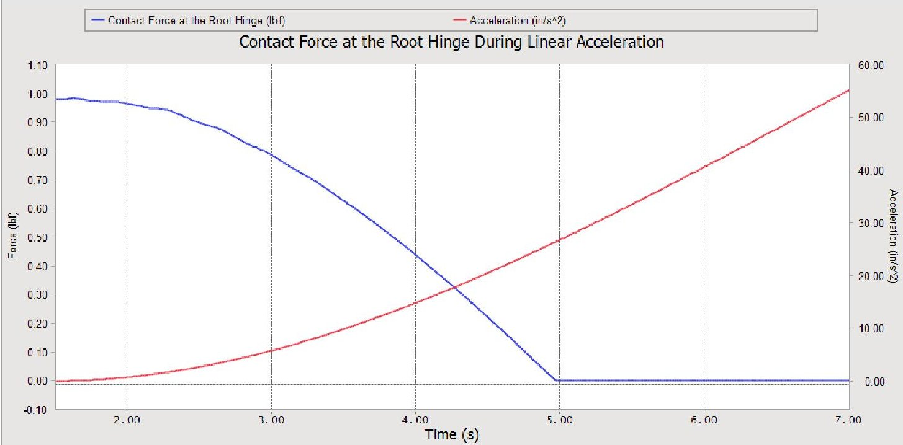

Figure 18. Linear acceleration of the deployed solar panel.

Figure 19 shows the force on the hinge during changes in angular acceleration. In fig. 19 the angular acceleration is ramped up quickly to keep the angular velocity negligible. The results from a ramped up angular velocity applied at the center of mass can be seen in fig. 22. The side panel decoupled from the hard stop at an angular acceleration of 11.8 rad/s^2.

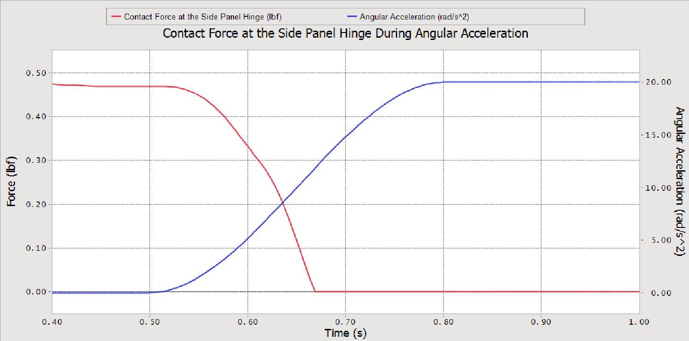

Figure 19. Hinge contact force during changes in angular acceleration.

The fundamental frequency of the system is evaluated using the model by applying a small simulated force at the corner of one of the panels. This force was released instantaneously and the position of the node at the corner where the force was applied is tracked over time. Figure 20 shows this test performed with hinges that were artificially locked in one orientation. An FFT is obtained from the data to gather frequency information as seen in Fig. 21. In this case, the FFT shows a fundamental frequency at 5.5 Hz.

<!-- PDF_PAGE: 14 -->

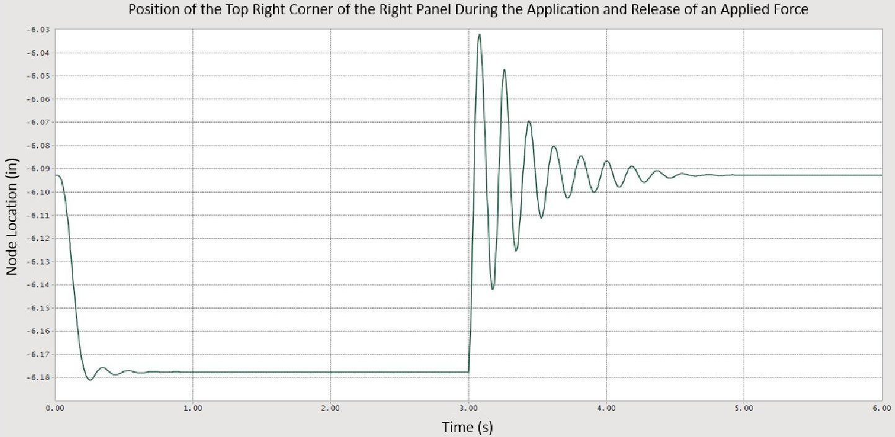

Figure 20. Time history of the solar panel after a small force impulse is applied.

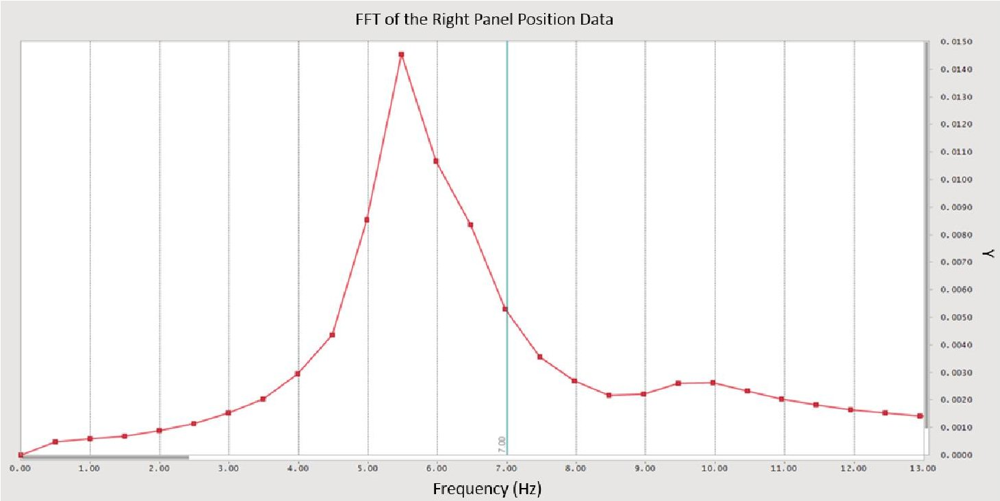

Figure 21. FFTcreated plot from the data presented in fig. 20.

In order to capture the effect of the hinges, this same test was applied with hinges that were free to rotate. This necessitated using a smaller force to avoid complete decoupling of the hard stops. The results of this test are shown in fig. 22. This test resulted in a fundamental frequency of approximately 3 Hz. However, this motion dampened fast enough that only one period could be evaluated.

<!-- PDF_PAGE: 15 -->

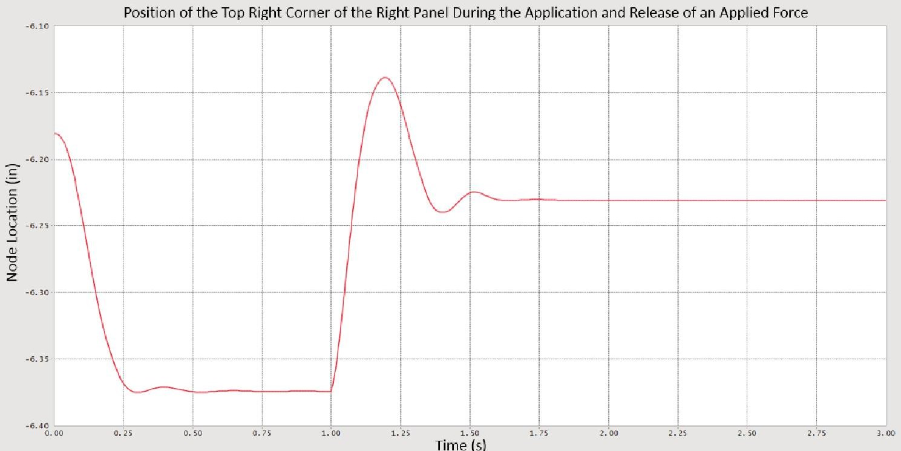

Figure 22. Response of a freely rotating hinge to an applied impulse force.

## D. Solar Panel Parameter Sensitivity

A set of 11 trials was run to evaluate the sensitivity of the model to various input factors. The five input factors that were evaluated are root spring stiffness, panel-panel spring stiffness, side panel substrate modulus, center panel substrate modulus, and solar array add-on mass. Parameters were adjusted by 20% from the nominal value. The study was conducted with the intention of being used to develop physical test to validate the performance of the simulations. A summary of the results can be seen in Table 1.

A strong correlation was found between the input parameters and the time to deploy, the maximum tumbling with instability, and the maximum input thrust. Increasing the spring stiffness tends to decrease time to deploy and increases stability while deployed while increasing the solar array add-on mass increased the time to deploy and decreased stability while deployed. However, trial 1 seems to be an outlier to these trends. Examining the simulation results for this case reveals an oscillation in the residual stresses of the left panel that is timed in such a way that the deployment of the left panel is delayed.

<!-- PDF_PAGE: 16 -->

Table 1. Simulation Trials for the Proposed Design of Experiments

<table border="1"><tr><td colspan="10">Design of Experiments</td></tr><tr><td colspan="6">Variables</td><td colspan="5">Results(as applicable to variable conditions)</td></tr><tr><td colspan="6"></td><td colspan="2">Act of Deployment</td><td colspan="3">Fully Deployed Condition</td></tr><tr><td>Trial</td><td>Root Spring Stiffness</td><td>Panel-Panel Spring Stiffness</td><td>Side Panel Substrate Modulus</td><td>Center Panel Substrate Modulus</td><td>Solar Array Add-on Mass</td><td>Time to Deploy(seconds)(1)</td><td>Rate of Damping(seconds)(2)</td><td>Primary Freq., Deployed(Hz)(3)</td><td>Max Tumbling with Instability(Rad/s^2)(4)</td><td>Maximum Input Thrust(lb.)(5)</td></tr><tr><td>0</td><td>Nominal</td><td>Nominal</td><td>Nominal</td><td>Nominal</td><td>Nominal</td><td>1.97</td><td>0.85</td><td>8.33</td><td>11.8</td><td>10.2</td></tr><tr><td>1</td><td>&gt;spring stiffness</td><td>Nominal</td><td>Nominal</td><td>Nominal</td><td>Nominal</td><td>2.23</td><td>1.23</td><td>8.33</td><td>11.8</td><td>10.9</td></tr><tr><td>2</td><td>Nominal</td><td>&gt;spring stiffness</td><td>Nominal</td><td>Nominal</td><td>Nominal</td><td>1.9</td><td>0.86</td><td>13.65</td><td>13.8</td><td>10.2</td></tr><tr><td>3</td><td>Nominal</td><td>Nominal</td><td>&gt;modulus</td><td>Nominal</td><td>Nominal</td><td>1.95</td><td>0.95</td><td>8.33</td><td>11.8</td><td>10.2</td></tr><tr><td>4</td><td>Nominal</td><td>Nominal</td><td>Nominal</td><td>&gt;modulus</td><td>Nominal</td><td>1.98</td><td>0.92</td><td>14.65</td><td>11.8</td><td>10.2</td></tr><tr><td>5</td><td>Nominal</td><td>Nominal</td><td>Nominal</td><td>Nominal</td><td>&gt;solar array</td><td>2.02</td><td>1</td><td>7.99</td><td>11.3</td><td>9.7</td></tr><tr><td>6</td><td>&lt;spring stiffness</td><td>Nominal</td><td>Nominal</td><td>Nominal</td><td>Nominal</td><td>2.08</td><td>1.03</td><td>7.99</td><td>11.8</td><td>9.3</td></tr><tr><td>7</td><td>Nominal</td><td>&lt;spring stiffness</td><td>Nominal</td><td>Nominal</td><td>Nominal</td><td>2.32</td><td>1.17</td><td>8.33</td><td>10.9</td><td>10.2</td></tr><tr><td>8</td><td>Nominal</td><td>Nominal</td><td>&lt;modulus</td><td>Nominal</td><td>Nominal</td><td>1.99</td><td>1</td><td>13.65</td><td>11.8</td><td>10.2</td></tr><tr><td>9</td><td>Nominal</td><td>Nominal</td><td>Nominal</td><td>&lt;modulus</td><td>Nominal</td><td>1.97</td><td>1.04</td><td>7.66</td><td>11.8</td><td>10.2</td></tr><tr><td>10</td><td>Nominal</td><td>Nominal</td><td>Nominal</td><td>Nominal</td><td>&lt;solar array</td><td>1.95</td><td>0.89</td><td>8.33</td><td>12.3</td><td>10.5</td></tr><tr><td>11</td><td>&gt;spring stiffness</td><td>&gt;spring stiffness</td><td>&gt;modulus</td><td>Nominal</td><td>Nominal</td><td>1.81</td><td>0.98</td><td>8.66</td><td>13.8</td><td>10.9</td></tr></table>

Notes:

(1) Time to Deploy refers to the time from melt rod release to full deployment without damping.

(2) Rate of damping is the time after deployment in which the solar array reaches equilibrium.

(3) Deployed fundamental frequency is the 1st natural frequency of the system in a fully deployed state.

(4) Max tumble rate of spacecraft without deployed wing decoupling from hinge hard stops, thus becoming unstable.

(5) Amount of thruster force that causes the solar array wings to decouple from the hard stops

## V. Summary

A vertical application that runs within the RecurDyn multibody dynamics software package which automates the development of hinge models has been presented. The simplification of a hinge with complex geometry to a single nonlinear component allows a nonlinear finite element representation to be used for each of the solar panels while maintaining a reasonable simulation time. Accurately modeling the dynamic behavior of deployable spacecraft structures, such as solar arrays is important for reducing risk during spacecraft development. The application is useful for spacecraft designers as it reduces model development time as well as simulation run time. The vertical application will be especially useful to developers of CubeSat as the solar arrays are large compared to the spacecraft body. The utility of the vertical application is demonstrated through the development of a deployment simulation and post deployment characterization of the e-Hawk solar array. In addition, a deployable space structure of any size can be simulated using the above tools and techniques.

## Acknowledgments

The authors thank Thomas Kraft of the NASA Glenn Research Center for his constructive input and feedback throughout this project. The authors also thank NASA for providing funding for this work through the Small Business Innovative Research grant program (Contract NNX16CC71P)

<!-- PDF_PAGE: 17 -->

## References

1. Final Report, SBIR Phase I contract NNX14CC72P, "Simulating Nonlinear Dynamics of Deployable Space Structures", Date of Order 06/17/2014, Completed 12/19/2014, Proposal #14-1 H5.02-9104.

2. Brant Ross, Nelson Woo, Joseph R. Blandino, "Simulation of the Deployment of a Flexible Roll-Up Solar Array Using Multi-Body Dynamics Software," 3rd AIAA Spacecraft Structures Conference, AIAA SciTech, (AIAA 2016-1706), San Diego, CA, January 4-8, 2016.

3. Brant Ross, Nelson Woo, Thomas G. Kraft, and Joseph R. Blandino, "Active Control of Solar Array Dynamics During Spacecraft Maneuvers," $ 3^{\mathrm{rd}} $ AIAA Spacecraft Structures Conference, AIAA SciTech, (AIAA 2016-1706), San Diego, CA, January 4-8, 2016.

4. Young, L.E., and Pack, H.C., "Solar Array Flight Experiment/Dynamic Augmentation Experiment," NASA Technical Paper 2690, 1987.

5. Tadikonda, S.S.K., Singh, R.P., and Stornelli, S., "Multibody Dynamics Incorporating Deployment of Flexible Structures," Journal of Vibration and Acoustics, Vol. 118, April 1996.

6. Banerjee, A.K., "Contributions of Multibody Dynamics to Space Flight: A Brief Review." Journal of Guidance, Control and Dynamics, Vol. 26, No. 3, May-June 2003.

7. Sinn, T., and Vasile, M., "Multibody Dynamics for Biologically Inspired Smart Space Structures," Proceedings of AIAA SCITECH 2014, National Harbor, MD, January 13-17, 2014.

8. from http://aprs.org/psat/pcube-sketch2.GIF