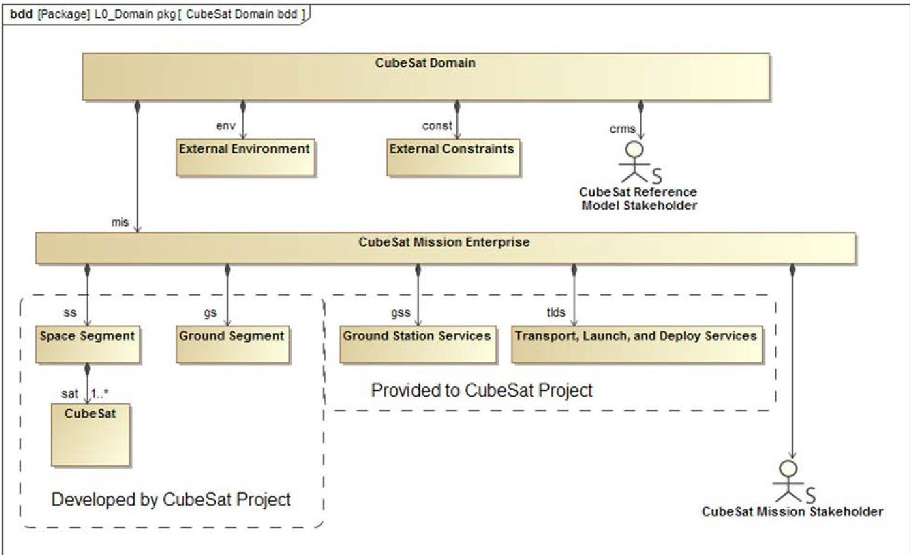
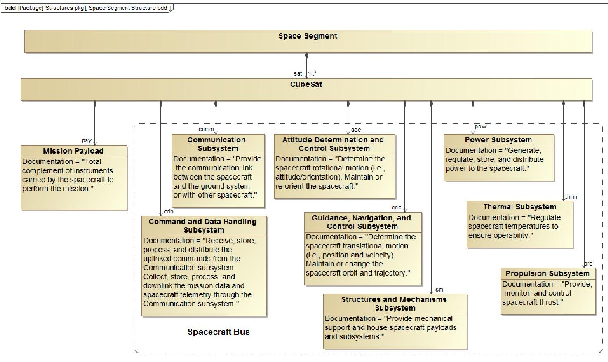
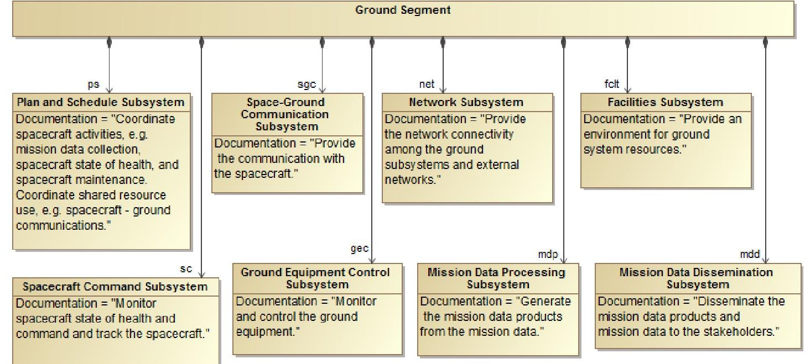
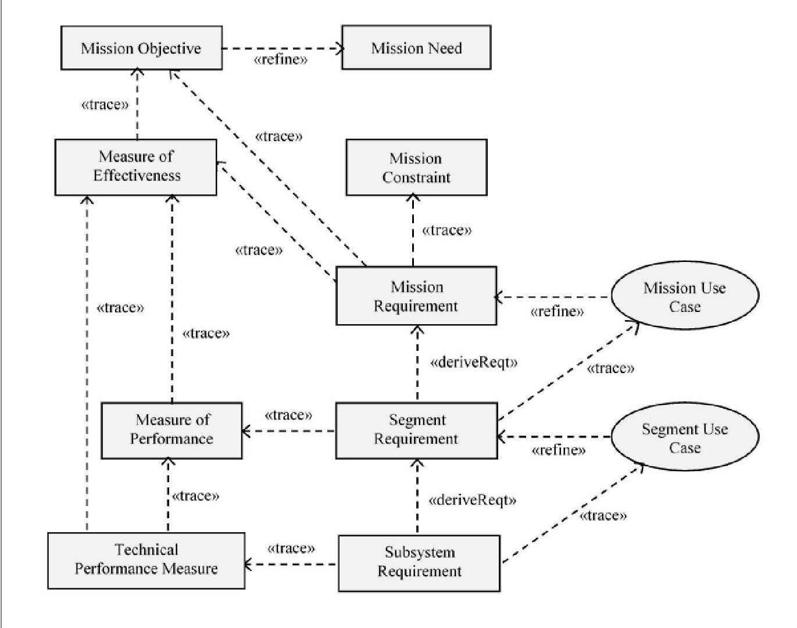
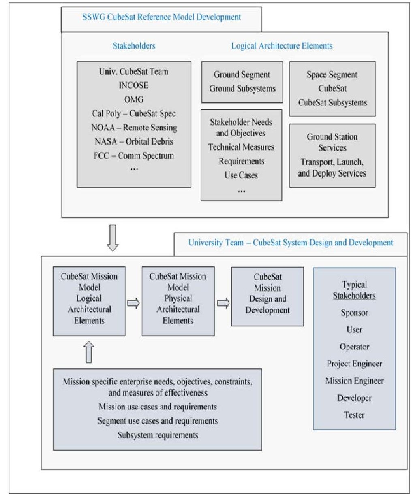
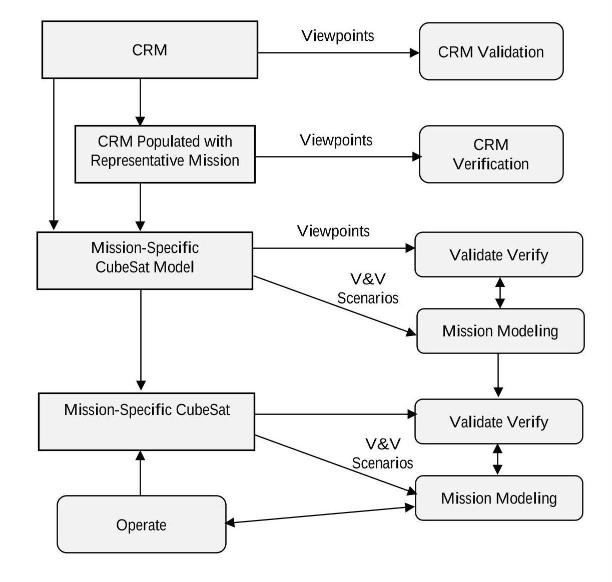

<!-- PDF_PAGE: 1 -->

# 15th Annual Conference on Systems Engineering Research Disciplinary Convergence: Implications for Systems Engineering Research

Eds.: Azad M. Madni, Barry Boehm Daniel A. Erwin, Roger Ghanem; University of Southern California Marilee J. Wheaton, The Aerospace Corporation Redondo Beach, CA, March 23-25, 2017

# Validation and Verification of MBSE-compliant CubeSat Reference Model

David Kaslow $ ^{a} $ , Azad M. Madni $ ^{b} $ $ ^{a} $ INCOSE Space Systems Working Group Chair, david.kaslow@gmail.com $ ^{b} $ University of Southern California, Azad.Madni@usc.edu

## Abstract

As Model-Based Systems Engineering (MBSE) continues to mature and becomes part of space engineering practice, the concept of a Reference Model becomes increasingly important. The CubeSat Reference Model (CRM) is an example of a reference model that is being developed by the INCOSE Space Systems Working Group (SSWG). The intent of the model is to facilitate the design, verification and validation of CubeSat design. The CRM is being developed with sufficient flexibility to support customization for specific CubeSat missions by mission-specific CubeSat teams. This paper presents the key elements of the CRM developed using MBSE practices. It presents different views of the model along with a validation and verification approach. Further research is needed into how best to augment with other models to facilitate CubeSat test and evaluation.

Keywords: verification; validation; CubeSat; Reference Model; MBSE

## 1. Introduction

A CubeSat is a low-cost standardized nanosatellite. It originated from the CubeSat Project which was established in 1999 by California Polytechnic State University (Cal Poly), San Luis Obispo and Stanford University's Space and Systems Development Laboratory (SSDL). The CubeSat Project was established for the university community to design, build, and launch satellites using mostly off-the-shelf components. The basic CubeSat unit is 10x10x10 centimeters with a mass of about 1.3 kilograms. This cubic unit is referred to as 1U. CubeSat units can be joined to form a larger satellite. One-, two-, and three-unit (1U, 2U, and 3U) CubeSats have been the most common configurations so far. They are typically launched as secondary payloads or deployed from the International Space Station.

Model-Based Systems Engineering (MBSE) is a key recent practice to advance the systems engineering discipline [1]. The International Council on Systems Engineering (INCOSE) established the MBSE Initiative [2] to promote, advance, and institutionalize the practice of MBSE. As part of this effort, since 2011 the INCOSE Space Systems Working Group (SSWG) Challenge Team has been investigating the applicability of MBSE for designing CubeSats. The SSWG team comprises academics (including faculty and students), practitioners (including engineers and software developers from NASA centers and industry), and representatives of commercial tool vendors.

The goals of the MBSE Challenge Project are to:

- Demonstrate Model-Based Systems Engineering (MBSE) methodology as applied to a CubeSat mission;

- Provide a CubeSat Reference Model (CRM) for CubeSat teams to use as the starting point for developing mission-specific CubeSat models; and

- Develop the CRM as an Object Management Group (OMG) specification.

Central to this MBSE work is the creation of a CubeSat Reference Model (CRM). A generic reference

<!-- PDF_PAGE: 2 -->

model in MBSE is a conceptual framework based on a domain-specific ontology. It consists of an interlinked set of concepts produced by a body of subject matter experts with the express purpose of fostering clear communications within collaborative teams of stakeholders. A reference model embodies the set of core concepts (including goals) that engineers can use for various purposes such as verification and validation, and test and evaluation. An apt analogy, according to Madni [3], [4] is that of examining a precious stone such as a diamond. "As you hold the gem up to the light and rotate your hand, you get to view its different facets. The rays of light from each facet offer a unique insight about the diamonds clarity and cut" [3]. A reference model is much like a gem. Its facets correspond to different perspectives or views, while the rays of light correspond to the information and insights contained in each perspective view. A reference model is a collection of different perspectives. It offers a high-level view of the problem domain (space). The key characteristics of a reference model are: abstractions, relationships, and entities. A reference model is methodology-neutral and technology-agnostic [3] [4].

Thus, the CubeSat Reference Model is an abstract framework for understanding the relationships among the entities of the CubeSat environment. Even though it is at least three levels of abstraction away from any physical instantiation, it still provides valuable assistance to the Mission-specific CubeSat development teams.

Our use of the term Reference Model should not be confused with the use of the same term by the Organization for the Advancement of Structured Information Standards (OASIS). OASIS uses to the term in the context of Service Oriented Architectures [5].

The term "Model as used in Model-Based Systems Engineering (MBSE) is represented using a language such as Systems Modeling Language (SysML). Since we are interested in modeling a generic CubeSat mission domain, and not a specific mission, we qualify the model as a "Reference Model."

The CRM will be delivered by SSWG to Mission-specific CubeSat development teams to:

- Populate the model with their Mission Statement and Mission Objectives, their Measures of Effectiveness and Performance, and their Stakeholders and Stakeholder Concerns

- Develop their Use Cases, System and Subsystem requirements, and Validation and Verification approach; and

- Refine the Logical Architecture and develop the Physical Architecture.

The challenges [6] facing the development teams include the following:

- There is currently no agreed-upon process for developing a CubeSat Enterprise [7]

- To date, no Mission-specific CubeSat Enterprise has been modeled

- It is anticipated that different Mission-specific CubeSat development teams will bring different levels of engineering and development skill and experience to bear

- Budget constraints will continue to be a driver

Encouraging the various Mission-specific CubeSat development teams to adopt MBSE, Object Oriented System Engineering Methodology (OOSEM), and SysML and providing them a standard Reference Model for their development will boost the efficiency and productivity of less experienced teams without any negative impacts.

Previously, the SSWG demonstrated the ability to model behaviors, interface with commercial off-the-shelf (COTS) simulation tools, and carry out trade studies [8]. Currently, the team is building a reference CubeSat model for use by aerospace students in the classroom, and by mission teams building mission-specific CubeSats [9], [10], [11], [12], [13], [14].

In Section 1, we have introduced the SSWG CubeSat effort. Section 2 presents a more detailed look at the effort required to develop the CubeSat Reference Model, including a description of the Logical Architecture, and the organization of the model (particularly the requirements captured in the model). Section 3 identifies the effort required to develop a Mission-specific CubeSat model using the CRM as a foundation. Section 4 discusses the approach to conducting Validation and Verification of the CubeSat Reference Model, and compares that approach to the approach for conducting Verification and Validation of the Mission-specific CubeSat model. Section 5 presents conclusions and future work.

<!-- PDF_PAGE: 3 -->

## 2. CubeSat Reference Model Development [13]

The CRM is intended to be used by university project teams designing space missions utilizing the CubeSat form-factor. The model is being developed assuming that the members of the team have an intermediate-level understanding of space mission analysis and design, Model-Based Systems Engineering (MBSE), Systems Modeling Language (SysML), and that their work is being guided by subject matter experts. MBSE is the formalized application of modeling to support key systems engineering tasks for addressing requirements, design, analysis, and validation and verification.

Logical and Physical Architectures. The CRM provides the logical architecture of a CubeSat. The logical components, which are abstractions of physical components, symbolically execute system functions (i.e., without implementation constraints). The physical architecture defines physical components of the system including hardware, software, persistent data, and operational procedures. The CRM logical elements are intended to be reused as a starting point for a mission-specific CubeSat logical architecture, followed by the development of physical architecture from the logical architecture during CubeSat development. On the other hand, should the Mission-specific Team decide to adopt a different logical architecture, the CRM is sufficiently flexible to accommodate

CubeSat Domain and Enterprise. Figure 1 shows the CubeSat Domain, which consists of the CubeSat Mission Enterprise (with its two segments and various services), Stakeholders, External Environment, and External Constraints. The External Environment consists of the Space Environment and Earth Environment. The External Constraints include Licenses and Regulations. The CubeSat Mission Enterprise encompasses everything that involves the development, deployment, and operation of the CubeSat mission.

Figure 1. CubeSat Domain and Mission Enterprise

CubeSat Space Segment. The CubeSat Space Segment consists of one or more CubeSats along with their orbits and subsystems. The Space Segment includes designs, interfaces, and operations to comply with the requirements and constraints that are imposed by the External Environment, as well as those by other aspects of the mission such as the Transport, Launch, and Deploy Services. For example, a launch

<!-- PDF_PAGE: 4 -->

has a pressure and vibration profile that constrains the design of the CubeSat. These requirements and constraints can be incorporated into a Transport, Launch, and Deploy Services model unique to the service providers.

CubeSat Ground Segment. The CubeSat Ground Segment consists of the CubeSat Mission Operations and one or more Ground Stations. Mission Operations includes the software, data, procedures, and personnel used to operate the CubeSat mission. Mission Operations activities include mission planning and scheduling, command and control of the CubeSat, control of the ground equipment, mission telemetry processing, and mission data processing and distribution. The Ground Station consists of the computers, network, communication equipment, and associated control infrastructure hosted in a ground facility. Communication equipment includes the space-ground antennas. The architecture accommodates a CubeSat project developing its own ground station or operating with an existing ground station that provides uplink and downlink services.

Subsystems. Figures 2 and 3 show the decomposition into logical subsystems of both the Space and Ground Segments. While these subsystems currently comprise the logical partitioning of the segments, they may later reflect the physical partitioning as well. Starting with this list, teams may add or remove subsystems based on the mission requirements and objectives.

Figure 2. CubeSat Space Segment

<!-- PDF_PAGE: 5 -->

Figure 3. CubeSat Ground Segment

Model Organization. There are packages for the domain, enterprise, space and ground segments, and space and ground subsystems. The enterprise, segment, and subsystems packages contain behaviors, structures, validation, and verification packages.

Requirements. Requirements are organized by enterprise, space and ground segments, and space and ground subsystems packages. The enterprise package consists of mission needs, mission objectives, mission constraints, and mission requirements packages with model elements to establish the relationships to the stakeholder needs, objectives, constraints, and measures of effectiveness. Figure 4 shows model elements that help define lower-level requirements. The relationships between elements are illustrative not prescriptive. Segment requirements are derived from mission requirements and trace to mission use cases. Segment requirements trace to measures of performance which trace to measures of effectiveness. Subsystem requirements are derived from segment requirements and trace to segment use cases. Subsystem requirements trace to technical performance measures which trace to measures of performance and to measures of effectiveness.

Technical Measures. Technical measures provide the stakeholders insight into the definition and development of the technical solution. Measures of effectiveness, key performance parameters, measures of performance, and technical performance parameters as are technical measures. They are distinct from requirements, although performance and other requirements may be traced to them. They are incorporated into the CRM as block value properties. A technical measure can be measured and compared to a target value.

Functional and Non-Functional Requirements. Requirements can be classified as functional or non-functional. Functional requirements define the desired behaviors of the system and non-functional requirements define the overall qualities or attributes of the resulting system. Non-functional requirements (which include Quality Factors) place constraints on the product being developed, the development processes, or conformance with external regulations. Examples of non-functional requirements include safety, security, usability, reliability, and performance. However, as requirements are decomposed, the distinction between functional and non-functional requirements may disappear. For example, a top-level mission reliability requirement may lead to lower level requirements that identify where redundancy would be needed. The presence of redundancy requires redundancy management functions whose behaviors could be considered functional requirements. Whether a requirement is expressed as a functional or non-

<!-- PDF_PAGE: 6 -->

functional requirement may depend on the level of detail to be included in the requirements document, the extent to which the application domain is understood, and the experience of the developers.

Figure 4. Hierarchy of Mission Needs, Objectives, and Constraints; Technical Measures, Requirements, and Use Cases The relationships between elements are illustrative not prescriptive

## 3. Mission-Specific CubeSat Model [13]

The steps for developing a mission-specific CubeSat model are illustrated in Figure 5. The first step is taking the CRM and populating the mission-specific enterprise needs, objectives, constraints, and measures of effectiveness to create a mission-specific logical architecture. Figure 4 previously illustrated the roles and relationships of requirements, use cases, and technical measures across the architectural layers comprising the enterprise, mission, segments, and subsystems. Key to defining the mission-specific logical architecture layers is creating of use cases and technical measures to describe fully the behaviors and data flow in support of the stakeholder needs, objectives, measures of effectiveness, and constraints. Although the CRM space and ground subsystems have been broadly defined, the mission teams may find it necessary to modify the subsystem definitions according to the allocated requirements.

The next step is to create the physical architecture from the logical architecture, and this is accomplished by determining the types of subsystem components that meet the functional and performance subsystem requirements. Physical components include the specific hardware, software, persistent data, and operational procedures.

<!-- PDF_PAGE: 7 -->

The final step in Figure 5 is to complete the CubeSat mission design and to develop the CubeSat space and ground segments.

Figure 5. CubeSat Reference Model Provides the Foundation for the Mission-Specific CubeSat Model

## 4. Approach to Validation and Verification [13]

The CRM is basically a model of a model. That is, the CRM will be used by a mission-specific CubeSat team to design and develop their mission-specific CubeSat.

Validation confirms, by providing objective evidence, that the system, as-built (or as it will be built), satisfies the stakeholders' needs. That is, the right system has been (or will be) built.

Verification confirms, by providing objective evidence, that the system and all its elements perform their intended functions and satisfy the requirements allocated to them. That is, the system has been built right. Verification methods include inspection, analysis, demonstration, and test.

Stakeholders are individuals or organizations with an interest in the system. Typical stakeholders include users, operators, organization decision makers, parties to the agreement, regulatory bodies, developing agencies, support organizations, and society at large. They can also include interoperating and enabling systems.

Stakeholders have various interests in the CRM: Some are interested in the models themselves and others are interested in the missions that can be realized from the mission-specific instantiations of the model, and some are interested in both.

<!-- PDF_PAGE: 8 -->

Stakeholders, Concerns, Viewpoints, and Views. ISO/IEC/IEEE 42010:2011 established the following terminology [15]:

- Stakeholders and Concerns: A concern could be manifest in many forms, such as in relation to one or more stakeholder needs, goals, expectations, responsibilities, requirements, design constraints, assumptions, dependencies, quality attributes, architecture decisions, risks or other issues pertaining to the system.

- Architecture Viewpoint: Work product establishing the conventions for the construction, interpretation and use of architecture views to frame specific system concerns

- Architecture View: Work product expressing the architecture of a system from the perspective of specific system concerns

Regulatory Agencies are stakeholders. Licenses and regulations, timelines, and procedures must be must be well understood and part of the CRM. In the U.S. the FCC regulates the radio frequencies, NASA provides orbital debris guidelines, and NOAA regulates remote sensing. The validation that the national stakeholders' regulations and guidelines have been properly instantiated, will consist of viewpoints into the CRM. The viewpoints include source regulations, guidelines, procedures, and timelines. Verification of compliance with the regulations and timelines will be the responsibility of the mission-specific CubeSat team. Their mission-specific CubeSat model will need viewpoints for the compliant model elements, licenses, and authorizations.

Cal Poly CubeSat Project is a stakeholder. The Cal Poly CubeSat Specification [16] specifies a CubeSat's physical, mechanical, electrical, testing, and operational requirements.

INCOSE and OMG are both stakeholders. They jointly developed SysML to support MBSE. An independent review team will validate that the CRM complies with accepted SysML modeling guidelines. OMG is responsible for establishing the CRM as a specification. OMG review and approval of the CRM will validate that the CRM is qualified to be a specification.

SSWG and University CubeSat Teams are both stakeholders since they are model users. The SSWG is a stakeholder since it is developing the model for use by the university team. A traditional pre-MBSE approach would be to negotiate a CRM requirements document and then to develop the model. In MBSE, the SSWG works with the university teams to define the model elements and relationships from the CubeSat domain and enterprise to the space and ground segments and subsystems.

Figure 6 illustrates that viewpoints into the CRM will provide the objective evidence needed for validation. The CRM will be populated with a representative mission, and then the viewpoints will provide the objective evidence for verification. The CRM will have logical elements that can be reused by a mission-specific CubeSat team as a basis for its logical and physical CubeSat models. The CRM will have viewpoints for model elements and relationships in support of mission-specific CubeSat stakeholder needs, objectives, and technical elements as well as requirements definition, validation, and verification. As illustrated in Figure 6, the mission-specific CubeSat viewpoints will provide the objective evidence needed for validation and verification of the mission-specific CubeSat model. Figure 6 also shows the role of mission modeling in the validation and verification of the mission-specific CubeSat model and the mission-specific CubeSat. The CubeSat SysML model and the modeling tool can be configured to execute a mission scenario. This includes interfacing with commercial off-the-shelf (COTS) modeling tools [7].

<!-- PDF_PAGE: 9 -->

Figure 6. Validation and Verification of the CubeSat Reference Model and the Mission-Specific CubeSat Model

## 5. Conclusion

As MBSE matures and continues to penetrate real world engineering practice, the concept of a reference model is an important development to facilitate transition of MBSE into real world practice [1], [17]. This paper has presented recent advances in developing a CubeSat Reference Model (CRM) in accord with MBSE specification. This paper discusses the specification, validation, and verification of the CRM. This activity is being pursued by a team comprising government, academia, and INCOSE SSWG. This activity is expected to continue into the foreseeable future resulting in further advances in MBSE [17], [18]. Future advances include the development of a library of reference models (for different domains and missions) that are metadata-tagged for easy retrieval.

## Acknowledgements

The authors acknowledge the contributions of SSWG team members Philip Cahill, Myron Hecht, and Brad Ayres in developing the Validation and Verification approaches expressed in this paper.

<!-- PDF_PAGE: 10 -->

## References

1. Madni, A.M. and Sievers, M. "Model Based Systems Engineering: Motivation, Current Status and Needed Advances," accepted for publication in Systems Engineering, 2016.

2. International Council on Systems Engineering (INCOSE), "MBSE Initiative," January 2007. [Online] Available: http://www.omgwiki.org/MBSE/doku.php.

3. Madni, A.M. Systems Architecting (SAE 549), Lecture Notes, Systems Architecting and Engineering Program, Viterbi School of Engineering, University of Southern California, 2009.

4. Madni, A.M. Model-Based Systems Engineering (SAE 548), Lecture Notes, Systems Architecting and Engineering Program, Viterbi School of Engineering, University of Southern California, 2011.

5. Reference Model for Service Oriented Architecture 1.0, OASIS Standard, 12 October 2006

6. M. Swartwout, "University-Class Spacecraft by the Numbers: Success, Failure, Debris (But Mostly Success)”,

30th Annual AIAA/USU Conference on Small Satellites, Logan UT, 2016. Approximately 75% of university-class missions were CubeSats, with a mission failure rate of some 50% (when launch failures were discounted).

7. S. Spangelo, J. Cutler, L. Anderson, E. Fosse, L. Cheng, R. Yntema, M. Bajaj, C. Delp, B. Cole, G. Soremekun, and D. Kaslow, "Model Based Systems Engineering (MBSE) Applied to Radio Aurora Explorer (RAX) CubeSat Mission Operational Scenarios", Proceedings of IEEE Aerospace Conference, Big Sky MT, 2013. University CubeSat design efforts have been largely based on intuition.

8. D. Kaslow, G. Soremekun, H. Kim, S. Spangelo, "Integrated Model-Based Systems Engineering (MBSE) Applied to the Simulation of a CubeSat Mission", Proceedings of IEEE Aerospace Conference, Big Sky, MT, March 2014.

9. D. Kaslow, L. Anderson, S. Asundi, B. Ayres, C. Iwata, B. Shiotani, R. Thompson, "Developing a CubeSat Model-Based System Engineering (MBSE) Reference Model - Interim Status", Proceedings of IEEE Aerospace Conference, Big Sky, MT, March 2015.

10. D. Kaslow, B. Ayres, M. Chonoles, S. Gasster, L. Hart, C. Massa, R. Yntema, B Shiotani, "Developing a CubeSat Model-Based System Engineering (MBSE) Reference Model - Interim Status #2", Proceedings of IEEE Aerospace Conference, Big Sky, MT, March 2016.

11. D. Kaslow, B. Ayres, M. Chonoles, S. Gasster, L. Hart, A. Levi, C. Massa, R. Yntema, B Shiotani, "Developing and Distributing a CubeSat Model-Based System Engineering (MBSE) Reference Model - Status", Proceedings of 32 Space Symposium, Colorado Springs, CO, April 2016.

12. D. Kaslow, B. Ayres, P. Cahill, M. Chonoles, L. Hart, C. Iwata, A. Levi, R. Yntema "CubeSat Model-Based Systems Engineering (MBSE) Reference Model - Development and Distribution - Interim Status", Proceedings of AIAA Space Forum, Pasadena, CA, August 2016.

13. D. Kaslow, B. Ayres, P. Cahill, L. Hart, R. Yntema, "Developing a CubeSat Model-Based System Engineering (MBSE) Reference Model - Interim Status #3", Proceedings of IEEE Aerospace Conference, Big Sky, MT, March 2017.

14. D. Kaslow, B. Ayres, P. Cahill, L. Hart, R. Yntema "A Model-Based Systems Engineering (MBSE) Approach

for Defining the Behaviors of CubeSats", Proceedings of IEEE Aerospace Conference, Big Sky, MT, March 2017.

15. ISO/IEC/IEEE 42010:2011 Systems and Software Engineering - Architecture Description.

16. CubeSat Design Specification, rev. 13, The CubeSat Program, Cal Poly SLO, February 2014

17. Madni, A.M., Spraragen, M., and Madni, C.C., "Exploring and Assessing Complex System Behavior through

17. Madhi, A.M., Spruragen, M., and Madhi, C.C., Exploring and Assessing Complex System Behavior through Model-Driven Storytelling," IEEE Systems, Man and Cybernetics International Conference, invited special session "Frontiers of Model Based Systems Engineering", San Diego, CA, Oct 5-8, 2014.

18 Madni, A.M. "Generating Novel Options During Systems Architecting: Psychological Principles, Systems Thinking, and Computer-Based Aiding," Systems Engineering, Volume 17, Number 1, pp. 1-9, 2014.