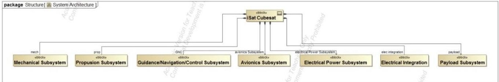
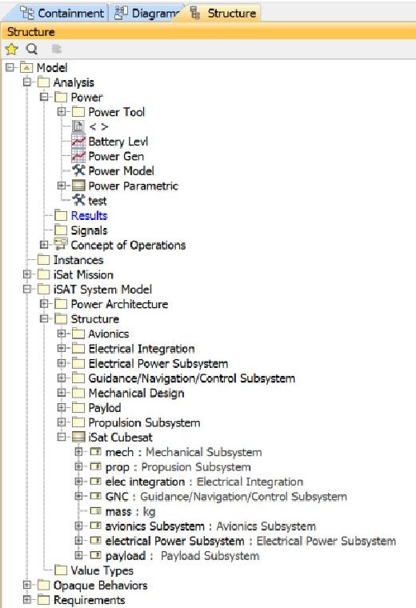
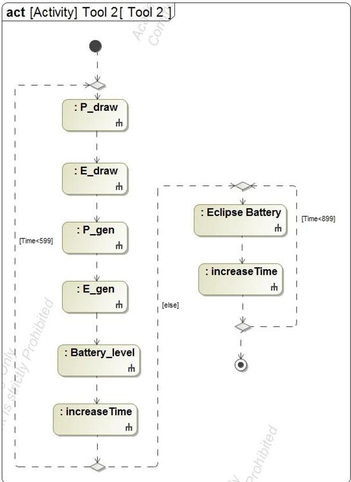
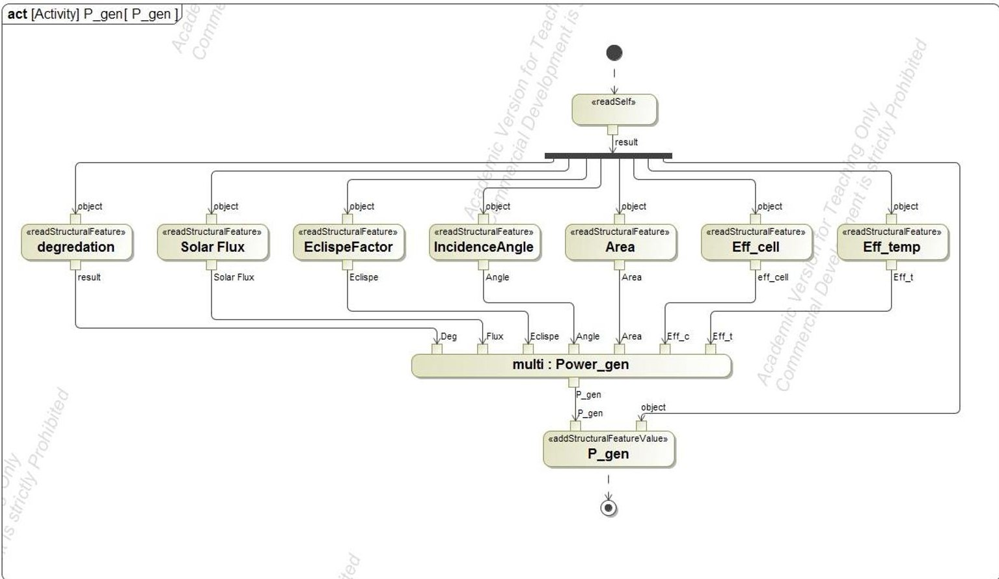
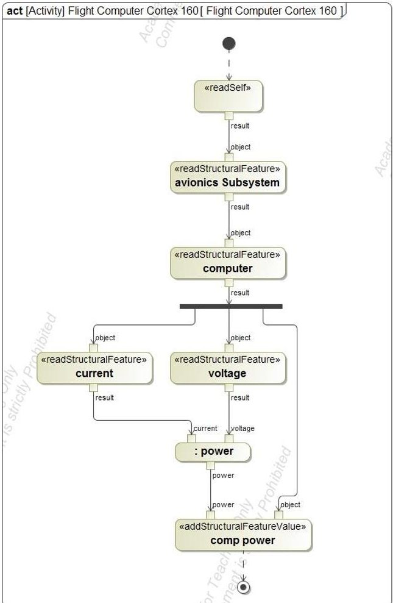
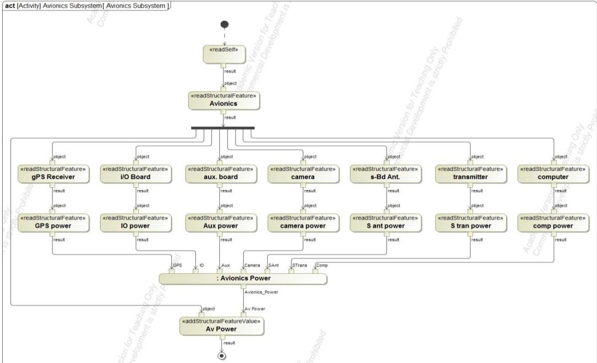
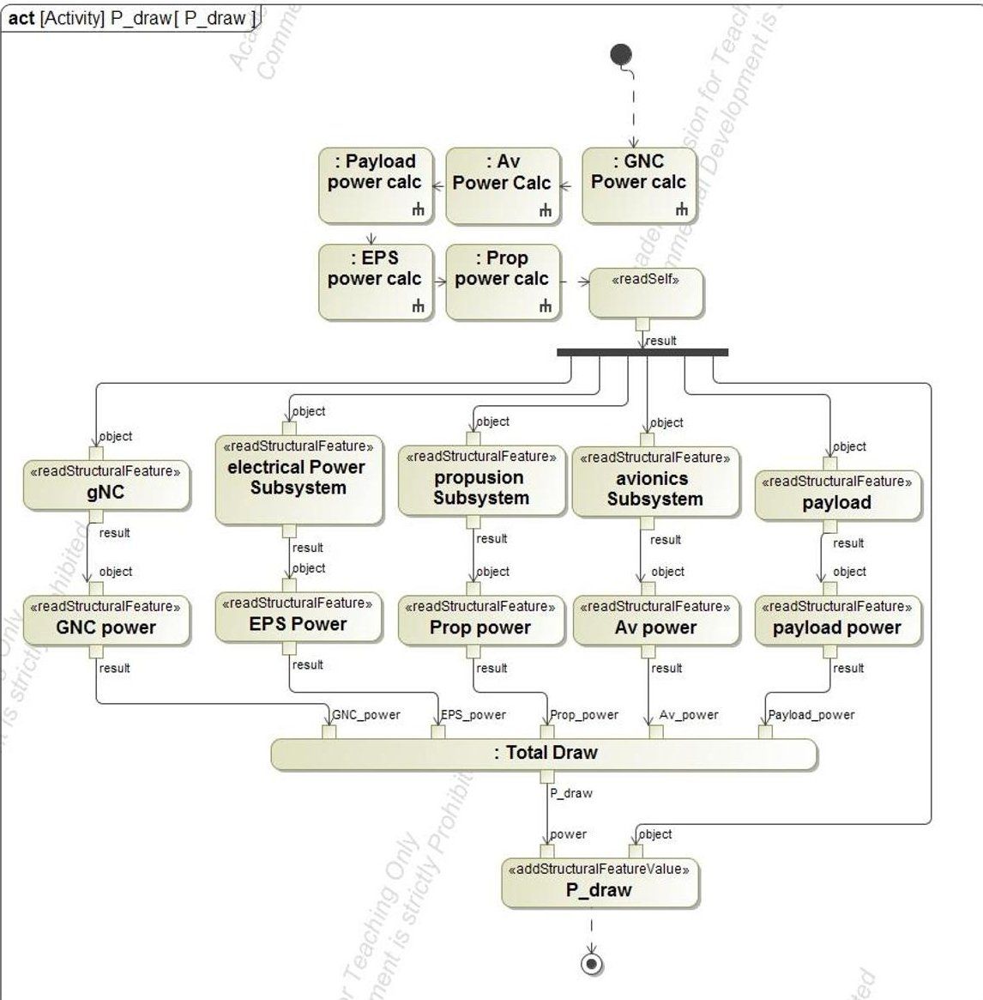
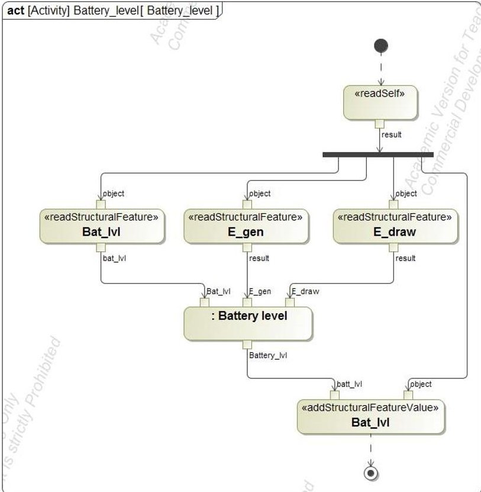
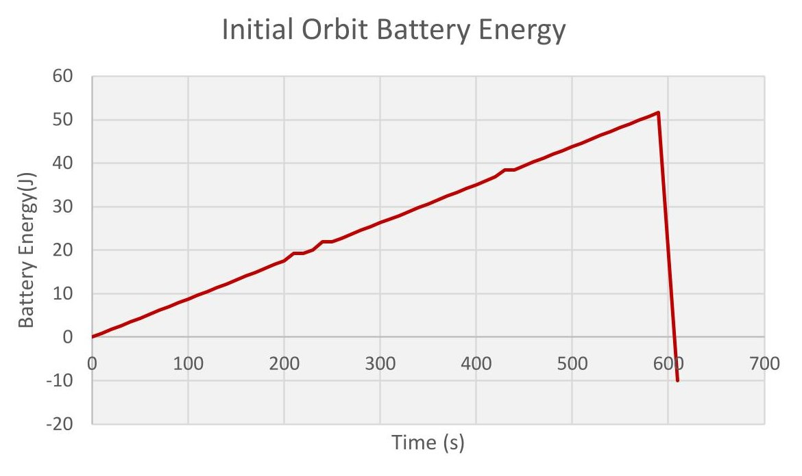

<!-- PDF_PAGE: 1 -->

# Integrated system modeling in SysML for Small Satellites

Lloyd Walker $ ^{1} $ and Dr. L. Dale Thomas $ ^{2} $ University of Alabama in Huntsville, Huntsville, AL 35899

Small satellites (>100kg) are becoming more prevalent with increasing mission types driving the complexity of the design. These missions range from earth imaging to technological demonstrations as well as educational uses within universities. The design and engineering of these satellites become more challenging with the miniature size, coupled subsystems and dynamic environments. One major issue of this architecture is the selection and verification of requirements. Model-based systems engineering is a powerful system engineering methodology providing engineers a model of the entire system model. This modeling environment can provide system design in the trade space as well as integrating disciplines together and allowing simulation. NASA Marshall Space Flight Center is currently working on a small satellite using an iodine fueled Hall thruster, called iSAT. This 12U satellite will be a technological demonstration of the use of a 200W Hall thruster in low earth orbit. Integrating the system models into SysML with the requirements and system architecture allowed for an analysis of the power system. A simulation of the power system was completed providing insight into the design.

## Nomenclature

MBSE = Model-Based Systems Engineering

INCOSE = International Council on Systems Engineering

iSAT = Iodine Satellite

NASA = National Aeronautics and Space Administration

UMD = Model Based Design

SysML = Systems Modeling Language

SSWG = Space Systems Working Group

STK = Systems Tool Kit

OMG = Object Management Group

UML = Unified Modeling Language

MPPT = Maximum Peak Power Tracking

GNC = Guidance, Navigation and Control

## I. Introduction

SMALL satellites, which here are defined as satellites weighing less than 100kgs, are becoming more popular in use. These satellites can be seen as an answer to the "better, faster, cheaper" approach with the decrease in the size of technology. However, the size of these satellites increases some of the design difficulties. Marshall Space Flight Center is currently working on a small satellite, called iSAT, through the Space Technology Mission Directorate. It is a 12 unit CubeSat with a size of 8" x 8" x 12", being used as a platform for a technological demonstration of an iodine Hall thruster propulsion system. $ ^{1} $ This will be done by starting at around a 600km circular orbit and reducing down to a 300km circular orbit with a 200W thruster. SmallSats are typically constrained by volume, mass, and power, which limit their propulsive capability. With this demonstration, NASA can provide future satellites with a means of electric propulsion while meeting constraints. On the other hand, using electric propulsion places a greater emphasis on the

<!-- PDF_PAGE: 2 -->

analysis of the electrical power system. The preliminary power model for the iSAT is currently modeled in LabView and Excel, which produces an open loop set of values. By shifting over to a model based systems engineering approach, the power profile can be modeled throughout the orbit. It also provides a platform that can leverage other powerful tools such as Satellite Toolkit and Matlab to simulate the satellite systems for a mission profile.

## II. SysML overview

Model Based Systems Engineering (MBSE) is the formalized application of modeling to support system requirements, design, analysis, verification, and validation activities from concept design through realization $ ^{2} $ . MBSE grew out of the model based software engineering approaches (e.g. [UML]) developed to facilitate complex software developments. Systems Modeling Language (SysML), an extension of UML, allows the construction of system models encompassing not only hardware and software elements of a system, but also human operators and the system context including other systems. MBSE system models help keep all project activities (engineering, development, integration) consistent and track all the interfaces and dependencies in the system.

Within the context of model based design (MBD) of complex engineered systems, MBSE methods and tools are experiencing more application in system development as they allow a system to be designed, analyzed, implemented, and verified against system-level and high-fidelity multidisciplinary systems simulations $ ^{3} $ . In particular, MBSE is witnessing increasing applications in the fields of mechatronics $ ^{4} $ and real time embedded systems $ ^{5} $ . SysML is the most widely used MBSE tool $ ^{6} $ . SysML is a standardized general-purpose modeling language to describe systems including hardware, software, personnel, and processes. Many modeling tools support SysML since it is based on the widely used software modeling language Unified Modeling Language (UML $ ^{7} $ . SysML was developed as a domainindependent system-level modeling language providing a unified description of the functions and architectures of a system $ ^{8} $ . In an MBD context, SysML provides a means to integrate and organize the hierarchy of models necessary to describe all the aspects of the system. SysML models are compatible with most software models in UML, and they can integrate additional parts that are needed to build a high-level model of a physical system, since the models in the hierarchy may be heterogeneous both in terms of the portion of reality they describe and in terms of the particular tool used for describing it $ ^{9} $ . When used in a complex system application, the system architecture view is described in SysML and a continuous system dynamics view defined in various physical system models $ ^{10} $ .

SysML is a graphical modeling language that can be used to visualize and communicate the design of systems. It is developed and maintained by the Object Management Group and initiated by INCOSE. The language is structured using diagrams and blocks to specify, analyze, design, optimize, and verify complex systems including software, hardware, and information. $ ^{11} $ The following descriptions are of the blocks and diagrams mainly used in this project which is provided by A Practical Guide to SysML.

## A. Package

A package is a container for other model elements. Any model element is contained in exactly one container which can be used as model navigation $ ^{11} $

## B. Block

A block is the fundamental modular unit for describing system structure in SysML. It can define a type of logical or conceptual entity. They are often used to describe reusable components that can be used on many different systems. Block Definition Diagrams is a widely diagram used to define blocks in terms of their features and their structural relationships with other blocks within the system. $ ^{11} $

## C. Actions

An activity diagram defines the actions used and the flow of input/output between them. They can be used to describe activities done by the system and execute behaviors. For this model, the use of the opaque behavior was widely used which can evaluate a mathematical expression $ ^{11} $

## D. Requirements

Requirements specify a capability or condition that must be satisfied, a function that a system must perform or a performance condition a system must achieve. The requirement diagram graphical represents the hierarchies of these requirements providing traceability and means to satisfy, verify, and refine them $ ^{1 1} $

<!-- PDF_PAGE: 3 -->

## E. State Machine

State Machines are used to describe the state-dependent behavior of a block throughout a cycle. The transition between these states is represented in a state machine diagram $ ^{11} $

## III. Purpose

The purpose of this paper is to show the use of MBSE on small satellites by integrating models using SysML. The work was completed using NoMagic Cameo System Modeler using SysML. The integrated model simulates the mission to analyze the power requirements and the electrical power system for the iSAT. It transfers a previous analytical power model that used Excel into SysML. This model is currently open loop providing basic outputs to inputs. This integration into a new environment allows the model to provide a closed loop orbit simulation with regards to the power system along with the supporting diagrams. Because chemical propulsion systems weigh more and are larger, they are prohibitive to this scale. Many engineers are focusing towards the use of electric propulsion for maneuvering capabilities for small sats. By showing that the power cycle is feasible for use, electric propulsion could expand its use on spacecraft. Furthermore using iodine as a propellant would provide a greater venue for electric propulsion on small satellites. This work would lower the uncertainty and risk associated with the use of electric propulsion.

## IV. Previous Work

Previous work into the field of MBSE for small satellites has mainly been focused in industry. The INCOSE Space Systems Working Group (SSWG) was founded in 2007 and investigating the application towards CubeSats since 2011. The chair David Kaslow has focused on the modeling of the University of Michigan's RAX CubeSat. The working group along with others in the industry started out by modeling the framework and then moved on to the behavior modeling. The latest focus has been on the lifecycle phases and trade studies. The paper "Integrated ModelBased Systems Engineering (MBSE) Applied to the Simulation of a CubeSat Mission" used a SysML model in Magic Draw combining models from MATLAB and STK using Model Center and the MBSE Analyzer $ ^{12} $ . This model was used to analyze hardware and mission configurations. These trade studies focused on the power and communications systems. Because the RAX CubeSat was launched back in 2010, this work is mainly a case study exercise for the application of MBSE. Up until now, this has been the only work done with the focus of CubeSats. Research is lacking in the application of MBSE for small satellites and its use during the preliminary phase.

## V. Power Model

The power model was previously completed by the Rotorcraft Systems Engineering and Simulation Center at the University of Alabama in Huntsville providing all the equations used in this analysis $ ^{13} $ . These equations are used to calculate the power generated from the solar panels, the power drawn from all the components and the energy provided to the batteries. These calculations use constant values, single input values, look up values and arrays. For the implementation into SysML, the look up values and arrays are held constant and were implemented as instances with the calculations as opaque behaviors. To begin the analysis, the power generated from the solar panels is calculated using the following equation.

$$
P _ {g e n} = F l u x _ {S o l a r} * S C _ {R A W e f f} * S C _ {T E M P e f f} * I _ {d} * F _ {E} * A r e a * c o s \left(\theta_ {i}\right)
$$

Equation (1) multiplies the solar flux, $ Flux_{Solar} $ , the raw and temperatures efficiencies for the solar cells, $ SC_{RAWeff},SC_{TEMPeff} $ , the inherent degradation, $ I_{d} $ , the eclipse factor, $ F_{E} $ , the solar panel area, Area, and the cosine of the angle of incident to the sun, $ \cos(\theta_{i}) $ . The solar flux, raw efficiency and the solar panel area are constants. The inherent degradation and MPPT efficiency are single input values. The temperature efficiency is a look up value and the eclipse factor and incidence angle are arrays. The next step is to find how much power is being drawn from each component. This is calculated using the following equation.

$$
P _ {d r a w n} = \sum N * I * V
$$

Equation (2) multiplies the number of each component, N, by the current, I, and the voltage, V, of the component which are all single input values. These equations are used as the foundation to determine the amount of energy used

<!-- PDF_PAGE: 4 -->

to charge the battery and used during the eclipse. After factoring efficiencies for the separate voltage converters and modes, the available energy to charge the battery can be found by the following.

$$
E _ {a v a l b a t t} = E _ {s c} * M P P T _ {e f f} - E _ {d r a w n}
$$

The available battery energy, $ E_{avalbatt} $ , is found by multiplying the energy generated by the solar cells, $ E_{sc} $ , by the maximum peak power tracking efficiency and subtracting the energy drawn. The energy for the satellite and the battery depth of discharge can be found by the following.

$$
B _ {C S} = 1 0 0 * \frac {E _ {b a t t e r y} + E _ {a v a l b a t t}}{B _ {M a x}}
$$

These equations will only provide instantaneous values for the spacecraft. Using a software like Excel, time steps could be added to provide a temporal element but it does not provide a usable simulation. For this, the power model was transferred into SysML in Cameo Systems Modeler.

## VI. Methodology

The SysML model of the iSAT started with defining the system architecture in a block definition diagram, defining the mechanical, propulsion, GNC, avionics, electrical power, and payload subsystems and electrical integration as blocks. These blocks are further defined into their composing components. For the subsystem blocks, the components are represented as parts and properties as values. The iSAT system architecture block definition diagram is shown in figure 1.

Figure 1. System architecture block definition diagram

In the containment tree, each subsystem also has its own package containing the component blocks and subsystem diagram, as seen in figure 2

The model then moves to a requirement diagram. The 75 requirements are then traced through the mission success criteria leading to the system and component level requirements $ ^{14} $ . Modeling in the requirements diagram shows the greater importance of some requirements to others by a high number of derived requirements. It also shows how some success criteria and system requirements does not produce any further requirements.

Figure 2. Structure tree for iSAT

<!-- PDF_PAGE: 5 -->

With the components and requirements modeled, the focus can shift to the power system analysis through activity diagrams. The closed loop analysis is shown as an activity diagram which is broken down into the sun and eclipse calculations in figure 3.

This is the top level logic in the power tool package. To begin, a new package was defined for the analysis containing blocks, diagrams, and values pertaining to this simulation. The equations stated in the power models are represented as activity diagrams in this package. To calculate the power generation, the activity diagram starts with a read self action which forks into read structural feature actions, referencing the values used in the equations, then which feeds into an opaque behavior providing the mathematical equation used. The output of this behavior is then fed to an add structural feature of P_gen, as shown in figure 4.

Figure 3. Closed loop power simulation acitivity diagram

Figure 4. Power generation activity diagram

American Institute of Aeronautics and Astronautics

<!-- PDF_PAGE: 6 -->

All parameters used in this activity diagram are found in the power tool block as parts under the power tool package. This is important because the read self action reads from the power tool package. Furthermore, the structural features are defined as the value types in the power tool block.

Figure 5. Power calculation activity diagram

In order to calculate the power of each component, extra consideration was taken to look up features of those components. The model was developed with the analysis and components in different packages, once again seen in the structure tree. Extra read structural feature actions were provided as a result. To take the avionics subsystem as an example, calculating the power for the flight computer requires two extra read structural feature actions to achieve the proper logic level in the structure tree to read the current and voltage values. As shown in figure 5, the read self action comes first. The diagram continues to the avionics subsystem read structural feature which is contained in the power tool package. To transfer to back to the system model package the diagram reads the computer structural feature which is under the avionics package. This transition is feasible because the computer is a part of the avionics subsystem which is then a part of the power tool. Now that the logic level is down to the component level, the current and power values can be read, feeding into the power opaque behavior yielding the power being drawn from the flight computer. Similar activity diagrams were built for each component. Instances were created for each component as the classifier with values for current, voltage and power mimicking the single input values. Then the subsystem's power draw can be calculated by summing up the components power. Figure 6 shows the activity diagram used to calculate the total power used for the avionic subsystem. Not unlike finding the power for each component, the subsystem structural feature is read in breaking off into the constituent parts and then the values. These values are then fed into

an opaque behavior summing them up yielding the subsystem power.

Since each of the activity diagrams are defined as activities themselves, the process to calculate the total power draw is to call upon each of those activities and

Figure 6. Avionics subsystem power calculation activity diagram

American Institute of Aeronautics and Astronautics

<!-- PDF_PAGE: 7 -->

then in similar fashion summing them up with another opaque behavior as shown in figure 7.

The next step in the analysis is to calculate the battery level shown in figure 8. The battery level opaque behavior models equation 3 in SysML yielding the battery level.

Finally, the last step in the calculations is to increase the simulated elapsed time. Once the time reaches a certain value, the simulation transitions into the eclipse activities, which is the same as the sun battery level without the energy generation, completing the simulation as seen in figure 3.

Ultimately to run the simulation, a simulation configuration diagram was created. The simulation configuration

Figure 7. Power draw calculations activity diagram

block used an instance of the power tool populated with the parameters as the execution target. Furthermore, a Time Series Chart was set as the user interface to plot the charge level against the mission elapsed time. The results of each simulation are saved and placed into a results package which can be used for additional analysis.

## VII. Results

With the recent emergence of the Complex Systems Integration Lab at the University of Alabama in Huntsville, the integration of a previous system model into SysML has been a practical learning experience. While modeling the architecture and requirements was straight forward, simulating the power system was more nuanced. The first simulation completed was the stopwatch tutorial provided by NoMagic $ ^{15} $ . This introduced the use of read self, read structural feature, add structural feature, and opaque behaviors. Because of the

Figure 8. Battery level calculation activity diagram

<!-- PDF_PAGE: 8 -->

simplistic nature of the tutorial, the analysis package was created separately from the system model package. The power tool package and block were then created, under which the analysis would be completed. It began with the power and energy generation activities. Moving forward a misunderstanding of the behavior of the read self action came clear. Since the component structural features were not under the same packages, the model was not able to read them. After consultation, the solution was found by associating the subsystems to the power tool block and increasing the read structural feature levels. Once the execution logic was figured out, the values for the equations were inputted. With slight discrepancies in the voltage converter modeling, the values are similar to the previous power model.

In regards to the iSAT mission, the SysML power model allows for further insight into their power system design. The results of the simulation display a need for further refinement in the power model. Currently, there is no duty cycle which rapidly drains the battery, as shown in figure 9.

Also without an initial battery charge, the satellite does not produce enough power to last during the eclipse. However, all of these issues can be addressed by manipulating values within the model, such as providing an initial battery level or changing the efficiency levels once component level testing is done. As a secondary payload, the power margins are tight due to the size constraint, but the SysML power simulation provides a powerful tool for the iSAT team at

Figure 9. Initial orbit battery energy results

Marshall Space Flight Center. In the same model, the power system can be analyzed beginning with orbit insertion and working through the mission profile. Moreover, if there is any change to the architecture it can be reflected in both the block definition diagram and the power system simulation. Near future work for this power model is a 15 orbit simulation to analyze the charge state of the batteries for a propulsive maneuver. It is also the plan of the Complex Systems Integration Lab to combine the power model with propulsion and attitude control models to provide higher fidelity through the inclusion of STK and Matlab with other diagrams.

## VIII. Conclusion

Small satellites are becoming more viable and with this technological demonstration, they will be able to include a propulsive system. Modeling these systems in SysML can assist in the preliminary analysis of the design. This paper shows that the iSAT electrical power system can be modeled in SysML. It not only provides a graphical representation of the system but also provides a means for simulation in the same environment. This technology can be leveraged for a future mission to hopefully reduce the cost and unforeseen interactions.

## Acknowledgments

The authors would like to acknowledge Jonathan Patrick from the Rotorcraft System Engineering and Simulation Center for the help in developing this model. Without him, this work might not have been possible. They would also like to acknowledge John Dankanich and Michael Selby from the iSAT team for the opportunity to work for this project. And lastly, the authors would like to the rest of the systems engineering department at the University of Alabama in Huntsville.

<!-- PDF_PAGE: 9 -->

1 Dankanich, J. W., Calvert, D., Kamhawi, H., Hickman, T., Szabo, J., and Byrne, L., "The Iodine Satellite (iSat) Project Development Towards Critical Design Review," 2015.

2 "Systems Engineering Vision 2020 version 2.03" Sep. 2007

$ ^{2} $ "Systems Engineering Vision 2020, version 2.03," Sep. 2007.

$ ^{3} $ Wan, J., Canedo, A., and Faruque, M. A. A., "Functional Model-Based Design Methodology for Automotive Cyber-Physical Systems," IEEE Systems Journal, vol. PP, 2015, pp. 1-12.

$ ^{4} $ Hackenberg, G., Richter, C., and Zaeh, M. F., "From Conception to Refinement in Mechatronics Systems Engineering," International Journal of Materials, Mechanics and Manufacturing, vol. 4, 2015, pp. 66-73.

5 Soriano, T., Hien, N. V., Tuan, K. M., and Anh, T. V., "An object-unified approach to develop controllers for autonomous underwater vehicles," Mechatronics, vol. 35, May 2016, pp. 54-70.

6 Rashid, M., Anwar, M. W., and Khan, A. M., "Toward the tools selection in model based system engineering for embedded systems—A systematic literature review," Journal of Systems and Software, vol. 106, Aug. 2015, pp. 150-163.

$ ^{7} $ "OMG Unified Modeling Language TM (OMG UML) Version 2.5," Mar. 2015.

$ ^{8} $ "OMG Systems Modeling Language (OMG SysML $ ^{\mathrm{TM}} $ )," Jun. 2015.

$ ^{9} $ Bassi, L., Secchi, C., Bonfé, M., and Fantuzzi, C., "A SysML-based methodology for manufacturing machinery modeling and design," Mechatronics, IEEE/ASME Transactions on, vol. 16, 2011, pp. 1049-1062.

$ ^{10} $ Reichwein, A., Paredis, C. J., Canedo, A., Witschel, P., Stelzig, P. E., Votintseva, A., and Wasgint, R. "Maintaining consistency between system architecture and dynamic system models with SysML4Modelica," Proceedings of the 6th International Workshop on Multi-Paradigm Modeling, ACM, 2012, pp. 43-48.

$ ^{11} $ Friedenthal, S., Moore, A., and Steiner, R., A Practical Guide to SysML: The Systems Modeling Language, 2015.

$ ^{12} $ Kaslow, D., Soremekun, G., Kim, H., and Spangelo, S., "Integrated model-based systems engineering (MBS applied to the Simulation of a CubeSat mission," Aerospace Conference, 2014 IEEE, IEEE, 2014, pp. 1-14.

$ ^{13} $ "iSAT Power Profile Model Equations Document," Dec. 2015.

$ ^{14} $ "Iodine Satellite (iSAT) System Requirements Document (SRD)," Jul. 2015.

15 "Tutorial - Cameo Simulation Toolkit 18.4 - No Magic Documentation" Available: http://docs.nomagic.com/display/CSTD184/Tutorial.

International Council on Systems Engineering, Seattle, WA, INCOSE-TP-2004-004-02. Chaps. 6, 7, 9, 11, 13