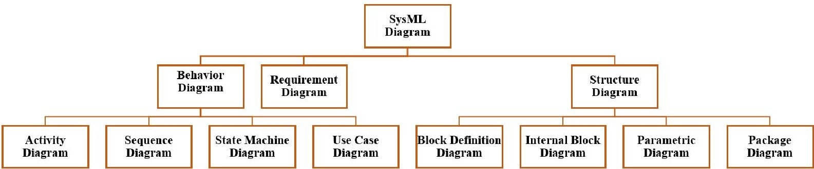
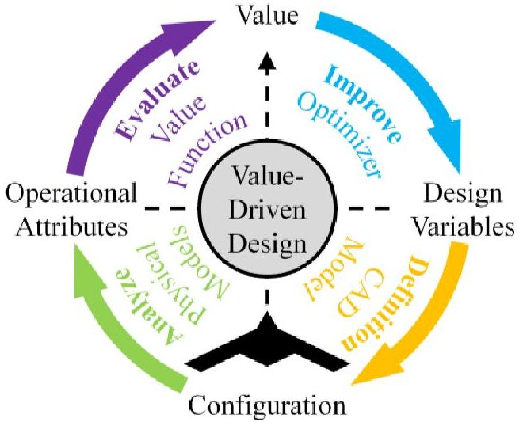
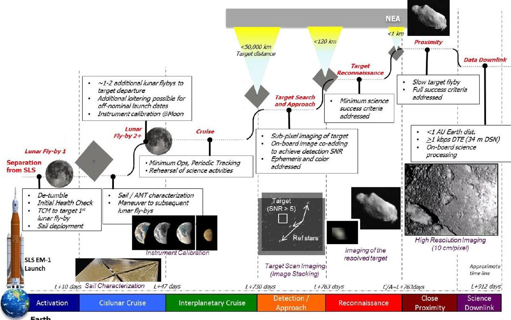
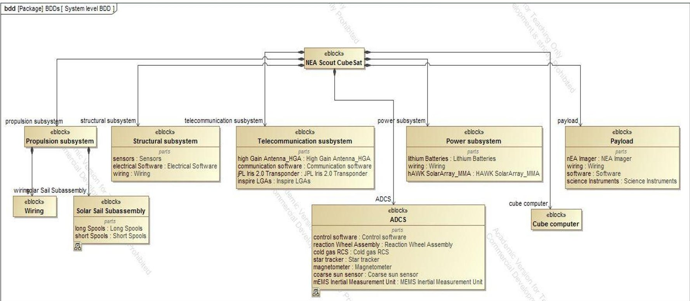
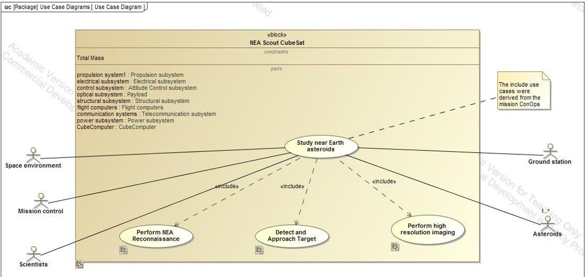
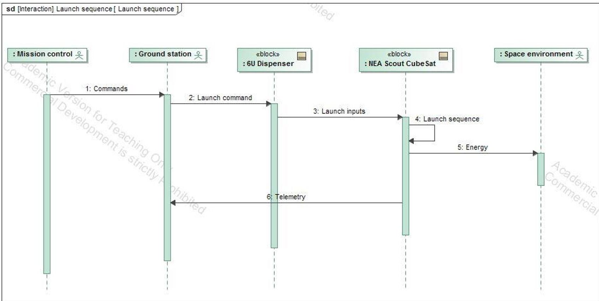
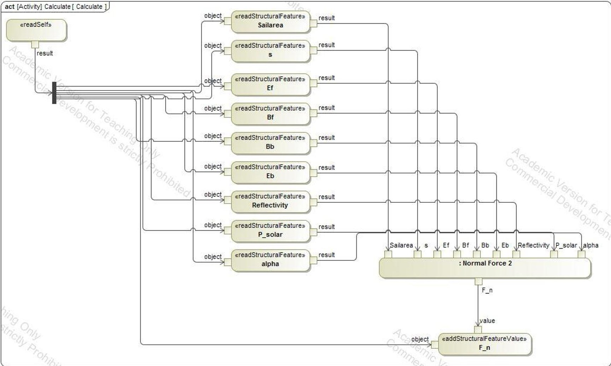
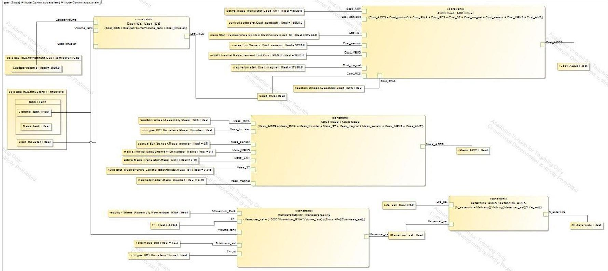
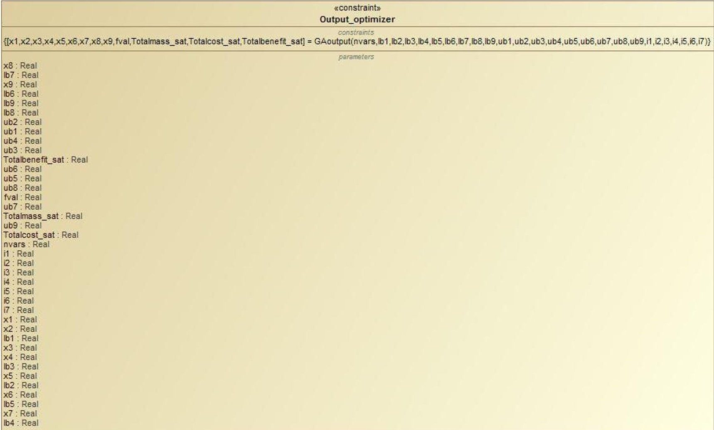
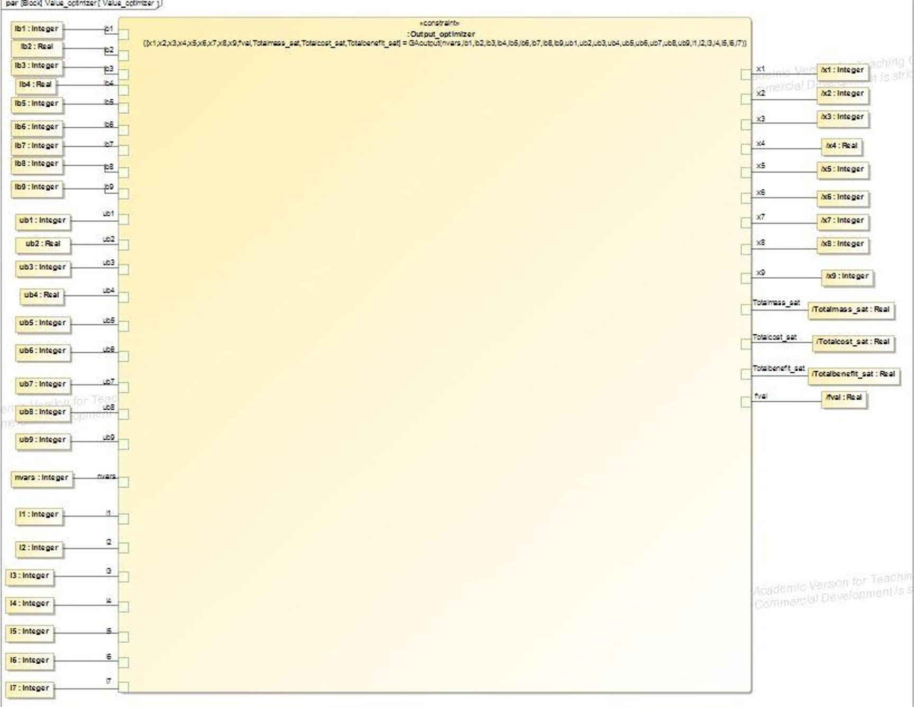

<!-- PDF_PAGE: 1 -->

# Integrating SysML and Value-Based Design with an NEA Scout Small Satellite Example

Garima V. Bhatia $ ^{1} $ and Bryan L. Mesmer $ ^{2} $ The University of Alabama in Huntsville, Huntsville, AL, 35899

There has recently been a tremendous growth in the use of model-based systems engineering (MBSE) among different categories of practitioners including government, industry, and academia. MBSE aims at using a consistent system model that is updated throughout the system life cycle to form a digital twin, to enable improved decision-making. OMG's Systems Modeling Language (SysML) is one of the primary modeling languages used to model not only system hardware and software, but also the people and processes involved in system development. SysML is finding increased application in different sectors, and is gaining favor among practitioners for their modeling needs. Value-based design (VBD) mathematically represents the preference of the stakeholder in the form of a value model which can be maximized to determine the optimal system. This paper attempts to bring together the benefits of SysML and value modeling to enable more informed decisions. This is performed by integrating value models with SysML to evaluate and compare alternatives. The challenges to integrating the two approaches are discussed and an example of the NEA Scout cube satellite modeled in Cameo Enterprise Architecture with stakeholder preference represented mathematically in a value model is used to explore the topic.

## Nomenclature

$ \pi_{i} $ = total value/profit of the system in $ for total life of system

$ \beta_{i} $ = total benefit received from the system in $ for total life of system

$ \beta_{ant} $ = benefit received from antennae in $

$ \beta_{camera} $ = benefit received from imager in $

$ \beta_{asteroids} $ = benefit received from studying asteroids in $

$ C_{i} $ = total cost of the system in $ for total life of system

$ C_{ADCS} $ = cost of ADCS subsystem in $

$ C_{structural} $ = cost of structural subsystem in $

$ C_{telecom} $ = cost of telecommunication subsystem in $

$ C_{payload} $ = cost of payload subsystem in $

$ C_{prop} $ = cost of propulsion subsystem in $

$ C_{misc} $ = cost of power subsystem and computer in $

$ C_{develop} $ = total development cost of satellite in $

$ C_{maintenance} $ = total maintenance cost of satellite in $

X = array of design variables

$ N_{asteroids} $ = total number of asteroids studied

$ Maneuver_{sat} $ = maneuverability of satellite

$ Momentum_{RWA} $ = momentum of reaction wheel assembly

$ Total mass_{sat} $ = total mass of satellite in kg

<!-- PDF_PAGE: 2 -->

## I. Introduction

LARGE-SCALE complex engineered systems (LSCES) are characterized by the extensive number of individuals participating in designing the system, the complex interactions between various disciplines, and the large amounts of money, time, and risk associated with each [1]. These LSCES often interact with other LSCES in order to fulfill their operational purpose, adding further to the complexity of these systems. LSCES generally tend towards the greater extremes in terms of size, cost, risk, and number of involved organizations and personnel. A complication of involving many organizations are the many decision-makers within those organizations. The flow of decisions in organizations generally follows a top-down approach, where decisions made at the top most level are communicated down the organizational hierarchy [2], [3]. The stakeholders at the top most level may be company CEOs or directors in case of industry or the generals at the highest level in case of the military. It is important that the preferences of these stakeholders are communicated in such a way that enables consistent decision making throughout the organization. If this occurs, then the decisions made by the decision-makers at the lower levels will be that which the top level stakeholders themselves would make. It is imperative to correctly capture and represent the preferences of the stakeholders in order to ensure that the designed system aligns with the desires of the stakeholders. Value-based design (VBD) is a new design philosophy aimed at representing preferences through meaningful mathematical models called value model [4], [5]. By representing preferences in value models some information that was previously communicated through requirements are now captured in an objective function. VBD has been increasingly gaining favor in the systems engineering (SE) community.

Another approach that has been progressively recognized in the past few decades is model-based systems engineering (MBSE). It is a new and improved method for enabling the design of systems using an integrated system model. The roots of MBSE lie in model-based software development which is based on incremental development. Similarly, traditional SE activities also follow serial development [6]. Models provide a means to represent the physical system in a way that assists in predicting the behaviors of the system and understanding the system. Models, in essence, represent a digital twin of the system in question, and design decisions can be based upon the response of the model to stimuli. They provide insights into different system states that may or may not have been predicted before. Thus, models, if used correctly, can be of tremendous help in the design of systems, especially LSCES where understanding the system is difficult. The Object Management Group's (OMG) Systems Modeling Language (SysML) and the SAE International Architecture Analysis and Description Language (AADL) are the two eminent MBSE languages. Literature has shown that of the two, SysML is used more widely [7]-[9]; however the language is constantly evolving.

Since both VBD and MBSE attempt at improving the design of LSCES, it is of interest to explore if the approaches can be used together for greater improvements. This paper integrates value models with SysML to study the advantages and challenges. NASA's Near-Earth Asteroid (NEA) Scout project was used as an example to demonstrate the integration. A model for the small satellite was created in Cameo Enterprise Architecture, a well-known tool for employing SysML. The value model was created using Matlab and then integrated with Cameo. The methodology section elaborates on the process followed and the challenges faced. A brief background about VBD and MBSE, the MBSE tools, as well as the Scout project is discussed in the following background section.

## II. Background

## A. MBSE

As per INCOSE, "Model-based systems engineering is the formalized application of modeling to support system requirements, design, analysis, verification, and validation beginning in the conceptual design phase and continuing throughout development and later life cycle phases" [10]. The models are stored in a central repository which enables the establishment of formal relationships between models. This translates to increased traceability of information related to the model throughout the system design process [11]. The primary object of MBSE is an integrated systems model that enables different views of the same model to facilitate better understanding of the system and its functions. The ability of multiple views could help to increase the involvement of stakeholders in the design process, which in turn could help the designers better understand the preferences of stakeholders. The other assumed advantages of MBSE over traditional document-centric SE approaches include support for incremental development, traceability, support for early Verification and Validation, and improved risk identification, among others.

<!-- PDF_PAGE: 3 -->

## B. SysML

SysML was developed as an extension of the popular Unified Modeling Language (UML) belonging to the field of software engineering. The language was developed to support system engineering activities by developing models that could encompass not only system hardware and software elements, but also model the people and processes involved [12]. The representation of these system elements is supported by the nine different diagrams comprising SysML [13]. Eight of the nine diagrams fall under two categories, namely structure and behavior diagrams. The classification of the SysML diagrams is depicted by the flowchart in Fig. 1. SysML has been constantly evolving over the years. Its governing standards have been revised four times in the past ten years [12]. A detailed understanding of SysML can be found in [11], [13]. There also exist a wide variety of tools to support SysML [8] $ - $ [10]. In this paper, the model for the Scout from the NASA Scout project was created in Cameo Enterprise Architecture (Cameo), one of the widely used tools for SysML in both industry and academia [14].

Figure 1. Classification of SysML diagrams

## C. VBD

VBD is a new approach to SE that aims at capturing the true preferences of stakeholders by means of a single mathematical representation called a value model [4], [5]. The primary underlying ideology behind VBD is that a

VBD is a new approach to SE that aims at capturing the mathematical representation called a value model [4], [5]. The single source of truth to represent the stakeholder's preference can be used to determine the best system. If the value model is formed correctly some of the preferences that were previously represented as requirements will become unnecessary as they will be represented in the value model. For example, a requirement for an electric car of a range of at least 200 miles could be eliminated if the desires concerning the attribute of range are effectively captured in the stakeholder's value model. This facilitates increased exploration of the design space which may result in a design that was initially disregarded due to the imposition of requirements. As another example, design in a profit-seeking organization may be driven by minimization of mass. This may happen because it is believed that the least mass will lead to the minimum cost, which in turn will drive the profit up. However, the organization likely does not care about mass, and in this case, the minimization of mass or cost act as surrogates for maximization of profit [15]. A correct value model would

Figure 2. Value-Based Design Process

represent profit directly, where mass may or may not be an attribute in the model. Design optimization in the context of VBD (specifically associated with the value-driven design method) is represented by Fig. 2 that shows the life cycle development of systems [16]. Value models are composed of attributes that represent the characteristics of the system. High level attributes are functions of lower level attributes and design variables. Design variables are the variables that can be altered by the designer to change the system. The value model has a singular unit which is usually monetary, allowing for direct comparisons between designs. The decomposition of the value model to the lowest levels of the design hierarchy enables improved consistency in decision-making as decision-makers at all levels are designing for a single objective that is desired by the stakeholder at the topmost level [17]. Past researchers have accommodated the inclusion of physics-based couplings to achieve system consistency in physics [18] $ ^{–} $ [20]. Previous works have also

<!-- PDF_PAGE: 4 -->

proven the benefits of value modeling and different value models by applying it to systems such as aircraft, spacecraft, and electric vehicles [15], [16], [20] $ - [23] $ .

## D. NEA Scout

The NEA Scout is a cube satellite (CubeSat) being developed by NASA Marshall Space Flight Center (MSFC), Jet Propulsion Laboratory (JPL), and NASA Langley Research Center. The CubeSat is proposed to fly as secondary payload on the Space Launch System (SLS) Exploration Mission 1 (EM-1) to analyze and study near-earth asteroids (NEAs). Asteroids falling within a distance of 1 AU from the earth will be targeted. The objective of the mission is to develop a system that can help fill in the knowledge gaps that exist about NEAs with an overall goal of possible human exploration of asteroids in the future. The satellite will execute a reconnaissance with the target and then perform high resolution imaging using an updated JPL OCO-3 Context Camera [24]. The expected mission duration is 2.5 years during which it will target a number of pre-identified targets to measure the physical properties of the asteroids to address certain key strategic knowledge gaps (SKGs). The satellite will be a standard 6U CubeSat with a maximum mass of 14 kg and will primarily employ commercial off-the-shelf (COTS) components [25]. The Scout proposes to employ solar sail propulsion. An overview of the mission is provided in Fig. 3 that shows the mission Concept of Operations (ConOps) [26]. A detailed description of the NEA Scout mission can be found in [25], [27], [28].

Figure 3. NEA Scout ConOps [27]

<!-- PDF_PAGE: 5 -->

## III. Methodology

## A. Model of NEA Scout in Cameo

A detailed model of the structure and functionality of the Scout CubeSat was created in Cameo. The structural breakdown of the CubeSat into different systems is shown in Fig. 4. A block definition diagram (BDD) was used to represent this breakdown. In addition to this system level BDD, additional BDDs were created for different subsystems to represent each in detail and avoid cluttering in the system level BDD. Other diagrams, namely activity diagrams, sequence diagrams, requirements diagrams, use case diagrams, sequence diagrams, and parametric diagrams were created to represent different functionalities of the system. These diagrams represent different views of the system that the stakeholder could use to enhance her understanding of the system. Examples of a BDD, a use case diagram, and a sequence diagram created for the Scout are shown in Figures 4, 5, & 6. These SysML diagrams are useful in representing system behaviors, understanding flows and system couplings, as well as in identifying emergent behaviors not anticipated during the initial phases of concept generation and conceptual design. Such a visual representation of the system also facilitates understanding of complex systems and variable relationships that may otherwise be difficult to comprehend. The variables and parameters of the system, including design variables, attributes, and physical constants, among others, are represented as value properties. Value properties may be characterized as variable type real, boolean, complex, integer, number, or string depending upon the nature of the parameter being represented. SysML also provides the designer with the ability of customizing value properties definitions.

Figure 4. Hierarchical decomposition of the NEA Scout

<!-- PDF_PAGE: 6 -->

Figure 5. Use Case diagram for the NEA Scout

Figure 6. Sequence diagram for the NEA Scout

<!-- PDF_PAGE: 7 -->

## B. Value Model for NEA Scout

As described in the background section, the objective of the Scout mission is to study and characterize the physical and chemical properties of asteroids within a proximity of 1AU from the Earth. A value model was created to calculate the profit associated with developing the satellite. This profit was assumed to be a function of the scientific benefit gained from the mission as well as the cost associated with the mission. The scientific benefit was translated to dollars, allowing the profit to be in dollar units. The equation for the profit is described by Eq. (1), where i represents the life of the satellite in years.

$$
\pi_ {i} = \beta_ {i} - C _ {i}
$$

The total benefit is the sum of the benefits achieved from the different subsystems. The total cost is the sum of the costs of the various subsystems and the development and maintenance costs for supporting the satellite throughout its lifespan. The equations for total benefit and total cost are described by Eq. (2) and Eq. (3).

$$
\beta_ {i} = \beta_ {a n t} + \beta_ {c a m e r a} + \beta_ {a s t e r o i d s}
$$

$$
C _ {i} = C _ {A D C S} + C _ {s t r u c t u r a l} + C _ {t e l e c o m} + C _ {p a y l o a d} + C _ {p r o p} + C _ {m i s c} + C _ {d e v e l o p} + C _ {m a i n t e n a n c e}
$$

The mission ConOps were considered to determine the scientific benefit for the satellite. Examples of variables considered to play an important role in the benefit are number of asteroids studied, camera image quality, data storage capacity, and antenna gain. Eq. (4) and Eq. (5) provide an example of the benefit equations used in the model. These equations describe the benefits received from the payload and the Attitude Determination and Control (ADCS) subsystems respectively. The benefits are in units of dollars. Note that the focus of this paper is not on formation of a value model but the incorporation of the value model into SysML. As such these equations are placeholders for higher fidelity models. The attributes present in these equations are functions of design variables.

$$
B e n e f i t _ {c a m e r a} = \frac {Q u a l i t y _ {i m a g e} * D a t a _ {s t o r a g e}}{M a s s _ {c a m e r a}}
$$

$$
\text {w h e r e Q u a l i t y} _ {\mathrm {i m a g e}} = \text {F r a m e r a t e} * \text {R e s o l u t i o n} * \text {S e n s o r}
$$

$$
B e n e f i t _ {a s t e r o i d s} = 1 5 0 0 0 0 * N _ {a s t e r o i d s}
$$

$$
\text{where} N_{asteroids} = \log_{10}(Maneuver_{sat}) * Life_{sat}
$$

$$
\text{and} \quad M a n e u v e r _ {s a t} = \frac {1 0 0 0 0 * M o m e n t u m _ {R W A} * V o l u m e _ {t a n k}}{(T h r u s t + F _ {n}) * T o t a l m a s s _ {s a t}}
$$

The tradeoffs between cost and benefit were designed to be represented in the system's physics models. A total of nine design variables were incorporated into the model, seven of which were discrete, and the remaining continuous. A description of the design variables as well as attributes used in the value model is provided in tables A1 and A2 in the Appendix. Table A3 lists the design variables and attributes associated with different subsystems.

The model was initially coded in Matlab to check for model feasibility. Each subsystem was coded to output the attributes associated with that subsystem. An analysis file was created to confirm convergence to a design. The outputs from this file were the total cost, total benefit, and total mass of the satellite. Total cost and benefit were direct inputs to the value model. A separate file was created to determine the value of the Scout, with total cost and total benefit being inputs to this file. The value model was then used to optimize and the optimal set of design variables for the satellite was found. The formal optimization statement for the problem is described by Eq. (6).

<!-- PDF_PAGE: 8 -->

$$
\min f (X) = - \pi_ {i} = - \left(\beta_ {i} - C _ {i}\right)
$$

$$
\begin{array}{l} \mathrm {w . r . t} X = \left[ A D C S _ {c o n f i g}, L i f e _ {s a t}, S a i l _ {m a t e r i a l}, t _ {s a i l}, T y p e _ {a n t}, n _ {a n t}, T y p e _ {i m a g e r}, C o n f i g _ {s t r u c t u r e}, T y p e _ {c o n f i g} \right] \\ s. t. T o t a l m a s s _ {s a t} - 1 4 \leq 0 \\ \end{array}
$$

The constraint described in the problem statement states that the total mass of the CubeSat cannot exceed 14 kgs. This requirement originates from regulations governing small satellites. Due to this pass or fail regulation it is difficult to incorporate the preference into the value model as this regulation is a step function, driving benefits to zero if violated. Since the problem consisted of discrete design variables, it was decided to use Genetic Algorithm (GA) as the method of optimization [29]. Matlab's built-in GA optimizer was used. The results from the optimization, including the value of the satellite (profit) and the measures of the key attributes are shown in Table 1.

Table 1: Results from GA Optimization

<table border="1"><tr><td>Parameter</td><td>Measure</td></tr><tr><td>Value/Profit(in $M)</td><td>10.3</td></tr><tr><td>Total cost(in $M)</td><td>1.9</td></tr><tr><td>Total benefit(in $M)</td><td>12.2</td></tr><tr><td>Total mass(in kg)</td><td>9.53</td></tr><tr><td>Life(in years)</td><td>9.84</td></tr><tr><td>No.of asteroids studied</td><td>17</td></tr></table>

Note that the value model used in this paper was of a very low fidelity. As such the values in Table 1 do not predict reality. The goal of this paper was to understand the integration of value models and SysML. Future work will involve higher fidelity, more realistic value models. These values were then used as a reference to compare the results obtained when the value model was integrated with SysML. The integration is discussed in the following section.

## C. Integration of Value Model with SysML

Two approaches were used to integrate value models and SysML. One approach used only SysML and the other leveraged Matlab with SysML. A description of the two approaches and their corresponding advantages and disadvantages are discussed in the following subsections.

## 1. SysML

Activity and parametric diagrams are usually used in SysML to handle mathematical calculations and analysis. These diagrams also provide visual means for observing simulations. In order to integrate the value model into the SysML model, different parametric diagrams were created for the different subsystems to calculate the attributes associated with each subsystem. Parametric diagrams function by means of constraint blocks. These blocks are used to define the mathematical operations expected to be performed by the system or the function to be executed. Cameo version 18.4 (used in this research) provides 16 different language options to choose from to define the constraints, including JavaScript, Matlab, Mathematica, SQL, and English. In this paper, JavaScript was used to represent the constraints. It is important that consistency with respect to language be maintained throughout the diagram.

<!-- PDF_PAGE: 9 -->

Within each subsystem, constraints were created for each variable that needed to be calculated. The constraints were then incorporated into parametric diagrams. For certain subsystems, both activity and parametric diagrams were used coherently to calculate subsystem attributes. For example, in the propulsion subsystem, an activity diagram, shown in Fig. 7, was used to calculate the normal component of the solar force $ \left( F_{n} \right) $ , whereas parametric diagrams were used to calculate other variables such as total mass and solar sail cost. Overall, the integration of value models in SysML using only SysML had many drawbacks. However, there were certain advantages to this approach too. The drawbacks and benefits for this approach are described in the two following sections.

- Drawbacks: One of the main drawbacks of using this approach is the need for extremely large number of diagrams for calculating the variables. The number of diagrams increases with the size of the system. If a subsystem requires evaluation of a large number of variables in order to calculate the outputs needed by the value model, the number of constraints would be large. This is due to one constraint generally being associated with each variable. The consequence of this is an extremely cluttered parametric diagram due to all of the constraints being represented. Evidence of this clutter is seen in Fig. 8 that represents a high-level visualization of the parametric diagram for the ADCS subsystem.

Another drawback observed was that parametric diagrams are only useful in performing simple mathematical calculations and are not yet fully equipped to handle complex computations in Cameo's SysML. For example, it was not possible to output an array using a parametric diagram. The activity diagram of Fig. 7 was used to circumvent this issue. Another drawback was that Cameo's SysML did not recognize a number of Java functions. Examples of functions not recognized were $ \log_{1 0} $ and 'for' loops. When implemented in Cameo the $ \log_{1 0} $ function call resulted in a return of a natural log evaluation. SysML did not work well with 'for' and 'if' loops either. The 'if' loops had to be replaced with 'switch' cases.

Figure 7. Activity diagram for calculating $ F_{n} $

American Institute of Aeronautics and Astronautics

<!-- PDF_PAGE: 10 -->

Another shortcoming of using just SysML to implement value modeling was the difficulty in executing an optimization. Cameo does not have an optimizer of its own. Ways around this lack of functionality are through external programs or developing an algorithm within an approved language. Developed algorithms must be executed through activity or parametric diagrams. Building an optimization algorithm in SysML is not only time consuming but also will require significant modifications in order for the code to execute properly. Thus, the value model was not completely implemented using this SysML approach.

Overall, this approach was arduous and would be recommended only in case of simple models that do not require complex mathematical operations.

- Advantages: One of the benefits of this approach was that it was easier to understand the functionalities of the system due to the way SysML has been designed. The ability to view the system through the different diagrams helps improve understanding about the system [30]. Through the activity and parametric diagrams, it should become easier for the SysML user (e.g. designers, managers, top-level stakeholders) to get a feel for the system's functionalities and couplings. This is where SysML could have an edge. As SysML evolves and gains capabilities its ability to integrate value models with complex systems will improve.

Figure 8. High-level visualization of the ADCS parametric diagram

## 2. SysML with Matlab

Leveraging Matlab was used to overcome the problems faced using the approach described in the previous section. The system model was first created in Matlab, with each subsystem coded to output the associated attributes. Other Matlab computations included an analysis to bring all the subsystem attributes together to evaluate the two system level attributes (total benefit and total cost), an evaluation of value of the system (profit), an optimization algorithm, and evaluation of the constraint (total mass).

The next step was to integrate Matlab with Cameo. Some difficulties were experienced during this process, which will be discussed in the drawbacks section. Upon successful integration, a parametric diagram was created off an optimization constraint block to evaluate the final optimal value of the system. SysML operates Matlab by means of function calls. In the constraint block that was created, shown in Fig. 9, the 'Matlab' language option was selected, and the function was copied from the Matlab file. Syntactical consistency is an important factor to consider while defining functions in SysML. The inputs and outputs in the function file were defined as value properties in the

<!-- PDF_PAGE: 11 -->

optimization block. The completed parametric diagram with the inputs and outputs connected to their respective pins is shown in Fig. 10. Figure 10 is used to show the extensive number of inputs and outputs involved.

Simulations are executed via instance blocks in SysML. These blocks are used to provide inputs to the parametric diagram. An instance block was created to execute the Matlab optimization function. The results obtained upon running the optimization were the same as shown in Table 1 where only Matlab was used. In addition to this parametric diagram, additional parametric diagrams were created for the different subsystems to evaluate their attributes.

- Drawbacks: One of the main problems faced with this approach was the difficulty in enabling Cameo and Matlab to "speak" to each other through their integration. Even upon correctly following the integration procedure, certain problems persisted while trying to incorporate the Matlab value models into SysML. For example, when a function was written in a constraint block and the variables were defined in the parametric diagram, SysML did not recognize the function call. Instead, an additional pin was created for the name of the function. The authors believe that this issue is due to conflicts between certain versions of Cameo and Matlab. Successful integration was achieved using a different version of Cameo than version 18.4 previously mentioned as well as a different version of Matlab.

Another drawback of this approach was the inability to have array inputs in SysML. The default input for Matlab's optimization algorithm is in the form of arrays for the lower and upper bounds of the design variables and for the indices of the integer variables. The default code had to be tweaked so that the arrays were broken into separate input variables. This increased the number of input variables causing the parametric diagrams to be cluttered. The same was true for the output arrays. There is no straightforward method of having SysML output arrays. This approach is also not as detailed as the purely SysML approach, as most of the computational work is being done 'behind the scenes' in Matlab and we can generally only view the inputs and the outputs of the system.

Figure 9. Constraint block for optimization

American Institute of Aeronautics and Astronautics

<!-- PDF_PAGE: 12 -->

- Advantages: Overall, although there were certain challenges and disadvantages associated with implementing this approach, it was considered to be easier than the pure SysML approach. Since SysML is not recommended for complex mathematical calculations, it was better to let Matlab handle that part and use SysML to understand the other system functionalities. The ability to view the system through different diagrams could help in understanding system properties such as the tradeoffs occurring within the system, related to the value model. Also, it was possible to successfully complete the integration of the value model with SysML using this approach because of the ability to perform an optimization through Matlab.

Figure 10. High-level visualization of parametric diagram for optimization

<!-- PDF_PAGE: 13 -->

Table 2: Drawbacks and advantages of approaches

<table border="1"><tr><td></td><td>SysML</td><td>SysML with Matlab</td></tr><tr><td>Drawbacks</td><td>Large number of diagrams neededParametric diagrams may be cluttered for intensive calculationsMostly useful for simple systemsCertain mathematical functions not defined in SysML library yetNo means to directly implement optimization</td><td>Compatibility of versions of the two tools is importantInputs cannot be in the form of arraysProcedure to output arrays not straightforward</td></tr><tr><td>Advantages</td><td>Easier to understand system functionalities due to multiple system views</td><td>Greater ability to handle complex mathematical computationsEasier to perform optimization and successfully execute value model</td></tr></table>

## IV. Conclusion and Future Work

This paper successfully showed how two approaches in SE (value modeling and MBSE) can be successfully integrated with each other to reap the benefits of both. In this paper two approaches for incorporating value models into SysML were explored. The NEA small satellite was used to demonstrate both these approaches. The advantages, disadvantages, and practicality of implementing these approaches were discussed. In conclusion, it was observed that it was better to let an external platform (such as Matlab) handle the sophisticated calculations that may exist in value models. In addition, SysML was observed to be useful in understanding the value models and the system, which would otherwise be difficult to understand by viewing thousands of lines of code. Since SysML is still evolving, future work will explore the usability of the pure SysML approach. Further investigations will explore the library of SysML functions to determine better means of implementing value models in SysML. Since the main focus of this paper was to explore the challenges associated with integrating value models with SysML, a very simple value model was used. Future work will involve forming a more realistic value model involving the time value of money and integrating it with SysML.

<!-- PDF_PAGE: 14 -->

Table A1: Description of Design Variables

<table border="1"><tr><td>Design Variable</td><td>Description</td><td>Type</td></tr><tr><td>ADCSconfig</td><td>Type of configuration for the Attitude Determination &amp; Control subsystem</td><td>Integer</td></tr><tr><td>Lifesat</td><td>Total life of the CubeSat in years</td><td>Continuous</td></tr><tr><td>Sailmaterial</td><td>Type of sail material</td><td>Integer</td></tr><tr><td>tsail</td><td>Thickness of sail in m</td><td>Continuous</td></tr><tr><td>Typeant</td><td>Type of antenna</td><td>Integer</td></tr><tr><td>nan</td><td>Total number of antennae</td><td>Integer</td></tr><tr><td>Typeimager</td><td>Type of imaging device</td><td>Integer</td></tr><tr><td>Configstructure</td><td>Type of structural configuration</td><td>Integer</td></tr><tr><td>Typeconfig</td><td>Type of configuration for computer and power</td><td>Integer</td></tr></table>

Table A2: Description of Attributes

<table border="1"><tr><td>Attribute</td><td>Description</td></tr><tr><td>Benefitasteroids</td><td>Total benefit received from studying asteroids ($)</td></tr><tr><td>CostADCS</td><td>Cost of ADCS ($)</td></tr><tr><td>MassADCS</td><td>Mass of the ADCS subsystem (kg)</td></tr><tr><td>Nasteroids</td><td>Total number of asteroids studied (#)</td></tr><tr><td>Benefitcamera</td><td>Total benefit received from camera ($)</td></tr><tr><td>Costpayload</td><td>Cost of payload ($)</td></tr><tr><td>Masspayload</td><td>Mass of payload (kg)</td></tr><tr><td>Costpropulsion</td><td>Cost of propulsion subsystem ($)</td></tr><tr><td>Fn</td><td>Normal component of solar force exerted on sails (N)</td></tr><tr><td>Masspropulsion</td><td>Mass of propulsion subsystem (kg)</td></tr><tr><td>Coststructural</td><td>Cost of structural subsystem ($)</td></tr><tr><td>Massstructural</td><td>Mass of structural subsystem (kg)</td></tr><tr><td>AntGaindB</td><td>Total gain of antennae in decibels</td></tr><tr><td>Benefitant</td><td>Total benefit received from antennae ($)</td></tr><tr><td>Costtelecom</td><td>Cost of telecommunications subsystem ($)</td></tr><tr><td>Masstelecom</td><td>Mass of telecommunications subsystem (kg)</td></tr><tr><td>Costmisc</td><td>Cost of computer &amp; power subsystem ($)</td></tr><tr><td>Massmisc</td><td>Mass of computer &amp; power subsystem (kg)</td></tr><tr><td>Totalmasssat</td><td>Total mass of the CubeSat (kg)</td></tr><tr><td>Totalcostsat</td><td>Total cost of the CubeSat ($)</td></tr><tr><td>Totalbenefitsat</td><td>Total benefit received from the CubeSat ($)</td></tr></table>

<!-- PDF_PAGE: 15 -->

Table A3: List of Design Variables and Attributes for Scout

<table border="1"><tr><td>Subsystem</td><td>Attributes</td><td>Design variables</td></tr><tr><td>ADCS</td><td>MassADCS, CostADCS,Nasteroids,Benefitasteroids</td><td>ADCSconfig,Lifesat</td></tr><tr><td>Miscellaneous</td><td>Massmisc,Costmisc</td><td>Typeconfig</td></tr><tr><td>Payload</td><td>Masspayload,Costpayload,Benefitcamera</td><td>Typeimager</td></tr><tr><td>Propulsion</td><td>Masspropulsion,Costpropulsion,Fn</td><td>Sailmaterial,t sail</td></tr><tr><td>Structure</td><td>Massstructural,Coststructural</td><td>Configstructure</td></tr><tr><td>Telecom</td><td>Masstelecom,Costtelecom,AntGaindB,Benefitant</td><td>Typeant,nant</td></tr></table>

## References

[1] C. L. Bloebaum and A. R. McGowan, "The design of large-scale complex engineered systems: present challenges and future promise," in Proceedings of the 14th AIAA/ISSMO Multidisciplinary Analysis and Optimization Conference, Indianapolis, IN, Paper No. AIAA-2012-5571, 2012.

[2] N. NASA, "Systems Engineering Handbook (NASA/SP-2007-6105,) Rev. 1, 2007," Garvey Paul R Anal. Methods Risk Manag. Syst. Eng. Perspect. Boca Rotan Chapman HallCRC, vol. 113, 2009.

[3] T. Robertson, "INCOSE systems engineering handbook," INSIGHT, vol. 1, no. 2, pp. 20-20, 1998.

[4] P. D. Collopy and P. M. Hollingsworth, "Value-driven design," J. Aircr., vol. 48, no. 3, pp. 749-759, 2011.

[5] P. Collopy, C. Bloebaum, B. Mesmer, and L. Green, "The distinct and interrelated roles of value-driven design, multidisciplinary design optimization, and decision analysis," in 12th AIAA Aviation Technology, Integration, and Operations (ATIO) Conference and 14th AIAA/ISSMO Multidisciplinary Analysis and Optimization Conference, 2012, p. 5575.

[6] C. E. Dickerson and D. Mavris, "A brief history of models and model based systems engineering and the case for relational orientation," IEEE Syst. J., vol. 7, no. 4, pp. 581-592, 2013.

[7] O. M. G. SysML, SysML v1.4 Specification. 2015.

[8] S. A. E. Aerospace and S. AS5506, "Architecture analysis and design language (aadl)," -5506 SAE Int., 2004.

[9] M. Rashid, M. W. Anwar, and A. M. Khan, "Toward the tools selection in model based system engineering for embedded systems—A systematic literature review," J. Syst. Softw., vol. 106, pp. 150-163, 2015.

[10] T. INCOSE, "Systems Engineering Vision 2020," INCOSE-TP-2004-004-02), http://www. incose. org/ProductsPubs/pdf/SEVision2020 20071003 v2 03. pdf, 2007.

[11] S. Friedenthal, A. Moore, and R. Steiner, A practical guide to SysML: the systems modeling language. Morgan Kaufmann, 2014.

[12] OMG, "OMG Systems Modeling Language (OMG SysMLTM)." Sep-2015.

[13] L. Delligatti, SysML distilled: A brief guide to the systems modeling language. Addison-Wesley, 2013.

[14] N. M. Inc, "Cameo Enterprise Architecture." [Online]. Available: https://www.nomagic.com/products/cameo-enterprisearchitecture. [Accessed: 09-Aug-2017].

[15] B. L. Mesmer, C. L. Bloebaum, and H. Kannan, "Incorporation of value-driven design in multidisciplinary design optimization," in 10th World Congress on Structural and Multidisciplinary Optimization, 2013, pp. 1-19.

[16] G. V. Bhatia, "A game theory approach to negotiations in defense acquisitions in the context of value-driven design: an aircraft system case study," 2016.

[17] P. Collopy, "Economic-based distributed optimal design," in AIAA Space 2001 Conference and Exposition, 2001, p. 4675.

[18] H. Kannan, E. Tibor, B. Mesmer, and C. L. Bloebaum, "Incorporation of Coupling Strength Models in a Value-based Systems Engineering framework for optimization," in 16th AIAA/ISSMO Multidisciplinary Analysis and Optimization Conference, 2015, p. 3086.

[19] H. Kannan, C. L. Bloebaum, and B. Mesmer, "Incorporation of Coupling Strength Models in Decomposition Strategies for Value-Based MDO," in 15th AIAA/ISSMO Multidisciplinary Analysis and Optimization Conference, 2014, p. 2430.

[20] H. Kannan, "An MDO augmented value-based systems engineering approach to holistic design decision-making: a satellite system case study," 2015.

[21] G. V. Bhatia, H. Kannan, and C. L. Bloebaum, "A Game Theory approach to Bargaining over Attributes of Complex Systems in the context of Value-Driven Design," in 54th AIAA Aerospace Sciences Meeting, 2016, p. 0972.

[22] H. Kannan, B. L. Mesmer, and C. L. Bloebaum, "Increased System Consistency through Incorporation of Coupling in Value-Based Systems Engineering," Syst. Eng., 2017.

[23] T. G. Topcu and B. Mesmer, "Customer, Commercial, and Government Value Functions for Electric Vehicle System Design," in IIE Annual Conference. Proceedings, 2015, p. 959.

[24] V. Bach et al., "Near Earth Asteroid (NEA) Scout Solar Sail Implementation," 2016.

[25] L. Johnson, J. Castillo-Rogez, J. Dervan, and L. McNutt, "Near Earth Asteroid (NEA) Scout," 2017.

[26] L. McNutt, L. Johnson, P. Kahn, J. Castillo-Rogez, and A. Frick, "Near-Earth Asteroid (NEA) Scout," in AIAA SPACE 2014 Conference and Exposition, 2014, p. 4435.

[27] L. McNutt, L. Johnson, D. Clardy, J. Castillo-Rogez, A. Frick, and L. Jones, "Near-Earth asteroid scout," 2014.

<!-- PDF_PAGE: 16 -->

[28] L. Johnson, A. R. Sobey, and K. Sykes, "Solar Sail Propulsion for Interplanetary Cubesats," in 51st AIAA/SAE/ASEE Joint Propulsion Conference, 2015, p. 3895.

[29] J. Arora, Introduction to optimum design. Academic Press, 2004.

[30] J. Murray, "Model Based Systems Engineering (MBSE) Media Study," Int. Counc. Syst. Eng. INCOSE, 2012.