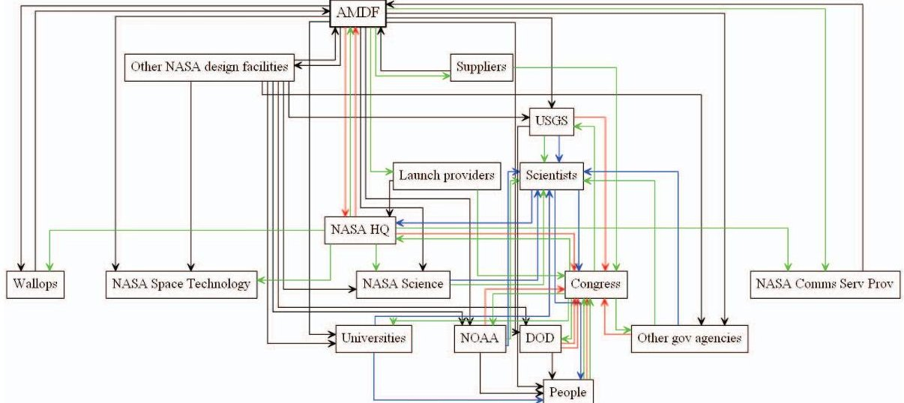
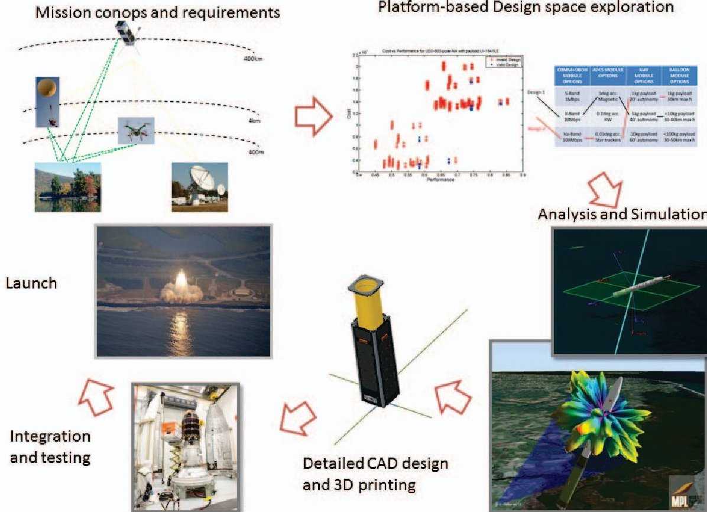
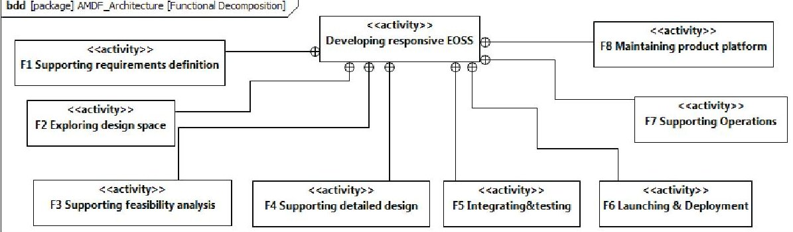
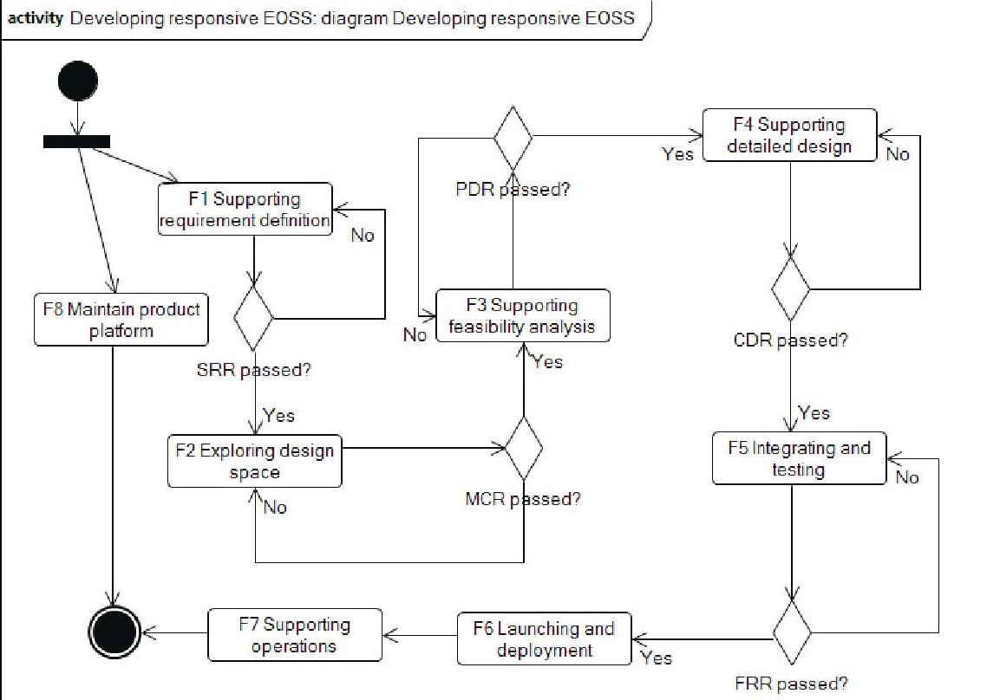
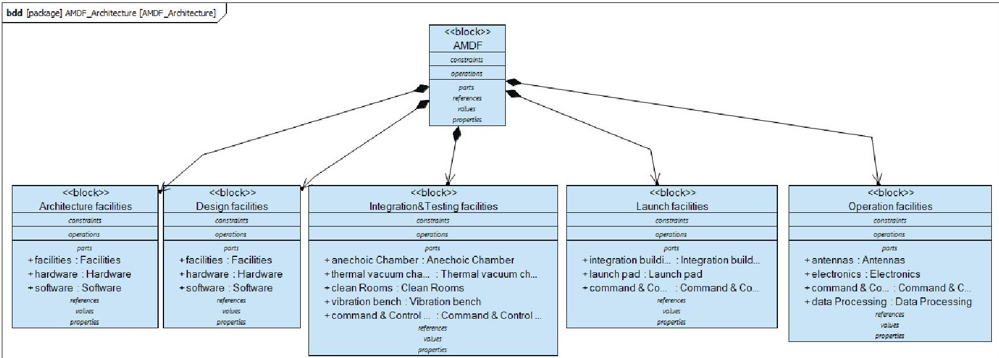
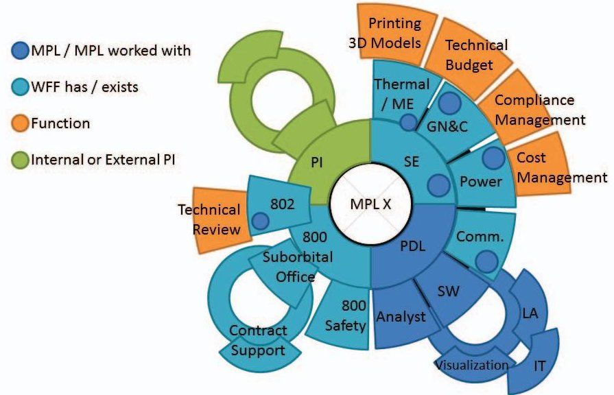
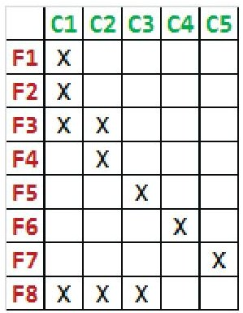
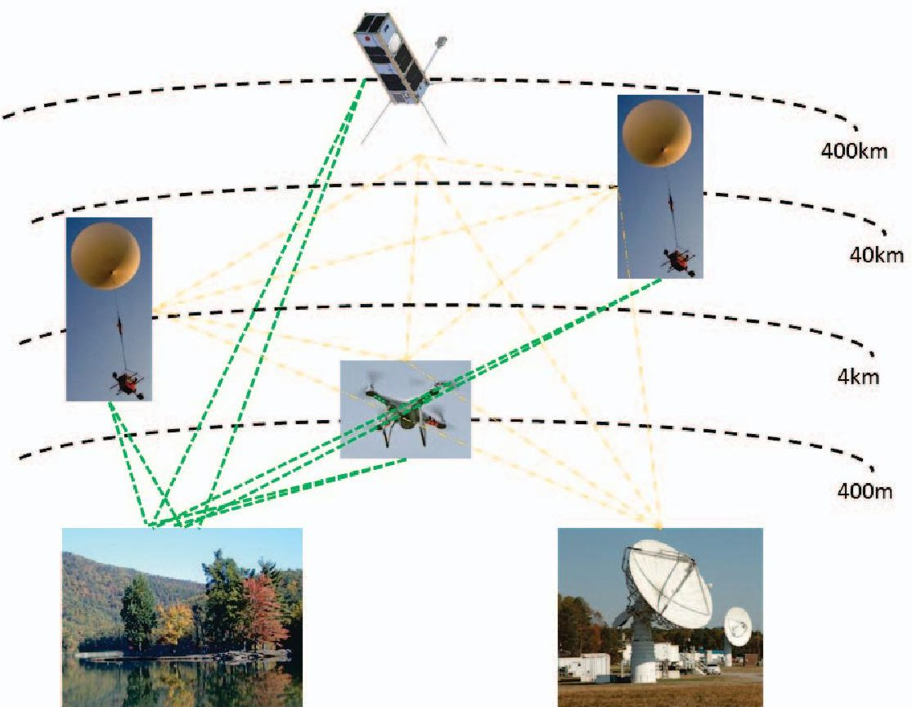

<!-- PDF_PAGE: 1 -->

# A Concept for an Agile Mission Development Facility for CubeSat and Suborbital Missions

Daniel Selva Cornell University 212 Upson Hall Ithaca, NY 14850 607-255-6351 daniel.selva@cornell.edu

Brenda Dingwall Goddard Space Flight Center Wallops Flight Facility Wallops Island, VA 23337 757-824-2969 brenda.j.dingwall@nasa.gov

Serhat Altunc Goddard Space Flight Center Greenbelt, MD 23337 301-286-29339 serhat.altunc@nasa.gov

Abstract—This paper introduces the Agile Mission Development Facility (AMDF), a concept for a new mission development platform at NASA Wallops that will develop a specific kind of Earth observing missions based on networks of small assets (CubeSats, UAVs and balloons) in a timeframe of weeks to months.

To achieve this reduced development time, the AMDF will use a new catalog-based and platform-based approach to mission design that emphasizes commonality at the subsystem or assembly level and the use of COTS components when possible. This will necessarily constrain the range of performance achievable by these missions, since only a few alternatives will be available for each subsystem. Only missions whose objectives can be achieved through a combination of the available modules will be considered.

In addition to providing a high-level description of the AMDF architecture, this paper describes the process by which this platform consisting of a few standard modules will be optimally designed to maximize the range of attainable performance while keeping short development times. Particular emphasis is put on the communications module that will enable cross-links between nanosatellites, UAVs, balloons, and ground assets.

Importantly, the AMDF focuses on a different customer segment than other similar NASA facilities such as the IDC at GSFC or Team X at JPL. AMDF Missions are not meant to compete with larger NASA missions in terms of performance, operational risk or mission assurance, but rather they intend to be complementary. In particular, the very short development time and multi-asset character of these systems will enable a completely new class of missions that can effectively respond to a rapidly changing phenomenon of opportunity, such as a hurricane, a volcano or a geopolitical event of interest for which a larger mission would be inappropriate. Additionally, they can be used to accelerate technology infusion for future larger missions, as long as the new technology satisfies a certain set of interface requirements.

The AMDF will maximize reuse of existing design, integration and testing software and hardware infrastructure at NASA Wallops as well as other NASA centers. All potentially relevant stakeholders, such as NASA Goddard, Headquarters, JPL, Ames, the Aerospace Corp., Applied Physics Lab, and universities with nanosatellite programs will be involved and considered in the AMDF development process.

This paper focuses on the description of the design aspects of the AMDF, as this is where most of the novelty lies. Integration, testing, launching and operations are only briefly discussed. A description of the system architecture of the AMDF is given using model-based systems engineering tools (SysML). An example application mission to measure ecological changes in the Jefferson and Washington National Forests is also discussed to illustrate the new kinds of missions that this facility could enable.

## TABLE OF CONTENTS

1. INTRODUCTION...1

2. THE AGILE MISSION DEVELOPMENT FACILITY ...4

3. STAKEHOLDER ANALYSIS...5

4. CONCEPT OF OPERATIONS...5

5. FUNCTIONAL ARCHITECTURE...5

6. PHYSICAL ARCHITECTURE...8

7. OPTIMAL DESIGN OF THE PRODUCT PLATFORM .11

8. EXAMPLES OF MISSIONS ENABLED BY THE AMDF11

9. CONCLUSION...15

REFERENCES...15

BIOGRAPHY...17

## 1. INTRODUCTION

## The need for new kinds of Earth Observing Systems

Earth Observing Systems (EOS) will play a key role in several of the most important global challenges that humankind will face in this century, including climate change, poverty, health, sustainability, terrorism, and others.

Requirements for these EOS are becoming more stringent to respond to these global challenges: we need more frequent datasets (sub-hour revisit times in some cases), with much lower latency (minutes), higher spatial resolution (sub-meter, better accuracy, and multi-spectral and multi-angular sampling.

Current EOS can no longer satisfy all these requirements. While part of this is simply due to technological limitations that will likely be solved in the next few decades, this is also partially due to the architecture paradigm that currently dominates EOS, namely the monolithic architectural paradigm. This paradigm consists of a small number of relatively large and isolated spacecraft carrying multiple instruments with synergistic and complementary goals, and with little decision-making capabilities on board. The level of coordination or interaction between the different spacecraft is close to non-existent from the operational perspective. There is also very limited real-time decision-making made onboard. Instead, the spacecraft execute observation plans that are computed in the ground and sent to the spacecraft through the ground-to-space links. For all these reasons, requirements particularly in terms of latency, revisit time, multi-spectral and multi-angular sampling cannot be met within the current architecture paradigm.

At the same time, we are witnessing important technological advances that provide us with unique opportunities to satisfy these requirements. At the subsystem level, there have been

<!-- PDF_PAGE: 2 -->

important advances in payloads, communications, attitude control and on-board processing among others for both space and airborne assets. Small microprocessors can process data orders of magnitude faster than ever before. Space-to-ground link data rates of several Gbps from LEO will soon be possible using optical communications or advanced RF systems. At the system level, there have been advances in key capabilities such as formation flying and space networking that enable completely new concepts.

For these reasons (new requirements and new technologies), we believe that EOS are at a point of architectural change. We foresee four types of architectural change: 1) from monolithic to distributed architectures; 2) from dumb isolated assets (no on-board processing, largely manually operated, no crosslinks) to intelligent and autonomous vehicles that make decisions and collaborate in real time; 3) from slow to agile missions (in terms of development, deployment and operations); 4) from isolated space, airborne and ground segments to networks of truly interconnected and heterogeneous assets. We briefly discuss each of these changes in the following paragraphs.

From monolithic to distributed architectures: The change from monolithic to distributed architectures has arguably already started. The trade-off between one large spacecraft vs multiple small spacecraft in Earth observation was thoroughly studied in the 1990s (see for example, [1], [2], [3]). Space organizations such as NASA and ESA noted the disadvantages of the monolithic approach in the 1990's and 2000's and started programs based on more distributed architectures such as the ESA Earth Explorers or the NASA Earth System Science Pathfinders. Indeed, architectures based on a larger number of smaller components had advantages in terms of risk, flexibility, scalability and evolvability among others.

The two main problems with this new distributed approach were that overall cost was increased and that cross-registration of measurements from synergistic instruments became more complex. The latter point was addressed by creating a special type of distributed architecture commonly known as trains (e.g. NASA A-train), in which synergistic satellites have identical orbits except for a small difference in their mean anomalies, so that they essentially follow each other at time intervals of a few minutes or even seconds. As for the cost issue, an opportunity has come up recently to use nanosatellites, thanks to the miniaturization of spacecraft technologies.

Constellations of nanosatellites are being developed (see for example [4]) that will break the traditional trade-off between the high-temporal resolution at a regional scale offered by GEO spacecraft and the global coverage and high spatial resolution offered by LEO spacecraft in an affordable way. Indeed, several studies have shown that constellations of a few dozens of CubeSats carrying large field-of-view instruments can provide revisit times on the order of 15-20 minutes, comparable to the refresh times provided by GEO missions (see for example [5]). Of special interest is the use of the CubeSat standard [6] to develop these nanosatellite constellations. In just over a decade, CubeSats have gone from being used by universities for educational purposes to being considered for large space organizations and commercial companies (e.g. Planet Labs) as major components of large-scale missions [7]. Constellations of CubeSats have been proposed for specific applications in Earth observation [8], [9] as well as holistic Earth observing programs [10], [11]. More than 300 CubeSats have been launched to space,

and market projections foresee a three-fold increase in this number in the next five years [12]. Therefore, as will be explained later, The AMDF focuses on designing distributed missions that leverage nanosatellites in general and CubeSats in particular.

From "dumb" assets to intelligent agents: In addition to the trend towards more distributed architectures with trains or other constellations of satellites, experts also expect that the degree of autonomy and on-board decision making of Earth Observing satellites will increase, thereby enabling real-time collaboration between satellites.

An example of such intelligent and distributed concepts is that of fractionated spacecraft. Fractionated Spacecraft are clusters of "free-flying subsystems" that together have the functionality of a single monolithic spacecraft. The concept of fractionated spacecraft was developed as a vision for space responsiveness and was studied thoroughly during the DARPA F6 project a few years ago [13], [14]. While the project was ultimately cancelled, several studies demonstrated the potential of fractionated spacecraft to improve system lifecycle properties such as resilience and reconfigurability [15], [16], [17], and some progress was done on some of the main enabling technologies such as electromagnetic formation flying and new communication protocols [18], [19].

Another EOS concept based distributed and intelligent systems is that of sensor webs. Sensor webs are networks of heterogeneous and spatially distributed sensors whose data can be accessed in real time through the Internet [20]. This network of assets can be seen as a dynamic and reconfigurable system (or system-of-systems) that can adapt to the environment and make decisions about what targets to observe from each asset and on each region of the spectrum in real time. Enabling technologies, standards, data fusion algorithms, and system architectures for sensor webs have been studied in the last few years [21]. Their scientific and societal value has been demonstrated on a number of fields including soil moisture sensing for hydrology [22] and volcano monitoring and sensor webs [23]. The concept of sensor webs depends to some extent on the development of a Space Internet, which has also been studied for decades now [24], [25].

The AMDF will focus on the development of such intelligent systems by putting special emphasis in the design, integration, testing and operations of advanced communications and data processing modules.

From "slow" to "agile" missions: Responding to some of the aforementioned global challenges will require unprecedented levels of mission agility. Here, the term "agility" is used in the broadest sense of the word and concerns different aspects of the missions lifecycle, namely agility in development time, in deployment time, and during operations. This agility is needed to enable latency and responsiveness requirements for weather forecasting (e.g., extreme weather events, nowcasting) and disaster monitoring among others. This agility thus another focus of the AMDF, that has as one of its primary goals the drastic reduction of the mission development time.

From silos to networks of heterogeneous assets: Finally, an important aspect of future EOS is their increased integration with non-space assets. Future EOS will consist of spaceborne, airborne and ground assets seamlessly interconnected through high-bandwidth networks. One could argue that this system-of-systems approach is already in place to some ex-

<!-- PDF_PAGE: 3 -->

tent, since for example balloons and ground stations are used for weather forecasting, ground and satellite measurements are used for aerosol monitoring [26], and ground-based and satellite-based measurements are combined in oceanography [27]; however, real-time communication between ground, air and space assets is still very limited to non-existent. Perhaps the flagship example of this approach is GEOSS, the Global Earth Observing System of Systems [28], [29]. Other systems of systems have been proposed for specific applications such as agriculture or disaster monitoring [30]. Another primary goal of the AMDF is thus to be capable of designing missions that consist of nanosatellites, atmospheric balloons, unmanned aerial vehicles, and ground assets.

## New mission architectures require new development processes

We have claimed that the future of EOS will include new types of missions to complement the existing ones. These new types of missions will be more agile, more intelligent, more autonomous, distributed and will combine air, space and ground assets.

Experts have forecast the arrival of these new missions for decades now; however, they have not materialized yet. We propose that this is due at least in part to the fact that the current NASA infrastructure and design processes are not optimized for these new type of missions. It currently takes months if not years to develop any kind of mission, which precludes missions especially designed to respond to events of interest and slows down technology infusion. Indeed, it takes enormous resources (cost, development time) to validate subsystem-level technologies such as high-gain antennas or high-precision attitude control systems, since often, increasing the TRL of components requires designing, fabricating, testing and launching expensive demonstration missions. Once subsystem technologies are validated, more demonstration missions are needed to test system-level concepts such as formation flying, satellite networking, or satellite-aircraft crosslinks. Thus, technology infusion is painfully slow.

Having the ability to design, integrate, test and launch a mission in space of weeks to months could dramatically accelerate technology infusion. Furthermore, achieving mission development times of weeks to months would enable an entire new class of scientific and societal missions that focus on responding to rapidly changing phenomena such as a hurricane or a geopolitical event of interest, or on studying relatively unpredictable and short duration phenomena such as ecosystem changes or changes of El Nino/La Nina cycles.

It is important to note that such facility could not replace current NASA infrastructure, since for example, such short development times cannot be compatible with the current NASA standards for mission assurance. Instead, this facility should be seen as complementary to the existing NASA mission development infrastructure, focusing on a different but valuable new class of missions.

## A platform-based approach to agile mission development

Certainly, achieving such short development times is extremely challenging; it simply cannot be achieved for arbitrarily complex missions and will necessarily require accepting larger operational risks than in larger NASA missions.

However, we argue that by designing a product platform with the right balance between commonality and performance, leveraging the use of COTS, and developing new intelligent

design tools, it is possible to achieve that goal for a range of interesting missions.

Product platforms have been used for years in many industries (e.g., aircraft, automotive, home appliances) as a means to reduce costs while creating product diversity by designing a family of products that share multiple components. For example, all cars in the VW MQB platform (e.g., Audi A3, Seat Leon, VW Golf, Audi TT) share the same front axle, pedal box, and engine positioning, despite varying wheelbase, track, and external dimensions. This allows all models to be manufactured in the same plant, with the same tools/machines, and using standardized interchangeable parts, which results in substantial reductions in design time and important cost savings. Similarly, all aircraft in the Boeing 737 family share the same height and width, and differ mostly in the length of the fuselage [31].

The design of complex systems using product platforms was studied extensively in the 2000's [32], [33], [34], [31]. Product platforms can bring benefits all across the systems engineering triangle, namely: an increase in product variety to capture different market segments; a reduction in manufacturing costs; a reduction in inventory costs; improved economies of scale and learning factors; reduced testing costs; reduced development time and time to market; reduced technological risks and risk of schedule slippage and cost overrun. In his excellent review, Simpson distinguished between reactive vs proactive platforms. Reactive platforms are designed from the bottom-up based on a set of existing components from existing systems that are standardized. Proactive platforms are designed from the top-down, starting with a desired family of systems in mind, and finding the optimal set of building blocks. He also discussed two main approaches to a product platform: scale-based vs module-based. In modulebased platforms, a system within the family is instantiated by a specific combination of common components or modules. In scale-based platforms, the variety is achieved by scaling (shrinking or stretching) the platform in one or more dimensions. The basic development strategy within a product family is to leverage the platform across multiple market segments and/or different performance ranges. For instance, common components can be used to cover different levels of performance/cost within a market segment. Alternatively, the platform can be used to cover different market segments at the same level of cost/performance [31]. Both approaches can be combined in what is known as beachhead leveraging.

Product platforms have also been used in the space industry, for example in the form of standard buses for communications or Earth observation. Most large satellite manufacturers offer one or more platforms for GEO communication satellites (e.g., Boeing 702, Eurostar, Lockheed A2100, SSL 1300, Alphabus) and some have platforms for Earth observing satellites as well (e.g., T-330, Pegastar). More recently, standard CubeSat subsystems and buses have also become available, from vendors such as Blue Canyon Technologies, ClydeSpace and others. However, standard platforms are not omnipresent in space systems, probably due in part to the performance maximization mentality of the industry.

We propose that a well-designed product platform could enable the kinds of development times needed to design this new and important class of responsive Earth Observing Systems. More precisely, what we are proposing is to develop a module-based product platform that would be leveraged using the beachhead approach. This means that some components will be common across mission with low or high

<!-- PDF_PAGE: 4 -->

performance, in different applications, and also in some cases across types of asset (e.g., communication systems could be common to CubeSats and balloons). The modules will be approximately at the subsystem or assembly level. For instance, the platform could have 3 types of communication and avionics systems, 3 types of electrical power systems, 3 of satellite structures and thermal systems, and 3 types of CubeSat buses, atmospheric balloons, and UAVs). These modules would be designed to be compatible with each other, so that they can be combined to produce a large number of different missions that could satisfy a wide range of requirements. The development of the platform will incur some upfront costs that should be amortized quickly. Indeed, because we only have to deal with a reduced number of types of components, it is possible to drastically reduce development risks, costs, and ultimately development times. While some reduction of performance is incurred compared to the case where each mission is designed from scratch to specification, due to the combinatorial nature of the platform, a wide range of performance could still be attainable.

## Research Questions and Scope of This Paper

This paper explores a concept for an Agile Mission Development Facility based on the platform-based approach described in the previous section. In order for such a facility to be valuable and feasible, several questions need to addressed.

A second class of questions concerns the feasibility of the approach. Can development times of weeks to months actually be achieved? Is launch availability compatible with such responsiveness?

The first set of questions is related to the value proposition. What range of performance can these missions achieve? What levels of mission assurance are possible? Presumably, not all missions are appropriate for design in such a facility. How do we know which missions are and which are not? How do these missions complement existing NASA missions? Are the missions that can be developed with this platform and this level of mission assurance useful?

Finally, there are questions related to the implementation of the approach. At what level should commonality be enforced (e.g. component, subsystem, or bus)? What is the optimal platform given currently available technology and mission trends? How do we determine the best system for a given set of mission requirements?

In this paper, we start to address some of these questions, focusing on the design aspects of the AMDF as opposed to the manufacturing, integration, launch and operational aspects. More precisely, this paper describes the concept and highlevel architecture for such facility, lays out a methodology to find the optimal product platform and optimal missions design given the platform, and discusses some examples of missions that could be designed in it.

To describe the architecture of the AMDF, we follow the System Architecture process recommended by best practices, starting from the needs of the stakeholders and the concept of operations, continuing with a functional decomposition of the goals, an allocation of the functions to components, and the aggregation of these components into subsystems. While several architecture frameworks and methodologies exist [35], [36], [37], [38], [39], all of them coincide in the common set of steps with only minor differences.

The rest of the paper is organized as follows. Section 2

provides an overview of the AMDF. The following sections follow the main steps of the system architecture methodology. Section 3 contains a stakeholder analysis for the facility. Section 4 describes the concept of operations of the AMDF, i.e. how it will be used and operated. Section 5 describes the functional architecture of the system. Section 6 describes the physical and allocated architecture of the system. Having described the AMDF, we then proceed to discuss the kinds of missions that could be designed in such a facility and describe a specific demonstration mission as an example. Section 7 discusses the main architectural trades that need to be solved, particularly regarding the product platform. Examples of missions that could be designed in the AMDF are described in Section 8. Finally, Section 9 summarizes the main findings of the paper, and discusses the limitations of the approach and the plans for future work.

## 2. THE AGILE MISSION DEVELOPMENT FACILITY

The Agile Mission Development Facility (AMDF) is a software and hardware platform that aims to develop Earth observing missions based on networks of small assets (e.g. CubeSats, UAV) in a timeframe of weeks to months.

The facility will be able to design missions that offer a wide range of capabilities and performance by leveraging a module-based platform across mission disciplines, performance levels, and vehicle types. Commonality will be designed at the subsystem or assembly level, so that a wide range of missions can be designed by combining a small number of options for each module (e.g. communications system, attitude control system, CubeSat bus, balloon, UAV). The design of this platform will be optimized to find the right compromise between performance and cost/schedule/risk.

Once the product platform is designed, the facility will be used as follows: the customer will provide an initial set of mission-specific requirements such as payload mass, power, volume and data throughput, control accuracy and slewing agility among others. An intelligent design tool featuring a database of modules (e.g., communications system, attitude control systems, electrical power systems) will then systematically explore the space of all possible mission configurations based on these modules. All valid configurations will be tested against the set of mission requirements and several options will be provided to the customer that optimize the trade-offs between all (potentially conflicting) requirements and cost in order to facilitate the final selection. Note that a possible outcome of this step is that the desired missions cannot be achieved with the current platform and therefore it is recommended to use other more traditional NASA means to design the mission. If one or more acceptable designs exist, then the decision maker will choose one, and a point design will be conducted including detailed mass, power, data rate, pointing, and reliability budgets for all assets, mission analysis predictions including coverage, contact times between assets, and target revisit time statistics, a CAD model and a 3D prototype of all the assets if desired. Once the design and prototypes have been approved, the integration, assembly and testing phases will be conducted. Finally, the space assets will be launched (e.g. to the ISS orbit) and all other assets will be deployed on the required site(s) as required by the mission.

The rest of this paper provides a more detailed description of the architecture of the AMDF, starting with the stakeholder analysis.

<!-- PDF_PAGE: 5 -->

## 3. STAKEHOLDER ANALYSIS

A stakeholder in an organization (corporation, government, project, etc.) is "any group or individual who can affect or is affected by the achievement of the organization's objectives" [40]. Stakeholder analysis is the discipline concerned with identifying and characterization of stakeholders and their needs. The main steps of the process are:

1. Identify the stakeholders, including customers, sponsors, suppliers, regulators, and other relevant organizations.

2. Identify the needs of each stakeholder, which may involve the exchange of money, products, services, information or influence among others.

3. Prioritize and group stakeholders as needed. Stakeholders with similar needs can be grouped together for the purpose of analysis and prioritization.

4. Characterize the needs of the stakeholders in terms of attributes such as intensity of the need, urgency, to what extent it can be fulfilled by other stakeholders, and so forth.

5. Prioritize the needs of the stakeholders, to get an idea of what are the most important outputs and value flows for the project.

Much of the value of stakeholder analysis for systems architecture lies on its ability to help system architects identify some goals for the system from the most important stakeholders and their needs. A list of the most important stakeholders for the AMDF project is provided in Table 1. In addition to GSFC/Wallops and the different kinds of customers from government, industry and academia, there are several other stakeholders to consider such as NASA HQ, communication services providers such as the Neart Earth Network (NEN), Space Network (SN) and the Deep Space Network (DSN), similar facilities at NASA (the Integrated Design Center, Team X), commercial space suppliers such as ClydeSpace or Blue Canyon Technologies, and regulators such as the FAA, the NTIA and the FCC. In order for the AMDF project to succeed, it will be essential to manage all these stakeholder relationships appropriately.

Beyond a simple list of stakeholders and their needs, a useful methodology to graphically represent the the relationships between the stakeholders is Stakeholder Value Networks (SVN), developed by Cameron et al [41]. An SVN is a directed graph in which vertices represent stakeholders and edges represent value flows between pairs of stakeholders. This represents both hub-and-spoke stakeholder relationships and more general situations in which there are also indirect value exchanges between stakeholders.

The SVN for the AMDF is given in Figure 2. The details of the value flows are not specified on the graph itself to avoid cluttering, but the following legend is used: green edges indicate a flow of money; black edges indicate a flow of products and services; blue edges indicate a flow of data, information or knowledge; and red edged indicate a flow of regulations, power, influence or compliance.

It is interesting to see that the SVN is meshed, with several value exchanges that, while do not directly include the AMDF, could indirectly affect its success, particularly all relationships between the government (Congress), NASA centers, the scientists and the people. Note that some organizations that were not present in Table 1 were added to the SVN to show the indirect value flows.

From this list of stakeholders and needs, we can formulate a preliminary list of high-level system goals, shown in Table 2.

These goals must not be confused with requirements: goals are higher-level and necessarily fuzzier than requirements, since at the architecture level, the information to set requirements is still not available. Moreover, goals are tradeable whereas requirements are fixed. In short, the goals will be refined and evolved into a much larger set of requirements later in the design process.

## 4. CONCEPT OF OPERATIONS

Another important part of the description of a system architecture is the concept of operations or conops. The conops is typically illustrated graphically through simple pictures, diagrams or cartoons. A pictorial representation of the concept of operations of the AMDF is illustrated in Figure 2. This flow diagram essentially replicates the NASA mission development process, but emphasizes the product platform aspects during design. The AMDF operations start with a set of meetings with the customer to define the concept of operations and high-level requirements of their Earth observation mission. After a Systems Requirement Review, the next step is to conduct a design tradespace exploration study looking at the space of all possible designs based on the AMDF product platform that satisfy the customer requirements - if any. It is during this step that the product platform is leveraged. Note however that at this stage of the paper we have not yet addressed the design of such platform, which is discussed in Section 7. Once a high-level design has been chosen based on a combination of components from the platform, a feasibility analysis phase is conducted using primarily simulation tools. This phase is validated by a Preliminary Design Review (PDR). A detailed design phase follows including the development of complete CADs of the mission elements as well as 3D-printed prototypes if desired, culminating in a Critical Design Review (CDR). After successfully passing the CDR, the system components are integrated and tested, and through acceptance at the Flight Readiness Review (FRR), the system is launched and deployed.

## 5. FUNCTIONAL ARCHITECTURE

The next step in the system architecture process is the description of the functional architecture. The functional architecture characterizes the system functions and the relationships between them. A Function is a process transformation applied to an object (called the operand) by another object called an element of Form (e.g. the system or a system component). A description of a functional architecture must contain three high-level pieces of information:

- A hierarchical decomposition of the system's primary function (a.k.a. the externally delivered function) into internal functions.

- A description of the connectivity between functions, consisting of object (operand) flows and control flows.

- A mapping between the system's goals and the system's functions, to show the traceability of intent.

Each of these items is described below for the AMDF.

## Functional decomposition

The functional decomposition of the AMDF is shown in a SysML block definition diagram on Figure 3. The primary function has been labeled "Developing responsive EOSS". This function decomposes into 8 internal functions at level 1, namely:

<!-- PDF_PAGE: 6 -->

Table 1. List of main stakeholders and their needs

<table border="1"><tr><td>Stakeholder</td><td>Description</td><td>Needs from AMDF</td></tr><tr><td>GSFC/Wallops</td><td>Wallops Flight Facility, host of the AMDF</td><td>Efficient and effective way to design and develop cross-platform missions
Reuse existing CubeSat design processes and tools
Add design optimization capabilities</td></tr><tr><td>Communications service provider</td><td>GSFC Ground Stations
Near Earth Network
Space Network
Deep Space Network</td><td>Well defined high speed cross platform data, communication and command and control modules</td></tr><tr><td>NASA Management-Sponsorship</td><td>NASA Headquarters</td><td>Affordability
Compliance with existing regulations
Enabling new missions and accelerating technology infusion
Low technical and programmatic risk
Leveraging commercial space sector</td></tr><tr><td>Other NASA design facilities</td><td>GSFC Integrated Design Center
JPL Team X</td><td>Clear value proposition of AMDF as a useful and complementary service</td></tr><tr><td>Customers</td><td>NASA Science
NASA Space Technology
NOAA
USGS
DoD
FFRDC (APL, Aerospace Corp.)
Universities</td><td>Enable a new kind of responsive Earth science missions
Accelerate and reduce the cost of technology validation
Enable opportunity missions for extreme weather events
Enable opportunity missions for agriculture, ecosystems, etc.
Enable opportunity missions for natural disasters, geopolitical events
Enable new opportunity missions and technology development
Enable new missions and affordable validation of new, high-risk technologies</td></tr><tr><td>Regulators</td><td>FAA
FCC and NTIA</td><td>Compliance with air space regulations
Compliance with frequency allocation regulations</td></tr><tr><td>Suppliers</td><td>Space component suppliers (e.g., SpaceMicro, Blue Canyon Technologies, Clyde Space)
Launch service providers</td><td>Stable revenue from delivery of components for the AMDF platform
Stable revenue from launch services</td></tr></table>

- Supporting the mission requirements definition (F1): This function consists in providing decision support to the customers to elicit their preferences and formulate their requirements. This support can take different forms, including showing a database of relevant past mission requirements, providing feedback about feasibility of requirements, conducting trade-offs between conflicting requirements or sensitivity analyses among others. The outcome of this function should be a set of requirements that is ready to go through a Systems Requirements Review (SRR).

- Exploring the design space with the product platform (F2): This function consists in generating a large number of alternative designs based on the product platform, calculating their cost and performance, evaluating them against the customer requirements, and presenting the information to the user about the cost-effectiveness of different designs as well as the trade-offs between a handful of the most promising designs.

The outcome of this function should be a conceptual design that is ready to go through a Mission Concept Review (MCR).

- Analyzing system feasibility, performance and utility (F3): This function consists in supporting the user in conducting the traditional activities for a preliminary mission design, which include multiple deliverables, namely: a) a detailed simulation of the orbital propagation for each asset during a representative period of time, including an estimation of orbital decay, satellite lifetime, and propellant needed for orbit control for all spacecraft; b) computation of relevant coverage figures of merit for the combined air and space assets, such as those derived from the cumulative distribution function of gap duration as a function of longitude, latitude and time; c) computation of figures of merit related to the communications system, including the total access time between pairs of assets, total data throughput per orbit and/or per day, average data rate, margin over minimum $ E_{b}/N_{0} $

<!-- PDF_PAGE: 7 -->

Figure 1. Stakeholder Value Network for the Agile Mission Development Facility. Legend for edge color: black = products/services, green = money, blue = data/information/knowledge, red = regulations/compliance.

Table 2. Prioritized list of system goals

<table border="1"><tr><td>Goal Id</td><td>Priority</td><td>Description</td></tr><tr><td>G1</td><td>Should have</td><td>The AMDF should provide a product platform that is a good compromise between affordability, responsiveness and the range of performance to enable a wide range of missions.</td></tr><tr><td>G2</td><td>Must have</td><td>The AMDF must comply with FAA and FCC regulations.</td></tr><tr><td>G3</td><td>Must have</td><td>The AMDF must target a new kind of missions that is not well served by current NASA infrastructure, namely distributed networks of intelligent and interconnected air, space and ground assets.</td></tr><tr><td>G4</td><td>Must have</td><td>The AMDF must be interoperable with current NASA infrastructure.</td></tr><tr><td>G5</td><td>Must have</td><td>The AMDF must be compatible with NASA guidelines and best practices concerning mission development and testing.</td></tr><tr><td>G6</td><td>Should have</td><td>The AMDF should reuse current infrastructure when possible and appropriate.</td></tr><tr><td>G7</td><td>Should have</td><td>The AMDF should use commercial off-the-shelf-components when possible and appropriate in order to activate the commercial space economy.</td></tr></table>

for the desired bit error rate, number of images downloaded per day, and others; d) computation of the exact duration of eclipses, total integrated solar irradiance on the solar panels, charge-discharge cycles of batteries, thermal heating and cooling cycles for all space assets; e) preliminary mass power, volume, reliability, pointing, and $ \Delta V $ budgets for all relevant assets; f) selection of the launch services required for the space assets; g) estimation of the mission lifecycle cost. The outcome of this function should be a system design that is ready to go through a Preliminary Design Review (PDR).

- Supporting detailed design (F4): This function consists in supporting the user in conducting a detailed design of all missions elements. While the need for detailed design is reduced by the fact that the assemblies are already designed in the product platform, there is still some detailed design work that needs to be done to ensure that a particular design is feasible. This function decomposes into a number of internal functions such as: a) performing a finite element structural analysis, a thermal analysis, an aerodynamic analysis for drag estimation, and an electromagnetic compatibility analysis; b) selecting final components for all subsystems and ensuring the compatibility between them; c) creating final, detailed mass, power, volume, pointing, DeltaV and reliability budgets; d) creating detailed CAD models for all system elements, subsystems and components; e) 3D-printing

a prototype of the main system components (if desired); f) detailed cost/schedule estimates and risk management plans. The outcome of this function should be a design that is ready to go through a Critical Design Review (CDR).

- Integration and testing (F5): The AMDF is also responsible for integrating and testing the system elements such as CubeSats and UAVs. This function decomposes into performing the traditional tests, namely: a) thermal vacuum test for all space assets; b) anechoic chamber tests for the antennas; c) vibration tests; d) electrical tests (continuity, isolation, voltage and currents for all electrical components); e) component and system-level functional tests for all electrical components (flatboard tests running flight and ground software). The outcome of this function should be a design that is ready to go through a Flight Readiness Review (FRR).

- Launching and deploying the system (F6): This function consists in performing all launch and/or deployment operations for all system elements including CubeSats, UAVs, atmospheric balloons, sounding rockets or others. Interfacing with the Wallops Flight Facilities for communications and other purposes, as well as with other launch facilities if appropriate, is also included in this function.

- Supporting system operations (F7): This function decom-

<!-- PDF_PAGE: 8 -->

Figure 2. Concept of operations for the Agile Mission Development Facility.

poses into a number of internal functions, such as: a) receiving and decoding telemetry from all assets; b) sending commands to all assets, to perform orbit control maneuvers, update observation scheduling plans, etc.; c) ensuring safe disposal or recovery of the system components after the mission.

- Maintaining product platform (F8): While it is not desirable to change the optimal components of the product platform at every mission, it is necessary to periodically check components for obsolescence and rerun the platform optimization algorithm with current technological and market assumptions to make sure that the platform is not too far from optimal.

## Functional connectivity

The functional connectivity of the AMDF is shown in a SysML activity diagram on Figure 4. The primary functional flow is the control flow that determines the basic sequence of activities in the mission development process. The flow incorporates several key decision points that model the traditional design reviews.

From the standpoint of operand flows, the main operands are the design models and documents during the design activities and the system (and components) at various stages of integration as well as the procedures for integration, testing and operation of the system.

## Mapping of goals to functions

The traceability of the flow of functional intent from goals to functions is captured by a Domain Mapping Matrix $ D M M_{G F} $ in which goals are in the rows and functions are in the columns. $ D M M_{G F} (i,j) $ is marked with an 'X' if goal i is satisfied by or allocated to function j. The $ D M M_{G F} $ for the AMDF is shown in Figure 5. The labels for Goals (G) and Functions (F) are taken from the description of the functions

<table border="1"><tr><td></td><td>F1</td><td>F2</td><td>F3</td><td>F4</td><td>F5</td><td>F6</td><td>F7</td><td>F8</td></tr><tr><td>G1</td><td>X</td><td>X</td><td></td><td></td><td></td><td></td><td></td><td>X</td></tr><tr><td>G2</td><td></td><td></td><td>X</td><td></td><td></td><td>X</td><td>X</td><td></td></tr><tr><td>G3</td><td>X</td><td>X</td><td></td><td></td><td></td><td></td><td></td><td></td></tr><tr><td>G4</td><td></td><td></td><td>X</td><td>X</td><td>X</td><td>X</td><td>X</td><td></td></tr><tr><td>G5</td><td></td><td></td><td>X</td><td>X</td><td>X</td><td></td><td></td><td></td></tr><tr><td>G6</td><td></td><td></td><td></td><td>X</td><td>X</td><td>X</td><td>X</td><td></td></tr><tr><td>G7</td><td></td><td>X</td><td></td><td>X</td><td>X</td><td></td><td></td><td>X</td></tr></table>

Figure 5. Domain Mapping Matrix showing traceability of goals to Level 1 functions for the AMDF.

in the previous section.

We note that all goals have at least one function associated with them and several goals are linked to many functions, often in the case of non-functional goals that are related to overall system performance.

## 6. PHYSICAL ARCHITECTURE

The next step in the system architecture process is the description of the physical architecture. The physical architecture characterizes the system components or elements of Form and the relationships between them. An element of Form is an object that is instrumental to the execution of function, as opposed to an operand which is affected (created, destroyed or changed) by the function. A description of a physical architecture must contain three high-level pieces of information, analogous to those of the functional architecture:

- A hierarchical decomposition of the system into subsystems and components.

- A description of the interfaces between components.

- A mapping between the system's functions and compo-

<!-- PDF_PAGE: 9 -->

Figure 3. SysML block definition diagram showing the first-level functional decomposition of the AMDF.

Figure 4. SysML activity diagram showing the functional connectivity of the AMDF.

nents or subsystems, to continue to show the traceability of intent.

Each of these is described for the AMDF below.

## Physical decomposition

The physical decomposition of the AMDF is shown in a SysML block definition diagram on Figure 6.

The main system components are described below:

- System Architecture Facilities (C1): The new system architecture facility will be located in the Wallops Flight Facility (WFF) in Wallops Island, VA. The facility will be configured as a concurrent design facility with several working stations and large screens, including a large full HD 3D screen for advanced 3D visualizations. The software platform, developed primarily by the Systems Engineering, Architecture and Knowledge (SEAK) Lab at Cornell University, consists of several hundreds of thousands of lines of code in Java, JESS and Python devoted to the automatic generation and evaluation of mission designs based on the product platform, as well as extensive decision support software such as evolutionary hyper-heuristic optimization algorithms, advanced visual analytics and advanced explanation facilities for enhanced

human-computer interactions. See the following references for details on the architecture development software platform [42], [43], [44], [45].

- Mission Design Facilities (C2): The mission design facilities are located in the Mission Planning Lab (MPL) at WFF. The organization of the MPL is shown in Figure 7, including the 3D printing stations, the subsystem analysis and design stations, and the customer (PI) stations among others.

- Integration and testing Facilities (C3): The integration and testing facilities are located at WFF. The following facilities and equipment are available: a) anechoic chambers; b) thermal vacuum chamber; c) clean rooms; d) vibration benches; e) command and control benches.

- Launch facilities (C4): NASA launch facilities located in WFF and KSC will be used for the AMDF. Each launch facility contains one or more integration buildings, one or more launch pads, and one or more command and control rooms.

- Operations facilities (C5): The NASA Space Communication and Navigation (SCan) system and its existing infrastructure, namely the Near Earth Network (NEN), Space Network (SN) and the Deep Space Network (DSN) will be leveraged.

<!-- PDF_PAGE: 10 -->

Figure 6. SysML block definition diagram showing the physical decomposition of the AMDF.

Figure 7. Organization of the MPL at NASA WFF.

## Physical connectivity

Multiple interfaces exist between the primary components of the AMDF. The most important ones are listed below:

1. Secured communications link between all the main components of the AMDF as well as between the AMDF and the customer mission. CCSDS standards apply for all space-to-ground and ground-to-space communications.

2. Design information interfaces between different design facilities. Systems modeling languages will be used instead of interface documents when possible and appropriate.

3. Mechanical interfaces between the system and the different integration, testing and launch facilities.

## Mapping of functions to components

The traceability of the flow of functional intent continues with a mapping between functions and components, which can be captured by a Domain Mapping Matrix $ D M M_{FC} $ in which functions are in the rows and components are in the columns. $ D M M_{FC}(i,j) $ is marked with an 'X' if function i is done by or allocated to component j. The $ D M M_{FC} $ for

Figure 8. Domain Mapping Matrix showing traceability of functions to components for the AMDF.

the AMDF is shown in Figure 8. The labels for Functions (F) and Components (C) are taken from the descriptions in the previous sections.

<!-- PDF_PAGE: 11 -->

## 7. OPTIMAL DESIGN OF THE PRODUCT PLATFORM

The description of the high-level architecture of the AMDF so far has not discussed one of the important features of the AMDF, namely the design of the product platform. The two major questions are described below.

- At what level of abstraction should commonality be enforced: at the component level (e.g., reaction wheel, antenna), at the subsystem level (e.g., communications system, electrical power system), or at the system level (e.g., 3U CubeSat bus, 1000g atmospheric balloon)? This is primarily a tradeoff between cost/development time/risk and performance: if commonality is enforced at the system level, the number of common parts is maximal and therefore presumably cost, development time and risk are low, but on the other hand the diversity in performance that can be achieved with this platform (i.e. the number of customers that can be satisfied) is low; on the other hand, if commonality is enforced at the component level, commonality is minimal and therefore cost, development time and risk are much higher, but the achievable range of performance is much larger. The choice of enforcing commonality at the subsystem or assembly level appears to be a good compromise between these two metrics, but a more rigorous quantitative analysis is needed.

- What is the optimal product platform (i.e., what actual modules should be used in the platform)? Again, this is a trade-off between cost/development time/risk and performance, but a lower, more detailed level. Note that this is an architectural decision that must be made at the beginning of the program, although the platform can also evolve over time to accommodate new kinds of missions or to overcome technology obsolescence. This is different from the operational decision that must be done a posteriori for each customer mission of what is the optimal design given a product platform.

Both these questions can be addressed through optimization. Several optimization frameworks have been developed to address commonality problems, both inside and outside the space domain (see for example [32], [33], [34]). The methods proposed are single-objective (e.g. max NPV) or multiobjective (max performance and min cost), may or may not include uncertainty, may have one or two optimization loops (one for the platform and one for the variants), and use a range of optimization and design space exploration algorithms including full factorial enumeration, orthogonal arrays, linear programming, sequential quadratic programming, dynamic programming and meta-heuristic algorithms.

Regardless of the optimization framework chosen, a range of target performance must be defined for a set of reference missions that the AMDF should be able to serve. For each reference mission, it is necessary to know a number of requirements, some of which are identified in Table 3.

It is also necessary to choose a set of parameters that describe the product platform, as illustrated in Table 4. The goal is to design the platform by choosing the values of these parameters such that the performance of the reference missions is as close to their target performance as possible. Note that for each mission, the best mission design is chosen based on the optimal platform design; therefore we can express this problem as a two-stage optimization problem.

Note that while this definition of the platform assumes that the customer would provide their own payload, it would also be possible to consider the payload as one of the modules, i.e.,

to have a few standard payloads "by default", such as highresolution cameras, millimeter-wave sounders, or visible and near-infrared imaging spectrometers.

Finally, models are needed to compute the attributes of interest for each design (e.g., all those in Table 3) from the system design variables (e.g., all those in Table 4). Preliminary models are already available for large models [46] and new design tools especially tailored for CubeSats have also been developed [45].

In summary, the AMDF product platform will be defined by solving the following optimization problem: minimize the sum for all reference missions of the sum for all attributes of Table 3 of the deviations between the achieved mission attribute performance and the target attribute performance with respect to the platform design variables from Table 4. Expressed mathematically:

$$
x ^ {*} = \min _ {x} \sum_ {m} \sum_ {a} \left| A _ {m, a} (x) - A _ {m, a} ^ {(t)} \right|
$$

where x indicates the design of the product platform, $ A_{m,a} $ is the value of attribute a for reference mission m, which depends on x through the aforementioned models, and the superindex (t) indicates a target value.

It is important to note that, while emphasis has been put on multi-asset missions with air, space and ground assets, the optimal architecture for a given mission may not include any satellites, and may consist exclusively of UAVs and/or balloons. This could be the case, for example, if the desired coverage of the phenomenon of interest is very local (e.g. a few km in extent), of very short duration, and if regularity of revisit time is not a major issue. Conversely, if the phenomenon of interest covers a large region or is at global scale and it is very hard or expensive to deploy air or ground assets with sufficient sampling frequency in the desired areas, the optimal architecture may only include satellites and not include any air or ground assets.

## 8. EXAMPLES OF MISSIONS ENABLED BY THE AMDF

As stated earlier, the concept presented here for an AMDF is not compatible with any kind of Earth observing mission, and in fact one of the plausible outcomes of a mission design study in the AMDF is that the mission cannot be designed with the AMDF platform and resources. This fact raises the question of what kinds of mission attributes make it a good or bad candidate for design in the AMDF. Some of the major factors driving this question are shown in Table 5.

Essentially, assuming that the desired payload falls within the admissible range in terms of mass, power, etc., if the need for low cost and short development time outweigh the need for low probability of failure and optimal performance, then the mission is a good candidate for design in the AMDF; otherwise, it should be developed at another NASA facility.

Because making these decision may be difficult without having some quantitative data about cost, performance, and probability of failure of different alternative designs, conducting an architecture study in the AMDF may be worthwhile even if the outcome is negative.

<!-- PDF_PAGE: 12 -->

Table 3. Partial list of requirements that must be provided for each reference mission.

<table border="1"><tr><td>Payload mass, power, volume and data rate</td><td>Ground horizontal spatial resolution</td></tr><tr><td>Attitude determination and control accuracy</td><td>Signal-to-noise ratio</td></tr><tr><td>Illumination constraints (e.g., sun-synchronous, no low-light orbits)</td><td>Accuracy</td></tr><tr><td>Revisit time (avg, max)</td><td>Spectral resolution and sampling</td></tr><tr><td>Total data throughput (# images per day)</td><td>Multi-scale sampling requirements</td></tr><tr><td>Latency (avg, max)</td><td>Thermal constraints (e.g., cryocooling)</td></tr></table>

Table 4. Partial list of parameters describing the product platform.

<table border="1"><tr><td>Component</td><td>Platform variables</td></tr><tr><td>Communications system</td><td>Frequency, antenna type, dimensions RF power, noise factor, modulations</td></tr><tr><td>Attitude control system</td><td>Torque, momentum storage, attitude determination and control accuracy</td></tr><tr><td>Electrical power system</td><td>Cell type, solar array area, battery type and number</td></tr><tr><td>Avionics</td><td>Data storage, data throughput, reliability</td></tr><tr><td>UAV</td><td>Max Payload, autonomy, max altitude</td></tr><tr><td>Atmospheric Balloon</td><td>Mass, volume, max altitude</td></tr></table>

Table 5. Factors that facilitate or preclude design of a mission in the AMDF.

<table border="1"><tr><td>Factors that facilitate design in the AMDF</td><td>Factors that preclude design in the AMDF</td></tr><tr><td>Can accept higher probability of failure</td><td>Needs extremely low probability of failure</td></tr><tr><td>Need very low cost</td><td>Cannot accept any loss of performance</td></tr><tr><td>Need very low development time</td><td>Needs payload that has too stringent requirements in terms of mass, power, volume, data rate or others.</td></tr><tr><td>Can accept suboptimal performance</td><td></td></tr></table>

## Example demonstration mission for ecosystem change

This subsection describes a mission that could be designed in the AMDF, for illustration purposes.

Mission Objectives—The George Washington and Jefferson National Forests (GWJNF) are located on the Appalachian Mountains and contain over 1.8 million acres of land over three states: Virginia, Kentucky and West Virginia. The park has a remarkable biological diversity with over 40 species of trees, 200 species of birds, 60 species of mammals, and 78 species of amphibians and reptiles. The goal of this demonstration mission is to provide visual and near-infrared (VNIR) imagery of the forests at multiple spatial resolutions from centimeters to tens of meters over a 3-month period between Fall and Winter. Such imagery could be useful to scientists interested in seasonal changes in the ecosystem, bird migrations, etc.

Mission Design and AnalysisThe outcome of the AMDF mission design process could determine that the optimal mission design in terms of the trade-off between performance and cost consists of a 3U CubeSat at 400km, 2 atmospheric balloons at 40km and 4km, and a UAV at 400m. This concept is illustrated in Figure 9.

Spacecraft lifetime: At 400km, analysis shows that a 3U CubeSat without a propulsion system and with a ballistic coefficient in the standard range has a median estimated

lifetime of 3 months, although exact values can range from 1 to 9 months depending on the exact launch date, ISS orbit at the time, satellite mass, drag area, and others. Since the CubeSat will not have a propulsion system, orbits beyond 600km of altitude are not desired as they would result in a deorbit time greater than the 25 years recommended by NASA.

Image characteristics: We use a small 3MP COTS camera, such as the NanoCam C1U from Gomspace, with a 9.22deg FOV and a 35mm focal length (F# of 1.9). Thus, the CubeSat provides imagery at about 40m spatial resolution and 65km swath. The UAV takes detailed imagery of the area of interest using the same camera, which results in imagery with a spatial resolution of 4cm in a swath of 65m. Two atmospheric balloons carrying the same payload are also deployed in the area, into the troposphere at about 4km and the stratosphere at about 40km. These balloons provide imagery at 40cm and 4m spatial resolution with swaths of 650m and 6.5km respectively, thus bridging the gap of three orders of magnitude between the imagery provided by the satellite and quadcopter. All imagery is acquired in the VNIR spectral range between 400 and 1000nm and is encoded in 10 bits. The NanoCam also features a dedicated 210MIPS processor that can perform JPEG compression, 32MB of RAM and 2GB of solid state storage (i.e. it can store over 100 images).

Link budgets: An S-band QPSK cross-link at 1Mbps will allow transmission of between 6 and 60 images per contact,

<!-- PDF_PAGE: 13 -->

Figure 9. Concept of operations of the demonstration mission.

depending on the compression ratio used (1 through 10). This is assuming patch antennas with gains of 8dBi on both the receiver and the transmitter, and 20% of the 10-minute contact devoted to overhead activities such as acquiring the asset and establishing the communication link. Link budgets at this data rate close with 0.3dB of margin using 2W of RF power on the transmitter for 400Km if a bit error rate of BER = $ 1 0^{-5} $ is desired, as shown in Table 6. Note that from the link budget perspective, much higher data rates between the assets and the ground station would be possible, but the S-band communications electronics selected for this demonstration missions are limited at 1Mbps, so this capability is not used.

Preliminary Mission Design—CubeSat design: The baseline CubeSat design for this demonstration mission uses a commercial 3U CubeSat kit combined with a relatively high-gain S-band communication system. The CubeSat uses a single patch antenna, located on the nadir face of the CubeSat. In addition to the antenna, the communications system has a 1Mbps QPSK S-band modem that can radiate 1W of RF power, as required by the link budgets. The CubeSat uses a 3-axis stabilized 0.1deg accuracy determination, 1deg control ADCS system. The on-board computer is based on a simple 400MHz 32-bit ARM9 microprocessor with 8GB of storage and 64MB of RAM. The on-board computer also features high-level flight software. Four deployable triple-junction solar panels with 23% efficiency and producing 6W of Beginning of Life (BOL) power each are used, for a total of 24W BOL, which provides enough margin for the spacecraft power budget. Li-Ion batteries with a capacity of 30Whr are utilized, which are sufficient to ensure power distribution during daily 30min eclipses in LEO. An electrical power regulation and distribution system is used including a harness and clip set. The design features the NanoCam C1U as mentioned above, and a GPS receiver for precise orbit determination. Finally, a standard 3U CubeSat structure and harness are utilized. The

list of components together with the mass, power and volume budgets are provided in Table 7. The current total mass is estimated to be < 3.4kg with 30% margin for wiring and others and the total dimensions shall not exceed 10 x 10 x 30cm (there is currently about a 50% margin in height for wiring). Power consumption is at 13W with 30% margin, which is well below the 24W. However, the 4-panel configuration is maintained to account for various uncertainties, peak power fluctuations and for flexibility in case it is decide to mount a second transceiver. See Table 7 for details.

UAV: The UAV design is based on a mass-consumer quadcopter available from commercial vendors. DJIs Phantom 3 Vision+ Quadcopter has a 4k UHD camera incorporated and weighs about 1.2kg. It has 25min autonomy without any payload, and has been shown to carry up to 1100g of additional payload on top of its camera, with a decrease in autonomy of about 14-15min (still over the average contact time). The DJI Phantom 3 design will be modified as follows: its original cameras and any other superfluous components will be removed; 2 QPSK S-band transceivers and patch antennas identical to the ones on the CubeSat will be mounted, one on the nadir face of the UAV and one on the zenith face. No pointing mechanism will be needed. A microprocessor will also be added, together with a rechargeable dedicated LiIon battery to power the microprocessor and the communications system. The components of the quadcopter payload are shown in Table 8. A conservative estimate of the total weight of the payload is 830g, which is about a 30% margin over the max payload performance.

Atmospheric Balloon: To maximize use of COTS, the atmospheric balloon will be a 2000g latex balloon available from commercial vendors such as Project Aether or Hwoyee. The balloon generates a nominal lift of over 65kp, which is much more than needed to lift the payload. Its average bursting altitude is about 38km, which is close enough to

<!-- PDF_PAGE: 14 -->

Table 6. Link budget for cross-link between CubeSat and airborne asset for demonstration mission.

<table border="1"><tr><td>Parameter</td><td>Value</td></tr><tr><td>Transmitter power</td><td>1W</td></tr><tr><td>Transmitter antenna gain</td><td>8.2dBi</td></tr><tr><td>Frequency</td><td>2.2GHz</td></tr><tr><td>Distance</td><td>400km</td></tr><tr><td>Data rate</td><td>1Mbps</td></tr><tr><td>Atmospheric losses</td><td>&lt;1dB</td></tr><tr><td>Line Losses</td><td>1dB</td></tr><tr><td>Pointing losses(1deg att.control)</td><td>&lt;0.01dB</td></tr><tr><td>Receiver gain</td><td>8.2dBi</td></tr><tr><td>Receiver system noise temperature</td><td>300K</td></tr><tr><td>Minimum $ \frac{E_{b}}{N_{0}} $ forBER=10-5(QPSK)</td><td>XX</td></tr><tr><td>Margin over $ \frac{E_{b}}{N_{0}} $ min</td><td>0.3dB</td></tr></table>

Table 7. Mass, power and volume budget for 3U CubeSat in demonstration mission.

<table border="1"><tr><td>Component</td><td>Mass(g)</td><td>Power(W)</td><td>Volume(cm3)</td></tr><tr><td>GPS receiver</td><td>23</td><td>1.0</td><td>71x46x11</td></tr><tr><td>S-band patch antenna</td><td>50</td><td>0</td><td>76x76x38</td></tr><tr><td>S-band modem</td><td>55</td><td>&lt;6</td><td>96x90x5</td></tr><tr><td>400MHz ARM9 processor</td><td>94</td><td>0.4</td><td>96x90x12</td></tr><tr><td>4 deployable solar panels</td><td>720</td><td>0</td><td>≈0</td></tr><tr><td>Li-Ion Battery pack</td><td>213</td><td>0</td><td>95x95x15</td></tr><tr><td>Electrical Power System</td><td>86</td><td>≈1</td><td>95x95x15</td></tr><tr><td>ADCS system</td><td>694</td><td>2.2</td><td>100x100x50</td></tr><tr><td>3MP camera</td><td>166</td><td>0.634</td><td>96x90x58</td></tr><tr><td>Structure</td><td>450</td><td>0</td><td>0</td></tr><tr><td>TOTAL</td><td>2694</td><td>10.2</td><td>95x95x214</td></tr></table>

Table 8. Mass, power and volume budget for UAV and balloon payload in demonstration mission.

<table border="1"><tr><td>Component</td><td>Mass(g)</td><td>Power(W)</td><td>Volume(cm3)</td></tr><tr><td>2xS-band patch antenna</td><td>100</td><td>0</td><td>76x76x76</td></tr><tr><td>2xS-bandQPSK transceiver</td><td>310</td><td>20</td><td>96x90x30</td></tr><tr><td>400MHzARM9 processor</td><td>94</td><td>0.4</td><td>96x90x12</td></tr><tr><td>Li-Ion20WhBattery pack</td><td>160</td><td>0</td><td>95x95x15</td></tr><tr><td>3MP camera</td><td>166</td><td>0.634</td><td>96x90x58</td></tr><tr><td>TOTAL</td><td>830</td><td>21.0</td><td>95x95x191</td></tr></table>

the desired 40km to obtain approximately evenly spaced (in logarithmic space) imagery between the 4km balloon and the 400km satellite. The balloon will be instrumented with the payload described in Table 8, a GPS receiver and temperature and humidity sensors.

- Monitoring carbon emissions of a specific country or area.

## Other example missions

Some other examples of missions that could be designed in the AMDF are listed below:

- Monitoring water reserves in a state during severe droughts.

- Monitoring bird migrations during migration season.

- Supporting disaster response at the regional or national level during hurricane season.

- Responding to a geopolitical event of interest.

- Monitoring ocean and atmosphere state during transitions between El Nino and La Nina periods.

While this list is not exhaustive and some of these missions could end up not being a good match for the AMDF depending on their specific requirements, the list is meant to show the range and variety of missions that could be enabled by such a facility.

<!-- PDF_PAGE: 15 -->

## 9. CONCLUSION

## Summary

This paper has described a preliminary concept for an Agile Mission Development Facility (AMDF), whose function is to develop a specific kind of affordable and responsive Earth Observing Systems of Systems in a timeframe of weeks to months.

The AMDF serves a different customer base compared with existing facilities at NASA such as the IDC or Team X. In particular, it targets missions that: a) consist of networks of interconnected air and space assets; b) for which the requirements of very low cost and very short development time outweigh the requirements for low probability of failure and maximum performance; c) some degree of custom design is still desired, so that simply building the vehicles in advance and storing them until they are needed is not an option. Thus, not all missions can be designed in the AMDF, and one plausible outcome from an AMDF study is that the mission is not a good candidate to be designed in the AMDF and should instead be developed in one of the other available facilities.

The AMDF achieves very short development times without sacrificing too much of the custom design performance by leveraging the idea of product platforms and using advanced design optimization tools. These tools explore all possible combinations of designs based on a catalog of available modules in the platform and find the most affordable configuration that satisfies all mission requirements, or propose multiple missions at different points on the non-dominated cost-performance curve. This allows expediting the mission design process and also reduces the amount of testing necessary, since only a few combinations of modules are allowed, and all the modules have been thoroughly developed and tested for compatibility before.

Furthermore, the AMDF will be compatible with existing NASA communication infrastructure and will leverage existing mission development infrastructure at the Wallops Flight Facility, namely the Mission Planning Lab, as well as existing integration, testing, launch and operations infrastructure at NASA specializing in CubeSat and atmospheric balloon missions.

## Challenges, limitations and future work

While the paper has attempted to show that an AMDF concept as described could be valuable, the study presented in this paper is only a preliminary description of the concept for the purposes of discussion and does not constitute a complete feasibility analysis of the concept.

The feasibility of the AMDF concept as proposed here poses several challenges. Some of the major ones are listed below, accompanied by some items of future work:

- Changing NASA risk attitudes: It is unclear that NASA customers would currently accept relatively high levels of risk or any loss in performance at all, even if the benefits in terms of cost and development time are important. Even if the customer were willing to accept that additional risk, it is also unclear that NASA would be willing to "put their name" (in the sense of "this mission was designed at NASA") on a mission that has high probability of failure. This problem is not new (nor intrinsic to NASA) and has been identified by many experts before as one of the causes of the high costs of space systems, and is sometimes referred to as the Space Spiral [46] (p.21).

- Managing commonality: Implementing a commonality strategy presents challenges by itself. Two of the most common ones are divergence and managing through the so-called commonality gap. Divergence is a phenomenon by which the originally planned amount of commonality across products in the family decreases over time as the platform is implemented, due to a variety of reasons. The commonality gap refers to the time that elapses between the moment where the investment for the development of the product platform is done and when the benefits of the commonality manifest themselves (presumably starting after the design of the nth variant). This time lapse can be of several months or even years, thus making it difficult for managers to navigate [47].

- Launch availability: Even if the AMDF is capable of developing a mission in a few weeks, the assumption that the space component can be launched in this timeframe is arguably optimistic given current launch availability. However, new commercial launch services providers for CubeSats are appearing that could substantially change this. In any case, a study on launch availability should be done.

## REFERENCES

[1] M. G. Matossian, "Earth Observing System mission design - Constrained optimization of the EOS constellation configuration design," in Proceedings of the 46th International Astronautical Congress. Oslo, Norway: International Astronautical Federation, 1995, pp. 1-3.

[2] D. Selva and E. Crawley, "Integrated assessment of packaging architectures in Earth observing programs," in Aerospace Conference, 2010 IEEE. Big Sky: IEEE, 2010, pp. 3-12.

[3] R. Thompson, R. Thorn, and J. Black, "ComputerAided Architecting of Disaggregated Space Systems," in 2014 IEEE Aerospace Conference, 2014.

[4] C. S. Ruf, S. Gleason, Z. Jelenak, S. Katzberg, A. Ridley, R. Rose, J. Scherrer, and V. Zavorotny, "The CYGNSS nanosatellite constellation hurricane mission," in International Geoscience and Remote Sensing Symposium (IGARSS), 2012, pp. 214-216.

[5] N. Hitomi, D. Selva, and W. J. Blackwell, "Exploring the Architectural Tradespace of Severe Weather Monitoring Nanosatellite Constellations," in AGU Fall Meeting 2014, 2014.

[6] R. Nugent, R. Munakata, A. Chin, R. Coelho, and J. Puig-Suari, "The cubesat: The picosatellite standard for research and education," in AIAA SPACE 2006 Conference & Exposition, vol. 805, no. 805, San Jose, CA, 2006.

[7] D. Selva and D. Krejci, "A Survey and Assessment of the Capabilities of Cubesats for Earth Observation," Acta Astronautica, vol. 74, pp. 50-68, 2012.

[8] W. J. Blackwell, G. Allen, C. Galbraith, T. Hancock, R. Leslie, I. Osaretin, L. Retherford, M. Scarito, C. Semisch, M. Shields, M. Silver, D. Toher, K. Wight, D. W. Miller, K. Cahoy, N. Erickson, S. Conrad, R. Kingsbury, P. Mckinley, B. Reid, R. Wezalis, A. Marinan, S. W. Paek, E. Peters, F. H. Schmidt, B. Alvisio, E. Wise, R. Masterson, and D. F. Miranda, "Nanosatellites for earth environmental monitoring: The MicroMAS project," in 2012 12th Specialist Meeting on Microwave Radiometry and Remote Sensing

<!-- PDF_PAGE: 16 -->

of the Environment (MicroRad). Ieee, mar 2012, pp. 1- 4.

[9] B. H. Swartz, L. P. Dyrud, S. R. Lorentz, D. L. Wu, W. J. Wiscombe, S. Papadakis, P. M. Huang, A. Smith, and D. Deglau, "The RAVAN CubeSat mission: Progress toward a new measurement of Earth outgoing radiation," in AGU Fall Meeting 2014, 2014.

[10] L. Dyrud, J. Fentzke, G. Bust, B. Erlandson, S. Whitely, B. Bauer, S. Arnold, D. Selva, K. Cahoy, R. Bishop, W. Wiscombe, S. Lorentz, S. Slagowski, B. Gunter, and K. Trenberth, "GEOScan: A global, real-time geoscience facility," in 2013 IEEE Aerospace Conference, Big Sky, 2013, pp. 1-13.

[11] D. Selva and D. Krejci, "Preliminary Assessment of Performance and Cost of a Cubesat Component of the Earth Science Decadal Survey Conference on Small Satellites Conference on Small Satellites," 27th Annual AIAA/USU Conference on Small Satellites, 2013.

[12] SpaceWorks, "2014 Nano/Microsatellite Market Assessment," SpaceWorks, Tech. Rep., 2014.

[13] O. Brown and P. Eremenko, "Fractionated space architectures: A vision for responsive space," in 4th Responsive Space Conference, 2006.

[14] O. C. Brown, P. Eremenko, and P. D. Collopy, "Value-Centric Design Methodologies for Fractionated Spacecraft: Progress Summary from Phase 1 of the DARPA System F6 Program," AIAA SPACE 2009 Conference & Exposition, 2009.

[15] S. Cornford, R. Shishko, S. Wall, B. Cole, S. Jenkins, N. Rouquette, G. Dubos, T. Ryan, P. Zarifian, and B. Durham, "Evaluating a fractionated spacecraft system: A business case tool for DARPA's F6 program," IEEE Aerospace Conference Proceedings, 2012.

[16] M. G. O'Neill and A. L. Weigel, "Assessing Fractionated Spacecraft Value Propositions for Earth Imaging Space Missions," Journal of Spacecraft and Rockets, vol. 48, no. 6, pp. 974-986, 2011.

[17] C. Mathieu and A. L. Weigel, "Assessing the Flexibility Provided by Fractionated Spacecraft," in AIAA SPACE 2005 Conference & Exposition, no. September, 2005, pp. 6700-6700.

[18] M. A. Koets, M. Tapley, B. Walls, J. Alvarez, W. Toczynski, B. D. Moore, and J. Pruitt, "Enabling Fractionated Spacecraft Communications Using F6WICS," in Military Communications Conference, 2012. MILCOM 2012. IEEE, 2012.

[19] M. Hu, G. Zeng, H. Yao, and Z. Li, "Electromagnetic formation control for fractionated spacecraft," Proceedings of the 30th Chinese Control Conference, no. 4, pp. 3484-3488, 2011.

[20] M. Benedetti, L. Ioriatti, M. Martinelli, and F. Viani, "Wireless sensor network: A pervasive technology for earth observation," IEEE Journal of Selected Topics in Applied Earth Observations and Remote Sensing, vol. 3, no. 4 PART 1, pp. 488-496, 2010.

[21] L. Di, K. Moe, and T. L. Van Zyl, "Earth observation sensor web: An overview," IEEE Journal of Selected Topics in Applied Earth Observations and Remote Sensing, vol. 3, no. 4 PART 1, pp. 415-417, 2010.

[22] M. Moghaddam, D. Entekhabi, Y. Goykhman, K. Li, M. Liu, A. Mahajan, A. Nayyar, D. Shuman, and D. Teneketzis, "A wireless soil moisture smart sensor web using physics-based optimal control: Concept and

initial demonstrations," IEEE Journal of Selected Topics in Applied Earth Observations and Remote Sensing vol. 3, no. 4 PART 1, pp. 522-535, 2010.

[23] W. Z. Song, B. Shirazi, R. Huang, M. Xu, N. Peterson, R. Lahusen, J. Pallister, D. Dzurisin, S. Moran, M. Lisowski, S. Kedar, S. Chien, F. Webb, A. Kiely, J. Doubleday, A. Davies, and D. Pieri, "Optimized autonomous space in-situ sensor web for volcano monitoring," IEEE Journal of Selected Topics in Applied Earth Observations and Remote Sensing, vol. 3, no. 4 PART 1, pp. 541-546, 2010.

[24] R. J. Kerczewski, K. B. Bhasin, T. P. Fabian, J. H. Griner, B. a. Kachmar, and A. M. Richard, "In-Space Internet-Based Communications for Space Science Platforms Using Commercial Satellite Networks," NASA, Tech. Rep. November, 1999.

[25] K. Bhasin, R. Depaula, and C. Edwards, "Internet Technologies for Space-Based Communications: State of the Art and Challenges," in 18th AIAA International Communication Satellite Systems Conference and Exhibition, 2000.

[26] F. Rocadenbosch, I. Mattis, C. Bockmann, G. Pappalardo, J. Bosenberg, L. Alados, U. Pierre, and C.i. P. Simon, "The European Aerosol Research Lidar Network (Earlinet): An Overview," in IGARSS 2008. 2008 IEEE International Geoscience and Remote Sensing Symposium., 2008, pp. II-410-II-413.

[27] L. Bermudez, N. York, A. Nw, W. Dc, T. O. Reilly, M. S. Road, M. Landing, and R. Fernandez, "Ocean Observing Systems Demystified," in OCEANS 2009, MTS/IEEE Biloxi - Marine Technology for Our Future: Global and Local Challenges, 2009, pp. 1-7.

[28] N. S. Alameh, P. D, M. J. Bambacus, and S. R. Marley, "NASA's Earth Science Gateway : A Platform for Interoperable Services in Support of the GEOSS Vision," in IGARSS 2006. 2006 IEEE International Geoscience and Remote Sensing Symposium., vol. 00, no. c, 2006, pp. 2477-2480.

[29] M. L. Butterfield, J. S. Pearlman, and S. C. Vickroy, "A system-of-systems engineering GEOSS: Architectural approach," IEEE Systems Journal, vol. 2, no. 3, pp. 321- 332, 2008.

[30] K. Daniel, B. Dusza, A. Lewandowski, and C. Wietfeld, "Airshield: A system-of-systems MUAV remote sensing architecture for disaster response," 2009 IEEE International Systems Conference Proceedings, pp. 196 200, 2009.

[31] T. W. Simpson, "Product platform design and customization: Status and promise," Ai Edam, vol. 18, no. 01, pp. 3-20, 2004.

[32] J. Gonzalez-Zugasti, K. Otto, and J. Baker, "A method for architecting product platforms," Research in Engineering ..., pp. 61-72, 2000. [Online]. Available: http://www.springerlink.com/index/PHW0HV79LQXEHFX5.pdf

[33] T. Simpson, J. Maier, and F. Mistree, "Product platform design: method and application," Research in Engineering Design, vol. 13, no. 1, pp. 2-22, 2001.

[34] O. de Weck, E. Suh, and D. Chang, "Product family and platform portfolio optimization," ASME International Design ..., 2003. [Online]. Available: http://strategic.mit.edu/docs/3_23_ASME_DAC48721.pdf

[35] M. W. Maier and E. Rechtin, The Art of Systems Architecting. New York: CRC press, 2000.

<!-- PDF_PAGE: 17 -->

[36] D. M. Buede, The Engineering Design of Systems: Models and Methods. Wiley, 2009.

[37] E. Crawley, B. Cameron, and D. Selva, Systems Architecture: Strategy and Product Development for Complex Systems. Prentice Hall, 2015.

[38] DoD Architecture Framework Working Group, "DoDAF Architecture Framework Version 2.0," 2009. [Online]. Available: http://dodcio.defense.gov/dodaf20.aspx

[39] C. Dickerson and D. N. Mavris, Architecture and Principles of Systems Engineering. Auerbach Publications, 2009.

[40] R. E. E. Freeman and J. McVea, "A Stakeholder Approach to Strategic Management," SSRN Electronic Journal, vol. 1, no. 01, p. 276, 2001.

[41] B. Cameron, "Value flow mapping: Using networks to inform stakeholder analysis," Acta Astronautica, vol. 62, no. 4-5, pp. 324-333, feb 2008.

[42] N. Hitomi and D. Selva, "Experiments with Human Integration in Asynchronous and Sequential Multi-Agent Frameworks for Architecture Optimization," Procedia Computer Science, 2015.

[43] , "The effect of credit definition and aggregation strategies on multi-objective hyper-heuristics," in Proceedings of the ASME 2015 International Design Engineering Technical Conferences, Boston, MA, 2015.

[44] D. Selva, C. Abello, and N. Hitomi, "Preliminary Experiments with Learning Agents in an Interactive Multi-agent Systems Architecture Tradespace Exploration Tool," in IEEE Systems Conference SysCon 2015, 2015.

[45] M. Jacobs and D. Selva, "A CubeSat Catalog Design Tool for a Multi-Agent Architecture Development Framework," in Aerospace Conference, 2015 IEEE, 2015.

[46] J. Wertz, D. Everett, and J. Puschell, Space Mission Engineering: The New SMAD. Hawthorne CA: Microcosm Press, 2011.

[47] R. Boas, B. G. Cameron, and E. F. Crawley, "Divergence and lifecycle offsets in product families with commonality," Systems Engineering, vol. 16, no. 2, pp. 175-192, 2013.

## BIOGRAPHY

Daniel Selva received a PhD in Space Systems from MIT in 2012, and he is an Assistant Professor at the Sibley School of Mechanical and Aerospace Engineering at Cornell University, where he directs the Systems Engineering, Architecture, and Knowledge (SEAK) Lab. His research interests focus on the application of knowledge engineering, global optimization and machine learning techniques to systems engineering and architecture, with a strong focus on space systems. Prior to MIT, Daniel worked for four years in Kourou (French Guiana) as an avionics specialist within the Ariane 5 Launch team. Daniel has a dual background in electrical engineering and aeronautical engineering, with degrees from Universitat Politecnica de Catalunya in Barcelona, Spain, and Supaero in Toulouse,

France. He is also a Faculty Fellow at the Mario Einaudi Center for International Studies, and a member of the AIAA Intelligent Systems Technical Committee.

Brenda Dingwall Dingwall received a B.S. in Electrical Engineering from University of Massachusetts, Amherst, and an M.S. in Rehabilitation Counseling from the University of Maryland Eastern Shore. She has been a Technical Manager with over 20 years of functional, Program and Project management experience, oversees and directs activities, and brokers discussions with scientists

and technology managers, for small satellite engineering projects. She leads formulation of Small Satellite programs at Wallops Flight Facility. In that role, she actively partners with industry and academia to propose solutions to the most pressing technological issues facing the small satellite community.

Serhat Altunc received his PhD in Electrical Engineering from University of New Mexico in 2007. He is currently working at Goddard Space flight Center, NASA and he is leading multiple Cubesat activities. Serhat is a flight and ground communication technologist with antenna, RF and Communication systems background. He published over 50 papers in refereed journals, book

chapter and conference proceedings.