<!-- PDF_PAGE: 1 -->

# A Structured, Model-Based Systems Engineering Methodology for Operations System Design

Duane L. Bindschadler $ ^{1} $ , Robert. R. Smith $ ^{2} $ , Charlene P. Valerio $ ^{3} $ , and Kathryn A. Schimmels $ ^{4} $ Jet Propulsion Laboratory, California Institute of Technology, Pasadena, CA, 91109

Two widely accepted techniques for lowering the cost and risk of developing systems are (1) the use of a defined systems engineering (SE) process or methodology and (2) the reuse of existing (previouslybuilt) system components. The first technique is represented, for example, in materials published by NASA (e.g., NASA Systems Engineering Handbook) or by professional societies such as INCOSE. Well-formed SE techniques provide value by establishing the proper scope of the system (e.g., requirements), and by identifying and resolving problems relatively early in project lifecycles, when fixes are less expensive. The second technique (reuse) is applied most commonly to hardware and software; it seeks to avoid replicating design and implementation costs while also reducing risk by placing proven capabilities into operational use. In this paper, we outline a methodology combining these two techniques and extending reuse beyond hardware and software to foundational aspects of a Mission Operation System's (MOS) design. We describe the system design artifacts that result (e.g., requirements, design documentation), as well as the reusable patterns and elements of the design, and their interrelationships. This approach is enabled by model-based systems engineering (MBSE) techniques and tools and is currently available in SysML form as a plug-in to MagicDraw. Additionally, usage of a rigorous MBSE approach allows for training materials and tutorials to be packaged within the overall model itself. The results of such an approach include decreased cost and risk during the design phase, improved ability of the MOS development team to investigate trade spaces and identify impacts to important flight-ground trade studies. Such results extend into decreased costs and risk in later phases due to improved design, decreased need for late fixes or development of "glue-ware" or scripts to fill unanticipated gaps in functionality, and improved ability to identify and plan testing and other validation activities. Finally, lower operational costs can be expected, both due to improved quality of the MOS, increased ease of maintaining updated knowledge of system configuration, and the fact that training and procedural materials are also updated at the same time as accepted system changes.

## I. Introduction

THIS paper describes a methodology for the development of Mission Operations Systems (MOS) that leverages model-based systems engineering (MBSE) techniques to make the systems engineering process more rigorous and repeatable and ultimately, to lower the cost and risk associated with MOS development. It does so by casting many of the conventional systems engineering products such as requirements, interface designs and specifications, and operations processes in a structured, reusable form. This paper begins (Section II) by contrasting this structured methodology with more conventional practice of system engineering in the formulation and design phases. Section III reviews key architectural concepts that enable the approach and that arise from considering the development of Mission Operations Systems from a product-line perspective, rather than as singular, unique creations in the context of a single Flight Project. Sections IV and V describe (respectively) the structure of a Multi-Mission Operations System (MMOS) model and the methods used to adapt the MMOS for use in a particular Project context. Section VI describes adoption by a number of diverse Flight Projects to date, challenges they face, and advantages that they have or expect to accrue as they continue development or begin flight operations.

## II. Background

Conventional systems engineering practices $ ^{1,2} $ emphasize a "best practices" approach focused producing documentation of such items as requirements, scenarios, Operations Concepts (or CONOPS), and interface

<!-- PDF_PAGE: 2 -->

specifications. These practices are firmly grounded in a document-based approach, and although those documents are developed and managed in electronic form, the fundamental structure remains informal, described in narrative form, and subject to reader's interpretation. The conventional approach has fundamental limitations $ ^{3} $ , including:

- Difficulty (e.g., labor-intensive) in assessing completeness, consistency, and relationships between systems engineering products such as requirements, analyses, and design and test information.

- Difficulty in tracing and understanding the impacts of changes that affect multiple elements.

- Synchronization and consistency between higher- and lower-level requirements and designs is difficult to maintain.

- Documents frequently lag understanding of system requirements and design understanding.

- Systems engineering requirements and design information is laborious to maintain and has restricted reusability.

These limitations can, and often do result in inefficiencies or quality issues that only become apparent during integration and testing (or later), where they can negatively impact cost, performance, or quality.

Many of these limitations can be addressed by model-based systems engineering (MBSE) approaches. MBSE is a formalized application of modeling to support system requirements, design, analysis, verification, and validation activities beginning in the conceptual design phase and continuing throughout development and later life cycles $ ^{2} $ Intended to address many of the limitations of conventional SE practice, it centers around a coherent model for a system and use of formal language (e.g., SysML). Significant advantages to this approach include

- Ability to define and create reports that assess completeness, consistency, and relationships between system elements.

- Explicit traceability between elements, capturing engineer's insights and better enabling assessment of impacts due to change.

- Documents can be treated as views into the model and more easily kept consistent and up to date $ ^{4} $

- Reuse of system engineering products is both feasible and cost-effective.

Reuse is a common practice, usually intended to lower costs associated with non-recurring engineering (NRE) the one-time costs associated with research, design, and testing of a new product. Less common is the reuse of design products themselves. The use of MBSE techniques significantly increases the potential for reuse, as will be described in Sections 5 and 6.

## III. Architecture

A set of reusable, mission-adaptable design products for a Mission Operations System have been developed at JPL as part of the Advanced Multi-Mission Operations System (AMMOS). The design products themselves are referred to as the Multi-Mission Operations System (MMOS) and are based on the Mission Services Architecture Framework (MSAF). The MSAF is a principled architecture framework based on ISO-42010 and consisting of the fundamental components, connections and constraints needed to assemble a system design, along with a number of architectural patterns that are fundamental to mission operations. The framework includes detailed model representations needed to represent a system rigorously and explicitly. For example, specification of an interface component in the model includes the functional elements it connects, as well as the details of the information transfers that take place such as the information products, frequency of transfers, and any other constraints. The MMOS model is a specialized adaptation of the MSAF that addresses the particulars needs and characteristics of a Mission Operations System (MOS). The components of the MMOS model are described fully in Section 4.

This approach yields some key differences with conventional SE approaches, many of which stem from the fact that the model (not documents) is the authoritative source of design information.

1. Documents are just one View (or perspective) into the system. Requirements documents or design descriptions or interface control documents (ICD) each represents one view of the system. Views may be individual diagrams, text, or tables, or collections thereof. One benefit of a rigorously-defined model is that a View can be generated to meet the need based on any specific stakeholder's perspective. Tables, diagrams, text or combinations thereof can be produced to meet the needs of the developing engineers, peer reviewers, review boards, implementers, or operators. A specification for such a View is called a Viewpoint, and can be reused as needed within or between Projects.

2. Documents are produced from the model and updated as the model itself changes - in real time, according to schedule, or on demand. With appropriate configuration control and management, access to authoritative, up-to-date information is significantly improved.

3. The model itself can (and should) evolve throughout a project's lifecycle. This is a significant advantage for a MOS, where design products such as processes and interface descriptions become operational processes,

<!-- PDF_PAGE: 3 -->

procedures, and operational interface agreements (OIAs) during flight operations and may themselves evolve over the course of long-duration missions.

These and other difference arise both from the MBSE methodology and from the MSAF's foundation in architectural principles. Principles are described more fully elsewhere $ ^{5} $; here we briefly summarize two key principles

- Close the Loop: For spaceflight missions, the notion of control must be built into a MOS from the ground up. The MSAF calls for closed-loop control, in which any command or directive prompts feedback from the element under control and in which the controlling element is responsible for generating explicit predictions. Only when feedback and prediction are meaningfully compared is the control loop considered closed. Within the MMOS, this principle is expressed by grouping functions into Plan, Execute, and Analyze capabilities. This pattern is used by all elements of the MMOS. It represents and enforces the principle of closed-loop control.

- Use Authoritative Sources of Information: These must be explicitly identified and used by the system, particularly where decisions are made. This principle is as important during a mission's design phase as it is during System I&T or flight operations. For design information, the MMOS model is intended to be the authoritative source.

## IV. Description of the MMOS Model

The MMOS model provides representations of the mission operations system (MOS), focused on the components needed to design a MOS and the relationships between these components. Each component describes different aspects of the system design. Taken together, these components and their relationships describe a generic, adaptable mission operations system. The primary components of the MMOS are use cases, requirements, system components (and composition), interfaces, information products, functions, and processes. Relationships between these components and reporting and analysis capabilities are also discussed.

## A. Uses Cases

The term use case (borrowed from software engineering) refers to how the mission needs to use the MOS. Use cases are mission scenarios that describe activities the MOS needs to be able to Plan, Execute, and/or Analyze. Consider a use case for initial acquisition of the spacecraft. This scenario (Figure 1) begins with separation of the flight vehicle from the launch vehicle and ends once the spacecraft is power positive, in communication with the MOS, (the ground is receiving spacecraft data and can send commands). This use case scenario describes the significant steps that the MOS needs to perform to transition from the starting point to the end point.

Scenarios are meant to be kept simple. They describe what needs to happen, with much less concern as to how it will be implemented. The flow should be a sequential set of activities that need to be performed. If different outcomes or different paths through the scenario (e.g., decision points), a different scenario is defined. Scenarios are used to identify requirements.

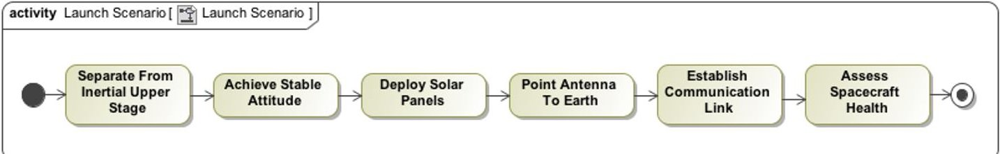

Figure 1 The use case scenario for performing initial acquisition after launch is described in a mission operations scenario.

## B. Requirements

A MOS is designed and built to meet a set of requirements. Requirements are sometimes thought of consisting only of a title and a statement that begins "The MOS shall..." In fact, MOS requirements have a number of other essential attributes that need to be captured. In the MMOS, a stereotype for MOS requirement is applied such that a requirement block has fields for capturing information such as rationale, verification method, and other attributes (such as a "key" or "driving"). Allocation of requirements to system components and requirement traceability are addressed through relationships, and are discussed later.

<!-- PDF_PAGE: 4 -->

## C. System Components and Composition

To be understandable, a system and its components must have defined boundaries and scope. The ability to allocate responsibility for performing functions (e.g., via requirements) relies on clearly defined scope. Engineers responsible for both internal and external systems need to share a common understanding of system boundaries and interfaces. System composition is represented in views that describe the system in a particular context. In the MMOS, model components possess clearly defined boundaries and explicit relationships to other components. Views are created to show only necessary parts of that information so that they can more clearly and completely describe specific aspects of the system.

To provide a view of system composition, the MMOS includes three standard diagrams. The first (not shown) is a hierarchical depiction of a Flight Project. This view is used to identify elements of the Project (including its MOS) and ownership or authority relationships between those elements.

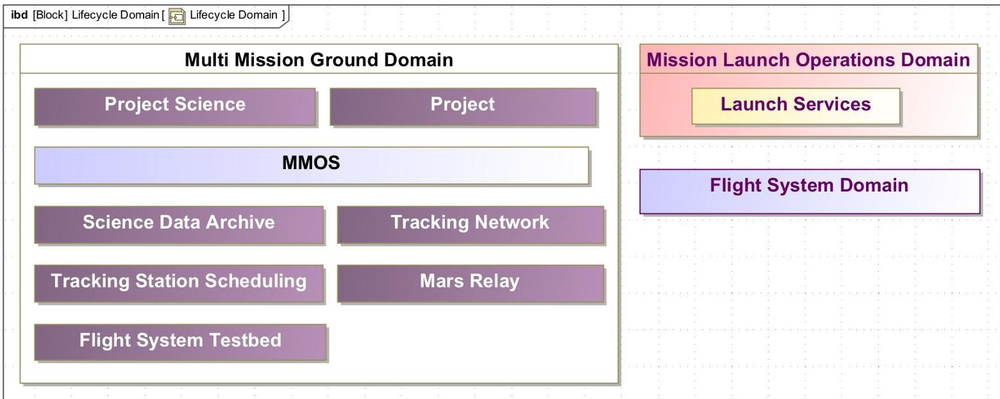

Figure 2: The system composition shows the MMOS as a system within the ground domain, having peer systems within the ground domain such as the tracking network. The Flight system domain is shown as a peer to the ground domain.

The second composition diagram is the MMOS in context with external systems (Figure 2). Systems are grouped by Domains, which provide context. The MMOS is shown as a peer system to other systems within the ground domain, and ground domain is shown as a peer domain with other domains. Such a diagram clarifies whether a particular system is part of the MOS or is a distinct entity requiring an external interface.

For example, a tracking network (e.g., DSN, ESTRACK) is a distinct entity that predates any given flight project and its MOS and interacts with multiple missions. Thus, the tracking network is not part of the MMOS. The Tracking Station Scheduling and Mars Relay systems are external systems that coordinate and integrate activities of multiple missions. They not part of one mission operations system in a compositional sense (although they may be part of a Project's organization). The Tracking Station Scheduling system coordinates mission tracking needs with those of other missions (and station downtime) to form an integrated schedule. The Mars Relay system coordinates the timing, data rates, and protocols for communications between landed spacecraft and Mars orbiters (that is, between different Project's MOSs) and manages the overall flow of data that flows through that relay network. (Note that a Relay capability can easily be generalized to other locations in the Solar System; Mars Relay is the only such existing example).

The third diagram shows the internal composition of the MMOS (Figure 3). Functionality within the MMOS is allocated to individual services. These standard (unadapted) services are the Mission Operations Engineering Service (MOES), Mission Control Service (MCS), Navigation Service (NAV), Spacecraft Operations Service (SCOS), and Science and Instrument Operations Service (SIOS). It is important to note that these Services are functional elements, not organizational ones. A particular MOS may or may not choose to establish its operations teams to match these Services (see Section IV.G for further discussion).

<!-- PDF_PAGE: 5 -->

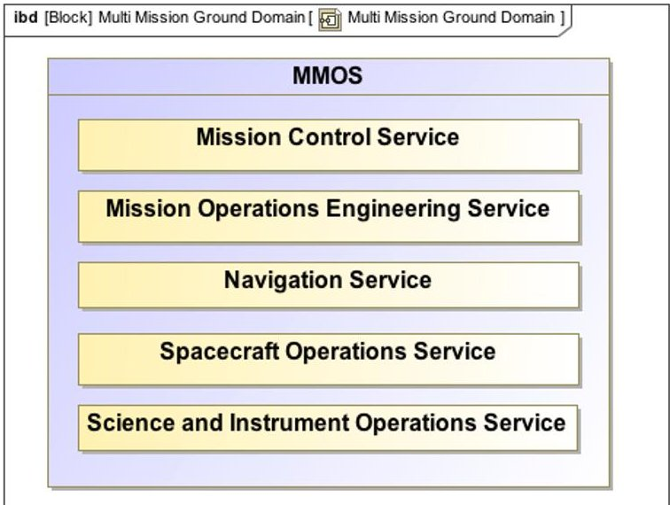

Figure 3: The composition diagram (an internal block diagram) describes the services internal to the MMOS.

## D. Interfaces

The MMOS must exchange information products with other systems and between internal elements. There are a number of items that need to be represented in the system design at each interface. The design needs to show the entity responsible for providing a specific product and the recipients. The interface needs to have a title and a description. The information product needs to be identified and described. The frequency of delivery and any constraints need to be specified (for example, information provided on change, information made available upon request, whether or not a receipt acknowledgement is required). An interface agreement is used to capture all these attributes and to expose system functionality for use (Figure 4). The agreement contains the list of information products being exchanged, describes the exchange of information, and specifies other related constraints. In addition to the interface agreement, characteristics of the interface itself are captured as ports within the MMOS model (Figure 4)

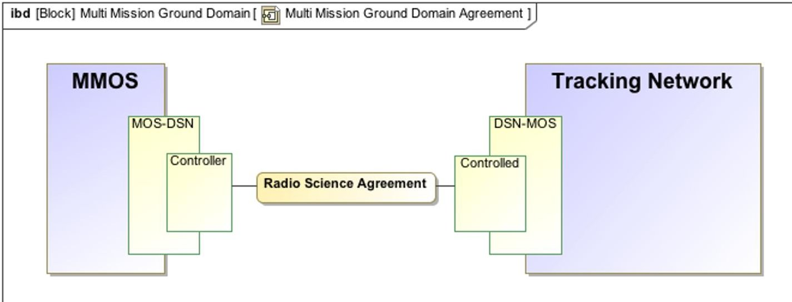

Figure 4: Above is the radio science agreement between the MMOS and the tracking network. It exists on the MOS to DSN port. The controller port further clarifies the type of interaction as control information exchanged with a system under control.

More-detailed diagrams (Figure 5) identify all information products flowing across and interface (and contained within an agreement). In addition, interfaces are further characterized by which services consume or produce information products. Delegation from the MMOS to an internal service - in this case the Science and Instrument Operations Service - is also depicted.

<!-- PDF_PAGE: 6 -->

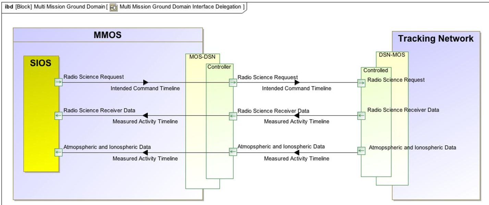

Figure 5: The above set of interfaces describes the products to be exchanged within the radio science agreement. Within the MMOS, responsibility for these product interfaces are delegated to the science and instrument service (SIOS).

The agreement to exchange information of a particular type between two systems includes information about the timing of interactions. This is particularly important for mission operations, where information products are produced by human operators, and the timing of interactions (e.g., daily at 5 pm or within one hour of receipt of telemetry) can drive performance requirements, complexity, staffing levels, and cost. The MMOS enables capture of this kind of information using sequence diagrams (Figure 6). Specification of interactions such as these is important for operator-involved processes, but is essential for automating all but the simplest interactions between systems. It can also be of significant value when changes occur on one side of an interface, enabling impact assessment and compensating changes if needed.

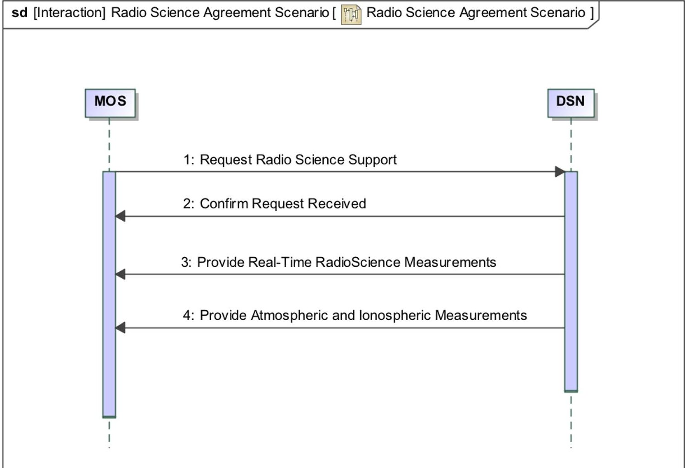

Figure 6: A SysML scenario diagram is used to show the steps involved in the agreement interaction.

<!-- PDF_PAGE: 7 -->

## E. Information Products

The MMOS defines a standard set of information types including plans, predicts, commands, measurements, and analysis products. These support the fundamental Plan-Execute-Analyze pattern. Plans and commands are produced by Plan for execution by the system under control (most commonly a Flight System or a Tracking Station). Predicts are also a product of Plan, for use by the Analyze capability. Measurements are provided by the system under control (for Analyze), and analysis products are needed (by Plan) to create the next set of plans and commands. Each product provides information that the system needs in order to plan, execute, and/or analyze its activities.

Information products are described so as to be independent of implementation in software. This allows for decoupling the MOS design from the details of a specific software tool or format. Thus the MMOS is not tied to any particular set of planning, telemetry, or command tools; those choices are left to a specific implementing Project.

## F. Functions

The MOS is composed of services (Section IV.C). Each service includes a fundamental set of capabilities: planning, execution, analysis, reporting, and data management (Figure 7). These five capabilities are used to group specific functions performed by a service as described below:

- Planning consists of the functions needed to generate executable plans for a flight system or tracking station. Examples include integration and conflict-resolution of multiple plan inputs, validation of plans against flight rules and resource constraints, and creation of predicts against which telemetered information can be compared.

- Execution functions are those that a service is directed to perform by an external system or in response to its plans.

- Analysis functions evaluate the results of execution and compare them to predicts or other expectations.

- Reporting functions create documents or other materials in response to requests. These are used internally by services to monitor performance, or by an external element to indicate status of a service. They also include production of standard documents needed for reviews.

- Data Management functions deal with storage, retrieval, and dissemination of a service's information.

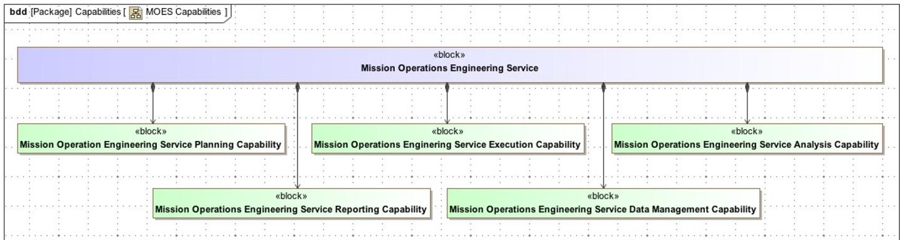

Figure 7: Diagram shows the association of the planning, execution, analysis, reporting, and data management capabilities to a service block.

Figure 8 shows an example of the individual functions of one service (MOES) for its execution capability.

Functions are elaborated into processes. The MMOS uses Business Process Modeling Notation (BPMN) for its expressivity and ease of understanding (Figure 9). Processes link to the information products they accept as inputs and output, and capture the tasks needed, including conditionals for decision points or contingencies. Key attributes of processes include:

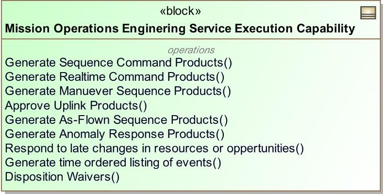

- Individual tasks can be elaborated as sub processes (designated by "+" )

Figure 8: Examples of functions within a capability.

- Processes may call one another. A

particular sub processes can be used by multiple calling processes.

- Information products internal to the process can be explicitly represented.

<!-- PDF_PAGE: 8 -->

- Flow of control (tasks) and flow of information are both explicitly represented

At the system (MOS) level, a process involves the coordination of functions provided by multiple services. In Figure 9, MOES has overall responsibility for coordinating MCS and SCOS tasks during a tracking pass. In this simple example, MOES distributes information needed by MCS and SCOS. MCS and SCOS then execute pass-related activities and provide reports to MOES. Details of MCS and SCOS activities are delegated to those services to elaborate and design, just as (during operations) they are responsible for their execution. Boundary events (Figure 8) tie a task to a contingency response process - for example, response to out-of-limit telemetry indicators.

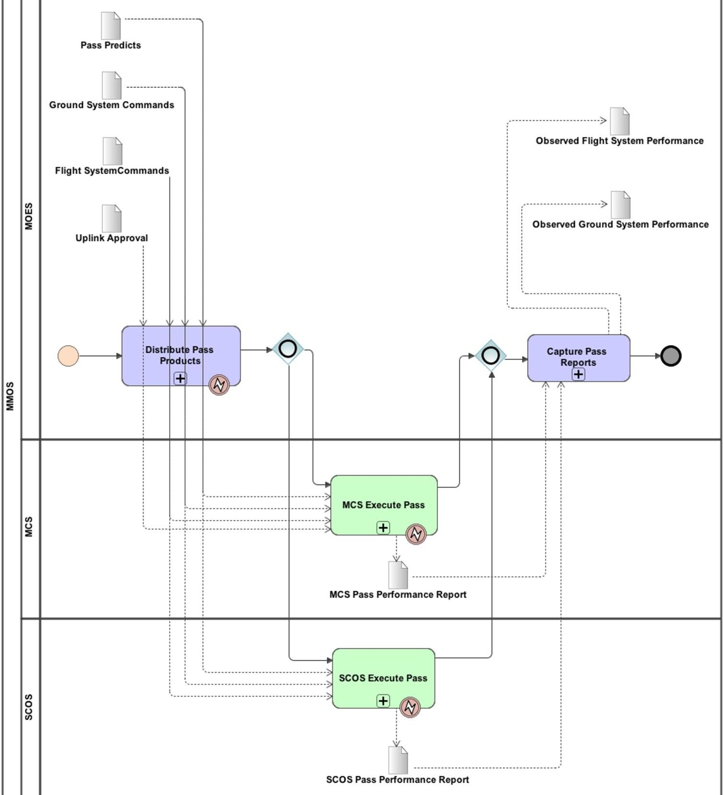

Figure 9: A system level process delegated to MOES calls functions from two other services. Data association flows link information products, control flows link individual tasks. In this example, each task has an elaborating sub-process ("+"). An error boundary event (the "lightning bolt" symbol) ties the task to a contingency process describing steps to take if the task fails.

<!-- PDF_PAGE: 9 -->

## G. Roles

Roles are an important feature of the MMOS. Roles perform tasks - individual steps within a process - and may either be an individual or a piece of software (for an automated task). Roles are specified in the MMOS and explicitly linked to the tasks that make up operational processes, and thence to the Services that make up the MMOS.

Neither Services nor Roles require that a MOS adopt a specific organization structure. Flight Projects employ a wide variety of organizational structures, depending on the size of the overall flight team and the difficulty and complexity of their work. The use of roles enables decoupling of functional elements (Services) from organizational elements (Teams) and provides each specific MOS the ability to organize roles into teams as it sees fit. Roles are linked to a Service - in a functional sense. But Roles may also be grouped into Teams in response to Project or MOS needs.

For example, a command operator and telemetry analyst are two separate roles, each responsible for a unique set process steps. Depending the mission implementation, each role could be performed by a separate team, or could be the responsibility of a single team. On a cubesat or smallsat mission, multiple Roles, or even entire Services might be performed by one part-time individual

## H. Relationships

Typically, when assessing completeness of the design, there is a list of interfaces, a separate list of functions a team performs, and a different list of system and subsystem requirements. Implicitly, an engineer has connected the dots between these various aspects of the system. Reviewers look at the independent pieces of information and ask questions to understand how one impacts the other, and to look for holes.

Within the MMOS, such relationships are explicitly specified. Not only are the relationships between items specified, but also the type of relationship is defined. Reports can be generated based on relationships (e.g., which requirements is a specific process related to - useful for V&V planning) To enable this kind of analysis of the design, the MMOS contains a set of key relationships between the various components described above. Many of these relationships are illustrated in Figure 10 (see Section V). These explicit relationships are useful for all types of reviews, ranging from a report used by individual engineers to assess progress, to review products given to peer reviews or review boards, to preliminary V&V reports, showing the relationship of requirements to the part of the design that fulfills them.

## I. Reporting and Analysis

If left buried in the database of a model, the information is of little value. To be able to view or analyze the information, reports are built. Engineers use software such as DocGen $ ^{4} $ to build the needed documents as they model the system design.

As the model is being adapted or developed, reports are needed to understand the quality and completeness of the system design. Reports can be quickly built for relationships, descriptions, or whatever information the system engineer needs to understand at the time. Reports can provide analysis of the model. Items such as unallocated requirements or information products with no consumer can be easily identified. Since all the items are connected using a systematic approach, the model can be traced from the mission scenarios down to the details of the information products being exchanged.

At mission key decision points, a mission generates gate products to show maturity of the design. These gate products represent a common set of views of the system. Using the MMOS, document models are populated with design information within the model and then render the information in a readable document format. Document models available in the MMOS include mission operations concept, system requirements, operational interfaces agreements, functional design description, among others.

As an example, interface documentation for an MOS needs to addresses a number of concerns. Interface designs need to identify specific attributes including the name of the product being exchanged, the frequency of delivery, the size of the information product, the provider, the consumer(s), how information is request and delivered, and any other constraints on the interface. Each of these attributes is present in the model for every interface. Using an existing document model, all these attributes may be extracted, formatted, and placed in a document form. The result is a reviewable document that is consistent across all interfaces and contains up-to-date design information. If reused across multiple flight projects, this method simplifies reviews by providing a common format and structure for the information being reviewed.

<!-- PDF_PAGE: 10 -->

## V. Methodology for Mission Adaptation

A structured methodology is a necessary adjunct to the rigor of a model-based representation of and MOS. For MMOS, this is provided in the form of an Adaptation Guide that follows a stepwise, top-down approach consistent with best practices $ ^{1,2} $ . Figure 10 depicts the methodology, stepping through the MMOS components described in Section IV (e.g., requirements) in general order of precedence. The Guide itself begins with a Start ("Splash") Page for Adaptation Guidance, which introduces the model and its design principles. Navigating through Adaptation Guidance in sequential order (Figure 10) leads the user through the following processes:

1. Establish the Scope of the MOS - What are the goals that my MOS system is intended to support? (Use cases, use case scenarios, requirements)

2. Establish the Composition of the MOS - How do I partition my MOS's design to accomplish my goals? (Systems, services, capabilities, functions)

3. Establish the Exchange of Information of the MOS - Who does my MOS interact with and what functionalities does my MOS expose? (Interfaces and agreements)

4. Establish the Behavior of the MOS - How does my MOS design accomplish my goals? (Processes and roles)

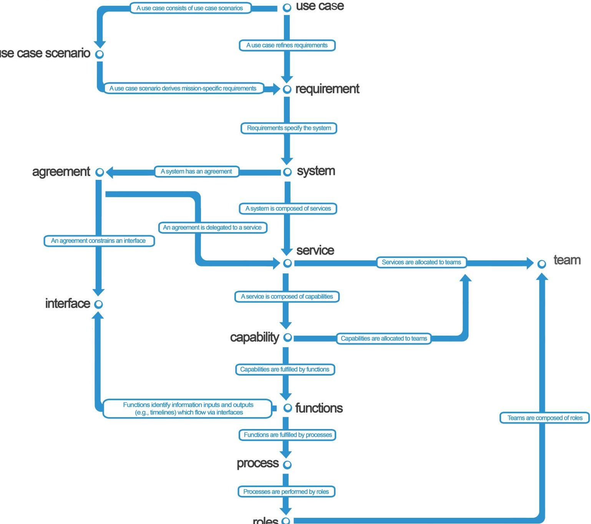

Figure 10: This overview flowchart of the MMOS model is the directed top-down approach that the adaptation guide walks through.

Each section of the Adaptation Guidance steps through a particular type of model content (e.g., requirements). Model content is introduced followed by three options for adaptation - how to add new content, how to modify

<!-- PDF_PAGE: 11 -->

existing content, and how to remove content. In this manner, existing specifications (for example, an Interface Agreement from Section IV.D.) can be used as-is, modified, or deleted if unneeded. Adaptation Guidance was designed with simplicity and a less-experienced MBSE practitioner in mind. Each section is shows the model components presented in Section 4 in an easy and understandable format. Notations for best modeling practices appear in green, and SysML tips and information are gray (Figure 11). And although the Guide is presented in a linear fashion, there are no barriers to working "backwards." In general, iteration is necessary between parts of any systems engineering process. Should the need for a new function be recognized during development, the MMOS model easily accommodates the need to backfill necessary interfaces, specify requirements, or even identify new use case scenarios.

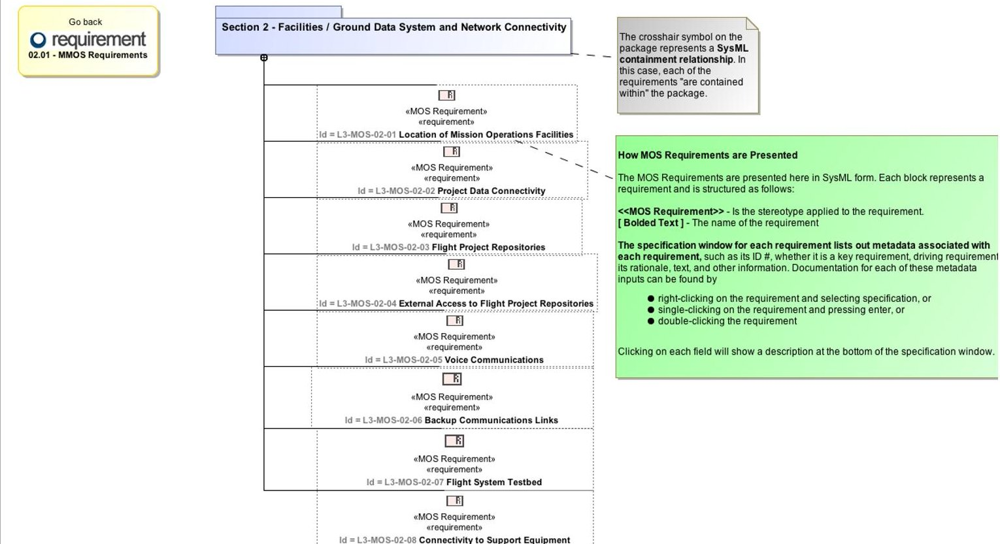

Figure 11: A sample page of Adaptation Guidance for Requirements. Users may adapt requirements from this view, or (for more expert users) work directly in the model.

The application of MBSE methods means that the Adaptation Guidance is more useful than conventional User Guide-type documents. Adaptation itself is one of the Viewpoints provided with the MMOS, and the Adaptation Guide is a View for any project-specific instance of the MMOS. The Guide structure (itself a model) is distinct from the MMOS model content (or its project-specific adaptation) and therefore reusable. But the content appearing in the Guide is sourced directly from the MMOS model itself, and any changes done within Adaptation Guidance are applied to the model. This is in contrast to conventional paper documents, which cannot reflect the changing state of the system model as adaptation proceeds. This method also provides rapid, concrete feedback to novice users (in the form of changes to the adapted MMOS) in the same place as tutorial and reference information.

One challenge with implementing Model-Based Systems Engineering in a project is that users will range from novices to experts in understanding the modeling languages, MBSE methods, and the software tools and plugins. Regardless of whether the user is a novice or an expert, they can start with the Adaptation Guide. A novice user may follow the stepwise, tutorial steps of the Guide, while more advanced users use it as a "Table of Contents" to navigate through contents deep within the model. Moreover, use of the Adaptation Guide as an entry point for adapting the model or working directly on the model are not mutually exclusive - both options remain because the Adaptation Guide is always consistent with the content of the model.

## VI. Adoption and Advantages

Missions of all sizes and types can leverage model based system engineering. From cubesats to flagship missions that span multiple NASA centers, the conceptual architecture and design of an MOS must address many of the same

<!-- PDF_PAGE: 12 -->

concerns. All missions need to identify their operational scenarios, allocate requirements, describe their compositional structure, and assign functions, identify responsibility for data products, and document processes. Smaller missions may require a less complex design; they must still address many of the same concerns as larger missions. Missions of all sizes have utilized the MSAF and MMOS to aid in their MOS architecture development and early design.

## A. Asteroid Redirect Robotic Mission (ARRM) Use of MMOS

The ARRM mission is a technology demonstration and human spaceflight precursor mission. Its intent is to retrieve a boulder from the surface of a near-Earth asteroid and return it to a lunar orbit for later examination by astronauts. The ARRM Project organization involves multiple NASA centers, including Glenn Research Center, Goddard Space Flight Center, Johnson Space Center, and JPL. All these development organizations need a common understanding of the project elements and systems, their designs, allocation of responsibilities, and clearly defined common terminology. Using MBSE across the project has significantly helped to facilitate communication across distributed teams. The architecture enables a layered approach, where the design can be adapted at a level of detail appropriate to project needs at each stage in its lifecycle.

ARRM was provided the architecture framework for modeling an MOS (the MSAF) and a set of integrated MOS design information (functions, interfaces, agreements, and processes) and associated MOS (Level 3) requirements. This has helped to quickly define an initial requirements set and to ensure completeness. ARRM is also using MMOS patterns for representing information, enabling clarity about information products and their flow through the flight and ground systems.

The collection of system views applicable to and used by ARRM includes the standard MOS key decision point (KDP) documents. ARRM has adapted the document models to suit mission specific needs and is enhancing and improving some of the analysis viewpoints.

## B. Europa Project Use of MMOS

The Europa Mission will conduct detailed reconnaissance and look for evidence of subsurface environments that could harbor life. It includes a partnership between JPL and the Applied Physics Lab (APL) managed by John Hopkins University. Systems modeling has become integral to the project's systems engineering approach. The MSAF and MMOS were utilized in 2014 during the mission concept study and review preparations. In 2015, they were used for early requirements and conceptual architecture development. In late 2015, the MMOS was deployed to the Europa modeling environment, and adaptation for the specific Europa MOS architecture is currently in progress.

Accomplishments and benefits seen to date include:

1. A draft set of MOS functional requirements for Europa Mission Concept Review based on the MMOS was generated in 2 days - and ingested into the Europa System Model framework. Conventional efforts to develop a set of draft requirements in a bottoms-up sense take months. This provided the mission with a clean starting set which could be incorporated into the top-down requirements development process.

2. The small MOS design team is currently assessing the sets of operational functions in the MMOS model for each of the service areas and identifying the needs for mission specific adaptation to them. This represents a better starting point than either starting from scratch or trying to extract such a list from a previous project's design materials.

3. The MOS team is using the agreements and interfaces of the MMOS, and adapting them to define and capture ground system interfaces. These include the MOS interfaces to the tracking network, science data archive, launch services, and Project Science systems.

4. The project is capturing the ground system and MOS concepts in architecture documents which are part of the system model. The Operations Concept document, the MOS functional requirements document, and the Functional Description document will be generated from the system model and include the modeled MOS content and diagrams.

In addition, the Europa MOS design team plans to refine and update MMOS use case scenarios and add new scenarios as they are identified. Some MMOS terminology is expected to change as well (for example, Planning, Coordination and Execution (PC&E) will replace the MOES service name, and Science System will replace Project Science. Preliminary examination suggests this will not require significant rework.

## C. Asteria

The Asteria mission is an astrophysics technology demonstration of arc second line-of-sight pointing, using a 6U cubesat platform. Like many such missions, the development team is very small; the MOS design team consists of a

<!-- PDF_PAGE: 13 -->

single, part-time engineer. Using the MMOS and following the methodology, an MOS design was completed and delivered. The operations concept, requirements, functional and interface designs and specifications, and operations processes were developed on a small budget without sacrificing necessary completeness or quality. This usage demonstrated scalability of the MMOS models - despite being designed with Discovery- to Flagship-class missions in mind, its use on a cubesat mission was straightforward; for example, unnecessary model items (e.g., specific requirements or functions) were easy to delete. The MOS engineer noted that he was able to focus on the technical aspects of the system design, rather than researching how to design the system and spending time documenting it from scratch.

## D. Lunar Resource Prospector Mission

The Lunar Resource Prospector Mission is a technology demonstration for harvesting volatiles near the South Pole of the Moon. The MOS design team (at Ames Research Center) is adapting the MMOS for their mission. To date, use case scenarios, requirements, and system composition and services have been adapted. The use of the MMOS provides a framework with a pre-populated reference design has allowed the design team to spend more time developing their system, and less time on developing a mission unique architecture.

## E. Incorporating mission adaptation back into the MMOS

As each mission adapts the MSAF and MMOS, they identify items that were not part of the baseline products. When missions request to use the products, we request that they provide feedback as to what they added, changed, or found not to be of value. This allows the architecture and reference system design to evolve to meet the everchanging needs of the next generation of missions.

## F. Challenges

As with any innovation, there are challenges to be overcome. The adoption of model-based approaches requires a degree of formality of both thought and approach. Conventional diagrams and narrative description allow for differing interpretations far more than do SysML or other modeling languages. This imprecision allow for more latitude (e.g., two interacting elements may have very different representations of the same interface) but ultimately results in problems in implementation, testing, or even operations. Projects and teams need to be sufficiently trained, and to be given time and opportunity to work through the learning curve. This is the investment needed to yield the advantages noted by missions (above) and in Section IV.H.

MBSE is fundamentally reliant on software that is responsive to systems engineering needs. The software tooling continues to evolve and be updated. One challenge is managing an MBSE environment that is a diverse collection of tools, including both COTS and in-house developed software.

In terms of the MMOS framework itself, both the technical issues in evolving the MMOS and support for doing so present challenges. For both Europa and ARRM, the MMOS represents one part of a larger Project System model. Consistency, interfaces, and integration have only just begun to be addressed. Changes to both Project instantiations of the model and to the MMOS themselves require a degree of configuration control and management that may be challenging, particularly in the formulation phase of flight projects.

## VII. Conclusions

The development of the MMOS model and its associated methodology has facilitated the use of MBSE techniques by Flight Projects. Early adoption of these methods show significant promise for having to MOS formulation and design phase efforts that are more repeatable from mission to mission and that produce higherquality requirements and design products in a cost-effective manner. The extent of adoption by projects of varying size (cost) and mission type and the ability of the MMOS to capture feedback and improve in response suggests that return on the overall investment in such capabilities is only just beginning. In its focus on building generalized, scalable model and method for the development of Mission Operations Systems, the MMOS is highly consistent with NASA's efforts to find and create Agency-wide efficiencies such as the Mission Operations Capability Leadership effort.

## Acknowledgments

The authors acknowledge the contributions of the many members of the Ops Revitalization Team that made this work possible. This research was carried out at the Jet Propulsion Laboratory, California Institute of Technology, under a contract with the National Aeronautics and Space Administration.

<!-- PDF_PAGE: 14 -->

## References

$ ^{1} $SE Handbook Working Group, INCOSE Systems Engineering Handbook v3.2.2, International Council on Systems Engineering, INCOSE-TP-2003-002-03.2.2, San Diego, CA, Oct. 2011.

$ ^{2} $ NASA Systems Engineering Handbook, NASA Headquarters, NASA/SP-2007-6105 Rev1, Washington, DC, Dec. 2007.

$ ^{3} $Friedenthal, S., Moore, A., and Steiner, R., A Practical Guide to SysML: The Systems Modeling Language, Elsevier, Inc., New York, 2008, Chaps. 1, 2.

$ ^{4} $Jackson, M., Delp, C., Bindschadler, D., Sarrel, M., Wollaeger, R., Lam, D., Dynamic gate product and artifact generation from system models, 2011 IEEE Aerospace Conference Proceedings, AERO 2011, May 13, 2011.

$ ^{3} $Bindschadler, D.L., Delp, C.L., McCullar, M., Principles to Products: Toward Realizing MOS 2.0, AIAA Space Operations 2012 Conference Proceedings, June 2012.