<!-- PDF_PAGE: 1 -->

# Battery-Aware Scheduling in Low Orbit: The GOMX-3 Case

Morten Bisgaard $ ^{1} $ , David Gerhardt $ ^{1} $ , Holger Hermanns $ ^{2} $ , Jan Krčal $ ^{2} $ Gilles Nies $ ^{2(\boxtimes)} $ , and Marvin Stenger $ ^{2} $

$ ^{1} $ GomSpace ApS, Aalborg, Denmark

$ ^{1} $ GomSpace ApS, Aalborg, Denmark

$ ^{2} $ Saarland University - Computer Science, Saarland Informatics Campus,

Saarbrücken, Germany

nies@cs.uni-saarland.de

Abstract. When working with space systems the keyword is resources. For a satellite in orbit all resources are sparse and the most critical resource of all is power. It is therefore crucial to have detailed knowledge on how much power is available for an energy harvesting satellite in orbit at every time especially when in eclipse, where it draws its power from onboard batteries. This paper addresses this problem by a two-step procedure to perform task scheduling for low-earth-orbit (LEO) satellites exploiting formal methods. It combines cost-optimal reachability analyses of priced timed automata networks with a realistic kinetic battery model capable of capturing capacity limits as well as stochastic fluctuations. The procedure is in use for the automatic and resource-optimal day-ahead scheduling of GOMX-3, a power-hungry nanosatellite currently orbiting the earth. We explain how this approach has overcome existing problems, has led to improved designs, and has provided new insights.

## 1 Introduction

The GOMX-3 CubeSat is a 3kg nanosatellite designed, delivered, and operated by Danish sector leader GomSpace. GOMX-3 is the first ever In-Orbit Demonstration (IOD) CubeSat commissioned by ESA. The GOMX-3 system uses Commercial-off-the-shelf (COTS) base subsystems to reduce cost, enabling to focus on payload development and testing. GOMX-3 was launched from Japan aboard the HTV-5 on August 19, 2015. It successfully berthed to the ISS a few days later. GOMX-3 was deployed from the ISS on October 5, 2015. Figure 1 shows the satellite and its deployment.

Both GomSpace and ESA are interested in maximizing the functionality of their nanosatellite missions. As such, GOMX-3 has been equipped with a variety of technical challenging payloads and components, among them: (i) 3-axis rotation and pointing with a precision of $ 2^{\circ} $ or less, (ii) in-flight tracking of commercial aircrafts, (iii) monitoring signals from geostationary INMARSAT satellites, and (iv) high-speed downlinking to stations in Toulouse (France) or Kourou (French Guiana).

<!-- PDF_PAGE: 2 -->

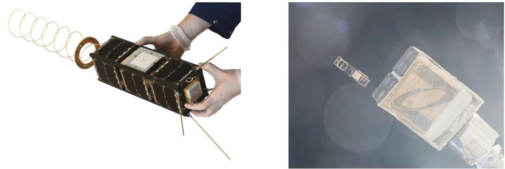

Fig.1. The final GOMX-3 nanosatellite (left) and its deployment from the ISS (right) together with AAUSAT5 (picture taken by Astronaut Scott Kelly).

For a satellite in orbit all resources are sparse and the most critical resources of all is power. Power is required to run the satellite, to communicate, to calculate, to perform experiments and all other operations. Detailed knowledge on the power budget is thus essential when operating a satellite in orbit. Furthermore, in a satellite not all power is used as it is generated. The satellite passes into eclipse each orbit and during those periods it must draw power from its batteries. This challenge is especially apparent for nanosatellites where not only the actual satellite but also the resources are very small. An operator of such a spacecraft is thus faced with a highly complex task when having to manually plan and command in-orbit operations constantly balancing power and data budgets.

In this paper we report on our joint activities, part of the EU-FP7 SENSATION project, to harvest formal modelling and verification technology, so as to provide support for commanding in-orbit operations while striving for an efficient utilization of spacecraft flight time. Concretely, we have developed a toolchain to automatically derive battery-aware schedules for in-orbit operation. The heterogeneous timing aspects and the experimental nature of the application domain make it impossible to use traditional scheduling approaches for periodic tasks.

The schedules we derive are tailored to maximize payload utilisation while minimizing the risk of battery depletion. The approach is flexible in the way it can express intentions of spacecraft engineers with respect to the finer optimisation goals. It comes as an automated two-step procedure, and provides quantifiable error bounds.

For the first step, we have developed a generic model of the GOMX-3 problem characteristics in terms of a network of priced timed automata (PTA) [3]. This model is subjected to a sequence of analyses with respect to cost-optimal reachability (CORA) with dynamically changing cost and constraint assignments. We use UPPAAL CORA for this step. The latter is a well understood and powerful tool to find cost optimal paths in PTA networks [4]. This first step takes the battery state into consideration by means of a linear battery representation (owed to the fact that nonlinearities are not supportable in CORA). As a result, any schedule generated in this step has a risk of not being safe when used in-orbit, running on a real battery and with real payload.

<!-- PDF_PAGE: 3 -->

To account for this problem, a second step validates the generated schedule on a much more accurate model of the on-board battery, a model that includes nonlinearities and also accounts for the influence of stochastic perturbations of load or battery state. For this step, we employ a stochastic enhancement [5] of the kinetic battery model [10] (KiBaM) with capacity bounds. As a result it is possible to discriminate between schedules according to their quantified risk of depleting the battery. Low risk schedules are shipped to orbit and executed there. The satellite behaviour is tightly monitored and the results gained are used to improve the model as well as the overall procedure.

The entire toolchain has been developed, rolled out, experimented with, and tailored for in-the-loop use when operating the GomX-3 satellite. We report on experiences gained and lessons learned, and highlight the considerable prospect behind this work, in light of the future development in the space domain.

## 2 Prerequisites

Priced Timed Automata. The model of Timed Automata (TA) [2] has been established as a standard modelling formalism for real time systems. A timed automaton is an extension of finite state machines with non-negative real valued variables called clocks in order to capture timing constraints. Thus, a timed automaton is an annotated directed graph over a set of clocks C with vertex set (called locations) L and edge set E. Edges and locations are decorated with conjunctions of clock constraints of the form c $ \bowtie $ k where c $ \in $ C, k $ \in $ $ \mathbb{N} $ and $ \bowtie\in\{<, \leq, =, \geq, >\} $ . For edges such constraints are called guards, for locations they are called invariants. Edges are additionally decorated with reset sets of clocks. Intuitively, taking an edge causes an instantaneous change of location and a reset to 0 for each clock in the reset set. However an edge may only be taken if its guard and the target location's invariant evaluate to true. If this is not that case the current location remains active, if it's invariant permits, and clocks increase continuously with their assigned rates, thus modelling the passing of time.

In order to reason about resources, TAs are enriched with non-negative integer costs and non-negative cost rates in the form of annotations for edges and locations respectively [3]. The result are priced timed automata (PTA). The intuition is that cost accumulates continuously in a proportional manner to the sojourn time of locations and increases discretely upon taking an edge as specified by the respective annotations.

Definition 1 (Priced Timed Automata). Let C be a set of clocks and $ \mathbb{B} (C) $ be the set of all clock constraints as described above. A priced timed automaton is a tuple $ \langle L, E, \ell_{0}, \mathrm{inv}, \mathrm{price} \rangle $ where L is a set of locations, $ E \subseteq L \times \mathbb{B} (C) \times 2^{C} \times L $ is a set of edges, $ \ell_{0} $ is the initial location, $ \mathrm{inv}: L \to \mathbb{B} (C) $ assigns invariants to locations, and price: $ L \cup E \to \mathbb{N} $ assigns costs and cost rates to edges and locations respectively.

To meet space requirements we omit the formal semantics of PTA, and instead refer to [3] for a complete development.

<!-- PDF_PAGE: 4 -->

A common problem to consider in the context of PTA is that of computating the minimum cost to reach a certain target location in a given PTA. This so-called cost-optimal reachability analysis (CORA) receives dedicated attention in the literature [4,8] and is well-known to the community. The CORA is implemented in a number of tools, most prominently Uppaal CORA [1]. As input Uppaal CORA accepts networks of PTAs extended by discrete variables, and thus allows for modular formalisation of individual components. The set of goal states is characterised by formulae over the variables in the network of PTAs.

Kinetic Battery Model. Batteries in-the-wild exhibit two non-linear effects widely considered to be the most important ones to capture: the rate capacity effect and the recovery effect. The former refers to the fact that if continuously discharged, a high discharge rate will cause the battery to provide less energy before depletion than a lower discharge rate. Thus a battery's effective capacity depends on the rate at which it is discharged. The latter effect describes the battery's ability to recover to some extent during periods of no or little discharge. We introduce the kinetic battery model (KiBaM) as the simplest model capturing these effects. It is known to provide a good approximation of the battery state of charge (SoC) across various battery types [5]. For a survey on battery models providing a context for the KiBaM we refer to [6,7].

The KiBaM divides the stored charge into two parts, the available charge and the bound charge. When the battery is strained only the available charge is consumed instantly, while the bound charge is slowly converted to available charge by diffusion. For this reason the KiBaM is often depicted by two wells holding liquid, interconnected by a pipe, as seen in Fig. 2.

The diffusion between available and bound charge can take place in either direction depending on the amount of both types of energy stored in the battery. Both non-linear effects are rooted in the relatively slow conversion of bound charge into available charge or vice versa. The KiBaM is characterized by two coupled differential equations:

$$
\dot {a} (t) = - I (t) + p \left(\frac {b (t)}{1 - c} - \frac {a (t)}{c}\right), \quad \dot {b} (t) = p \left(\frac {a (t)}{c} - \frac {b (t)}{1 - c}\right).
$$

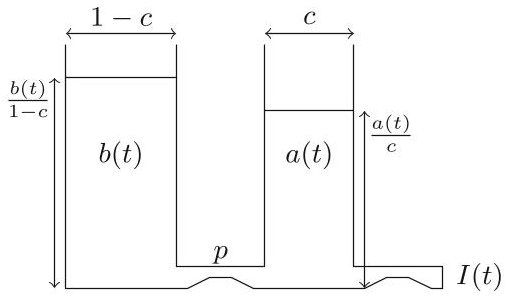

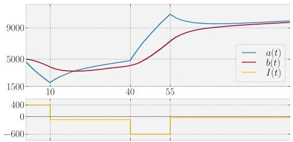

Fig. 2. The two-wells depiction of the KiBaM (left) and a SoC evolution trace over time under a piecewise constant load (right).

<!-- PDF_PAGE: 5 -->

Here, the functions a(t) and b(t) describe the available and bound charge at time t respectively, $ \dot{a} (t) $ and $ \dot{b} (t) $ their time derivatives, and I(t) is a load on the battery. We refer to the parameter p as the diffusion rate between both wells, while parameter c $ \in $ [0,1] corresponds to the width of the available charge well, and 1-c is the width of the bound charge well. Intuitively, $ a (t) / c $ and $ b (t) / (1-c) $ are the level of the fluid stored in the available charge well and the bound charge well, respectively. Figure 2 shows a SoC trace of the KiBaM ODE system. We shall denote the KiBaM SoC at time t as $ [a_{t};b_{t}]$ and consider I(t) to be piecewise constant.

Adding Randomness and Capacity Limits. The KiBaM model has been extended with capacity limits (say $ a_{\mathrm{m a x}} $ for the available charge and $ b_{\mathrm{m a x}} $ for the bound charge), as well as means to incorporate stochastic fluctuations in the SoC and the load imposed on the battery. Both extensions come with their own set of technical difficulties. For a complete technical development of this we refer to [5]. In this setting SoC distributions may not be absolutely continuous, because positive probability may accumulate in the areas $ \{[0;b]\mid 0 < b < b_{\mathrm{m a x}}\} $ where the available charge is depleted and $ \{[a_{\mathrm{m a x}};b]\mid 0 < b < b_{\mathrm{m a x}}\} $ where the available charge is full. Therefore, one works with representations of the SoC distribution in the form of triples $ \langle f,\bar{f},z\rangle $ where

- f is a joint density over ]0, $ a_{\max}[\times ]0, b_{\max}[], $ which represents the distribution of the SoC in the area within the limits,

- $ \bar{f} $ is a density over $ \{a_{\mathrm{max}}\} \times ]0,b_{\mathrm{max}} $ [ and captures the bound charge distribution while the available charge is at its limit $ a_{\mathrm{max}} $

- z $ \in $ [0,1], the cumulative probability of depletion.

It is possible to analytically express an under-approximation of the SoC distribution $ \langle f_{T},\bar{f}_{T},z_{T}\rangle $ after powering a task (T,g) when starting with the initial SoC distribution $ \langle f_{0},\bar{f}_{0},z_{0}\rangle $ , where T is a real time duration and g is the probability density function over loads. We omit the derivation of these expressions due to their lengthiness. Sequences of tasks can be handled iteratively, by considering the resulting SoC distribution after powering a task to be the initial SoC distribution for powering the next task.

Figure 3 displays the SoC distributions while powering an exemplary task sequence. Each distribution $ \langle f,\bar{f},z\rangle $ is visualized as three stacked plots: f is represented in the heatmap (middle), the curve of $ \bar{f} $ in the small box (top), z in the small box as a colour-coded probability value representing the cumulative depletion risk (bottom).

## 3 Modelling the GomX-3 Nanosatellite

GOMX-3 is a 3 L $ ( 3 0 \times1 0 \times1 0 $ cm, 3 kg) nanosatellite launched in October 2015 from the ISS. It's mission payloads are threefold: Tracking of ADS-B beacons emitted by commercial airplanes, testing a high-rate X-Band transmitter module for in-space adequacy, and monitoring spot-beams of geo-stationary satellites belonging to the INMARSAT family, via an L-Band receiver. In addition,

<!-- PDF_PAGE: 6 -->

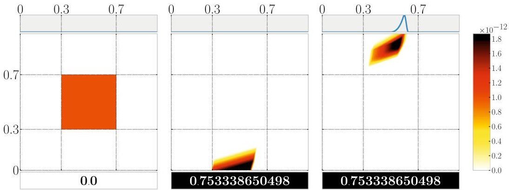

Fig. 3. An exemplary battery with $ a_{\mathrm{max}}=b_{\mathrm{max}}=5\cdot10^{6} $ $ c=0.5 $ $ p=0.0003 $ with an initially uniform SoC density over the area $ [0.3,0.7] a_{\mathrm{max}}\times[0.3,0.7] b_{\mathrm{max}} $ (left), subjected to a task sequence (500, $ \mathcal{U} $ [3000,3600]), (600, $ \mathcal{U} $ [-3300,-3900]) with $ \mathcal{U} $ denoting uniform distribution. Roughly 75 % of the SoC density flows into the depletion area (negative available charge) after powering the first task and is thus accumulated in z (middle). The remaining 25 % are considered alive and transformed further. Some of it even reaches the capacity limit $ a_{\mathrm{max}} $ of the available charge (right).

it features a UHF software defined radio module for downlinking collected data to and uplinking new instructions from the GomSpace base station in Aalborg, Denmark. In the sequel, we refer to the operation of one of these payloads as a job. Each of these jobs comes with its own set of satellite attitude configurations, making an advanced 3-axis attitude control system indispensable. This attitude control uses gyroscopes and magnetorquers to enable the satellite to slew into any dedicated position with a precision of up to $ 2^{\circ} $ . It is especially power-hungry.

As an earth-orbiting satellite, GOMX-3 naturally enters eclipse. To continue operation, it draws the necessary power to sustain its operation from an onboard battery system. These batteries are, in turn, charged by excess energy harvested during insolation periods by solar panels that cover any non-occupied surface.

Since its launch, GomX's follows the roughly equatorial orbit of (and below) the ISS. Therefore, insolation periods as well as operation windows for the different jobs are well predictable over the time horizon of about a week ahead, yet they are highly irregular. Exploiting the pre-determined attitude configurations per mode of operation, the net power balance of every job can be predicted by the in-house GomSpace POWERSim tool. This information is the essence of the power-relevant behaviour of GomX-3. In order to understand their joint implications for the energy budget of GomX-3, it is important to accurately model these power-relevant aspects of the satellite components, and their interplay.

## 3.1 Objectives

In broad terms, the main mission goal of GOMX-3 is to maximize the amount of jobs carried out without depleting the battery. The concrete objectives spelled

<!-- PDF_PAGE: 7 -->

out by GomSpace engineers changed several times along the mission. This meant that the models have to have the necessary flexibility needed to reflect the requirements once they are made formal.

GomX-3 switches to Safe Mode if the battery SoC falls below a given threshold. For GomX-3 this threshold is at 40% of the battery's capacity. In Safe Mode, all non-essential hardware components are switched off, preventing of the satellite being productive. The primary objective is thus to avoid Safe Mode, while maximizing secondary objectives. Several such secondary objectives need to be taken into account.

- Whenever possible the UHF connection to the GomSpace base station must be scheduled and maintained throughout the entire operation window in order to enable monitoring the status of GOMX-3 and to uplink new instructions if need be. This is crucial to maintain control over the satellite and thus considered vital for the success of the mission.

- Independent of the satellite attitude, the ADS-B helix antenna is able to receive ADS-B beacons. Thus this hardware module will be active at all times, thereby constantly collecting data of airplane whereabouts.

- The X-Band windows are small, as the downlink connection can only be established if the satellite is in line of sight and close enough to the receiving ground station. The corresponding downlink rate, however, is relatively high.

- L-Band jobs will have job windows as long as an orbit duration but vary a lot depending the time of the year, and will collect a lot of data if successful. The variations in window lengths can be observed in Sect.5, where actual schedules are visualized.

- L-Band jobs are to become as balanced as possible across the available INMARSATS.

- Jobs filling their entire job window are most valuable. Jobs that have been aborted early or started late are not considered interesting.

- L-Band and X-Band jobs are mutually exclusive, as they require different attitudes. UHF jobs may be scheduled regardless of the current attitude, even when L-Band or X-Band jobs are currently executed.

- Only downlinked data are useful, thus the time spent on data collection payloads (L-Band, ADS-B) and downlink opportunities (X-Band) needs to be balanced in such a way that only a minimal amount of data needs to be stored temporarily in the satellite's memory. This induces the need to weigh the data collection rate and the downlink speed against each other.

Based on these observations and the expertise of GomSpace engineers, it was deemed that two fully executed X-Band jobs are enough to downlink the data of one successful L-Band job together with the ADS-B data collected in the meanwhile.

## 3.2 PTA Modelling

As the central modelling formalism PTAs are employed when modelling the behaviour of GomX-3, with special emphasis being put on flexibility w.r.t. the

<!-- PDF_PAGE: 8 -->

optimization objective. In order to allow for easy extensibility, the modelling was purposely kept modular and generic. Notably, the TA formalism is not expressive enough for the nonlinearities of the kinetic battery model. Therefore we use a simple linear model (intuitively corresponding to a single well holding liquid) instead, and account for this discrepancy later. The component models belong to the following categories.

Background load comprises the energy consumption of modules that are always active, including the ADS-B module for tracking airplanes, the gyroscopes and magnetorquers (even though not at full power) for keeping the attitude invariant.

Jobs are dealt with in a generic way, so that only the common characteristics are modelled. A job has a finite time window of when it can be executed, it may be skipped, it may require an a priori preheating time (to ramp up the physical modules related to the job) as well as a specific attitude, it may need to activate a set of related modules inducing piecewise constant loads, its window may occur in a periodic pattern.

Battery represents a relatively simple linear battery which can support piecewise constant loads. It keeps track of its (one-dimensional) state of charge and updates that based on the (dis)charge rate and the time until the load changes again. Since the battery is modelled as an automaton, the system can monitor and take decisions based on the remaining battery charge.

Attitude represents the predetermined attitude requirements of each job and the worst case slewing time of 5 min.

Insolation is a simple two-state automaton (sun and eclipse) based upon the predicted insolation times, triggering a constant energy infeed due to the solar panels.

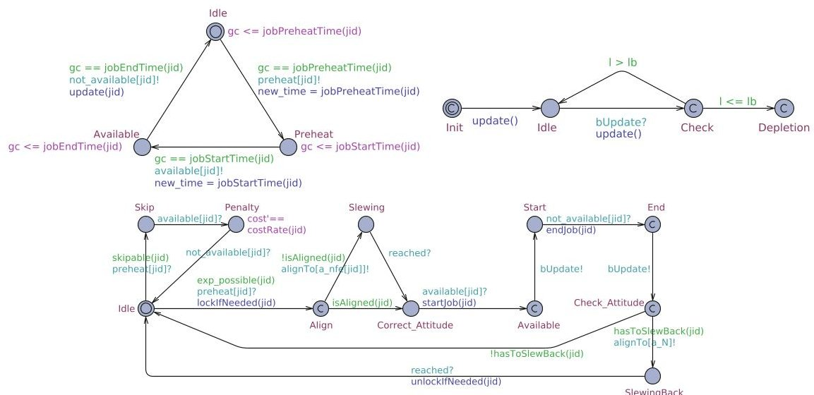

Fig. 4. The JobProvider automaton (top left), the Job instance automaton (bottom) and the Battery automaton (top right).

<!-- PDF_PAGE: 9 -->

Among these components, the PTAs modelling the battery and the job aspects are the most interesting. They are depicted in Fig. 4 and explained in more detail below.

JobProvider: This automaton provides the interface between multiple arrays representing the job opportunities as well as their implied preheating times, and the actual Job automaton. It waits for a job window, discriminating whether the job needs preheating or not, and broadcasts signals triggering the actual decision making. In the Idle location, being initial, it waits for the global clock gc to hit a certain job preheat time event (stored in the array jobPreheatTime), sets the time variable to the current time, and notifies the Job automaton to start preheating over a the dedicated preHeat[jid] channel, where jid uniquely identifies a certain job type. Upon this notification it switches into the PreHeat location and waits for the actual job to start, i.e. the global time reaching the expected start time of the job identified by jid, consequently transitioning into location Available, where, in turn it waits for completion of the job (gc reaching jobEndTime[jid]), switching into location Idle yet again, all the while notifying its environment on the respective dedicated channels.

Job: This automaton represents the execution or skipping of a job. It starts in its Idle location, waiting to be notified of impending preheating duties. At this point the take-or-skip decision is taken, as witnessed by the two outgoing transitions into locations labelled Skip and Align. A job is either skipped because it is not optimal to take it, or because the attitude requirements don't match the current attitude of the satellite because of an already ongoing job. If the job is skipped, cost is accumulated with rate costRate(jid) over the duration of the job, effectively returning into location Idle. If it is taken, attitude requirements of the scheduled job are checked via the guard isAligned(jid), upon which the satellite starts slewing (location Slewing) to the correct attitude (location Correct_Attitude) if need be. Upon notification, the job is executed (Start $ \rightarrow $ End $ \rightarrow $ Check_Attitude) triggering the battery via channel bUpdate to update its SoC, and finally checks whether it has to change attitude to minimize atmospheric drag using guards hasToSlew-Back(jid) to finally return eventually to location Idle.

Battery: This model represents a simple linear battery with capacity that can be (dis)charged with piecewise constant loads. It is notified of load changes via channel bUpdate, upon which it computes the length of a constant load interval via global integer variables new_time and old_time, and subtracts the result multiplied by rate from its internal SoC 1, upon which it ends up in location Check. A check is performed whether the SoC fell below a threshold 1b, upon which we either transition into (and stay in) the Depletion location or return to Idle to power another task.

## 3.3 Cost Model and Reachability Objectives

In the following we explain how the objectives derived by GomSpace engineers were turned into constraints and cost parameters of the PTA model.

<!-- PDF_PAGE: 10 -->

The Safe Mode threshold is kept variable and must be set before scheduling. It appears as 1b (for lower bound) in the automata models. Depending on the degree of aggressiveness of the intended schedule, it can either be set close to the real Safe Mode threshold of 40% or it can be set higher, for example to 55% thereby adding an implicit safety margin.

UPPAAL CORA computes cost-minimal schedules. Therefore, we interpret the price annotations of PTA transitions as penalties for skipped jobs. Likewise cost rates in states accumulate penalty per time unit a job window is left unused. An optimal schedule will then have the property that the minimal portion of important jobs windows was left unexploited.

An immediate consequence of this setup is that UHF jobs have a high penalty if skipped, as they are supposed to be scheduled every time they are possible. For L-Band and X-Band jobs, the number of jobs scheduled should result in an average ratio of 1/2, according to the GomSpace directives. To arrive there, we proceed as follows. Let $ \varDelta_{X} $ and $ \varDelta_{L} $ denote the job windows length expectations of X-Band and L-Band jobs, respectively. Then the cost rate for skipping L-Band and X-Band window portions is set $ 2\cdot\varDelta_{X} $ and $ \varDelta_{L} $ , respectively. Likewise, the L-Band jobs on different INMARSAT are internally viewed as different jobs. Their cost rates for skipping should be set equal.

In order to generate an optimal schedule from the network of PTAs up to a certain time horizon (treated as an orbiting count), we need to define the goal set of states to be used in a reachability objective as supported by UPPAAL CORA. To this end, we simply introduce a small automaton that counts the orbits already scheduled for and manages this number globally, say in a variable n. A query for a schedule of n orbits can then easily be formulated as $ \exists \diamond (n=20). $

## 3.4 Model Quality Assurance

In light of the high overall significance of the GOMX-3 mission, it was from the start deemed important to assure the adequacy of the formal models used to represent and to eventually manoeuvre the satellite. For this reason, a series of dedicated workshops were organized in the context of the SENSATION project, comprising among others the authors of this paper. On these occasions, presentations of varying technical detail were delivered by both sides, so as to expose the formal approach, the set of concrete problems, as well as possible solutions thereof. In later stages, collaborative work was organised via Google docs and Skype, which indeed provided an effective way to communicate feedback in both directions. This altogether made it possible to effectively crossfertilize the domain expertise of the GomSpace engineers with the modelling and verification experience at Saarland University, so as to assure a high quality model. In the same vein, the design of the entire scheduling workflow (explained next) was a consensus decision.

<!-- PDF_PAGE: 11 -->

## 4 The Scheduling Workflow

The scheduling workflow, depicted in Fig. 5, loops through a two-step procedure of schedule generation and schedule validation. The latter is needed to account for the inaccuracies of the simple linear battery model, which is used for schedule generation, relative to real battery kinetics. Therefore any generated schedule is validated along the stochastically enhanced KiBaM known to be sensitive to such effects. If the validation does not exhibit good enough guarantees, the current schedule is discarded and excluded from the generation step, and a new schedule is computed. Otherwise it will be accepted, upon which we break the loop and ship the schedule to orbit.

## 4.1 Schedule Generation

The mission times to be considered for automatic scheduling span between 24 and 72 h. Longer durations are not of interest since orbit predictions are highly accurate only for a time horizon of a handful of days, and because GOMX-3 is as a whole an experimental satellite, requiring periods of manual intervention. However, even a 24 h schedule computation constitutes a challenge for plain CORA, since the number of states grows prohibitively large.

Heuristics. The state-space explosion can, to certain extend, be remedied by using heuristics, i.e. exclusion of certain schedules at the risk of losing optimality. Here is a brief overview of heuristics used:

1. Take every job if battery is almost full. Job opportunities will be taken if the battery is close to being full, since the battery cannot store more energy anyway. This minimizes the risk of not being able to harvest energy due to a full battery.

2. Force discard of schedules on depletion. This simple, yet effective heuristic forces the PTA network into a dedicated deadlock location (Depletion) whenever the battery automaton reaches a non positive SoC, resulting in the schedule to be dropped.

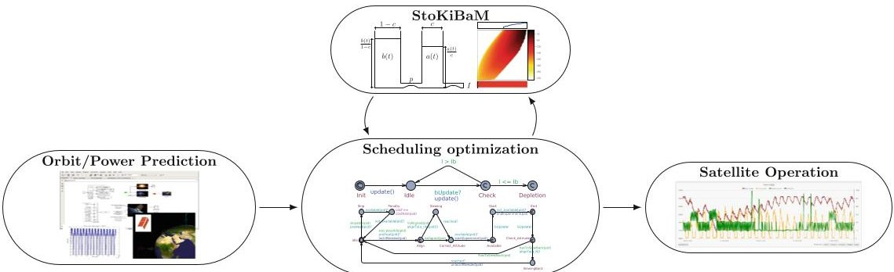

Fig. 5. Scheduling workflow.

<!-- PDF_PAGE: 12 -->

The following heuristics are specific to objectives expressed by the engineers.

3. An L-Band job precedes two X-Band jobs. To avoid storage of large amounts of data on the satellite, we bound the ratio of data collection and downlink jobs. A ratio $ \mathrm{r_{X}} / \mathrm{r_{L}} $ can be approximated greedily by adding a global variable r (initially 0) as well as guards to the Job automaton such that X-Band jobs are scheduled only if $ \mathrm{r} \geq \mathrm{r_{L}} $ and L-Band jobs are scheduled only if $ \mathrm{r} < \left( \mathrm{r_{X}}+\mathrm{r_{L}} \right) \cdot \mathrm{r_{X}} $ . Upon scheduling an X-Band and L-Band job, we set $ \mathrm{r}:= \mathrm{r}-\mathrm{r_{L}} $ and $ \mathrm{r}:= \mathrm{r}+\mathrm{r_{X}} $ respectively. With $ \mathrm{r_{X}}:=2 $ and $ \mathrm{r_{y}}:=1 $ schedules never start with an X-Band job and in the long run, the ratio of X-Band and L-Band jobs stays between 1 and 2/1.

4. Keep L-Band jobs in balance across INMARSATS. Similarly to the realization of the above heuristic we bound the difference among L-Band jobs on the relevant INMARSATS to at most 2.

5. Always schedule UHF jobs. Instead of penalizing skipped UHF jobs by annotations of large costs (to enforce their scheduling), we enforce them on the automaton level, omitting any cost annotation.

6. Impose upper bound on discharging loads. This heuristic does what it says.

Especially heuristic 6 proves useful in several ways. First, the KiBaM used in the validation step yields less energy before depletion if subjected to high loads due to the rate-capacity effect (that is not captured by the linear battery model). Second, high loads are reached when UHF jobs are scheduled in addition to an L- or X-Band job. Such situations seem lucrative to UPPAAL CORA, given that they don't accumulate much cost. Yet, they often result in schedules that leave the battery (almost) empty. Third, the bound can be chosen such that parallel experiments, and thus high loads, occurs only during insolation, but not in eclipse.

To give some insight into the effect of each heuristic on the computation with UPPAAL CORA, we provide a comparison by means of an example, reported in the following table. In the example all the above mentioned heuristics were implemented (first row), except for the one mentioned.

<table border="1"><tr><td>Heuristics used</td><td>Total CORA time</td><td>States explored</td><td>Optimal value computed</td></tr><tr><td>All</td><td>2.6</td><td>172452</td><td>262792</td></tr><tr><td>All but 1</td><td>10.2</td><td>700429</td><td>262792</td></tr><tr><td>All but 2</td><td>80.7</td><td>5474775</td><td>262792</td></tr><tr><td>All but 3</td><td>8.9</td><td>592233</td><td>258081</td></tr><tr><td>All but 4</td><td>3.7</td><td>224517</td><td>262792</td></tr><tr><td>All but 5</td><td>2.7</td><td>175191</td><td>262792</td></tr><tr><td>All but 6</td><td>86.1</td><td>6029126</td><td>243269</td></tr></table>

It becomes apparent that heuristic 2 and 6 are the most effective. Most of the combinations studied induce the schedule depicted below, where job windows of

<!-- PDF_PAGE: 13 -->

a certain type, i.e. L-Band on different INMARSATS $ ( L_{1}, L_{2} ) $ , X-Band ( X ) and UHF, are displayed as black (grey) bars if they were indeed taken (skipped).

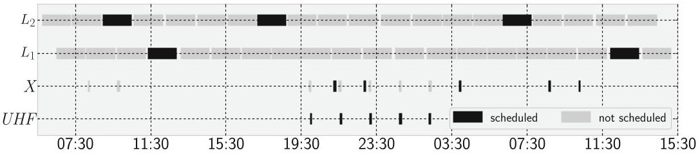

At first sight, dropping heuristics 3 or 6 lead to superior solutions. Without heuristic 3 one more X-Band job can indeed be scheduled, explaining why this schedule is cheaper in terms of accumulated penalty. It is however scheduled before the first L-Band job, rendering it useless because there is nothing to downlink. As expected, without heuristics 6 UPPAAL CORA predominately schedules UHF jobs parallel to X- or L-Band jobs, thereby straining the battery. The large number of states explored indicates that the state space exploration in this case is often misguided into eventual battery depletion.

Dynamic Scheduling. Another issue is that UPPAAL CORA's optimization criterion is static, i.e. the prices cannot be updated based on the schedule generated so far. This is contrasted by the GomSpace engineering intention of having a dynamic scheduling approach. We take care of this by viewing the PTA network as being parameterized, i.e. as templates that need to be instantiated by concrete values. This enables us to divide the scheduling interval into disjoint subintervals that can be scheduled individually, with distinct scheduling objectives and prices, all the while carrying over resulting quantities as initial values to the subsequent subinterval to be scheduled. Important quantities that need to be passed on are the resulting battery state, the number of individual jobs already scheduled and the state of the PTA network at the end of the previous subinterval. This information allows us to adjust the prices and scheduling objective at the end of each subinterval, depending on the requirements previously fixed. The subschedules are then conjoined to a schedule for the actual time interval. This line of action is a trade-off between optimality and being dynamic, as it implements a greedy heuristics.

Given the back-to-back nature of this approach, it is undesired to start with an almost empty battery after a scheduling interval. We require the battery to have a certain minimum charge at the end of the schedule. This requirement translates directly to a reachability query on the PTA network: $ \exists \diamond (\mathbf{n}=2 0 \land 1 \geq 7 5 0 0 0 0 00) $ , where 1 is the global variable representing the battery SoC.

## 4.2 Schedule Validation

As mentioned, UPPAAL CORA's expressiveness does not allow for direct modelling of the KiBaM as a PTA. Instead the schedule computed is based on the

<!-- PDF_PAGE: 14 -->

simple linear model, that is known to not capture important effects that can be observed from measurements of real batteries. In order to validate whether the computed schedule truly doesn't violate the constraints we imposed, we need to validate the schedule along the above mentioned stochastic KiBaM with capacity limits. In fact, such a schedule can be seen as a sequence of tasks $ ( T_{j}, I_{j} ) $ which we can immediately be used as input to the method to bound the cumulative risk of premature battery depletion of the computed schedule. The initial KiBaM SoC distribution is assumed to be a truncated 2D Gaussian around the initial battery state given to the PTA network and white noise is added to the loads of the tasks. If the validation step exhibits a low enough depletion risk, the computed schedule is accepted, otherwise the schedule is excluded and another schedule is computed.

## 4.3 Schedule Shipping

In order to uplink a schedule to GOMX-3, several comma separated files (.csv) are generated. Each file contains a list of job opportunities of a certain type, for example L-Band (see below), given by two timestamps representing the start time and the end time of the job window respectively, the implied duration of the timestamps, as well as a flag that shows whether the opportunity should be taken. One such file could be read as follows:

<table border="1"><tr><td>Access</td><td>Start time(UTCG)</td><td>Stop time(UTCG)</td><td>Duration(sec)</td><td>Scheduled</td></tr><tr><td>1</td><td>17 Nov 2015 00:38:38.922</td><td>17 Nov 2015 01:09:42.642</td><td>1863.720</td><td>1</td></tr><tr><td>2</td><td>17 Nov 2015 02:16:24.134</td><td>17 Nov 2015 02:45:23.914</td><td>1739.781</td><td>0</td></tr><tr><td>$\vdots$</td><td>$\vdots$</td><td>$\vdots$</td><td>$\vdots$</td><td>$\vdots$</td></tr><tr><td>15</td><td>17 Nov 2015 23:41:20.490</td><td>18 Nov 2015 00:12:38.983</td><td>1878.493</td><td>0</td></tr></table>

## 5 Results

A number of successful experiments have been carried out on GOMX-3 in-orbit, so as to evaluate and refine our method, focussing on the determination of schedules to be followed for the days ahead. These in-orbit evaluations have successfully demonstrated the principal feasibility and adequacy of the approach, as we will discuss in this section.

In Figs. 6, 7 and 8 three representative in-orbit experiments are summarized. The schedules are visualised as three stacked plots of data against a common time line (left). The bottom ones are Gantt charts showing which jobs are scheduled (black bars) and which job windows are skipped (grey bars) respectively. The plots in the middle display the loads imposed by the jobs as predicted (purple) and as actually measured (green) on GomX-3. The top plots presents the

<!-- PDF_PAGE: 15 -->

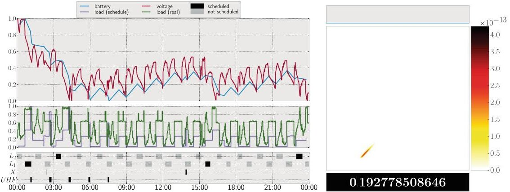

Fig. 6. Schedule November 17, 2015 midnight to November 18, 2015 midnight. (Color figure online)

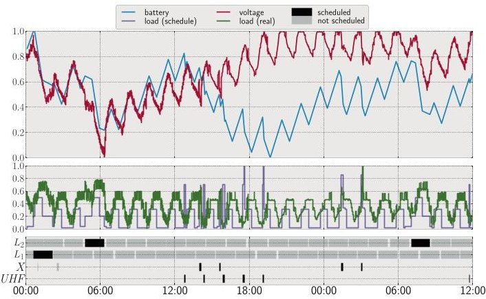

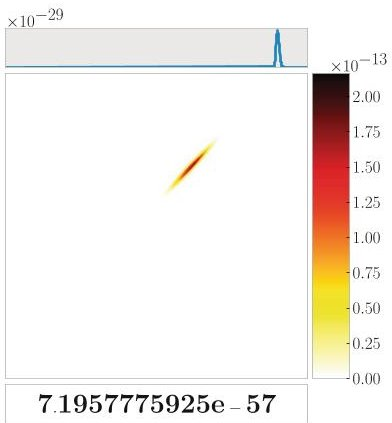

Fig. 7. Schedule February 14, 2016 midnight to February 15, 2016 noon. (Color figure online)

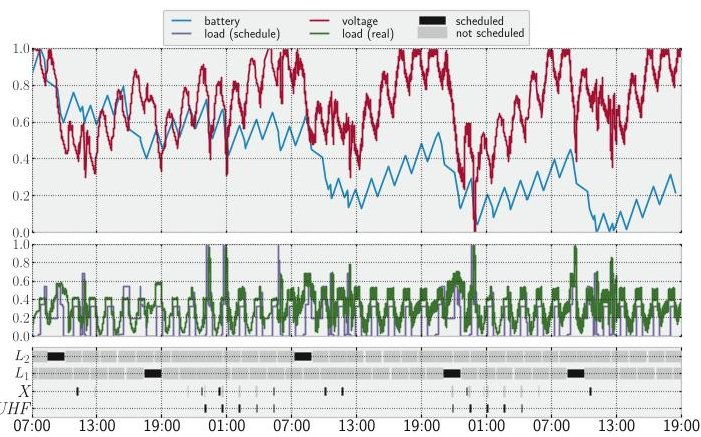

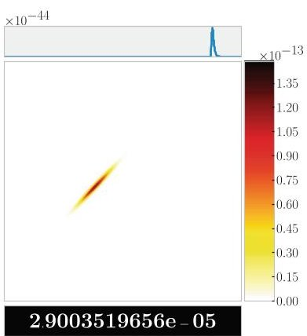

Fig. 8. Schedule March 20, 2016 7 AM to March 22, 2016 7 PM. (Color figure online)

<!-- PDF_PAGE: 16 -->

battery SoC of the linear battery (blue) as predicted by Uppaal Cora as well as the actual voltage (red) logged by GOMX-3. Voltage and SoC are generally not comparable. However, both quantities exhibit similar tendencies during the (dis)charging process. The battery, voltage and load curves have all been normalized to the interval [0,1] for comparison reasons.

On the right, the three components of the SoC density resulting from the validation step are displayed, obtained by running the generated schedule along the stochastic KiBaM with capacity limits. It is to be interpreted as in Fig. 3. The most crucial part is at the bottom of the plot, quantifying the risk of entering Safe Mode as specified by the GomSpace engineers (40%)

The data is summarized in the following table, that reports on the value chosen as internal depletion threshold to the battery automaton, the initial SoC provided to UPPAAL CORA, the minimal SoC along the schedule generated by UPPAAL CORA, the depletion risk as calculated by the stochastic KiBaM validation step and how often GOMX-3 actually entered Safe Mode.

<table border="1"><tr><td>Experimentdd.mm.yyhh:mm</td><td>Duration(h)</td><td>InitialSoC(%)</td><td>Depletion threshold(%)</td><td>Min.SoC(%)</td><td>Depletion risk(%)</td><td>Safe mode entered(nr.)</td></tr><tr><td>17.11.1500:00</td><td>24</td><td>85</td><td>40</td><td>40.3</td><td>20</td><td>2</td></tr><tr><td>14.02.1600:00</td><td>36</td><td>90</td><td>55</td><td>69</td><td>&lt;10^{-50}$</td><td>0</td></tr><tr><td>20.03.1607:00</td><td>60</td><td>90</td><td>55</td><td>55.9</td><td>&lt;10^{-2}$</td><td>0</td></tr></table>

November 2015. The schedule presented in Fig. 6 spans November 17, 2015. It is a schedule that optimizes for maximum L-Band payload operations, yielding 4 L-Band operations and 1 X-Band operation together with the 5 UHF groundstation passes. The battery SoC and the measured battery voltage show a close correspondence. GomSpace reported that GomX-3 entered Safe Mode twice, if only for a short period of time.

February 2016. Figure 7 presents a schedule spanning one and a half day, starting on February 14, 2016. It illustrates how optimized scheduling can be utilized to not only take power limitations into consideration but also handle secondary constraints like data generation and data downlinking balance via L-Band and X-Band tasks. There is a noticeable difference in the length of L-Band job windows, relative to the earlier experiment reported, as a consequence of experiences gained by the engineers in the meanwhile. The initial SoC and the internal depletion threshold were communicated to us as 90% and 55% The plot exhibits a drift between battery SoC and measured voltage around 3 PM of the first day, after initially showing a close correspondence, indicating that the battery is in a better state relative to our pessimistic predictions. The GomSpace engineers were able to track down this drift to a mismatch in the net power balance computed as input to the toolchain.

<!-- PDF_PAGE: 17 -->

March 2016. The third schedule we present (Fig. 8) is the longest in duration, spanning from March 20 at 7 AM to March 22 at 7 PM. After initial close correspondence of SoC and voltage, around 18 h into the test run we observe a slight but continuous drift between predicted battery SoC and measured voltage, yet not as steep as in the February test run.

## 6 Discussion and Conclusion

This paper has presented a battery aware scheduling approach for low-earth orbiting nano satellites. The heterogeneous timing aspects and the experimental nature of this application domain pose great challenges, making it impossible to use traditional scheduling approaches for periodic tasks. Our approach harvests work on schedulability analysis with (priced) timed automata. It is distinguished by the following features: (i) The TA modelling approach is very flexible, adaptive to changing requirements, and particularly well-suited for discussion with space engineers, since easy-to-grasp. (ii) A dynamic approach to the use of cost decorations and constraints allows for a splitted scheduling approach optimising over intervals, at the (acceptable) price of potential sub-optimality of the resulting overall schedules. (iii) A linear battery model is employed while scheduling, but prior to shipping any computed schedule is subjected to a quantitative validation on the vastly more accurate Stochastic KiBaM, and possibly rejected. This last aspect is very close in spirit to the approach developed in [9], where a simulation-based analysis of computed schedules is used to validate or refute CORA schedules, under a model with stochastic breakdowns and repairs of production machinery. The stochastic KiBaM validation step is not based on simulation, but exact (or conservative) up to discretisation.

The GOMX-3 in-orbit experiments have demonstrated an indeed great fit between the technology developed and the needs of the LEO satellite sector. The schedules generated are of unmatched quality: It became apparent that relative to a comparative manual scheduling approach, better quality schedules with respect to (i) number of experiments performed, (ii) avoidance of planning mistakes, (iii) scheduling workload, and (iv) battery depletion risk are provided. At the same time, the availability of scheduling tool support flexibilises the satellite design process considerably, since it allows the GomSpace engineers to obtain answers to what-if questions, in combination with their in-house POWERSim tool. This helps shortening development times and thus time-to-orbit.

State of the art technology and very rapid development cycles will continue to be a crucial part of the nanosatellite market. They are the roots of a steady stream of novel scientific challenges. In fact, GomSpace will launch a 2 spacecraft constellation (GomX-4 A and B) in 2017 and is actively pursuing several projects with much larger constellations. Deploying constellations of a large number of satellites (2 to 1000) brings a new level of complexity to the game, which in turn asks for a higher level of automation to be used than has previously been the case in the space industry. The technology investigated here is beneficial in terms of optimization and planning of satellite operations, so as to allow for more

<!-- PDF_PAGE: 18 -->

efficient utilization of spacecraft flight time. A spacecraft operator is faced with a highly complex task when having to plan and command in-orbit operations constantly balancing power and data budgets. This leads to the fact that for larger constellations tools for optimization, automation and validation are not only a benefit, but an absolutely necessity for proper operations.

Acknowledgements. This work has received support from the EU 7th Framework Programme project 318490 (SENSATION), by the European Space Agency under contract number RFP/NC/IPL-PTE/GLC/as/881.2014, by the ERC Advanced Investigators Grant 695614 (POWVER), and by the CDZ project 1023 (CAP). We are grateful to Boudewijn Haverkort and Marijn Jongerden (both from Universiteit Twente), Kim Larsen, Marius Mikuconis, Erik Ramsgaard Wognsen (all from Aalborg University), and all further participants of SENSATION as well as experts at GomSpace for very fruitful discussion and support.

## References

1. UPPAAL CORA (2005). http://people.cs.aau.dk/~adavid/cora/introduction.html

2. Alur, R., Dill, D.L.: A theory of timed automata. Theor. Comput. Sci. 126, 183- 235 (1994)

3. Behrmann, G., Fehnker, A., Hune, T., Larsen, K., Pettersson, P., Romijn, J., Vaandrager, F.: Minimum-cost reachability for priced time automata. In: Benedetto, M.D., Sangiovanni-Vincentelli, A. (eds.) HSCC 2001. LNCS, vol. 2034, pp. 147-161. Springer, Heidelberg (2001). doi:10.1007/3-540-45351-2_15

4. Behrmann, G., Larsen, K.G., Rasmussen, J.I.: Optimal scheduling using priced timed automata. ACM SIGMETRICS Perform. Eval. Rev. 32(4), 34-40 (2005)

5. Hermanns, H., Krčal, J., Nies, G.: Recharging probably keeps batteries alive. In: Berger, C., Mousavi, M.R. (eds.) CyPhy 2015. LNCS, vol. 9361, pp. 83-98. Springer, Heidelberg (2015). doi:10.1007/978-3-319-25141-7_7

6. Jongerden, M.R., Haverkort, B.R.: Which battery model to use? IET Softw. 3(6), 445-457 (2009). http://dx.doi.org/10.1049/iet-sen.2009.0001

7. Jongerden, M.R.: Model-based energy analysis of battery powered systems. Ph.D. thesis, Enschede. http://doc.utwente.nl/75079/

8. Larsen, K., Behrmann, G., Brinksma, E., Fehnker, A., Hune, T., Pettersson, P., Romijn, J.: As cheap as possible: efficient cost-optimal reachability for priced timed automata. In: Berry, G., Comon, H., Finkel, A. (eds.) CAV 2001. LNCS, vol. 2102, pp. 493-505. Springer, Heidelberg (2001). doi:10.1007/3-540-44585-4_47

9. Mader, A., Bohnenkamp, H., Usenko, Y.S., Jansen, D.N., Hurink, J., Hermanns, H.: Synthesis and stochastic assessment of cost-optimal schedules. Int. J. Softw. Tools Technol. Transf. 12(5), 305-318 (2010)

10. Manwell, J.F., McGowan, J.G.: Lead acid battery storage model for hybrid energy systems. Solar Energy 50(5), 399-405 (1993)