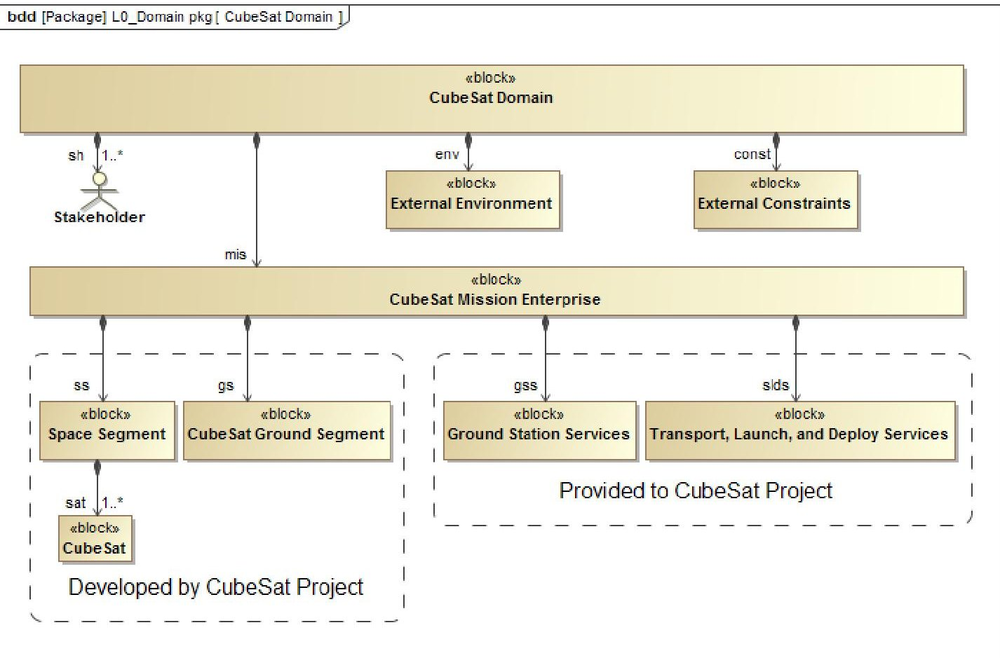
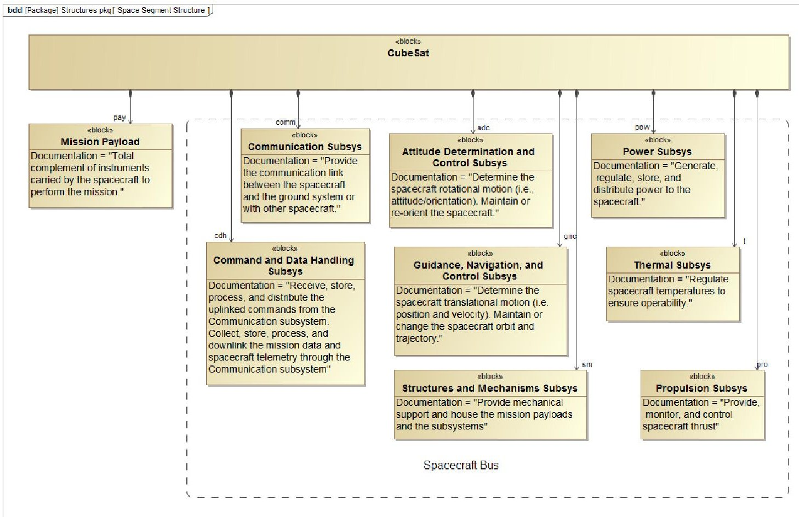
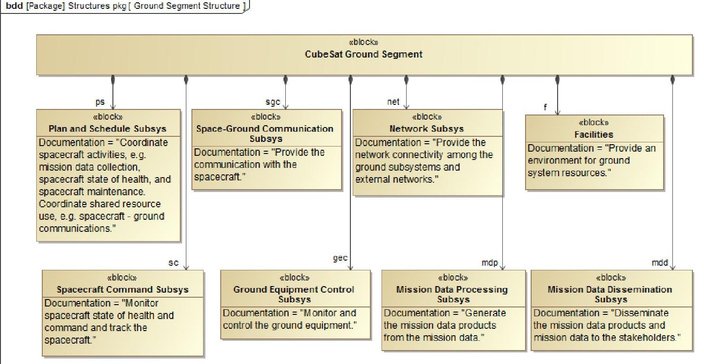
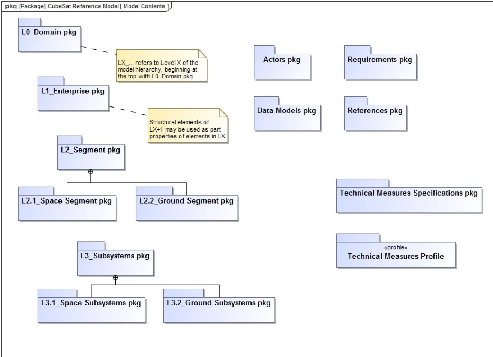
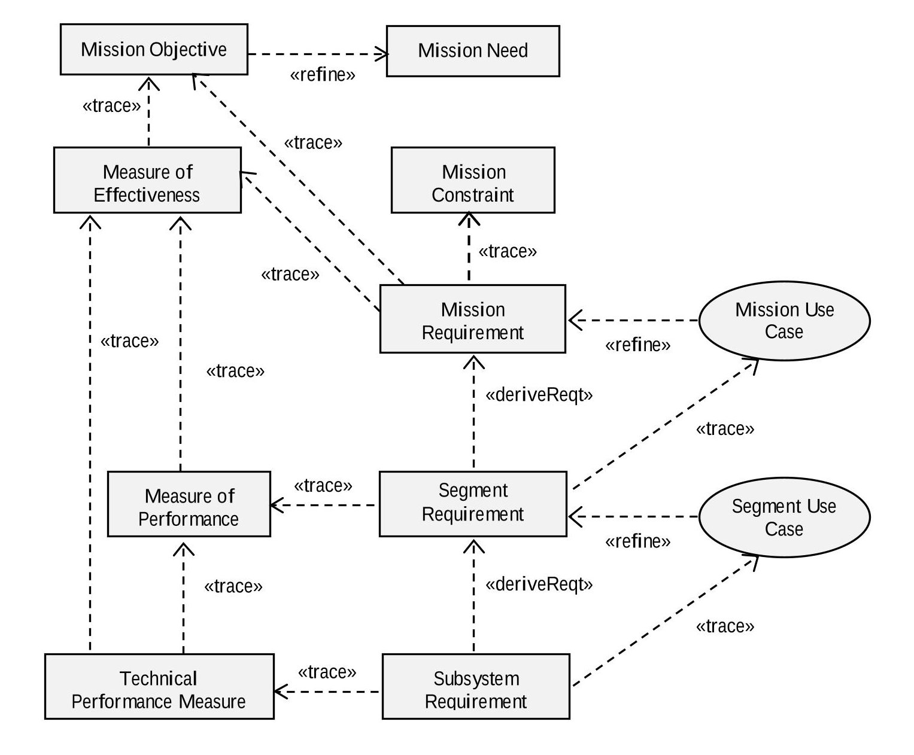
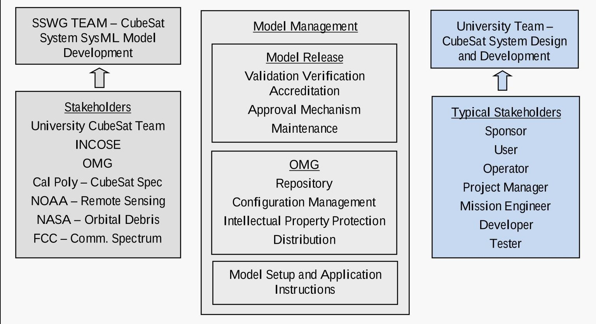
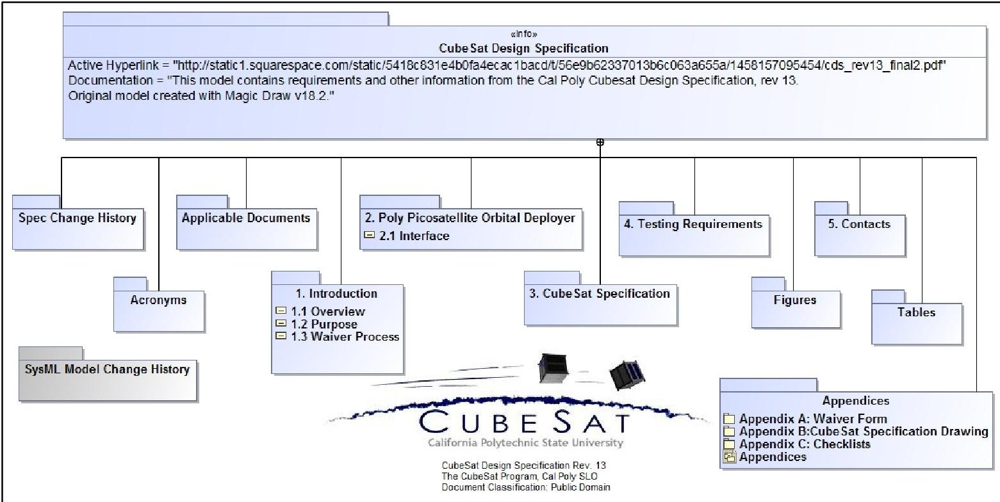
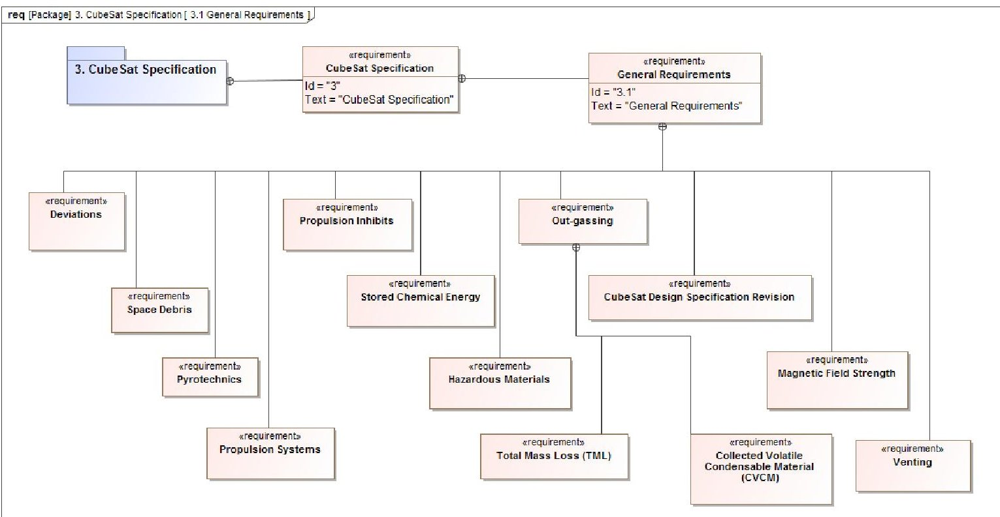
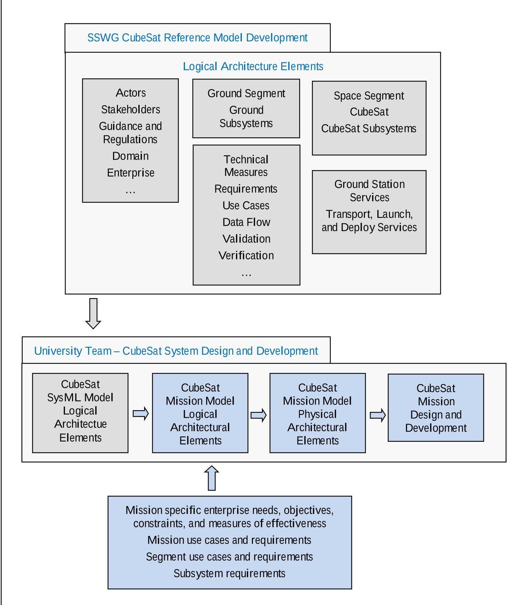

<!-- PDF_PAGE: 1 -->

# CubeSat Model-Based System Engineering (MBSE) Reference Model-Development and Distribution Interim Status

David Kaslow $ ^{1} $ Consultant, Berwyn, PA 19312 USA

Bradley J. Ayres $ ^{2} $ The Aerospace Corporation, Wright Patterson AFB, OH 45433 USA

Laura Hart The MITRE Corporation McLean,VA 22102 USA

Philip T Cahill Consultant, Bryn Mawr PA 19010 USA

Curtis Iwata $ ^{3} $ Affiliate of The Aerospace Corporation, El Segundo, CA 90245 USA

Michael Jesse Chonoles Chonoles Consulting Malvern, PA 19355 USA

Alejandro G. Levi

USAF Space and Missile

Center, El Segundo, CA

90245 USA

Rose Yntema InterCAX, Alanta, GA 30308 USA

Model-Based Systems Engineering (MBSE) is a key practice to advance systems engineering that can benefit CubeSat missions. MBSE involves creating a system model that is a single source for systems engineering such as architecture development and interface management. The system model can also integrate other discipline specific engineering models and simulations. Our application of MBSE uses Systems Modeling Language (SysML), which is a graphical modeling language, to model all aspects of a system either directly or through an interface with another model. SysML diagrams are used to describe requirements, structures, behaviors, and parametrics from the system down to the component level.

The model is intended for use by aerospace students in their classroom or by a team building a mission-specific CubeSat. The model is being developed by the Space Systems Working Group (SSWG) of the International Council on Systems Engineering (INCOSE). This paper provides an overview of the model development, architecture, and application; and it outlines the current direction of the SSWG.

## I. Introduction

A CubeSat, a type of nanosatellite, is a low-cost standardized satellite with its origin in the CubeSat Project which was established in 1999 by California Polytechnic State University (Cal Poly), San Luis Obispo and Stanford University's Space and Systems Development Laboratory (SSDL). The CubeSat Project was established to enable the university community to design, build, and launch satellites using primarily off-the-shelf components. More recently, the global space community has adopted the CubeSat form-factor as a means of performing scientific missions, conducting technology demonstrations, and providing commercial remote sensing services at significantly reduced cost.

The basic CubeSat unit is 10x10x10 centimeters with a mass of about 1.3 kilograms, and this cubic unit is referred to as 1U. CubeSat units can be joined to form a larger satellite, and one-, two-, and three-unit (1U, 2U, and 3U) CubeSats have been the most common configurations so far. They are typically launched as secondary payloads or deployed from the International Space Station.

<!-- PDF_PAGE: 2 -->

Model-Based Systems Engineering (MBSE) is a key practice to advance the systems engineering discipline, and the International Council on Systems Engineering (INCOSE) established the MBSE Initiative to promote, advance, and institutionalize the practice of MBSE. As part of this effort, the INCOSE Space Systems Working Group (SSWG) Challenge Team has been investigating the applicability of MBSE for designing CubeSats since 2011.

The SSWG team is made up of academics including students and professors, professional practitioners including engineers and software developers from NASA centers and industry, and representatives from commercial software tool vendors. The team meets weekly via teleconferencing, and the standing meeting is on Friday at 1 P.M. U.S.A. Eastern Standard Time. Meeting materials and links to meeting recordings are in Google Docs. Conference papers are posted on the INCOSE SSWG website.

The goals of the MBSE Challenge Project are the following:

- Demonstrate Model-Based Systems Engineering (MBSE) methodology as applied to a CubeSat mission.

- Provide a CubeSat Reference Model (CRM) that CubeSat teams can use as starting point for their mission-specific CubeSat model.

Previously, the SSWG demonstrated the ability to model behaviors, interface with commercial off-the-shelf (COTS) simulation tools, and carry out trade studies. Currently, the team is building a reference model for CubeSats to be used by aerospace students in their classroom or by a team building a mission-specific CubeSat.

At the top of the CRM is the CubeSat Domain consisting of the Stakeholders, CubeSat Mission Enterprise, External Environment, and External Constraints. The CubeSat Mission Enterprise consists of the Space and Ground Segments, which are further decomposed into their subsystems.

The enterprise architecture accommodates an external service providing CubeSat transportation to a launch site, integration into a launch vehicle, launch, and deployment. It also accommodates a CubeSat project developing its own ground station or operating with an existing ground station that provides uplink and downlink services.

In describing the CRM development effort, there are two main contexts. The first is the development of the CRM by SSWG, and this paper will primarily be narrated from this perspective. The other is the user's context who will start with the CRM and refine it to aid in their CubeSat project. Each has a different set of goals and stakeholders, which is discussed in the Stakeholders section.

## II. Project Phases

There have been four phases to the SSWG Challenge Project. The first phase of SSWG CubeSat project created a CRM that was applied to the Radio Aurora Explorer (RAX), a 3U CubeSat developed by SRI International and the Michigan Exploration Laboratory at the University of Michigan. $ ^{1} $ The RAX mission was to study the formation of magnetic field-aligned electron density irregularities in the Earth's ionosphere, which are known to disrupt tracking and communication between Earth and orbiting satellites. The SysML model for the RAX CubeSat demonstrated the basic implementation and utility of MBSE for this type of space mission.

The second phase focused on expanding the RAX CubeSat model to include modeling behaviors and interfacing with several COTS simulation tools. $ ^{2} $ Modeling of the communication downlink supported trades of data download rate, available power, and signal to noise ratio. System power modeling included the orbit as well as opportunities to collect energy, collect mission data, and downlink data.

The third phase included incorporating additional design and operational characteristics into the RAX model. $ ^{3} $ The following two trade studies were demonstrated: 1) On-board energy level as a function of solar panel area and maximum battery capacity, and 2) quantity of data downloaded as function of orbital altitude and ground station network.

The fourth and current phase is focused on developing a CRM. $ ^{4,5} $

## III. CubeSat Reference Model Development

The CRM is intended to be used by university project teams designing space missions utilizing the CubeSat form-factor. The model is being developed under the assumption that the members of the team have an intermediate-level understanding of space mission analysis and design, Model-Based Systems Engineering (MBSE), and Systems Modeling Language (SysML) and that they are working with subject matter experts who are guiding them through this effort.

MBSE is the formalized application of modeling to support key systems engineering tasks for addressing requirements, design, analysis, validation, and verification. SSWG's application of MBSE is enabled by the following: 1) a modeling language - SysML, 2) an engineering methodology, and 3) a modeling tool set from No Magic, Inc.

<!-- PDF_PAGE: 3 -->

SysML, a graphical modeling language, is used to model all aspects of a system either directly or through interfaces with other models. SysML diagrams are used to describe requirements, structures, behaviors, and parametrics from the system down to the component level. Requirements and design are contained and integrated in the model rather than in a series of independent engineering artifacts. This allows for a full exploration of the model with changes automatically propagated and reflected in every view of the model.

SysML can support various systems engineering activities including analyzing stakeholder needs, analyzing system requirements, defining the logical architecture, and synthesizing candidate physical architectures. The logical architecture is a decomposition of the system into logical components that interact to satisfy the system requirements. The logical components are abstractions of the physical components that perform the system functionality without imposing implementation constraints.

The physical architecture defines the physical components that interact with each other, its environment, and its stakeholders to satisfy the system requirements. The physical components of the system include hardware, software, persistent data, and operational procedures.

The CRM provides the logical architecture. The logical elements can be reused as a starting point for a mission-specific CubeSat logical architecture, followed by the physical architecture and the CubeSat development.

The decomposition of the architecture is consistent with engineering methodologies used elsewhere including NASA Systems Engineering Handbook $ ^{6} $ and Space Mission Analysis and Design - The New SMAD. $ ^{7} $ The specific methodology used to create the architecture is not critically important to the development of the reference model. It only matters that the model provides the foundation for a user to create a physical architecture.

## IV. CubeSat Reference Model $ ^{8} $

## A. Domain

Figure 1 shows the CubeSat Domain, which consists of the CubeSat Mission Enterprise, Stakeholders, External Environment, and External Constraints. The External Environment consists of the Space Environment and Earth Environment. The External Constraints include Licenses and Regulations.

## B. CubeSat Mission Enterprise

The CubeSat Mission Enterprise encompasses everything that involves the development, deployment, and operation of the CubeSat mission. The main focus is on the CubeSat Space Segment and CubeSat Ground Segment, which are developed by the CRM users. Additionally, the CRM includes two CubeSat-specific services to aid the modeling effort, which are the Ground Station Services and the Transport, Launch, and Deploy Services.

There are other services that are not specific to a CubeSat project and are not explicitly modeled in the CRM, but if they are important to the mission, they can and should be modeled by the users. For example, if GPS timing and location services are needed for CubeSat mission operations, then the GPS system should be modeled as part of the CubeSat Mission Enterprise, and its timing and position signals would be received and processed by CubeSat subsystems. If the project intends to use relay satellites such as NASA's Tracking and Data Relay Satellite System (TDRSS), then it would also be part of the CubeSat Mission Enterprise, and the Ground and Space Segments planning, scheduling, uplink and down link would be subject to TDRSS availability. Alternatively, if the project develops its own relay satellites, then those satellites would be part of the CubeSat Space Segment. The GPS and TDRSS services are used by other space missions and are not unique to CubeSat projects, and this is why they are not explicitly modeled in the CRM.

## C. Transport, Launch, and Deploy Services

CubeSats are transported to a launch site, integrated into a launch vehicle, launched, and deployed, and there are many options for each step. They can be transported using commercial service providers such as FedEx $ ^{\circledR} $ Space Solutions. There are numerous integration services such as through Spaceflight Industries. Launch gets the CubeSat to orbit, and they are typically secondary payloads on a rocket or manifested as cargo to the International Space Station. Deployment is the step in which the CubeSat separates from the host, becoming a free-flying satellite. There are many deployment mechanisms currently in use, such as the Poly-PicoSatellite Orbital Deployer (P-POD) and the NanoRacks CubeSat Deployer.

If the CubeSat system has its own transport, launch, deployment capabilities, then they would be part of a Launch Segment at the same level as CubeSat Space and Ground Segments. Currently the CubeSat community procures these services through external entities, and this is represented by the Transport, Launch, and Deploy Services block as illustrated in Figure 1. Although a team could find separate service provider for each step, it is common to contract with a full-service provider that handles this phase of the project. Care is needed when

<!-- PDF_PAGE: 4 -->

modeling the interfaces with these services (and probably quite beneficial) because it is most likely that they are unique to each service provider and to each option of each step (i.e., different requirements and constraints of each launch vehicle and CubeSat deployer).

## D. CubeSat Space Segment

The CubeSat Space Segment consists of one or more CubeSats with their orbits and subsystems. The Space Segment includes designs, interfaces, and operations to comply with the requirements and constraints that are imposed by the External Environment and External Constraints, as well as those by other aspects of the mission such as the Transport, Launch, and Deploy Services. For example, a launch has a pressure and vibration profile that constrains the design of the CubeSat, and these requirements and constraints could be incorporated into a Transport, Launch, and Deploy Services model unique to the service providers.

## E. CubeSat Orbits

There are two approaches to specifying and achieving an orbit. CubeSat mission analysis can determine a preferred orbit and a range of satisfactory orbits.

If the CubeSat is launched as a secondary payload, the CubeSat project will need to select a launch opportunity that leaves the CubeSat within the range of satisfactory orbits. If the CubeSat has an orbit adjust capability, it can then be moved from the satisfactory orbit to the preferred orbit. If the CubeSat is a primary payload, it can be launched directly to the preferred orbit.

There are several space-based and ground-based orbit determination techniques. A ground-based technique is to send an uplink ranging signal to the satellites and then to receive back a response signal. The satellite position and velocity can be derived from the ranging signal transmit time and the response signal's Doppler shift. The satellite orbit can then be derived from the position and velocity. A space-based technique is to use a GPS receiver to determine satellite position and velocity.

## F. CubeSat Ground Segment

The CubeSat Ground Segment consists of the CubeSat Mission Operations and one or more Ground Stations. Mission Operations includes the software, data, procedures, and personnel used to operate the CubeSat mission. Mission Operations activities include mission planning and scheduling, command and control of the CubeSat, control of the ground equipment, mission telemetry processing, and mission data processing and distribution. The Ground Station consists of the computers, network, communication equipment, and associated control infrastructure hosted in a ground facility. Communication equipment includes the space-ground antennas.

## G. Ground Station Services

The CubeSat project could develop its own Ground Station or use an existing Ground Station owned by somebody else, which would be Ground Station Services as illustrated in Figure 1. There could be several providers of Ground Station Services with the service capabilities and interfaces unique to each service provider.

## H. CubeSat Subsystems and Ground Subsystems

The logical architectures for the CubeSat and Ground Segment are shown in Figure 2 and Figure 3. The CubeSat Logical Architecture defines the major subsystems that are typically found on a CubeSat. In the CRM, the bus is defined as a collection of subsystems instead of its own block, and it is denoted by a "dashed-boundary" in Figure 2. Likewise, the Ground Segment Logical Architecture is shown in Figure 3, and it defines the major subsystems necessary to perform the typical ground system functions.

## I. Model Organization

Figure 4 shows the CRM's high-level organization. Requirements are organized by Enterprise, Space and Ground Segments, and Space and Ground Subsystems packages. The Enterprise requirements consist of mission needs, objectives, constraints, and requirements with model elements to establish the relationships to the stakeholder needs, objectives, constraints, and measures of effectiveness. Mission requirements are refined by mission use cases.

There are model elements that help define the lower-level requirements as illustrated in Figure 5. Segment requirements are derived from mission requirements and trace to mission use cases. Subsystem requirements are derived from segment requirements and trace to segment use cases. Segment requirements trace to measures of performance which trace to measures of effectiveness. Subsystem requirements trace to technical performance measures which trace to measures of performance and to measures of effectiveness. Additionally, there are model elements in support of requirements validation and verification.

<!-- PDF_PAGE: 5 -->

## V. Stakeholders

A stakeholder is any entity that has an interest in the system. With respect to the CRM, the SSWG team recognizes that there are two sets of stakeholders. The first set is for the CRM itself, and these stakeholders are concerned with the proper development, management, and distribution of the reference model. The second set of stakeholders is for the CubeSat mission and the CRM users, and their concern is mission success. Both sets of these stakeholders are shown in Figure 6.

The stakeholders for the CRM include the following: SSWG, university teams that will be using the model, Cal Poly San Luis Obispo, regulatory agencies (for the U.S. these include Federal Communications Commission (FCC), National Oceanic and Atmospheric Administration (NOAA), and National Aeronautics and Space Administration (NASA)) , INCOSE (since the model development is based on INCOSE's engineering principles including MBSE), and Object Management Group (OMG) (since the model will be an OMG product).

Licenses and regulations that cover CubeSat activities are administered at the national level, and the timelines and procedures for requesting and receiving approval must be well understood and part of the model. For example in the U.S., FCC regulates the radio frequencies and spectrum management; NASA provides orbital debris guidelines; and NOAA regulates remote sensing. Another stakeholder is the Cal Poly CubeSat Project. The Cal Poly CubeSat Specification $ ^{9} $ has been populated into its own SysML model to enable the content of the specification to be related to the CRM as shown in Figure 7 and Figure 8.

The stakeholders for the mission-specific CubeSat model are those with an interest in the mission-specific CubeSat space and ground system. Typical stakeholders identified in the model include sponsor, user, operator, project manager, project engineer, developer, and tester.

## VI. Mission-Specific CubeSat Model

The steps for developing a mission-specific CubeSat model are illustrated in Figure 5 and Figure 9. The first step is taking the CRM and populating the mission-specific enterprise needs, objectives, constraints, and measures of effectiveness to create a mission-specific logical architecture. Mission use cases are created to refine mission requirements which support the measures of effectiveness, objectives, needs, and constraints.

Space and ground segment requirements are derived from mission requirements. Segment use cases are created to refine segment requirements which in turn trace to mission use cases. Segment measures of performance are created in support of the enterprise measures of effectiveness. Segment requirements are created in support of the measures of performance.

Space and ground subsystem requirements are derived from segment requirements and trace to segment use cases. Subsystem technical performance measures are created in support of segment measures of performance and enterprise measures of effectiveness. This results in the mission-specific logical model as illustrated in Figure 9. Although the CRM Space and Ground Subsystems have been broadly defined, the mission teams may find it necessary to modify the subsystem definitions according to the allocated requirements.

The next step is to create the physical architecture from the logical architecture, and this is accomplished by determining the types of subsystem components that meet the functional and performance subsystem requirements. Physical components include the specific hardware, software, persistent data, and operational procedures. The final step in Figure 9 is to complete the CubeSat Mission Design and to develop the CubeSat Space and Ground Segments.

<!-- PDF_PAGE: 6 -->

Figure 1. CubeSat Domain and Mission Enterprise

Figure 2. CubeSat Logical Architecture

American Institute of Aeronautics and Astronautics

<!-- PDF_PAGE: 7 -->

Figure 3. CubeSat Ground Segment Logical Architecture

American Institute of Aeronautics and Astronautics

<!-- PDF_PAGE: 8 -->

Figure 5. Hierarchy of Mission Needs, Objectives, and Constraints; Technical Measures, Requirements, and Use Cases.

<!-- PDF_PAGE: 9 -->

Figure 6. Two Teams - Two Groups of Stakeholders

Figure 7. Cal Poly Design Spec Model Organization

<!-- PDF_PAGE: 10 -->

Figure 8. Cal Poly Design Spec Model - Example of Requirements Modeling

<!-- PDF_PAGE: 11 -->

Figure 9. CubeSat Reference Model Provides the Foundation for the CubeSat Mission Specific Model

<!-- PDF_PAGE: 12 -->

## VII. Next Steps

SSWG's effort to date has been focused on establishing standard nomenclature and definitions; incorporating the stakeholders and their needs, objectives, and measures of effectiveness; and defining the generic CubeSat architecture down to the logical subsystem level.

Near term plans include creating use cases to further define the subsystem capabilities. Examples of use cases include mission data collection, mission data distribution, and spacecraft state-of-health. Additionally, the model will be evaluated for usability by a few university teams.

The OMG process will be initiated for the model to be proposed as an OMG specification/standard. Acceptance means that OMG membership considers the model to be a viable CubeSat Reference Model.

## VIII. Conclusion

After several phases of learning and applying MBSE to the CubeSat design process, the SSWG Challenge Team is now focused on developing the CubeSat Reference Model, which is a SysML model that will serve as a framework for future CubeSat developers. MBSE holds the promise of reducing the burden of systems engineering tasks, which is beneficial to small CubeSat teams, and a properly designed reference model can serve as a checklist to these teams and promote uniformity and consistency across future CubeSat models.

## References

$ ^{1} $ S. Spangelo, D. Kaslow, C. Delp, B. Cole, L. Anderson, E. Fosse, B. Gilbert, L. Hartman, T. Kahn, and J. Cutler, "Applying Model Based Systems Engineering (MBSE) to a Standard CubeSat," in Proceedings of IEEE Aerospace Conference, Big Sky, MT, March 2012

$ ^{2} $ S. Spangelo, L. Anderson, E. Fosse, L Cheng, R. Yntema, M. Bajaj, C. Delp, B. Cole, G. Soremekun, D. Kaslow, and J. Cutler, "Model Based Systems Engineering (MBSE) Applied to Radio Explorer (RAX) CubeSat Mission Operational Scenarios," Proceedings of IEEE Aerospace Conference, Big Sky, MT, March 2013.

$ ^{3} $D. Kaslow, G. Soremekun, H. Kim, S. Spangelo, "Integrated Model-Based Systems Engineering (MBSE) Applied to the Simulation of a CubeSat Mission", Proceedings of IEEE Aerospace Conference, Big Sky, MT, March 2014.

$ ^{4} $D. Kaslow, L. Anderson, S. Asundi, B. Ayres, C. Iwata, B. Shiotani, R. Thompson, "Developing a CubeSat Model-Based System Engineering (MBSE) Reference Model - Interim Status", Proceedings of IEEE Aerospace Conference, Big Sky, MT, March 2015.

$ ^{5} $D. Kaslow, L. Anderson, S. Asundi. B. Ayres, C. Iwata, B. Shiotani, R. Thompson, "Developing and Distributing a CubeSat Model-Based System Engineering (MBSE) Reference Model ", Proceedings of the 31st Space Symposium, Colorado Springs, CO, April 2015.

$ ^{6} $NASA Systems Engineering Handbook, rev. 1, December 2007, NASA/SP-2007-6105 Rev1.

$ ^{7} $ J.R. Wertz, D. Everett, and J. Puschell, Eds., Space Mission Engineering: The New SMAD, (Space Technology. Library, Volume 28), Hawthorne, CA, Microcosm Press, 2011.

$ ^{8} $ D. Kaslow, B. Ayres, M. Chonoles, S. Gasster, L. Hart, A. Levi, C. Massa, R. Yntema B. Shiotani, "Developing and Distributing a CubeSat Model-Based System Engineering (MBSE) Reference Model - Status", Proceedings of the 32st Space Symposium, Colorado Springs, CO, April 2016.

$ ^{9} $CubeSat Design Specification, rev. 13, The CubeSat Program, Cal Poly SLO, February 2014