<!-- PDF_PAGE: 1 -->

# Developing a CubeSat Model-Based System Engineering (MBSE) Reference Model - Interim Status #2

David Kaslow Consultant

1497 Canterbury Lane

Berwyn, PA 19312

610-405-6685

david.kaslow@gmail.com

Laura Hart

Lockheed Martin Space

System Company

230 Mall Blvd, Bldg 100

King of Prussia, PA 19406

610-354-6529

laura.e.hart@lmco.com

Bradley Ayres The Aerospace Corp. 2310 E. El Segundo Blvd. El Segundo, CA 90245 937-255-3355 x3422 bradley ayres.etr@ofit.edu

Chris Massa Draper Laboratory 555 Technology Square Cambridge, MA 02139 617-258-1000 cmassa@draper.com

Michael Jesse Chonoles

Chonoles Consulting

105 Spring Road

Malvern, PA 19355

michael@

chonolesconsulting.com

Rose Yntema

InterCAX

75 5th Street NW

Suite 312

Atlanta GA 30308

404-592-6897 x101

rose.yntema@intercax.com

Dr. Samuel D. Gasster

1014 Maroney Ln

Pacific Palisades, CA

90272

310-459-1670

sgasster@aol.com

Bungo Shiotani University of Florida 939 Sweetwater Drive Gainesville, FL 32611 352-846-3020 bshiota@ufl.edu

Abstract-Model-Based Systems Engineering (MBSE) is a key practice to advance the systems engineering discipline. The International Council on Systems Engineering (INCOSE) established the MBSE Initiative to promote, advance, and institutionalize the practice of MBSE. As part of this effort, the INCOSE Space Systems Working Group (SSWG) Challenge Team has been investigating the applicability of MBSE for designing CubeSats since 2011. The goal of the team is to provide a sufficiently complete CubeSat Reference Model that can be adapted to any CubeSat project.

The INCOSE Systems Engineering Vision 2020 defines MBSE as "the formalized application of modeling to support system requirements, design, analysis, verification and validation activities beginning in the conceptual design phase and continuing throughout development and later life cycle phases."

At the core of MBSE is the development of the system model that helps integrate other discipline-specific engineering models and simulations. The team has been creating this system model by capturing all aspects of a CubeSat project using the Systems Modeling Language (SysML), which is a graphical modeling language for systems engineering. SysML diagrams are used to describe requirements, structures, behaviors, and parametrics from the system level down to the component level. Requirements and design are contained in the model rather than in a series of independent engineering artifacts.

In the past three phases of the project, the team has created the initial iteration of the reference model, applied it to the Radio Aurora Explorer (RAX) mission, executed simulations of system behaviors, interfaced with commercial simulation tools, and demonstrated how behaviors and constraint equations can be executed to perform operational trade studies.

The modeling effort starts anew in this fourth phase.

The CubeSat Reference Model starts with an identification of potential stakeholders. A stakeholder is any entity that has an interest in the system including sponsor, end user, procurer, supplier, and regulatory agencies. The each stakeholder's needs, objectives, constraints, and measures of effectiveness are

978-1-4673-7676-1/16/$31.00 ©2016 IEEE

incorporated in the model. Constraints are those items fixed and not subject to trades such as mission budget and schedule.

One of the stakeholders is the Cal Poly CubeSat project. The Cal Poly CubeSat Specification has been populated into its own SysML model to enable the content of the specification to be related to the CubeSat Reference Model.

The CubeSat mission enterprise consists of the space system, ground system, launch services, launch vehicle interface system, and communication services.

Since the reference model is being developed by a team effort, there is an obligation to protect the investment of time and knowledge of each team member. There also needs to be a licensing environment that is conducive to a user organization supporting the development of and use of the model. There will be a license that allows for non-commercial use and prohibits incorporating the model or model features into a commercial product.

## TABLE OF CONTENTS

1. INTRODUCTION ...1

2. BACKGROUND ...2

3. RECENT PHASES...5

4. CURRENT PHASE...5

5. CONCLUSION...11

6. NEXT STEPS ...11

REFERENCES ...15

BIOGRAPHY ...15

## 1. INTRODUCTION

A CubeSat, a type of nanosatellite, is a low-cost, standardized satellite with its origin in the CubeSat Project established in 1999 by California Polytechnic State University (Cal Poly), San Luis Obispo and Stanford University's Space Systems Development Laboratory (SSDL). The CubeSat Project was established to enable the university community to design, build, and launch satellites using primarily off-the-shelf components. More recently,

<!-- PDF_PAGE: 2 -->

the worldwide community has adopted the CubeSat standard as a means of performing scientific, surveillance, and technology demonstration missions at significantly reduced cost.

The basic CubeSat unit is 10x10x10 centimeters with a mass of about 1.3 kilograms, and this cubic unit is referred to as 1U. CubeSat units can be joined to form a larger satellite.

The cheaper cost and shorter life cycle has lowered the barrier to entry for many organizations, and consequently, most groups that develop CubeSats are doing it for the first time. They do not necessarily have the experience or discipline to manage their projects with proper systems engineering, and even if they do, the role is not a full-time position due to the smaller budgets of CubeSat missions. To aid these efforts, the International Council on Systems Engineering (INCOSE) Space System Working Group (SSWG) organized the Model-Based Systems Engineering (MBSE) Challenge Project Team to create the CubeSat Reference Model to serve as a guide and tool.

The goals of the MBSE Challenge Project are the following:

- Provide a CubeSat Reference Model that CubeSat teams can use as starting point for their mission-specific CubeSat model. This has an additional goal of demonstrating the application of the model in assessing measures of performance in the concept life cycle phase.

- Demonstrate MBSE methodology as applied to a CubeSat mission. This has an additional goal of demonstrating Object-Oriented Systems Engineering Method (OOSEM) as applied to a CubeSat mission.

## 2. BACKGROUND

This project has its genesis in the INCOSE MBSE Initiative and the INCOSE SSWG MBSE Challenge Project as shown in Figure 1. In 2007, INCOSE established the System Engineering Vision 2020 [1], the MBSE Initiative [2], and the MBSE Roadmap [3]. The Roadmap is shown in Figure 2. Vision 2020 included demonstrating the application of MBSE paired with Systems Modeling Language (SysML) to several engineering disciplines including space systems.

The SSWG team is made up of academics (aerospace students and professors), professional practitioners including engineers and software developers from NASA centers and industry, and representatives from commercial software tool vendors. The team meets weekly via teleconferencing, and the standing meeting is on Friday at 1 P.M. U.S.A. east coast time. Meeting materials and links to meeting recordings are in Google Docs. Conference papers are posted on the INCOSE SSWG website http://www.incose.org/ChaptersGroups/WorkingGroups/government/space-systems.

## Traditional Systems Engineering

Traditional systems engineering has been document-centric. Documents are used to record, store, and convey system and subsystem specification including requirements, concepts of operations, and interfaces. This approach results in creating, updating, reviewing, and managing the configuration of separate documents. Models are created and used on an asneeded basis, most of the time to analyze different aspects of system performance in support of generating requirements.

## Model-Based Systems Engineering

MBSE is the formalized application of modeling to support system requirements, design, analysis, verification, and validation activities beginning in the conceptual design phase and continuing throughout development and later life cycle phases. Reference [4] has an overview of traditional systems engineering versus MBSE. Figure 3 illustrates that MBSE consists of:

- A modeling language

- An engineering methodology

- System modeling tools

- Interfaces with other models

## Systems Modeling Language

The project's application of MBSE uses the Systems Modeling Language (SysML) and graphical modeling tools from No Magic $ ^{\circ} $ . SysML is based on Unified Modeling Language (UML), a product of the Object Management Group (OMG) [5]. SysML is structured to contain all the design information. Reference [6] has an overview of SysML elements and diagrams.

As shown in Figure 4, the SysML model contains various elements such as blocks, actors, flows, signals, and ports. Structure, behavior, requirement, and parametric diagrams provide views into the model. The model is the single, authoritative, integrated repository of information. Changes to the model are automatically populated into the system views.

A block is the fundamental SysML modeling element. A block can define a type of logical or conceptual entity; a physical entity; a hardware, software, or data component; a person; a facility; an entity that flows through the system; or an entity in the natural environment. The block features used to define a block include structural features, behavioral features, and constraints.

<!-- PDF_PAGE: 3 -->

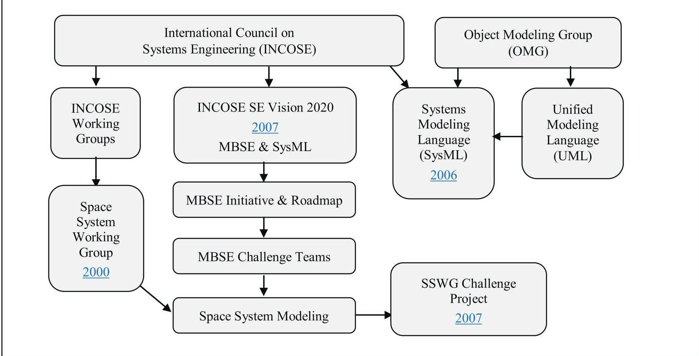

Figure 1. Context of the INCOSE MBSE Initiative and SSWG Challenge Project.

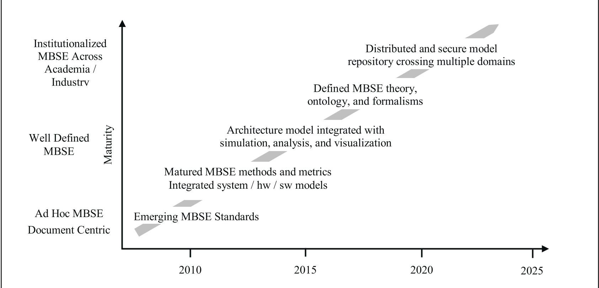

Figure 2. Model-Based Systems Engineering Roadmap. Adapted from [3]

<!-- PDF_PAGE: 4 -->

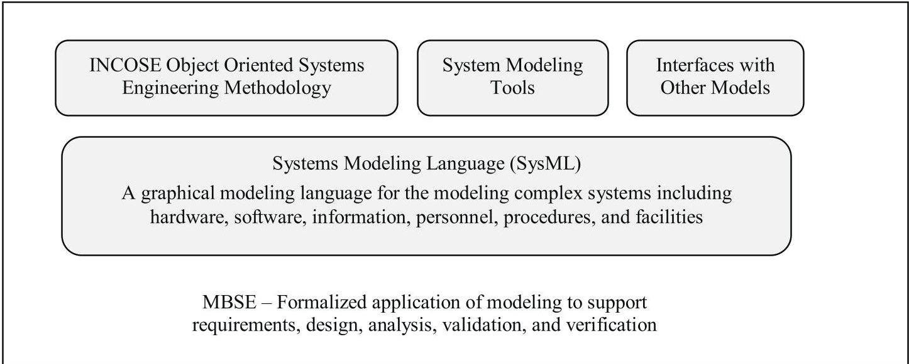

Figure 3- Model-Based Systems Engineering Components

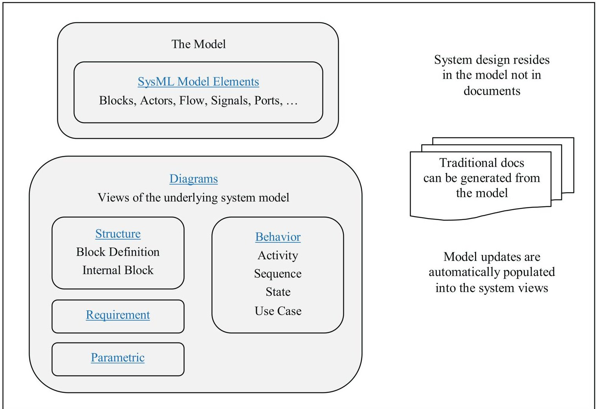

Figure 4. SysML Model Elements and Views into the Model

<!-- PDF_PAGE: 5 -->

## Object-Oriented Systems Engineering Method

SysML is modeling language and not a system engineering methodology. The team is using the Object-Oriented Systems Engineering Method (OOSEM) [7] as presented in the INCOSE Systems Engineering Handbook [8] and the Practical Guide to SysML [9].

OOSEM includes analyzing stakeholder needs, analyzing system requirements, defining the logical architecture, and synthesizing candidate physical architectures. The logical architecture is a decomposition of the system into logical components that interact to satisfy the system requirements. The logical components are abstractions of the physical components that perform the system functionality without imposing implementation constraints.

The CubeSat Reference Model will provide the logical architecture. It will have all the logical model elements for population by a mission specific CubeSat team.

## 3. RECENT PHASES

The physical architecture defines the physical components that interact to satisfy the system requirements. The physical components of the system include hardware, software, persistent data, and operational procedures.

As shown in Figure 5, there have been four phases to the SSWG Challenge Project. Reference [6] has an overview of phases 1, 2, and 3.

The first phase of SSWG CubeSat project created a CubeSat Reference Model that was applied to the Radio Aurora Explorer (RAX), a 3U CubeSat developed by SRI International and the Michigan Exploration Laboratory at the University of Michigan [10].

The second phase focused on expanding the RAX CubeSat model to include modeling behaviors and interfacing with several Commercial Off-the-Shelf (COTS) simulation tools [11]. Communication downlink modeling supported trades of data download rate, available power, and signal to noise ratio. System power modeling included the orbit as well as opportunities to collect energy, collect mission data, and downlink data.

The third phase was comprised of two activities. The first was the development of a CubeSat Enterprise Model to capture cost and product life cycle aspects for the mission spacecraft and problem domain [12]. The second activity incorporated additional design and operational characteristics into the RAX model [6]. The following two trade studies were demonstrated: 1) on-board energy level as a function of solar panel area and maximum battery capacity and 2) quantity of data downloaded as a function of orbital altitude and ground station network.

## 4. CURRENT PHASE

The fourth and current phase is focused on developing a CubeSat Reference Model [4,13,17]. Figure 6 illustrates the development approach that is described in [4] and replicated below.

The architecture of the CubeSat Reference Model is founded on MBSE and OOSEM. The decomposition of the architecture is consistent with engineering methodologies used elsewhere including NASA Systems Engineering Handbook [14] and Space Mission Analysis and Design The New SMAD. [15]

The specific methodology used to create the architecture is not critically important to the development of the reference model. It only matters that the model provides the foundation for a user to create a physical architecture.

## Stakeholders

The CubeSat Reference Model starts with an identification of potential stakeholders. A stakeholder is any entity that has an interest in the system.

Figures 7 and 8 show the stakeholder identification and descriptions as populated in the CubeSat Reference Model.

Each stakeholder's needs, objectives, constraints, and measures of effectiveness are incorporated in the reference model. Constraints are those items fixed and not subject to trades such as mission budget and schedule. Identification of the stakeholders is important and should be done at the start of a project. Reference [13] has additional details on stakeholder terminology.

- Federal Communications Commission (FCC) regulates the radio frequencies

- Particular attention must be paid to the regulatory agencies. CubeSat projects are pursued internationally, but the licenses and regulations that cover its activities are administered at the national level. For example in the United States:

- National Aeronautics and Space Administration (NASA) provides orbital debris guidelines through the Orbital Debris Assessment Report

- National Oceanic and Atmospheric Administration (NOAA) regulates remote sensing

The timelines for requesting and receiving approval must be well understood at project start.

Additionally, a SysML model of the CubeSat Design Specification is being created [16]. This model will provide the foundation for specifying a CubeSat's physical, mechanical, electrical, testing, and operational requirements. Figures 9 and 10 are an overview of the Cal Poly model and the general requirements including the textual description.

<!-- PDF_PAGE: 6 -->

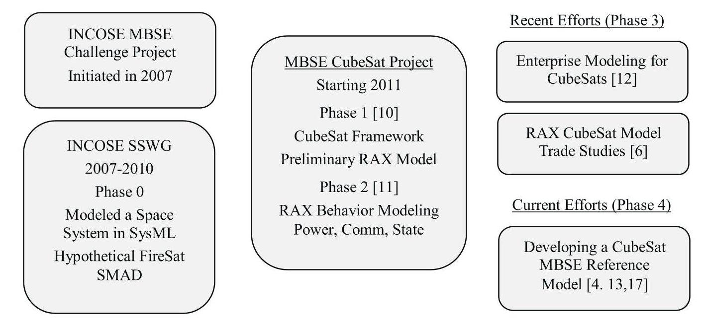

Figure 5-SSWG MBSE Challenge Project Phases

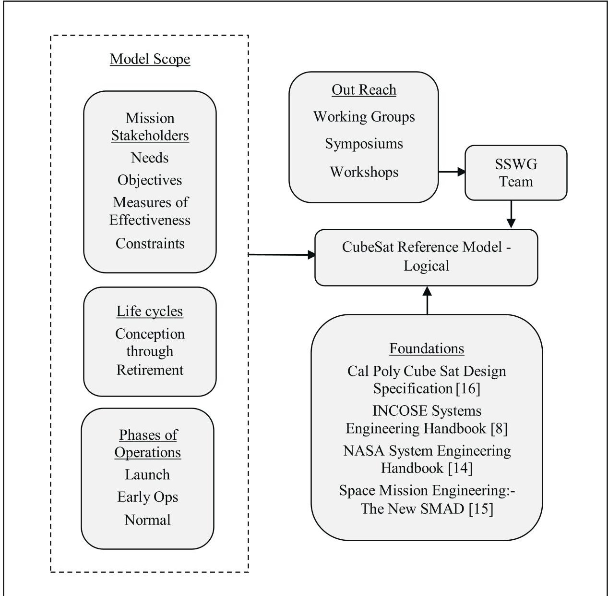

Figure 6 - Development of the CubeSat Reference Model

<!-- PDF_PAGE: 7 -->

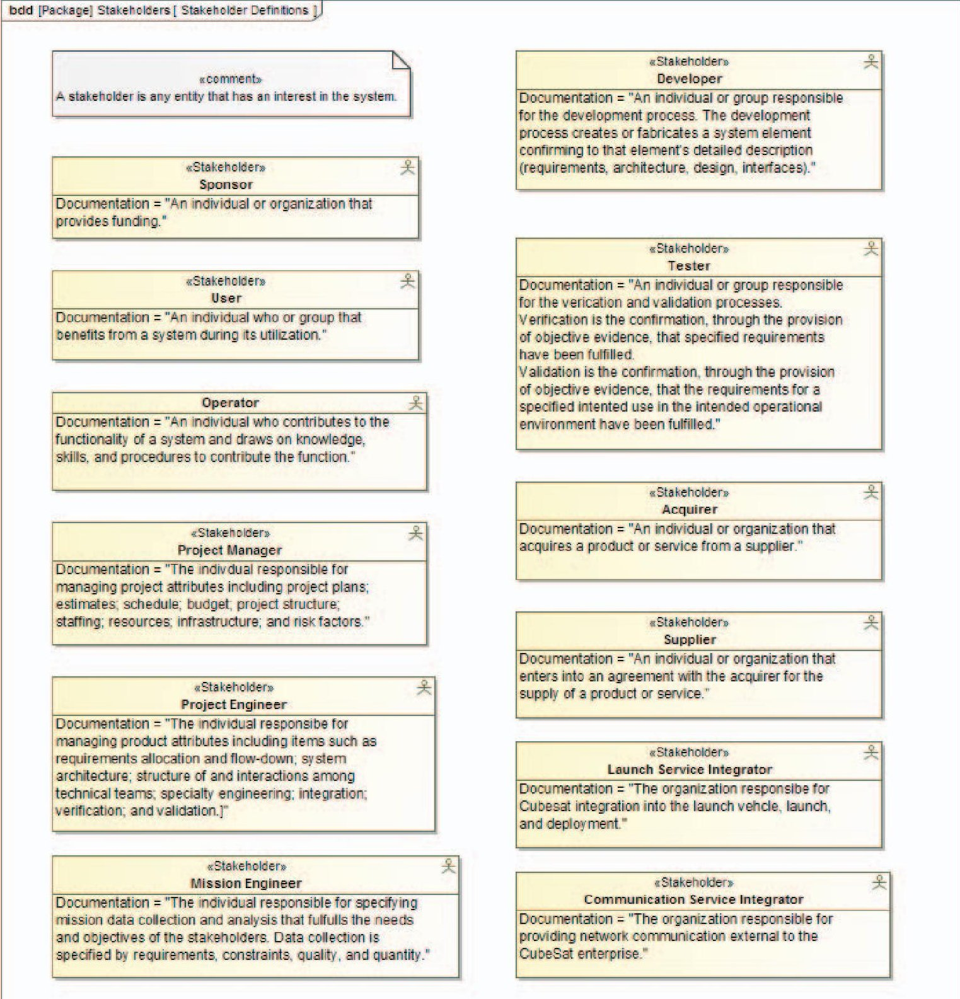

Figure 7. Individual Stakeholders

<!-- PDF_PAGE: 8 -->

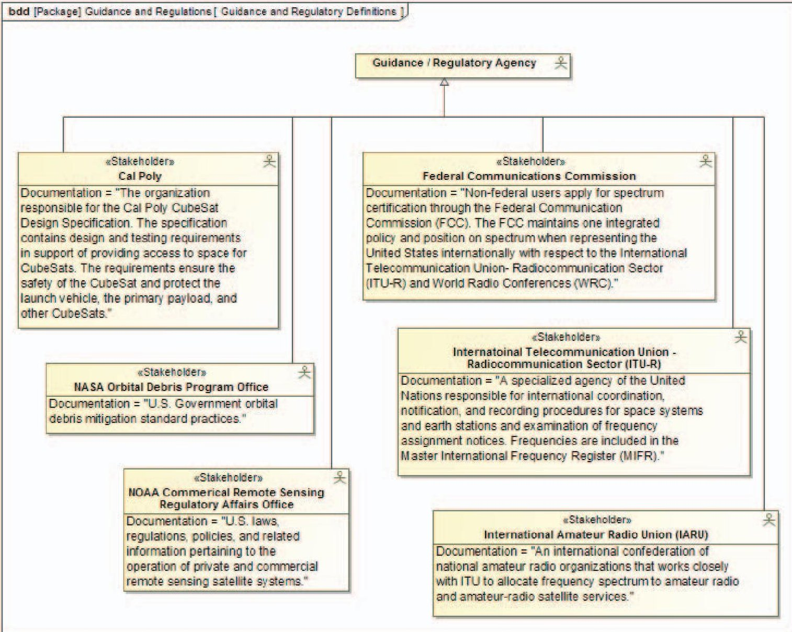

Figure 8. Regulatory Agencies Stakeholders

<!-- PDF_PAGE: 9 -->

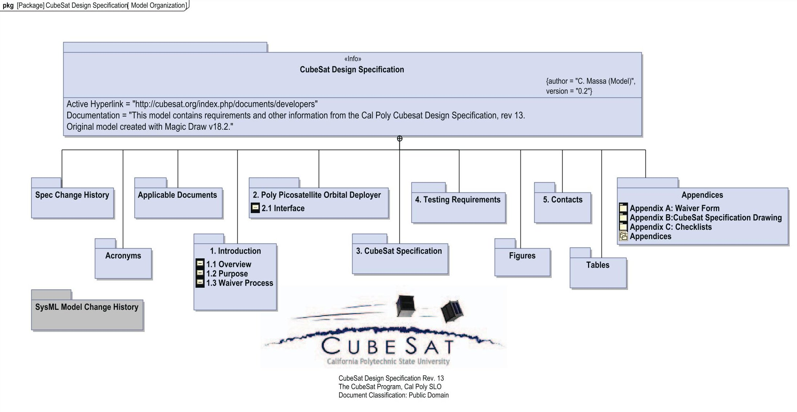

Figure 9. CubeSat Design Specification - SysML Model

<!-- PDF_PAGE: 10 -->

<table border="1"><tr><td>#</td><td>Id</td><td>Name</td><td>Text</td><td>Refined By</td></tr><tr><td>1</td><td>3</td><td>CubeSat Specification</td><td>CubeSat Specification</td><td></td></tr><tr><td>2</td><td>3.1</td><td>General Requirements</td><td>General Requirements</td><td></td></tr><tr><td>3</td><td>3.1.1</td><td>Deviations</td><td>CubeSats which incorporate any deviation from the CDS will submit a DAR and adhere to the waiver process(see Section 1.3 and Appendix A).</td><td>Appendix A Waiver Form Page 1
Appendix A Waiver Form Page 2
Deviation Waiver Approval Request
Example Waiver Request
1.3 Waiver Process: DocSection</td></tr><tr><td>4</td><td>3.1.2</td><td>Space Debris</td><td>All parts shall remain attached to the CubeSats during launch, ejection and operation. No additional space debris will be created.</td><td></td></tr><tr><td>5</td><td>3.1.3</td><td>Pyrotechnics</td><td>No pyrotechnics shall be permitted.</td><td></td></tr><tr><td>6</td><td>3.1.4</td><td>Propulsion Systems</td><td>Any propulsion systems shall be designed, integrated, and tested in accordance with AFSPCMAN 91-710 Volume 3.</td><td></td></tr><tr><td>7</td><td>3.1.5</td><td>Propulsion Inhibits</td><td>Propulsion systems shall have at least 3 inhibits to activation.</td><td></td></tr><tr><td>8</td><td>3.1.6</td><td>Stored Chemical Energy</td><td>Total stored chemical energy will not exceed 100 Watt-Hours. 3.1.6.1 Note: Higher capacities may be permitted, but could potentially limit launch opportunities.</td><td></td></tr><tr><td>9</td><td>3.1.7</td><td>Hazardous Materials</td><td>CubeSat hazardous materials shall conform to AFSPCMAN 91-710, Volume 3.</td><td></td></tr><tr><td>10</td><td>3.1.8</td><td>Out-gassing</td><td>CubeSat materials shall satisfy the following low out-gassing criterion to prevent contamination of other spacecraft during integration, testing, and launch. A list of NASA approved low out-gassing materials can be found at: http://outgassing.nasa.gov</td><td></td></tr><tr><td>11</td><td>3.1.8.1</td><td>Total Mass Loss(TML)</td><td>CubeSats materials shall have a Total Mass Loss(TML)&lt;1.0%</td><td></td></tr><tr><td>12</td><td>3.1.8.2</td><td>Collected Volatile Condensable</td><td>CubeSat materials shall have a Collected Volatile Condensable Material(CVCM)&lt;0.1%</td><td></td></tr><tr><td>13</td><td>3.1.9</td><td>CubeSat Design Specification</td><td>The latest revision of the CubeSat Design Specification will be the official version which all CubeSat developers will adhere to.The latest revision is available at http://www.cubesat.org.3.1.9.1 Note:Cal Polywill send updates to the CubeSat mailing list upon any changes to the specification.You can sign-up for the CubeSat mailing list here:www.cubesat.org/index.php/about-us/how-to-join</td><td></td></tr><tr><td>14</td><td>3.1.10</td><td>Magnetic Field Strength</td><td>Some launch vehicles hold requirements on magnetic field strength.Additionally, strong magnets can interfere with the separation between CubeSat spacecraft in the same P-POD.As a general guideline, it is advised to limit magnetic field outside the CubeSat static envelope to 0.5 Gauss above Earth&#x27;s magnetic field.</td><td></td></tr><tr><td>15</td><td>3.1.11</td><td>Venting</td><td>The CubeSat shall be designed to accommodate ascent venting per ventable volume/area&lt;2000 inches.</td><td></td></tr></table>

Figure 10. CubeSat Design Specification - General Requirements - SysML Model

<!-- PDF_PAGE: 11 -->

## Logical Architecture

The purpose of the CubeSat Reference Model is to provide a logical architecture, which serves as a guide and provides the building blocks for any CubeSat mission. The goal is to provide an object-oriented architecture framework so that teams can easily compose their CubeSat system and mission from the elements and objects found in the reference model.

Figure 11 illustrates that the CubeSat mission enterprise consists of launch services, launch vehicle interface system communication services, space system, and ground system,

Figures 12 and 13 show the breakdown of logical subsystems after partitioning both the space and ground systems. Some may sound like physical subsystems because the two have a one-to-one correspondence. Starting with this list, teams may add or remove subsystems based on the mission requirements and objectives. Reference [13] provides an overview of subsystem components.

## Model Use and Distribution

Figure 14 shows the context of the reference model with respect to the mission-specific CubeSat model.

- Representative stakeholder needs, objectives, measures of effectiveness, and constraints

- The SSWG team is developing a model distribution process to share with external entities, and this is illustrated in Figure 15 and [4]. The minimum level of model structure to be incorporated in the reference model before it will be distributed outside of the SSWG includes the following:

- Properties and parametrics at subsystem level for power and weight

- Data and information flow for plans, schedules, commands, telemetry, and mission data

Since the reference model is being developed by the SSWG team effort, there is an obligation to protect the investment of time and knowledge of each team member. There also needs to be a licensing environment that is conducive to a user organization supporting the development of and use of the model.

## Concept Life Cycle Trade Studies

The CubeSat Reference Model provides the basis for concept life cycle trade studies as described in [17] and summarized below.

A user can populate a mission-specific model with the concept life cycle stakeholders and stakeholder needs, objectives, constraints, and measures of effectiveness (MOEs). One stakeholder's MOEs may be in conflict with another stakeholder's MOEs. These conflicting MOEs are included in the trade space.

MOEs are decomposed into measures of performances (MOPs) and technical performance measures (TPMs). There may be different ways to decompose the MOEs, but these different decompositions are included in the trade space.

The model element parameters that drive the measures (i.e., MOE, MOP, and TPM) and the model parameters that quantify the measures are identified. Then the trades can be carried out.

## 5. CONCLUSION

After several phases of learning and applying MBSE to the CubeSat design process, the SSWG Challenge Team is now focused on developing the CubeSat Reference Model, which is a SysML model that will serve as a framework for future CubeSat developers. MBSE holds the promise of reducing the burden of systems engineering tasks, which is beneficial to small CubeSat teams, and a properly designed reference model can serve as a checklist to these teams and promote uniformity and consistency across future CubeSat models. Several avenues of distribution along with licensing and copyright options are being considered.

## 6. NEXT STEPS

The effort to date has been focused on establishing standard nomenclature and definitions; incorporating the stakeholders and their needs, objectives, and measures of effectiveness; and defining the generic CubeSat architecture down to the logical subsystems. The next step is to create an example mission-specific model and to validate the MOEs and MOPs.

<!-- PDF_PAGE: 12 -->

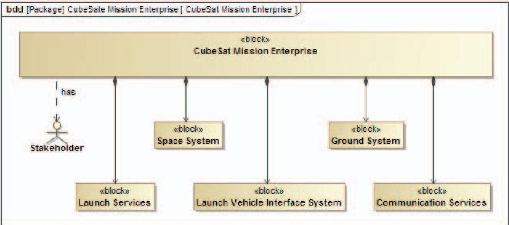

Figure 11. CubeSat Mission

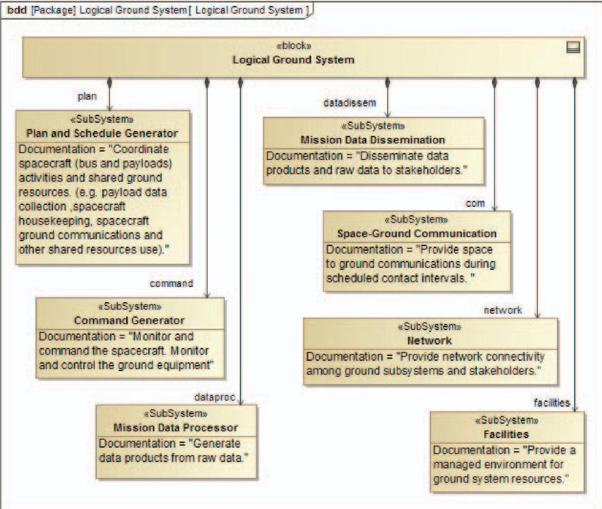

Figure 12. Ground System - Logical Architecture

<!-- PDF_PAGE: 13 -->

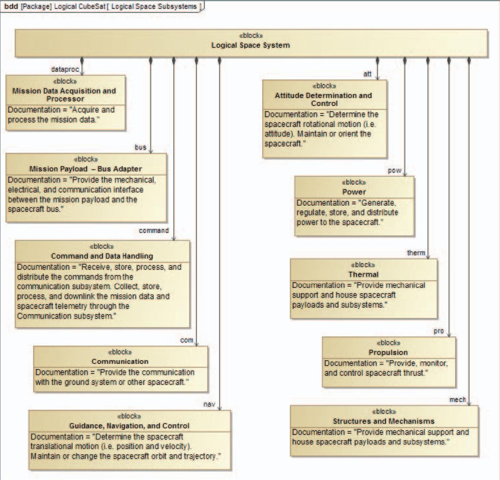

Figure 13. Space System - Logical Architecture

<!-- PDF_PAGE: 14 -->

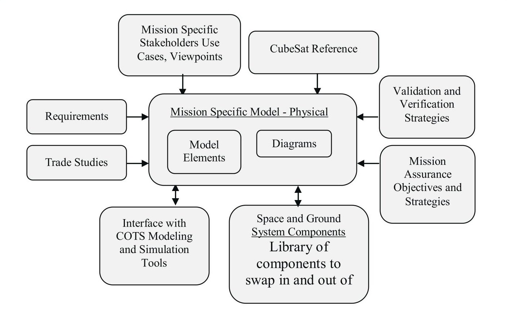

Figure 14 - Development of a Mission Specific CubeSat Model

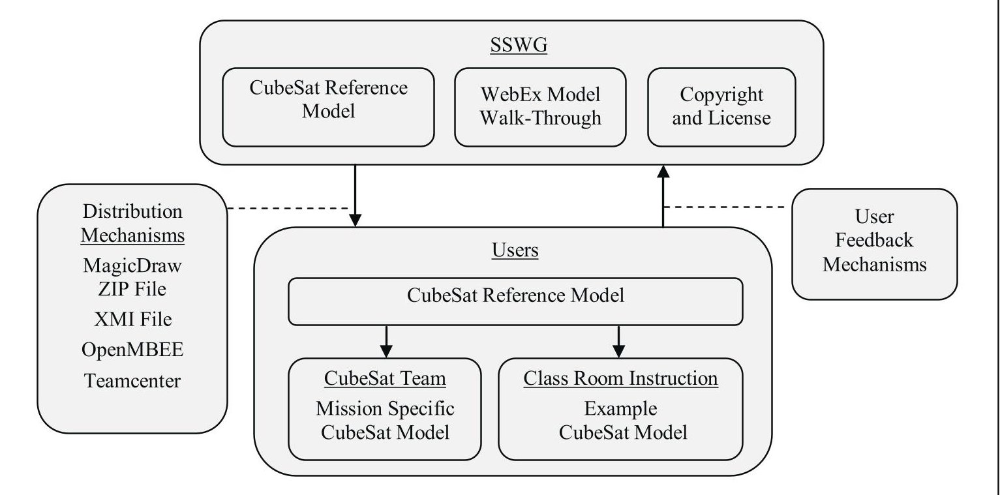

Figure 15 - Distribution and Use of the CubeSat Reference Model

<!-- PDF_PAGE: 15 -->

## REFERENCES

[1] Systems Engineering Vision 2020, INCOSE-TP-2004 004-02, ver. 2.03, September 2007. [Online]. Available: http://oldsite.incose.org/ProductsPubs/pdf/SEVision2020_2007 1003_v2_03.pdf

[2] International Council on Systems Engineering (INCOSE), "MBSE Initiative," January 2007. [Online] Available: http://www.omgwiki.org/MBSE/doku.php

[3] MBSE Roadmap. MBSE Wiki, INCOSE MBSE IW 2012. MBSE Wiki. [Online] Available: http://www.omgwiki.org/MBSE/lib/exe/fetch.php?media=mbse :mbse_iw_2012-introduction-2012-01-21-friedenthal-c.pptx

[4] D. Kaslow, L. Anderson, S. Asundi. B. Ayres, C. Iwata, B. Shiotani, R. Thompson, "Developing and Distributing a CubeSat Model-Based System Engineering (MBSE) Reference Model", Proceedings of the 31st Space Symposium, Colorado Springs, CO, April 2015.

[5] Object Management Group (OMG), OMG Website. [Online]. Available: http://www.omgsysml.org/

[6] D. Kaslow, G. Soremekun, H. Kim, S. Spangelo, "Integrated Model-Based Systems Engineering (MBSE) Applied to the Simulation of a CubeSat Mission", Proceedings of IEEE Aerospace Conference, Big Sky, MT, March 2014.

[7] Object Management Group (OMG), OMG Wiki. [Online]. Available: http://www.omgwiki.org/MBSE/doku.php?id=mbse:incoseoose m

[8] INCOSE Systems Engineering Handbook, Fourth edition, INCOSE-TP-2003-002-04 2015, John Wiley & Sons, Hoboken, NJ

[9] S. Friedenthal, A. Moore, R. Steiner, A Practical Guide to SysML, Third edition., Elsevier, Waltham, MA.

[10] S. Spangelo, D. Kaslow, C. Delp, B. Cole, L. Anderson, E. Fosse, B. Gilbert, L. Hartman, T. Kahn, and J. Cutler, "Applying Model-Based Systems Engineering (MBSE) to a Standard CubeSat," in Proceedings of IEEE Aerospace Conference, Big Sky, MT, March 2012.

[11] S. Spangelo, L. Anderson, E. Fosse, L Cheng, R. Yntema, M. Bajaj, C. Delp, B. Cole, G. Soremekun, D. Kaslow, and J. Cutler, "Model-Based Systems Engineering (MBSE) Applied to Radio Explorer (RAX) CubeSat Mission Operational Scenarios," Proceedings of IEEE Aerospace Conference, Big Sky, MT, March 2013.

[12] L. Anderson, B. Cole, R. Yntema, M. Bajaj, S. Spangelo, D. Kaslow, C. Lowe, E. Sudano, M. Boghosian, R. Reil, S. Asundi, and S. Friedenthal, "Enterprise Modeling for CubeSats," Proceedings of IEEE Aerospace Conference, Big Sky, MT, March 2014.

[13] D. Kaslow, L. Anderson, S. Asundi, B. Ayres, C. Iwata, B. Shiotani, R. Thompson, "Developing a CubeSat Model-Based System Engineering (MBSE) Reference Model - Interim Status", Proceedings of IEEE Aerospace Conference, Big Sky, MT, March 2015.

[14] A Systems Engineering Handbook, rev. 1, December 2007, NASA/SP-2007-6105 Rev1.

[15] J.R. Wertz, D. Everett, and J. Puschell, Eds., Space Mission Engineering: The New SMAD, (Space Technology. Library, Volume 28), Hawthorne, CA, Microcosm Press, 2011.

[16] CubeSat Design Specification, rev. 13, The CubeSat Program, Cal Poly SLO, February 2014

[17] D. Kaslow, B. Ayres, C. Iwata, and B. Shiotani, "CubeSat Model-Based Systems Engineering (MBSE) Reference Model - Application in the Concept Life Cycle", Proceedings of AIAA Space Forum, Pasadena, CA, August 2015.

## BIOGRAPHY

David Kaslow has thirty-four years of experience at Lockheed Martin in both the technical and management aspects of developing ground mission capabilities. He has five years of experience at Analytical Graphics creating their Standard Object Catalog and pursuing Model-

Based Systems Engineering. Dave is a co-author of four chapters Cost-Effective Space Mission Operations. He is also the author and co-author of papers and presentation for INCOSE Annual International Symposiums and Workshops, the IEEE Aerospace Conference, the Small Satellite Workshop and the NDIA Systems Engineering Conference. Dave is the lead for the INCOSE Space Systems Working Group. He has participated in the Space Systems MBSE Challenge Team since its founding in 2007 and is a principal contributor to the CubeSat Challenge Team.

Bradley Ayres, Ph.D., is an Adjunct Assistant Professor of Systems Engineering, Department of Aeronautics and Astronautics at the Air Force Institute of Technology. He serves as the Aerospace Corporation Chair supporting AFIT and the Center for Space Research and Assurance. He received his

Ph.D. in Business Administration specializing in MIS from Florida State University in 2003. Dr. Ayres has degrees from University of Missouri (BS, Chemical Engineering), Webster University (M.A., Procurement and Acquisition Management) and AFIT (M.S., Software

<!-- PDF_PAGE: 16 -->

Systems Management). Dr. Ayres' research interests include management of complex systems, model-based systems engineering, and space systems engineering. His is a member of the PMI, INCOSE and AIAA.

Michael is a prominent expert in UML and SysML, with years of experience as a teacher, course developer, and consultant for leading corporations and projects. Michael has an MS in systems engineering from Penn, and undergraduate degrees in math and physics from MIT. He recently retired from

Lockheed Martin, where he directed internal standards and consulted across several large projects. Before that, as Chief of Methodology of Lockheed's Advanced Concept Center, he specialized in UML, methodology, use cases, and requirement development. Michael helped write the UML and SysML standards, and several books including UML 2 For Dummies. Recently, he has led the official OMG review team for UML 2.5, co-chaired OMG's Analysis & Design Task Force, and taken a lead role in writing the exams for the latest OMG Certifications for UML and SysML Professionals.

Dr. Samuel Gasster is a systems engineer at TASC/Engility supporting the USAF/SMC. His research interests include model-based systems engineering for space mission applications and advanced concepts for Earth remote sensing. He has worked at The Aerospace Corporation for 25 years supporting a wide range

of defense and civilian programs and agencies, including the USAF, DMSP, NPOESS, NASA, NOAA, DARPA and IARPA. He has received numerous awards for his support to NASA and national security space. He has taught remote sensing and computer science at UCLA Extension and lectured on systems engineering at the California Institute of Technology. Dr. Gasster is a member of INCOSE, a life member of the APS and senior member of the IEEE. He holds a Ph.D. in physics from the University of California, Berkeley and an S.B. in mathematics from MIT.

Laura Hart, is a Systems Engineer Sr Stf at Lockheed Martin Space Systems Company, in King of Prussia PA. She is a Sr. member of the Corporate Engineering and Technology Advanced Practices group responsible for codifying and promoting Model Based System Engineering (MBSE) best practices across the LM Corporation. She has

over twenty years of industry experience covering a wide spectrum of responsibilities including requirements, design, implementation and test in the DoD industry. Laura is an active member of the OMG and

supports both the SysML and UPDM/UAF language specifications.

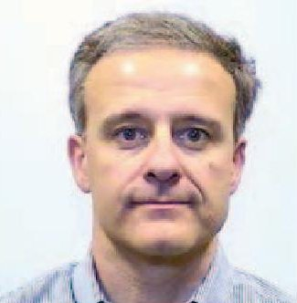

Chris Massa has over 20 years of experience involving spacecraft and launch vehicle systems engineering integration, simulation, and test. He is currently a member of the System Science and Architecture group at Draper Laboratory, working on system

modeling and simulation of missile guidance systems. He is also a member of the INCOSE Space Systems Working Group, and the AIAA Systems Engineering Technical Committee. He holds a B.S. in Aeronautics and Astronautics from M.I.T, and an M.S. in Aeronautics and Astronautics from Stanford University.

Rose Yntema is the Applications Engineer at Intercax (www.intercax.com) where she applies MBSE techniques to complex systems in areas such as aerospace energy, defense, and telecommunications. She is actively involved in the development of software for integrating the total

system model (TSM) federation of models with SysML at its core, including parametric modeling and simulation, as well as quality assurance and technical support. Yntema earned her M.S. (2012) in Electrical and Computer Engineering from the Georgia Institute of Technology, and Sc.B. (2010) in Electrical Engineering from Brown University. She is a member of the INCOSE Space Systems Working Group and has co-authored papers for the IEEE Aerospace Conference in that capacity.

Bungo Shiotani is a Ph.D. student in Aerospace Engineering (AE) at the University of Florida (UF) working on systems engineering aspects for small satellites. Specifically to develop a model-based systems engineering model focusing on mission assurance throughout the project life-cycle. Bungo received two Bachelor of Science degrees, one in

AE from UF and the other in Engineering Physics from Jacksonville University. He also received his Master of Science in AE from UF where his thesis, Reliability Analysis of SwampSat, focused on performing reliability analyses on SwampSat, UF's first CubeSat. His experiences and as the project manager with SwampSat lead to an internship at NESTRA (Japan) where he worked on developing system diagrams and test procedures as well as assembly integration and testing of their three microsatellites that were in development.