<!-- PDF_PAGE: 1 -->

# SYSML BASED CUBESAT MODEL DESIGN AND INTEGRATION WITH THE

HORIZON SIMULATION FRAMEWORK

A Thesis presented to the Faculty of California Polytechnic State University, San Luis Obispo

In Partial Fulfillment of the Requirements for the Degree Master of Science in Aerospace Engineering

by Shaun Terrence Luther June 2016

<!-- PDF_PAGE: 2 -->

© 2016 Shaun Terrence Luther ALL RIGHTS RESERVED

<!-- PDF_PAGE: 3 -->

## COMMITTEE MEMBERSHIP

TITLE: SysML based CubeSat Model Design and Integration with the Horizon Simulation Framework

AUTHOR: Shaun Terrence Luther

DATE SUBMITTED: June 2016

COMMITTEE CHAIR: Dr. Eric Mehiel, Ph.D.

Professor of Aerospace Engineering

COMMITTEE MEMBER: Dr. Jordi Puig-Suari, Ph.D.

Professor of Aerospace Engineering

COMMITTEE MEMBER: Dr. Kira Abercromby, Ph.D.

Associate Professor of Aerospace Engineering

COMMITTEE MEMBER: Dr. Kurt Colvin, Ph.D.

Professor of Industrial and Manufacturing Engineering

<!-- PDF_PAGE: 4 -->

## ABSTRACT

# SysML based CubeSat Model Design and Integration with the Horizon Simulation Framework Shaun Terrence Luther

This thesis examines the feasibility of substituting the system input script of Cal Poly's Horizon Simulation Framework (HSF) with a Model Based Systems Engineering (MBSE) model designed with the Systems Modeling Language (SysML). A concurrent student project, SysML Output Interface Creation for the Horizon Simulation Framework, focused on design of the HSF Translator Plugin which converts SysML models to an HSF specific XML format. A SysML model of the HSF test case, Aeolus, was designed. The original Aeolus HSF input script and the translated SysML input script retained the format and dependency structure required by HSF. Both input scripts returned identical results and thus validated the feasibility of linking SysML with HSF through the HSF Translator Plugin. A second SysML model of the Cal Poly CubeSat mission, ExoCube, was also designed and converted into an HSF input script. The ExoCube input script also retained the format and dependency structure required by HSF. This demonstrated that future SysML models can be used in conjunction with the HSF Translator Plugin to create a functional HSF system input script.

<!-- PDF_PAGE: 5 -->

## ACKNOWLEDGMENTS

This thesis is dedicated to my parents, Terry and Cindy Luther. You taught me that I can do anything that I set my mind to. I've always followed that advice and it has led me to accomplish great things. I couldn't have asked for more supportive or more loving people to guide my life and show me the right path.

<!-- PDF_PAGE: 6 -->

## TABLE OF CONTENTS

LIST OF TABLES...ix

LIST OF FIGURES...x

ACRONYMS...xiii

CHAPTER

1 INTRODUCTION...1

1.1 Problem Statement and Proposition...1

1.2 Objective and Deliverables...2

1.3 Novelty...4

1.4 Summary of Sections...5

2 BACKGROUND AND RELATED WORK...7

2.1 Systems Engineering...7

2.2 Model Based Systems Engineering...8

2.3 Systems Modeling Language...10

2.4 Horizon Simulation Framework...13

2.5 CubeSat...14

2.6 Related Work...16

2.6.1 Applying MBSE to a Standard CubeSat...17

2.6.2 MBSE Applied to RAX CubeSat Mission Operational Scenarios...21

2.6.3 Integrated MBSE Applied to the Simulation of a CubeSat Mission...25

<!-- PDF_PAGE: 7 -->

3 MODEL DESIGN PROCESS...31

3.1 SysML Software...31

    3.1.1 SysML Software Client...31

    3.1.2 Model Quality...32

3.2 Aeolus...34

    3.2.1 Rationalization...34

    3.2.2 Mission Overview...34

    3.2.3 SysML Model Overview...35

3.3 ExoCube...39

    3.3.1 Rationalization...39

    3.3.2 Mission Overview...40

    3.3.3 SysML Model Overview...41

4 INTEGRATION WITH HSF...54

    4.1 HSF Input Scripts...54

    4.2 HSF Scheduling Algorithm Framework...56

    4.3 HSF Translator Plugin...57

5 RESULTS AND CONCLUSION...59

    5.1 Aeolus Model Results...59

        5.1.1 HSF Translator Plugin Output...59

        5.1.2 Initial Aeolus Results...60

        5.1.3 Extended Aeolus Results...63

    5.2 ExoCube Model Results...66

<!-- PDF_PAGE: 8 -->

5.2.1 HSF Translator Plugin Output ... 66

5.2.2 HSF .h and .cpp Scripts ... 68

5.3 Conclusion ... 69

5.3.1 Strengths and Weaknesses ... 71

5.3.2 Lessons Learned ... 72

5.3.3 Future Work ... 73

BIBLIOGRAPHY ... 75

APPENDICES

A: ExoCube SysML Diagrams ... 78

B: ExoCube Operational Mode Diagrams ... 81

<!-- PDF_PAGE: 9 -->

## LIST OF TABLES

Table Page

Table 1: Thesis Deliverables...3

Table 2: SysML and HSF Specific Tasks...3

Table 3: SysML Diagram Types...12

Table 4: Active use of SysML in large scale industry...17

Table 5: Model Quality...33

<!-- PDF_PAGE: 10 -->

## LIST OF FIGURES

Figure Page

Figure 1: MBSE across the System Life Cycle [3]...8

Figure 2: INCOSE MBSE Roadmap [3]...10

Figure 3: SysML Diagram Types [2]...11

Figure 4: PolySat team member holds CP-6 mission [9]...15

Figure 5: CubeSat Mission Environment [13]...19

Figure 6: RAX Block Definition Diagram [15]...22

Figure 7: RAX Internal Block Diagram [15]...23

Figure 8: Simulation and Analysis Tool Integration with PHX ModelCenter [15]...24

Figure 9: RAX Team Past and Future Phases [16]...26

Figure 10: Updated RAX Vehicle BDD [16]...27

Figure 11: Requirement Verification BDD [16]...28

Figure 12: (Left) Energy storage and generation vs. time; (Right); Data downlink vs time [16]..29

Figure 13: The 6C Model Quality Goals [18]...32

Figure 14: Aeolus Mission Concept [19]...35

Figure 15: Aeolus System BDD ...36

Figure 16: Aeolus Subsystem IBD ...38

Figure 17: Aeolus Optics Subsystem BDD...38

Figure 18: Aeolus Power Subsystem BDD...39

Figure 19: ExoCube Mission Profile and Assembled Satellite [20]...41

Figure 20: ExoCube System BDD...43

Figure 21: ExoCube Subsystem IBD...43

Figure 22: ExoCube Power Subsystem IBD...45

<!-- PDF_PAGE: 11 -->

Figure 23: ExoCube Power Subsystem BDD ...46

Figure 24: ExoCube Comms Subsystem IBD...47

Figure 25: ExoCube Comms Subsystem BDD ...48

Figure 26: Expanded ExoCube Allocation Matrix ...49

Figure 27: ExoCube Operational Campaign Mode...50

Figure 28: ExoCube Requirements Satisfaction Table ...51

Figure 29: ExoCube Requirements Satisfaction BDD...52

Figure 30: ExoCube Requirements Satisfaction Matrix ...53

Figure 31: Original HSF Input Script for Aeolus ...55

Figure 32: HSF Input Script Dependency Block Diagram ...56

Figure 33: Aeolus Input Script Derived from Aeolus SysML Model...60

Figure 34: Aeolus Comm & SSDR State Data – 480 Second Simulation ...61

Figure 35: Aeolus Power State Data – 480 Second Simulation...62

Figure 36: Aeolus Target State Data – 480 Second Simulation...62

Figure 37: Aeolus Target Location Data – 480 Second Simulation ...63

Figure 38: Aeolus Comm and SSDR State Data – 3500 Second Simulation ...64

Figure 39: Aeolus Power State Data – 3500 Second Simulation...64

Figure 40: Aeolus Target State Data – 3500 Second Simulation...65

Figure 41: Aeolus Target Location Data – 3500 Second Simulation ...66

Figure 42: ExoCube Input Script Derived from ExoCube SysML Model...67

Figure 43: ExoCube Input Script Dependency Block Diagram...68

Figure 44: power.cpp Function Script...69

Figure 45: ExoCube ADC Subsystem IBD...78

Figure 46: ExoCube ADC subsystem BDD...78

Figure 47: ExoCube C&DH subsystem IBD ...79

Figure 48: ExoCube C&DH subsystem BDD...79

<!-- PDF_PAGE: 12 -->

Figure 49: ExoCube Payload subsystem IBD ... 80

Figure 50: ExoCube Payload subsystem BDD ... 80

Figure 51: ExoCube Operational Patrol Mode ... 81

Figure 52: ExoCube Operational Attitude Correction Mode ... 81

Figure 53: ExoCube Operational Data Transmission Mode ... 82

<!-- PDF_PAGE: 13 -->

## ACRONYMS

<table border="1"><tr><td>ADCS:</td><td>Attitude Determination and Control System</td></tr><tr><td>BCDU:</td><td>Battery Charge Discharge Unit</td></tr><tr><td>BDD:</td><td>Block Definition Diagram</td></tr><tr><td>C&amp;DH:</td><td>Command and Data Handling</td></tr><tr><td>Cal Poly:</td><td>California Polytechnic State University, San Luis Obispo</td></tr><tr><td>COMM:</td><td>Communications</td></tr><tr><td>COTS:</td><td>Civilian off the Shelf</td></tr><tr><td>DOD:</td><td>Department of Defense</td></tr><tr><td>HSF:</td><td>Horizon Simulation Framework</td></tr><tr><td>IBD:</td><td>Internal Block Diagram</td></tr><tr><td>INCOSE:</td><td>International Council of Systems Engineers</td></tr><tr><td>MBSE:</td><td>Model Based Systems Engineering</td></tr><tr><td>MDA:</td><td>Model Driven Architecture</td></tr><tr><td>NASA:</td><td>North American Space Agency</td></tr><tr><td>OMG:</td><td>Object Management Group</td></tr><tr><td>PDU:</td><td>Power Distribution Unit</td></tr><tr><td>PPOD:</td><td>Poly-PicoSatellite Orbital Deployer</td></tr><tr><td>RAX:</td><td>Radio Aurora Explorer</td></tr><tr><td>SNR:</td><td>Signal to Noise Ratio</td></tr><tr><td>SSDR:</td><td>Solid State Data Recorder</td></tr><tr><td>STK:</td><td>System Tool Kit</td></tr><tr><td>SysML:</td><td>Systems Modeling Language</td></tr></table>

UML: Unified Modeling Language

<!-- PDF_PAGE: 14 -->

## 1 INTRODUCTION

## 1.1 Problem Statement and Proposition

Models are often used to quantify aspects of a system for analysis within the discipline of systems engineering. There are numerous modeling tools and corresponding languages to accommodate the highly variable nature of modeling complex systems. Some models are designed to perform a single task such as a MATLAB script which mathematically calculates the fuel required to change the orbit of a satellite. Other models are entirely visual and describe the flow of data so as to better optimize processing. No matter which style or type, models have proven to be useful for systems engineers in the past, and will continue to be useful in the future.

This thesis focuses on a modeling language known as the Systems Modeling Language (SysML). SysML is a graphic modeling language based off of a software design language called the Unified Modeling Language (UML). SysML can be described as a documentation tool which generates models that can encompass most aspects of a complex system. SysML is primarily used for systems engineering tasks including analysis, specification, design, verification, and validation. These tasks are traditionally the responsibilities of the systems engineer and are commonly required in the design of most complex systems. Although powerful on its own, it has been shown that users greatly benefit from the ability to use SysML in conjunction with a simulation platform. Collaborative efforts have been made between large software companies to bring better simulation functionality to the language. Unfortunately, these large companies often create expensive and unpractical software clients for educational purposes. This thesis will investigate an alternative approach to merge SysML with a simulation platform.

Previous theses at Cal Poly produced the Horizon Simulation Framework (HSF). HSF is a modeling and simulation tool which performs system level trade analysis and can act as a cost function based optimal scheduling tool. The user must create input scripts and a scheduling

<!-- PDF_PAGE: 15 -->

algorithm to run each unique simulation. The design of these scripts requires a specialist with a detailed understanding of HSF. Scripts are modular and can be reused with some editing, but they are often created for a single standalone simulation. If the scripts could instead be extracted from a previously constructed model of the system, it would facilitate many benefits including faster simulation turnaround times and increased confidence in the simulation. This concept was the basis for the problem statement of this thesis:

"Is it possible to design a SysML model which will interface with the Horizon Simulation Framework to streamline the simulation design process, while simultaneously providing the traditional benefits of model based systems engineering?"

The primary focus of this thesis is to link the two tools so that a SysML model can directly replace the system script that is required for each HSF simulation. HSF will essentially act as the simulation engine and a SysML model will provide the system data to be evaluated. Although this work only investigates the possibility of replacing the HSF system script, it should also be beneficial to replace the other input scripts with the same SysML model.

## 1.2 Objective and Deliverables

A set of deliverables must be successfully realized to accomplish the overarching goal of this thesis; to bridge the gap between SysML and HSF. First, the concept must be tested and its viability must be validated. Second, the concept must prove its practicality by producing results. This led to a straight forward set of deliverables which acted as a path forward for the thesis. The deliverables are listed in Table 1.

<!-- PDF_PAGE: 16 -->

Table 1: Thesis Deliverables

<table border="1"><tr><td>Deliverable</td><td>Rationale</td></tr><tr><td>An HSF plugin that will convert SysML models into HSF system scripts.</td><td>This plugin will act as the interface between the two tools and allow the benefits of both to be more readily utilized.</td></tr><tr><td>A SysML model of the HSF test case, Aeolus.</td><td>This model will be translated to an HSF input script and compared to the original Aeolus input script to verify that format and structure remain as required for an HSF simulation</td></tr><tr><td>HSF simulation results created with the translated SysML input script</td><td>These results will validate that a SysML model is a viable substitute for the HSF system test scenario input script.</td></tr><tr><td>A SysML model of a complex system (ExoCube) which includes subsystems, components, their interfaces, and their constraints.</td><td>This model of a real world example will also be translated to an HSF input script so that format and structure of the translated script may be compared to the required HSF input script format.</td></tr></table>

After the deliverables of this concept were realized, the depth of work required to accomplish this goal was investigated. An obvious split between work pertaining to SysML modeling, and work pertaining to the SysML to HSF Translator Plugin became apparent. It was deemed that this would be better accomplished by two people. My colleague, Viren Patel, dedicated his thesis to creating a conversion tool which translates a SysML model into an HSF script and I dedicated my thesis to learning and designing the required SysML models. Although the overall project was ultimately the undertaking of two theses, the work was highly interwoven and was eventually realized through continual collaboration between myself and Viren. The primary tasks related to SysML and HSF that were required for completion this thesis can be found in Table 2

Table 2: SysML and HSF Specific Tasks

<table border="1"><tr><td>SysML Related Tasks</td><td>HSF/Plugin Related Tasks</td></tr><tr><td>Conduct extensive research and train in SysML so as to be capable of creating fully representative system models</td><td>Conduct extensive research and train in HSF so as to be capable of executing test scenarios</td></tr><tr><td>Design a fully representative model of the HSF test system script, Aeolus.</td><td>Design a plugin which will convert SysML outputs into HSF input scripts</td></tr><tr><td>Design a fully representative model of a complex system (ExoCube) to serve as the system script for a new, real world, HSF simulation.</td><td>Convert the Aeolus SysML model into an HSF input script and run an HSF simulation with the new input script</td></tr><tr><td>Analyze the simulation results of both models and come to a conclusion regarding the success of the thesis.</td><td>Convert the ExoCube SysML model into an HSF input script for analysis</td></tr></table>

<!-- PDF_PAGE: 17 -->

## 1.3 Novelty

The feasibility of using SysML as an input for HSF is the fundamental and original innovation of this thesis. The successful realization of this thesis supports the design of a system by adding the functionality of SysML to HSF, and vice versa. Unlike other simulations, which are created for a single purpose, the joining of these two tools allows for a smooth data flow between SysML and HSF. This will enable users to create a single model containing a database of system knowledge and use the same model for simulation purposes. As a result, there will not be a requirement to create a new description of the system for each new and successive simulation. The enhancement to HSF also allows the framework to continue to grow and be implemented as both an educational tool and a tool for real world design.

If SysML is also adopted into any Cal Poly core design process, the concept behind this thesis will support future design work by providing a standard design methodology and a base for SysML CubeSat modeling. Adopting SysML will reduce systems engineering overhead, development costs, and development time. The ExoCube model will also be an excellent SysML modeling example and may be useful to design future CubeSat models.

This thesis will support the Cal Poly engineering department by continuing to expose SysML to the faculty and students. Model Based Systems Engineering (MBSE) is quickly growing and beginning to become more common in industries that design complex systems. For example, the United States Department of Defense has required the use of SysML in some defense contractor programs creating a mandatory growth of the language. JPL has also begun implementing SysML in a large number of their programs.

The increased use of SysML in large government entities was a factor in selecting this thesis topic. As SysML gains a larger presence in the aerospace industry, it should also merge with private industry and educational organizations. As one of the top aerospace engineering

<!-- PDF_PAGE: 18 -->

schools in the nation, Cal Poly should endeavor to keep up with current trends in industry. This thesis will facilitate an opportunity to investigate SysML as a future curriculum.

MBSE is fairly new when compared to the long history of classical systems engineering. SysML is newer yet to MBSE. An in-depth study or original work related to SysML is beneficial to the growth of the discipline. Because of this, the growth of MBSE and SysML is also an indirect benefactor of this thesis.

A farther reaching novelty of this thesis can be described as "A single model for design, test, and flight." This concept would create design benefits including a single body of knowledge, a dynamic model developing with the design, model data which is always current, higher confidence the model, and automated verification of requirements. Further benefits from a simulation platform include a means for system testing, generation of mission schedules, trade analysis, verification of requirements and constraints, prediction of design problems, and visualization.

A single model would also allow for parameters and schedules to be verified prior to flight. It would be possible to create revisions to the concept of operations during flight and update the flight plan in near real-time with operational performance feedback from verified situation results. This capability could be vital when seeking solutions for operation changes, unplanned anomalies, or unforeseen failures. Ultimately, models such as this may be used by mission systems engineers to evaluate planning, scheduling, and operations when considering all spacecraft data including position, attitude, on-board energy, data, thermal states, etc.

## 1.4 Summary of Sections

This paper will go on to explain the basic background information necessary to understand systems engineering, MBSE, HSF, SysML, and CubeSats. Related work will then be covered including what has been conducted in industry and similar academic work. The Model Design

<!-- PDF_PAGE: 19 -->

Process section describes the SysML software client used for this thesis and the quality goals in model design. The rationalization and mission overview of the Aeolus and ExoCube missions is then discussed, followed by a detailed description of the individual models and their comprising diagrams. These are followed by additional HSF process descriptions and integration of the SysML models via the HSF Translator Plugin. Lastly, results of the Aeolus and ExoCube SysML script translation are discussed. The conclusion provides an overall summary of the thesis, lessons learned, strengths, weaknesses, and possible future work.

<!-- PDF_PAGE: 20 -->

## 2.1 Systems Engineering

Systems engineering is a multidisciplinary approach to enable the realization of successful systems. It focuses on defining customer needs and required system functionality early in the development cycle, documenting requirements, and then proceeding with design synthesis and system validation while considering all parts of the design process including testing, manufacturing, and operations. [1]

This process is accomplished by the following activities.

- Analyzing stakeholder needs to understand the problem, goals, and measures of effectiveness of those goals

- Specifying system functionality, interfaces, characteristics, and other qualities which enable the system to meet its goals

- Synthesizing alternative solutions by splitting the system into subsystems and components which satisfy specific requirements

- Performing trade analysis to evaluate the effectiveness of alternate solutions and to ultimately provide a balance to achieve overall effectiveness measures

- Maintaining traceability to ensure that requirements and stakeholder needs are addressed

Systems engineering integrates all the disciplines and specialty groups into a team effort forming a structured development process that proceeds from concept to production to operations. Systems engineering considers both the business and the technical needs of all customers with the goal of providing a quality system that meets the user needs. [2]

<!-- PDF_PAGE: 21 -->

## 2.2 Model Based Systems Engineering

Model-based systems engineering, or MBSE, is the formalized application of modeling to support tasks of a systems engineer including activities related to requirements, design, analysis, validation, and verification. This work begins in the conceptual design phase and continues on throughout development and later life cycle phases. [3] Figure 1 shows the phases of a typical design and the tasks which MBSE often aids in.

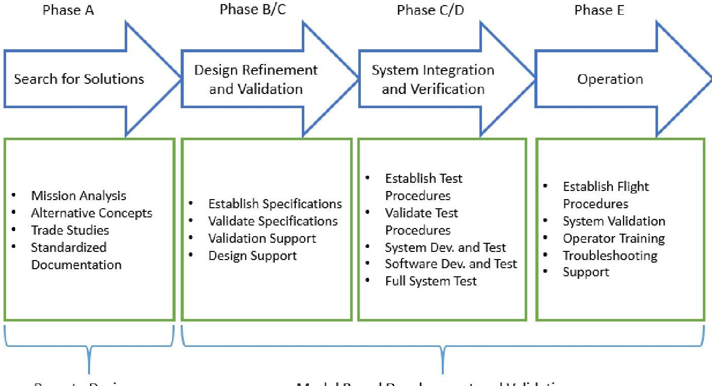

Figure 1: MBSE across the System Life Cycle [3]

MBSE is a term that describes an approach to Systems Engineering that emphasizes a system architecture model as the primary work artifact throughout the system development life cycle. A model is an approximation, representation, or idealization of selected aspects of the structure, behavior, or operation of a real world process, concept, or system. [4] A model usually offers different views in order to serve different purposes. A view is a representation of a system from the perspective of related concerns or issues.

MBSE combines traditional systems engineering best practices with rigorous visual modeling techniques. Systems Engineers must interface with various other engineering specialties

<!-- PDF_PAGE: 22 -->

including software, electrical, mechanical, aerospace, etc., and modeling has become a common way to create this interface. [5] To understand how their needs and goals are being addressed, stakeholders may also need to understand MBSE, such as visual requirement analysis and verification, the concept of operations, functional analysis and allocations, performance analysis, trade studies, and system architectures.

MBSE offers a variety of advantages over traditional document centric systems engineering approaches. It is possible to model requirements in order to ensure that the requirements are an integral part of the model and all other parts of the model can be traced back to those requirements. This allows for the validation that you are building the right system. Model analysis and design provides a precise architectural blueprint organization by the views that are meaningful to all system stakeholders. This verifies that you are building the system right. Model simulation automates the system verification and validation, thus reducing errors and costs early in the lifecycle. [3]

MBSE may also enhances the ability to capture, analyze, share, and manage the information associated with the complete specification of a product, resulting in the following benefits: [6]

- Improved communications between the customer, program management, systems engineers, hardware and software developers, testers, and specialty engineering disciplines.

- Increased ability to manage system complexity by enabling a system model to be viewed from multiple perspectives.

- Improved product quality by providing a precise model of the system that can be evaluated for consistency, correctness, and completeness.

- Enhanced knowledge capture, simplified knowledge capture, and built in abstraction mechanisms can result in reduced cycle time and lower costs.

<!-- PDF_PAGE: 23 -->

The International Council of Systems Engineers (INCOSE) has predicted that the capability and the usage of MBSE in both large and small scale production will greatly increase in the next 10-15 years. Additional resources will be dedicated toward research and development within MBSE as standards are established and languages, such as SysML, become more common in industry. Figure 2 shows INCOSE's proposed path forward for MBSE.

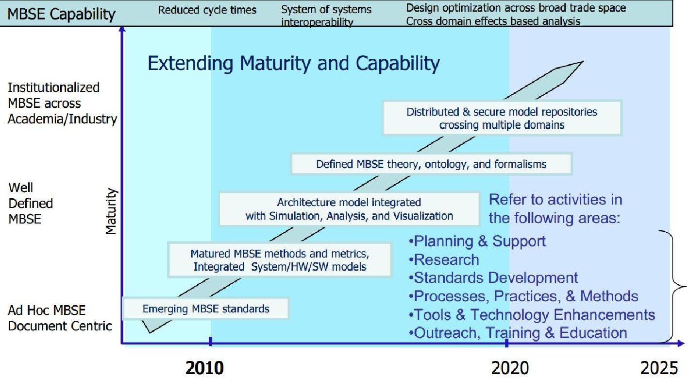

Figure 2: INCOSE MBSE Roadmap [3]

MBSE is eventually expected to replace the document centric approach that has been practiced by systems engineers in the past. In time it will also influence the future practice of systems engineering by being fully integrated into the definition of systems engineering processes. [3]

## 2.3 Systems Modeling Language

SysML is a general purpose graphical modeling language that supports the implementation of MBSE, including activities related to analysis, specification, design, validation, and verification of complex systems. These systems may include hardware, software, data, personnel, procedures, facilities, and other elements of any system. The language is intended to help specify

<!-- PDF_PAGE: 24 -->

and architect systems and specify its components that can then be designed using other domain specific languages such as UML for software design and VHSIC Hardware Description Language for hardware design.

SysML can represent systems, components, and other entities as follows:

- Structural composition, interconnection, and classification

- Function-based, message-based, and state-based behavior

- Constraints on the physical and performance properties

- Allocations between behavior, structure, and constraints

- Requirements and their relationship to other requirements, design elements, and test cases

SysML is made up of nine sub topics as shown in the diagram taxonomy in Figure 3. A short description can also be seen in Table 3.

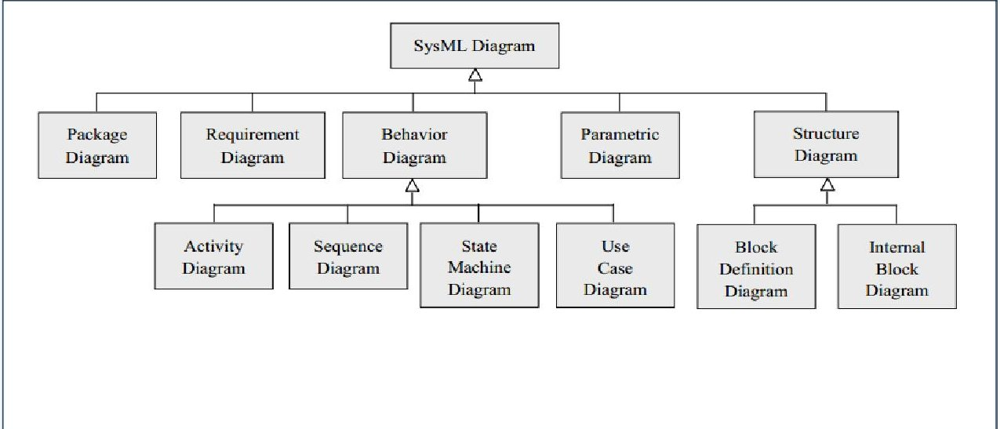

Figure 3: SysML Diagram Types [2]

<!-- PDF_PAGE: 25 -->

Table 3: SysML Diagram Types

<table border="1"><tr><td>Diagram Type</td><td>Description</td></tr><tr><td>Requirement Diagram</td><td>Represents text-based requirements and their relationship with other requirements, design elements, and test cases to support requirements traceability</td></tr><tr><td>Activity Diagram</td><td>Represents behavior in terms of the ordering of actions based on the availability of inputs, outputs, and control, and how the actions transform the inputs to outputs</td></tr><tr><td>Sequence Diagram</td><td>Represents behavior in terms of a sequence of messages exchanged between parts</td></tr><tr><td>State Machine Diagram</td><td>Represents behavior of an entity in terms of its transitions between states triggered by events</td></tr><tr><td>Use Case Diagram</td><td>Represents functionality in terms of how a system or other entity is used by external entities to accomplish a set of goals</td></tr><tr><td>Block Definition Diagram (BDD)</td><td>Represents structural elements called blocks, and their composition and classification</td></tr><tr><td>Internal Block Diagram (IBD)</td><td>Represents interconnection and interfaces between the parts of a block</td></tr><tr><td>Parametric Diagram</td><td>Represents constraints on property values, such as F=m*a, and are used to support engineering analysis</td></tr><tr><td>Package Diagram</td><td>Represents the organization of a model in terms of packages that contain model elements</td></tr></table>

SysML provides a means to capture the system modeling information as part of an MBSE approach without imposing a specific method on how this is performed. The selected method determines which activities are performed, the ordering of the activities, and which modeling artifacts are created to represent the system. For example, traditional structured analysis methods can be used to decompose the functions and allocate the functions to components. Alternatively, one can apply a use case driven approach that derives functionality based on scenario analysis and associated interactions among parts. The two methods may produce different combinations of diagrams in different ways to represent the system specification and design. [2]

SysML is used to model all aspects of a system either directly or through an interface with other models. It enables Systems Engineers to create and evolve models in an integrated, collaborative, and scalable environment. It enables building models that can be used in early design stages and that can support specification and design updates. Using models to define,

<!-- PDF_PAGE: 26 -->

develop, and ultimately operate a system accomplishes the goal of developing a single model for design, test and fly.

## 2.4 Horizon Simulation Framework

The Horizon Simulation Framework is a modeling and simulation tool with applications in the verification and validation of system-level requirements. It can perform system level trade analysis and act as a cost-function based optimal scheduling tool. [7] HSF accomplishes these system level trades by harnessing the ability to simulation multiple scenarios with varying system parameters, and comparing the results of those scenarios to determine how the resulting schedule and system performance react. The capability to perform system level based analysis is an invaluable tool for designers which can support subsystem optimization, increase confidence in the system and can expedite the overall design process.

Previous thesis work has endeavored to design HSF on the principles of modularity, flexibility, and utility. HSF is considered to be modular due to the ability to replace individual input scripts or parts of the scheduling algorithm. These HSF components are separate and interact through a strictly defined interface. This separation ideally allows the input scripts or scheduling algorithm to be changed without the need to modify the other. [7] This exclusive separation between input scripts and scheduling algorithm was a key element to the successful realization of this thesis. After understanding this separation, it was possible to focus all attention on the design of a new SysML system model and conversion of that model into a form that HSF could recognize as its system input script.

Input to HSF is performed with specially formatted XML scripts which define the initial simulation parameters, timing parameters, target properties, and system properties. SysML models can be directly exported to XML format, but are not configured in the unique XML format required by HSF. A conversion tool was required to bridge the gap between the standard

<!-- PDF_PAGE: 27 -->

XML output of the SysML model and the unique XML formant required by HSF. Viren Patel's thesis, SysML Output Interface Creation for the Horizon Simulation Framework, focuses on the creation, design, and implementation of this tool, called the HSF Translator Plugin.

Output from HSF is presented to the user in the form of standard text files. Output text files contain the state variables set by subsystems within the simulation as well as the positions of all assets and targets during the simulation. [7] Result files include data for the ADCS, Comm, Payload, Power, and Data Storage subsystems. Result files also include system position, system velocity, and target data. Result file data can then be converted into graphical form to provide a logical way to view data.

## 2.5 CubeSat

The CubeSat movement began as a collaborative effort between Professor Jordi Puig Suari at Cal Poly, San Luis Obispo, and Professor Bob Twiggs at Stanford University. A one unit (1U) CubeSat is described as a spacecraft with dimensions of a 10 centimeter cube and a mass of up to 1.33 kilograms. [8] CubeSats can be made in many sizes including 0.5U, 1U, 1.5U, 2U, 3U, 6U, etc. depending on the functionality that designer requires.

The purpose of CubeSat is to provide a standard for design of pico-satellites which reduces cost and development time, increases accessibility to space, and sustains frequent launches. The CubeSat movement is an international collaboration of hundreds of universities, high schools, and private firms developing pico-satellites containing scientific, private and government payloads where developers greatly benefit from the sharing of information within the community. The majority of development has historically come from academia, but other parties including and amateur radio enthusiasts and small start-up companies are beginning to design and build CubeSats as well.

<!-- PDF_PAGE: 28 -->

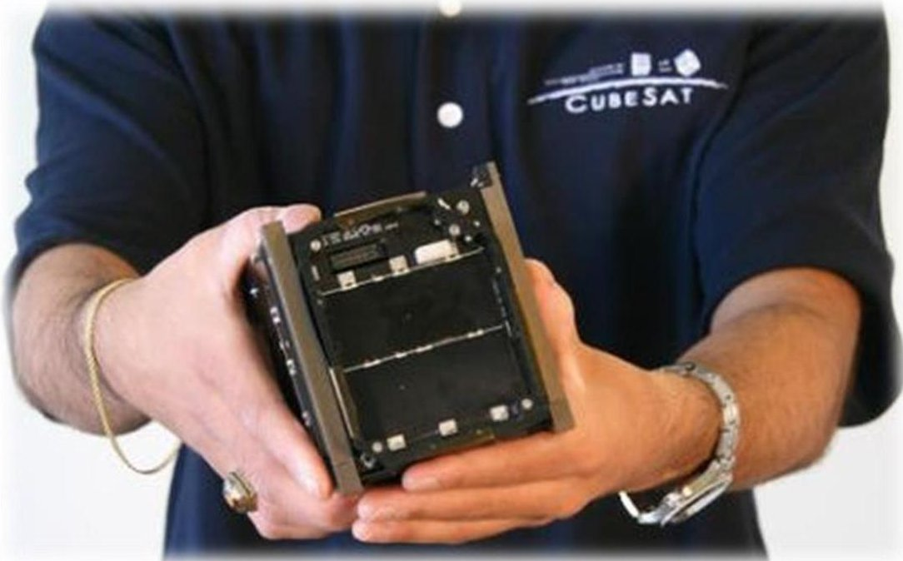

Figure 4: PolySat team member holds CP-6 mission [9]

CubeSat missions can cost anywhere from fifty thousand dollars for a low-end satellite with limited functionality, up to multi-million dollars for a high-end satellite with multiple mission goals and associated instruments. The lower end of the spectrum is far below all other satellite design costs and has made the CubeSat a viable option for schools and universities across the world. Because of this, a large number of universities and some companies and government organizations around the world are developing CubeSats.

A common design approach for CubeSat mission planning is to learn from previous design team knowledge and use intuition based trade studies for mission design. This can be dangerous if key personnel are unavailable, or operational parameters are neglected in the early stages of design. This often leads to cost and scheduling overruns, intolerable for a low budget CubeSat mission. However, these risks can be mitigated if standardized design practices, such as SysML, and standardized trade templates, such as HSF, are in place.

Cal Poly's CubeSat design program is aptly named PolySat. Since their establishment, they have launch 7 missions, CP1 - CP6, and CP8. Cal Poly also designs the common deployment system called the Poly-PicoSatellite Orbital Deployer (P-POD). [10] P-POD's are capable of deploying three 1U CubeSats, a 1U and a 2U CubeSat, or a single 3U CubeSat. [11] Most

<!-- PDF_PAGE: 29 -->

CubeSats carry one or two scientific instruments as their primary mission payload allowing for a cost-effective independent means of getting a payload into orbit. [12] As Cal Poly's CubeSat program matures, they have begun to design missions with more complex and expensive scientific instruments, often supplied by outside sources.

Implementation of MBSE via SysML may be of great benefit to PolySat and other university CubeSat programs. It is likely that universities will not be able to dedicate a large portion of the design budget to systems engineering due to the low cost nature of academic based CubeSat missions. Ideally, MBSE would reduce the systems engineering overhead while simultaneously enabling students to gain valuable real world systems engineering skills.

It was decided that a CubeSat would be the subject of this thesis' analysis due to the reasons listed above and additional reasons listed in section 3.3.1. PolySat was in the design process of the CubeSat mission, ExoCube, during the primary effort of this thesis. Cal Poly's dedicated CubeSat program and documented flight history allowed on sight interactions with the design team of ExoCube and aided in the design of a CubeSat SysML model.

## 2.6 Related Work

The use of SysML in systems engineering is a relatively new activity, much of which is being expedited by government financed defense contractors and other government related entities including NASA and the military. Because of the private nature this sector, it can be difficult for the general public to find the most current work. As an example, a CubeSat meta model was created and is owned by NASA JPL but it was not possible to acquire a copy or examine the model because of internal JPL restrictions. This does, however, confirm that similar work is being conducted within industry. The Object Management Group (OMG) also provides some insight into how SysML is being used in these difficult to reach sectors.

<!-- PDF_PAGE: 30 -->

The OMG is an international computer industry standards consortium founded in 1989. The standards they impact are driven by vendors, users, academic institutions, and government agencies. The OMG's modeling standards encompass Model Driven Architecture (MDA) and UML, which enable visual design, execution and maintenance of processes. The OMG also controls standards regarding SysML as a portion of it is composed of UML.

A survey was conducted by the Object Management Group querying some of the largest aerospace, defense, and automotive companies on their active usage of SysML. This survey revealed that all fields had some usage of SysML and that space systems had the highest concentrated use of the language. Although the percentages in Table 4 are not particularly high, it should be noted that SysML is still relatively new and its popularity is growing each year.

Table 4: Active use of SysML in large scale industry

<table border="1"><tr><td>Industry</td><td>% of Active Use of SysML</td></tr><tr><td>Space</td><td>23%</td></tr><tr><td>Aircraft</td><td>20%</td></tr><tr><td>Defense</td><td>20%</td></tr><tr><td>Automotive</td><td>7%</td></tr></table>

The following three sections consist of three papers with an end goal that is similar to this thesis. The case study outlined in these papers intended to apply MBSE to a CubeSat mission via SysML and is the result of a continuing team effort to implement a full MBSE design strategy to CubeSat design. The team includes University of Michigan graduate students, department professors, and engineers from JPL, InterCAX, and other MBSE related tools. For simplicity, the papers are referenced throughout the section as P1, P2, and P3.

## 2.6.1 Applying MBSE to a Standard CubeSat

Applying MBSE to a Standard CubeSat is a case study which intends to leverage a previously modeled SysML example satellite to design a CubeSat Modeling Framework. The original concept inception rose from an INCOSE presentation outlining the SysML model of the

<!-- PDF_PAGE: 31 -->

fictional satellite, FireSat. The Space Mission Analysis and Design (SMAD) textbook example, FireSat, is a fictional satellite for monitoring and reporting forest fires.

The goal of this CubeSat Framework can be summarized by the following quote, "The Framework illuminates a path to an integrated model based engineering environment, including interoperability with system models, mission analysis, and 3D visualization capabilities provided by Analytical Graphics, Inc. (AGI) Systems Tool Kit (STK)." [13] The objectives of the study were to model and codify a CubeSat and to explore the possibility of enabling data transfer between the SysML and commercial programs such as STK and InterCAX.

The SysML team chose the Radio Aurora Explorer-2 (RAX-2) mission as a basis for their CubeSat framework. The primary objective of the RAX mission was to study the formation of magnetic Field-Aligned Plasma Irregularities (FAI) in the lower polar ionosphere (80-300 km). [14] The study goes on to further describe the RAX-2 mission and begins their initial definition of the CubeSat Modeling Framework, listed below.

- Part - a component of the spacecraft

- State - the value of a variable that describes a condition of the system for a given period of time

- Function (input, output) - a behavior of a Part that modifies the state of the Part based on the Function's input and output states

- Input: values used to affect the state of the Part

- Output: values used to report on the result of the Function's effect on the state of the Part

- Subsystem - have functions which operate on states

- Interface - an area of consideration on a Part for which interaction is an engineering concern. It usually requires coordination or standardization to function properly.

<!-- PDF_PAGE: 32 -->

- Scenario - a sequence of functions to accomplish a Mission Objective.

These definitions act as a set of guidelines for the modeling framework. P1 then defines the types of SysML diagrams that are associated with each term. These definitions are a standard practice in the modeling of complex system within SysML.

The team separates the CubeSat scenario into separate blocks including the CubeSat Mission Element, the Space Environment, Stakeholders, and a set of Mission Objectives. The CubeSat Mission Element is then further subdivided into a CubeSat Ground System and a CubeSat Flight System. The Mission BDD can be seen below, in Figure 5.

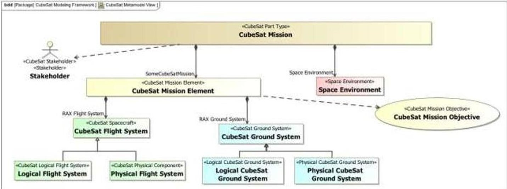

Figure 5: CubeSat Mission Environment [13]

The specific details of the space environment, mission element, ground system, and flight system frameworks are briefly described for the RAX-2 mission. These sections give an overview of each part of the model and how the CubeSat framework is separated into flight system and ground system. The Flight System includes functions such as power generation, thermal control, attitude control, and orbital control. The team states that describing the CubeSat system in this manner provides a far more explicit and precise description of functionality.

P1 then goes on to describe the segment of RAX-2 mission operations that the team focused on. The objective operation begins with the collection of FAI data from target points of

<!-- PDF_PAGE: 33 -->

interest. The Data Handling subsystem is then responsible for processing the collected data, and the Communication subsystem is responsible for downlinking the data. SysML sequence diagrams were used to describe the interaction of data collection, processing, and downlink. Package diagrams were used as a library for hardware and software component information.

In the conclusion, P1 discusses an event at an INCOSE demonstration in which a SysML model was interfaced with STK and was used to execute a scenario. The paper concludes with stating that the model has reached is first milestone which was to establish a basic structure for a CubeSat Framework. Future steps are intended to expand this basic model with the eventual goal of interfacing the SysML model with STK.

The goal of P1 was very similar to the preliminary work performed for this thesis. In P1, and this thesis, a set of similar initial terms were defined. This is a common practice in SysML modeling and can be traced back to the basics in A Practical Guide to SysML by Sanford Friedenthal [2]. A mission Block Definition Diagram was also defined in both scenarios. P1 split the Mission into a CubeSat Mission Element and a Space Environment. The CubeSat Mission element was then subdivided into a CubeSat Flight System and a CubeSat Ground System. The models created for this thesis split the mission domain into three categories including a Ground System, a Spacecraft System, and an Environment.

The Systems in both scenarios were also similar in that the satellites were required to target specific areas of interest then collect, process, and downlink data related to that area. As in most satellite systems, the subsystems responsible for these actions were similar. The end result of P1 is a relatively simple Framework that the team plans to use to build future CubeSat SysML models, essentially laying the groundwork for future development. This was similar to the initial research and modeling that was conducted for this thesis.

<!-- PDF_PAGE: 34 -->

## 2.6.2 MBSE Applied to RAX CubeSat Mission Operational Scenarios

MBSE Applied to RAX CubeSat Mission Operational Scenarios extends the work of the original RAX-2 SysML modeling case study presented in P1. The work conducted in P2 is the product of an INCOSE MBSE challenge project aimed at promoting MBSE and advancing the state of the practice. P2 focused on extending the initial SysML RAX model and providing the CubeSat community with a model that can automate the flow of data. They expected this to allow users to evaluate design configurations and reconfigure the model for different mission scenarios.

P2 begins by describing MBSE, SysML, the field of CubeSats, and the specific CubeSat Framework described in P1. The extensive tool suit that the team used for this new study is below.

- MagicDraw: SysML modeling tool that enables analysis and design of systems databases

- Cameo Simulation Toolkit: MagicDraw plugin, enables different MBSE models such as State Machines and Activity Diagrams within MagicDraw

- STK: Supports high fidelity simulations and visualizations of satellite behavior

- MATLAB: Provides numerical computing for evaluating equations, functions, and algorithms.

- ParaMagic: MagicDraw plugin, used to import mathematical models from MATLABN/Simulink into SysML model and execute constraint relationships

- PHX ModelCenter: allows users to create and execute simulation workflows by integrating various simulation models i.e. Excel spreadsheets, STK scenarios, and MATLAB scripts

The rationale behind using this suite of tools was to demonstrate how a diverse tool set could be integrated into a common framework, to use appropriate simulators and mathematical

<!-- PDF_PAGE: 35 -->

engines for respective simulation, and to test and determine which tools worked well for different applications.

The paper then goes on to describe the RAX mission and the RAX SysML Model, created from the CubeSat Framework described in the P1. The RAX SysML model was redesigned for the purpose of simulating specific scenarios and can be seen below, in Figure 6. It includes the launch system, the environment, and the mission, which is subdivided into the Ops system, the flight system, and the ground system.

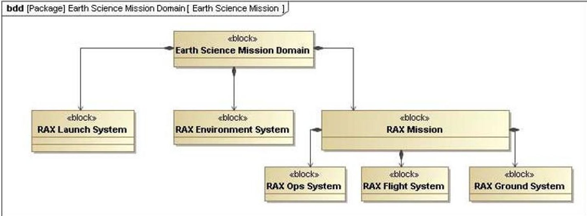

Figure 6: RAX Block Definition Diagram [15]

The team also shows the RAX mission IBD, seen below in Figure 7, including subsystems and their corresponding power and data rate relations between subsystems. Subsystems include Power Collection and Control, Mission Data Handling, Attitude Determination and Control, Thermal Determination and Control, Comm, and Payload.

<!-- PDF_PAGE: 36 -->

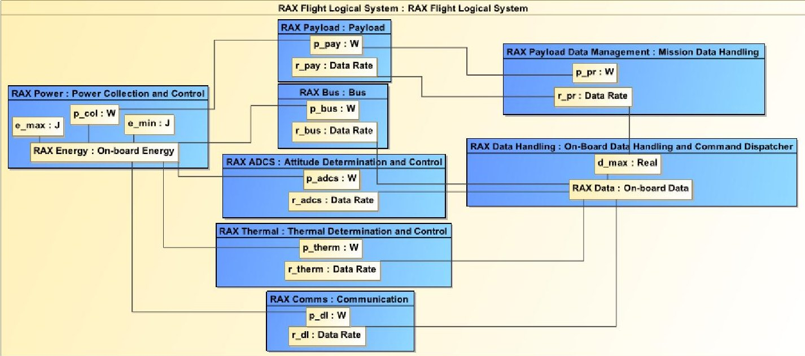

Figure 7: RAX Internal Block Diagram [15]

P2 utilized the ParaMagic plugin to design parametric models, where each model represents a specific design alternative, configuration, or scenario. The team describes their attempt to capture realistic power scenarios, "We have developed a simulation that consists of PHX ModelCenter as the glue that ties together simulations and analysis components from STK, SysML, and MATLAB. We model the dynamics of opportunities to collect energy and download data and how this impacts the time history of the satellite states, including the on-board energy and data, and the amount of downloaded data." [15] They are then able to analyze a RAX specific scenario by combing the parametric model from MagicDraw with an orbital scenario from STK and an analytical script from MATLAB using PHX ModelCenter as shown below, in Figure 8.

<!-- PDF_PAGE: 37 -->

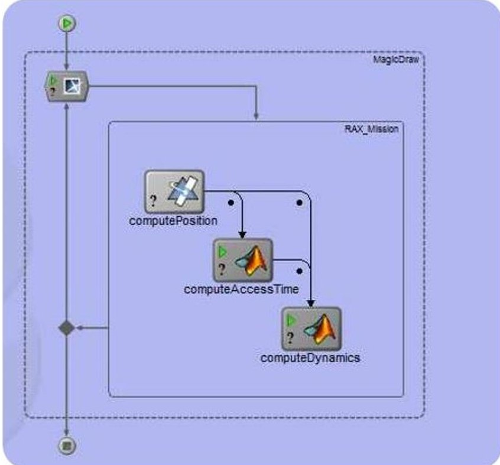

Figure 8: Simulation and Analysis Tool Integration with PHX ModelCenter [15]

MagicDraw enabled the team to describe their satellite in SysML, STK enabled them to calculate orbital data and visualize the outcome, MATLAB enabled them to calculate analytical data, and PHX ModelCenter enabled them to interface the different simulation tools together. Finally, the team describes its use of CAMEO Simulation Toolkit to build activity/state machine diagrams. The team states that these diagrams can be used to compare expected satellite behavior against what the model predicts to occur. If real flight data is available, that can also be compared to the state machine diagrams.

The paper concludes with a description of each SysML diagram, and how that diagram has been utilized for the study. BDD and IBD diagram structures of SysML are the starting point, establishing the fundamental relationships and interfaces between the components of our system. [15] Parametric diagrams are used to enable analysis such as comm link margins, power constraints, etc. State Machine diagrams are used to define the time evolution of the system. The team infers that these three diagrams, which describe their system, comprise the required framework for integrating the design model with analytical models. They also note, beginners

<!-- PDF_PAGE: 38 -->

found the learning curve reasonable, as they were building off the work of the experts and thus learning as they contributed.

The goal of P2 was to establish a full SysML model of the RAX CubeSat from the Framework created in P1, and to run simulations within the extensive tool suite described above. This was accomplished, but not to the full extent that the team initially intended. The final results of P2 used the SysML defined relation between power and data flow, to calculate time independent scenario outcomes. Although the analysis lacked the ability to simulate scenarios with reference to the time, the team was able to address this in P3.

P2 had the same general concept as this thesis, but instead utilized a suite of plugins and software tools external to SysML to analyze a CubeSat mission. In both case of P2 and this thesis, the mission and CubeSat vehicle was initially defined within a SysML model. The model was then used at the basis of knowledge for other analysis tools. This thesis utilizes MagicDraw to model a system, a custom plugin to link SysML and the simulation tool, and the single analysis tool, HSF, to perform all simulation operations. P2 utilized MagicDraw and the ParaMagic Plugin to model a CubeSat system, and a suite of tools including STK to simulate orbit, MATLAB to calculate analytical data, and PHX ModelCenter to integrate the unique software clients.

## 2.6.3 Integrated MBSE Applied to the Simulation of a CubeSat Mission

Integrated MBSE Applied to the Simulation of a CubeSat Mission is the final installment of the RAX case study. The work was the product of the INCOSE MBSE Initiative's Systems Engineer Vision 2020. P3 begins with a general project overview, including the initial inspiration for the project and the INCOSE FireSat SysML example. This is followed by an overview of SysML and the team's previous SysML modeling of RAX.

Current and future plans for the RAX case study is described in three phases. Phase one, outlined in P1, consisted of developing a SysML reference model of a CubeSat, then applying the

<!-- PDF_PAGE: 39 -->

parameters of the RAX mission to it. Phase two, outlined in the P2, focused on expanding the RAX CubeSat model to include behaviors [15] including comm downlink, data rate, power, and signal to noise calculations. Phase two was successful, but the capabilities developed lacked the ability to time-step through a behavioral model and determine whether requirements are satisfied through the entire RAX mission. Phase three, outlined in P3, comprised of two activities including the development of a CubeSat enterprise model to capture cost and product lifecycle aspects, and capturing additional RAX design and operational characteristics.

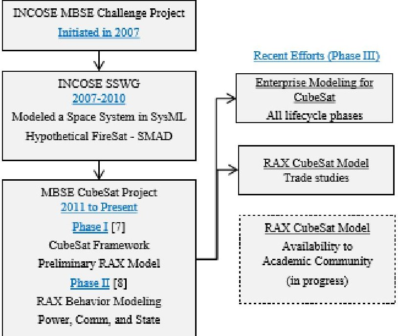

Figure 9: RAX Team Past and Future Phases [16]

Technical accomplishments of P3 begin with the development of a new RAX model based on the CubeSat reference model described in the P2. The new model was developed so as to demonstrate how trade studies can be performed within a systems modeling development environment. P3 utilizes the same suite of modeling and simulation tools including MagicDraw, STK, MATLAB, PHX ModelCenter, and Cameo Simulation Toolkit.

The redesigned SysML model of the RAX CubeSat can be seen below, in Figure 10. A standard set of subsystems was included in the model but more detailed modeling was implemented for the Power and Comm subsystems, which were the focus of the P3 simulations.

<!-- PDF_PAGE: 40 -->

The team limited the simulation to find minimum and maximum battery capacity, maximum data buffer capacity, and minimum download data quantity.

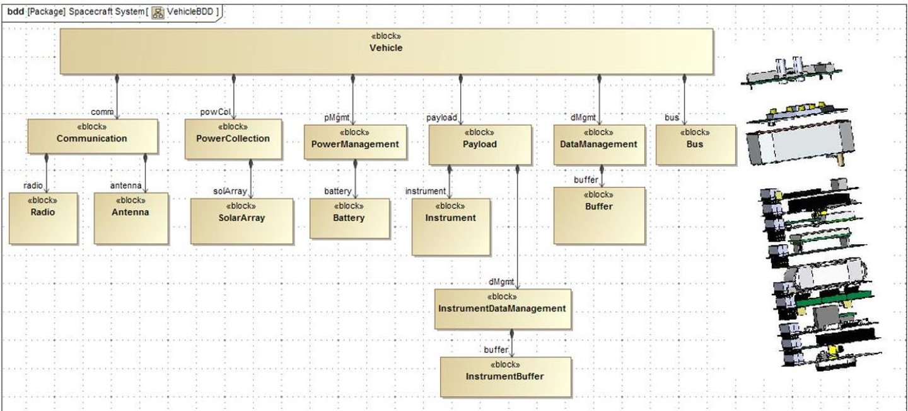

Figure 10: Updated RAX Vehicle BDD [16]

SysML Satisfy relationships were used to relate requirements to system properties which were calculated via mission simulation. Figure 11 shows the mapping of requirements to value properties of the Vehicle block.

<!-- PDF_PAGE: 41 -->

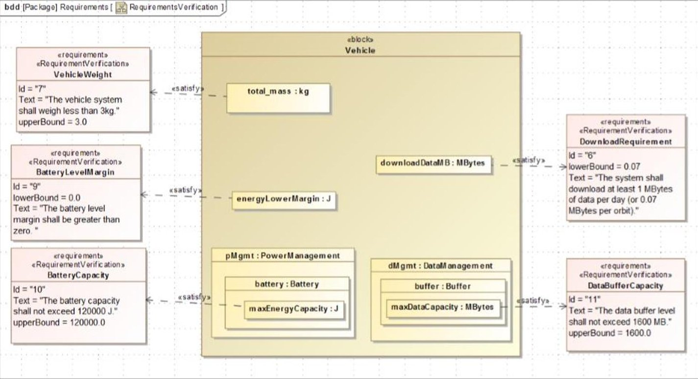

Figure 11: Requirement Verification BDD [16]

Parametric diagrams, activity diagrams, and state machine diagrams were used to create a starting point for the simulation tool suite. State diagrams modeled possible events that the vehicle could encounter and appropriate vehicle behavior. Activity diagrams defined what actions could be performed during an event, along with the flow of input and output data. SysML Parametric diagrams and PHX ModelCenter were then used to create a link between the SysML model and the analytical simulation clients, STK, and MATLAB. These external tools enabled the team to estimate RAX performance. STK was used to model the spacecraft orbit and calculate data collection opportunities and data downlink opportunities. The STK orbital data was then ported to MATLAB scripts in order to compute power collection. Finally, ModelCenter integrated the MagicDraw SysML model, the STK orbital scenario, and the analytical MATLAB scripts.

The team stresses that time history of the vehicle state was an important factor to data collection. The left plot in Figure 12 depicts the time history energy state of the power system. The blue line indicates the energy, in joules, stored in the vehicles power system. The red line

<!-- PDF_PAGE: 42 -->

indicates the sun energy generated by the vehicle panels, and is dependent on the vehicles position in orbit. The right plot in Figure 12 depicts the data downlink state of the vehicle. The downlink is correlated to the dip in energy generation in the power state plot.

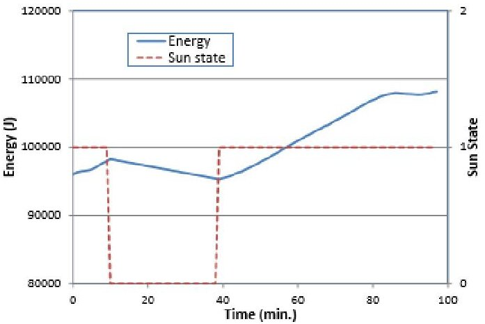

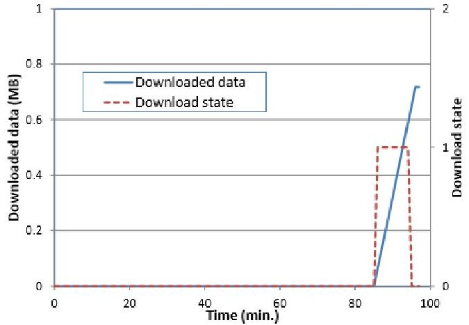

Figure 12: (Left) Energy storage and generation vs. time; (Right); Data downlink vs time [16]

P3 then goes on to described various trade studies related to the power and comm system dynamic. These studies were conducted to show how different solar panel areas, max battery capacities, orbital attitudes, and ground station networks effect the power and data time state. The ability to perform analytical trade studies is an extremely useful asset that can be used to understand the behavior of the system and interaction of components within subsystems. It can also be used to verify that the model has been designed correctly. P3 concludes with future plans of making the RAX CubeSat model available to the academic community. They hope that it will be used as a starting point for a CubeSat team to develop their own model and perform trade studies.

The goal of P3 was to establish a SysML based time dependent simulation tool suite that was capable of conducting full mission trade studies. A new, more complex, SysML model of the RAX CubeSat was created to enable this capability. This updated SysML model was also equipped with requirements related to their applicable components within the spacecraft. Simulations were again executed with the tool suite described above but this time were successfully correlated to the time domain.

<!-- PDF_PAGE: 43 -->

P3 was the final realization of the initial goal of the original case study presented in P1. The summation of these three papers, and the case study as a whole, endeavored to accomplish the same goal as this thesis. The goal was focused on designing a simulation system that would be capable of verifying the impact of design decisions in real time using MBSE. In the case study and this thesis, the overall mission and CubeSat vehicle were initially defined within a SysML model. The model was then used as a basis of knowledge for other analysis tools.

The case study utilized MagicDraw and the ParaMagic Plugin to model a CubeSat system, and a suite of tools including STK to simulate orbit, MATLAB to calculate analytical data, and PHX ModelCenter to integrate the unique software clients. This thesis utilizes MagicDraw to model a system, a custom designed plugin to translate the SysML model to the simulation tool, and a single analysis tool, HSF, to perform all simulation operations.

The RAX case study and this thesis had similar, successful, outcomes. The final results of P3 produced trade studies relating solar panel area, battery sizing, orbit, and ground systems. The final results of this thesis produced trade studies relating solar panel power generated, battery sizing, targets captured, data generated, and data downlinked. Both projects also show that there is a community wide desire for fully integrated simulation tools which are able to perform trade studies and mission analysis. Although the analysis tools differed between the RAX case study and this thesis, both projects agree that SysML is an ideal platform to describe a full mission system, and that MBSE is an emerging and promising solution for satellite mission simulations.

<!-- PDF_PAGE: 44 -->

## 3 MODEL DESIGN PROCESS

Two SysML models were created for this thesis and will be outlined in this section. The first model, Aeolus, was created to describe the system script used in the HSF test scenario. The second model, ExoCube, was created to describe a Cal Poly CubeSat mission. The primary goal of designing the Aeolus model was to validate the concept that a SysML model could be translated into an HSF system script for use in HSF. The primary goal of designing the ExoCube model was to verify that a real world example could be modeled in SysML and a correctly structured input script could be created for future use in an HSF simulation.

## 3.1 SysML Software

## 3.1.1 SysML Software Client

A MBSE software client capable of exporting SysML models into a suitable format for the HSF Translator Plugin was required prior to the SysML model design. The primary software clients that were evaluated include Sparx Systems' Enterprise Architect, No Magic's MagicDraw, The Modelio SysML Designer, Papyrus for SysML, and InterCAX. Each client was evaluated based on a variety of factors including functionality, source (open or commercial), stage of development, technical support, cost, etc. When possible, trials of each software were also evaluated. Ultimately, analysis and trade studies showed that MagicDraw paired with its corresponding SysML Plugin was the ideal choice.

MagicDraw is one of the leading commercial MBSE tools available to consumers and is designed and distributed by No Magic. It supports UML 2 metamodels, the latest XMI standard for data storage and the most popular programming languages for implementation. MagicDraw also requires a SysML plugin to support the OMG SysML $ ^{\mathrm{TM}} $ 1.4 for standards based system engineering.

<!-- PDF_PAGE: 45 -->

The MagicDraw SysML plugin retains all capabilities of the MagicDraw architecture modeling environment with a System Engineer perspective. It includes SysML specific menus, toolbars, diagrams, specifications, user interface, dependency matrices, validation suites, etc. [17] The SysML plugin supports all SysML diagrams, including Requirements, Block Definition, Internal Blocks, Parametric and others. With this plugin, MagicDraw adds support for additional specification, analysis, design, and validation of a broad range of systems.

## 3.1.2 Model Quality

Maintaining design consistency is a critical issue when concerning the complex nature of aerospace systems. Projects which lack consistency often end up suffering from cost and scheduling overruns. One solution to help mitigate these overruns is to use a standard for measuring the quality of a model. While there are multiple standards available, this work has been guided by and uses the "6 C's of MBSE." Figure 13 illustrates the 6C's and their relations to other possible elements which may be encountered while modeling.

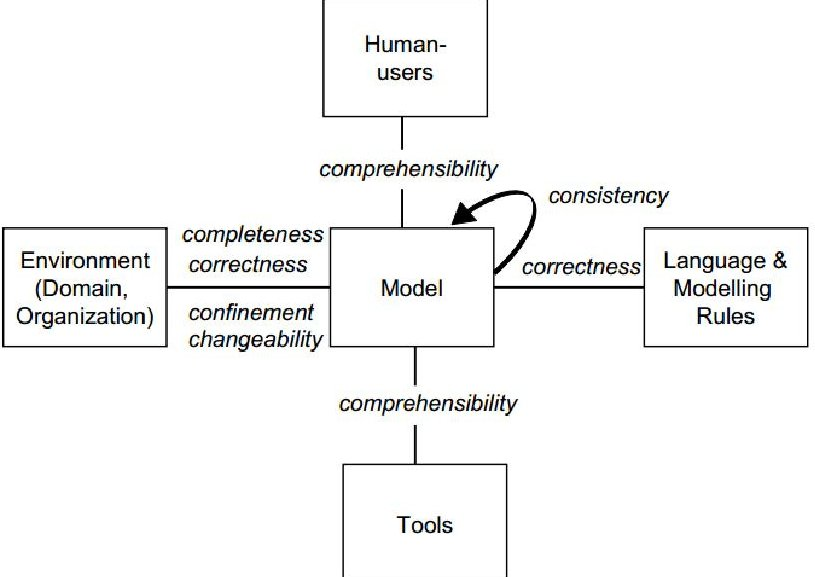

Figure 13: The 6C Model Quality Goals [18]

The quality of models, whether being used for software development with UML or for satellite development with SysML, is often ascertained by following a set of six goals commonly referred to as the "6 C's of Model Based Systems Engineering." The elements of the 6 C's of MBSE are completeness, consistency, comprehensibility, confinement, and changeability. [18]

<!-- PDF_PAGE: 46 -->

These six quality goals were addressed during the creation of the Aeolus and ExoCube models. A definition of each goal and an explanation of in what manner they were addressed can be found in Table 5.

Table 5: Model Quality

<table border="1"><tr><td>Correctness</td><td rowspan="2">Correctness was assured by two methods. The first consisted of research and training in SysML including the creation of example models from A Practical Guide to SysML, and the design of personal test models to solidify correct technique. The second method used to verify correctness of the model was the warning system available in MagicDraw. This feature declares when a construct of the model is in violation of any syntax or relationship violations. This feature was a key element of correctness in both learning SysML and in designing the Aeolus and ExoCube models.</td></tr><tr><td>Adhering to language syntax, including right elements and correct relations between them, style, rules, or naming guidelines</td></tr><tr><td>Completeness</td><td rowspan="3">Completeness was verified through inspection. Both models were created using data from external sources. Data for the Aeolus model was transcribed from the test scenario and data for the ExoCube model was collected from members of the PolySat team. ExoCube Data was directly transcribed from ExoCube database spreadsheets in which all system and subsystem data was maintained. The source data was physically confirmed to be identical to the corresponding SysML model aspects by inspection.</td></tr><tr><td>Having all the necessary information that is relevant, enough detail to support the purpose of the model</td></tr><tr><td>No contradictions within the model</td></tr><tr><td>Consistency</td><td rowspan="2">Consistency was again addressed by the warning system available in MagicDraw. The warning system informs the user of any relationship contradictions that would otherwise appear as an internal relationship violation.</td></tr><tr><td>No contradictions within the model</td></tr><tr><td>Comprehensibility</td><td rowspan="2">Comprehensibility was addressed by a top-to-bottom design approach. SysML has demonstrated the capability for this top-to-bottom design refinement which is utilized in the design of the Aeolus and ExoCube models. The design process provides a solution which satisfies top level requirements via verification within the model.</td></tr><tr><td>Understandable to other users or tools which will interact with the model</td></tr><tr><td>Confinement</td><td rowspan="2">Confinement was addressed by including all appropriate data in the models. The Aeolus system script from HSF acted as the database for the Aeolus SysML model. All data within the script was considered relevant and was included in the SysML model. The ExoCube data was provided by the PolySat team in the form of a detailed excel spreadsheet. To capture every aspect of ExoCube, the SysML model also contains all data that was previously documented within the database spreadsheet.</td></tr><tr><td>Including relevant diagrams and maintaining the correct level of abstraction</td></tr><tr><td>Changeability</td><td rowspan="2">SysML is an inherently dynamic data storage tool. Changeability was accounted for in the model design process by including component blocks that do not directly affect the system script or HSF simulation, but allow for future growth. These idle blocks essentially act as place holders until the system develops further and includes data to populate them.</td></tr><tr><td>Able to support changes to allow continuous improvement and evolution</td></tr></table>

<!-- PDF_PAGE: 47 -->

## 3.2 Aeolus

## 3.2.1 Rationalization

The HSF test scenario, Aeolus, was modeled in SysML to validate the feasibility of this thesis. Feasibility was dependent on the SysML models ability to be translated into an HSF input script, the format and structure of the original and translated script being identical, the ability to run the translated input script in an HSF scenario, and HSF returning the same output schedule as the original Aeolus test scenario.

The Aeolus model was designed prior to the ExoCube model due to the simplistic nature of the system and to expedite the thesis schedule. The Aeolus SysML model was less complex which allowed a smooth redesign when aspects of the model required alteration. Designing the Aeolus model was an enabling factor to learn and improve SysML and MagicDraw related skills. The design of Aeolus also aided to increase overall experience with numerous model development methods. By first focusing all attention on the Aeolus model, a timely first draft of the SysML model was constructed and exported to the XML format required for the HSF Translator Plugin. This supported Viren's work and enabled the project as a whole to develop faster than if both models were designed simultaneously.

## 3.2.2 Mission Overview

Aeolus is an Extreme-weather imaging satellite in a circular, 1000km, 35 degree inclined orbit. The satellite's simulated orbit begins on August $ 1^{\mathrm{st}} $ 2008. [19] The satellite is tasked to capture images of terrestrial targets, as can be seen as red circles in Figure 14. The simulation generates thousands schedules in order to enhance certain aspects of the mission i.e. image capture, power storage, data downlink, etc.

<!-- PDF_PAGE: 48 -->

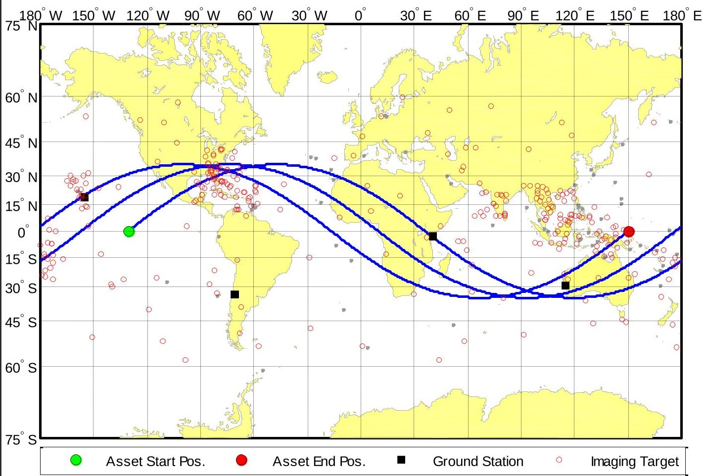

Figure 14: Aeolus Mission Concept [19]

The original HSF Aeolus scenario consists of six subsystems including Access, Attitude Determination and Control (ADCS), Communications (COMM), Electro-Optical Sensor (EOSensor), Solid State Data Recorder (SSDR), and Power. These subsystems are defined within the HSF base code via .h header scripts, and .cpp function scripts. Each subsystem header script creates the subsystem with HSF, and returns whether the subsystem can perform its required operations for a given task. The function script contains specific numerical data describing the subsystem and algorithms which calculate tasks related to the subsystem. The test case consists of a baseline configuration, subsystem models, orbit initial conditions, orbital propagators, initial state data conditions, and dependencies. [7]

## 3.2.3 SysML Model Overview

The Aeolus SysML model is best understood by examining the system block definition diagram (BDD), as seen in Figure 15. The mission domain contains the three system blocks

<!-- PDF_PAGE: 49 -->

including the ground system, the environmental system, and the spacecraft system. When broken down, these system blocks contain subsystem blocks which describe and define them. The environment system is comprised of the sun vector block which contains numerical values describing the initial location of the sun relative to the spacecraft. Similar to the original HSF Aeolus scenario, the spacecraft system is comprised of six subsystem blocks including Access, ADCS, Optics, SSDR, Communications, and Power. The spacecraft subsystem blocks also contain numerical values describing critical aspects of each subsystem. The ground system does not contain any blocks because this thesis was focused on the HSF system input script.

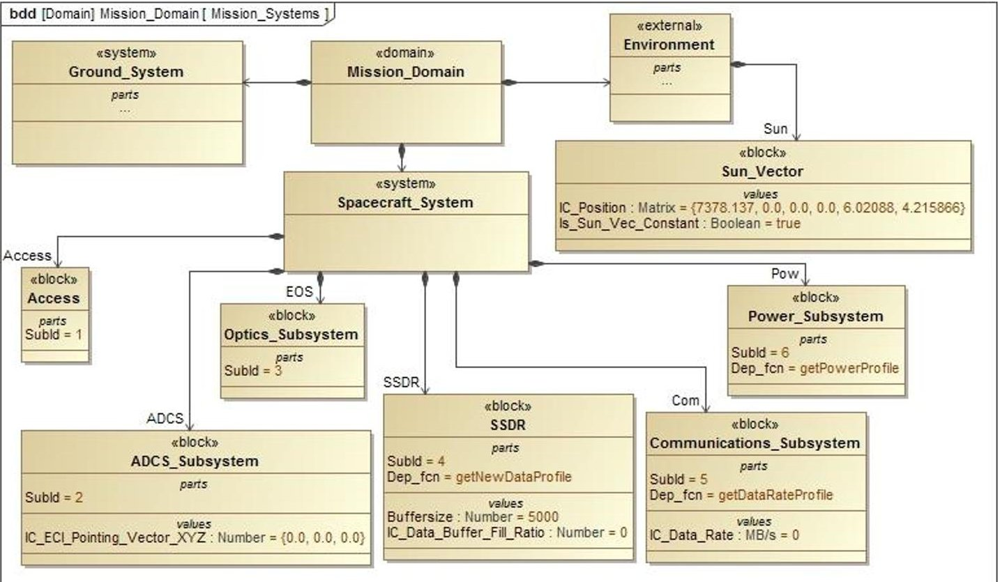

Figure 15: Aeolus System BDD

The internal block diagram (IBD) of the system is shown in Figure 16 and contains the six spacecraft subsystems. Each subsystem corresponds to a function of the previous Aeolus HSF system script.

The Access subsystem calculates geometric access to a location on the Earth based on direct line of sight. It cannot perform a task if this line of sight does not exist.

<!-- PDF_PAGE: 50 -->

The ADCS subsystem determines if there is enough time to slew the spacecraft to align itself with the target on the ground. For this simple scenario, slew calculations are completed by evaluating the time available before the scheduled start of the task. If there is insufficient time, the ADCS subsystem cannot perform the task. This subsystem also calculates the pointing vector to the target and stores it as a state variable.

The COMM subsystem state variables represent the downlink data rate to ground stations. It only functions during tasks that are designated as communication tasks. The COMM subsystem calculates this rate by calling a dependency function called “getDataRateProfile.” The downlink data rate is set to a constant value over the remaining duration of the task.

The EOSensor subsystem calculates the quantity of data required to image a target based upon its priority, which is given by the target of the imaging task. It calculates and sets the incidence angle to the target as well as the sizes of images that are taken.

The SSDR subsystem calculates and stores the quantity of data that has been created by other subsystems. The buffer calculation is done by calling a dependency function that calculates the amount of data to be stored based upon the image data set by the EOSensor. Similarly, it calculates the amount of data sent by the COMM subsystem and reduces the amount stored on the data buffer accordingly.

The Power subsystem calculates and stores the time history of the battery depth of discharge. It also calculates the amount of power generated from solar panels by using the current position and a model of the sun. This allows the subsystem to determine the times intervals in which the solar panels are lit and generating power. The Power subsystem calls a dependency function to determine the time history of power usage of other subsystems. The subsystem uses the power usage history and the size of the batteries to determine the time history of the battery depth of discharge and stores the result as state variables.

<!-- PDF_PAGE: 51 -->

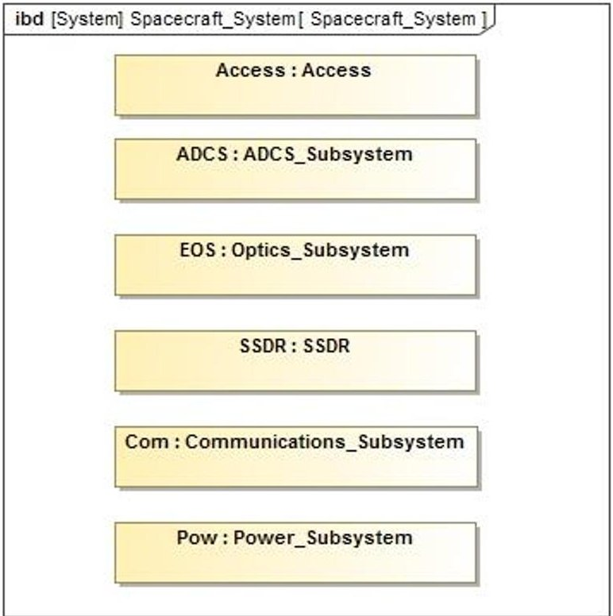

Figure 16: Aeolus Subsystem IBD

Each subsystem in the IBD has a corresponding BDD, as seen in Figure 17 and Figure 18. Figure 17 shows the BDD of the optics subsystem. In the Aeolus SysML model, the optics subsystem consists only of the EO sensor, represented by the EOS block. The EOS block contains numerical values describing critical aspects of the component.

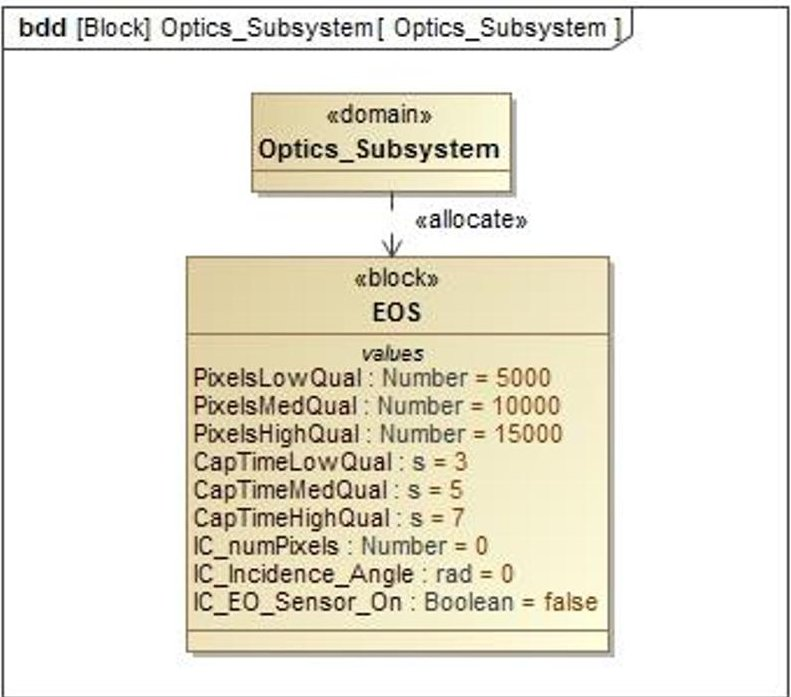

Figure 17: Aeolus Optics Subsystem BDD

<!-- PDF_PAGE: 52 -->

Figure 18 shows the BDD of the power subsystem. The power subsystem has four component blocks allocated to it, however it should be noted that only two of the four blocks contain numerical values. The BCDU and PDU blocks were created to show the potential for added functionality and to show the opportunity for changeability within the model. The inclusion of these extra component blocks does not yield any negative effects to the HSF simulation but easily allows for additional data to be included as the design and the model become more complex.

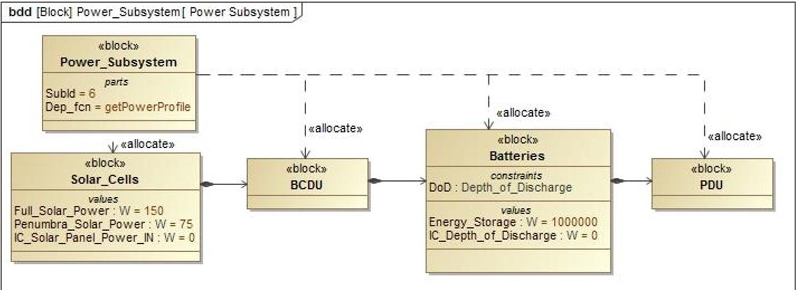

Figure 18: Aeolus Power Subsystem BDD

All initial condition values contained in system, subsystem, and component blocks will be translated into an input script via the HSF Translator Plugin. If the data is consistent with the old HSF input, the HSF output of this Aeolus test case will produce identical input scripts and resulting schedules. This will validate that the script created from a SysML model and translated via HSF Translator Plugin is a viable system script input for HSF.

## 3.3 ExoCube

## 3.3.1 Rationalization

The ExoCube mission was chosen due to the rationale outlined in section 2.5 and due to the ease of access to system information. PolySat was in the design process for ExoCube during

<!-- PDF_PAGE: 53 -->

the primary effort of this thesis which enhanced collaboration and transfer of ExoCube system data. All required data to model the ExoCube satellite was obtained from personal communication with the design team leads, and from the satellite budget spreadsheets used to design, calculate, and track subsystem figures. The ExoCube design team leads were able to provide the following spreadsheets; UHF uplink budget, data downlink budgets, mass budget, power consumption, power analysis, and operational modes. Fabrication of the ExoCube engineering development unit was also underway which enabled direct observation of the CubeSat power subsystem.

A secondary reason for choosing the ExoCube mission was due to its similarity to the original Aeolus test scenario. Both systems are earth orbiting satellites with similar operational concepts including orbital parameters, earth observation payloads, solar based power generation, data downlink to specified ground stations, etc. Originally, the CubeSat platform was also thought to be a relatively simple system to model in SysML and simulate in HSF. Although it turned out to be a much more complex system than Aeolus, it was undeniably more straightforward than other options, i.e. a large geostationary satellite.

The purpose of simulating the ExoCube SysML model was to apply the concept of this thesis to a real world design scenario. To accomplish this, the ExoCube model is required to contain all relevant subsystem data which was collected from the satellite budget spreadsheets and design team personnel. The SysML model is required to be exported to a XML output and converted into an HSF specific XML input script via the HSF Translator Plugin. The structure of the new ExoCube HSF input script must then be evaluated against the original Aeolus input script to verify that the script would function in an HSF scenario designed for the ExoCube mission.

## 3.3.2 Mission Overview

ExoCube is a space weather satellite sponsored by the National Science Foundation. Its primary mission is to directly measure the density of Hydrogen, Oxygen, Helium and Nitrogen in

<!-- PDF_PAGE: 54 -->

the upper atmosphere. Cal Poly is designing the core satellite bus, while the scientific payload is supplied by NASA Goddard Space Flight Center (GSFC). The University of Wisconsin, Madison and Scientific Solutions, Inc. (SSI) are developing the scientific objectives and providing guidance for instrument development. The ExoCube scientific payload includes a scientific instrument that is developed by NASA GSFC, in collaboration with University of Wisconsin, Madison, Scientific Solutions, Inc., and Cal Poly. ExoCube will characterize [O], [H], [He], [N2], [O+], [H+], [He+], [NO+], and total ion density by taking in-situ measurements within the exosphere, while taking particular interest in orbital locations above various radio observatories. ExoCube uses an active control system to point itself in the desired direction for measurements, and uses passive control to maintain this orientation. [20] Details of the mission and the assembled CubeSat can be seen in Figure 19.

- Satellite Name: CP10 (ExoCube)

- School: California Polytechnic State University, San Luis Obispo

- Mission Measuring the Elemental Composition of the Exosphere

- Launch Date: January 31st 2015

- Comm Frequency: 437.27MHz

- Modulation: FSK

- Comm Output Power: ~1 W

- Project Status: Integrated into PPOD. Waiting for launch!

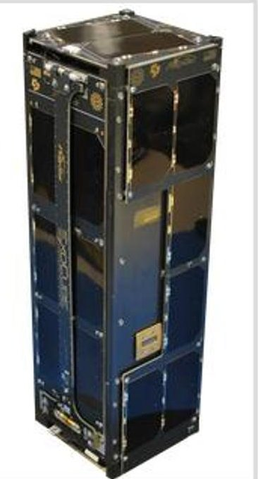

Figure 19: ExoCube Mission Profile and Assembled Satellite [20]

## 3.3.3 SysML Model Overview

Design work began on the ExoCube SysML model after the Aeolus model had been completed. The SysML XML output of the Aeolus model was provided to Viren and work on the HSF Translator Plugin was able to commence. A more intuitive design was implemented in the

<!-- PDF_PAGE: 55 -->

ExoCube SysML model due to the increased freedom of ExoCube, recently acquired knowledge of SysML, and hands on experience with modeling in SysML.

The ExoCube model block definition diagram can be seen in Figure 20. It is similar to the Aeolus model but includes more detail. The mission domain, again, contains three system blocks including the Environmental, Spacecraft Systems, and Ground Systems. These system blocks are made up of subsystem blocks which describe and define them. The Environment system contains blocks for the spacecraft orbit, and its initial sun vector. The Spacecraft System is again comprised of six subsystems including Access, ADCS, Payload, C&DH, Comms, and Power. These subsystem blocks also contain numerical values describing critical aspects of each subsystem.

The ground system contains blocks with ground station data, and target data. In this model, there is not domain for timing related inputs. For the purposes of this thesis, the original HSF target and timing input scripts are used instead of translating these from the SysML model. The concept of translating all input scripts from the SysML model is discussed in more detail in section 5.3.3.

<!-- PDF_PAGE: 56 -->

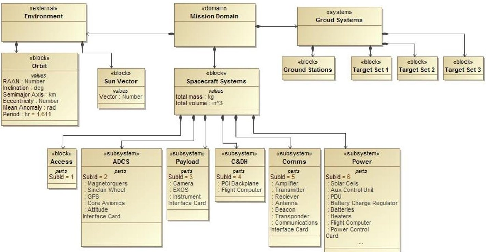

Figure 20: ExoCube System BDD

Similar to the Aeolus model, the ExoCube model also has an IBD of all subsystems. The IBD, shown in Figure 21, is color coded to aid in differentiating subsystems and their components. This can be helpful when viewing large diagrams containing more than one subsystem. Each subsystem block contains its specific Subsystem Identification (Sub ID) number which identifies said subsystem and its corresponding components in HSF.

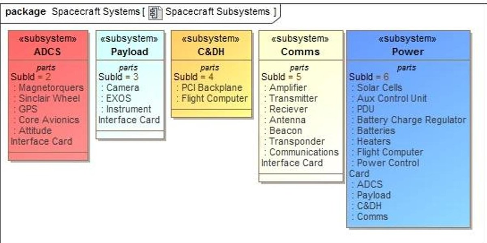

Figure 21: ExoCube Subsystem IBD

<!-- PDF_PAGE: 57 -->

Figure 22 is an example of the power subsystems IBD. The purpose of this diagram is to provide the SysML user with the data required to understand the inner workings of the subsystem and the relationships between subsystem components. This diagram was not included in the Aeolus model because its complexity did not deem one necessary.

The IBD shows the flow of power throughout the power subsystem and how each component interfaces with other components. As mentioned above, the different colored blocks represent different subsystems with power represented as blue, ADCS as red, C&DH as gold, Payload as light blue, and Communication (Comm) as yellow. Numerical values can be seen as green boxes within the battery block and the solar cell block. These numerical values describe critical aspects of the component. Components that lack numerical values are placeholders for additions to the model. Again, these were created to show the potential for added functionality and to show the opportunity for changeability within the model. The inclusion of these extra component blocks does not yield any negative effects to the HSF simulation but enables additional data to be included as aspects of the design are defined and as the system become more complex.

<!-- PDF_PAGE: 58 -->

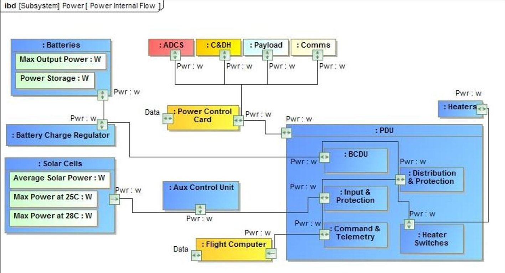

Figure 22: ExoCube Power Subsystem IBD

Figure 23 shows the BDD of the power subsystem. It is similar to the Aeolus model's BDD of the power system but is much more detailed. It contains all data related the power subsystem that is necessary to run an HSF simulation.

The power subsystem block, seen in the top left corner, contains a corresponding Sub ID and all power subsystem components including solar cells, auxiliary control unit, Power Distribution Unit (PDU), battery charge regulator, batteries, and heaters. An allocation relationship can be seen between each of these component blocks and the power subsystem block.

Only the solar cells, batteries, and battery charge regulator contain numerical values. The solar cells block contains values pertaining to power absorption when the satellite is in the sunlit portion of its orbit. The batteries block contains values pertaining to power storage, used primarily when the satellite is in the shadowed segment of its orbit. The battery charge regulator contains numerical values pertaining to peak voltage, wattage, and amperage in and out of the batteries. Battery charge regulator terms were not used in the simplified HSF simulation but would be useful for design as a database of system information.

<!-- PDF_PAGE: 59 -->

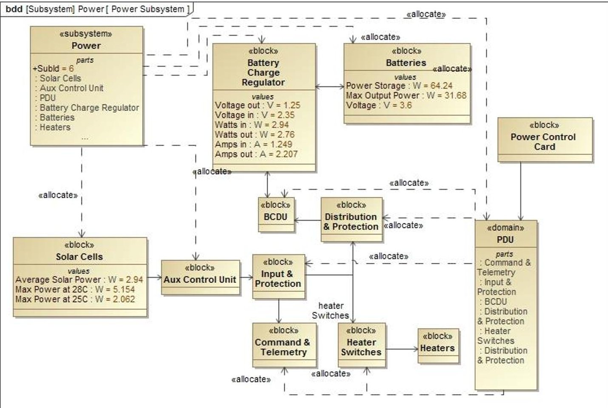

Figure 23: ExoCube Power Subsystem BDD

Figure 24 is the IBD of the comm subsystem which, similar to the power IBD, shows the flow of power and data throughout the subsystem. Numerical values are not shown but are included within the green boxes in the transmitter, receiver, and antenna blocks. These numerical values describe critical aspects of each component and are used for the HSF simulation. Components that lack numerical values are placeholders for additions to the model.

<!-- PDF_PAGE: 60 -->

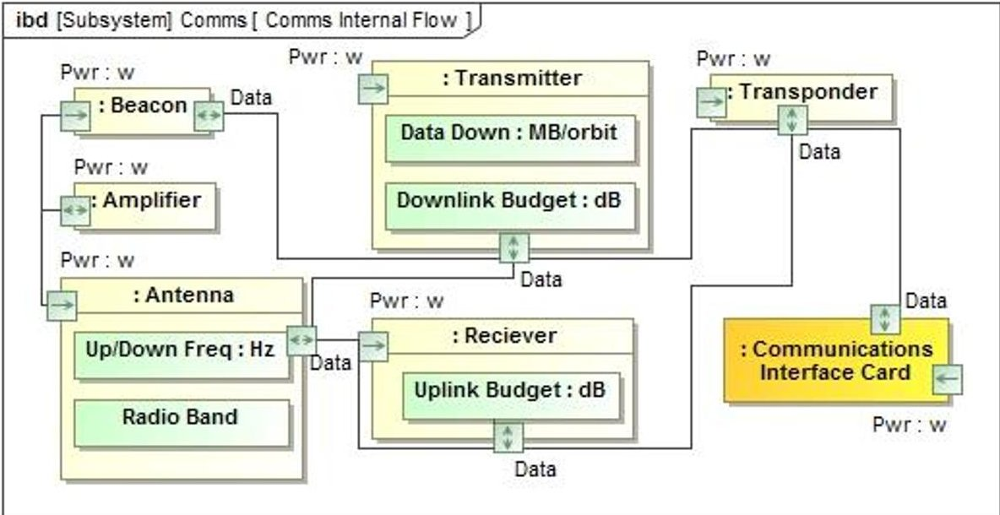

Figure 24: ExoCube Comms Subsystem IBD

Figure 25 shows the BDD of the Comm subsystem. It contains all data related the Comm subsystem that is necessary to run an HSF simulation.

The Comm subsystem block, seen in the top left corner, contains its Sub ID, and all Comm subsystem components including amplifier, transmitter, receiver, antenna, beacon, and transponder. An allocation relationship can be seen between each of these component blocks and the comm subsystem block.

In this subsystem, the receiver, transmitter, beacon, and antenna all contain numerical values. The receiver, transmitter, and beacon all contain power requirements that are flowed to and accounted for in the power subsystem. This flow can be seen in Figure 22, between the Comm subsystem and the power control card. The transmitter also contains a data-down term which may be used in the data downlink maneuver within HSF simulations. All additional numerical terms would be useful for design as a database of system information.

The remaining subsystem BDDs and IBDs including ADCS, C&DH, and Payload can be seen in appendix 0: A: ExoCube SysML Diagrams.

<!-- PDF_PAGE: 61 -->

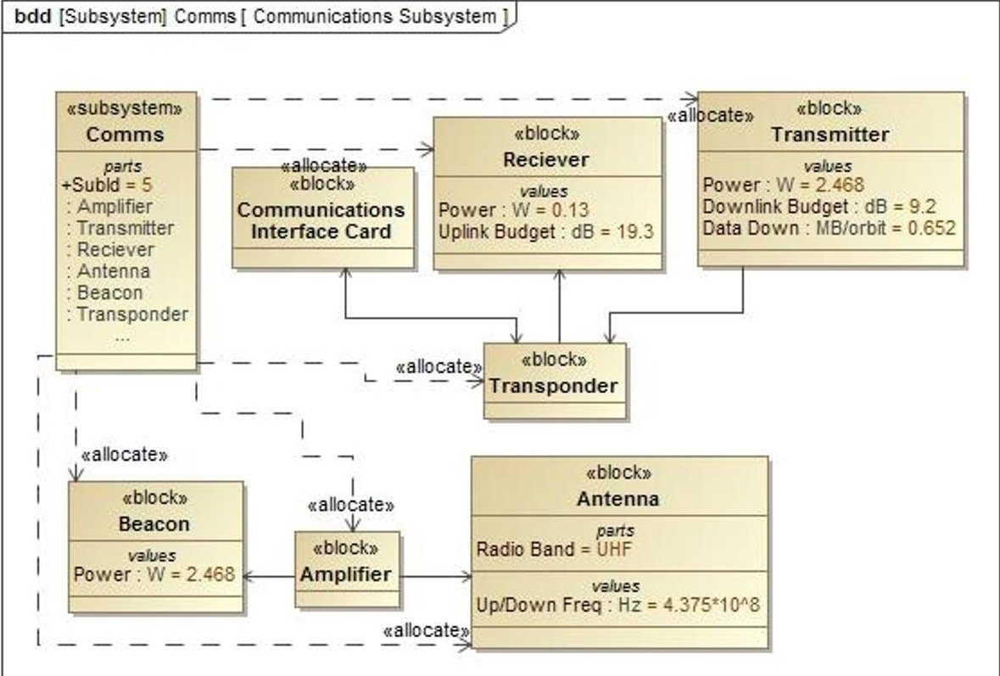

Figure 25: ExoCube Comms Subsystem BDD

Figure 26 is a partially expanded SysML allocation matrix. The matrix is a database for all system knowledge pertaining to allocation of diagrams, subsystems, and components within the spacecraft domain. The purpose of this matrix is to provide a user with traceability on each individual component within the complex space system. This diagram is also useful in verifying that all components are allocated their correct subsystem.

In the left column, each subsystem is composed of its component blocks. Certain component blocks, such as Core Avionics, PCI backplane, and PDU, are composed of additional component blocks, but for the purposes of this screen capture, have been compressed. The top row contains every diagram, subsystem, and component within the spacecraft domain. The corresponding matrix, in Figure 26, shows allocations previously discussed in system and subsystem diagrams. Relationships between subsystems and their owners are represented as arrows when a row is uncompressed, and as number when a row is compressed. The number represents how many components are allocated to the parent block.

<!-- PDF_PAGE: 62 -->

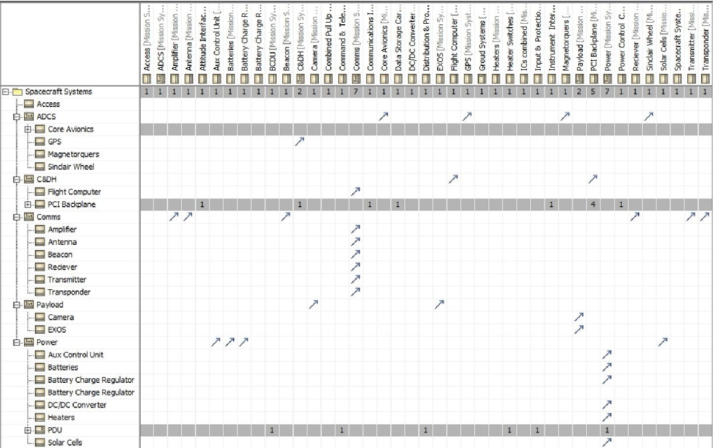

Figure 26: Expanded ExoCube Allocation Matrix

Figure 27 is an example of the how the spacecraft's operational modes are described within the SysML model. This state machine diagram describes the percentage of time each component is drawing current, collecting data, transmitting data, or any other function that might be described by the components block within its subsystem's BDD.

During campaign mode, the avionics system, reaction wheel, GPS, Exos instrument, and communications components are in operation during 100% of the mode duration. The receiver and beacon components are within a concurrent subdivision and thus will only be operational during their specific percentages of the mode duration. Other modes of the ExoCube model can be seen in appendix 0: B: ExoCube Operational Mode Diagrams.

<!-- PDF_PAGE: 63 -->

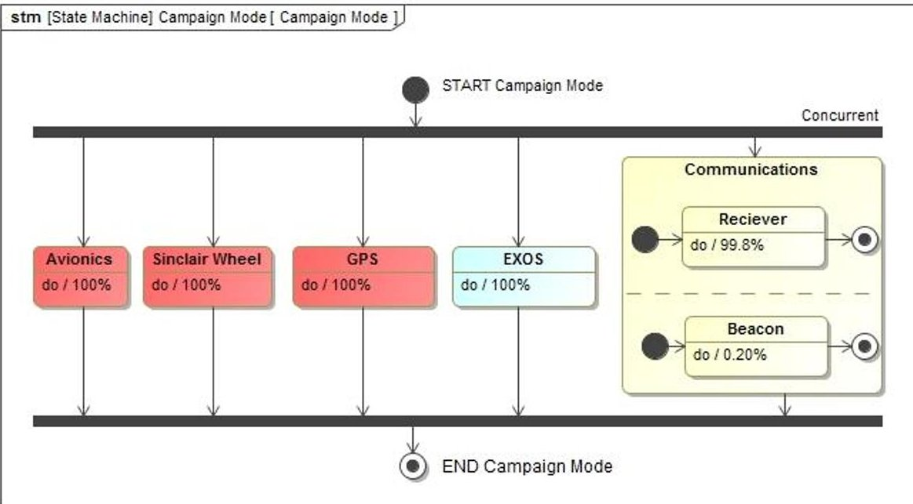

Figure 27: ExoCube Operational Campaign Mode

Figure 28 depicts the ExoCube mission Requirements Satisfaction table. In this table, requirements are numbered, given an Id based on sub-requirement dependencies, named, and described. Similar to the allocation matrix, the Requirements Satisfaction table provides a user with traceability on individual requirements. This table can be useful to verifying that all requirements have been fully satisfied and for traceability regarding how each requirement has been satisfied. This table differs from the allocation matrix because it not only spans the spacecraft domain but also the entire mission domain.

The far right column, Satisfied By, shows which system, subsystem, component, or numerical value satisfies the requirement. Some general requirements are satisfied by an entire component, such as Id: 2: "The spacecraft shall take "in-situ" measurements of total ion density in Earth's atmosphere," which is satisfied by the EXOS instrument. A more specific requirement, such as Id: 4.1: "The spacecraft shall maintain an altitude between 425 and 650 kilometers. (Best case: 475 km)," is satisfied by a numerical value, Semi-major Axis: km, contained in within the orbit block in the environmental domain. Finally, a relatively complex requirement such as Id 7: "The spacecraft shall use less than 2 watts of power," may need to be satisfied by more than one

<!-- PDF_PAGE: 64 -->

item. In the case of Id. 7, it is satisfied by the Battery Charge Regulator block numerical value Watts out: W and the Battery block numerical value, Max Output Power: W.

<table border="1"><tr><td>#</td><td>Id</td><td>Name</td><td>Text</td><td>Satisfied By</td></tr><tr><td>1</td><td>1</td><td>Atmospheric Compo...</td><td>The spacecraft shall take in-situ measurements the elements O,H,He,N2,O+,H+,He+ and NO+ in Earth&#x27;s atmosphere.</td><td>EXOS
:EXOS</td></tr><tr><td>2</td><td>2</td><td>Ion Density</td><td>The spacecraft shall take in-situ measurements total ion density in Earth&#x27;s atmosphere.</td><td>EXOS
:Camera</td></tr><tr><td>3</td><td>3</td><td>Housekeeping</td><td>The spacecraft shall communicate with the ground station every 2 minutes.</td><td>Beacon
:Beacon</td></tr><tr><td>4</td><td>4</td><td>Orbit</td><td>The spacecraft shall maintain an orbit which can support all mission requirements.</td><td>Orbit</td></tr><tr><td>5</td><td>4.1</td><td>Altitude</td><td>The spacecraft shall maintain an altitude between 425 and 650 kilometers. (Best case:475km)</td><td>Semimajor Axis:km</td></tr><tr><td>6</td><td>4.2</td><td>Orbital Inclination A...</td><td>The spacecraft shall maintain an OIA greater than 45 degrees and less than 135 degrees. (Best case:OIA&gt;80 degrees,Polar)</td><td>Indination:deg</td></tr><tr><td>7</td><td>4.3</td><td>Eccentricity</td><td>The spacecraft shall maintain an eccentricity of less than1.(Best case:ecc=0)</td><td>Eccentricity:Number</td></tr><tr><td>8</td><td>5</td><td>Mass</td><td>The spacecraft shall be less than450 grams in mass.</td><td>total mass:kg</td></tr><tr><td>9</td><td>6</td><td>Volume</td><td>The spacecraft shall be smaller than3.5x3.5x2 inches in volume.</td><td>total volume:in^3</td></tr><tr><td>10</td><td>7</td><td>Power</td><td>The spacecraft shall use less than2 watts of power.</td><td>Watts out:W
Max Output Power</td></tr><tr><td>11</td><td>8</td><td>Field of View</td><td>The spacecraft shall have2,63 degree,fields of view.</td><td>Camera
:EXOS</td></tr><tr><td>12</td><td>9</td><td>Pointing Accuracy</td><td>The spacecraft shall have a pointing accuracy of+/-10 degrees.</td><td>Magnetorquers
:Sinclair Wheel</td></tr><tr><td>13</td><td>10</td><td>Pointing Knowledge</td><td>The spacecraft shall have pointing knowledge of+/-5 degrees.</td><td>Core Avionics</td></tr><tr><td>14</td><td>11</td><td>Max Slew Rate</td><td>The spacecraft shall have a max slew rate of0.1 degrees per second.</td><td>Sinclair Wheel</td></tr><tr><td>15</td><td>12</td><td>Remote Control Mode</td><td>The spacecraft shall have a temporary over-ride ability to adjust mode variables for storms.</td><td>Storm Override Mode</td></tr><tr><td>16</td><td>13</td><td>Location Accuracy(i...</td><td>The spacecraft shall have a location accuracy of+/-5.56km.</td><td>GPS</td></tr></table>

Figure 28: ExoCube Requirements Satisfaction Table

Figure 29 depicts the requirements satisfaction BDD. It is essentially an expanded version of the ExoCube System BDD, in Figure 20, but focuses on specific aspects of the mission which satisfy a requirement. The requirements satisfaction BDD is where the Satisfied By relationship, in the requirements satisfaction table, is established. It is a suitable visual representation of all requirements and their relationship with the satisfying item. This diagram depicts which subsystems satisfy the most requirements and thus can be used as a simple way to visually determine mission critical and high risk subsystems or components.

<!-- PDF_PAGE: 65 -->

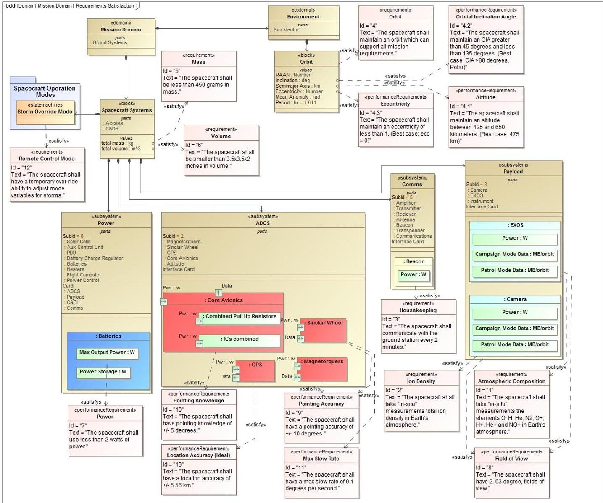

Figure 29: ExoCube Requirements Satisfaction BDD

Finally, Figure 30 is a partially expanded requirement satisfaction matrix. The matrix is a database for all system knowledge pertaining to requirements within the mission domain. This matrix provides the user with the graphical functionality as described for the allocation matrix, but is generally less useful due to the availability of the requirements table.

In the left column, each domain is composed of its systems, and those systems are composed of their corresponding subsystems. The top row contains all requirements. The corresponding matrix in Figure 30 shows which subsystem, component, or numerical value satisfies each requirement. Relationships between subsystems and their owners are represented as

<!-- PDF_PAGE: 66 -->

arrows when a row is uncompressed, and as number when a row is compressed. As previously discussed, some requirements may be satisfied by more than one component or value.

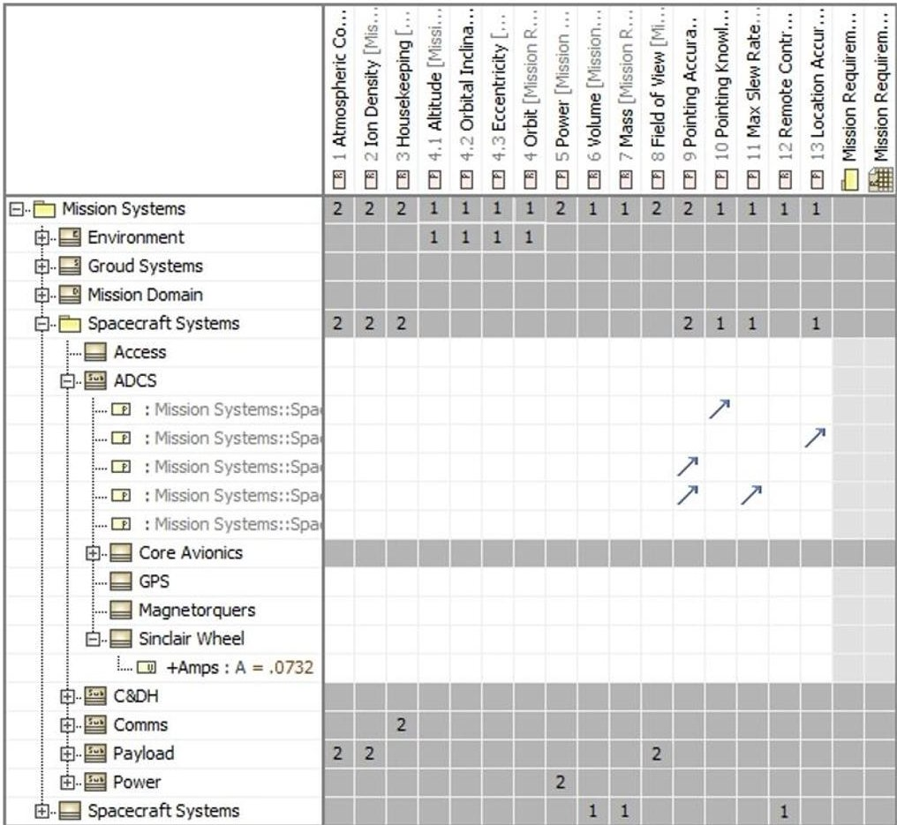

Figure 30: ExoCube Requirements Satisfaction Matrix

<!-- PDF_PAGE: 67 -->

## 4 INTEGRATION WITH HSF

## 4.1 HSF Input Scripts

As described in section 2.4, HSF is considered to be modular due to the discrete separation between the input scripts and the scheduling algorithm. HSF requires 3 input scripts to execute a simulation.

The first script dictates the start and end times of the simulation. This script also contains the starting Julian date as well as the time step and maximum number of desired schedules. It is possible that a simulation will not generate enough feasible schedules to reach the maximum number, but if it does, HSF will limit the schedules to that set amount.

The second input script dictates the simulation targets including ground stations and image capture locations. It acts as a database for all desired targets and target data. It includes each target name, target priority value, target type (ground station or image location), task type (image capture or data transfer), max time to capture target, and target coordinate location.

The third input script dictates relationships within the satellite or CubeSat system. This input script is the focus of this thesis and, contains the spacecraft initial conditions, subsystem parameters, dependencies, and constraints.

The original HSF input script for the Aeolus test scenario is shown below, in Figure 31. Red arrows point to the Sub ID numbers, green arrows point to subsystem dependencies, and yellow arrows point to subsystem constraints. Dependencies and constraints within the input script provide the HSF base code and scheduling algorithm with a relationship between subsystems. This dictates how individual subsystem data interact other subsystem data within the scheduling algorithm.

<!-- PDF_PAGE: 68 -->

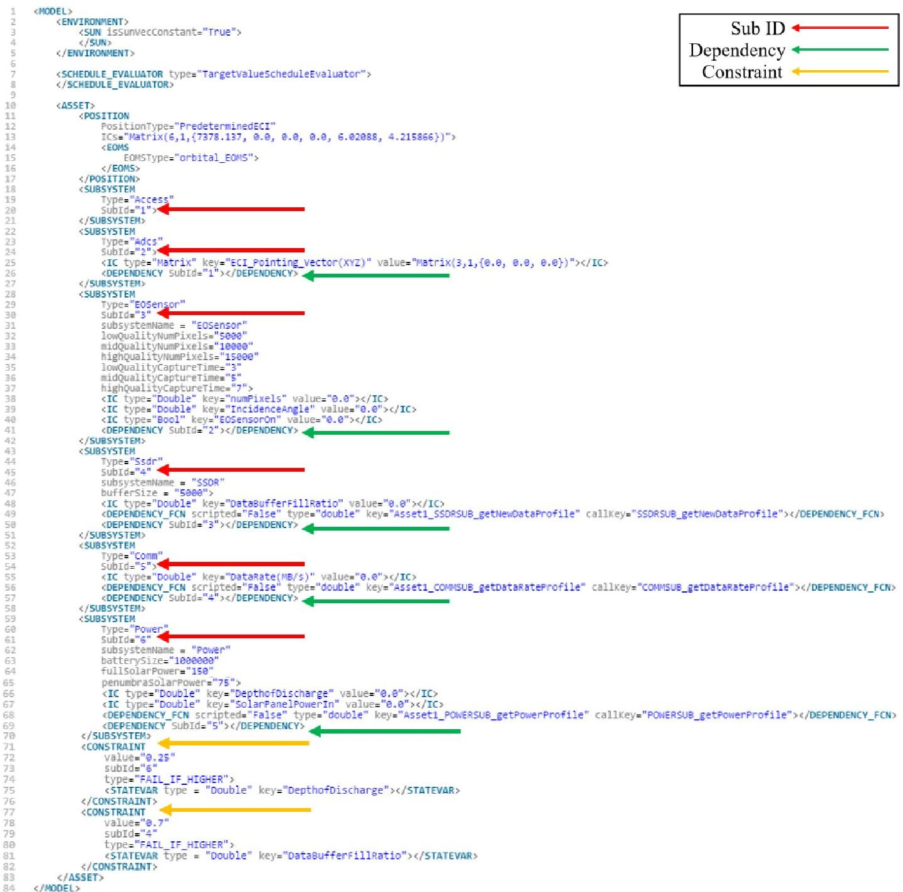

Figure 31: Original HSF Input Script for Aeolus

The dependency structure of the Aeolus test scenario is shown in block diagram form below, in Figure 32. It is imperative that the format and structure created from these dependencies and constraints is correctly described in the SysML model and is correctly translated into the HSF system input script. The Aeolus and ExoCube translated scripts both require this structure to be considered a viable replacement for the original manually written input script.

<!-- PDF_PAGE: 69 -->

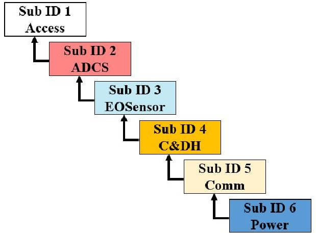

Figure 32: HSF Input Script Dependency Block Diagram

## 4.2 HSF Scheduling Algorithm Framework

HSF scheduling algorithm framework interprets the input script parameters, dependencies, and constraints described in the three input scripts and executes a simulation scenario to create a series of schedules. The algorithm generates a schedule by creating a chronological list of tasks performed by the system. Before the algorithm can add a new task to a schedule it must perform three checks. First, the previous task must first have already been completed. The scheduler then checks to see if the same task can be performed again. Lastly, the scheduler confirms that the task can be physically performed by the system. If all checks are satisfied, then the schedule is copied and the new task is added to the end. As the algorithm progresses through tasks, some generated schedules will not be capable of performing any additional tasks and are discarded. This process is repeated until the simulation end parameters are met, or there are no longer any feasible schedules. If a convergent schedule is found, HSF will output standard text result files.

The goal of each HSF simulation is to converge on a result schedule which will satisfy all requirements without violating any mission, system, or subsystem. Tasks ultimately enable the system to capture targets and downlink target data. Targets with the highest priority are ground stations (value = -1) because data uplinks and downlinks are considered mission critical. The algorithm does not create and select optimal schedules. Instead, it simply makes a list of feasible

<!-- PDF_PAGE: 70 -->

schedules that fulfill the simulation parameters. Because of this, multiple simulation results may be required to perform system parameter trades and find a satisfactory solution.

## 4.3 HSF Translator Plugin

To accomplish the goal of this thesis, a SysML model is must be converted into the same specialized XML format as the previous HSF system input script. MagicDraw is capable of exporting SysML models to standard XML format, but the standard XML output is not compatible with HSF. The HSF Translator Plugin was designed to convert these standard XML files into the custom XML format used by HSF.

Each Subsystem within the SysML generated XML output file has its own specific tag due to the design standards which the original SysML model follows. The plugin searches for these specific tag types and extracts them as it reads through the SysML generated XML file. The plugin utilizes the C# command function library to enable direct manipulation of the XML files, as opposed to a brute force method of using text editing commands. With this function library, the plugin searches for tags rather than specific strings of text, saving time and processing power.

Subsystem tags also have subtags contained within them, calling out specific parameter labels. These subtags have another level of subtags which contain parameter values. When the plugin fetches a subsystem tag, the subtag labeling system allows it to efficiently fetch all subsequent subsystem components, parameters, and parameter values. When fetching is completed, the plugin formats the subsystem tags and subtags by removing any irrelevant data. The plugin then organizes the subsystem tags into the custom XML format of the HSF input script.

The final output of the HSF Translation Plugin is a specially formatted XML system input script that has a format identical to the original HSF system input script. The organization style of the SysML model allowed for its subsequently exported XML script to be easily

<!-- PDF_PAGE: 71 -->

searched, reformatted, and converted into the specialized XML script for HSF. The similarity between the exported XML script and the HSF XML script was also a key driver behind the functionality of the plugin.

<!-- PDF_PAGE: 72 -->

## 5.1 Aeolus Model Results

Validation of this thesis was performed by comparing the format and structure of the translated SysML Aeolus input script to the original Aeolus input script. This section will show that the original script and the translated script are identical. This validates the SysML model and modeling technique, proves that the plugin is functioning correctly by translating the SysML model into the correctly formatted XML system input script, and demonstrates a functional HSF simulation.

## 5.1.1 HSF Translator Plugin Output

The HSF Translator Plugin was used to convert the Aeolus SysML model into the HSF input script which can be seen below, in Figure 33. For the translated input script to allow HSF to run a simulation, dependencies and constraints relationships within the input script must retain the sane structure, and all numerical data must remain unchanged. Figure 33 depicts the translated SysML Aeolus input script. Again, red arrows point to the Sub ID numbers, green arrows point to subsystem dependencies, and yellow arrows point to subsystem constraints.

The HSF Translator Plugin created the new Aeolus input script in a more compact form, but all essential data remains. Correct Sub ID numbers are assigned to their corresponding subsystems, correct dependencies are assigned to their corresponding subsystems, correct constraints are assigned to their corresponding subsystems, and all initial condition numerical data was transcribed from the SysML model. Additionally, the structure created from the dependency and constraint relationships remained identical, as seen in Figure 32, thus allowing individual subsystem data interact other subsystem data within the scheduling algorithm.

<!-- PDF_PAGE: 73 -->

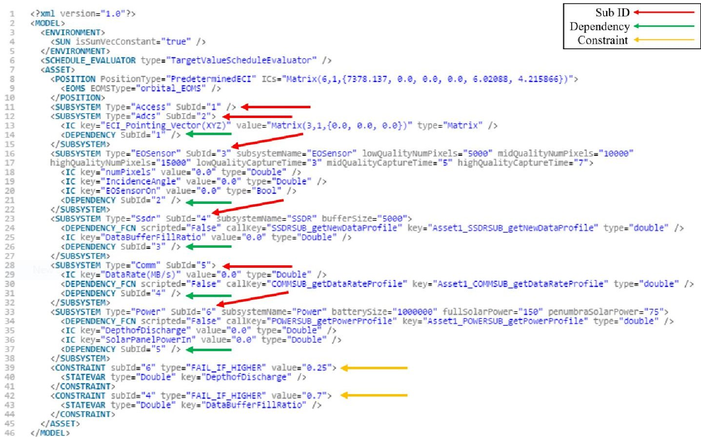

Figure 33: Aeolus Input Script Derived from Aeolus SysML Model

## 5.1.2 Initial Aeolus Results

A 480 second trial run of the Aeolus test scenario with original scripted inputs was initially executed. A 480 second trial run of the Aeolus test scenario with the SysML input was subsequently executed. The results were identical, as expected.

For the purposes of this thesis, each simulation is described as a graphical representation of select data from the simulation output text files by four plots. The four plots represent subsystems on the theoretical Aeolus satellite including communication, data storage, power storage, power absorption, satellite incidence angle, and general target data.

As can be seen in Figure 34, the satellite solid state data recording (SSDR) system accumulates data as the mission progresses. Unfortunately, this first verification run of the Aeolus test scenario was too short to allow the satellite enough time to perform a downlink maneuver. This will be available in simulations with longer runtimes.

<!-- PDF_PAGE: 74 -->

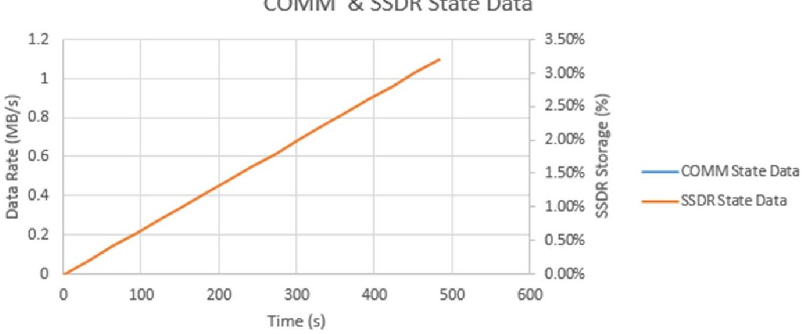

Figure 34: Aeolus Comm & SSDR State Data - 480 Second Simulation

The state of the Aeolus battery and solar panel systems can be seen in Figure 35. The simulation begins with Aeolus in shadow, but the satellite quickly passes through the Earth's penumbra and into full sunlight. Solar power generation is represented by the orange line of the SolarPanelPowerIn term. As expected, the blue line representing the Aeolus battery DepthofDischarge term increases during the shadowed segment of the orbit. It should be noted that during the 150 seconds of shadow, the depth of discharge only reaches 1.4%. Both the scripted Aeolus simulation and the SysML fed simulation reported this result. Once the satellite is in full sunlight, the depth of discharge rapidly decreases until it reaches zero. The Aeolus simulation was set to have a solar power generation capability of 150 watts.

<!-- PDF_PAGE: 75 -->

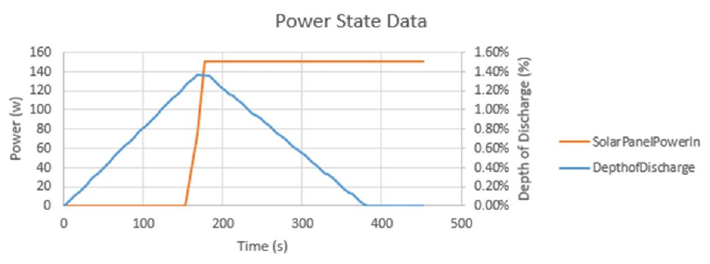

Figure 35: Aeolus Power State Data - 480 Second Simulation

The mission objective of the Aeolus satellite is to image previously specified targets across the globe. The following two plots show data relating to this objective. In Figure 36, the number of targets acquired and the incidence angle at which they were acquired are shown. During the 8-minute simulation, a total of 16 target captures took place.

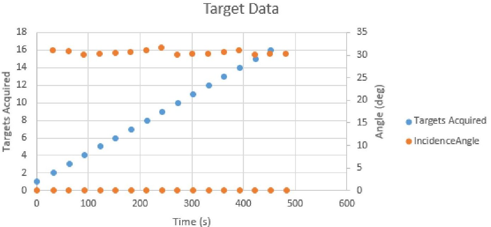

Figure 36: Aeolus Target State Data - 480 Second Simulation

The location of those target captures can be seen in Figure 37. The simulation only output 4 unique locations.

<!-- PDF_PAGE: 76 -->

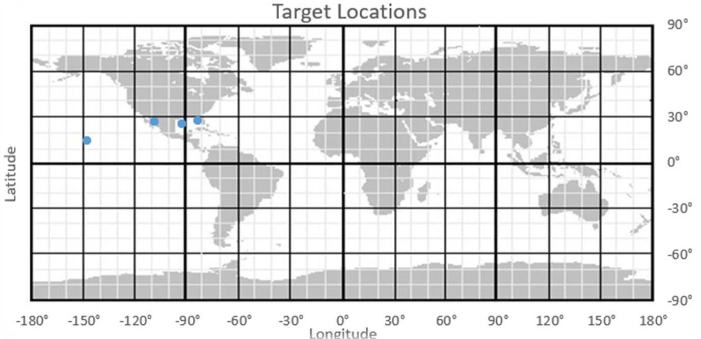

Figure 37: Aeolus Target Location Data - 480 Second Simulation

## 5.1.3 Extended Aeolus Results

The initial 480 second simulation provided strong evidence that the original scripted inputs and the new SysML input provided the same results. This was a favorable outcome, but the concept was tested again in an extended, 3500 second, simulation. Again, both the original HSF script, and the SysML converged and produced identical results.

In the original 480 second simulation, the satellite did not perform a data downlink maneuver due to inadequate simulation time. The 3500 second, or 58 minute, scenario was executed to provide additional verification of the SysML input method, and to show that the Aeolus subsystems were all functioning nominally. As can be seen in Figure 38, The SSDR percentage climbs at the same rate of the previous scenario until it reaches 18%. At this point, HSF finds the conditions favorable to schedule a communication downlink task. Five successive downlink tasks are performed until the SSDR has downlinked all data. At this point, no additional data is stored.

<!-- PDF_PAGE: 77 -->

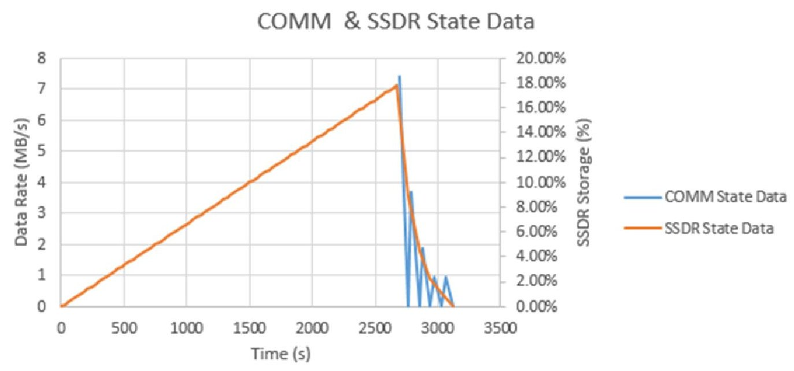

Figure 38: Aeolus Comm and SSDR State Data - 3500 Second Simulation

The beginning of the power state data plot is identical to the previous 480 second simulation results. For the majority of this simulation, the satellite is in the sun, the solar panels are generating 150 watts, and the battery is not being discharged. The battery remains at 0% depth of discharge until the 2700 second mark, where a spike in power usage occurs. This spike directly corresponds to the communication downlink tasks.

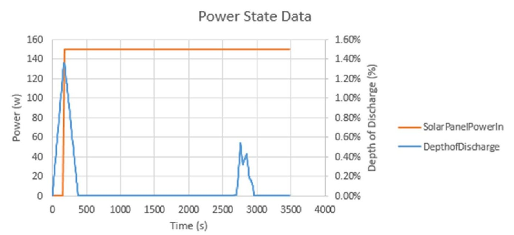

Figure 39: Aeolus Power State Data - 3500 Second Simulation

<!-- PDF_PAGE: 78 -->

Again, the number of targets acquired and the corresponding incidence angle are shown in Figure 40. This extended simulation shows that the rate at which the satellite captured targets remained constant until the communication downlink tasks. At that point, the satellite continued to acquired targets, but at a reduced rate. This is likely due to a reallocation of power to the communication subsystem and the targeting priority of pointing the satellite to the downlink station. The satellite was able to capture 100 targets by the end of the 3500 second simulation.

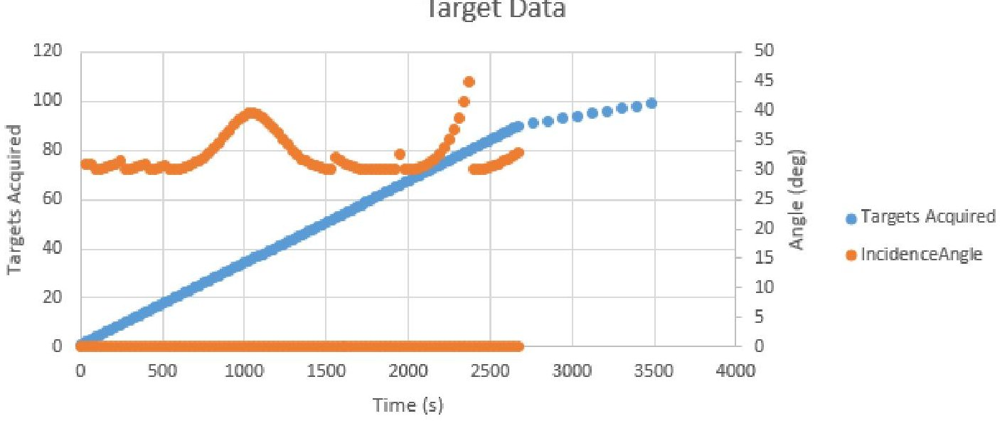

Figure 40: Aeolus Target State Data - 3500 Second Simulation

The extended Aeolus simulation produced a much greater variety of target capture locations. The simulation now output 13 unique locations and it was, again, found that multiple target captures took place on an individual location.

<!-- PDF_PAGE: 79 -->

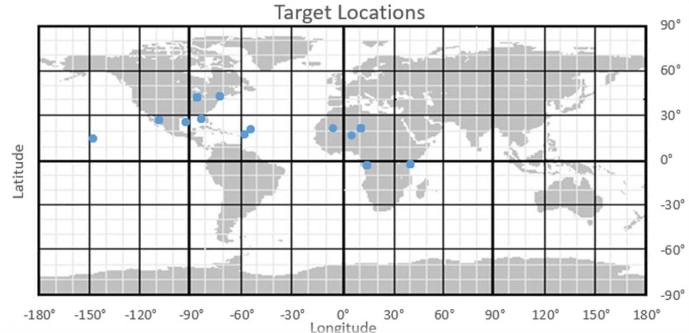

Figure 41: Aeolus Target Location Data - 3500 Second Simulation

## 5.2 ExoCube Model Results

Further validation of the SysML modeling technique and the HSF Translator Plugin was accomplished by comparing the structure of the HSF input script, translated from the ExoCube SysML model, with the structure of the original Aeolus input script.

## 5.2.1 HSF Translator Plugin Output

The HSF Translator Plugin was used to convert the ExoCube SysML model into an input script which can be seen below, in Figure 42. It was again necessary for the translated input script to contain the same dependency and constraint structure as the original input script. This structure satisfies the input parameter requirements of the HSF base code and scheduling algorithm. Red arrows point to the Sub ID numbers, green arrows point to subsystem dependencies, and yellow arrows point to subsystem constraints.

The HSF Translator Plugin was able to generate an ExoCube input script that was similar to the Aeolus input script. Sub ID numbers, dependencies, and constraints are identical to the Aeolus scenario. The primary difference between the Aeolus and ExoCube input scripts is the

<!-- PDF_PAGE: 80 -->

numerical initial condition data, specifically relating to the power subsystem. This data was translated from the power subsystem of the ExoCube SysML model.

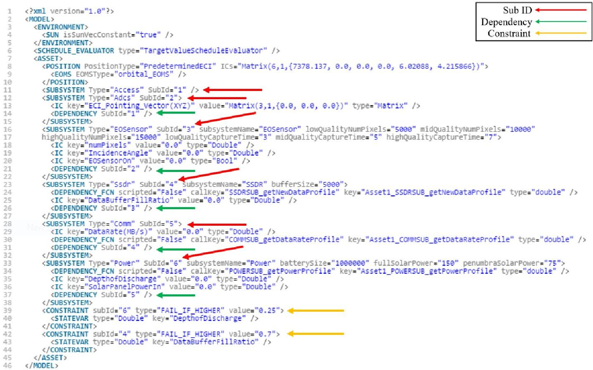

Figure 42: ExoCube Input Script Derived from ExoCube SysML Model

The translated ExoCube script retained the original structure created by the dependency and constraint relationships. The ability to consecutively transcribe the structure shown Figure 43, again shows two things. The first is that the SysML model contains all necessary data required by HSF and is correctly designed to interface with the HSF Translator Plugin. The second is that the HSF Translator Plugin is correctly recognizing all system and subsystem aspects within the SysML model and correctly transcribing them into the correct XML format required by the HSF scheduling algorithm framework.

<!-- PDF_PAGE: 81 -->

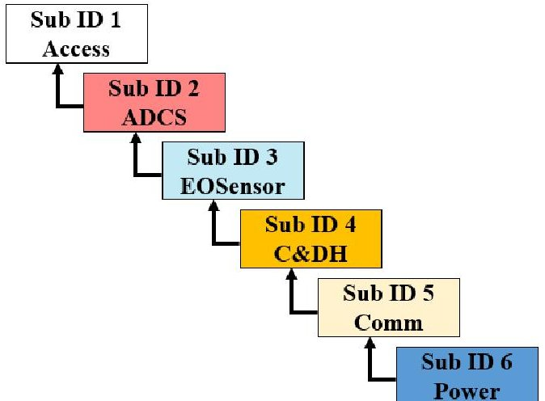

Figure 43: ExoCube Input Script Dependency Block Diagram

## 5.2.2 HSF .h and .cpp Scripts

It was not possible to use the translated ExoCube input script in an HSF simulation. In order to run an ExoCube simulation, the scheduling algorithm would need to have been updated to reflect additional subsystem values specific to ExoCube. The .cpp function scripts within the framework primarily describe all aspects of the spacecraft's subsystems. These, as well as many other aspects of the scheduling algorithm framework, would have required a detailed overhaul in order to reflect the much smaller subsystem parameters of the ExoCube Cubesat.

Parameters specific to each spacecraft subsystem are embedded in these .cpp scripts. The power.cpp script can be seen below, in Figure 44. For example, red arrows point to two key variables which describe the power consumption of the spacecraft. The powerSubPowerOut and powerOut[te] values of 10 and 65 watts, respectively, correspond to the Aeolus vehicle power consumption. Conversely, ExoCube power requirements are in the single digits.

<!-- PDF_PAGE: 82 -->

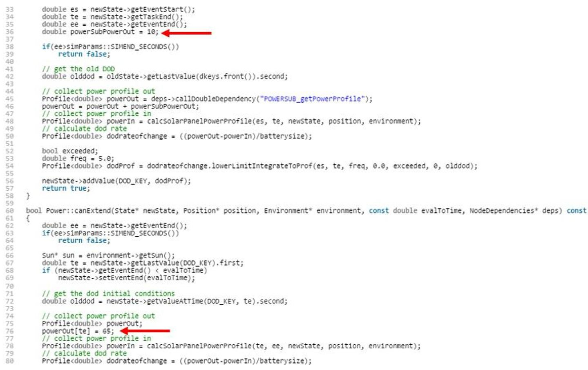

Figure 44: power.cpp Function Script

We were unable to change the framework due to our limited experience with the scheduling algorithm aspects of HSF. These power values, as well as many other .cpp script values and additional functionality within the framework made it unrealistic to create a scenario specific to ExoCube within the scope of this thesis.

## 5.3 Conclusion

The overarching goal of this thesis was to link a SysML model and HSF through the HSF Translator Plugin. This was examined due to the fact that a user would have to acquire highly specialized knowledge of HSF and its extensive framework in order to execute a simulation. If the user could instead employ a more common modeling tool, SysML, as the input to HSF, then the ability to construct and run a simulation would be available to a larger user base. The user would then have the ability to use HSF to execute day in the life simulations and while also utilizing the benefits of MBSE from the SysML model. This concept led to the question, "Is it possible to design a SysML model which will interface with the Horizon Simulation Framework

<!-- PDF_PAGE: 83 -->

to streamline the simulation design process, while simultaneously providing the traditional benefits of model based systems engineering?"

Deliverables necessary for investigation of this topic included the HSF Translator Plugin, A SysML model of the HSF test scenario Aeolus, a SysML model of the real-world ExoCube CubeSat, and Aeolus simulation scenario results created from the translated input script. All deliverables were completed and the final outcome produced favorable results.

All results from the Aeolus effort of this thesis were highly favorable including the SysML model, translated input script, and the scenario simulation results. The original, manually written, system input script and the script converted from the Aeolus SysML model were structurally identical. HSF produced identical scheduling results after executing simulations with both input scripts, thus validating that the SysML model was capable of acting as a system input script for HSF simulations. The success of the Aeolus SysML script satisfied the initial goal of this thesis.

Results from the ExoCube simulations were also highly favorable including the SysML model, and the translated input script. The converted ExoCube SysML script retained the required HSF dependency and constraint structure. The HSF Translator Plugin was also able to recognize new initial condition data from the ExoCube SysML model and include in the translated input script. This demonstrates that future SysML models can be used in conjunction with the HSF Translator Plugin to create an HSF system input script. The Aeolus and ExoCube SysML models may also serve as a starting point and base of knowledge for future SysML satellite models. Design teams will be able to refine and reuse the models in order to learn and improve SysML modeling skills.

The successful realization of this thesis intended to incorporate the benefits of MBSE and SysML with the simulation capability of HSF. The work completed in this thesis has begun to

<!-- PDF_PAGE: 84 -->

extend the functionality of HSF by incorporating the benefits of SysML into the model design process. If continued efforts are made to improve HSF, future design teams will be able to use this integrated modeling and simulation tool to aid in future spacecraft design activities. HSF may eventually lead to the realization the single body of knowledge concept which will aid in all phases of a satellite mission.

## 5.3.1 Strengths and Weaknesses

The greatest strength of this thesis was that the SysML input and the original input of the Aeolus simulation produced structurally identical results. HSF produced identical schedule results after replacing the original input script with the translated input script. This successful translation was then able to be compared to the translated ExoCube input script and it was possible to draw confident and optimistic conclusions regarding the future development of the concept.

The greatest weaknesses of this thesis was the lack of insight into the internal mechanics of the HSF scheduling algorithm framework and subsystem scripts. Initial research was conducted into the functionality and dependencies of the modular HSF input scripts and the discrete scheduling algorithm. It was originally concluded that the input scripts described all aspects of the vehicle, environment, target, and time related values, and the scheduling algorithm was solely responsible for creating and maintaining algorithms and schedules. Our confidence that all HSF inputs were controlled by these three scripts allowed attention to be solely focused on translating the system input script. Although originally seen as a strength, this was ultimately a weakness because the HSF Translator Plugin did not include the functionality required to include all system and subsystem parameters within a HSF simulation.

Viren and I were able to stay within close collaboration during the entirety of the thesis. Despite this good collaboration, another weakness was that of scheduling setbacks and slow progress due to the interwoven deliverables of the thesis. Work for this thesis began with myself researching SysML and SysML clients, obtaining a software license, and eventually designing

<!-- PDF_PAGE: 85 -->

SysML models. There were setbacks in obtaining the MagicDraw license but this was not originally problematic. I was able to quickly begin modeling the Aeolus system after I had acquired an understanding of the language. It was necessary that the Aeolus model was complete prior to the start of Viren's work because he required access to a full SysML based XML output template. The project time allowed Viren a few short months before our graduate year was complete and we were no longer attending classes at Cal Poly. Soon after, Viren and I found employment opportunities and were unable to dedicate much time to the progress of the thesis. This led to a massive extension of the original thesis completion timeline.

## 5.3.2 Lessons Learned

The Aeolus SysML model input was able to produce the exact results as the original HSF input scripts for multiple simulation executions over a variety of time frames. This validation of interchangeable input scripts satisfied the initial goal of this thesis in that SysML was interfaced with HSF to provide the benefits of both platforms. However, this change alone did not streamline the entire simulation design process.

The HSF framework contains subsystem .h header scripts and .cpp function scripts. Parameters and algorithms maintained in these function scripts are independently and manually written, and were subsequently inaccessible to the input script. Unfortunately, it was found to be unavoidably necessary to heavily edit or redesign the subsystem function scripts, as well as many aspects of the framework for each new simulation. A complete knowledge of the HSF scheduling algorithm framework would have been required for modification or creation of a new ExoCube scenario.

The focus of this thesis was limited to implementing the HSF system script from a SysML model and therefore, the subsystem values and functions could not be manipulated with the knowledge and tools available. Further work regarding the modularization of the HSF header

<!-- PDF_PAGE: 86 -->

and function scripts, as well as additional capability to the HSF Translator Plugin will be required to create a fully automated link between SysML and HSF.

## 5.3.3 Future Work

The primary problems encountered were related to the implementation of ExoCube into HSF. These issues are currently being addressed by switching the HSF scripting language from XML to Python. Ultimately, the HSF Translator plugin can be altered or redesign to translate the SysML model into Python, the user will be able to incorporate the translated SysML based Python Scripts into HSF.

Future work may then expand to a SysML based translation of the remaining input scripts into the new Python input scripts. As seen in Figure 20, the SysML model has a domain dedicated to Ground Systems, including ground stations and targets. All aspects of the ground systems that are currently described in the HSF input script can be easily modeled in SysML, translated into HSF required format, and used as an HSF input. Ground stations could then be easily added, edited, or removed as mission design progressed and understanding of ground station availability became better defined. Targets would also be easily added, edited, or removed as mission design progressed and requirements related to data collection became more defined. To model all HSF input scripts in SysML, a timing domain must also be added to the SysML model. The timing domain would include the simulation start and end times, the starting Julian date, the simulation time step, and the maximum number of desired schedules.

Although the system input scripts and the HSF scheduling algorithm were designed to be modular, it was found that additional functionality within the framework was less than interchangeable. The system input script was not able to incorporate all aspects of the ExoCube subsystems into a new simulation. The input script created from the SysML model would have provided a more desirable outcome if all system requirements were established solely from the system input script.

<!-- PDF_PAGE: 87 -->

A more autonomous transition between SysML and HSF may be possible by enabling the HSF Translator Plugin to create aspects of the frame work, specifically the .h and .cpp scripts. This new plugin functionality must recognize subsystem values described in the SysML and convert that data into a format accepted by HSF. This would specifically address subsystem parameters described in the framework including, ADCS, Comm, EOSensor, Power, and SSDR.

This path may not be practical and it may, instead, be preferable to edit or replace specific subsystem values within HSF. A possible solution to this scenario involves a revision of HSF so that all subsystem specific values are defined within the input scripts. The completion of the continued modularization of HSF and the added functionality of the HSF Translator Plugin would allow all aspects of an HSF simulation to be fully described from the translated input script created from a single SysML model.

<!-- PDF_PAGE: 88 -->

## BIBLIOGRAPHY

[1] C. Carson, M. Firzgerald and S. Hallen, "Model Driven Development with SysML," IMB, INCOSE Symposium, 2009.

[2] S. Friedenthal, A. Moore and R. Steiner, A Practical Guide to SysML: The Systems Modeling Language, Burlington, MA: Morgan Kaufmann Publishers, 2008.

[3] J. Murray, "Model Based Systems Engineering (MBSE) Media Study," Portland State University, Department of Systems Engineering, 2012.

[4] IEEE, "IEEE Standard Glossary of Software Engineering Terms," IEEE Std 610.12-1990 vol. 610, no. 12, p. 84, 1990.

[5] "SysML Forum," PivotPoint Tech Corp, 2015. [Online]. Available: http://sysmlforum.com/sysml-faq/.

[6] J. Wolfrom, "Model-Based Systems Engineering (MBSE) Overview," Applied Physics Lab.

[7] B. Butler, "Dynamic Model Creation and Scripting Support in the Horizon Simulation Framework," California Polytechnic State University, San Luis Obispo, 2012.

[8] R. Munakata, "CubeSat Design Specification," California Polytechnic State University, San Luis Obispo, 2009.

[9] Cal Poly Aerospace Department, "Winter News Letter," Cal Poly, 2009. [Online]. Available: https://aero.calpoly.edu/newsletters/winter-2009/cp-6-ready-fly/.

[10] D. o. L. Vega Programme Office, "Educational Payload on the Vega Maiden Flight - Call for CubeSat Proposals," European Space Agency, 2008.

<!-- PDF_PAGE: 89 -->

[11] M. Crook, "NPS CubeSat Launcher Design, Process and Requirements," Naval Postgraduate School, Monterey, 2009.

[12] D. Leonard, "Space.com," 8 September 2004. [Online]. Available: http://www.space.com/308-cubesats-tiny-spacecraft-huge-payoffs.html.

[13] S. Spangelo and et-al, "Applying Model Based Systems Engineering to a Standard CubeSat," IEEE, Vols. 978-1-4577-0557-1/12, 2012.

[14] e. a. J. Cutler, "Initial Flight Assessment of the Radio Aurora Explorer", in Proceedings of the 25th Small Satellite Conference, Logan, Utah, August 2011.

[15] S. Spangelo and et-al, "Model Based Systems Engineering (MBSE) Applied to Radio Aurora Explorer (RAX) CubeSat Mission Operational Scenarios," Institute of Electrical and Electronics Engineers, no. IEEE AC Paper #2170, p. 18, 2013.

[16] e. a. David Kaslow, "Integrated Model-Based Systems Engineering (MBSE) Applied to the Simulation of a CubeSat Mission," Institute of Electrical and Electronics Engineers, no. IEEEAC Paper #2289, p. 14, 1/22/2014.

[17] N. Magic, "NoMagic.com," No Magic Inc., 2015. [Online]. Available: http://www.nomagic.com/products/magicdraw-addons/sysml-plugin.html.

[18] V. D. T. N. PARASTOO MOHAGHEGH, "Definitions and Approaches to Model Quality in ModelBased," Sintef research co., Trondheim, Norway, 2009.

[19] E. Mehiel, "Model Based Systems Engineering," Cal Poly, San Luis Obispo, 2012.

[20] PolySat, "CP-10 (ExoCube)," California Polytechnic State University, 2015. [Online]. Available: http://polysat.calpoly.edu/launched-missions/cp10-exocube/.

<!-- PDF_PAGE: 90 -->

[21] C. Paredis, "Mode-Based Systems Engineering: A Roadmap for Academic Research," Geogria Tech, Model-Based Systems Engineering Center, 2011.

[22] R. Cloutier, "SysML RFI Analysis Results," Object Management Group, Long Beach, CA, 2004.

[23] V. Dehlen, P. Mohagheghi and T. Neple, "Definitions and Approaches to Model Quality in Model Based Software Development-A Review of Literature," Object Management Group, 2008.

[24] C. Delp, "Viewpoint Modeling and Model Based Media Generation for Systems Engineers: Document Generation and Scalable Model Based Engineering," Jet Propulsion Laboratories, Pasadena, 2011.

[25] S. Friedenthal, R. Griego and M. Sampson, "INCOSE Model Based Systems," INCOSE, San Diego, 2007.

[26] H. Graves and Y. Bijan, Using Formal Methods with SysML in Aerospace Design and Engineering, Springer Science, 2011.

[27] R. Griego and M. Dee, "INCOSE MBSE Challenge Teams," INCOSE, 20 January 2011. [Online]. Available: http://mbse.gfse.de/.

[28] C. Paredis, "System Analysis using SysML Parametrics: Model-Based Systems Engineering Center," Gorgia Tech, Model-Based Systems Engineering Center, 2011.

[29] D. Kaslow and et-al, "Integrated Model-Based Systems Engineering (MBSE) Applied to the Simulation of a CubeSat Mission," IEEE, Vols. 978-1-4799-1622-1/14, no. 2289. Version 5, 2014.

<!-- PDF_PAGE: 91 -->

## APPENDICES

## A: ExoCube SysML Diagrams

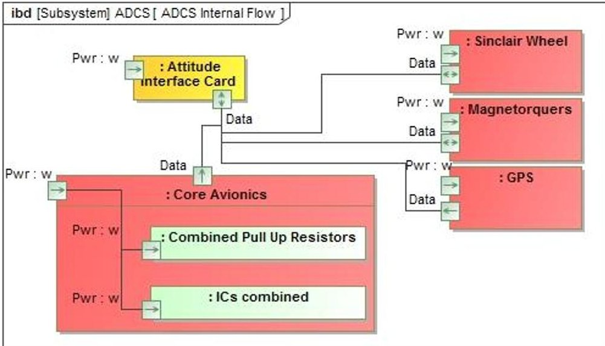

## Figure 45: ExoCube ADC Subsystem IBD

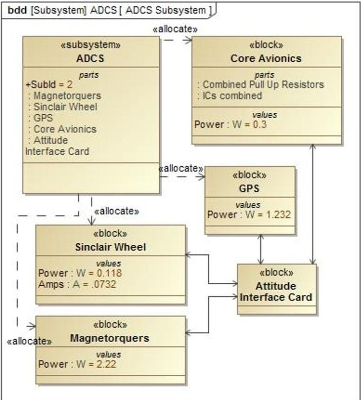

Figure 46: ExoCube ADC subsystem BDD

<!-- PDF_PAGE: 92 -->

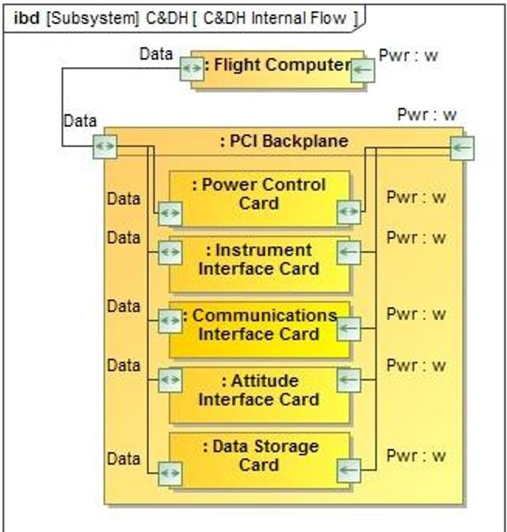

Figure 47: ExoCube C&DH subsystem IBD

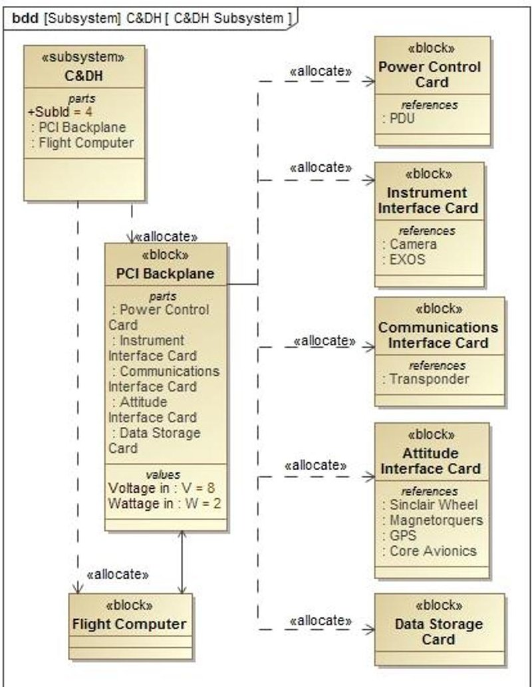

Figure 48: ExoCube C&DH subsystem BDD

<!-- PDF_PAGE: 93 -->

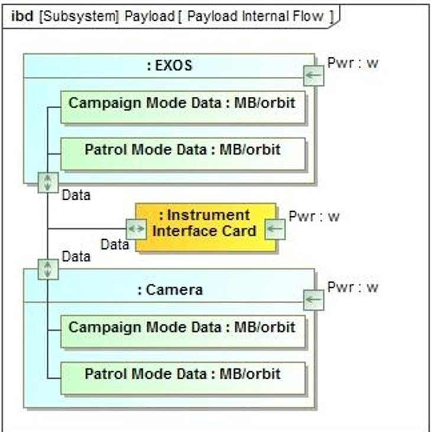

Figure 49: ExoCube Payload subsystem IBD

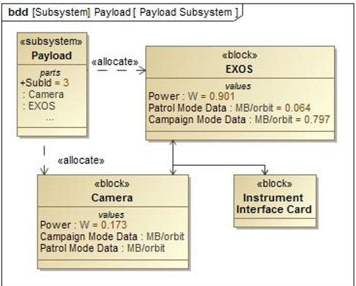

Figure 50: ExoCube Payload subsystem BDD

<!-- PDF_PAGE: 94 -->

## B: ExoCube Operational Mode Diagrams

Figure 51: ExoCube Operational Patrol Mode

Figure 52: ExoCube Operational Attitude Correction Mode

<!-- PDF_PAGE: 95 -->

Figure 53: ExoCube Operational Data Transmission Mode

