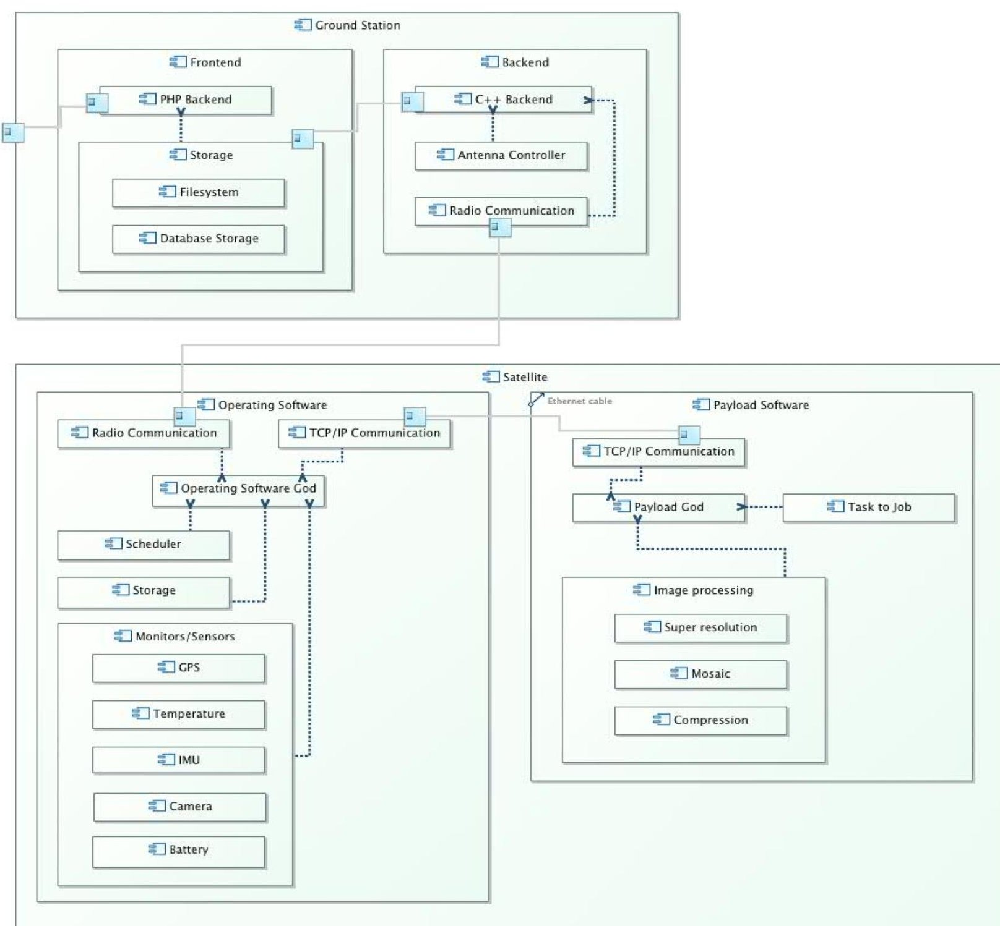

<!-- PDF_PAGE: 1 -->

# Toward Requirements Engineering of Cyber-Physical Systems: Modeling CubeSat

Hassan Reza Department of Computer Science University of North Dakota 3950 Campus Road, Stop 9015 Grand Forks, ND 58202 701-777-4107 reza@cs.und.edu

Jeremy Straub Department of Computer Science University of North Dakota 3950 Campus Road, Stop 9015 Grand Forks, ND 58202 701-777-4107 jeremy.straub@my.und.edu

Christoffer Korvald Department of Computer Science University of North Dakota 3950 Campus Road, Stop 9015 Grand Forks, ND 58202 701-777-4107 christoffer.korvald@my.und.edu

Nicholas Alexander Weisberg Division of Computer Science, Marshall University One John Marshall Drive Huntington, WV 25755 304-696-5453 alexander50@live.marshall.edu

Justin Hubber Department of Computer Science University of North Dakota 3950 Campus Road, Stop 9015 Grand Forks, ND 58202 701-777-4107 justin.huber@my.und.edu

Abhinav Chawla Department of Computer Science University of North Dakota 3950 Campus Road, Stop 9015 Grand Forks, ND 58202 701-777-4107 abhinav.chawla@my.und.edu

Abstract—The OpenOrbiter CubeSat Development Initiative is working to build a small spacecraft system using open source software and open hardware principles. The important design considerations for the CubeSat include availability and performance. The essential contribution of this paper is the requirement elicitation and specification of system-wide qualities such as availability, performance, and security using quality attribute scenarios. The effect of using the quality-based scenarios is that it allows more rigorous treatment of non-functional requirements and hence proper selection of an architecture modeling to satisfy these requirements.

## TABLE OF CONTENTS

1. INTRODUCTION ... 1

2. BACKGROUND ... 2

3. CUBESAT IMPLEMENTATION ... 4

4. APPROACH ... 5

5. CONCLUSIONS AND FUTURE WORK ... 10

REFERENCES ... 11

ACKNOWLEDGEMENTS ... 11

## 1. INTRODUCTION

The term cyber-physical systems (CPS) refers to the class of highly sophisticated systems that go beyond the engineering requirements of real-time embedded systems (RTES). These systems put heavy emphasis on computation, communications, and coordination among stand-alone subsystems that can be monitored and connected via cybersystems. The development of CPSs demands the close integration and careful coordination of numerous system components including the onboard computing system, communications links and environmental interaction systems such as various monitoring and actuary devices [1-4]. Specifically, for a typical CubeSat, these components

include a camera, other sensors and attitude control (and possibly propulsion) actuators (see, e.g., [5]).

In addition to classical challenges (e.g., safety, reliability, robustness, efficiency, etc.) relevant to the design of RTESs, CPSs pose additional and more fundamental challenges [2, 6]. Challenges facing the engineering of CPSs include requirement engineering, design, and verification and validation of both the cyber and physical elements. The specification and verification of CPS, in turn, requires application of different and/or hybrid modelling notations to specify and verify both discrete and continuous dynamics aspects of these systems in the closely coupled environment in which the elements can be highly concurrent and/or distributed. Other challenges include the specification and verification of non-functional requirements such as security, usability, safety, deployability, configurability, and energy-efficiency. Size and weight constraints on some CPSs pose additional restriction on computational and communication capabilities and hence on the overall performance of the CPS.

These systems also require appropriate integration strategies for cyber and physical elements to create the high degree of coordination required to perform their tasks correctly [2-4]. This level of cooperation and coordination dictates close collaboration and integration requires a multidisciplinary approach (i.e., combining mechanical engineering, electrical engineering and computer science). The multidisciplinary approach required for CPS applications poses additional technical challenges regarding the systematic application of requirements specifications for system capability and quality requirements driven by multiple classes of stakeholders. This raises the question of how to use and/or modify existing modern software engineering processes (e.g., Model-Driven Engineering [7,8] and Model-Based Engineering [9]), products (e.g., Architectural Analysis and Description languages (AADL) [10,11]) and supporting

<!-- PDF_PAGE: 2 -->

tools (e.g., OSATE [8]) to support the architectural design and implementation of CPS.

In this paper, the requirements engineering of small spacecraft CPS are discussed. Specifically it discusses the attempt to document the software requirements of CubeSats. CubeSats are small space systems that are growing in popularity [12] for use in a wide variety of applications to serve educational, scientific, government / military and commercial objectives. The University of North Dakota (UND) CubeSat program's [13] main objective [7] is to provide access to space for small payloads, which can be designed and implemented by scientists, engineers and even students majoring in science, technology, engineering, and math (STEM) and other disciplines to perform a multitude of prospective missions.

Despite their small size, the software elements of small spacecraft can be very complex due to their distributed nature, concurrency and synchronization requirements, and system non-determinism. To enhance dependability and maximize the probability of mission success and investment return, mission critical systems require the systematic application of modern engineering approaches in order to specify and analyze the capability and quality of these systems in a cost-effective manner. The design and implementation of CubeSats presents additional complexities stemming from the close integration and coordination of computational and communication subsystems and the limited resources (e.g. power) available for their use.

In particular, this paper discusses the application of the model-based requirements engineering (MBRE) method to the development of the CubeSat cyber-physical system currently under development at the University of North Dakota (UND) [7]. The project is a student-run effort [14, 15] that aims to reduce the parts cost required for building a small spacecraft to below $5,000 [16]. To do this, the project is using open source software and open hardware concepts that will allow other developers to use the software and hardware designs at no cost to them. This not only facilitates low-cost development, it also allows the implementation of CubeSat programs at institutions that may have an interest in researching one particular area of craft design, but lack capabilities in other areas.

This paper continues with a discussion of relevant background materials in Section 2. Section 3 then describes the implementation of the CubeSat at UND. Then, in Section 4, the proposed methodology for CubeSat requirements definition, based on quality-attributes scenarios [17], is explained. Finally, in Section 5, the paper concludes with a summary of what has been determined from this exercise and a discussion of future work on the UND CubeSat project.

## 2. BACKGROUND

Space system developers have been, largely, reluctant to shift to modern engineering practices. This is evidenced by several studies conducted to understand the root cause of operational failures of space mission systems. For example, the report presenting the results of the investigation of the root cause of the failure of the Mars Climate Orbiter mission indicated that the main cause of the loss of the spacecraft could be attributed to an incorrect assumption made by staff at Lockheed Martin Astronautics and the Jet Propulsion Laboratory regarding measurement units used in their calculations [1]. One used English units whereas the other used metric units. This type of error is not unexpected given the difficulty of formally specifying and verifying the qualities and functionality of space systems.

## CubeSats

CubeSats are small spacecraft that provide simplified launch vehicle integration capabilities due to their standardized form factor. CubeSats commonly range in size from the 1U form factor (with dimensions of approximately 10 cm x 10 cm x 10 cm and a mass of 1.33 kg) to larger sizes such as the 2U (20 cm x 10 cm x 10 cm) and 6U (30 cm x 20 cm x 10 cm) variants. Larger sizes have also been proposed. The CubeSat general requirements are discussed in [18, 19]. These requirements, however, tell little about the actual operations of a given satellite (excepting some basic compliance requirements). CubeSat system requirements describe what (services) the system should provide, and how well these services have to be delivered in order to meet technical, financial, educational and other goals. The system requirements, among other things, may include mission objectives, interface, functional and nonfunctional, and physical requirements. An example of a CubeSat mission statement could be to encourage and educate STEM students to design and implement a small satellite system for inexpensive access to space in a manner that will meet enumerated legal, financial, educational, and scientific objectives.

## Necessity of Functional Requirements

Functional analysis and other methods can then be used to refine and properly identify the functional requirements of the system under construction. For example, functional tree, use-case scenarios, stories, and prototyping approaches can be utilized to refine abstract requirements into more detailed requirements that can be verified.

The difficulty of capturing the system requirements, for the most part, revolves around modelling and analyzing of the non-functionalities (also known as system quality attributes or para-functionalities) of a system, such as safety, performance, and such. Contradiction, omission, or commission (addition) of non-functional requirements (NFRs) may impact system architectural designs that are key artifacts for success or failure of a system. NFRs are non-orthogonal, meaning that some NFRs may interact with

<!-- PDF_PAGE: 3 -->

others in positive or negative ways. For example, maintainability and portability can impact each other in positive way, whereas security and usability may interact in negative way. Therefore, the selection of a design that meets the blend of NFRs requires some kind of trade-off analysis.

Omission or commission of NFRs may also result in a need for the reengineering of the entire system, because no one component can be modified to fulfill the missing or added NFR. Ambiguity in describing NFRs may also pose significant issues both during the architectural design, and verification and validation (V&V) phases. The use of terms like 'good', 'easy' or 'high', which are often used to specify system-wide properties like security and usability is problematic as it will be very difficult to specify and verify conformance during front-end and back-end engineering. For instance, a statement that the system shall provide a 'very good user interface' or 'very good security' are undefined and therefore cannot be architected or verified. Therefore, it makes sense to apply systematic requirement engineering techniques suitable to describe and evaluate the NFRs of cyber-physical systems such as CubeSats.

## Prior Work on Requirements Definition

Goal-oriented methods such as KAOA [20] and the NFR framework [21] are qualitative approaches that have been proposed to systematically document system level properties (also known as global system properties). These approaches are, for the most part, based on the divide and conquer design principle and are very much similar to the functional tree [22] approach used to analyze the functionalities of systems. Instead of using top-level functional requirements, the goal-oriented approaches incorporate decomposition techniques to decompose high level design goals (e.g., performance) into sub-goals represented by graphs (e.g., using AND or OR). These graphs are generated based on top-down or bottom-up approaches to represent various type of relationships among top system-wide goals and sub-goals as well as possible correlations (positive or negative) among these goals and their implementations. Moreover, these relationships (together with information regarding their correlation) have been used to increase the understanbility of design goals and their justification. This, in turn, allows architects to carry out trade-off analysis between various competing NFRs and their alternatives architectural solutions.

These approaches are very similar to functional tree [22] ones used to refine top level system functionalities to derive the low level functions. They are helpful to document NFRs in a more systematic way; however, their usability and scalability can be an issue when either dealing with a handful of NFRs or dealing with certain types of NFRs such as software sustainability [23].

In [24], Malavolta, Muccini and Sharaf studied the architectural issues associated to CPSs. The objective of this study was to identify problematic issues in the architecting of CPSs. To this end, they researched questions such as

identifying the applications domains in which the CPS have been used, and the types of architectural solutions (e.g., styles) that may be reused for or assist in solving problems with and developing CPSs. This work addresses the requirements engineering of CPSs. The systematic documentation of CPSs is a very important prerequisite for designing, implementing and validating CPSs.

In [25], Selic studied the issues related to documenting CPS requirements for the physical elements of the continuous and dynamic domain parts of CPSs. Examples of these issues include the cumulative error created by mismatches between a constant offset in the deviation between the actual values presented by the controlled variable and the desired values. This error could a pose a serious problem to safety critical systems that demand a high level of precision. To address this type of requirement problem, Selic identified a class of requirements relevant to the continuous part of CPSs where different variations are not properly specified. To that end, a classification to address cyberphysical system requirements was proposed; the classification is used as a checklist (or guidelines) by the system and software engineers to ensure the presence and/or the justification for the absence of the CPS's requirements. Although this work addresses a very important class of requirements (namely requirements attributed to the continuous dynamic domain of CPSs's physical part), it does not provide any solution for other system-level requirements critical to the proper operations of CPSs. An example of this type of requirement is non-functional requirements (such as security, etc.).

In [17], Len, Paul and Rick provide an extension to UML called Embedded UML. They discuss function-architecture co-design, which allows for formal and informal analysis of a model, in addition to simulation. There are already many proposals in existence addressing some aspect of modeling real-time systems using UML. The new Embedded UML approach seeks to combine the best of the existing proposals to create a more complete UML profile suitable for embedded real-time systems. It relies heavily on reactive (instead of active) objects, as reactive objects are a better match to embedded systems. A functional and executable specification can be mapped to specific platform architectures to perform analysis and simulation. The technique still lacks in requirements specification and other areas, but it provides a nearly comprehensive modeling notation for embedded systems.

In [26], De Niz compares UML and AADL and identifies what areas of the software development process each should be utilized for. UML provides several diagram types that can be used to model different aspects of the functionality of a system, but the relationships between the diagrams are hard to specify. UML could be extended using stereotypes, tagged values and constraints for specific applications. SysML and the Modeling and Analysis of Real-Time and Embedded systems (MARTE) approach have been created to fill in the gaps left by UML. SysML extends UML with

<!-- PDF_PAGE: 4 -->

two new diagrams: the requirements diagram, and the parametric diagram. Both diagrams are not made with the extension mechanisms described earlier, they instead modify the core diagrams. The parametric diagram can be used to model software relationships mathematically.

In [27-29], Jürjens discuss the importance of security quality attributes in the architecture of security-critical systems and presents an extension of the UML standard, UMLsec, for the purpose of model design for secure systems development projects. A set of requirements for security engineering is provided; however, implementing security mechanisms are omitted. A formal application of the UMLsec extension is presented where it is used in a biometric authentication system and the results are examined. A UML model with the UMLsec extension could prospectively provide useful insight on the current state of the security of a CubeSat project. The UMLsec extension could prove to be of great use for other projects using the Open Prototype for Educational Nanosats (OPEN) framework [30, 31] that are classified as security-critical systems.

In [32], Tan, Goddard and Perez provide a proposed definition and architecture for CPSs, in general. They suggest that human society is similar to CPS in that human individuals, or components, interact with the physical world. Four observations are made about human society, due to the successful integration with the physical world, which could benefit the design process of CPS architecture. They propose an architecture to address these requirements. The architecture suggests what the "next-generation network" should control but it leaves numerous open questions on how to implement the system, as there are no specific scenarios or systems presented. However, the behaviors (such as a global reference time and individual component control schemes) should be taken into consideration when designing any CPS, including the CubeSat spacecraft.

In [33], Holt, et al. proposed a model-based approach to requirement engineering of a systems of systems. The approach revolves around an ontology-based framework that consists of views and processes to document and relate system requirements using use-cases. The sets of processes and views were applied to test the capability of the system represented by a model. The emphasis of this work, for most part, was to capture the system's functional requirements at a high level of abstraction (system of systems) and its corresponding low level (system/subsystem elements).

## 3. CUBESAT IMPLEMENTATION

The software for the CubeSat spacecraft discussed herein consists of the following components: the ground station, the onboard operating software (satellite / payload), and the communications link. The ground station software provides the mission operators with an interface to define tasks, plan the mission and otherwise monitor the health and status of the spacecraft [34]. The ground station software will also be responsible for receiving and sending commands to the

spacecraft over amateur radio bands (using either an amateur or experimental license). All images captured by the satellite will be sent and maintained by the ground station for future use.

The operating software is responsible for ensuring that the satellite is always operating within the parameters defined and that it performs the tasks assigned by the operators. This all has to be done as efficiently as possible to minimize power consumption and maximize task completion levels.

Onboard operating software (satellite and payload) consists of multiple sensors such as a Global Positioning System (GPS) receiver and temperature, and Inertial Measurement Unit (IMU) sensors. These devices will be utilized to provide the operating software with the information needed to operate efficiently. The payload software will run on separate processing units and these will only be powered on when they are needed, to conserve the limited spacecraft battery. The operating software is also responsible for breaking up high level tasks into smaller imaging jobs the operating system can perform while the payload computer is not powered on [34].

Onboard image processing will serve several purposes. First, because of the limited bandwidth between the spacecraft and the ground station, an approach to reduce data needed to be transmitted is required. Second, it is desirable to produce ready-for-user data products that could be downloaded directly from the satellite by a prospective user. A technique called mosaicking, where several images are stitched together (effectively discarding overlapping regions) serves both of these purposes. An image covering a larger area is produced. Super resolution can also be used to create a higher resolution image from overlapping images. This will allow a less expensive camera with lower resolution to be used, but still produce a high quality image. This approach facilitates the use of smaller and lower mass camera hardware, freeing valuable mass and volume for use by other subsystems. The communications link is used to provide dependable communications between these subsystems.

The CubeSat's operational capabilities have been defined using UML scenarios and use cases. This work reports on the practicality of quality-attribute (QA) scenarios (based on the approach presented in [17]) to document nonfunctional requirements (NFR) of CubeSats, which is considered to be the prerequisite for evaluation and further investigation. The rational for using quality-attributes scenarios are to serve two objectives of the CubeSat project: 1) to specify quality attribute requirements by incorporating a level of detail in the form of templates to resolve the ambiguity normally attributed with existing approaches (e.g., natural language), and 2) to validate the suitability of architectural design decisions using tradeoff analysis to ensure that the architecture meets the quality attribute requirements.

To meet the first objective, sixteen quality attribute scenarios were generated to specify key quality attributes

<!-- PDF_PAGE: 5 -->

associated with the design of a CubeSat. The CubeSat's main design considerations are availability, security, performance and usability. Availability requires that the system to be up and running. The integrate-ability requirement refers to the degree by which system elements can be easily combined and/or interfaced with other elements such as the data link, etc. Security refers to the degree at which system assets are protected. Performance refers to speed by which the system reacts to the end-user, performs its operations, or the extent to which it utilizes the resources in efficient way.

To meet the second objective, these scenarios will be used for architecting a future CubeSat system such that the selected architecture optimizes its key quality attributes (NFRs). The key justification for architecting for nonfunctionalities, as discussed in [35], is that it provides a context under which design decisions and their consequences can be systematically analyzed as the system evolves through continuous integration and validation. The selected software architecture (ATAM [17]) then will be precisely defined using the model-based engineering language AADL [17, 36, 37] and analyzed using OSATE [8] to ensure that the software architecture supports the specified qualities. A CubeSat project will greatly benefit from a formal model specified in AADL to verify the quality and operational capability of the system during continuous integration and validation. Detecting problem areas using a software architecture defined in AADL at an early stage has been shown to be effective to reduce the development effort required, because it prevents the propagation of errors to the subsequent development phases.

## 4. APPROACH

The first step in developing any complex software system is creating models (behavior, data, functional, etc.). Without a proper understanding of the problem and context, a blindly implemented system is unlikely to succeed from the beginning. Before any type of implementation can begin, a team of designers must make a number of decisions and formalize a set of software requirements based on stakeholder needs. The first stage of software development is known as requirements engineering. The process of gathering information to formulate requirements is known as requirements elicitation and it is a key skill for any software engineer [38]. Of course, one cannot expect all stakeholders to be educated computer scientists capable of expressing every need in a formal, technical manner. Instead, it is the job of the requirements engineer to gather general information from the stakeholder and, from that information, generate a set of formal requirements. All formal software requirements must satisfy (at least) two critical properties: specificity and verifiability. Therefore, every single software requirement must be written in a precise, quantifiable and testable way to minimize subjectivity.

CubeSat System Requirements

The first step in this process is to capture system requirements for the CubeSat using quality attributed scenarios [17] and UML use case scenarios. To this end, two templates were used to specify both functional and nonfunctional requirements. Extended version of use-case scenarios that incorporated references to non-functional or functional requirements were used to establish proper treatability among requirements. Quality attribute scenarios and templates developed by Bass, et al. at Carnegie Mellon University [17] were used to document the nonfunctional requirements of the CubeSat.

Figure 1 depicts the system architecture of the CubeSat system. The architecture consists of three main sub-systems: the off-board system (ground station and communications), the onboard or cyber-system (image and data processors), physical systems (camera and actuator). The ground station is where the user commands the spacecraft, where user created tasks are stored and sent to the satellite and where images sent by the satellite are stored. The ground station and satellite sub-systems each contains two major subsystems, front-end and back-end for the ground station, and operating software and payload software for the satellite. In Figure 1, the front-end of the ground station takes input from the operator validates it and stores it into a database before data is transmitted to the back-end, to reduce the amount of invalid data transmitted to the satellite. The back-end component is responsible for tracking the satellite to find out when it will be in an acceptable range to communicate data to and from it. The satellite system is where tasks for image processing are received from the ground station. The images are taken by the spacecraft camera, processed and sent back to the ground station for the user to view. The payload software is used to perform various tasks such as image processing and compression.

The crosscutting requirements important to the operations of CubeSat are now discussed using quality attribute scenarios based on [17]. The CubeSat mission will have a relatively short duration of roughly three months (based on the currently projected orbit). In order to make the most out of the given time, it is imperative that the different components be highly available. In general, availability refers to the ability for the system to carry out its designed functions and is represented as the ratio of the time the system is up and running over the total time the system is expected to perform its task. The following scenarios (based on templates proposed in [17]) specify availability scenarios specific to the CubeSat system. Scenario one utilizes a ping/echo fault detection tactic for availability characterization and is presented by Table 1.

Table 1. First Availability Scenario

<table border="1"><tr><td>Portion of Scenario</td><td>Values</td></tr><tr><td>Source</td><td>Internal to system: Operating software.</td></tr><tr><td>Stimulus</td><td>Payload software not responding to ping from the operating software.</td></tr></table>

<!-- PDF_PAGE: 6 -->

Figure 1. Overall Architecture of the CubeSat

<table border="1"><tr><td>Environment</td><td>Normal Operation</td></tr><tr><td>Artifacts</td><td>Payload Software</td></tr><tr><td>Response</td><td>Recover from fault:
Log fault
Halt all tasks from being sent to payload
Restart payload software
Resend uncompleted tasks</td></tr><tr><td>Response Measure</td><td>Time to recover from fault.</td></tr></table>

This scenario specifies a situation in which a scheduled task needs to be carried out by the satellite's payload software. The operating software sends a ping signal and waits for a response. If the response is provided, the task is then sent to the payload software to be carried out. If a ping response is not received, recovery steps may need to be performed so

that the desired task can be carried out while the satellite is still in range of the task's target. The fault should be logged in the operating software's storage while at the same time the payload processing system should be restarted. During the restart any further attempts at sending tasks to the payload software should be halted. Once the payload software is believed to be online, a ping request should be sent to validate that it is in an operational state. If a response is received, tasks should continue to be sent as normal, otherwise the recovery process should be continued until the payload software is able to be reached.

Scenario two (represented in Table 2) depicts a situation in which an exception/detection fault detection tactic is used. When the satellite's onboard camera captures a target image, the operating software must validate that the data has been captured properly before it can be stored for later use

<!-- PDF_PAGE: 7 -->

by the payload software. If the data cannot be validated, either due to a camera malfunction during the capture or data write issue after image capture, a recovery of the task should be performed. The fault should be logged in the operating software's storage and the camera and camera software should be restarted in order to attempt to resolve any problems so that future tasks are performed properly. Once the camera is detected to be operational, the failed task should be rescheduled to be put back in the imaging queue and carried out per the schedule priority.

Table 2. Second Availability Scenario

<table border="1"><tr><td>Portion of Scenario</td><td>Values</td></tr><tr><td>Source</td><td>Internal to system: Operating software.</td></tr><tr><td>Stimulus</td><td>Incorrect data from camera</td></tr><tr><td>Environment</td><td>Normal Operation</td></tr><tr><td>Artifacts</td><td>Camera</td></tr><tr><td>Response</td><td>Recover from camera fault:
Log fault
Restart camera
Put the imaging job back in the queue</td></tr><tr><td>Response Measure</td><td>Time to recover from camera fault.</td></tr></table>

Scenario three (represented in Table 3) utilizes a sanity check fault detection tactic for availability. The CubeSat satellite is only able to receive transmissions from the ground station while it is in range of radio communication, which only occurs within certain time windows, as it orbits the Earth. Once a transmission from the ground station is received by the satellite, it is stored in the operating software's storage and placed in the task queue according to its priority with relation to the other tasks already in queue. Transmissions are marked with a sequence number; thus, if there is any break in the sequence numbers received during a transmission, a failure message should immediately be sent to the ground station and the operating software should go back to a listening state to prepare for receiving the next message. This scenario is one of the more important measures for availability as there is a limited window for communication between the ground station and satellite and as many tasks as possible need to be sent to the satellite for processing during this time.

Table 3. Third Availability Scenario

<table border="1"><tr><td>Portion of Scenario</td><td>Values</td></tr><tr><td>Source</td><td>External to system: Ground Station.</td></tr><tr><td>Stimulus</td><td>Transmission of data interrupted</td></tr><tr><td>Environment</td><td>Normal Operation</td></tr><tr><td>Artifacts</td><td>Operating Software</td></tr><tr><td>Response</td><td>Recover from failed transmission:
• Send “Failed transmission”
message to ground station</td></tr></table>

<table border="1"><tr><td></td><td>·Wait for next transmission</td></tr><tr><td>Response Measure</td><td>Time to recover from failed transmission and resume receiving of data.</td></tr></table>

When working with a cyber-physical system such as a CubeSat, there must be contingencies in place in the event of physical failure. Physical systems must be monitored to ensure that critical conditions can be avoided or remedied. The CubeSat system battery is a prime example of such a physical system. If the battery loses charge, the system will shut-down and be nonoperational. To circumvent this issue, the charge capacity of the battery is constantly monitored and the system is placed in a low-energy state if the battery drops to critical levels. Table 4 presents this scenario.

Table 4. Battery Power

<table border="1"><tr><td>Source</td><td>Battery</td></tr><tr><td>Stimulus</td><td>Low Charge Remaining</td></tr><tr><td>Environment</td><td>Normal Operations</td></tr><tr><td>Artifact</td><td>System Power</td></tr><tr><td>Response</td><td>Enter low energy state for recharging</td></tr><tr><td>Response
Measure</td><td>Battery should never fall below 10% charge</td></tr></table>

Working with a continuously moving system provides some challenges with regards to communications. Radio transmitters require a clear path before communications can be sent or received. However, a moving object will not maintain this for extended periods of time. It is projected that during a 24-hour period, the control center will be able to establish communications with the spacecraft roughly five times. Each of the five communication windows will last for approximately ten minutes [6]. In order to retrieve all the data from the system, it is crucial to fully utilize all communication windows.

Table 5. Communications Window

<table border="1"><tr><td>Source</td><td>Communication Window</td></tr><tr><td>Stimulus</td><td>Data Download</td></tr><tr><td>Environment</td><td>Within Communication Range</td></tr><tr><td>Artifact</td><td>System Communications</td></tr><tr><td>Response</td><td>If data is queued, transmission begins</td></tr><tr><td>Response
Measure</td><td>System should send data during every communication window</td></tr></table>

Radio waves are a very versatile and effective means of communication; however, they are susceptible to many sources of interference. Primarily, interference is introduced by other radio signals on the same frequency spectrum. Cellular devices and commercial radio broadcasting have introduced a large amount of noise across frequencies which can potentially cause signal degradation. Another major source of radio interference is heavy buildup of moisture in the atmosphere. For example, heavy rain can cause radio signals to be degraded and is sometimes referred to as rain fade. Lastly, solar radiation can impair radio communication in the event of a solar storm. Each of these sources are

<!-- PDF_PAGE: 8 -->

completely out of operator control and cannot be effectively mitigated. Instead, the system must be aware of signal degradation and allow the control center operator to decide how to react on a case-by-case basis

Table 6. Radio Inference scenario

<table border="1"><tr><td>Source</td><td>Communication System</td></tr><tr><td>Stimulus</td><td>Signal Interference</td></tr><tr><td>Environment</td><td>Saturated Airwaves</td></tr><tr><td>Artifact</td><td>System Communications</td></tr><tr><td>Response</td><td>Notify the control center operator about signal interference</td></tr><tr><td>Response Measure</td><td>System should recognize degraded communications with 65% accuracy</td></tr></table>

Performance directly relates to the responsiveness of a software system. Even if a system is available, it must be capable of processing a request in a timely manner, otherwise the system is not satisfying its users requirements. There are two prominent measures of performance: throughput and latency. Throughput is the number of requests that can be served in a given amount of time; latency is the amount of time required to respond to a request. Thus, system designers should aim to maximize the throughput while minimizing the latency of any software system, but it can be difficult to make a system perform more work (high throughput) in less time (low latency).

Communication latency is an unavoidable problem in longrange communications. Because transmissions are being sent to a system that is hundreds, or even thousands, of kilometers away, there is a significant amount of propagation delay. While operators may not need the system to be immediately responsive, controllable latency should be minimized to ensure that the system is as responsive as possible. Furthermore, when working within very short communication windows with low transmission rates, communications time should not be wasted due to high latency.

Table 7. Communication latency

<table border="1"><tr><td>Source</td><td>Communication System</td></tr><tr><td>Stimulus</td><td>Sporadic Communications</td></tr><tr><td>Environment</td><td>Within Communication Range</td></tr><tr><td>Artifact</td><td>System Communications</td></tr><tr><td>Response</td><td>Messages are received and processed</td></tr><tr><td>Response Measure</td><td>Communication latency must be less than 500 milliseconds one-way</td></tr></table>

Real-time systems must be able to adequately respond to user requests and messages at all times. However, there are limitations to the number of user requests that a system can handle before new requests must be dropped. In the event that the system receives continuous, or frequent sporadic communications, a finite set of those packets can be stored in the message queue until the system is free to process a

new message. The problem, however, is that the message queue capacity is limited due to resources constraints. If the queue reaches its capacity, new packets must be dropped and are not processed.

Table 8. Message Queue Overloading

<table border="1"><tr><td>Source</td><td>Communication System</td></tr><tr><td>Stimulus</td><td>Sporadic Communications</td></tr><tr><td>Environment</td><td>System Overloaded</td></tr><tr><td>Artifact</td><td>System Communications</td></tr><tr><td>Response</td><td>New messages are dropped and lost</td></tr><tr><td>Response Measure</td><td>No more than 5% of data should be lost due to queue overloading</td></tr></table>

For real-time systems, priority-based scheduling algorithms are appealing since priority 0 jobs will always be executed before any other job. Should the system need to react to a situation, queuing a priority 0 job will ensure immediate action is taken. If the job prioritization system is abused, however, jobs that are of lower priority may be starved of processing cycles. An example of this is shown in [36]. A variety of approaches are available to prevent starvation [26, 39].

Table 9. Process Starvation

<table border="1"><tr><td>Source</td><td>Job Processing</td></tr><tr><td>Stimulus</td><td>System Begins Processing Job</td></tr><tr><td>Environment</td><td>Normal Operations</td></tr><tr><td>Artifact</td><td>System Controls</td></tr><tr><td>Response</td><td>System must complete a job and begin a new job to prevent starvation</td></tr><tr><td>Response Measure</td><td>System should complete any single job within 48 hours</td></tr></table>

Table 10. Transmission rate

<table border="1"><tr><td>Source</td><td>Data Transmitter</td></tr><tr><td>Stimulus</td><td>Image Download Requested</td></tr><tr><td>Environment</td><td>Within Communication Range</td></tr><tr><td>Artifact</td><td>Image Data Transmission</td></tr><tr><td>Response</td><td>Image is sent to the control center</td></tr><tr><td>Response Measure</td><td>Transmitter should be capable of sending a single JPEG compressed image during a window</td></tr></table>

As discussed previously, there are limited windows for communicating with the control center. Since the system will only have ten-minute communication windows five times per day, the data transfer rate is of significant importance.

Assuming that the system has a 10 Kilobits per second transmitter, around 750 Kilobytes of data can be transferred during a single window. The onboard Raspberry Pi Camera module provides a maximum image resolution of 2592x1944 pixels, also known as a 5-Megapixel image. Assuming that the average file size of a JPEG compressed, 5

<!-- PDF_PAGE: 9 -->

Megapixel image is 750 Kilobytes, the system will be capable of transmitting a single image per window.

A mechanism us needed to handle images that are over 750 Kilobytes and cannot be transferred in a single communication window. If this situation should arise, the system will begin transmitting the image and send as many bytes as possible to the control center. The control center stores a record of the successfully retrieved bytes as well as the bytes that are missing from the image and can reassemble the pieces as they arrive across multiple transmission windows.

Table 11. Communication Fragmentation

<table border="1"><tr><td>Source</td><td>Data Communication</td></tr><tr><td>Stimulus</td><td>Data packet is too large to send during a single communication window</td></tr><tr><td>Environment</td><td>Within Communication Range</td></tr><tr><td>Artifact</td><td>Partially Transmitted Data Packet</td></tr><tr><td>Response</td><td>Remaining bytes of data packet are transmitted during the next communication window</td></tr><tr><td>Response Measure</td><td>A fragmented data packet must be completely reconstructed within 48 hours of the initial transmission</td></tr></table>

Table 12. Lost Packet Retransmission

<table border="1"><tr><td>Source</td><td>Data Download</td></tr><tr><td>Stimulus</td><td>Control center does not receive all packets of a message</td></tr><tr><td>Environment</td><td>Degraded Communications</td></tr><tr><td>Artifact</td><td>System Data</td></tr><tr><td>Response</td><td>Control center acknowledges all received packets and system retransmits packets for missing acknowledgements</td></tr><tr><td>Response Measure</td><td>System must begin retransmitting and acknowledged packets within 1 second of receiving acknowledgements list</td></tr></table>

Security is one of the broadest and most complex areas of modern day computing. System data could, prospectively, be anything between top secret government intelligence to comparatively unimportant imagery and appropriate safeguards are required corresponding to the sensitivity of the data and system being secured. Security is often broken down into three major categories, namely: confidentiality, integrity, and availability. Confidentiality embodies the notion of only allowing authorized individuals to access data and systems. Integrity encompasses all efforts to prevent data from being modified against the will of the owner. Lastly, availability covers a user's ability to access critical data at all times.

Authentication is the primary method of preventing unauthorized individuals from accessing secured data. Regardless of the method used, the system should employ authentication to ensure that the system's control and system data remains secure. Examples of authorized

individuals may include the control center operator and approved researchers. Table 13 presents a security scenario authenticating authorized user during normal operations.

Table 13. Lost Packet Retransmission

<table border="1"><tr><td>Source</td><td>Authorized Individual</td></tr><tr><td>Stimulus</td><td>Requests Access to the System</td></tr><tr><td>Environment</td><td>Normal Operations</td></tr><tr><td>Artifact</td><td>System Controls</td></tr><tr><td>Response</td><td>Authenticated user is granted access</td></tr><tr><td>Response Measure</td><td>System should always grant access to an authenticated user</td></tr></table>

Because there are so many means by which an individual can tamper with data, the integrity subsection of security provides means of verifying data. One of the most common methods of checking data integrity is using a hash. A hash function takes data (e.g. file, TCP/IP message) as input and returns a mathematically generated, (relatively) unique hash code as output. Therefore, if a user knows the hash code for a piece of data, the user can hash the received data to ensure the codes match. If the codes match, the data is genuine and unmodified; otherwise, the data has been changed either accidentally or purposefully. Table 14 presents a scenario dealing with unauthorized modification during the normal mode of operation.

Table 14. Hash Data Integrity Verification

<table border="1"><tr><td>Source</td><td>Communication Packet</td></tr><tr><td>Stimulus</td><td>System receives a data packet</td></tr><tr><td>Environment</td><td>Normal Operations</td></tr><tr><td>Artifact</td><td>System Controls</td></tr><tr><td>Response</td><td>System is unable to verify the identity of sender checking the digital signature and drops the packet</td></tr><tr><td>Response Measure</td><td>Unverified packets should be dropped with 95% accuracy</td></tr></table>

System designers must be aware of possible disasters that may render the system inoperable. While it is impossible to consider all possible disasters that could disrupt the system, all systems should maintain a disaster recovery plan that details how the system can recover after a catastrophic event. The most obvious solution is to have an identical, operational system, but this solution is also one of the most expensive and complex. Table 15 presents a recovery scenario to access data by the authorized user.

Table 15. Disaster Recovery Scenario

<table border="1"><tr><td>Source</td><td>Stored Data</td></tr><tr><td>Stimulus</td><td>Authenticated User Requests Data</td></tr><tr><td>Environment</td><td>Normal Operations</td></tr><tr><td>Artifact</td><td>Stored Data</td></tr><tr><td>Response</td><td>Verify data integrity using a hash function</td></tr><tr><td>Response Measure</td><td>System must accurately detect 75% of all data modifications</td></tr></table>

<!-- PDF_PAGE: 10 -->

An inherent problem with radio communications is that anyone with a transmitter, the proper frequency, and knowledge of the system's path is capable of sending messages to the system. If these unsolicited packets were to be processed, an unauthorized user could take control of the system. Digital signature verification provides a solution to this problem. The system will contain public keys from all verified entities such as the control center or governing bodies. With these public keys, the system can verify that any digitally signed packet was, or was not, sent by one of the aforementioned verified entities. If the sender is verified, the packet can be processed; otherwise, the packet is discarded without processing. The Tables 16 and 17 present these two scenarios.

Table 16. Verified Packet

<table border="1"><tr><td>Source</td><td>Communication Packet</td></tr><tr><td>Stimulus</td><td>System receives a data packet</td></tr><tr><td>Environment</td><td>Normal Operations</td></tr><tr><td>Artifact</td><td>System Controls</td></tr><tr><td>Response</td><td>System is able to verify the identity of sender by checking the digital signature and processes the packet</td></tr><tr><td>Response Measure</td><td>Unverified packets should be dropped with 95% accuracy</td></tr></table>

Table 17. Unverified Packet

<table border="1"><tr><td>Source</td><td>Environment</td></tr><tr><td>Stimulus</td><td>Fatal Control Center Event</td></tr><tr><td>Environment</td><td>Critical Conditions</td></tr><tr><td>Artifact</td><td>System Controls</td></tr><tr><td>Response</td><td>System controls are transferred to a remote control center</td></tr><tr><td>Response Measure</td><td>Remote control center must establish communications with the system within 48 hours of the fatal event</td></tr></table>

## 5. CONCLUSIONS AND FUTURE WORK

Development of CubeSats is still ongoing at University of North Dakota. The research presented in this paper is a critical step in furthering the analysis, design, development, and testing of a CPS such as the CubeSat using a modern software engineering approach. The key step for selecting and validating the optimal software architecture is the proper elicitation and precise documentations of system requirements. An important part of the system requirements is quality attributes that can be used to test the suitability of the design related to the requirements. The elicitation and specification of quality attributes (QAs) is problematic, because QAs are context sensitive, and are difficult to specify or verify using absolute quantities. To this end, the Quality Attribute Scenario and templates proposed by [17] were used to generate a set of quality attribute scenarios to precisely document key non-functional requirements important to the CubeSat system.

Through this work, a few shortcoming associated with using QAs have been identified. One of the key shortcomings of

QAs' approach is the way QAs are structured using the utility tree [17] approach. Utility trees use an ad-hoc decomposition technique. This, in turn, results in obscuring the other quality attributes (that have commonalities). For example, security has availability as a sub-attribute (e.g., a security attack such as a denial of service, which may cause the system being unavailable) and aspects of availability (e.g., data replications to maximize assets distribution used to increase availability and reliability) that may interact with aspects of security (e.g., minimality to minimize asset distribution). Another issue related to scenario generation using the QAs approach is that it works only with a handful of QAs with well-established quality models. The approach does not scale up to create QA's scenarios for new quality attributes such as greenability or sustainability, which currently do not have standard quality models to characterize them.

Finally, the practicality of these models to generate scenarios is an open question. For example, for the CubeSat project, students had difficulties generating scenarios for even quality attributes (such as performance) with well-established quality models. In general, to generate various scenarios for different QAs, the developer must possess an extensive background in and understanding of these qualities and their impact on one another.

Future work will rank and prioritize scenarios generated during this work to perform the trade-off analysis procedure outlined in ATAM to select the optimal architecture that best meet the CubeSat's NFRs. The set of scenarios will be prioritized based on their difficulty (cost) to achieve and their relative importance to other system-wide requirements. For instance, if it is decided that the performance (e.g., transaction throughput scenario) is given priority over security (e.g., data integrity scenario), then the set of scenarios would be reprioritized. Using prioritized scenarios, the software architecture of the CubeSat will be selected. The selected architectureal style (or domain specific architecture) will be specified using the Architecture Analysis and Design Language (AADL) in order to describe and analyze the non-functionalities of the CubeSat. To this end, we plan to divert the output generated by the AADL parser to an appropriate analysis tool supported by OSATE to evaluate the results.

## APPENDIX A

General availability scenario for the CubeSat system is presented in Table 18 [17].

Table 18. Availability General Scenario

<table border="1"><tr><td>Portion of Scenario</td><td>Values</td></tr><tr><td>Source</td><td>Internal or External to the system</td></tr><tr><td>Stimulus</td><td>Fault: Data interruption, false data, non-responsive pings, component or sensor failure, schedules missed</td></tr><tr><td>Environment</td><td>Normal Operation</td></tr></table>

<!-- PDF_PAGE: 11 -->

<table border="1"><tr><td>Artifacts</td><td>Payload, Operating, or Ground Station software, sensors</td></tr><tr><td>Response</td><td>Recover from fault</td></tr><tr><td>Response Measure</td><td>Time to recover from fault.</td></tr></table>

## ACKNOWLEDGEMENTS

A portion of this research was funded by the United States National Science Foundation (NSF Award #1359224) with support from the United States Department of Defense.

A subset of the work presented herein was presented at the Research Experience for Undergraduates Poster Session at the 2015 AIAA/USU Conference on Small Satellites.

Small satellite development work at the University of North Dakota is or has been supported by the North Dakota Space Grant Consortium, North Dakota NASA EPSCoR, the University of North Dakota Faculty Research Seed Money Committee, North Dakota EPSCoR (NSF Grant # EPS814442), the Department of Computer Science, the John D. Odegard School of Aerospace Sciences and the National Aeronautics and Space Administration.

## REFERENCES

The involvement of the numerous other students from multiple disciplines in this project is gratefully acknowledged. Also, thanks are given to the numerous faculty mentors who have helped make this project possible.

[1] G. Martin, L. Lavagno and J. Louis-Guerin. Embedded UML: A merger of real-time UML and co-design. Presented at Proceedings of the Ninth International Symposium on Hardware/Software Codesign. 2001, .

[2] A. T. Klesh, J. W. Cutler and E. M. Atkins. Cyberphysical challenges for space systems. Presented at Cyber-Physical Systems (ICCPS), 2012 IEEE/ACM Third International Conference On. 2012, .

[3] K. Park, R. Zheng and X. Liu. Cyber-physical systems: Milestones and research challenges. Comput. Commun. 36(1), pp. 1-7. 2012.

[4] J. M. Bradley and E. M. Atkins. Coupled Cyber Physical system modeling and coregulation of a CubeSat. Robotics, IEEE Transactions On 31(2), pp. 443-456. 2015. DOI: 10.1109/TRO.2015.2409431.

[5] S. Chaieb, M. Wegerson, J. Straub, R. Marsh, B. Kading and D. Whalen. The OpenOrbiter CubeSat as a system-of-systems (SoS). Presented at 10th International Conference on System of Systems Engineering. 2015, .

[6] E. Lee. Cyber physical systems: Design challenges. Presented at Object Oriented Real-Time Distributed Computing (ISORC), 2008 11th IEEE International Symposium On. 2008,.

[7] J. Straub, C. Korvald, A. Nervold, A. Mohammad, N. Root, N. Long and D. Torgerson, "OpenOrbiter: A Low-Cost, Educational Prototype CubeSat Mission Architecture," Machines, vol. 1, pp. 1-32, 2013.

[8] (). OSATE2 Software. Available: https://wiki.sei.cmu.edu/aadl/index.php/Osate_2.

[9] E. Yourdon and L. L. Constantine. Structured Design: Fundamentals of a Discipline of Computer Program and Systems Design 1979.

[10] A. Hartman and K. Nagin. The AGEDIS tools for model based testing. ACM SIGSOFT Software Engineering Notes 29(4), pp. 129-132. 2004.

[11] P. H. Feiler and D. P. Gluch, Model-Based Engineering with AADL: An Introduction to the SAE Architecture Analysis & Design Language. Boston, MA: Addison-Wesley Professional, 2012.

[12] J. Straub, "Cubesats: A low-cost, very high-return space technology," in Proceedings of the 2012 Reinventing Space Conference, Los Angeles, CA, 2012, .

[13] J. Straub, "Increasing National Space Engineering Productivity and Educational Opportunities via Entrepreneurship, Entrepreneurship and Innovation," Technology and Innovation, vol. 15, pp. 211-226, 2013, 2013.

[14] J. Straub and D. Whalen. An assessment of educational benefits from the OpenOrbiter space program. Education Sciences 3(3), pp. 259-278. 2013.

[15] J. Straub and D. Whalen. Evaluation of the educational impact of participation time in a small spacecraft development program. Education Sciences 4(1), pp. 141-154. 2014.

[16] J. Berk, J. Straub and D. Whalen, "Open prototype for educational NanoSats: Fixing the other side of the small satellite cost equation," in Proceedings of the 2013 IEEE Aerospace Conference, Big Sky, MT, 2013, .

[17] B. Len, C. Paul and K. Rick. Software architecture in practice. Boston, Massachusetts Addison 2003.

[18] California Polytechnic State University, "CubeSat design specification, revision 12," California Polytechnic State University, San Luis Obispo, California, August 1, 2009. 2009.

[19] California Polytechnic State University, "CubeSat design specification, revision 13," California Polytechnic State University, San Luis Obispo, California, August 19, 2013. 2013.

[20] A. Van Lamsweerde. Requirements engineering: From

<!-- PDF_PAGE: 12 -->

system goals to UML models to software specifications. 2009.

[21] L. Chung, B. A. Nixon and E. Yu. Using nonfunctional requirements to systematically select among alternatives in architectural design. Presented at Proc. 1st Int. Workshop on Architectures for Software Systems, Seattle, Washington. 1995, .

[22] N. Viola, S. Corpino, M. Fioriti and F. Stesina. Functional Analysis in Systems Engineering: Methodology and Applications 2012.

[23] P. Lago, S. A. Koçak, I. Crnkovic and B. Penzenstadler. Framing sustainability as a property of software quality. Commun ACM 58(10), pp. 70-78. 2015.

[24] I. Malavolta, H. Muccini and M. Sharaf. A preliminary study on architecting cyber-physical systems. Presented at Proceedings of the 2015 European Conference on Software Architecture Workshops. 2015, .

[25] B. Selic. Using UML for modeling complex real-time systems. Presented at Languages, Compilers, and Tools for Embedded Systems. 1998, .

[26] D. De Niz. Diagrams and languages for model-based software engineering of embedded systems: Uml and aadl. White Paper, Www. Sei. Cmu. Edu/ Library 2007.

[27] J. Jürjens. Principles for secure system design. 2002.

[28] J. Jürjens. Secure Systems Development with UML 2005.

[29] J. Jürjens. Sound methods and effective tools for model-based security engineering with UML. Presented at Software Engineering, 2005. ICSE 2005. Proceedings. 27th International Conference On. 2005,.

[30] J. Straub, J. Berk, A. Nervold, R. Marsh and D. Whalen. The open prototype for educational NanoSats. University of North Dakota Graduate School Scholarly Forum 2013.

[31] J. Straub. An open prototype for educational NanoSats: Increasing national space engineering productivity via a low-cost platform. Presented at the 2nd National Academy of Inventors Conference. 2013, .

[32] Y. Tan, S. Goddard and L. C. Perez. A prototype architecture for cyber-physical systems. ACM Sigbed Review 5(1), pp. 26. 2008.

[33] J. Holt, S. Perry, R. Payne, J. Bryans, S. Hallerstede and F. O. Hansen. A model-based approach for requirements engineering for systems of systems. Systems Journal, IEEE 9(1), pp. 252-262. 2015.

[34] M. P. Heimdahl, L. Duan, A. Murugesan and S. Rayadurgam. Modeling and requirements on the physical side of cyber-physical systems. Presented at Twin Peaks of Requirements and Architecture (TwinPeaks), 2013 2nd International Workshop on The. 2013,.

[35] S. Bellomo, N. Ernst, R. Nord and R. Kazman. Toward design decisions to enable deployability: Empirical study of three projects reaching for the continuous delivery holy grail. Presented at Dependable Systems and Networks (DSN), 2014 44th Annual IEEE/IFIP International Conference On. 2014, .

[36] P. H. Feiler, D. P. Gluch and J. J. Hudak. The architecture analysis & design language (AADL): An introduction. 2006.

[37] J. J. Hudak and P. H. Feiler. Developing aadl models for control systems: A practitioner's guide. 2007.

[38] D. L. Parnas and J. Madey. Functional documents for computer systems. Science of Computer Programming 25(1), pp. 41-61. 1995.

[39] H. Reza, F. Gu and M. Askelson. Model based engineering of ground based risk mitigation system. Presented at Proceedings of the 2011 International Conference on Software Engineering Research & Practice. 2011, .

## BIOGRAPHY

Hassan Reza is an Associate Professor of Software Engineering and Director of Graduate Studies in the School of Aerospace Sciences at the University of North Dakota, Grand Forks since 2000. He received his Ph.D. from the Department of Computer Science and Operations Research at the North Dakota State University, Fargo. His

primary research interests include Software Architecture, Applied Petri nets, Model-based Engineering of Cyberphysical system, Cybersecurity, and Safety/Security Engineering. His research has been funded by the NSF, DOD, and Rockwell Collins. He is a member of the Association for Computing Machinery (ACM), and the Institute of Electrical and Electronics Engineers (IEEE).

Jeremy Straub conducts research in spacecraft development, 3D printing, autonomy and policy at the University of North Dakota. He has published over 35 journal articles and 120 full conference papers (in addition to numerous other conference, panel and other presentations) on topics ranging from the development and assessment of

technology to technology policy and law. As a result of this

<!-- PDF_PAGE: 13 -->

work, Jeremy has won multiple best paper/poster awards, been included in Marquis Who's Who in the World and Who's Who in America and been inducted into several professional honorific societies including Sigma Xi. Jeremy's work at UND has been featured in numerous media publications, coast-to-coast, including coverage in the Albuquerque Journal, Houston Chronicle, Washington Times, Oklahoman and San Francisco Chronicle. Prior to returning to academia, Jeremy had a successful career in industry where he held progressively responsible positions in software and technology development, technology management and management. He was responsible for the development of North America's first traffic-adaptive navigation solution and his work was featured in numerous media articles in publications including Entrepreneur, Forbes and the Silicon Valley Business Journal.

Nicholas Alexander is an undergraduate student in the Weisberg Division of Computer Science at Marshall University. During the summer of 2015, he successfully completed the Research Experience for Undergraduates in Small Spacecraft Software at the University of North Dakota.

Justin Huber is a recent graduate from the master's degree program in the Department of Computer Science at the University of North Dakota. He holds a BS in Computer Science and Mathematics from Dickinson State University. Prior to returning to school to pursue his master's degree he held a

position in Research & Analysis at Multi-Systems Inc., a Property Management System designer and distributer for the hotel industry.

Christoffer Korvald is a recent graduate from the master's degree program in the Department of Computer Science at the University of North Dakota. While at UND, Christoffer was the President of the local chapter of the Upsilon Pi Epsilon Honor Society. He also served as the

president of the Association of Norwegian Students Abroad USA, which has over 1500 members. Christoffer holds a BA in Computer Science with a Software Engineering specialization from the University of North Dakota. He served previously as the Associate Director of Software for the Open Orbiter Satellite Initiative.

Abhinav Chawla is a recent graduate from the master's degree program in the Department of Computer Science at the University of North Dakota. Abhinav is presently serving in the United States Armed Forces.