<!-- PDF_PAGE: 1 -->

# A Score Function for Optimizing the Cycle-Life of Battery-Powered Embedded Systems

Erik Ramsgaard Wognsen $ ^{1} $ ( $ \times $ ) , Boudewijn R. Haverkort $ ^{2} $ , Mariijn Jongerden $ ^{2} $ René Rydhof Hansen $ ^{1} $ , and Kim Guldstrand Larsen $ ^{1} $

$ ^{1} $ Aalborg University, Aalborg, Denmark {erw,rrh,kgl}@cs.aau.dk $ ^{2} $ University of Twente, Enschede, The Netherlands {b.r.h.m.haverkort,m.r.jongerden}@utwente.nl

Abstract. An ever increasing share of embedded systems is powered by rechargeable batteries. These batteries deteriorate with the number of charge/discharge cycles they are subjected to, the so-called cycle life. In this paper, we propose the wear score function to compare and evaluate the relative impact of usage (charge and discharge) profiles on cycle life. The wear score function can not only be used to rank different usage profiles, these rankings can also be used as a criterion for optimizing the overall lifetime of a battery-powered system.

We perform such an optimization on a nano-satellite case study provided by the company GomSpace. The scheduling of the system is modelled as a network of (stochastic) weighted timed games. In a stochastic setting, exact optimization is very expensive. However, the recently introduced UPPAAL STRATEGO tool combines symbolic synthesis with statistical model checking and reinforcement learning to synthesize nearoptimal scheduling strategies subject to possible hard timing-constaints. We use this to study the trade-off between optimal short-term dynamic payload selection and the operational life of the satellite.

## 1 Introduction

Battery-powered devices are ubiquitous: Satellites, pacemakers, sensor networks, laptops, tablets, smartphones, etc. Electric cars are also becoming popular. But while batteries provide portable power, they only do this for a limited period of time, be it a day or several years. Primary (non-rechargeable) batteries by definition need replacement when they run out, but even secondary (rechargeable) batteries deteriorate with time and use. This is due to various unwanted chemical reactions which accompany the desired reactions that bind and release the chemically stored energy. Predicting this wear is important for battery-powered systems. For those systems that are not easily serviceable, such as unmanned spacecraft and sensors embedded in bridges and buildings, predicting the wear on secondary batteries is a central part of predicting the total system lifetime.

<!-- PDF_PAGE: 2 -->

For serviceable systems, prediction can be part of calculating the maintenance cost of the complete battery-powered system.

As part of design space exploration, a system designer may propose a set of possible system designs that use the battery differently. To help evaluate these designs, he or she may consult battery documentation and data sheets but will often find that the manufacturer has only included limited performance and endurance data. Another option is therefore to test the proposed designs in experiments with physical batteries. However, these tests can be prohibitively slow and expensive, even with accelerated testing techniques that wear out the battery faster at artificially high temperatures.

To greatly reduce the effort required for this part of the design space exploration, we propose a scoring function that takes as input a battery usage profile (state-of-charge time-series) obtained from system simulation, for example. To be able to analyze complicated workloads that cannot easily be decomposed into alternating phases of discharging and full recharging, we analyze the usage profile in the frequency domain. The advantage of our approach is that we provide a fully model-based evaluation approach for the performance and lifetime of battery-powered systems.

We demonstrate the feasibility of our approach on a nano-satellite case study, provided by the company GomSpace, in which we examine the trade-off between short-term dynamic payload selection and the operational life of the satellite. We do this by combining the wear score function with a timed automata-based system model, which is then subjected to near-optimization using reinforcement learning as provided by the new tool UPPAAL STRATEGO.

This paper is organized as follows. Section 2 introduces the UPPAAL STRATEGO tool, Section 3 introduces batteries and battery degradation, Section 4 introduces our wear score function, and Section 5 puts it all together in our case study. Section 6 discusses limitations and assumptions, Section 7 considers related work, and Section 8 concludes.

## 2 Uppaal Stratego

For the model-based evaluation we will use (weighted and stochastic) timed automata (and games), exploiting the tool UPPAAL STRATEGO [2] being a novel branch of the UPPAAL tool suite that allows to generate, optimize, compare and explore consequences and performance of strategies synthesized for stochastic priced timed games (SPTG) in a user-friendly manner. In particular, UPPAAL STRATEGO comes with an extended query language (see Appendix A), where strategies are first class objects that may be constructed, compared, optimized and used when performing (statistical) model checking of a game under the constraints of a given synthesized strategy.

To illustrate the features of UPPAAL STRATEGO, let us look at the example in Fig. 1, providing an "extended" timed automata model of a small task with two phases. In the first phase the task must choose between two treatments indicated by the location A and U differing in time (up to 100 time-units respectively 50

<!-- PDF_PAGE: 3 -->

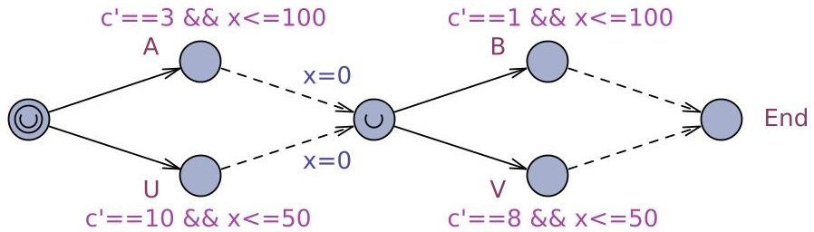

Fig.1. A small task with two phases.

time-units) and cost-rate (3 respectively 10). Similarly, in the second phase, the task must choose between two treatments indicated by locations B and V again differing in time and cost-rate. Whereas the choice of treatment in the two phases is up to the task to control (indicated by the solid transitions), the actual time of the treatment is left to an uncontrollable environment (indicated by the dashed transitions). In one scenario, the objective of the task is to make choices that will ensure a given completion time regardless of a possible antagonistic environment. Under this interpretation, Fig. 1 represents a timed game. However, it may also be seen as a stochastic priced timed game (SPTG), assuming that the duration of the uncontrollable treatments are chosen by uniform distributions, and the objective of the control strategy is to optimize the expected completion time, or the expected completion cost (e.g. the cost-rate $ c^{\prime}==3 $ in location A indicates that the cost variable c grows with rate 3 in this location).

We are interested in synthesizing strategies for various objectives. For example, the query strategy Opt = minE(c) [<=200]: <> Task.End will provide (by learning) the strategy Opt that minimizes the expected completion cost. The relativized query E [<=200; 1000] (max: c) under Opt estimates this expected cost to be 200.39. Figure 2(a) summarizes 10 random runs according to Opt, indicating that only cheap treatments (A and B) are chosen. Now, assume that the task must be completed before 150 time-units. From Fig. 2(a) the strategy Opt clearly does not guarantee this. However, we can generate the most permissive (non-deterministic) strategy Safe that guarantees this bound using the query strategy Safe = control: A<> Task.End and time<=150. Unfortunately, this has a high expected completion cost of 342.19, but the learning query strategy OptSafe = minE(c) [<=200]: <> Task.End under Safe

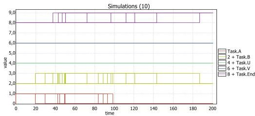

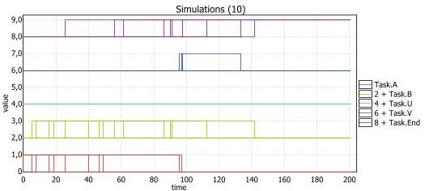

Fig. 2. (a) Runs under Opt. (b) Runs under OptSafe.

<!-- PDF_PAGE: 4 -->

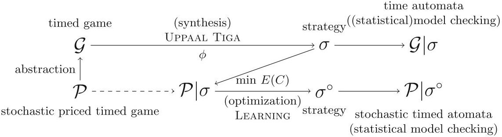

Fig. 3. Overview of UPPAAL STRATEGO

will provide a sub-strategy OptSafe optimizing the expected completion cost here found to be 279.87 - subject to the constraints of Safe. Figure 2(b) summarizes 10 random runs according to SafeOpt, indicating that only the treatment U is never chosen. Model checking confirms that treatment B may only be chosen in case the first phase is completed before 50 time-units by the unsatisfiable query E<> Task.B and time>=51 and Task.x==0 under Safe.

As shown in the overview Fig. 3 UPPAAL STRATEGO will abstract a SPTG $ \mathcal{P} $ into a timed game (TGA) $ \mathcal{G} $ by simply ignoring prices and stochasticity in the model. Using $ \mathcal{G} $ , UPPAAL TIGA may now be used to (symbolically) synthesize a (most permissive) strategy $ \sigma $ meeting a required safety or (time-bounded) liveness constraint $ \phi $ . The TGA $ \mathcal{G} $ under $ \sigma $ (denoted $ \mathcal{G} |\sigma) $ may now be subject to additional (statistical) model checking. Similarly, the original STGA $ \mathcal{P} $ under $ \sigma $ may be subject to statistical model checking. Now using reinforcement learning we may synthesize near-optimal strategies that minimizes (maximizes) the expectation of a given cost-expressions cost. In case the learning is performed from $ \mathcal{P} |\sigma $ , we obtain a sub-strategy $ \sigma^{o} $ of $ \sigma $ that optimizes the expected value of cost subject to the hard constraints guaranteed by $ \sigma $ . Finally, given $ \sigma^{o} $ , one may perform additional statistical model checking of $ \mathcal{P} |\sigma^{o} $ .

## 3 Battery Concepts

Electrochemical cells release chemically stored energy as electrical energy. In primary cells, the chemical reaction that enables this process irreversibly changes the chemical composition of the battery. However, in secondary cells, the reaction can be reversed, converting electrical energy back to chemical energy. Batteries consist of one or more electrochemical cells. When more severals cells are present, they can be connected in series for increased voltage, or in parallel for increased capacity, or a combination of connections for a combination of the properties. Small variations among the connected cells affect the performance and degradation of the overall battery and complicate charging and discharging procedures. Batteries can in turn be connected into battery packs with the same challenges. In this paper, we limit our attention to (single) batteries consisting of only one electrochemical cell.

<!-- PDF_PAGE: 5 -->

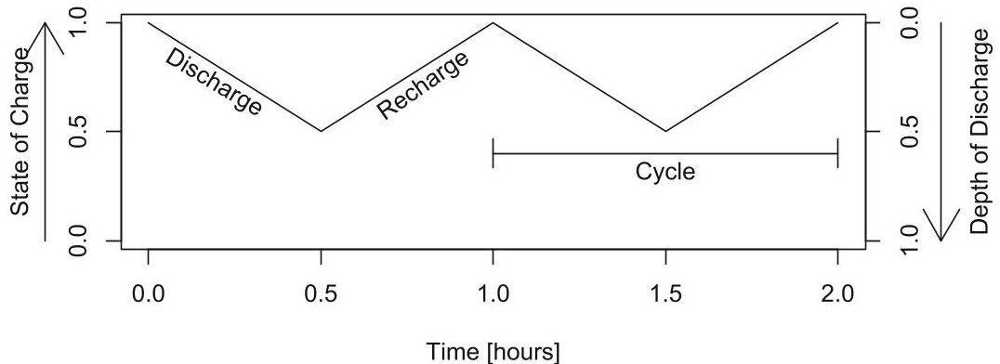

Fig. 4. Illustration of key battery concepts: State of charge (SOC), depth of discharge (DOD), discharge and recharge phases, and cycle.

Fig. 4 illustrates the fundamental battery concepts. The first one is state of charge (SOC). Using a car analogy, a full tank corresponds to 100% SOC, and an empty tank corresponds to 0%. Driving speed and acceleration/breaking patterns affects wind and rolling resistance, and therefore the distance it is possible to travel with a given amount of fuel. Similarly for batteries, the load on the battery affects the amount of energy it can release before running dry. This is due to the rate/capacity effect [5]. (Note however, that the in the car, the energy stored is directly proportional to the amount of fuel in the tank. In the battery, the released energy itself varies with use.) Furthermore, a battery that runs dry is not really empty because the recovery effect [5] means that it will slowly regain some charge while resting. Last but not least, a battery can be charged above the design capacity if a higher voltage is applied (at the cost of faster wear of the battery).

Since both an empty and a full battery are not easily defined in practical usage, we refer to the battery datasheets to define the SOC. The battery is full when it is charged at the design charge voltage. The battery has reached a 0% SOC when it has delivered the nominal capacity. Some batteries are used for backup power and spend most of their lifetime near full SOC. In this work, we are interested in secondary batteries used in the typical cycling between charging and discharging.

A cycle in a system means returning to a state it has visited before. For a battery, it could, for example, be discharging a fully charged battery and then recharging it to its full capacity. Depth of discharge (DOD) = 1-SOC is another basic battery concept. It is often used in discussion of battery wear, and it is often used in the sense of maximal DOD. For example, "cycling at 80% DOD" means to repeatedly discharge to 80% DOD and recharge to 0% DOD (= 100% SOC).

The chemical reactions that store and release energy are, unavoidably, accompanied by other, unwanted chemical reactions and processes that slowly destroy the reactants or the electrodes. The main performance consequence is that with time and use, the capacity of the battery fades.

<!-- PDF_PAGE: 6 -->

The rate of deterioration depends, among other things, on the maximal DOD reached, the rate of charge and discharge, temperature, dwelling at high and low SOC, and overcharging [3]. The maximal DOD that is discharged to is especially important, and can be the only focus of battery manufacturers' datasheets. For example, one battery is expected to reach end-of-life ( 80% capacity remaining) after 350 cycles at 100% DOD, 1000 cycles at 50%, and 1700 cycles at at 25% $ ^{1} $ This kind of data can be good enough for simple workloads and system designs, but is not enough for advanced workloads, which motivates our approach.

## 4 The Wear Score Function for SOC-Profiles

In the discussion of battery powered systems with complicated workloads, the definition of a cycle from Section 3 often falls short because it is too precise. Consider, for example, a fully charged battery (100% SOC) that is discharged to 20%, recharged to 90%, discharged again to 20%, then recharged to 100%. According to the precise definition, this trajectory from 100% to 100% is one cycle, but from a battery application point of view, it is very close to being two cycles in the sense of "discharge-then-recharge".

Not only is this very likely usage of a battery difficult to discuss, but it is also unlikely that a battery data sheet will say anything about the expected battery lifetime for this type of load. To circumvent this issue, we propose to examine SOC profiles in the frequency domain. Using the discrete Fourier transform, we convert the SOC profile (time-series) into a frequency spectrum containing all component frequencies and their magnitudes. The discrete Fourier transform is computed by the Fast Fourier transform (FFT) algorithm, which outputs a sequence of complex numbers. The moduli (absolute values) of these numbers correspond to the magnitudes of the component frequencies. If the SOC profile is a sequence $ S=s_{1} s_{2} \dots s_{n} $ of SOC values sampled at frequency f, its score is

$$
\operatorname {w s f} (S, f) = \frac {2 f}{n} \sum_ {i = 0} ^ {\lfloor n / 2 \rfloor} i | \mathcal {F} (S) _ {i} | ^ {2}
$$

where $ |\mathcal{F}(S)_{i}| $ is the modulus of the $ i $th element of the output of the FFT function on S. The input consists only of real numbers, i.e., complex numbers with imaginary part zero. Therefore, only the first half of the FFT output (below the Nyquist frequency) is relevant to us. Hence, the sequence is summed up to index $ \lfloor n/2\rfloor $ , and the multiplied by 2 to account for the frequencies lost above the Nyquist frequency. The fraction $ \frac{fi}{n} $ (distributed inside and outside the sum) is the frequency corresponding to the FFT magnitude at index i. The outside fraction $ \frac{2f}{n} $ does not affect ordering of scores, but it does bring them into a comfortable order of magnitude.

The wear score function is devised such that an SOC profile with a lower wear score is better for the longevity of the battery. Fig. 5 illustrates four different SOC profiles as well as their scores and intermediate results of the score

<!-- PDF_PAGE: 7 -->

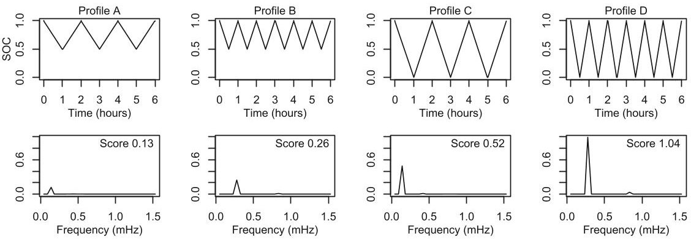

Fig. 5. Four example SOC profiles and their scores.

calculation. The FFT-like plots in fact show the magnitudes of the SOC oscillations at the component frequencies $ \frac{f i}{n} $ for $ i=0,\ldots,\lfloor n/2\rfloor $ (not to be confused with the sampling frequency, f). Each value is thus an element in the sequence $ \frac{2f i}{n} |\mathcal{F}(S)|^{2} $ , with modulus, exponentiation, and multiplication applied elementwise on the sequence. The wear score is the sum of this sequence. In the plot, the frequency axes are truncated to zoom in on the interesting harmonics.

Comparing profiles A and B, we see discharging to the same DOD (50%) ,but a doubling of the charge rate, discharge rate, the number of cycles that can be completed in the same time frame, and finally, the score. The same applies when comparing C and D. In these two simple comparisons, the score is proportional to the number of cycles/time, which conforms with the general idea that a battery can sustain a fixed number of cycles at a given DOD.

Comparing profiles B and C, we see that the same amount of charge is delivered equivalent to three full capacities discharged in six hours. However, profile C discharges to twice the DOD while delivering this charge. This also increases the score because a higher DOD wears out the battery faster, even when the same charge is delivered. This matches what [3] cites as Symon's [7] Premise 2: "The charge life of the cell will always [...] be greater than [the rated charge life] when the battery is cycled less deeply." In other words, shallow DOD cycling improves the total amp-hour throughput in the lifetime of a battery.

The above examples serve only to test the wear score function on simple workloads, like those found in battery datasheets. The strength of the wear score function is however its ability to accept arbitrarily complicated workloads, including those mentioned at the beginning of this section. To demonstrate this, we turn to the nano-satellite case study in Section 5.

## 5 Nano-satellite Case Study

Our use case concerns the GOMX-3 satellite built by the company GomSpace. It is a nano-satellite with a volume of only three liters. Its purpose is two-fold. One subsystem tracks commercial aircraft, and two other subsystems are used to test improved forms of satellite-to-ground and satellite-to-satellite communication.

<!-- PDF_PAGE: 8 -->

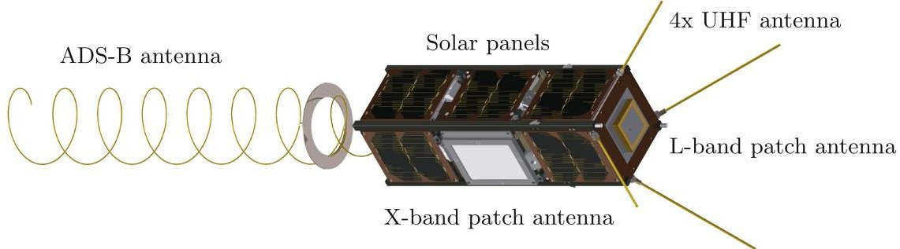

Fig. 6. The GOMX-3 nano-satellite

## 5.1 System Description

As you can see in Fig. 6, the satellite is covered in solar panels, and four different types of antennas for radio communication are attached. On the inside, it packs circuitry for all the radios, reaction wheels and magnetic coils for attitude (orientation) control, a main computer, and a battery.

The ADS-B system continuously tracks aircraft to assist ground-based systems, such as those in Europe and North America that cannot "see" the aircraft over the Atlantic Ocean. The UHF radio is the tried and tested means for receiving commands from the ground station and sending measurements back. The X-band radio is for experimenting with higher throughput ground communication. The L-band radio is for testing satellite-to-satellite communication.

Due to the locations of the antennas on the satellite body, only one of them can be pointed towards its target at a time (using the attitude control system). Therefore, for each orbit the satellite makes around the Earth, a single type of communication is chosen, referred to as an orbit type. An orbit takes 90 minutes.

The four radios on the satellite consume a lot of energy, and the small number of solar panels can only generate a limited amount of energy. The challenge is, therefore, to do the most useful work with the available energy. Useful work can be seen from different perspectives. From a short-term perspective, the focus is on the number of experiments done in a short time-frame such as a week. But as we know from Section 3, the battery wears out with use. So from a long-term perspective, more work done every week means that the battery, and therefore the satellite, will last fewer weeks. We model the aspects of the case relevant for assessing battery wear and mission utility to study this trade-off as follows.

## 5.2 Satellite Model

The satellite is modelled in UPPAAL. The battery SOC is represented with a simple floating point percentage value using the declaration double soc = 80.0; The initial value is set to 80% SOC to represent the energy lost during the launch and the storage period until the launch. The energy harvested from the solar panels, and the energy consumed by the subsystems and radios is represented by

<!-- PDF_PAGE: 9 -->

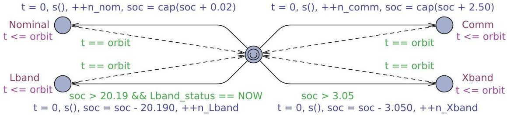

Fig. 7. Timed automaton describing the four orbit/experiment types. The controller only has influence over the solid edges; the dashed edges represent the environment.

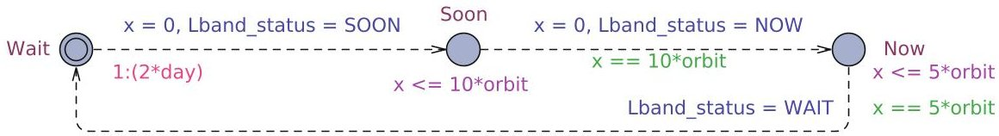

Fig. 8. Stochastic timed automaton controlling the L-band experiment window.

each orbit having and a net energy balance such as +2.50 or -20.19 percentage points SOC.

The automaton shown in Fig. 7 encodes the orbit types and energy balance. The initial, central location is the one from which experiments are chosen. It is urgent (marked by the rounded 'U'), which means that the choice must be made without delay. Edges in the automaton can have guards, which are conditions that must be satisfied to take a transition involving that edge. The Nominal and Communication (UHF) orbit types collect more energy than they consume, so these edges may always be chosen and have no guards. The X-band and L-band edges may only be taken when enough energy is available (e.g., soc > 3.05). The L-band experiment additionally can only be performed in specific time windows as indicated in the guard with Lband_status == NOW. The global variable Lband_status is controlled by a separate automaton, presented below.

Each of the four edges also has an update statement. Each edge (1) resets the clock t, (2) calls the function s which samples the SOC for use in the score calculation, (3) increments the relevant orbit type counter (which is used in the utility function), and (4) updates the SOC according to the energy balance of the relevant orbit type. For the two orbits with energy surplus, the cap function returns the minimum of its argument and 100.0, to prevent overcharging the batteries. In practice, this is achieved by disconnecting solar panels. Each experiment location has the invariant t <= orbit, and each edge returning to the central choice location has the guard t == orbit, ensuring that each orbit takes the orbit time, 90 minutes.

The arrival of the experiment windows for the L-band experiment are controlled by the automaton in Fig. 8. The time spent in the 'Wait' location follows an exponential probability distribution. Its rate $ \lambda $ is chosen such that the mean time between arrivals is two days (32 orbits). Once it is triggered, the automaton will spend ten orbits in the 'Soon' location, and then five orbits in the 'Now'

<!-- PDF_PAGE: 10 -->

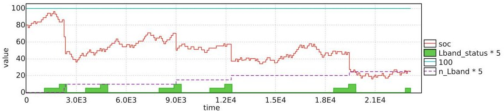

Fig. 9. Example simulation run of the system under no strategy: All nondeterministic choices are resolved using a uniform probability distribution. Note that increments of n_Lband only occur during the experiment window (the second step on the "staircase") and that it is accompanied by a large drop in state of charge.

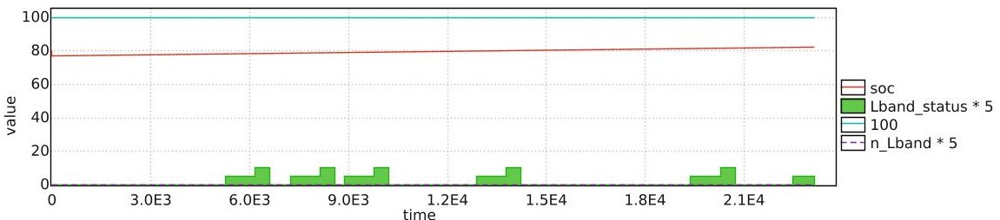

Fig.10. Simulation of a strategy that minimizes the battery wear score. No L-band experiments are performed.

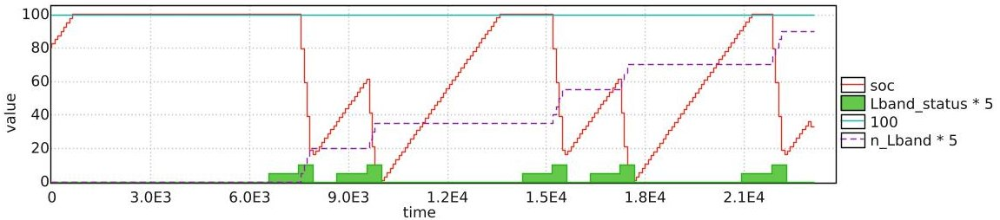

Fig.11. Simulation of a strategy that maximizes the number of L-band experiments.

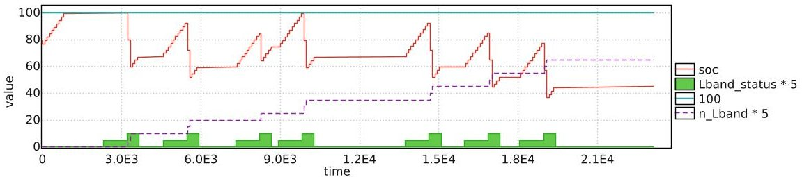

Fig. 12. Simulation of a strategy that minimizes 0.2*score - 0.8*n_Lband.

<!-- PDF_PAGE: 11 -->

location, wherein the L-band orbits are possible. The purpose of the 'Soon' location is to give the reinforcement learning (see Section 5.3) the option of reacting to the upcoming experiment window.

An example simulation run of the system is shown in Fig. 9. The solid curve shows the evolution of the SOC between 0 and 100%. The solid "staircases" show the value of the variable Lband_status, as set in Fig. 8. The low step corresponds to the 'Soon' location, and the high step to the 'Now' location. The dashed line shows the accumulated number of L-band experiments performed, scaled by five to make the value more easily readable.

In addition to the two automata for the orbit type and the experiment window, the overall system model contains a separate automaton for calculating the wear score. This automaton waits until the end of the predefined system simulation period (16 days), and then calculates the score using (1) on the SOC samples taken by the orbit automaton's function. Once the wear score has been calculated, the boolean done is set. Thus, the linear temporal logic (LTL) property " < > done " can be used as the requirement for the runs used in optimization.

## 5.3 Learning and Optimization

We use UPPAAL STRATEGO's "minimize expected value" query as follows:

strategy s = minE( ... expression ...) [<=nn*orbit]：<> done The expression to minimize is our cost function. The first choice of cost function could be just the wear score. Fig. 10 shows a simulation run of the system under a strategy that minimizes the expected value of the score. The simulation is generated with the query simulate 1 [<=nn*orbit+1] {soc, Lband_status*5, 100, n_Lband*5} under s. The strategy almost always chooses the Nominal orbit because this orbit has the smallest effect on the SOC and will thus wear out the battery the least. The score is a low 0.003. But none of the L-band experiments are performed, so this is probably a bad strategy. It does not help if the battery will last for 15 years if nothing useful is done in those years!

In another extreme, we maximize the number of L-band experiments done. In the example simulation in Fig. 11, 18 L-band experiments were performed, and the sharp changes in SOC result in the high (bad) wear score of 73.5.

In between these two extremes, we might choose a cost function that combines the two previous in a weighted sum, e.g., 0.2*score-0.8*n_Lband. The number of L-band experiments is subtracted rather than added because minimizing -n_Lband maximizes n_Lband. As we see in Fig. 12, the strategy has learned to choose the battery (wear) friendly Nominal orbit in waiting periods, save up energy with the Communication orbit just before the experiment window, and then do only a few L-band experiments, rather than almost depleting the battery as in Fig. 11. In this simulation, the number of L-band experiments was 13, and the wear score was 33.7.

The simulations discussed above only illustrate the strategies. To examine them more systematically, we find the mean value of the score from a number of runs (here, 25000) under the given strategy (here, s) with the query:

E[<=nn*orbit+1; 25000] (max: score) under s

<!-- PDF_PAGE: 12 -->

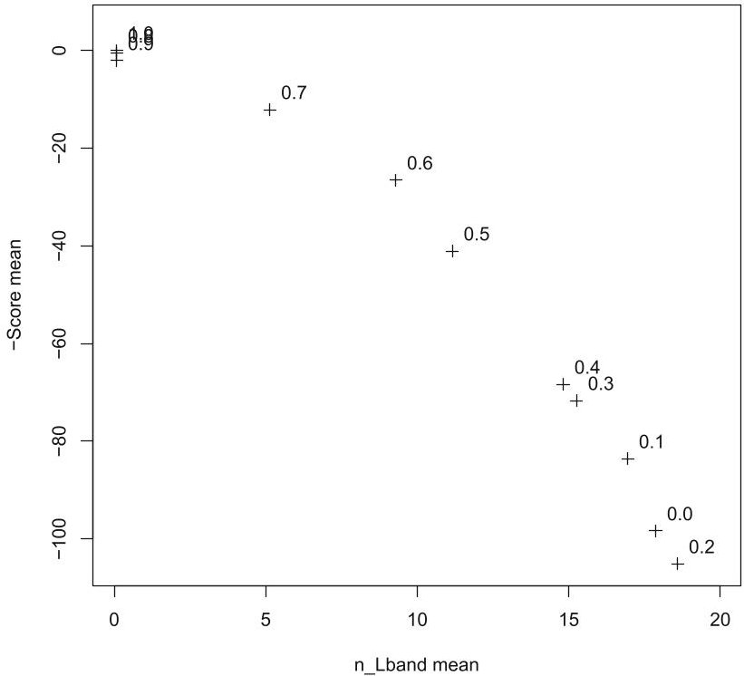

Fig. 13. Weighted sum optimizations of trade-offs between score and number of experiments done. The number next to each point is the parameter p in the expression being minimized, p $ \star $ score/6 - (1-p) $ \star $ n_Lband.

We do this for both the score and n_Lband on a whole family of strategies $ ^{2} $ parameterized by $ p\in[0,1] $:

**strategy** s_ *p* = **minE** ( *p* *score/6 - (1 - *p*) *n_Lband) [<=nn*orbit] : <> done

Fig. 13 shows the Pareto-like frontier corresponding to this family of strategies. Note that the score axis is flipped such that the top right corner holds the most desirable values. The plot shows how improving one objective hurts the other. But going from p=0 to p=0.1 improves the wear score while only impacting the number of experiments minimally. Finding the largest number of experiments for p=0.2 is unexpected. It is possible that the strategy that achieves this result is learned in a part of the state space that is, ironically, less likely to be explored thoroughly for the single objective optimization at p=0.

## 6 Discussion of the Wear Score Function

Our score function is generic rather than tailored for a specific battery technology or application domain. We can see this, for example, when we consider the two profiles B and C in Section 4: The score doubles with a doubled DOD. The

<!-- PDF_PAGE: 13 -->

tendency in this is correct, but the wear may not be directly proportional to the DOD. To more exactly predict battery lifetime, the approach will have to be targeted to a specific battery technology.

However, obtaining wear data from battery manufacturers' datasheets can be very challenging. Petricca et al. [6] report that "from an extensive survey of more than 100 datasheets of commercial battery of different chemistries, sizes, energy and form factors, we did not find a single datasheet that report information about the following characteristics altogether in the same document: battery behavior due to constant current, pulse current, and aging effects."

However, we speculate that with enough data available for fitting, the following generalized form of (1), parameterized on p and q, could be relevant.

$$
\operatorname {w s f} ^ {\prime} (\boldsymbol {S}, f) = \frac {2 f ^ {p}}{n} \sum_ {i = 0} ^ {\lfloor n / 2 \rfloor} i | \mathcal {F} (\boldsymbol {S}) _ {i} | ^ {q}
$$

Moreover, it seems to be not very well studied what happens when batteries are used in ways that are not simply repeating "charge fully, then immediately discharge to some depth". Drouilhet and Johnson [3] mention dwell time at low and high states of charge as a contributor to wear, implying that a medium SOC could be good for battery life. Similarly, the end of charge voltage, which also affects the SOC to which the battery is charged, is said to influence battery life $ ^{3} $ Here, the DC component of the Fourier transform could be relevant to explore even though it is ignored in (1) and (2) due to being multiplied by zero.

We are starting work on experimental validation of the wear function with newly bought measurement equipment, and we are also interacting with battery manufacturers about this. Reporting on the results of this is future work.

Temperature is another wear factor that could be interesting to try to include. The correlation between temperature and wear is possibly complicated and the effect of temperature and charge/discharge rates may not be possible to consider separately. In this paper, we assume a constant temperature for the battery.

## 6.1 Limitations

Using a discrete Fourier transform imposes some limitations on the score function. The score is relevant for battery technologies for which charge and discharge rates can be considered to have symmetric effects on wear. With some technologies, this is not always the case for high currents, see, e.g., [1]. Drouilhet and Johnson [3] also cite a work saying that high charge rates at low and intermediate SOC may increase battery life, but they do not consider the evidence conclusive.

For our score function, we assume that the proposed SOC profile is to be repeated indefinitely. Therefore it should start and end at the same SOC to prevent an assumed discrete jump between SOCs when the profile is repeated. We also assume that the profile is of a short duration wherein the battery wear

<!-- PDF_PAGE: 14 -->

can be ignored, i.e., the capacity remains close to constant. Such a profile could be on the order of weeks rather than months or years.

The sampling/simulation parameters f and n are chosen according to the speed of changes in the SOC. The sampling frequency f should be large enough that the oscillations of interest are slower than the Nyquist frequency $ f/2 $ . Higher harmonics are negligible at realistic uses of batteries because they would not support sustained high currents (changes in SOC), which in turn give rise to strong high frequency harmonics. The sampling window $ n/f $ affects the lowest observable frequency, which is its reciprocal $ f/n $ . The lowest observable frequency should be low enough to observe the oscillations of interest. The score depends on the sampling parameters, so for now it only makes sense to compare scores calculated with the same parameters.

## 7 Related Work

Drouilhet and Johnson [3] in the context of energy storage describe a battery life prediction method that takes into account DOD and discharge rate. They propose a function for each of these to which manufacturer data can be fitted. Combining the two expressions, the effective discharge affecting the battery with respect to wear can be computed from a user-prescribed discharge profile consisting of a series of discharge events. The battery is seen as having a fixed charge life (lifetime Ampere-hour throughput until end-of-life), but relative to "effective" discharge, which depends on DOD and discharge rate. They apply their method to a case study of peak shaving in an Alaskan village powered by wind energy. By predicting the lifetime of different sizes of NiCd and VRLA batteries, they find the most cost effective battery technology and size for the given application. In our approach, we try to generalize from the focus on simple workloads wherein each discharge is followed by a full recharge.

Petricca et al. [6] describe an electrical circuit model of capacity fading due to cycling, as well as the increase of the internal resistance due to cycling. What is needed to build the model is manufacturer's data on capacity fading due to cycling at different temperatures and discharges rates (C-rates), and data on increase of the internal resistance at a reference discharge rate and for various DODs. It is questionable whether this data is always available to the user. As mentioned in Section 6, the authors had a hard time obtaining it. The capacity loss is based on an equation that takes as input the number of cycles. Again we encounter the concept of cycles that only works for simple workloads, where each discharge phase starts at 100% SOC.

Guena and Leblanc [4] in the context of backup power experimentally examine how DOD affects the cycle life of lithium-metal-polymer batteries. They test at 0.6% , 50% , 60% , 70% , 80% , and 100% DOD and find that reduced DOD improves cycle life and total charge throughput. This matches our expectations. They also test micro cycling (to 0.6% DOD) and find it to have no effect on cycle life, i.e., the micro cycled cell had the same capacity fade as one with a float charge (no cycling). Unfortunately the sample sizes are too small to say

<!-- PDF_PAGE: 15 -->

anything conclusive (one cycled cell compared to three floating cells), and more information would be interesting to have.

## 8 Conclusion

In this paper we have presented the wear score function, which ranks battery usage profiles according to their relative impact on the cycle life of the battery. The score function takes into account the workload characteristics that influence the cycle life the most: charge rate, discharge rate, and depth of discharge. The key strength of the score function is that it is not limited to standard regular charge-discharge profiles, but it allows comparison of complex workload profiles. This makes it a very useful tool in the design of battery powered devices, as we have shown in the GOMX-3 nano-satellite case study. In the case study, we have integrated the wear score function into an automata-based model of the satellite as a stochastic timed game. The wear score function is however suited for use with any system modelling formalism and field of application.

In its current form the wear score function allows ranking usage profiles and optimizing. The scores, however, may not be directly proportional to the actual battery life. We expect that the score function can be tailored to a specific battery type. However, in order to do this much experimental data is needed. Obtaining such data, and fitting the score function to match the real cycle life, is part of the future work.

Acknowledgments. This work has been done in cooperation with the partners of the EU FP7 project SENSATION. We would especially like to thank Peter Bak, David Gerhardt, and Morten Bisgaard of GomSpace ApS for our fruitful discussions about challenges of nano-satellites and the GOMX-3 project. We would also like to thank Gilles Nies, Jan Krcál, and Holger Hermanns of Saarland University for inspiring discussions of battery modelling and wear. Finally, our colleague at AAU Peter Gjol Jensen has been helpful in explaining the inner workings of UPPAAL STRATEGO and its learning algorithm.

## References

1. Choi, S.S., Lim, H.S.: Factors that affect cycle-life and possible degradation mechanisms of a Li-ion cell based on LiCoO2. Journal of Power Sources 111(1), 130-136 (2002)

2. David, A., Jensen, P.G., Larsen, K.G., Mikučionis, M., Taankvist, J.H.: UPPAAL STRATEGO. In: Baier, C., Tinelli, C. (eds.) TACAS 2015. LNCS, vol. 9035, pp. 206-211. Springer, Heidelberg (2015)

3. Drouilhet, S., Johnson, B.L.: A battery life prediction method for hybrid power applications. In: AIAA Aerospace Sciences Meeting and Exhibit (1997)

4. Guena, T., Leblanc, P.: How depth of discharge affects the cycle life of lithiummetal-polymer batteries. In: 28th Annual International Telecommunications Energy Conference, INTELEC 2006, pp. 1-8, September 2006

<!-- PDF_PAGE: 16 -->

5. Martin, T.L.: Balancing batteries, power, and performance: System issues in CPU speed-setting for mobile computing. PhD thesis, Carnegie Mellon (1999)

6. Petricca, M., Shin, D., Bocca, A., Macii, A., Macii, E., Poncino, M.: Automated generation of battery aging models from datasheets. In: Computer Design, pp. 483-488. IEEE (2014)

7. Symons, P.: Life estimation of lead-acid battery cells for utility energy storage. In: Proceedings of the Fifth conference on Batteries for Utility Storage, San Juan, Puerto Rico, July 1995

## A Appendix

## Query Language of Uppaal Stratego

UPPAAL STRATEGO allows for strategy assignment "strategy S =" and strategy usage "under S", using strategy identifiers S. In particular, the queries of UPPAAL STRATEGO allow for constructing (and binding) strategies that guarantee safety or reachability objectives, or that optimize (minimize or maximize) the expected value of a given expression (within a given bound on time, steps or chosen cost). Constructed (and bound) strategies may now be used to relativize the queries already used in UPPAAL, UPPAAL TIGA and UPPAAL SMC.

Table 1. A non-comprehensive list of different types of now supported queries. NS (non-deterministic), DS (deterministic) and SS (stochastic) are used to signify the type of the strategy allowed in the given situation.

<table border="1"><tr><td colspan="2">Strategy generators using UPPAAL OPT</td></tr><tr><td>Minimize objective</td><td>strategy DS=minE(expr)[bound]:<>&lt;>prop</td></tr><tr><td>Maximize objective</td><td>strategy DS=maxE(expr)[bound]:<>&lt;>prop under NS</td></tr><tr><td colspan="2">Strategy generators using UPPAAL TIGA</td></tr><tr><td>Guarantee objective</td><td>strategy NS=control:A&lt;>prop</td></tr><tr><td>Guarantee objective</td><td>strategy NS=control:A[]prop</td></tr><tr><td colspan="2">Statistical Model Checking Queries</td></tr><tr><td>Hypothesis testing</td><td>Pr[bound](&lt;>prop)&gt;=0.1 under SS</td></tr><tr><td>Evaluation</td><td>Pr[bound](&lt;>prop) under SS</td></tr><tr><td>Comparison</td><td>Pr[bound](&lt;>prop1) under SS1&gt;=Pr[bound](&lt;>prop2) under SS2</td></tr><tr><td>Expected value</td><td>E[bound;int](min:prop) under SS</td></tr><tr><td>Simulations</td><td>simulate int[bound]{expr1,expr2} under SS</td></tr><tr><td colspan="2">Model checking queries</td></tr><tr><td>Safety</td><td>A[]prop under NS</td></tr><tr><td>Liveness</td><td>A&lt;>prop under NS</td></tr></table>