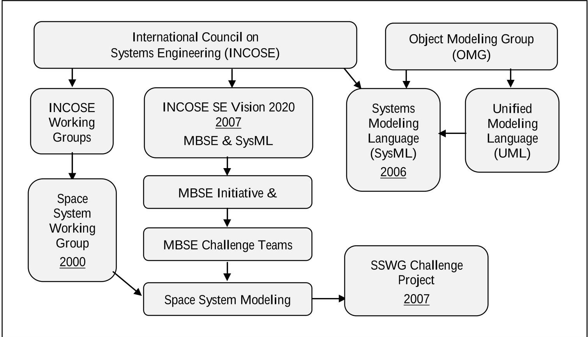
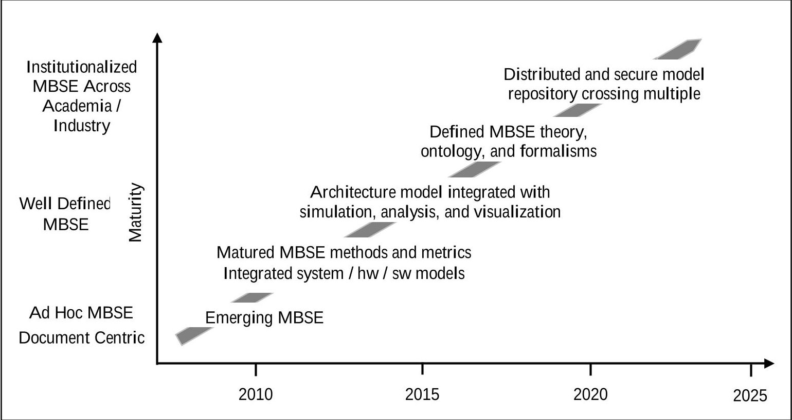
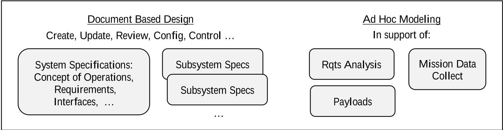
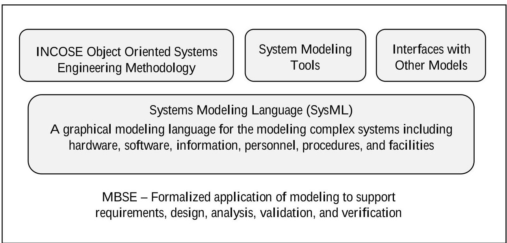
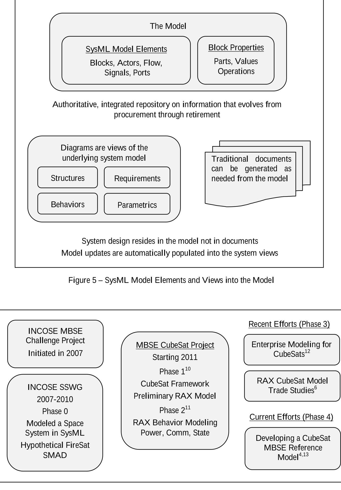
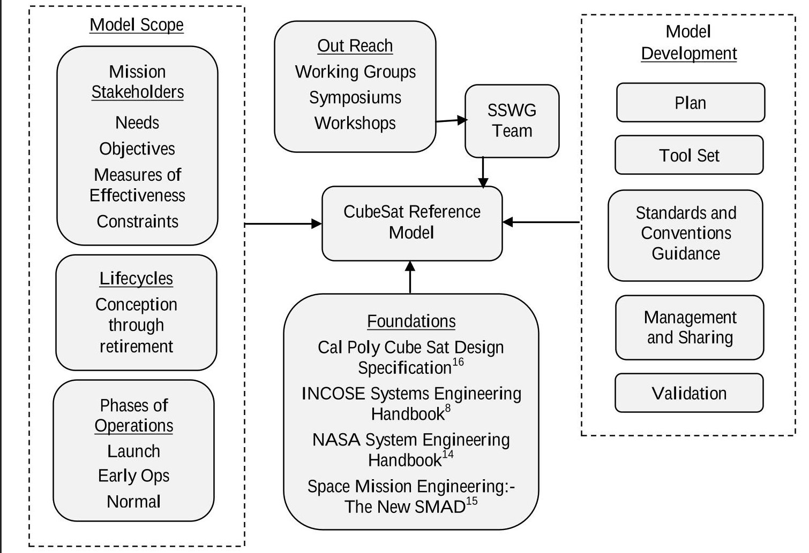
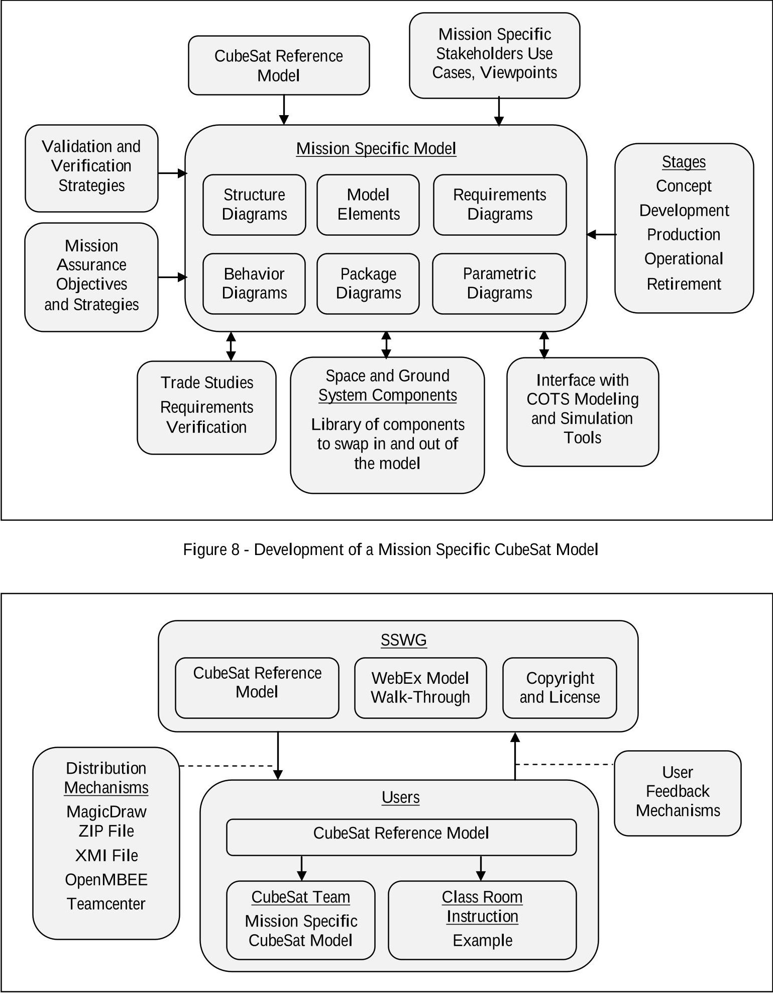

<!-- PDF_PAGE: 1 -->

# CubeSat Model-Based System Engineering (MBSE) Reference Model - Application in the Concept Lifecycle Phase

David Kaslow $ ^{1} $ Consultant, Berwyn, PA, 19312, USA

Bradley J. Ayres $ ^{2} $ The Aerospace Corporation, Wright Patterson AFB, OH 45433 USA

Curtis Iwata $ ^{3} $ Affiliate of The Aerospace Corporation, El Segundo, CA, 90245

and

Bungo Shiotani $ ^{4} $ University of Florida, Gainesville, FL, 32611, USA

Model-Based Systems Engineering (MBSE) is a key practice to advance systems engineering that can benefit CubeSat missions. MBSE involves creating a system model that is a single source for system engineering such as architecture development and interface management. The system model also integrates other discipline specific engineering models and simulations. Our application of MBSE uses System Modeling Language (SysML), a graphical modeling language, to model all aspects of a system either directly or through an interface with another model. SysML diagrams are used to describe requirements, structures, behaviors, and parametrics from the system down to the component level. The model is intended for use by aerospace students in their classroom or by a CubeSat team building a mission-specific CubeSat. Using the CubeSat Reference Model as a starting point, a user can populate a mission-specific model with the concept lifecycle stakeholders and stakeholder needs, objectives, constraints, and measures of effectiveness (MOEs) and carry out concept life-cycle studies.

## I. Introduction

A CubeSat, a type of nanosatellite, is a low-cost standardized satellite with its origin in the CubeSat Project established in 1999 by California Polytechnic State University (Cal Poly), San Luis Obispo and Stanford University's Space Systems Development Laboratory (SSDL). The CubeSat Project was established to enable the university community to design, build, and launch satellites using primarily off-the-shelf components. More recently, the worldwide community has adopted the CubeSat standard as a means of performing scientific, surveillance, and technology demonstration missions at significantly reduced cost.

The basic CubeSat unit is 10x10x10 centimeters with a mass of about 1.3 kilograms, and this cubic unit is referred to as 1U. CubeSat units can be joined to form a larger satellite, and one-, two-, and three-unit (1U, 2U, and 3U) CubeSats have been the most common configuration. They are typically launched as secondary payloads or deployed from the International Space Station. The dispenser mechanism limits the number of units that can be

<!-- PDF_PAGE: 2 -->

joined together. Larger dispensers have been developed recently, and they allow for newer specifications (6U, 12U, and 27U) of CubeSats to be deployed.

The CubeSat subsystems are essentially the same as those for a larger satellite. They may be physically smaller, have less performance capability, and be assembled from off the shelf components, but the tradeoff is that they can be developed with lower cost (development and launch) and within a shorter timeframe. In addition, many CubeSatclass satellites are utilized as technology maturation platforms due to their shorter turnaround time and reduced cost compared to traditional monolithic satellites.

The cheaper cost and shorter life cycle has lowered the barrier to entry for many organizations, and consequently, most groups that develop CubeSats are doing it for the first time. They do not necessarily have the experience or discipline to manage their projects with proper systems engineering, and even if they do, the role is not a full-time position due to the smaller budgets of CubeSat missions. To aid these efforts, the International Council on Systems Engineering (INCOSE) Space System Working Group (SSWG) organized the MBSE Challenge Project Team to create the CubeSat Reference Model to serve as a guide and tool.

The goals of the MBSE Challenge Project are the following:

- Demonstrate Model-Based Systems Engineering (MBSE) methodology as applied to a CubeSat mission. This has an additional goal of demonstrating Object Oriented Design Method (OOSEM) as applied to a CubeSat mission.

- Provide a CubeSat Reference Model that CubeSat teams can use as starting point for their mission-specific CubeSat model. This has an additional goal of demonstrating the application of the model in assessing measures of performance in the concept life cycle phase.

## II. Project Background

This project has its genesis in the INCOSE MBSE Initiative and the INCOSE SSWG MBSE Challenge Project (refer to Figure 1). In 2007, INCOSE established the System Engineering Vision 2020, $ ^{1} $ the MBSE Initiative, $ ^{2} $ and the MBSE Roadmap. $ ^{3} $ The Roadmap is shown in Figure 2. Vision 2020 included demonstrating the application of MBSE paired with Systems Modeling Language (SysML) to several engineering disciplines including space systems.

The SSWG team is made up of academics (aerospace students and professors), professional practitioners including engineers and software developers from NASA centers and industry, and representatives from commercial software tool vendors. The team meets weekly via teleconferencing, and the standing meeting is on Friday at 1 P.M. U.S.A. east coast time. Meeting materials and links to meeting recordings are in Google docs. Conference papers are posted on the INCOSE SSWG website.

## A. Model-Based Systems Engineering

The notion of traditional systems engineering is depicted in Figure 3. Documents are used to record, store, and convey system and subsystem specification including requirements, concepts of operations, and interfaces. This results in creating, updating, reviewing, and managing the configuration of separate documents, which can be numerous for a large and complex project. Models are created and used on an as-needed basis, most of the time to analyze different aspects of system performance in support of generating requirements, and unfortunately, these models are not integrated into an overarching system model that can provide and maintain the context and connected to the documents which contain the design information.

MBSE is the formalized application of modeling to support system requirements, design, analysis, verification, and validation activities beginning in the conceptual design phase and continuing throughout development and later life cycle phases. Ref. 4 has an overview of traditional systems engineering versus MBSE, and Figure 4 summarizes the necessary components to MBSE.

## B. Systems Modeling Language (SysML)

The project's application of MBSE uses Systems Engineering Modeling Language (SysML) and graphical modeling tools. SysML is structured to contain all the design information.

SysML is based on Unified Modeling Language (UML), a product of the Object Management Group (OMG). UML is used to specify, visualize, and document models of software systems including their structure and design. UML is built on fundamental object-oriented concepts including classes and operations.

A block is the fundamental SysML modeling element. A block can define a type of logical or conceptual entity; a physical entity; a hardware, software, or data component; a person; a facility; an entity that flows through the

<!-- PDF_PAGE: 3 -->

system; or an entity in the natural environment. The block features used to define a block include structural features, behavioral features, and constraints.

Figure 1 - Context of the INCOSE MBSE Initiative and SSWG Challenge Project

Figure 2 - Model-Based Systems Engineering Roadmap. Adapted from Ref. 3.

<!-- PDF_PAGE: 4 -->

Figure 3. Traditional Systems Engineering

Figure 4 - Model-Based Systems Engineering Components

As shown in Figure 5, the SysML modeling elements include blocks, actors, flows, signals, and ports. Structure behavior, requirement, and parametric diagrams provide views into the model. The model is the single, authoritative integrated repository of information. Changes to the model are automatically populated into the system views. Ref. 6 has an overview of SysML elements and diagrams.

## C. Object-Oriented System Engineering Method (OOSEM)

SysML is modeling language and not a system engineering methodology. The team is using the Object-Oriented System Engineering Method (OOSEM) $ ^{7} $ as presented in the INCOSE Systems Engineering Handbook $ ^{8} $ and the Practical Guide to SysML. $ ^{9} $

OOSEM includes analyzing stakeholder needs, analyzing system requirements, defining the logical architecture, and synthesizing candidate physical architectures. The logical architecture is a decomposition of the system into logical components that interact to satisfy the system requirements. The logical components are abstractions of the physical components that perform the system functionality without imposing implementation constraints.

The physical architecture defines the physical components that interact to satisfy the system requirements. The physical components of the system include hardware, software, persistent data, and operational procedures.

The CubeSat Reference Model will provide the logical architecture. It will have all the logical model elements for population by a mission specific CubeSat team.

## III. CubeSat Reference Model Development

As shown in Figure 6, there have been four phases to the SSWG Challenge Project. Ref. 6 has an overview of phases 1, 2, and 3.

<!-- PDF_PAGE: 5 -->

The first phase of SSWG CubeSat project created a CubeSat Reference Model that was applied to the Radio Aurora Explorer (RAX), a 3U CubeSat developed by SRI International and the Michigan Exploration Laboratory at the University of Michigan. $ ^{10} $

The second phase focused on expanding the RAX CubeSat model to include modeling behaviors and interfacing with several Commercial Off the Shelf (COTS) simulation tools. $ ^{11} $ Communication downlink modeling supported trades of data download rate, available power, and signal to noise ratio. System power modeling included the orbit as well as opportunities to collect energy, collect mission data, and downlink data.

The third phase was comprised of two activities. The first was the development of a CubeSat Enterprise Model to capture cost and product lifecycle aspects for the mission spacecraft and problem domain. $ ^{12} $ The second activity incorporated additional design and operational characteristics into the RAX model. $ ^{6} $ The following two trade studies were demonstrated: 1) On board energy level as a function of solar panel area and maximum battery capacity, and 2) quantity of data downloaded as function of orbital altitude and ground station network.

The fourth and current phase is focused on developing a CubeSat Reference Model. $ ^{4,13} $ Figure 7 illustrates the development approach that is described in Ref. 4 and replicated below.

The architecture of the CubeSat Reference Model is founded on MBSE and OOSEM. The decomposition of the architecture is consistent with engineering methodologies used elsewhere including NASA Systems Engineering Handbook $ ^{14} $ and Space Mission Analysis and Design - The New SMAD. $ ^{15} $

The specific methodology used to create the architecture is not critically important to the development of the reference model. It only matters that the model provides the foundation for a user to create a physical architecture.

Additionally, a SysML model of the Cal Poly CubeSat Design Specification is being created. $ ^{16} $ This will provide the foundation for specifying a CubeSat's physical, mechanical, electrical, testing, and operational requirements.

The CubeSat Reference Model starts with an identification of potential stakeholders. A stakeholder is any entity that has an interest in the system. Typical stakeholders for a CubeSat mission include the following:

- Sponsor Mission Engineer Supplier

- End User

- Developer

- Regulatory Agencies

- Project Manager

- Tester

- Launch Service Integrator

- Project Engineer

- Procurer

- Communication Service Integrator

Each stakeholder's needs, objectives, constraints, and measures of effectiveness are incorporated in the reference model. Constraints are those items fixed and not subject to trades such as mission budget and schedule. Identification of the stakeholders is important and should be done at the start of a project.

Particular attention must be paid to the regulatory agencies. CubeSat projects are pursued internationally, but the licenses and regulations that cover its activities are administered at the national level. For example, in the United States, the Federal Communications Commission (FCC) regulates the radio frequencies and orbital debris guideline through the Orbital Debris Assessment Report and the National Oceanic and Atmospheric Administration (NOAA) regulates remote sensing. The timelines for requesting and receiving approval must be well understood at project start.

The reference model supports all life cycle stages employed by the organization utilizing the model. For example, for an academic CubeSat project, the likely stages would be concept, development, production, operational, and retirement. The model supports all phases of operations: launch, early operation, and normal operations.

Providing a fully-formed CubeSat Reference Model could be a bit overwhelming for a mission specific CubeSat team, especially a team that is just becoming familiar with MBSE and SysML. Having models for each life-cycle phase is a more gradual way to get up to speed. That should also make it easier for a team to modify, add, and remove SysML elements when working with copies of the models.

<!-- PDF_PAGE: 6 -->

Figure 6-SSWG MBSE Challenge Project Phases

<!-- PDF_PAGE: 7 -->

Figure 7 - Development of the CubeSat Reference Model

## A. Logical Architecture

The purpose of the CubeSat Reference Model is to provide a logical architecture, which serves as a guide and provide the building blocks for any kind of CubeSat mission. The goal is to provide an object-oriented architecture framework so that teams can easily compose their CubeSat system and mission from the elements and objects found in the reference model. Figure 8 shows the context of the reference model with respect to the mission-specific CubeSat model.

Below is the breakdown of logical subsystems after partitioning both the space and ground systems. Some may sound like physical subsystems because the two have one-to-one correspondence. Starting with this list, teams may add or remove subsystems based on the mission requirements and objectives. Because these subsystems are objects, their names are nouns and not verbs. Ref. 13 has additional descriptions of these subsystems.

Space Subsystems

- Mission Data Acquisition and Processor

- Acquire and process the mission data.

- Mission Payload - Bus Adapter

- Provide the mechanical, electrical, and communication interface between themission payload and the spacecraft bus.

- Command and Data Handling

Receive, store, process, and distribute the commands from the Communication subsystem.

- Collect, store, process, and downlink the mission data and spacecraft telemetry through the Communication subsystem.

## Communication

- Provide the communication with the ground system or other spacecraft.

<!-- PDF_PAGE: 8 -->

## Guidance, Navigation, and Control

- Determine the spacecraft translational motion (i.e., position and velocity). Maintain or change the spacecraft orbit and trajectory.

## Attitude Determination. and Control

- Determine the spacecraft rotational motion (i.e., attitude). Maintain or orient the spacecraft.

## Power

- Generate, regulate, store, and distribute power to the spacecraft.

## Thermal

- Regulate spacecraft temperatures to ensure operability.

## Propulsion

- Provide, monitor, and control spacecraft thrust.

## Structures and Mechanisms

- Provide mechanical support and house spacecraft payloads and subsystems.

## Ground Subsystems

## Plan and Schedule Generator

- Coordinate the space and ground activities and allocate resources to these activities.

## Command Generator

- Monitor and command the spacecraft and the ground equipment.

## Mission Data Processor

- Generate the mission data products from the mission data.

## Mission Data Dissemination

- Disseminate the mission data products and mission data.

## Space - Ground Communication

- Provide the communication with the space system.

## Network

- Provide the network connectivity among the ground subsystems and external networks.

## Facilities

- Provide the environment and institutions for the ground system resources.

## B. Model Use and Distribution

The SSWG team is developing a model distribution process to share to external entities, and this is illustrated in Figure 9 and Ref. 4. The minimum level of model structure to be incorporated before the reference model will be distributed outside of the SSWG includes the following:

- Representative stakeholder needs, objectives, measures of effectiveness, and constraints

- Properties and parametrics at subsystem level for power and weight

- Data and information flow for plans, schedules, commands, telemetry, and mission data

Since the reference model is being developed by the SSWG team effort, there is an obligation to protect the investment of time and knowledge of each team member. There also needs to be a licensing environment that is conducive to a user organization supporting the development of and use of the model.

<!-- PDF_PAGE: 9 -->

Figure 9 - Distribution and Use of the CubeSat Reference Model

<!-- PDF_PAGE: 10 -->

## C. Concept Life Cycle Trade Studies

Using the CubeSat Reference Model as a starting point, a user can populate a mission-specific model with the concept life cycle stakeholders and stakeholder needs, objectives, constraints, and measures of effectiveness (MOEs). One stakeholder's MOEs may be in conflict with another stakeholder's MOEs. These conflicting MOEs are included in the trade space.

First, the MOEs are decomposed into measures of performances (MOPs) and technical performance measures (TPMs). There may be different ways to decompose the MOEs, but these different decompositions are included in the trade space.

Next, the model elements that are involved in the initial set of trade studies are identified, such as the following mission objectives (e.g., observation of a scientific phenomena, technology demonstration), satellites and orbits, sensors, and ground stations. Then, the model element parameters that drive the measures (i.e., MOE, MOP, and TPM) and the model parameters that quantify the measures are identified.

Next, an interface between the mission model and a space system model (e.g., AGI's System Tool Kit) are established. The interface supports the input (driving parameters) into the space system model and the output (quantifying parameters) from the space system model. After this interface is established, the state, parametric, and activity diagrams for the trade studies are devleoped. The state diagrams model behavior state changes in response to internal and external events such as viewing access to the mission's subject of interest and ground stations. The parametric diagrams are mapped to model elements and capture characteristic parameters to enable quantification of mission performance. The activity diagrams define actions within the activity along with the flow of inputs, outputs, and control such as time-stepping through a scenario.

The suggested use of the Cubesat model is to establish and explore the mission trade space. To do this, a firstorder trade space that satisfies the mission objectives is established. Then, candidate models for the Data Acquisition and Handing, Power, and Communication subsystems are created. The model is used to establish and evaluate a second-order trade space that provides sufficient power for collect and downlink mission data to meet the established measures.

## IV. Next Steps

The effort to date has been focused on establishing standard nomenclature and definitions; incorporating the stakeholders and their needs, objectives, and measures of effectiveness; and defining the generic CubeSat architecture down to the logical subsystems. The next step is to create an example-mission specific model and to validate the MOEs and MOPs.

## V. Conclusion

After several phases of learning and applying MBSE to the CubeSat design process, the SSWG Challenge Team is now focused on developing the CubeSate Reference Model, which is a SysML model that will serve as a framework for future CubeSat developers. MBSE holds the promise of reducing the burden of systems engineering tasks, which is beneficial to small CubeSat teams, and a properly designed reference model can serve as a checklist to these teams and promote uniformity and consistency across future CubeSat models. Several avenues of distribution along with licensing and copyright options are being considered, and the team hopes to release the models publicly in the near future.

## References

$ ^{1} $Systems Engineering Vision 2020, INCOSE-TP-2004-004-02, ver. 2.03, September 2007. [Online]. Available: http://oldsite.incose.org/ProductsPubs/pdf/SEVision2020_20071003_v2_03.pdf

$ ^{2} $International Council on Systems Engineering (INCOSE), "MBSE Initiative," January 2007. [Online] Available: http://www.omgwiki.org/MBSE/doku.php

$ ^{3} $MBSE Roadmap. MBSE Wiki, INCOSE MBSE IW 2012. MBSE Wiki. [Online] Available: http://www.omgwiki.org/MBSE/lib/exe/fetch.php?media=mbse:mbse_iw_2012-introduction-2012-01-21-friedenthal-c.pptx

$ ^{4} $ D. Kaslow, L. Anderson, S. Asundi. B. Ayres, C. Iwata, B. Shiotani, R. Thompson, "Developing and Distributing a CubeSat Model-Based System Engineering (MBSE) Reference Model ", Proceedings of the 31st Space Symposium, Colorado Springs, CO, April 2015.

$ ^{5} $ Object Management Group (OMG), OMG Website. [Online]. Available: http://www.omgsysml.org/

$ ^{6} $D. Kaslow, G. Soremekun, H. Kim, S. Spangelo, "Integrated Model-Based Systems Engineering (MBSE) Applied to the Simulation of a CubeSat Mission", Proceedings of IEEE Aerospace Conference, Big Sky, MT, March 2014.

<!-- PDF_PAGE: 11 -->

$ ^{7} $ Object Management Group (OMG), OMG Wiki. [Online]. Available: http://www.omqwiki.org/MBSE/doku.php?id=mbse:incoseoosem

$ ^{8} $INCOSE Systems Engineering Handbook, v. 3.2.2, October 2011, INCOSE-TP-2003-002-03.2.2.

$ ^{9} $ S. Friedenthal, A. Moore, R. Steiner, A Practical Guide to SysML, 2nd ed., Elsevier, Waltham, MA, 2012.

$ ^{1 0} $ S. Spangelo, D. Kaslow, C. Delp, B. Cole, L. Anderson, E. Fosse, B. Gilbert, L. Hartman, T. Kahn, and J. Cutler, "Applying Model Based Systems Engineering (MBSE) to a Standard CubeSat," in Proceedings of IEEE Aerospace Conference, Big Sky, MT, March 2012

$ ^{11} $ S. Spangelo, L. Anderson, E. Fosse, L Cheng, R. Yntema, M. Bajaj, C. Delp, B. Cole, G. Soremekun, D. Kaslow, and J. Cutler, "Model Based Systems Engineering (MBSE) Applied to Radio Explorer (RAX) CubeSat Mission Operational Scenarios," Proceedings of IEEE Aerospace Conference, Big Sky, MT, March 2013.

$ ^{12} $ L. Anderson, B. Cole, R. Yntema, M. Bajaj, S. Spangelo, D. Kaslow, C. Lowe, E. Sudano, M. Boghosian, R. Reil, S. Asundi, and S. Friedenthal, "Enterprise Modeling for CubeSats," Proceedings of IEEE Aerospace Conference, Big Sky, MT, March 2014.

$ ^{13} $ D. Kaslow, L. Anderson, S. Asundi, B. Ayres, C. Iwata, B. Shiotani, R. Thompson, "Developing a CubeSat Model-Based System Engineering (MBSE) Reference Model - Interim Status", Proceedings of IEEE Aerospace Conference, Big Sky, MT, March 2015.

$ ^{1 4} $NASA Systems Engineering Handbook, rev. 1, December 2007, NASA/SP-2007-6105 Rev1.

$ ^{15} $ J.R. Wertz, D. Everett, and J. Puschell, Eds., Space Mission Engineering: The New SMAD, (Space Technology. Library, Volume 28), Hawthorne, CA, Microcosm Press, 2011.

$ ^{1 6} $CubeSat Design Specification, rev. 13, The CubeSat Program, Cal Poly SLO, February 2014