<!-- PDF_PAGE: 1 -->

# Developing a CubeSat Model-Based System Engineering (MBSE) Reference Model - Interim Status

David Kaslow Consultant

1497 Canterbury Lane

Berwyn, PA

610-405-6685

david.kaslow@gmail.com

Louise Anderson

DigitalGlobe

1601 Dry Creek Drive

Ste 260

Longmont, CO 80503

303-684-4354

lweezy@gmail.com

Curtis Iwata The Aerospace Corporation 2310 E. El Segundo Blvd. El Segundo, CA 90245 310-336-2358 curtis.iwata@gmail.com

Bungo Shiotani University of Florida Space Systems Group 939 Sweetwater Drive Gainesville FL 32611 352-846-3020 bshiota@ufl.edu

Sharan Asundi

Tuskegee University

Dept of Aerospace Engineering

516 University Avenue

Tuskegee, AL 36088

334-727-8768

asundi@mytu.tuskegee.edu

Bradley Ayres

The Aerospace

Corporation

2310 E. El Segundo Blvd.

El Segundo, CA 90245

937-255-3355 x3422

bradley.ayres.ctr@afit.edu

Robert Thompson Air Force Institute of Technology

2950 Hobson Way

WPAFB, OH 45433

937-255-3636

robert.thompson@afit.edu

Abstract-Model-Based Systems Engineering (MBSE) is a key practice to advance systems engineering that can benefit CubeSat missions. MBSE creates a system model that helps integrate other discipline specific engineering models and simulations. The system level model is initiated at the start of a project and evolves throughout development. It provides a cohesive and consistent source of system requirements, design analysis, and verification.

The International Council on Systems Engineering (INCOSE) Space Systems Working Group (SSWG) established the Space Systems MBSE Challenge team in 2007. The SSWG Challenge team has been investigating the applicability of MBSE for designing CubeSats since 2011.

Our application of MBSE uses System Modeling Language (SysML), a graphical modeling language. SysML is used to model all aspects of a system either directly or through an interface with another model. SysML diagrams are used to describe requirements, structures, behaviors, and parametrics from the system down to the component level.

The first phase of SSWG CubeSat project created a CubeSat reference model that was applied to the Radio Aurora Explorer (RAX), a three-unit CubeSat developed by SRI International and the Michigan Exploration Laboratory at the University of Michigan.

The second phase focused on expanding the RAX CubeSat model to include modeling behaviors and interfacing with several Commercial Off the Shelf (COTS) simulation tools.

The third phase was comprised of two activities. The first was the development of a CubeSat Enterprise Model to capture cost and product lifecycle aspects for the mission spacecraft and problem domain. The second activity incorporated additional design and operational characteristics into the RAX model.

The modeling effort starts anew in this fourth phase and has two objectives:

- Develop a CubeSat Reference Model that other projects can use as a starting point for their mission specific CubeSat model. The space and ground systems, 978-1-4799-5380-6/15/$31.00 $2015 IEEE

subsystems, and components are being modeled throughout the entire project lifecycle.

- Develop a CubeSat Project Model that models how CubeSat design and development are to be accomplished.

The first objective is in response to: "Model-based systems engineering (MBSE) is the formalized application of modeling to support system requirements, design, analysis, verification and validation activities beginning in the conceptual design phase and continuing throughout development and later life cycle phases." [1]

The second objective is in response to: "A MBSE methodology is a collection of related processes, methods, and tools used to support the discipline of systems engineering in a 'model-based' or 'model-driven' context." [2]

The effort to date has been focused on establishing nomenclature; the incorporation of the stakeholders and their needs, objectives, measures of effectiveness; and the architecture down to the logical subsystems. The next step is to determine the level of model definition at each of the lifecycle stages and to create models for the concept and development phases.

The CubeSat Reference Model will be rolled-out in a controlled fashion to make certain that model is understandable and useful. The requests and applications of the model have fallen into two categories: 1) Using the model within an aerospace engineering course and 2) evaluating the application of MBSE within an aerospace program.

## TABLE OF CONTENTS

1. INTRODUCTION ...2

2. RECENT PHASES...2

3. CURRENT PHASE...3

4. CUBESAT DOMAINS AND STAKEHOLDERS...6

5. CUBESAT OPERATIONAL DOMAIN...6

6. CUBESAT MISSION ENTERPRISE ...11

7. CONCLUSION...12

<!-- PDF_PAGE: 2 -->

8. NEXT STEPS ...12

REFERENCES ...15

BIOGRAPHY ...15

## 1. INTRODUCTION

Figure 1 shows the genesis of the Space Systems Working Group (SSWG) Challenge Project. In 2007, the International Council on Systems Engineering (INCOSE) established its Systems Engineering Vision 2020 [1]. The vision included demonstrating the applicability of Model Based Systems Engineering (MBSE) paired with Systems Modeling Language (SysML) to several engineering disciplines.

The MBSE Initiative started at the 2007 International Workshop [3]. INCOSE established the MBSE Roadmap shown in Figure 2 and a set of MBSE Challenge Teams including one for space systems modeling [4]. The Roadmap defines the high-level, long-term vision for the maturation and acceptance of MBSE across academia and industry.

The objective of MBSE is to develop a model of a system that carries the project from start to decommission. It is an integration of discipline-specific engineering models and simulations, and SysML forms its foundation. SysML was developed jointly by INCOSE and the Object Modeling Group (OMG) to support MBSE [5].

SysML has modeling elements for requirements, structure behavior, and parametrics. Structure diagrams consist of block definition diagrams and internal block diagrams. Behaviors describe how a block deals with inputs and outputs and changes to its internal state. Behavior diagrams describe what the system must do to meet requirements. Behavior diagrams consist of Activity, State Machine, Sequence, and Use Case diagrams. Parametrics are the mathematical formulations needed by the models and simulations. SysML is used to specify, analyze, design, optimize, and verify systems including hardware, software, information, personnel, procedures, and facilities. But SysML is just a language and not a methodology or tool.

The composition of the SSWG team has changed over the years due to the availability of personnel and the focus of the modeling effort. Team members include aerospace students and professors, JPL and NASA engineers, and engineers and software developers from commercial modeling and simulation (M&S) tool providers.

The team holds teleconferences on Fridays at 1 pm EST, and the meeting materials and notes are posted in a shared Google Docs folder. The recent phases of the project are a year in length concluding with a paper (and this paper) and presentation at the annual March IEEE Aerospace Conference in Big Sky, Montana [6] [7] [8] [9].

## 2. RECENT PHASES

The SSWG Challenge Project initiated the MBSE CubeSat Project in April 2011 to demonstrate the application of MBSE to a realistic mission in the space systems domain. A CubeSat is a type of miniature spacecraft with a form factor based on the standardized unit cube, which is 10-centimeters on a side, and it weighs approximately one kilogram per cube. CubeSats typically consist of one to three units with some up to six units.

## Phase 1

The first phase consisted of developing a SysML reference model of a CubeSat and applying it to the Radio Aurora Explorer (RAX) [6]. RAX is a three-unit CubeSat developed jointly by SRI International and the Michigan Exploration Laboratory at the University of Michigan [10]. The RAX mission is to study the formation of magnetic field-aligned electron density irregularities in the Earth's ionosphere, which are known to disrupt tracking and communication between Earth and orbiting satellites.

During each pass over a ground-based radar station, RAX receives and processes the scattered radar signal and then downloads the payload and telemetry data to a ground station. The modeling of RAX was to prove the applicability of MBSE for modeling operational space missions. It was not intended to be an accurate model of the RAX satellite.

The Phase 1 RAX SysML model defined the logical and physical architecture of the flight and ground systems. The logical architecture defines the subsystems in terms of the capabilities that they provide that are necessary to achieve mission objectives. The physical architecture specifies the hardware, software, data, procedures and operator actions that are needed to implement the subsystems.

## Phase 2

The second phase focused on expanding the RAX CubeSat model to include behaviors [7]. This phase of the RAX CubeSat modeling supported the analysis of the following:

- Mission activities and states: Opportunities to collect mission data, download data, and collect solar energy.

- Power: Solar energy collection and subsystem power consumption taking into account mission activities and states.

- Communication: Data download rate, available power, and signal to noise ratio taking into account gains and losses due communication components, atmosphere, and length of propagation path.

This phase of the project was successful, but the capabilities that were developed lacked the ability to time-step through a behavioral model and determine whether requirements were satisfied throughout the entire RAX mission.

<!-- PDF_PAGE: 3 -->

## Phase 3

The third phase consisted of two efforts. The first was to develop the beginnings of an Enterprise model for a generic CubeSat [8], and this has carried over into the current phase.

The second effort addressed the shortcomings of the RAX model in Phase 2. A new model was developed with the capability to time-step through a scenario and to capture the energy collection and usage processes as well as data collection, storage, and download [9].

Figure 3 shows the lists of state, parametric, and activity diagrams developed for the RAX mission simulation. The state diagrams model behavior in response to internal and external events such as in-view of the experimental site. The parametric diagrams are mapped to models that estimate RAX performance such as experimental data collection. The activity diagrams define actions within the activity along with the flow of inputs, outputs, and control such as time-stepping through a scenario.

The following trade studies were demonstrated:

- On-board energy level as a function of solar panel area and maximum battery capacity.

- Quantity of data downloaded as a function of orbital altitude and ground station network.

COTS Modeling and Simulation Tools

The following commercial M&S tools were used in Phases 2 and 3:

- MagicDraw $ ^{\textcircled{R}} $ and Cameo Simulation Toolkit $ ^{\textcircled{R}} $ from No Magic.

- ModelCenter $ ^{\textcircled{R}} $ and MBSE Analyzer $ ^{\textcircled{R}} $ from Phoenix Integration.

- Systems Tool Kit $ ^{\textcircled{R}} $ (STK) from Analytical Graphics.

- ParaMagic $ ^{\textcircled{R}} $ and Systems LIfecycle Management $ ^{\textcircled{R}} $ (SLIM) from InterCAX.

- MATLAB $ ^{\circledR} $ from MathWorks.

## 3. CURRENT PHASE

The past phases have demonstrated that it is possible to interface SysML with special purpose M&S tools in order to model a space mission and carry out trades studies. MBSE was also used to create a model that describes the system design and mission operations. The next step is to model how the system design and development are going to be accomplished, and this is the current focus of the team. Additionally, the scope is being expanded to cover the entire project lifecycle.

## CubeSat Reference Model and CubeSat Project Model

This phase started with the goal of developing a CubeSat Reference Model and CubeSat Project Model that CubeSat

teams can use as a starting point for their mission-specific CubeSat models. Figure 4 is an overview.

The core of the CubeSat Reference Model is the space system, ground system, and each of their subsystems and components, and these have been the focus of the earlier modeling phases.

The Reference Model is being enhanced to fulfill the INCOSE Systems Engineering Vision 2020 statement, which states, "Model-based systems engineering (MBSE) is the formalized application of modeling to support system requirements, design, analysis, verification and validation activities beginning in the conceptual design phase and continuing throughout development and later life cycle phases" [1].

Also called out in Figure 4 is the Survey of Model-Based Systems Engineering (MBSE) Methodologies. It states that "A MBSE methodology is a collection of related processes, methods, and tools used to support the discipline of systems engineering in a 'model-based' or 'model driven' context" [2]. The CubeSat Project Model called out in Figure 4 will be a repository for these processes, methods, and tools.

Figure 4 also lists the MBSE methodologies referenced in the survey and a post survey web site [2] [11]. An assessment of the MBSE methodologies and a survey of MBSE tools were beyond the scope of the survey.

This project follows the Object-Oriented System Engineering Method (OOSEM) presented in the INCOSE Systems Engineering Handbook and a Practical Guide to SysML and MagicDraw from No Magic is used for the SysML tool [12] [13].

## Cal Poly CubeSat Design Specification

There are number of different CubeSat specifications and CubeSat launcher interface specifications and capabilities. As shown in Figure 4, the CubeSat Reference Model and CubeSat Project Model will be developed according to the Cal Poly CubeSat Design Specification (CDS) [14].

The following is extracted from the CDS:

- The primary mission of the CubeSat Program is to provide access to space for small payloads.

- The primary responsibility of Cal Poly, as the developer of the Poly Picosatellite Orbital Deployer (P-POD), is to ensure the safety of the CubeSat and protect the launch vehicle, primary payload, and other CubeSats.

- CubeSat Design Specification requirements may be superseded by launch provider requirements.

<!-- PDF_PAGE: 4 -->

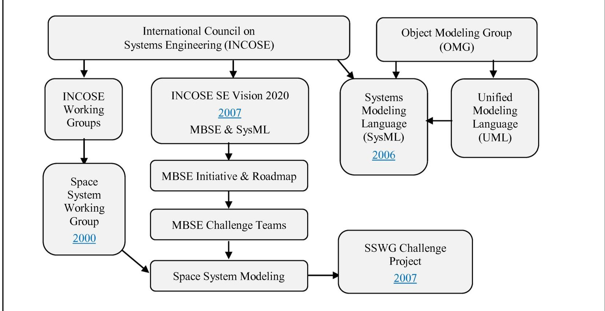

Figure 1. INCOSE MBSE Initiative and SSWG Challenge Project.

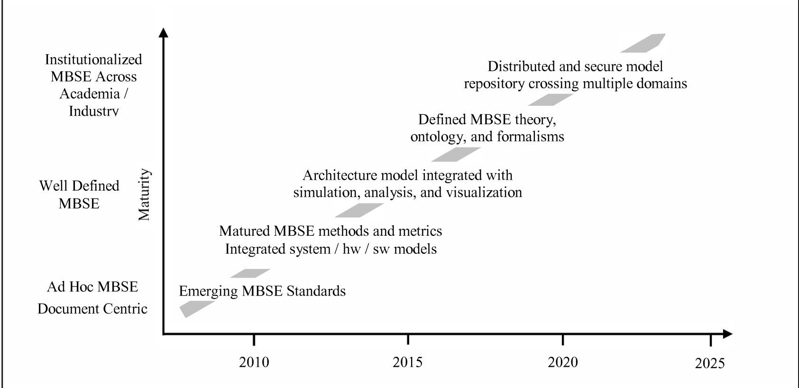

Figure 2. MBSE Roadmap. Adapted from [4]

<!-- PDF_PAGE: 5 -->

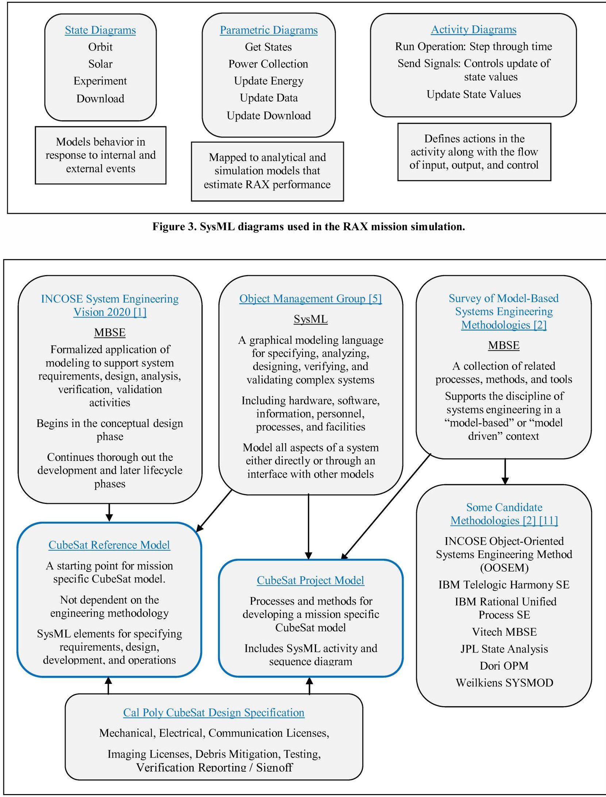

Figure 4. Current Phase.

<!-- PDF_PAGE: 6 -->

The CDS includes propulsion, materials, mechanical, and electrical specifications which will be populated into the Reference Model. It also includes requirements covering communication licenses, remote sensing licenses, debris mitigation, testing, and verification reporting/signoff, which will be populated into the Project Model as Activity diagrams or Sequence diagrams.

## CubeSat Reference Model

Figure 5 illustrates the scope and foundation of the CubeSat Reference Model. It will cover all phases of the lifecycle and all phases of operations: launch, early, and normal.

The foundation of the CubeSat Reference Model is built with the MBSE and OOSEM methodologies, as well as space systems engineering methods. The specific choice of MBSE or space systems engineering methodology is not critically important in the development of the reference model. It only matters that:

- The reference model contains SysML elements for the requirements, design, analysis, verification, and validation activities.

- The reference model can be customized to contain additional SysML elements to capture unique needs of the mission-specific model.

- Systems engineering artifacts can be extracted from the model, which can be used to demonstrate mission assurance to the stakeholders.

The publications listed in Figure 5 have different names for the lifecycle stages, but the purpose of each stage is basically the same. INCOSE's generic terminology for the lifecycle stages is listed in Table 1 [12]. For this project, the INCOSE terminology is used with some exceptions. The more familiar term 'operational' is used instead of 'utilization', and 'sustainment' is used instead of 'support'. The mission-specific CubeSat projects may not experience all of these lifecycle stages. For example, a university CubeSat team may start with the Concept stage.

The scope of the CubeSat Reference Model starts at the very beginning of a project with identification of the stakeholders and the mission needs, objectives, measures of effectiveness, and constraints. The publications listed in Figure 5 tend to differ on the definition of mission terminology. For this project, the definitions listed in Table 2 will be used.

Figure 6 shows the eventual end state of the CubeSat Reference Model. The model will have space system and ground system model components, package diagrams, and structure diagrams that define a typical space-ground system. There also will be requirement, parametric, and behavior diagrams to demonstrate how the needs, objectives, measures of effectiveness, and constraints of the stakeholders are satisfied.

## 4. CUBESAT DOMAINS AND STAKEHOLDERS

The CubeSat Reference Model and the CubeSat Project Model are aligned to the lifecycle stages, and the models are structured accordingly. Within the domain of the CubeSat project, the stages or domains are Concept, Development, Production, Operational, Sustainment, and Retirement, and this is illustrated in Figure 7.

Providing a fully-formed CubeSat Reference Model and CubeSat Project Model could be a bit overwhelming for a mission specific CubeSat team, especially a team that is just becoming familiar with MBSE and SysML. Having models for each lifecycle phase is a more gradual way to get up to speed. That should also make it easier for a team to modify, add, and remove SysML elements when working with copies of the models

The stakeholders are also represented at the CubeSat domain level. Figure 8 presents a representative set of stakeholders, which can of course be modified depending on the project. The needs and objectives are incorporated into the spacecraft design based on the requirements flow down illustrated in Figure 9.

## 5. CUBESAT OPERATIONAL DOMAIN

The CubeSat operational domain consists of three parts, which are the CubeSat Mission Enterprise, the External Environment, and the External Constraints, as shown in Figure 10. The first two are described below, and the CubeSat Mission Enterprise is detailed in the next section.

## External Environment

The external environment can be divided into the natural and induced environments. The natural environment refers to the physical conditions that the spacecraft experiences in orbit (space) and on the ground (Earth). Induced environments include cyber as well as shipping and handling of CubeSats. The launch environment is categorized as both natural and induced. The relationships of these environments are shown in Figure 11.

## External Constraints

For all CubeSat projects, there are external constraints that influence the system design and development, and typically, the technical, licensing, and regulatory constraints are the key ones that must be considered.

Currently all CubeSats are flown as secondary payloads, and consequently, the orbit is dictated by the primary payload. This limits the technical aspects of the CubeSat design and its development. Furthermore, the launch provider and the primary payload may have additional constraints. For example, the CubeSat may be required to wait at least 30 minutes after ejection from the P-POD before deploying its antenna and transmitting data.

<!-- PDF_PAGE: 7 -->

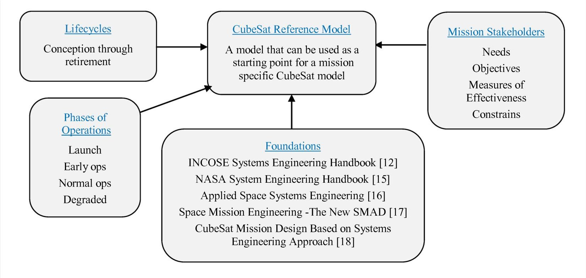

Figure 5. CubeSat Reference Model - Scope.

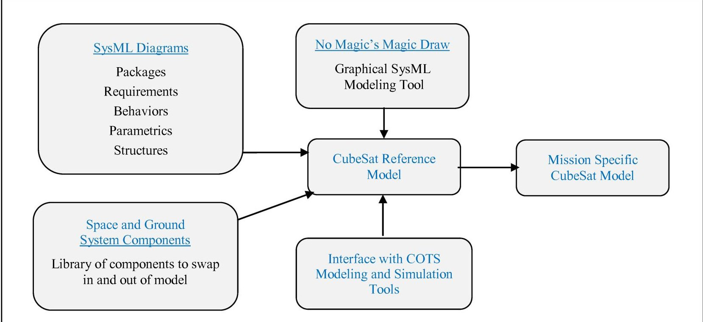

Figure 6. CubeSat Reference Model - Eventual End State.

<!-- PDF_PAGE: 8 -->

Table 1. Lifecycle Stages as Defined in INCOSE Handbook [12].

<table border="1"><tr><td>Lifecycle Stages</td><td>Purpose</td></tr><tr><td>Exploratory Research</td><td>Identity stakeholders&#x27; needs
Explore ideas and technologies</td></tr><tr><td>Concept</td><td>Refine stakeholders&#x27; concepts
Explore feasible concepts
Propose viable solutions</td></tr><tr><td>Development</td><td>Refine system requirements
Create solution description&#x27;
Build system
Verify and validate system</td></tr><tr><td>Production</td><td>Produce system
Inspect and verify</td></tr><tr><td>Utilization</td><td>Operate system to satisfy users&#x27; needs</td></tr><tr><td>Support</td><td>Provide sustained system capability</td></tr><tr><td>Retirement</td><td>Store, archive, or dispose of system</td></tr></table>

Table 2. Stakeholder and Related Mission Terminology.

<table border="1"><tr><td>Stakeholders</td><td>Any entity(individual or organization)that has an interest in the system. Typical stakeholders include users, operators, organization decision makers, parties to the agreement, regulatory bodies, developing agencies, support organizations, and society at large. They can also include interoperating and enabling systems[12].</td></tr><tr><td>Mission Needs</td><td>A concise description of the needs or services that the system must provide.It should be solution-independent and only describe the problem the system is supposed to solve.The mission need drives everything else[12][16].</td></tr><tr><td>Mission Objectives</td><td>The broad set of goals that must be achieved in order to successfully satisfy the stated mission need,such as the purpose to be achieved,product to be produced,or a service to be performed[16][17][19].</td></tr><tr><td>Measures of Effectiveness</td><td>Operational measures of success that are closely related to the achievement of the mission objective/requirement being evaluated,in the intended operational environment under a specified set of conditions[12][20].</td></tr><tr><td>Mission Constraints</td><td>Limitations placed on cost,schedule,&amp;implementation techniques that are available to the system designer.They are typically fixed and not subject to trades,e.g. mission budget and schedule[16][17].</td></tr><tr><td>Mission Requirements</td><td>Derived from the Mission Objectives and Mission Constraints and documented in a simple,concise,verifiable,&amp;understandable format.They should be stated in terms of operational&amp;mission outcomes rather than implementation and solution concepts[16].</td></tr><tr><td>Measures of Performance</td><td>Characterize the physical or functional attributes relating to the system operation;i.e.,they provide insight into the performance of the specific system[20].</td></tr><tr><td>Technical Performance Measures</td><td>Measure attributes of a system element within the system to determine how well the system or system element is satisfying specified requirements[20].</td></tr></table>

<!-- PDF_PAGE: 9 -->

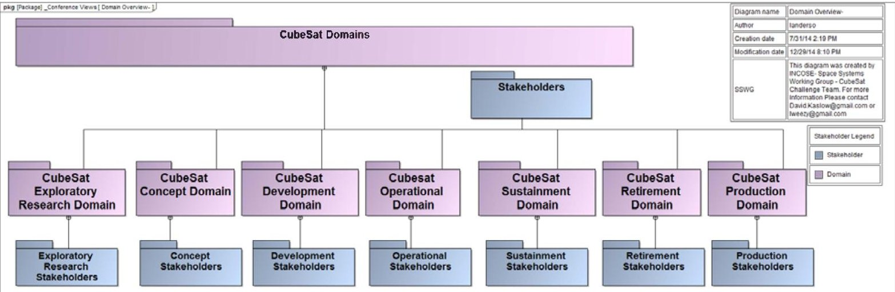

Figure 7. CubeSat Domains.

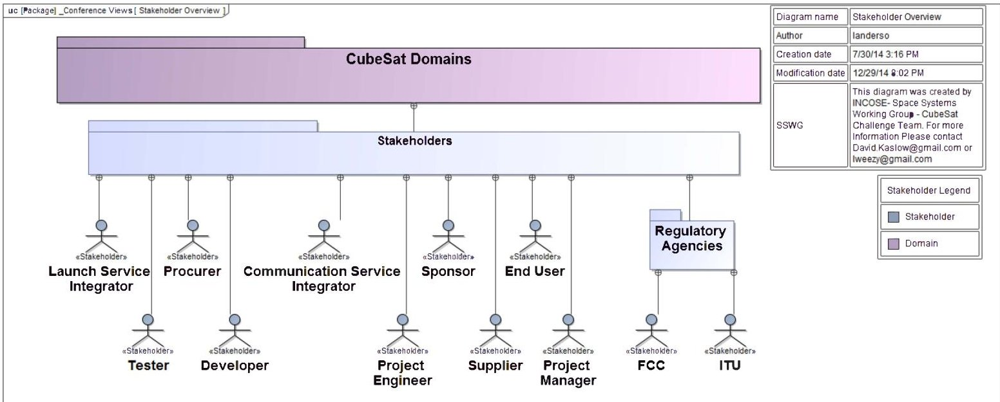

Figure 8. CubeSat Stakeholders.

<!-- PDF_PAGE: 10 -->

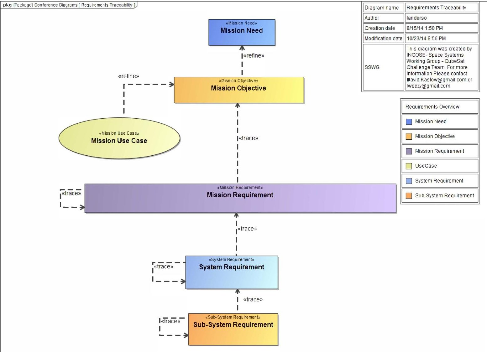

Figure 9. Requirements Flowdown.

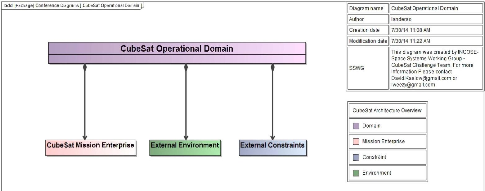

Figure 10. CubeSat Operational Domain.

<!-- PDF_PAGE: 11 -->

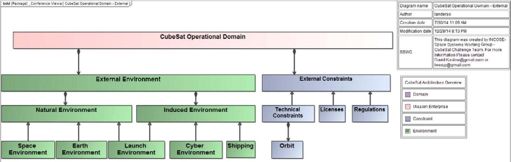

Figure 11. External Environments and External Constraints.

CubeSat projects are pursued internationally, but the licenses and regulations that cover its activities are administered at the national level. Consequently, the rules, the process to gain specific permissions, and the responsible regulatory bodies varies between countries. For example in the United States, the Federal Communications Commission (FCC) regulates the frequencies, the Orbital Debris Assessment Report contains guidelines for limiting orbital debris, and the National Oceanic and Atmospheric Administration (NOAA) regulates remote sensing. Since most CubeSats use amateur frequency bands, the desired amateur frequency must first be coordinated through the International Amateur Radio Union. American CubeSat projects must also adhere to the International Traffic in Arms Regulations and Export Administration Regulations

## 6. CUBESAT MISSION ENTERPRISE

The CubeSat Mission Enterprise, as shown in Figure 12 consists of the Space System, the Ground System, and the external elements of Launch Services, Launch Vehicle Interface System, and Communication Services.

The Space and Ground Systems are represented by logical and physical architectures. The logical architecture decomposes the system into logical components, which are abstractions of components that implement the system, and it also defines the interactions between these components that are needed to accomplish system-level actions and operations. The logical components are then allocated to the physical components that are implemented as hardware, software, data, procedures, and operator actions. The physical architecture is then defined in terms of these physical components and their interactions [13].

## Logical Space System

The Space System can be further divided into the bus, payload, and their subsystems, as shown in Figure 13. Table 3 lists each of the subsystems and their descriptions as

defined by the SSWG team. Depending on the CubeSat project, some of the subsystems may not be needed. For example, the propulsion and the guidance, navigation, and control subsystems may not be utilized if the mission does not require orbit control.

## Logical Ground System

Similar to the Space System, Figure 14 shows the subsystems of the Ground System, and their definitions are provided in Table 4.

The logical components of some of the subsystems can be identified early on, and the following are examples for the power, structures and mechanisms, thermal, and communications subsystems.

## Power

The power components for CubeSats include solar panels, batteries, regulators, and wiring harnesses.

## Structures and Mechanisms

The choices of structures and mechanism components for CubeSats are determined primarily by availability of commercially available components and the Cal Poly CubeSat Design Specification.

## Thermal

Designing CubeSats to operate within thermal limits is generally accomplished by selecting components that are thermally robust and positioning of the heat generating components within a thermal path to the CubeSat structure and to external surfaces.

## Communications

The communications subsystem consist of a forward uplink for sending commands from the ground terminal to the spacecraft and a return downlink for sending telemetry and

<!-- PDF_PAGE: 12 -->

mission data from the spacecraft to the ground terminal. The spacecraft and ground components include antennas, receivers, transmitters, and cables.

A link analysis is based on the properties of the communication components including the transmitter power, line loss from the transmitter to transmit antenna, transmit antenna gain, and receive antenna gain. The link analysis also uses the frequency and data rate, and it accounts for the system noise temperature and losses due to transmission path length and atmospheric attenuation.

These factors are accommodated in the SysML model of communication component properties and parametric equations that relate signal to noise ratio, transmit power, and data rate. The model can use an acausal solver to determine the following: 1) the maximum feasible signal to noise ratio for a given data rate and available power, 2) the minimum feasible power for a given data rate and desired signal to noise ratio, and 3) the maximum feasible data rate given available power and desired signal to noise ratio. The signal to noise ratio must exceed a minimum level to ensure a desired error rate is achievable [7].

Other subsystem logical components depend on the allocation of mission specific functional and performance requirements.

## Guidance, Navigation, and Control

Navigation is the determination of spacecraft position and velocity (trajectory) as a function of time. Navigation control is the determination and execution of propulsion commands to change the trajectory. Guidance is changing the current trajectory to the desired trajectory.

The determination of navigation data can be carried out on the ground or onboard the spacecraft. Ground-based determination can be active (ranging) or passive (optical or radar tracking) Optical or radar tracking are not practical options for student-built CubeSats). There are several options for space-based navigation data including processing signals from the Tracking Data Relay Satellite System (TDRSS) or from navigation satellites such as the U.S. Navstar Global Position System (GPS).

CubeSat missions requiring navigation control are not common. However, navigation data is always required.

## Attitude Determination and Control

The choice of attitude determination and control components is driven by mission specific requirements. The choices for attitude determination sensors include star sensors, sun sensors, horizon sensors, and magnetometers. The choice for attitude control components include gravity booms to align with the Earth gravity field, magnets to align with the Earth's magnetic field, momentum wheels, control moment gyros, magnetic torquers, and thrusters.

As a project develops its CubeSat model, it will need to assess the level of component definition in the logical architecture before creating candidate physical architectures. Depending on the mission requirements, a more detailed decomposition of the subsystems may be necessary. Then the candidate physical architectures are enumerated as specific instances of hardware and software.

## 7. CONCLUSION

Work has begun on the development and distribution of a CubeSat Reference Model and CubeSat Project Model that CubeSat teams can use as starting points for their mission-specific CubeSat models.

The models cover all stages of the lifecycles and all phases of operations from launch, early, normal, and degraded. The CubeSat Reference Model will include SysML elements for the requirements, design, verification, and validation activities. The CubeSat Project Model will cover how CubeSat design and development are to be accomplished. The models will be consistent with the Cal Poly CubeSat Design Specification.

The model architecture consists of the CubeSat Mission Enterprise, External Environment, and External Constraints. The Mission Enterprise consists of the Space System and the Ground System as well as the externals: Launch Services, Launch Vehicle Interface System, and Communication Services.

The effort to date has been focused on establishing nomenclature; incorporating the stakeholders and their needs, objectives, and measures of effectiveness; and defining the architecture down to the logical subsystems.

## 8. NEXT STEPS

The next step is to determine the level of model definition at each of the lifecycle stages and to create models for the concept and development phases. The model will be validated by applying it to a hypothetical CirrusSat mission to detect cirrus clouds.

The CubeSat Reference Model will be rolled-out in a controlled fashion to make certain that model is understandable and useful. The requests and applications of the model have fallen into the following two categories: 1) using the model within an aerospace engineering course and 2) evaluating the application of MBSE within an aerospace program. The first roll-out will be to an MBSE workshop. The model will then be updated based on the feedback, and the roll-out will be expanded.

<!-- PDF_PAGE: 13 -->

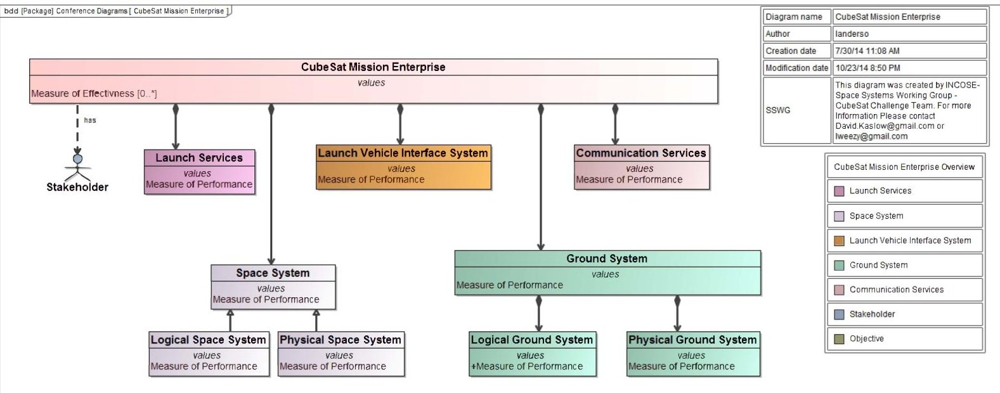

Figure 12. CubeSat Mission Enterprise.

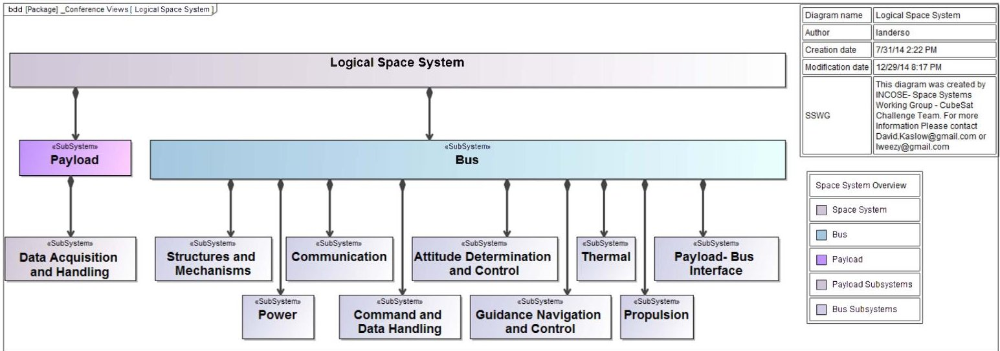

Figure 13. Logical Space System Model.

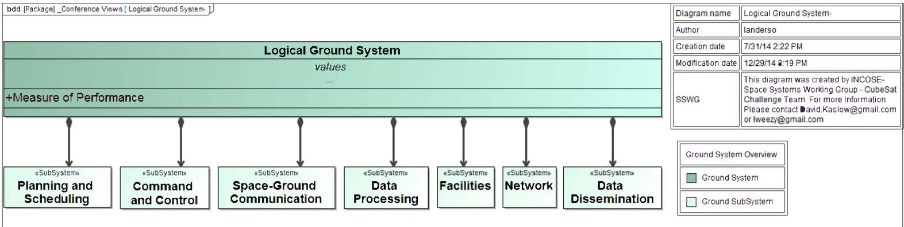

Figure 14. Logical Ground System Model.

<!-- PDF_PAGE: 14 -->

Table 3. Space Subsystems.

<table border="1"><tr><td colspan="2">Payload</td></tr><tr><td>Data Acquisition and Handling</td><td>Acquire, process, store, and downlink mission data.</td></tr><tr><td colspan="2">Bus</td></tr><tr><td>Attitude Determination. and Control</td><td>Determine and control the spacecraft rotational motion (orientation).[17,Table14-6,Section19.1,andSection25.4.3]</td></tr><tr><td>Command and Data Handling</td><td>Receive,store,and distribute spacecraft commands.Collect,store,and downlink spacecraft telemetry.[17,Table14-6].</td></tr><tr><td>Communications</td><td>Provide communication between the spacecraft and ground or the spacecraft and another spacecraft.[17,Table14-6andSection16.2].</td></tr><tr><td>Guidance,Navigation,and Control</td><td>Determine and control the spacecraft translational motion.(trajectory).[17,Table14-6andSection19.2]</td></tr><tr><td>Payload Bus Adapter</td><td>Provide the interface the bus and payload.</td></tr><tr><td>Power</td><td>Monitor,collect,store,distribute,andcontrolspacecraftpower.[17,Table14-6andSection25.4.3].</td></tr><tr><td>Propulsion</td><td>Provide and control spacecraft thrust.[17,Table14-6andSection25.4.3].</td></tr><tr><td>Structures and Mechanisms</td><td>Provide mechanical support and integration of the spacecraft payloads and subsystems.[17,Table14-6andSection25.4.3].</td></tr><tr><td>Thermal</td><td>Monitor and control the spacecraft thermal state.[17,Table14-6andSection25.4.3].</td></tr></table>

<table border="1"><tr><td colspan="2">Table 4. Ground Subsystems.</td></tr><tr><td>Planning and Scheduling</td><td>Coordinate spacecraft (bus and payloads) activities and shared ground resources. (e.g. payload data collection, spacecraft housekeeping, spacecraft ground communications and other shared resources use).</td></tr><tr><td>Command and Control</td><td>Monitor and command the spacecraft. Monitor and control the ground equipment.</td></tr><tr><td>Data Processing</td><td>Generate data products from raw data.</td></tr><tr><td>Data Dissemination</td><td>Disseminate data products and raw data to stakeholders.</td></tr><tr><td>Space to Ground Communications</td><td>Provide space to ground communications during scheduled contact intervals.</td></tr><tr><td>Network</td><td>Provide network connectivity among ground subsystems and stakeholders.</td></tr><tr><td>Facilities</td><td>Provide a managed environment for ground system resources.</td></tr></table>

<!-- PDF_PAGE: 15 -->

## REFERENCES

[1] Systems Engineering Vision 2020, INCOSE -TP_2004- 004-02, ver. 2/03,September 2007. [Online]. Available: http://www.incose.org/ProductsPubs/pdf/SEVision2020 20071003_v2_03.pdf

[2] Survey of Model-Based Systems Engineering (MBSE) Methodologies. INCOSE-TD-2007-003-01, Ver B. 10 June 2008. [Online]. Available https://www.incose.org/ProductsPubs/pdf/techdata/MTT C/MBSE_Methodology_Survey_2008-0610_RevB- JAE2.pdf

[3] International Council on Systems Engineering (INCOSE), "MBSE Initiative," January 2007. [Online] Available: https://connect.incose.org/tb/MnT/mbseworkshop/

[4] MBSE Roadmap. MBSE Wiki, INCOSE MBSE IW 2012. MBSE Wiki. [Online} Available: http://www.omgwiki.org/MBSE http://www.omgwiki.org/MBSE/lib/exe/fetch.php?media =mbse:mbse_iw_2012-introduction-2012-01-21 friedenthal-c.pptx

[5] Object Management Group (OMG), OMG Website. [Online]. Available: http://www.omgsysml.org/

[6] S. Spangelo, D. Kaslow, C. Delp, B. Cole, L. Anderson, E. Fosse, B. Gilbert, L. Hartman, T. Kahn, and J. Cutler, "Applying Model Based Systems Engineering (MBSE) to a Standard CubeSat," in Proceedings of IEEE Aerospace Conference, Big Sky, MT, March 2012.

[7] S. Spangelo, L. Anderson, E. Fosse, L Cheng, R. Yntema, M. Bajaj, C. Delp, B. Cole, G. Soremekun, D. Kaslow, and J. Cutler, "Model Based Systems Engineering (MBSE) Applied to Radio Explorer (RAX) CubeSat Mission Operational Scenarios," Proceedings of IEEE Aerospace Conference, Big Sky, MT, March 2013.

[8] L. Anderson, B. Cole, R. Yntema, M. Bajaj, S. Spangelo, D. Kaslow, C. Lowe, E. Sudano, M. Boghosian, R. Reil, S. Asundi, and S. Friedenthal, "Enterprise Modeling for CubeSats," Proceedings of IEEE Aerospace Conference, Big Sky, MT, March 2014.

[9] D. Kaslow, G. Soremekun, H. Kim, S. Spangelo, "Integrated Model-Based Systems Engineering (MBSE) Applied to the Simulation of a CubeSat Mission", Proceedings of IEEE Aerospace Conference, Big Sky, MT, March 2014.

[10] J. Springmann, B. Kempke, J. Cutler, and H. Bahcivan, "Initial Flight Results of the RAX-2 Satellite," in Proceedings of the 26th Annual Small Satellite Conference, Logan, UT, August 2012.

[11] Additional Methodologies Identified as Gaps since 2008 INCOSE Survey. MBSE Wiki, Metrics and Methodologies [Online]. Available: http://www.omgwiki.org/MBSE/doku.php?id=mbse:methodology

[12] INCOSE Systems Engineering Handbook, v. 3.2.2 October 2011, INCOSE-TP-2003-002-03.2.2.

[13] S. Friedenthal, A. Moore, R. Steiner, A Practical Guide to SysML, $ 2^{\mathrm{nd}} $ ed., Elsevier, Waltham, MA, 2012.

[14] CubeSat Design Specification, rev. 13, The CubeSat Program, Cal Poly SLO, February 2014

[15] NASA Systems Engineering Handbook, rev. 1, December 2007, NASA/SP-2007-6105 Rev1.

[16] W. Larson, et. al., Applied Space Systems Engineering, (Space Technology Series), McGraw Hill, Boston, MA, 2009.

[17] J.R. Wertz, D. Everett, and J. Puschell, Eds., Space Mission Engineering: The New SMAD, (Space Technology. Library, Volume 28), Hawthorne, CA, Microcosm Press, 2011.

[18] S. Asundi and N. Fitz-Coy, "CubeSat Mission Design Based on Systems Engineering Approach," Proceedings of IEEE Aerospace Conference, Big Sky, MT, March 2013.

[19] A Guide to the Project Management Body of Knowledge, $ 4^{\mathrm{th}} $ ed., Project Management Institute, 2008.

[20] G. Roedler and C. Jones, Technical Measurement, ver. 1, INCOSE-TP-2003-020-01, December 2005. [Online], Available: https://www.incose.org/ProductsPubs/pdf/TechMeasurementGuide_2005-1227.pdf

## BIOGRAPHY

Louise Anderson is a Systems Engineer for Production Ground Systems at DigitalGlobe. She has 3 years systems engineering experience at Jet Propulsion Laboratory and 5 years of experience in engineering. She has experience in mission operations, systems architecture, ground systems, and flight systems.

She graduated in May 2010 from the University of Colorado, Boulder with a degree in Aerospace Engineering. Previously she worked at the Laboratory for Atmospheric Space Physics in Boulder Colorado working as a Command Controller in the Mission Operations Team. She has worked on the mission ops team for Kepler, Sorce, AIM, Quikscat, and Icesat. Louise is a member of INCOSE and is the lead for the Space Systems Working Group CubeSat Challenge Team.

<!-- PDF_PAGE: 16 -->

Sharan Asundi is an Assistant Professor of Aerospace Science Engineering at Tuskegee University (TU). His research interests include design & development of pico/nano/microsatellites (PNMSats) for atmospheric research and technology advancement. He has collaborated with NASA

Goddard to research magnetic activity and the design of magnetically clean PNMSats. He has sought support (pending) from Air Force to develop a magnet coil test facility at TU to advance this research. He has proposed (NSF) to develop a 6U CubeSat (with a Laser Induced Breakdown Spectroscope (LIBS) instrumentation) in collaboration with University of Florida, NASA and Maryland Aerospace Inc. to advance the understanding of upper atmospheric composition. Through support from Rockwell Collins, he is setting up an Amateur Radio Station at TU.

Bradley Ayres, Ph.D., is an Adjunct Assistant Professor of Systems Engineering, Department of Aeronautics and Astronautics at the Air Force Institute of Technology. He serves as the Aerospace Corporation Chair supporting AFIT and the Center for Space Research and Assurance. He received his

Ph.D. in Business Administration specializing in MIS from Florida State University in 2003. Dr. Ayres has degrees from University of Missouri (BS, Chemical Engineering), Webster University (M.A., Procurement and Acquisition Management) and AFIT (M.S., Software Systems Management). Dr. Ayres' research interests include management of complex systems, model-based systems engineering, and space systems engineering. His is a member of the PMI, INCOSE and AIAA.

Curtis Iwawa Curtis Iwata has been involved in model-based systems engineering projects since 2013, starting with the NASA Jet Propulsion Laboratory's Mars2020 project. He is currently a Member of the Technical Staff at The Aerospace Corporation. He graduated from

the Georgia Institute of Technology with a doctorate degree in Aerospace Engineering. He also attended the International Space University and University of California, Irvine.

David Kaslow has thirty-four years of experience at Lockheed Martin in both the technical and management aspects of developing ground mission capabilities. He has five-years of experience at Analytical Graphics creating their Standard Object Catalog and pursuing Model

Based Systems Engineering. Dave is co-author of four chapters Cost-Effective Space Mission Operations. He is also the author and co-author of papers and presentation for INCOSE Annual International Symposiums and Workshops, the IEEE Aerospace Conference, the Small Satellite Workshop and the NDIA Systems Engineering Conference. Dave is the lead for the INCOSE Space Systems Working Group. He has participated in the Space Systems MBSE Challenge Team since its founding in 2007 and is a principal contributor to the CubeSat Challenge Team.

Bungo Shiotani is a Ph.D. student at the University of Florida (UF) working on systems engineering aspects for small satellites. Specifically to develop metrics to quantify mission assurance throughout the project lifecycle. Bungo received two Bachelor of Science degrees,

one in Aerospace Engineering from UF and the other in Engineering Physics from Jacksonville University. He also received his Master of Science in Aerospace Engineering from UF where his thesis, Reliability Analysis of SwampSat, focused on performing reliability analyses on SwampSat, UF's first CubeSat. His experiences and as the project manager with SwampSat lead to an internship at NESTRA (Japan) where he worked on developing system diagrams and test procedures as well as assembly integration and testing of their three microsatellites that were in development.

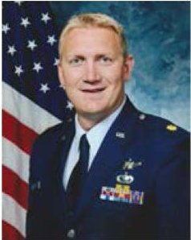

Robert Thompson, Major USAF is a Ph.D. candidate at the Air Force Institute of Technology. He received a B.S. in Engineering from the United States Air Force Academy in 2002. He has held several space acquisition and operations positions as an officer in the U.S. Air Force, including an Air

Force Satellite Control Network system architect. He later became the project manager for the 3 $ ^{rd} $ -generation IR ground system and was instrumental in establishing the Commercially Hosted Infrared Payload (CHIRP) program. In 2008, he earned an MS in Systems Engineering from Loyola Marymount University. Afterward he led launch telemetry operations at the NRO Ops Squadron (NOPS). His interests include space systems and system of systems architectures.