<!-- PDF_PAGE: 1 -->

# Enterprise Modeling For CubeSats

Louise Anderson Bjorn Cole Jet Propulsion Laboratory 4800 Oak Grove Dr. Pasadena, CA 91109 lweezy@gmail.com bjorn.cole@jpl.nasa.gov

Christopher Lowe University of Strathclyde 75 Montrose Street Glasgow, G1 1XJ, UK christopher.lowe@strath.ac.uk

Rose Yntema

Manas Bajaj

InterCAX

75 Fifth Street NW,

Suite 312

Atlanta, GA 30308

rose.yntema@intercax.com

manas.bajaj@intercax.com

Robin Reil NASA Ames Research Centre Moffett Federal Airfield -NUQ Mountain View CA 94035 robin.l.reil@nasa.gov

Eric Sudano EVSudano Systems Solutions 27 Cumberland Drive Downingtown,PA 19335 evsudano@gmail.com

Sara Spangelo

David Kaslow

Analytical Graphics

220 Valley Creek Blvd.

Exton, PA 19341

spangelo.sara@gmail.com

david.kaslow@gmail.com

Sharan Asundi

Tuskegee University

1200 W Montgomery Road

Tuskegee

AL 36088

asundi@mytu.tuskegee.edu

Mary Boghosian Aerospace Corporation 200 S. Los Robles, Suite 50 Pasadena CA 91101 mary.h.boghosian@aero.org

Sanford Friedenthal Object Management Group 109 Highland Ave Needham, MA 02494 safriedenthal@verizon.net

Abstract—Understanding the business aspect of a project or mission is of key importance in spacecraft systems engineering, including the mission cost, high level functions and objectives, workforce, hardware, and production of spacecraft. This is especially true for CubeSat missions, which typically deal with low costs, limited resources, low mass, low volume, and low power. Introducing enterprise modeling concepts to CubeSat missions allows for incorporation of analysis of cost, business processes, and requirements for the mission's spacecraft and problem domain. The following describes an application of enterprise modeling to CubeSats.

A cost model in the form of parametric, cost estimating relationships (CERs) is described here and is planned to be integrated with the system model architecture to provide an "up to the minute" total project cost estimate, with emphasis on assessment at the conceptual design phase. System mission parameters such as space & ground segment sub-system performance metrics and launch vehicle requirements will provide input to an overall mission cost, which can be developed and refined throughout the mission lifecycle. Additional factors are applied in areas where uncertainties exist, and global financial phenomena such as projected inflation will also be considered.

Production and management of the system model and supporting analysis tools will be discussed. The idea of an open source framework available for modeling CubeSats that incorporates both business concerns and approach is appealing for rapid development of CubeSats. The framework developed is a SysML representation of common CubeSat elements that can be used as a library to build a domain-specific CubeSat, and will incorporate management of the model and typical use cases. Tools will be used to help analyze the CubeSat system and allow for design of the System using SysML. A design for managing and packaging the commercial off the shelf (COTS) tooling, models, and analysis libraries is discussed. Modular parametric relations are included in the framework, with which the mass or cost of any component can be determined by

summing up the mass or cost of its constituent components as they are designed with variant architectures.

While SysML provides a big picture model describing both the CubeSat and outside elements for systems engineering purposes, Product Lifecycle Management (PLM) software provides a more detailed view of the specific parts that make up the manufactured product. A method for linking elements in a SysML model with artifacts in a PLM repository, including version management, is discussed. Other models and analysis that more fully describe the system in question can also be linked, allowing for collection of all relevant information about the CubeSat in one place.

Much like the way current CubeSat Pumpkin Kits are marketed and sold, a modeling framework that allows for analyzing and costing the technical design of the spacecraft throughout the lifecycle of the mission will allow for more robust and reusable designs. This paper discusses the incorporation of enterprise concerns into a CubeSat framework and the management of that framework.

## TABLE OF CONTENTS

TABLE OF CONTENTS ...1

1. INTRODUCTION ...2

2. ENTERPRISE MODELING FOR CUBESATS...4

3. COST MODELING ANALYSIS...6

4. INTEGRATED ANALYSIS ARCHITECTURE ...8

5. PRODUCT LIFECYCLE MANAGEMENT ...9

6. FRAMEWORK MANAGEMENT AND RELEASE.10

7. CONCLUSION...11

8. ACKNOWLEDGMENTS...11

REFERENCES...12

BIOGRAPHY ...13

978-1-4799-1622-1/14/$31.00 ©2014 IEEE

<!-- PDF_PAGE: 2 -->

## 1. INTRODUCTION

## Overview

As Systems Engineering has evolved one of the key concepts is the use of teams in order to build large complex systems. Model Based Systems Engineering (MBSE) and the use of standard languages such as Systems Modeling Language (SysML) and Unified Modeling Language (UML) allow for stronger more integrated communication between engineering teams. [1] MBSE is the formalized application of modeling to support system requirements, design analysis, optimization, verification, and validation. It begins in the conceptual design phase, continuing throughout development and into later life cycle phases including operations. SysML a language used in MBSE originated in 2001 with International Council on Systems Engineering (INCOSE) and the language has continued to grow and be used in systems model throughout the past years. The information below details one extension of the INCOSE MBSE Working Group that is specific for CubeSat Space System applications.

## INCOSE MBSE Challenge Project

INCOSE kicked off the MBSE Challenge project at the January 2007 INCOSE International Workshop [2]. The MBSE Roadmap (Figure 8, state in 2012) was created to define the high-level, long term vision for the maturation and acceptance of MBSE across academia and industry. This roadmap has continued to evolve at the MBSE

INCOSE workshops every year from 2007 onwards.

## Radio Aurora Explorer

The INCOSE Space Systems Working Group (SSWG) CubeSat project was initiated in April 2011 to demonstrate the application of MBSE to a realistic mission in the space systems domain. The Radio Aurora Explorer (RAX) satellite was selected [3]. RAX is a three Unit (3U) CubeSat developed by the University of Michigan Exploration Lab (MXL) and SRI International. The RAX mission is to study the formation of magnetic field-aligned plasma irregularities in the lower polar atmosphere that are known to disrupt tracking and communication between Earth stations and orbiting satellites.

A CubeSat is type of miniaturized spacecraft with a standard form factor based on standardized cubes 10-centimeters on a side and weighing less than one kilogram. CubeSats typically consist of one to three cubes.

As RAX passes over a radar transmitter it receives and processes the scattered radar signal. The processed radar data is compressed and stored for subsequent downlink. In addition to payload data, telemetry data is also collected and downloaded. The ground radar station is the Poker Flat Incoherent Scatter Radar (ISR) located in Alaska. The primary RAX ground station and operations center is located at the University of Michigan in Ann Arbor.

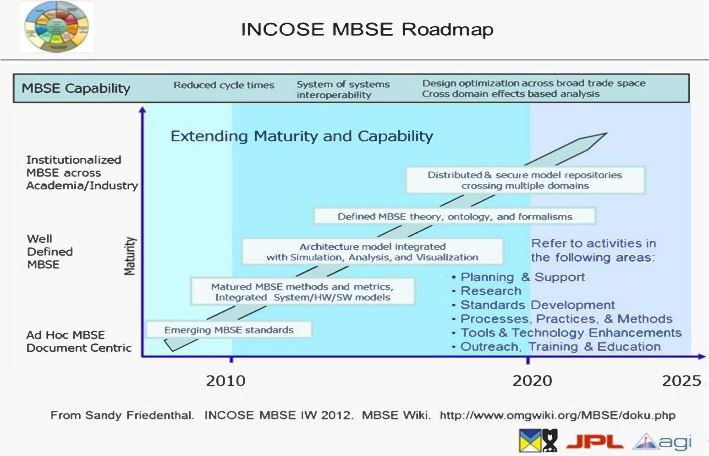

Figure 1 - MBSE Roadmap

<!-- PDF_PAGE: 3 -->

## CubeSat Project-First Phase

The first phase of the CubeSat project consisted of developing a SysML framework model of a CubeSat and then applying that framework to model RAX [4].

Our CubeSat framework defined the logical and physical architecture of the flight system and ground system. The logical model described the subsystems in terms of the functions they perform that are necessary to achieve the mission objectives. The physical model specified the parts that would be needed to implement the subsystems.

## CubeSat Project-Second Phase

The second phase focused on expanding the RAX CubeSat model to include modeling behaviors [5]. We integrated several simulation tools to execute SysML-based behavior models, including subsystem functions and internal states of the spacecraft. The tools included MagicDraw and Cameo Simulation Toolkit from No Magic; ModelCenter from Phoenix Integration; ParaMagic from InterCAX, Systems Tool Kit from Analytical Graphics; and MATLAB from MathWorks. This phase of the RAX CubeSat modeling supported analysis of communication download, power, and mission activities and states.

Communication downlink modeling supported trades of data download rate, available power, and signal to noise ratio. The trades were carried out using the ParaMagic

## parametric solver.

Power modeling was used to investigate the time history of on-board energy and data, and the quantity of downlinked data. The modeling incorporated MagicDraw, ModelCenter, Systems Tool Kit, and MATLAB.

Activity and state behavior modeling of the ground system and flight system included transitions between uplink downlink, experiment, and nominal operations states. Cameo Simulation Toolkit enabled execution of the activity models and state machines.

This phase of the project was successful, but the modeling lacked the ability to time-step through a behavioral scenario to determine if requirements would be satisfied across the entire scenario.

## CubeSat Project-Third Phase

The third phase of the INCOSE SSWG Challenge team consists of continuing the development of an Architectural Framework for CubeSats using prior experience with the integrated RAX CubeSat Model [6].

The main motivation behind the continuation of development on a CubeSat Framework and model is the continued and growing interest from the space community with CubeSats as well as the successful Return on Investment (ROI) seen from some other modeling projects

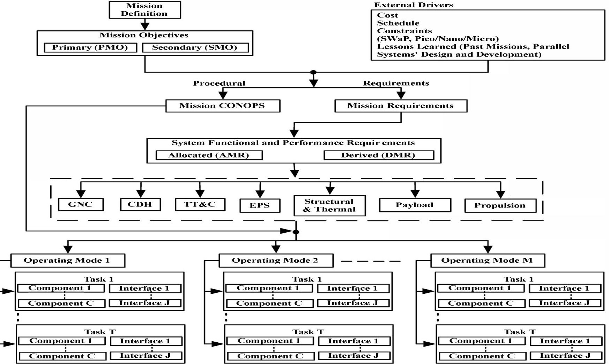

Figure 2 - Requirements Flow-down

<!-- PDF_PAGE: 4 -->

[7]. Currently in the CubeSat community there are many homegrown CubeSat Kits [8] that focus around the hardware aspect of a CubeSat design. The Challenge team hopes to bring together a Systems Engineering kit that is useful for the full lifecycle of a CubeSat mission. This idea of a lifecycle is what ties into the Enterprise modeling approach that is applicable in many disciplines. Typical CubeSat missions are lower cost, but are continuing to test additional capabilities that are relevant in larger flagship type missions such as technology readiness levels (TRLs) for new technologies.[9] In order to aid the growth of the CubeSat community as well as provide further enhancements, the Challenge team aims to make it quicker to have out of the box analysis for CubeSats. Some of the main types of analysis focused on here will be the incorporation of business concerns tying to requirements and stakeholders. This top-down architectural design approach gives the framework extensibility to build on enterprise concerns like cost and schedule. It also gives greater flexibility in the detailed design of the subsystems for the integrated behavioral type analysis shown in our

top-down design approach and a bottom-up development process to address the reliability of CubeSats and stakeholder concerns. The overhead associated with power, telemetry and computational cost for each component, interface, and task, facilitates estimation of the CubeSat system overhead for these factors. Such an overhead estimation model can accommodate parametric cost modeling, power budgets, mass budgets, telemetry budgets, etc., of a CubeSat system.

The diagram shown in Figure 9 provides an overview of the top-down design approach of a CubeSat architecture framework. A more elaborate discussion and implementation of this framework is available in Reference [10] and [12] Starting with the conceptualization of a CubeSat mission, which is captured as the mission definition, the requirement flow-down captures the traceability link to identify and group the basic building blocks of a CubeSat system. The top-down design approach loosely accommodates the external drivers, which include financial cost, schedule, constraints, and lessons learned

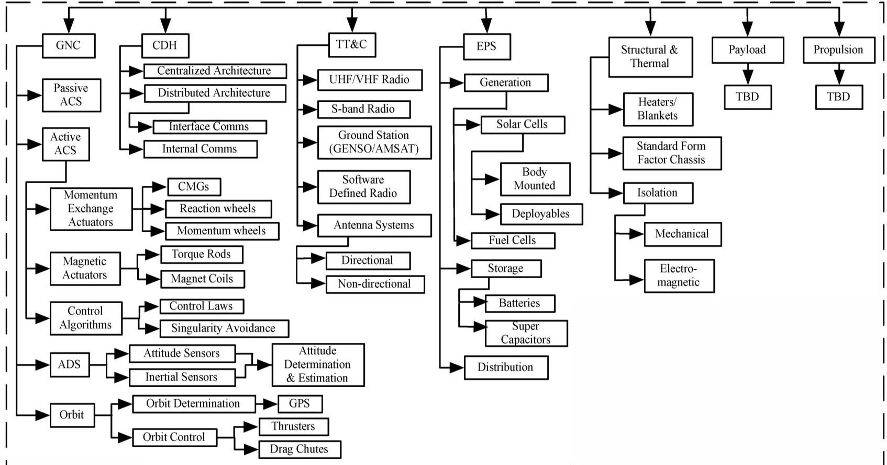

Figure 3 - Subsystems Block

## 2. ENTERPRISE MODELING FOR CUBESATS

previous works [5].

## CubeSat Architecture Framework

A CubeSat architecture framework [10], such as the one shown in Figure 9, can provide a traceability map for translating the mission objectives and mission requirements into basic building blocks of CubeSat system components, interfaces and tasks. The framework, which is based on NASA's Systems Engineering Handbook [11], facilitates a

from previous missions or parallel systems design and development. Contrary to the practice adopted by traditional satellites, CubeSat mission have extensively used commercial-off-the-shelf (COTS) components, subsystems and software as well. To accommodate this feature as part of the CubeSat architecture framework, a subsystems block (Figure 10) can significantly aid the systems design and development of CubeSats. Such a subsystems block is essentially the basis of a toolkit, which can be developed as part of model-based systems engineering tools like No Magic's Cameo Systems Modeler [13].

<!-- PDF_PAGE: 5 -->

The subsystems block, expanded in Figure 10 to show the categories of each subsystem, can be thought of as a coin sorter machine. The system requirements when flowed through this block get broken down into components, interfaces, and tasks as basic building blocks. Each component is associated with one or more interfaces and their tasks. Those components and their interfaces are grouped together to form operating modes as per the mission concept of operations (CONOPS).

The Mission CONOPS facilitates a systematic approach of realizing the mission objective and is critical for organizing mission operations. A specialized mission CONOPS articulated in the form of a flowchart, is shown in Figure 11. In essence, it captures the life cycle of a CubeSat and can be adopted as a layout for the design of flight software [12]. The mission CONOPS also serves as an outline for identifying the phases or operating modes. These phases can be designed to be one-time operations, which can be executed multiple times.

## Mission Operations System(MOS)/Ground System (GS)

Expanding the current CubeSat framework [4] to include a more complete Ground System (GS) model is an essential step towards enabling the framework to address enterprise concerns and solutions. The approach is to expand on the existing framework to define more complete ground system packages for requirements, logical and physical subsystems, logical and physical components, and use cases for ground system operations as illustrated in with the top level and nest packages.

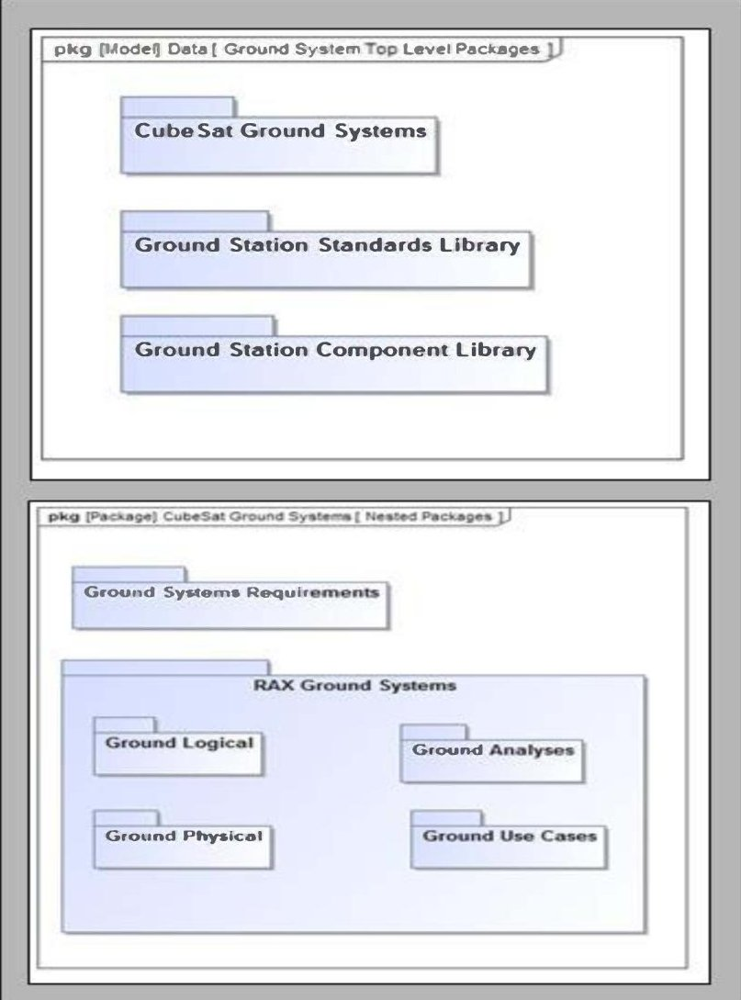

Figure 4 - Proposed Package ad Model Organization for Ground Systems

Subsystem and components packages would include behavior, parametric and structure as required. These would support ground analyses for mission operations studies,

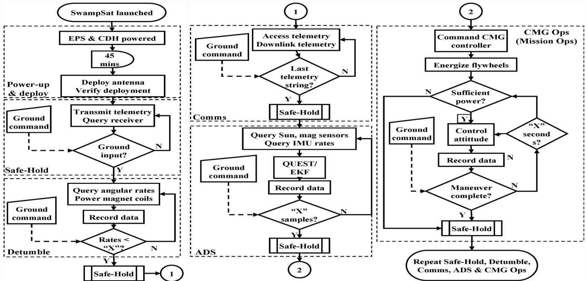

Figure 5 - Mission Concept of Operations (CONOPS)

<!-- PDF_PAGE: 6 -->

subsystem and component trade studies, and cost estimation for the ground system. shows the proposed Ground System subsystems in the current model under development.

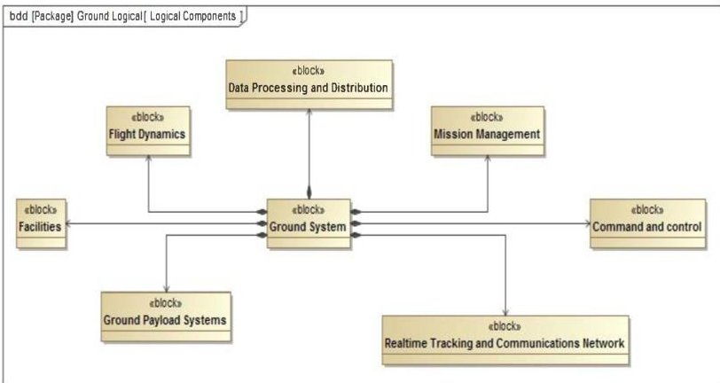

Figure 6 - Proposed Ground System Model Subsystems

Generally, the ground system analyses would be part of a larger set of analyses supporting enterprise studies for decision making about the space system being considered for development. For example, if enterprise needs determined that the spacecraft system needed to lead in selecting frequency and output power, the ground system model would need to accept those as parameter inputs. Further, the same link budget model considerations (propagation loss, etc.) would be utilized. The ground Signal to Noise Ratio (SNR) analysis would build on the same model. The model and the parameters would be employed in the component selection trade analysis for the ground real-time tracking and communication network components. (e.g. Antenna type and size, high power amplifiers, low noise amplifiers, modems). These in turn could be coupled to a parametric costing model.

Current work is focused transforming the functional flow diagram illustrated in into the SysML model using No Magic'sCameo Systems Modeler tool and making the Ground model consistent with the existing CubeSat model; vetting the differences as needed.

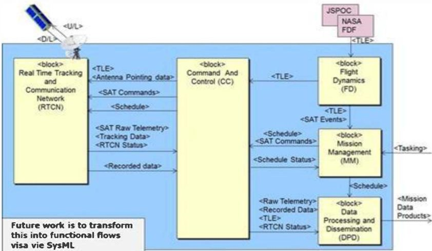

Figure 7 - Ground Subsystem Flow Diagram

## 3. COST MODELING ANALYSIS

## Space System Cost

A significant amount of effort has been applied in the past to the development of cost models for use with large space systems (systems with mass range of 1000 kg or more). The cost estimation approach used has been focused on parametric, historical database-driven, methodologies exploiting Cost Estimating Relationships (CERs) as the primary contributors behind the cost estimation model. For relatively small space systems (microsatellites) with mass range 100 kg to 500 kg or so, there exist a handful of commercial/government tools applicable to space system cost estimation and/or mission cost, such as the Aerospace Corporation's Small Satellite Cost Model (SSCM) [14] [15], the Advatech Pacific's Integrated System and Cost Modeling Tool (ISCM) [16] [17] and PRICE System's PRICEH model [18]. However, the capabilities of smaller (pico) satellites （<50 kg-0.1 kg) are advancing rapidly and their rate of production and launch frequency is following the same trend. CubeSats form part of this picosatellite family and feature a high proportion of off the shelf (OTS) hardware and software utilization, meaning system cost must be assessed differently from traditional methods as development and verification costs can differ significantly.

More and more commercial institutions, government agencies, and universities are becoming involved in developing and launching picosatellites especially CubeSats. More and more funding support is becoming available, encouraging development, launch and in-space operation for short-term (few hours) as well as mediumterm (several months) missions. Furthermore, integration of the CubeSat platform into organizational enterprise activities means that the development, launch, tracking and operation costs are becoming a fundamental part of the business model.

Many requirements and challenges exist with respect to estimating the cost of development, launch and operation of CubeSats.

(1) A large percentage of these satellites are constructed using standardized commercial components and as a result the costs of components, integration and test, for both hardware and software, must be considered and have a major influence over the final system cost.

(2) Most CubeSats are developed by small, multidisciplinary teams of engineers and students, (many of whom are volunteers), which means a significant level of effort is provided at minimal to no cost over a relatively short timescale. Hence, generally no accurate labor cost can be tracked.

(3) The system requirements and architecture are often undefined and dynamic throughout the project lifecycle; therefore, critical requirements assisting the schedule are not clearly identified.

<!-- PDF_PAGE: 7 -->

(4) During operation, institutions develop small control and tracking stations specific for their use; it is unlikely that large ground antenna systems are used.

(5) Lack of standards during development, Integration & Test, and operation makes it difficult to apply detailed parametric cost models.

(6) There is an inherent inability to utilize traditional massbased cost databases due to the very small masses (and range in mass) of these satellites.

Modifications to the existing large systems cost tools (commercially available and built in-house) have failed to predict the cost of these systems accurately, resulting in skewed predictions. Thus, a new database and methodology has to be developed where all these challenges are met. A picosatellite (CubeSat) cost model, exploiting model based interdisciplinary system development approaches, has been pursued. The first of such approaches is the Aerospace Picosatellite Cost Model (A-PICOMO) [19]. A-PICOMO is a parametric cost model driven by findings from the community in coordination with input from subject matter experts; it is based on logical reasoning about cost implications, which can be used for strategic planning, tradeoffs, investment decisions, budget planning and risk management etc. It looks at the system heuristically assuming the system development follows systems engineering activities, such as human elements, systems I&T, facility, and procurement, and the system cost is closely related to the interaction of these elements. The objective of A-PICOMO is to support cost-centric trade studies (i.e. assess the cost impact of deltas on the system/mission objectives).

For any CubeSat project, whether it is a University-based tech-demo platform or a commercial Earth observation multi-agent constellation, cost plays a major role in the success or failure of the mission, through close relationship with system value. As such, it is critical to have cost estimation capabilities throughout the mission lifecycle allowing trades to be conducted between cost, system performance, schedule and risk. Contributors to overall mission cost include those associated with the space segment (hardware, software, design and development, assembly, integration and test and ground support equipment), ground segment (station rental & construction, software, operations effort) and launch segment (launch preparation, launch and early operations) as well as factors accounting for predicted economic inflation.

Overall, the CER approach such as A-PICOMO is to be applied within this CubeSat framework since this offers flexibility in terms of input requirements, can be considered reliable across the project lifecycle and is ideal for trade studies in which cost is either a decision variable or measure of interest. A CER method also matches well with the enterprise architecture described here, as it is applicable right from early phase conceptual studies, enabling an all-in-one prediction of performance and cost otherwise achieved

only via multi-disciplinary collaboration. In this work, parameters from the enterprise model provide inputs, such as system features and test requirements (hardware and software), which are incorporated with the system development effort to generate the most effective CERs.

A similar approach is taken for the estimation of ground segment cost as a function of CONOPS parameters such as resource requirements (passes per day), down/up-load data rate and the number of ground stations used by the system.

## Launch Cost

Deployment housings, designed for the accommodation of pico-satellites during launch, are developed by different organizations (academic and none academic). Professor Puig-Suari's group at CalPoly San Luis Obispo (SLO) and Tyvak, a spin-off company managed by the same professor; develop a deployment mechanism called the Poly Picosatellite Orbital Deployer (P-POD). The P-POD is a deployment system and a standard interface between picosatellites and the launch vehicle. The purpose of the P-POD is to act as an interface between the pico-satellites or CubeSats and the launch vehicle as well as a deployment system for the pico-satellites. The P-POD has a tubular design; its interface can be configured to accommodate three or more CubeSats together to form a nano-satellite for integration on Launch Vehicle. The cost of P-POD development, integration and test is not included in the cost of pico-satellite development [20].

The cost of P-POD design, development, test & integration with pico-satellites, including the interfaces with the launch vehicle starts at a minimum of $125K per one unit [31]. The upper limit of this cost is not defined as it depends on the number of pico-satellite units, design complexity of the deployer, and the number and type of interfaces with the launch vehicle.

Since early 1990s, when launches of pico-satellites started, several types of launch vehicles have been used by many launch providers (private and government) [21]. However, the market for launching of pico-satellites has been increasing. This is believed to be related to the decrease in cost of launch services offered, which was historically in the $10-million market range of launch vehicles, too high for pico-satellite operators [22].

"Launch Cost" is generally the largest single expense: initially launch cost was $30K per CubeSat (that weigh 1 kg or less) for the Kosmotras Russian Dnepr launch [23], later it has increased to $70K for a US Minotaur launch or higher and other US commercial launches. ESA (with the Vega launch) is subsidizing launches for academic satellites. Other non-commercial, educational launch opportunities exist, such as NASA's ELaNa (Educational Launch of Nanosatellites) program, where the participants (CubeSat developers) are required to deposit $30K with NASA[30] while they are still in development of their CubeSats as

<!-- PDF_PAGE: 8 -->

insurance against a future launch opportunity, which is redeemed provided they meet the set launch date.

Other costs between ELaNa program and Launch Services Program (LSP) amount to nearly $400K recurring and other non-recurring costs (amount is not disclosed), which facilitate launch into the specified orbit. The detailed nature of these costs is proprietary and not disclosed by the ELaNa/LSP program [24].

Currently, there is no strategy to minimize launch cost. NASA, as a next logical step is developing its own Nano Launcher System for use at different altitude and orbit trajectories. However, there is no cost information associated with this program. NASA LSP has placed Garvey Spacecraft Corporation under a contract for developing high altitude launches for CubeSats directly attached to the Launch Vehicle interface deck, thus eliminating the use of P-PODs.

Adaptive launch solutions such as Evolved Expendable Launch Vehicle (EELV) Secondary Payload Adapter (ESPA) ring or other rideshare opportunities, hosting fixed pressurized/unpressurized experiments and sensors etc, from commercial companies are added cost (non-recurring type) to launching the pico-satellite/CubeSat systems. The price of these kinds of services varies from $125K for a 1U system to low Earth orbit, to $6M for 24Us to a combined geostationary/low lunar orbit.[31] These charges are added costs for providing standard interfaces and regular flight opportunities on a range of vehicles that address emerging market needs [25] [26].

## Operations Cost

Large missions typically require anywhere from 2-15+ years of operation, whereas a typical pico-satellite requires as little as 10 minutes to a year of operation, depending on the design life and reliability of the system. With large missions, where the Mission Operations Plan (MOP) is part of the Mission Operation System (MOS), the cost of the MOS makes up 12% - 50% of a space mission's lifecycle

Mission operations consists of the people occupying the ground and space assets, as well as the hardware, software, facilities, policies, and procedures that support the mission operation concept. A key consideration is the command, control, and communications (C3) architecture, which connects the spacecraft, ground elements, and mission operations elements together.

## 4. INTEGRATED ANALYSIS ARCHITECTURE

The initial CubeSat framework developed in [4] has been extended and applied to model a variety of model instances. In particular, in [5] we demonstrated how the framework could be used to represent operational scenarios and in [6] we demonstrated how the framework can be applied to capture behavioral modeling supported by the integration of analytic models (Systems Tool Kit, MATLAB, Java) into a systems-level model (captured in SysML). This was executed by the Cameo Simulation Toolkit (in MagicDraw) discrete-event simulator, which enabled end-to-end simulation of realistic mission scenarios. This enabled requirements verification for mission scenarios and the ability to perform trades on parameters such as orbit latitude, ground network size and distribution, and solar panel and battery sizes.

Looking forward, there are a variety of interesting applications for this initial work. In particular, other academic institutions are expressing interest in having access to the model framework and examples to support their own concept design and development and the CubeSat model is currently being released to this community. In addition, ongoing efforts at the Jet Propulsion Lab (JPL), where many of the developers of the framework and model are associated, are well-aligned with needing this type of CubeSat modeling capability. For instance, the currently-indevelopment Team Xc (c for CubeSat) will employ a concurrent design approach specifically designed for CubeSats to enable feasibility assessments, point designs, and trade space exploration. This emerging product will leverage the experience and prototypes demonstrated with

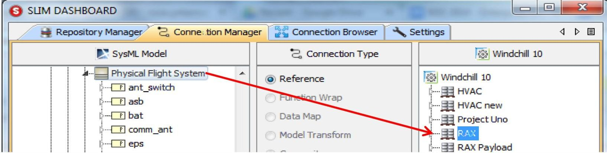

Figure 12 - Drag-and Drop SysML Block structure to generate Windchill part structure

cost depending on its duration and complexity. Whereas for pico-satellites, the MOP cost is generally unknown and/or negligible such that in some university developed CubeSats programs no specific cost is assigned to MOP whatsoever.

the CubeSat framework and models described in this paper and the others it references.

<!-- PDF_PAGE: 9 -->

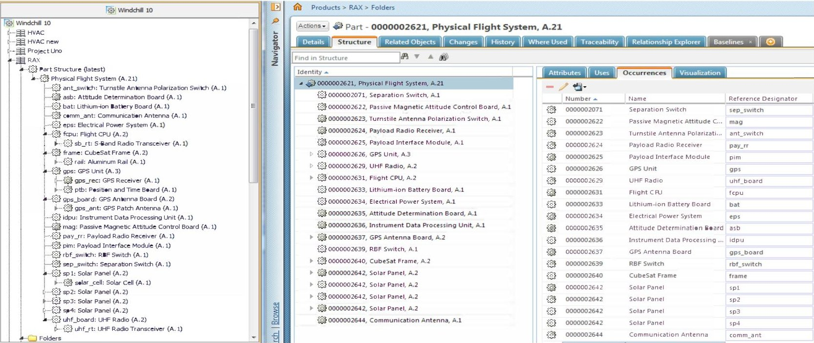

Figure 13 - Part structure (BOM) generated in Windchill for the CubeSat block structure using SLIM (Windchill view in SLIM dashboard - left and Windchill native application view - right)

## 5. PRODUCT LIFECYCLE MANAGEMENT

A key MBSE challenge is to develop and maintain a unique model of the system, from the earliest stages of system development. This model can then continuously evolve through the lifecycle: formulation, design, manufacturing, and operations. This unique model would serve as the "blueprint" of the system. This challenge is addressed by SLIM (Systems LIfecycle Management), a vision concept and software environment developed by InterCAX. [29][30][31] SLIM enables systems engineers to develop a high-level system model in SysML and connect it to domain-specific models, such as Bills of Materials (BOMs) and Computer Aided Design (CAD), Computer Aided Engineering (CAE), MATLAB/Simulink, and Mathematica documents, managed in various enterprise product lifecycle management systems, such as Teamcenter (Siemens Project Lifecycle Management (PLM)) and Windchill (PTC). SLIM manages these fine-grained connections to various versions

of the models and can sync data or generate/sync complete model structures. In the context of the CubeSat work, we exercised the following use cases with SLIM:

(1) Use Case 1: Develop an initial architecture of the CubeSat in SysML and automatically generate a part structure in a PLM system which becomes a starting point for mechanical/electrical designers for further decomposing the parts and developing Mechanical and Electrical CAD models.

(2) Use Case 2: Reuse the payload part structure developed in a previous mission which exists in a PLM environment. Generate a SysML block structure from the payload model in Windchill and use it in the context of a new CubeSat design.

In both the use cases, SLIM creates a connection between the SysML model elements and PLM elements which can be used for comparison and bi-directional synchronization.

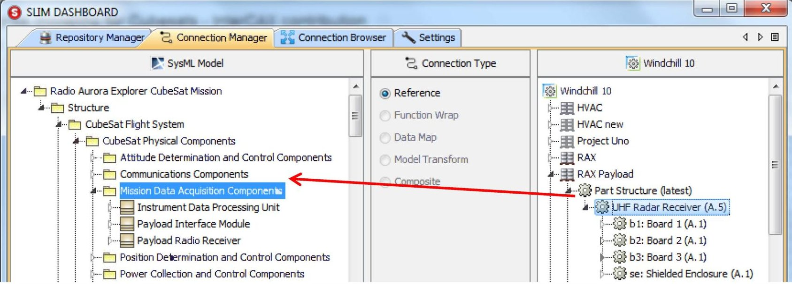

Figure 14- Drag-and-drop PLM part to SysML package

<!-- PDF_PAGE: 10 -->

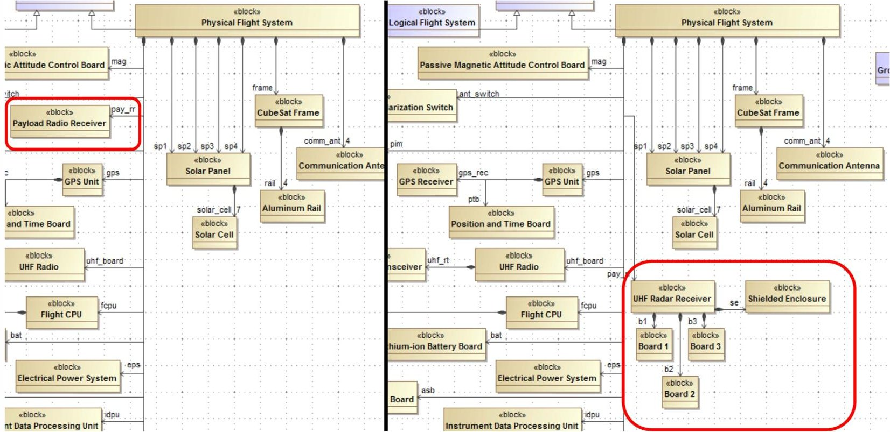

Figure 15 - Left (view of CubeSat block structure as designed initially with a placeholder payload - Payload Radio Receiver); Right (updated architecture with the precise payload structure - UHF Radar Receiver).

The use cases are elaborated below.

Use Case 1: The systems engineer begins to design the CubeSat system architecture in SysML. Once the general components have been mapped out, the block structure is used to generate a part structure in a PLM system Windchill (Figure 12). The other members of the project team can then use the Windchill BOM structure (Figure 13) as a starting point for the decomposition and design of the parts. Connections are saved between the corresponding parts and blocks so that changes on either side can be synchronized as desired.

Use Case 2: The payload for the mission may be reused from a previous mission enterprise that exists in a PLM system (such as Windchill or Teamcenter). The latest (or a specific) version of the top-level part in the payload can be dropped into the SysML model (as shown in Figure 14) to generate the corresponding block structure. Then, as shown in Figure 15, this payload block structure (UHF radar receiver and constituent parts, right) can be used in the context of the CubeSat, replacing the dummy payload block (Payload Radio Receiver, left) that was used by the systems engineer as a placeholder in the initial architecture. This may be a preliminary design, perhaps submitted for purposes of mass and/or cost calculation, and can later be synced when further refinements are made on either side.

Capabilities to compare and synchronize the structures (SysML block structure and PLM part structure) using SLIM are maturing now and will be demonstrated in the next iteration of this work. The ability to bring different types of model elements in the SysML-based CubeSat architecture from different repositories—requirements and

parts from Teamcenter, parts from Windchill, and data from MySQL databases—and have them connected and synchronized will also be demonstrated in the next iteration.

## 6. FRAMEWORK MANAGEMENT AND RELEASE

Much like the way current CubeSat Pumpkin Kits are marketed and sold, a modeling framework that allows for analyzing and costing the technical design of the spacecraft throughout the lifecycle of the mission will allow for more robust and reusable designs. This paper discusses the incorporation of enterprise concerns into a CubeSat framework and the management of that framework.

Overall, the challenge team expanded development on the CubeSat Framework published in [4] and incorporated a lot of the different information gathered from applying the framework to the RAX Mission. Special attention and interest was paid to develop the model in a proprietary-free environment over a period of several months and used that model to carry out several trade studies. The focus was on capturing characteristics of CubeSat design and operations, with the main intent of the model being able to demonstrate the interface of COTS capabilities as well as be reusable among the CubeSat Community.

The model included the spacecraft, ground network, external environment, experimental target, and control software, as well as the interactions between these elements. Spacecraft subsystems required for operational analysis was captured, including the communication, power collection, power management, data management, payload, and bus subsystems. Spacecraft states, such as on-board energy, onboard data, and downloaded data, were modeled in the context of their interaction with the subsystem functions.

<!-- PDF_PAGE: 11 -->

The COTS modeling and simulation tools included MagicDraw and Cameo Simulation Tool Kit from No Magic; ModelCenter, Analysis Server, and MBSE Analyzer $ ^{\bullet} $ from Phoenix Integration; Systems Tool Kit (STK) from Analytical Graphics, and MATLAB.

The integrated model enabled the execution of trade studies to evaluate mission performance and verify that mission requirements would be satisfied. Requirements were defined for data collection, storage, download and for battery capacity and margin. Data collection and management and power collection and management subsystems were modeled in order to demonstrate the interdependencies of these requirements. Energy state trade studies varied the solar panel area and battery capacity. Data collection trade studies varied the orbital altitude and ground station network.

To the best of our knowledge this is the first known integration of a space system SysML model with a set of analytical models, simulation engines, and special purpose high fidelity space system model.

## Model Availability

Our RAX CubeSat model and its manual are being made available to the academic community. The intent is to provide:

(1) An introduction to the application of MBSE and SysML in modeling a space system

(3) A mechanism for soliciting suggestions for improvements to the model

(2) A starting point for a CubeSat team to develop their own model

The manual contains sections on:

(1) Role of SysML diagrams in RAX CubeSat model

(2) RAX trade studies

(3) Software installation

(4) Evaluating and executing the behavioral models

(5) Modifying the SysML model

## 7. CONCLUSION

Throughout this paper we've touched on the architecture framework of a CubeSat. The framework and the information about the system that is fed into an integrated modeling approach to enterprise modeling is the core concept for the analyses discussed in this paper. The model gives a CubeSat Engineering team an entry point to any mission. Each mission and its relevant set of system information adapts the architecture framework and then is capable of performing sophisticated analysis in the early

phases of that mission as well as throughout the lifecycle as the design matures.

By using MBSE and SysML and the top down approach discussed earlier, an engineering team can more effectively communicate and integrate the system such as the component, interfaces, processes and tasks. [1] Those system elements directly feed into the early Mission Operations Concept. From this point where at least the general components have been selected the other analysis methods can be incorporated to help drive the design choices.

The framework identified the parameters that are relevant to defining a systems cost. As the engineers start to choose the system components and interfaces the properties that need to be evaluated for cost are identified. The tasks and processes underlying each of these system design pieces give an idea for the task force needed to complete the mission design and those pieces are also directly fed into the analysis system for estimating mission costs.

Another key factor in any mission is incorporating all of the different design information that is being generated across a team of engineers. There might be mechanical engineers designing the detailed component sketches as well as system engineers who are less familiar with modeling concepts but are contributing written reports and analysis.

The final segment of our enterprise approach is involving product lifecycle management tools which allow for many different engineers to interface the modeling system and provide information to the system in varying formats. Having a project lifecycle management tool gives a picture to the system engineers and project managers of the integrated system design.

The work taken on by the CubeSat Challenge team is continually evolving. This framework has already been used in a few different analysis approaches, which drove the team to make the model and supporting tools available to the CubeSat community. Currently our architectural framework model and instructions for using the different tools to do analysis with the model are available. The best ways to build this system is to continue adding knowledge from the CubeSat community and build a larger user base that can provide feedback to the modeling approach.

## 8. ACKNOWLEDGMENTS

Parts of this research were carried out at the Jet Propulsion Laboratory, California Institute of Technology, under a contract with the National Aeronautics and Space Administration, and the Aerospace Corporation Civil and Commercial Program Office through its Internal Research and Development program. We would like to thank the University of Michigan RAX team for their contributions. This work was supported by National Science Foundation (NSF) grant ATM-0838054 to SRI International and the University of Michigan.

<!-- PDF_PAGE: 12 -->

## REFERENCES

[1] J. DeFranco, C. Neill, and R. Clariana, "A Cognitive Collaborative Model to Improve Performance in Engineering Teams — A Study of Team Outcomes and Mental Model Sharing," Syst. Eng., vol. 14, no. 3, pp. 267-278, 2011.

[2] International Council on Systems Engineering (INCOSE), "MBSE Initiative." 2007.

[3] J. Springmann, B. Kempke, J. Cutler, and H. Bahcivan, "Initial Flight Results of the RAX-2 Satellite," in Small Satellite Conference 2012, Logan, Utah, August 10-15, 2012, 2012.

[4] S. C. Spangelo, D. Kaslow, C. Delp, B. Cole, L. Anderson, E. Fosse, B. S. Gilbert, L. Hartman, T. Kahn, and J. Cutler, "Applying Model Based Systems Engineering (MBSE) to a Standard CubeSat," in Aerospace Conference, 2012 IEEE, 2012.

[5] S. C. Spangelo, J. Cutler, L. Anderson, E. Fosse, R. Yntema, M. Bajaj, C. Delp, B. Cole, G. Soremekum, and D. Kaslow, "Model based systems engineering (MBSE) applied to Radio Aurora Explorer (RAX) CubeSat mission operational scenarios," Aerosp. Conf. 2013 IEEE, 2013.

[6] S. Spangelo, G. Soremekun, H. Kim, D. Kaslow, G. Bruchanski, G. Haun, and J. Cutler, "Integrated Model-Based Systems Engineering (MBSE) Applied to the Simulation of a CubeSat Mission," 2014 IEEE Aerospace Conference. 2014.

[7] S. Mitchell, "Transitioning the SWFTS Program Combat System Product Family from Traditional Document-Centric to Model-Based Systems Engineering," Syst. Eng., 2013.

[8] Pumpkin, "Pumpkin Inc. Website." [Online]. Available: http://www.cubesatkit.com/.

[9] S. Greenland and C. Clark, "CubeSat Platforms as an Onorbit Technology Validation and Verification Vehicle," Pestana Conf. Cent., no. June, 2010.

[10] S. Asundi and N. Fitz-Coy, "CubeSat Mission Design Based on a Systems Engineering Approach," Aerosp. Conf. 2013 IEEE, 2013.

[11] NASA, NASA Systems Engineering Handbook, 1st ed. 2007.

[12] S. Asundi and N. Fitz-Coy, "Design of Command, Data and Telemetry Handling System for a Distributed Computing Architecture CubeSat," Aerosp. Conf. 2013 IEEE, 2013.

[13] NoMagic, "No Magic's Cameo Systems Modeler." [Online]. Available: http://www.nomagic.com/products/cameo-systems-modeler.html.

[14] Aerospace, "Small Satellite Cost Model Webpage." [Online]. Available: http://www.aerospace.org/expertise/technical- resources/small-satellite-cost-model/.

[15] E. Mahr and G. Richardson, "Development of the Small Satellite Cost Model (SSCM) Edition 2002," Aerosp. Conf. 2003 IEEE, vol. 8, pp. 3831-3841, 2003.

[16] M. O'Such, "Optimal Vehicle Design Using the Integrated System and Cost Modeling Tool Suite," in 13th AIAA/ISSMO Multidisciplinary Analysis Optimization Conference, 2010, vol. 46, no. 0704.

[17] T. Havard, M. Sutton, D. Armon, A. Pacific, and I. Sellers, "Spacecraft Functional Sensitivity Study," in 6th Responsive Space Conference, 2008.

[18] PRICE, "PRICE Webpage." [Online]. Available: http://www.pricesystems.com/enus/offerings/pricecostmodels.aspx.

[19] M. Boghosian and J. Fortune, "Aerospace Internal R&D Report," 2009.

[20] M. Boghosian, "Cost Estimating Methodology for Very Small," in 1st Interplanetary CubeSat Workshop, 2012, pp. 1-15.

[21] A. Mitskevich, "Launch Services Program Program Level Poly-Picosatellite Orbital Deployer ( PPOD ) and CubeSat Requirements Document," pp. 1-14.

[22] M. Boghosian, "Interview with subject matter experts, 26th Annual AIAA/USU Conference on Small Satellites." 2012.

[23] Spaceflight, "Spaceflight Services - Pricing Page." [Online]. Available: http://spaceflightservices.com/pricing-plans/.

[24] G. Skrobot, "ELaNa Launch Services Program." 2012.

[25] J. Puig-Suari, C. Turner, and R. Twiggs, "CubeSat: The Development and Launch Support Infrastructure for Eighteen Different Satellite Customers on one Launch," in 15th AIAA/USU Conference on Small Satellites, 2001, pp. 1-5.

[26] A. Sweet, "Announcement of CubeSat Launch Initiative." NASA, [Online]." [Online]. Available: http://www.nasa.gov/pdf/430539main_CubeSat_Launch_I initiative_Announcement_7_30_2010.pdf.

[27] M. Boghosian, "Interview with Garrett Skrobot, ELaNa Launch Services Program Manager, 26th Annual AIAA/USU Conference on Small Satellites." 2012.

[28] Adaptive Launch Solutions, "Adaptive Launch Solutions Web Page." [Online]. Available: http://www.adaptivelaunch.com/index.php.

[29] M. Bajaj, D. Zwemer, R. Peak, A. Phung, A. Scott, and M. Wilson, "Satellites to Supply Chains , Energy to Finance — SLIM for Model-Based Systems Engineering Part 1 : Motivation and Concept of SLIM," in INCOSE International Symposium, 2011, no. June, pp. 20-23.

[30] M. Bajaj, D. Zwemer, R. Peak, A. Phung, A. Scott, and M. Wilson, "Satellites to Supply Chains , Energy to Finance — SLIM for Model-Based Systems Engineering Part 2: Applications of SLIM," in INCOSE International Symposium, 2011, no. June, pp. 20-23.

[31] InterCAX, "InterCAX SLIM Software Page." [Online]. Available: http://www.intercax.com/products/slim/.

<!-- PDF_PAGE: 13 -->

## BIOGRAPHY

Louise Anderson is a Systems Engineer for Production Ground Systems at DigitalGlobe.She has 3 years systems engineering experience at Jet Propulsion Laborator and 5 years of experience in engineering.She has experience in mission operations, systems architecture, ground systems, and flight systems.She

graduated in May 2010 from the University of Colorado, Boulder with a degree in Aerospace Engineering. Previously she worked at the Laboratory for Atmospheric Space Physics in Boulder Colorado working as a Command Controller in the Mission Operations Team. She has worked on the mission ops team for Kepler, Sorce, AIM, Quikscat, and Icesat. Louise is a member of INCOSE and is the lead for the Space Systems Working Group CubeSat Challenge Team.

Bjorn Cole is a systems engineer in the Mission Systems Concepts section of the Jet Propulsion Laboratory. His research interests are in the fields of design space exploration, visualization, multidisciplinary analysis and optimization, concept formulation, architectural design methods technology planning, and more

recently, model-based systems engineering. He is currently working on pre-Phase A mission formulation. He earned his Ph.D. and M.S. degrees in Aerospace Engineering at the Georgia Institute of Technology and his B.S. in Aeronautics and Astronautics at the University of Washington.

Rose Yntema is the Applications Engineer at InterCAX (www.InterCAX.com) where she applies MBSE techniques to complex systems in areas such as aerospace, energy, defense, and telecommunications. She is actively involved in the development of SysML parametric modeling and simulation software.

Yntema earned her M.S. (2012) in Electrical and Computer Engineering from the Georgia Institute of Technology, and Sc.B. (2010) in Electrical Engineering from Brown University.

Manas Bajaj is the Co-Founder and Chief Systems Officer at InterCAX (www.InterCAX.com) where he leads the development of software applications for MBSE. He has successfully led several government and industrysponsored projects. Dr. Bajaj has been actively involved in the development, implementation, and

deployment of the OMG SysML standard and the ISO STEP AP210 standard for electronics. He is a Content Developer (author) for the OMG Certified Systems Modeling Professional (OCSMP) certification program, and coaches organizations on SysML and MBSE. Dr. Bajaj's research interests are in the realm of SysML and model-based systems engineering (MBSE), computer-aided design and engineering (CAD/CAE), advanced modeling and simulation methods and open standards for product and systems lifecycle management (PLM/SLM). He has authored several publications and won best paper awards. Dr. Bajaj earned his PhD (2008) and MS (2003) in Mechanical Engineering from the Georgia Institute of Technology, and B.Tech. (2001) in Ocean Engineering and Naval Architecture from the Indian Institute of Technology (IIT), Kharagpur, India. He is an INCOSE member and participates in the OMG and PDES Inc working groups.

Sara Spangelo completed her Master's in Aerospace Engineering at the University of Michigan, where she worked on optimizing trajectories for energy efficient periodic solar-powered UAVs. She has been involved in the GPS and operational scheduling of the Radio Aurora Explorer (RAX) CubeSat Mission from 2009-2012. She

completed a Ph.D.in Aerospace Engineering at the University of Michigan, focusing on developing models, simulators, and optimization algorithms for scheduling small spacecraft and diverse heterogeneous ground networks towards enhanced communication capacity. She interned at JPL in 2012, where her work focused on integrating diverse simulation environments to enable Model-Based Systems Engineering of small spacecraft.

<!-- PDF_PAGE: 14 -->

Dave Kaslow has thirty-four years of experience at Lockheed Martin in both the technical and management aspects of developing ground mission capabilities. He has five-years of experience at Analytical Graphics creating their Standard Object Catalog and pursuing Model

Based Systems Engineering. Dave is co-author of "Defining and Developing the Mission Operations System", "Activity Planning", "FireSat" and "Spacecraft Failures and Anomalies" in Cost-Effective Space Mission Operations. He is also the author and co-author of papers and presentation for the International Council on Systems Engineering (INCOSE) Annual International Symposiums and Workshops, the IEEE Aerospace Conference, and the Small Satellite Workshop.

Christopher Lowe is a PhD candidate at the Advanced Space Concepts Laboratory, University of Strathclyde (Glasgow) and is conducting research in to mathematical modeling of Picosatellite Missions to incorporate the parametric relationships evident between the main mission elements (Space, ground, launch,

performance and cost). In addition, Christopher is interested in the development of numerical simulators as tools for automated system design of the space segment. He earned his Bachelors and Masters degrees from the University of Southampton, UK in Space Systems Engineering.

Robin Reil is a Systems Engineering Intern for the Mission Design Center at the NASA Ames Research Center. She is performing thesis research at NASA Ames for her Master's in Aerospace Engineering from California Polytechnic State University (Cal Poly), San Luis Obispo. Her work focuses on creating a standardized approach

for applying Systems Engineering to the CubeSat mission design process with the help of SysML modeling. She has been a member of INCOSE for 2 months, and she attended the INCOSE 2013 International Workshop in Jacksonville, FL. She received her B.S. in Physics, also from Cal Poly.

Eric Sudano is the founder and principal solutions architect at EV Sudano Systems Solutions. He has 40 years of satellite and space surveillance ground systems development, verification, system transition and acceptance experience including: NASA Goddard Space Flight Center Space Network (SN),

USAF Multi-Mission Satellite Operations Center (MMSOC), the USAF MILSTAR Terminal, and the Ground Electro Optical Deep Space Surveillance System. His goal is to provide "right sized" full lifecycle systems engineering, business development and risk assessment solution services for satellite ground station development, operations & maintenance, and sustainment engineering while maintaining an enterprise view of solutions. His research interests include improving system (i.e. small satellite ground station) mission effectiveness, interoperability, and affordability.

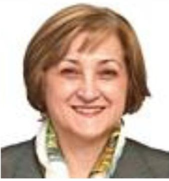

Mary Boghosian received her PhD in physics of magnetic materials from Imperial College, London University, and MBA from Rensselaer Polytechnic Institute. She joined The Aerospace Corporation in 2006, where she has developed the first picosatellite cost estimation

methodology and named it A-PICOMO; Aerospace's Picosatellite Cost Model. She also led and supported NASA cost and schedule estimation studies, and performed magnetics analysis on JPL flight projects. Dr. Boghosian developed a process for independent cost/ schedule assessment review for NASA class D missions, and led the team during the System Readiness Review. Recently, she has been involved in a new mission concept development utilizing the International Space Station (ISS) and constellation of propelled picosatellites. Prior to joining Aerospace, Dr. Boghosian spent 8 years at JPL where she led successful flight instrument and technology proposals, contributed to development of communication hardware for various flight projects, participated in more than 50 mission concept studies within the Team X, and developed new technology concepts for space magnetic sensor and actuator devices.

<!-- PDF_PAGE: 15 -->

Sharan Asundi is an Assistant Professor in the Department of Aerospace Science Engineering at Tuskegee University. He graduated with a MS and PhD in Aerospace Engineering from University of Florida in 2011, under the guidance of Dr. Norman Fitz-Coy His research interests include design of autonomous ground and

space systems, spacecraft attitude determination and estimation, vehicle health monitoring and design of small satellite mission operations.

Sanford Friedenthal is an industry leader in model-based systems engineering (MBSE) and independent consultant. Previously, as a Lockheed Martin Fellow, he led the corporate engineering effort to enable Model- Based Systems Development (MBSD) and other advanced practices across the

company. In this capacity, he was responsible for developing and implementing strategies to institutionalize the practice of MBSD across the LM Business Units. His experience includes the application of systems engineering throughout the system life cycle from conceptual design, through development and production on a broad range of systems including missile systems, electro-optical navigation and targeting systems, and information systems. He has been a systems engineering department manager responsible for ensuring systems engineering processes are implemented on the programs, and enhancing overall systems engineering capability. Mr. He is co-chair of the INCOSE MBSE Initiative and an INCOSE Fellow. He also is a leader of the Industry Standards effort through the Object Management Group (OMG) and INCOSE to develop the Systems Modeling Language (OMG SysML $ ^{\mathrm{TM}} $ ) that was adopted by the OMG in 2006. He is co-author of A Practical Guide to SysML.

<!-- PDF_PAGE: 16 -->

