<!-- PDF_PAGE: 1 -->

# Integrated Model-Based Systems Engineering (MBSE) Applied to the Simulation of a CubeSat Mission

David Kaslow

Analytical Graphics

220 Valley Creek Blvd

Exton, PA 19341

david.kaslow@gmail.com

Grant Soremekun

Phoenix Integration

1715 Pratt Drive

Suite 2000

Blacksburg, VA 24060

grant@phoenix-int.com

Hongman Kim

Phoenix Integration

1715 Pratt Drive

Suite 2000

Blacksburg, VA 24060

hkim@phoenix-int.com

Sara Spangelo

Jet Propulsion Lab

4800 Oak Grove Drive

Mail Stop 1709-106

Pasadena, CA 91109

sara.spangelo@jpl.nasa.gov

Abstract— Small satellite missions are becoming increasingly complex as scientists and engineers propose to utilize them to accomplish more ambitious science and technology goals. Small satellites such as CubeSats are challenging to design because they have limited resources, coupled subsystems, and must operate in dynamic environments.

Model Based Systems Engineering (MBSE) is a key practice to advance systems engineering that can benefit CubeSat missions. MBSE creates a system model that helps integrate other discipline specific engineering models and simulations. The system level model is initiated at the start of a project and evolves throughout development. It provides a cohesive and consistent source of system requirements, design, analysis, and verification.

This paper describes an integrated, executable MBSE representation of the Radio Aurora Explorer (RAX) CubeSat mission. The purpose of the RAX mission is to study the formation of magnetic field-aligned electron density irregularities in the Earth's ionosphere, which are known to disrupt tracking and communication between Earth and orbiting spacecraft. The RAX CubeSat model describes the configuration and properties for various systems and subsystems, and is capable of executing behavior and parametric models for analyzing subsystem functions and states of the spacecraft. It is comprised of a SysML model created with MagicDraw $ ^{\circledR} $ , a set of analytical models developed in MATLAB $ ^{\circledR} $ , and a high fidelity space system simulation model created in STK $ ^{\circledR} $ . ModelCenter was used to integrate the analytical and simulation models. The integrated analyses were linked to the SysML model using MBSE Analyzer, a bridge between SysML tools and ModelCenter. Behavioral models were executed for a representative RAX mission to study energy state and data collection capabilities.

This work was undertaken to demonstrate the power, scalability, and utility of MBSE tools and methods that are available to help meet the challenge of designing spacecraft missions of ever-increasing complexity. The RAX CubeSat model will be made available to the academic community for further study and potential extension for more complex missions.

## TABLE OF CONTENTS

1. INTRODUCTION ...1

2. SYSML OVERVIEW ...2

3. SSWG CUBESAT PROJECT ...3

4. RAX MODELING...4

5. RAX ENERGY STATE &

DATA COLLECTION ANALYSIS...10

ACKNOWLEDGEMENTS...13

REFERENCES...13

BIOGRAPHY ...14

## 1. INTRODUCTION

## INCOSE MBSE Challenge Project

This work is a key part of the INCOSE MBSE Initiative's Systems Engineering Vision 2020 [1]. MBSE is the formalized application of modeling to support system requirements, design, analysis, optimization, verification, and validation. It begins in the conceptual design phase, continuing throughout development and into later life cycle phases including operations. A high-level overview describing the relationship between MBSE and SysML is provided in Figure 1. The MBSE Initiative started at the January 2007 INCOSE International Workshop [2]. The MBSE Roadmap was created to define the high-level, long term vision for the maturation and acceptance of MBSE across academia and industry.

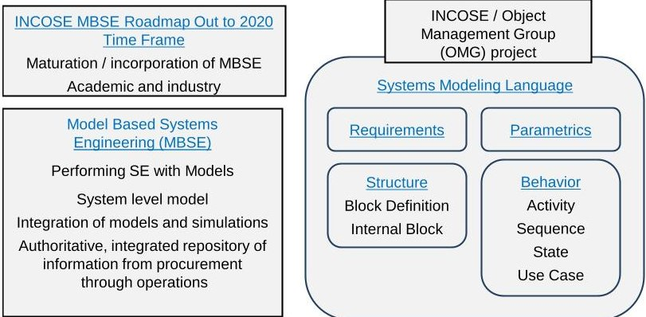

Figure 1 - High level overview describing the relationship between MBSE and SysML.

This effort is connected to the Space Systems Challenge Team that was established in April 2007 by the INCOSE Space Systems Working Group (SSWG). An overview of

<!-- PDF_PAGE: 2 -->

the Challenge Team's work to date is described in Section 3. This initial effort was on the modeling of a hypothetical FireSat space system. FireSat is a low Earth orbit (LEO) spacecraft for detecting, identifying, and monitoring forest fires. This space system is used as an example in the widely used and accepted Space Mission Analysis and Design (SMAD) textbook [3].

The results were reported first in December 2007 then in a series of INCOSE workshops and symposiums, and INCOSE INSIGHT articles. They demonstrated that a space system could be modeled in SysML. Much was learned from modeling FireSat but the hypothetical nature of FireSat precluded anyone from actually building the model. Therefore the practical use of the model could not be demonstrated or verified.

## Radio Aurora Explorer

The SSWG CubeSat project was initiated in April 2011 to demonstrate the application of MBSE to a realistic mission in the space systems domain. A CubeSat is type of miniaturized spacecraft with a standard form factor based on standardized unit cubes 10-centimeters on a side and weighing less than one kilogram each. A CubeSat typically consists of one to three units.

The SSWG selected Radio Aurora Explorer (RAX) for the CubeSat project [4]. RAX is a three unit CubeSat developed jointly by SRI International and the Michigan Exploration Laboratory (MXL) at the University of Michigan. It is the first in a series of CubeSat funded by the National Science Foundation (NSF) to study space weather. The purpose of the mission is to study the formation of magnetic fieldaligned electron density irregularities in the Earth's ionosphere, which are known to disrupt tracking and communication between Earth and orbiting spacecraft.

As RAX flies along its orbit, it periodically passes over high-powered, ground-based radar stations. During each pass over, RAX performs a science experiment by receiving and processing the scattered radar signal transmitted by the radar. RAX passes through the experimental zone in approximately five minutes. The processed radar data is compressed and stored for subsequent downlink. Position and time information from the on-board GPS receiver provides accurate spatial and temporal information during each experiment. The primary ground-based radar station is the Poker Flat Incoherent Scatter Radar (ISR) located in Alaska. RAX uses a number of world-wide ground-based downlink stations. The primary RAX downlink station and operations center is located at the University of Michigan in Ann Arbor. Payload and telemetry data are collected and downloaded. Telemetry data includes attitude determination sensor measurements, temperature values, voltage values, and other health and status information from the flight computer.

The modeling of RAX described in paper is this intended as a prototype to prove out the applicability of MBSE for

modeling operational space missions. It is not intended to be an accurate model of the RAX satellite.

A brief introduction to SysML for those unfamiliar with the language or MBSE is provided in Section 2. An overview of the SSWG's CubeSat project activities leading up to and including this effort are provided in Section 3. SysML, analytical, and simulation models developed for RAX are described in Section 4. RAX operational trade study results are presented in Section 5. Conclusions and potential future activities are discussed in the final section.

## 2. SYSML OVERVIEW

SysML is a graphical modeling language developed by the Object Modeling Group (OMG) and International Council on Systems Engineering (INCOSE) [5]. It is a modeling language, not a methodology or a tool. SysML is used to model all aspects of a system either directly or through an interface with another model. It is used to specify, analyze, design, optimize, and verify complex systems including hardware, software, information, personnel, procedures, and facilities.

This section contains terminology taken from Practical Guide to SysML [6]. References to the terminology are provided to aid in obtaining a more in depth understanding.

SysML diagrams describe a system in terms of structure, requirements, parametrics, and behaviors. Figure 2 illustrates the types of SysML diagrams. [6, Fig. 3.1]

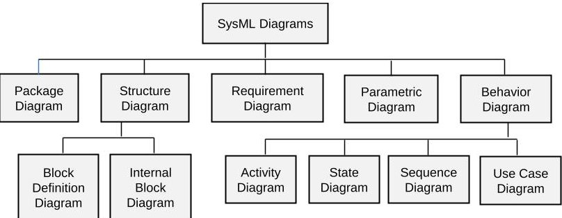

Figure 2 - Classification of SysML diagrams.

## Package Diagrams

Packages are containers for model elements. Package diagrams are used to describe model organization. [6, Para. 6.2 and A3]

## Structure Diagrams

Structure diagrams describe how the system is put together the architecture of the system. As shown in Figure 2, structure diagrams consist of block definition diagrams and internal block diagrams.

Block definition diagrams define the characteristics of blocks in terms of structure and behavior features, the relationships between the blocks, and the parametric constraints. [6, Para. 7.1.1 and A4]

<!-- PDF_PAGE: 3 -->

Internal block diagrams describe the internal structure of blocks in terms of how their parts are interconnected. [6, Para. 7.1.2 and A5]

## Blocks

Blocks are the modular units of structure SysML. They define a system component or an item that flows through the system as well as external entities, conceptual entities, or other logical abstractions. [6, Para. 7.3 and 7.4]

Structure provides for the specification of parts and values. Value properties describe the quantitative characteristics of a block such as physical and performance. [6, Para. 7.3.4]

Behavior defines how a block interacts with its environment and modifies its state. [6, Para. 7.5]

## Requirements

Requirements specify capabilities or conditions that must be satisfied, functions that the system must perform, or performance conditions a system must achieve. [6, Para. 13.1 and A11]

Requirement diagrams depict requirements and their relationship with other requirements, design elements, and test cases to support requirements traceability, satisfaction, and verification.

SysML requirement elements have compartments for name, ID, text and traceability. The traceability compartments include owner derived, derived from, satisfied by, and verified by.

## Parametric Diagrams

Constraint blocks define constraints in terms of equations and their parameters. The use of constraint blocks is represented by parametric diagrams. Parametric diagrams typically define systems of equations that constrain the value properties of the blocks. [6. Para. 8.1.1, 8.1.2, and A6] For this work, constraint blocks are mapped directly to analytical tools to extend the power and scalability of Parametric Diagrams beyond that provided by a system of equations (see Section 4).

## Behavior Diagrams

Behaviors describe how a block deals with inputs and outputs and changes to its internal state. Behavior diagrams describe what the system must do to meet requirements. [6 Para. 7.3.4] As shown in Figure 2, behavior diagrams consist of Activity, State Machine, Sequence, and Use Case diagrams.

The first three diagrams describe behavior of blocks. The fourth diagram, Use Case, describes the behavior of a system from the viewpoint of the users of the system.

## Activity Diagrams

Actions are the basic components of activities. They accept inputs and produce outputs. Activity diagrams represent behavior by expressing the order that actions execute and describe the actions that convert inputs to outputs. [6, Para. 9.2 and A7]

We use activity diagrams to iterate through time and model time-dependent activities. The conversion of inputs to outputs is sometimes accomplished by use of other SysML diagrams such as parametric diagrams, which are called from activity diagrams.

## State Machine Diagrams

State is a significant condition in the life of a block. State machine diagrams describe the state-dependent behavior of a block throughout its life cycle in terms of its states and the transitions between them. [6, Para. 11.2 and A9]

## Sequence and Use Case Diagrams

Sequence diagrams describe the interaction between the structural elements of a block, as a sequence of message exchanges. [6, Para. A8] The RAX CubeSat model does not use sequence diagrams.

Use cases describe the goals of a system from the perspective of the users of the system. The goals are described in terms of the functionality that the system must support. [6. Para. A10] The RAX CubeSat model does not employ use case diagrams.

## 3. SSWG CUBESAT PROJECT

The SSWG CubeSat project has been investigating the applicability of MBSE for designing CubeSats since 2011 (see Figure 3). This section describes three phases of work that have been completed so far.

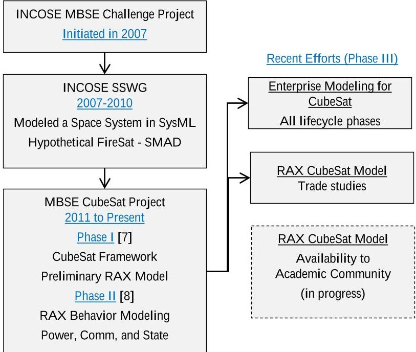

Figure 3-SSWG Challenge Project activities.

<!-- PDF_PAGE: 4 -->

## Phase I

The first phase of the SSWG MBSE CubeSat project consisted of developing a SysML reference model of a CubeSat, and then applying the reference model to model RAX [7].

The RAX SysML model defined the logical and physical architecture of the flight and ground systems. The logical portion of the model specified the subsystems in terms of the functions they perform that are necessary to achieve mission objectives. The physical portion of the model specified the parts that would be needed to implement the subsystems.

A collaborative design environment was utilized during this phase, including a CubeSat-MBSE Google group, a MBSE Google documents collection, a No Magic Teamwork Server for SysML modeling, and biweekly Web conferencing.

## Phase II

The second phase focused on expanding the RAX CubeSat model to include modeling behaviors [8]. This phase of the RAX CubeSat modeling supported analysis of communication download, power, and mission activities and states and how they were related to opportunities to perform spacecraft functions.

Communication downlink modeling supported trades of data download rate, available power, and signal to noise ratio. System power modeling included the orbit as well as opportunities to collect energy, collect mission data, and downlink data. The model was used to investigate the time history of on-board energy and data, and the quantity of downlinked data. Activity and state behavior modeling of the ground system and flight system included transitions between uplink, downlink, experiment, and nominal operations states.

This phase of the project was successful but the capabilities developed lacked the ability to time-step through a behavioral model and determine whether requirements are satisfied throughout the entire RAX mission.

## Phase III

As shown in Figure 3, Phase III is comprised of two parallel activities. The first activity is focused on the development of a CubeSat enterprise model to capture cost and product lifecycle aspects for the mission spacecraft and problem domain [9].

The second activity, described in the paper, focused on capturing additional RAX design and operational characteristics. A new RAX CubeSat model was developed from scratch based on the published CubeSat reference model [8]. Behavioral models were implemented and tightly integrated with parametrics modeling and analysis to

demonstrate how operational trade studies can be performed from within a systems modeling development environment. The RAX CubeSat model does not contain proprietary data so that it could be provided to the academic community.

## 4. RAX MODELING

Many of the COTS modeling and simulation tools used in Phase II of the CubeSat project were also used for this work, including MagicDraw and Cameo Simulation Toolkit (by No Magic), ModelCenter $ ^{\circledR} $ and MBSE Analyzer (by Phoenix Integration, Systems Tool Kit (STK), by Analytical Graphics), and MATLAB (by MathWorks).

## SysML Model

Architecture of the CubeSat Mission is defined in SysML block definition diagrams shown in Figure 4 that includes the spacecraft, ground network, external environment experimental target, and control software, as well as the interactions between these elements. This approach reflects the methodology generally used in the small satellite community.

The Vehicle block definition diagram shown in Figure 5 describes the vehicle subsystems and their components, including communication, power collection, power management, data management, payload, and bus. More detailed modeling was implemented for the critical subsystems required to model and execute the power and communication subsystems.

Detailed modeling was minimized by excluding several other non-critical subsystems, such as attitude determination and control. The energy and data dynamics of these other subsystems, which were less important to capture in our models, are grouped into the Bus subsystem.

The proof of concept is limited to modeling energy collection and management as well as data collection and management. Thus, the following requirements for RAX were defined:

- Minimum and maximum battery capacity

- Maximum data buffer capacity

- Minimum download data quantity

"Satisfy" relationships were used to relate requirements to system properties that are calculated via mission simulation. Figure 6 shows the mapping of requirements to value properties of the Vehicle block.

Parametric diagrams were created to describe the engineering analyses for computing RAX performance metrics. The following parametric diagrams were created for modeling various computations at a given time step:

- GetStates: Used for modeling how to compute various RAX states for a representative mission. This includes when RAX is in a state to collect energy from the sun, perform an experiment, or download data. It also

<!-- PDF_PAGE: 5 -->

returns the solar incidence angles and download efficiency.

- PowerCollection: Used for modeling how to compute the total instantaneous power collection given information about the solar incidence angles on all solar panels, solar panel areas and efficiency, and solar intensity.

- UpdateEnergy: Used for modeling how to compute the amount of stored energy on-board the spacecraft. See Figure 7.

- UpdateData: Used for modeling how to compute the amount of stored data on-board the spacecraft.

- UpdateDownload: Used for modeling how to compute the amount of data downloaded by the spacecraft and successfully collected at the ground station.

- The following RAX activities were modeled using SysML activity diagrams:

- RunOperation is the top-level activity diagram that executes the scenario when triggered. At every time iteration, this diagram updates the time step and then calls the other activity diagrams that execute various actions.

- SendSignals (Figure 8) determines the current states based on the time step, and then sends signals to

update a state machine defined for the mission as described below.

- UpdateStates changes the level of on-board energy, on-board data, and downloaded data for the next time step.

- The CubeSatMission state machine was used to model the following RAX states (See Figure 9):

- Orbit state indicates whether the spacecraft has been launched and transitioned to operations.

- Solar state indicates whether the spacecraft is in the Sun light or in eclipse.

- Experimental state indicates whether the spacecraft is collecting experimental data or not.

- Download state indicates whether the spacecraft is transmitting data to ground stations or not.

All states were modeled in a binary fashion (for example RAX is either collecting or not collecting experimental data), and can overlap one another from an operational perspective (for example RAX can be collecting experimental data while also storing solar energy).

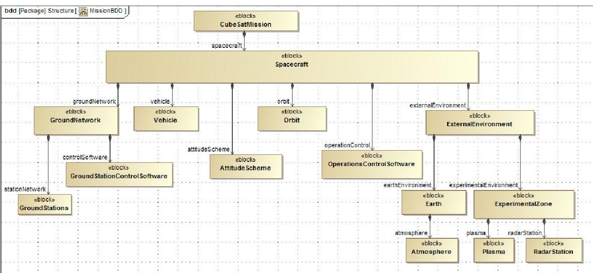

Figure 4 - Mission block definition diagram.

<!-- PDF_PAGE: 6 -->

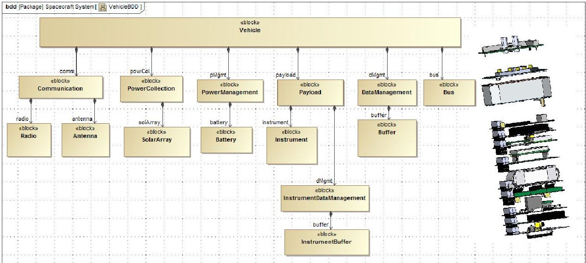

Figure 5-Vehicle block definition diagram.

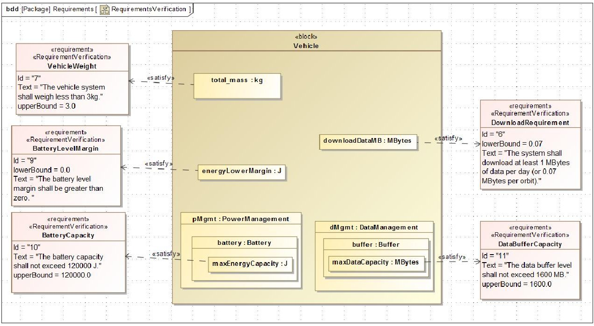

Figure 6 - RAX system requirements are verified by using the results of behavioral simulations.

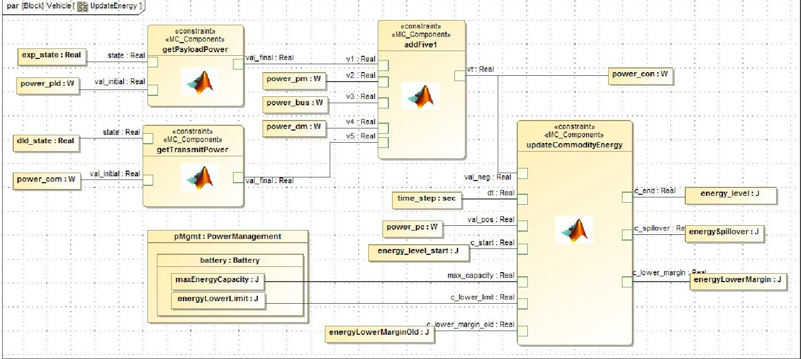

Figure 7 - Parametric diagram that updates energy state.

<!-- PDF_PAGE: 7 -->

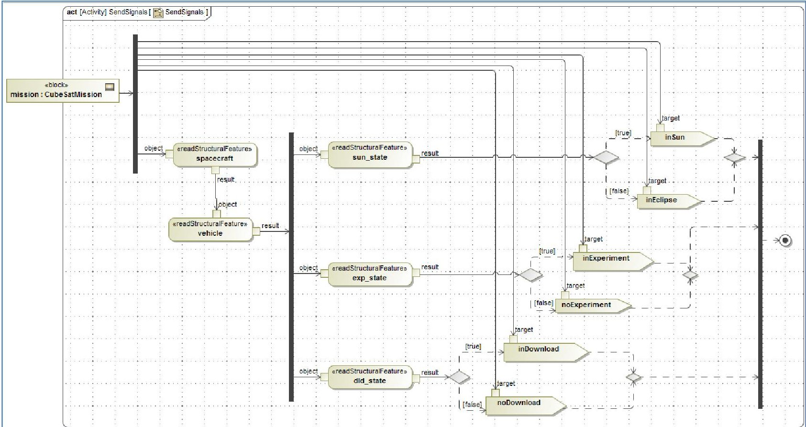

Figure 8 - Activity diagram sends signals to update states of the RAX CubeSat.

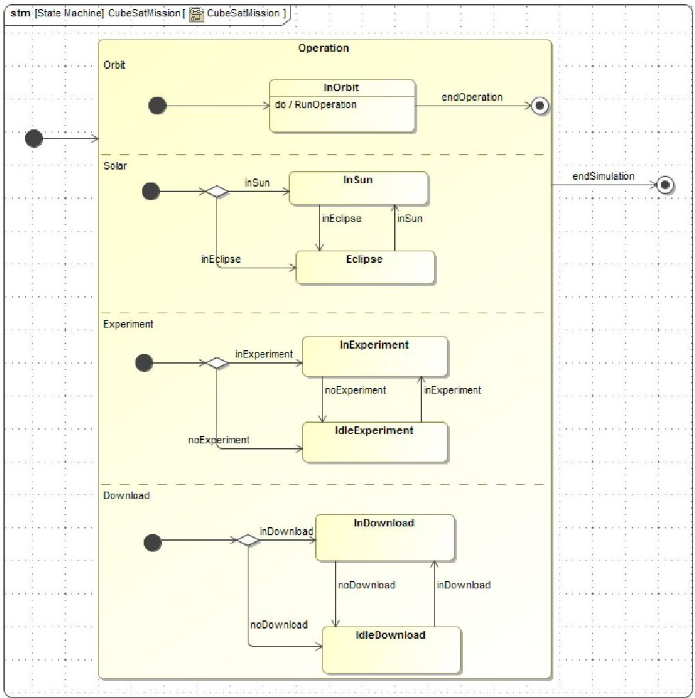

Figure 9 - State machine diagram shows states of system functions.

<!-- PDF_PAGE: 8 -->

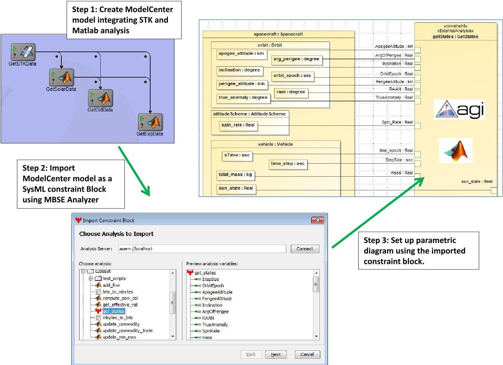

Figure 10 - ModelCenter models were imported as SysML constraint blocks for use in parametric diagrams.

<!-- PDF_PAGE: 9 -->

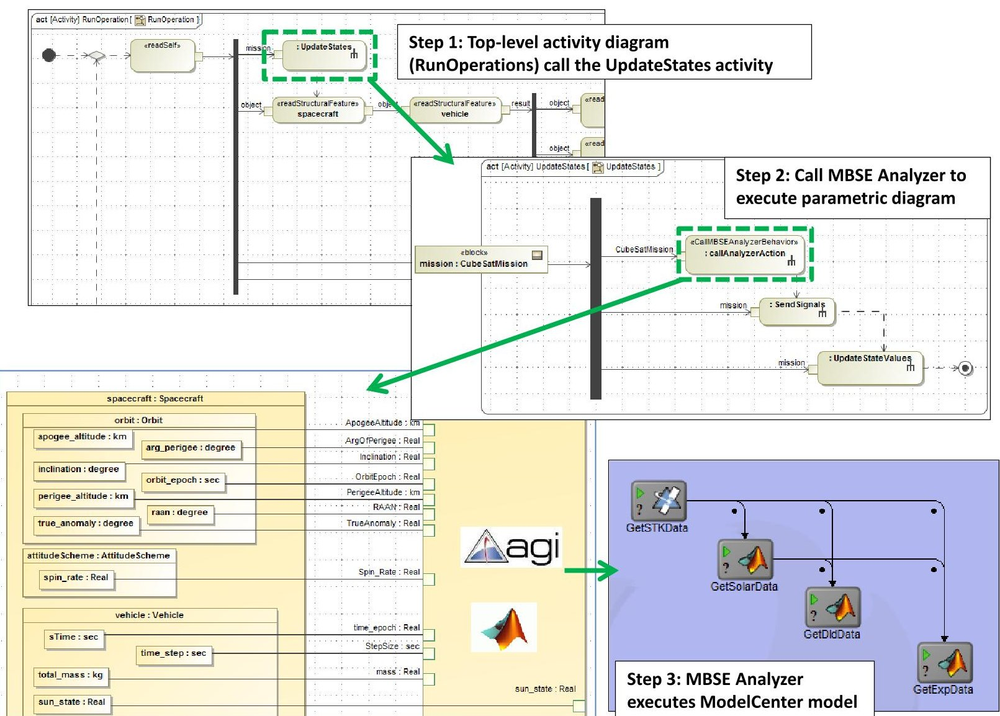

Figure 11 - Calling engineering analysis from SysML activity simulation.

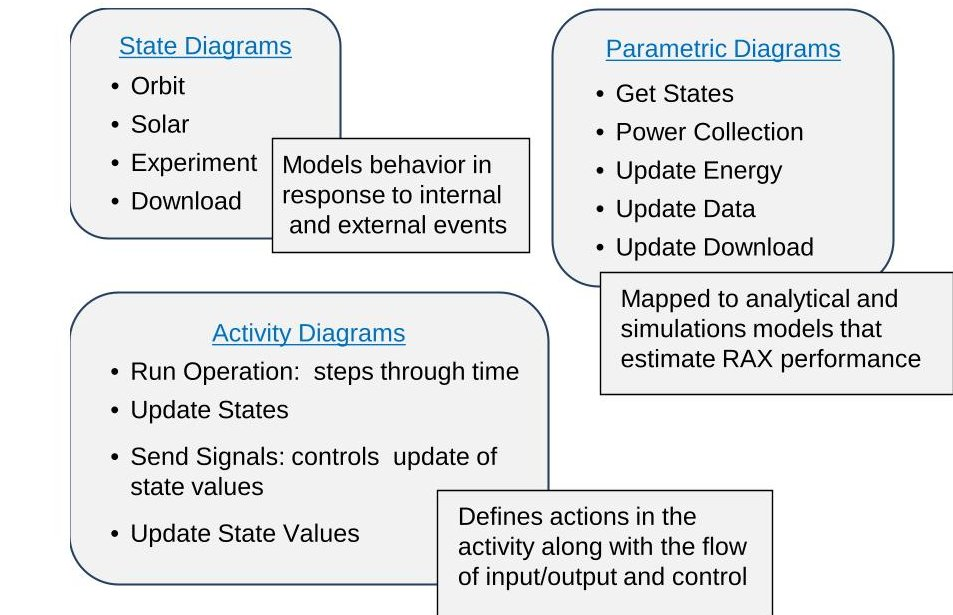

Figure 12 - Use of SysML diagrams in RAX CubeSat mission simulation.

<!-- PDF_PAGE: 10 -->

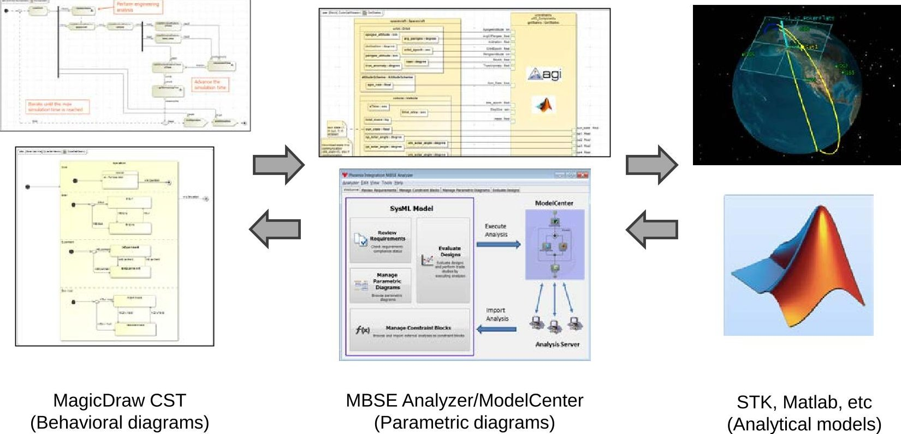

Figure 13-COTS modeling and simulation tools used to execute the RAX CubeSat model.

## Simulation and Analytical Models

Various computational models were developed to analyze orbital, energetic, and behavioral dynamics at each time step. STK was used to model spacecraft orbits, calculate opportunities for experimental data collection and when to download data to ground stations. The results from STK are used to compute the power collected by RAX's solar panels using MATLAB codes. MATLAB and Java scripts were used to perform analytical calculations for updating energy levels and simple conversions.

## Model Integration and Execution

ModelCenter is a graphical environment for automating simulation workflows (model execution, model integration, and design space exploration). For this work, ModelCenter was used to create several integrated models comprised of the STK, MATLAB, and scripts in Java.

Each integrated model was then imported into MagicDraw as a constraint block using MBSE Analyzer [10], [11], which is a bridge between SysML tools and ModelCenter. These constraint blocks were then used to build the parametric diagrams described above. The process for creating the GetStates parametric diagram is illustrated in Figure 10.

MBSE Analyzer effectively allows SysML parametric diagrams to be executed by linking constraint blocks to executable ModelCenter models. Parametric diagrams can be executed directly via MBSE Analyzer's GUI, or via other tools like Cameo Simulation Toolkit (CST), which we utilized for this work in order to time-step through the behavioral models described above.

During CST simulation, the top level activity diagram steps through time and engineering simulation (See Figure 11). When the UpdateStates action is reached, a call is made to MBSE Analyzer to execute various parametric diagrams via ModelCenter. The information returned from evaluating the parametric diagrams influences the flow path as CST continues to execute the activity and state machine diagrams. This process is illustrated in Figure 11. SysML diagrams used in the mission simulation are summarized in Figure 12. Interactions of modeling and simulation tools in the process are summarized in Figure 13. As each time step is completed, MBSE Analyzer collects the time history of system states so that the performance of RAX can be evaluated. That's how time history data was collected, which is discussed in the next section.

## 5. RAX ENERGY STATE & DATA COLLECTION ANALYSIS

The integrated RAX CubeSat model was used to analyze performance of different hardware and mission configurations. The trade studies were motivated by common design questions for realistic CubeSat missions. In the current practice of satellite design, tools such as STK and MATLAB are used to analyze mission performance. However, there is no readily available capability that enables verifying the impact of design decisions on mission requirements throughout the entire mission. The integrated model demonstrates how to accomplish this by performing mission simulations using MBSE models.

During a mission simulation, time history of the states of the satellite was collected. Time history data helps understand behavior of the system. It is also very useful for verifying the model. Figure 14 shows the time history of energy state

<!-- PDF_PAGE: 11 -->

of a nominal RAX CubeSat. The dotted line indicates the Sun state of the satellite, whose binary states can be either one (in the Sun) or zero (in shade). The solid line shows the energy level in the battery. The energy level increased initially since the satellite was in the Sun charging the battery. The satellite went into shade at 9 minute and the energy level started dropping steadily because it could not charge the battery while consuming energy for essential functions. When the satellite went into the Sun again in 39 minute, it started charging the battery again and the energy level goes up steadily.

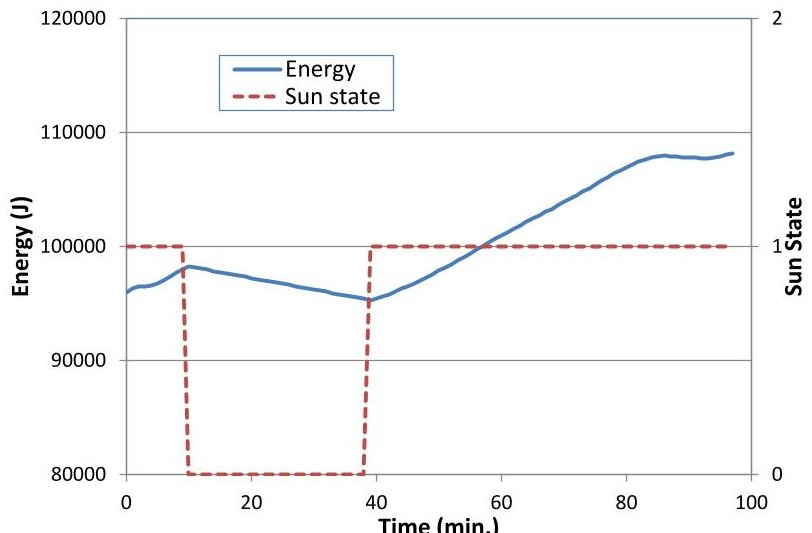

Figure 14 - Time history of energy state of nominal RAX CubeSat design.

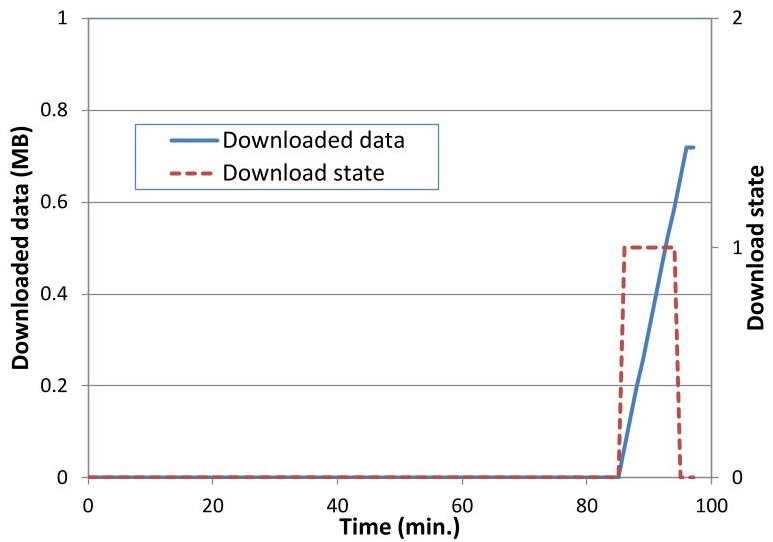

Figure 15 - Time history of download state of nominal RAX CubeSat design.

One interesting feature of the energy state plot is a small dip near to the end of the simulation; the energy level went down slightly while the satellite was able to charge the battery. This behavior of the system can be explained by the time history of data download in Figure 15. The dotted line in Figure 15 indicates the download state. During the dip of the energy state, the satellite was able to see a ground station and was transmitting data. The solid line of Figure 15 shows that total data downloaded was increasing during the time period. Since the operation consumed extra energy,

the energy level went down while the satellite was collecting solar energy. The time history plots show that the integrated RAX model correctly models the behavior of energy collection and data download, and their interactions.

The integrated CubeSat model was used to perform trade studies of key design parameters of components and mission. Preliminary studies assessed the design space to determine design parameters that had great impact on the mission performance. We also considered parameters that are often used in typical university-class CubeSat missions. The trade studies are summarized in Table 1, where the parameters that are varied in the SysML model, various design instances, and performance metrics are listed. The first two studies were performed for a single orbit because we were interested in how the energy level varies as the spacecraft goes in and out of the sun. The third and fourth studies were performed for a full day to investigate the results over longer time scales relevant for these trades.

Table 1 - Summary of trade studies.

<table border="1"><tr><td>Trade studies</td><td>Values Studied</td><td>Performance Metric</td></tr><tr><td>Solar Panel Area</td><td>Nominal:18.2cm2/side1/2 of nominal1/4 of nominal</td><td>On-board energy level</td></tr><tr><td>Max Battery Capacity</td><td>Nominal:115,000JReduced:100,000J</td><td>On-board energy level</td></tr><tr><td>Orbital Altitude</td><td>Nominal:811kmx457kmLow:593kmx250kmHigh:1311kmx932km</td><td>Quantity of data downloaded</td></tr><tr><td>Ground Station Network</td><td>Ann Arbor&amp;Menlo ParkAnn Arbor&amp;FairbanksFairbanks&amp;Menlo Park</td><td>Quantity of data downloaded</td></tr></table>

Table 2 - Description of the ground station network.

<table border="1"><tr><td>Name</td><td>Latitude/Longitude(deg.)</td><td>Altitude(km)</td><td>Min. ElevationAngle(deg.)</td><td>Comm.Efficiency</td></tr><tr><td>Ann Arbor(MI)</td><td>42.271-83.73</td><td>0.256</td><td>5</td><td>0.80</td></tr><tr><td>Fairbanks(Alaska)</td><td>64.88-147.5</td><td>0.136</td><td>0</td><td>1.0</td></tr><tr><td>Menlo Park(California)</td><td>37.457-122.2</td><td>0.022</td><td>0</td><td>0.95</td></tr></table>

Solar panel area and battery capacity are important design parameters, for which it is hard to make design decisions early on in mission design because they require understanding of the behavior of on-board energy. On-board

<!-- PDF_PAGE: 12 -->

energy serves virtually all subsystems of a satellite and its dynamics with subsystems must be understood to determine solar panel area and battery capacity. The integrated CubeSat model captures these dynamics and helps make informed decisions about sizing the spacecraft components. The first two trade studies in Table 1 were to understand the impact of these component parameters on system requirements.

To evaluate impact of solar panel area, three different sizes were selected: nominal of 18.2 $ cm^{2} $ per side, a half, and a quarter of the nominal size. The integrated CubeSat model was executed for each of the three configurations and time history of energy state was collected. Figure 16 compares time histories from the simulations. For all three designs, maximum battery capacity was fixed at 115,000 J. One system requirement was that "the energy level in the battery shall not drop below 92,000 J". The max and min bounds are shown as flat lines in Figure 16. Energy level of the nominal design stayed within the bounds during the mission. When the solar panel area was reduced by half, energy level still stayed within the bounds, although it was well below the max capacity. When the solar panel area was reduced further, to a quarter of the nominal, the energy level went below the required minimum at the end of the simulation. The flat area of the energy level in the middle indicates that the rate of energy collection of the solar panel was equal to the rate of energy consumption by the satellite when it was idling. The results clearly show that the quarter size solar panel is too small for the mission.

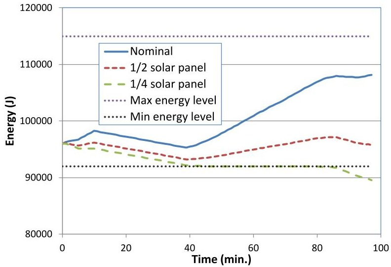

Figure 16 - Impact of solar panel sizing on energy state.

The second trade study evaluated impact of max capacity of the battery. We compared two designs: nominal with max capacity of 115,000 J and one with a reduced capacity of 100,000 J. Figure 17 compares time histories of energy level of the two designs. When the battery capacity was reduced, energy level could not rise above the max capacity of 100,000 J. This shows that there will be spillover of energy collected by solar panel, and it may be considered to reduce the size of the solar panel.

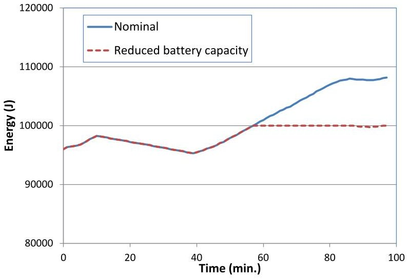

Figure 17 - Impact of battery capacity on energy state.

Small satellites, such as CubeSat, generally have little or no control over their orbit because they are launched as secondary payloads on primary mission launches. Thus, we investigated the sensitivity of performance metrics to orbital properties, in particular orbit altitude. This also provides insight into how performance may degrade as the spacecraft loses altitude later in its lifetime. As shown in Table 1, three orbit altitude scenarios were considered including nominal, low, and high. Figure 18 shows time histories of data download of the three scenarios during 24 hours of operation. Overall, the nominal and the low orbit scenarios performed similarly, although the nominal orbit collected a bit more data. The high orbit scenario turned out to be able to collect much more data than the nominal design. This can be attributed to that the high orbit satellite has more access to the experimental zone and ground stations.

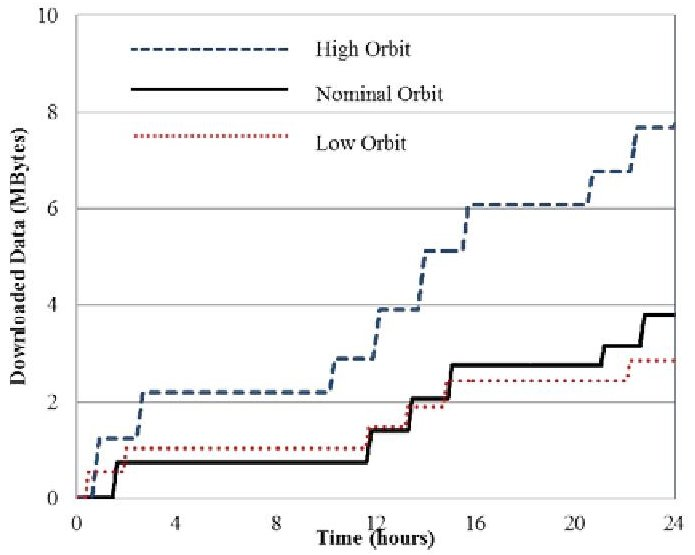

Figure 18- Trade study of orbit selection for data download.

<!-- PDF_PAGE: 13 -->

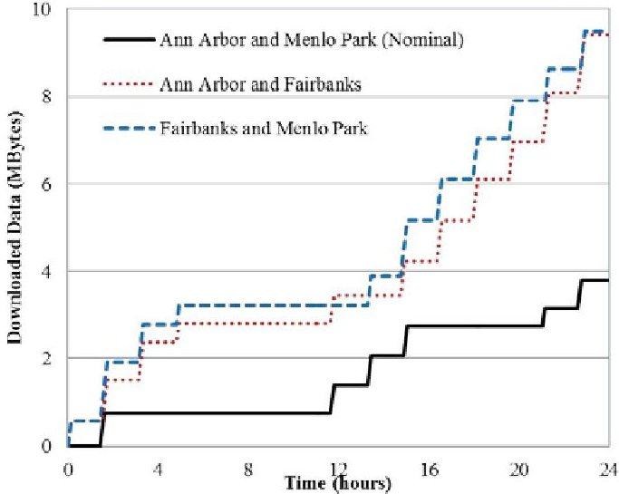

Figure 19- Trade study of selection of ground stations for data download.

Designing ground station networks is an early design decisions for small spacecraft missions that is challenging to do without good knowledge of on-board data and energy management. The last trade study investigated impacts of selection of ground station network. Three different network configurations were studied as shown in Table 1. Location data of the ground stations used is available in Table 2. Time histories of data download for the three configurations were compared in Figure 19. The nominal configuration using Ann Arbor and Menlo Park stations collected about 3.9 MB of data during 24 hours. It turned out the two other configurations were able to collect much more data than the nominal configuration. Nonetheless, all three configurations satisfy the system requirement that "the system shall download at least 1MB of data per day". The results from this study may be combined with other considerations such as financial cost to build or use a ground station in a certain location, to determine the best solution for a given mission.

These trade studies demonstrate the ability of the model and the tools to simulate an entire CubeSat mission. The capability allows assessing sensitivity of key components and mission parameters and verifying system requirements. These trades are just representative of what can be done. While design parameters were studied independently in this work, it is possible to study combined effects of the parameters. The model can be extended to include additional aspects of system behavior. For example, more complex and involved studies can be performed including evaluation of different scheduling algorithms.

## 6. CONCLUSION

An integrated modeling approach was demonstrated for a RAX CubeSat mission by creating an executable MBSE model. The integrated model was created by connecting a system architecture model in SysML with engineering analysis models wrapped in ModelCenter. CubeSat mission was simulated by executing SysML behavioral diagrams using MagicDraw's CST. Accurate mission simulation was

made possible by enabling SysML behavioral simulation to call detailed engineering analysis models via MBSE Analyzer, a bridge between SysML tools and ModelCenter.

The integrated model was exercised to generate time history of system states during the mission. The results were useful to understand behavior of the system and interaction of components, and also to verify the model. The simulation capability was used for trade studies that evaluated impacts of design parameters on mission performance. The integrated model allowed use of not only component parameters but also mission parameters such as orbit properties and ground network. Results of mission simulations were used to check system requirements of minimum energy limit and data download.

We are planning to make available the RAX CubeSat model and associated manual to academic community. The model can be used as a starting point for a CubeSat team to develop their own model and perform trade studies.

## ACKNOWLEDGEMENTS

The work done by Phoenix Integration was supported by the DoD DARPA SBIR Program under the contract of W31P4Q-12-C-0049. Sara Spangelo conducted this work while a consultant for AGI. She is now working at JPL. We acknowledge the foundational CubeSat reference model work carried out the INCOSE SSWG team, lead in 2012- 2013 by Louise Anderson. We thank AGI and No Magic for their support. We acknowledge the guidance provided by Michael Bruchanski and Gregory Haun of AGI to help manage the modeling effort. We thank the University of Michigan and SRI International RAX Teams led by Professor James W. Cutler for their contributions. Specifically we thank Dr. John Springmann for his guidance in modeling the RAX satellite. We would also like to thank Sandy Friedenthal for his invaluable review, contributions, and guidance.

## REFERENCES

[1] International Council on Systems Engineering (INCOSE), INCOSE Website. [Online]. Available: http://www.incose.org/ProductsPubs/products/sevision20 20.aspx

[2] International Council on Systems Engineering (INCOSE), "MBSE Initiative," January 2007. [Online] Available: https://connect.incose.org/tb/MnT/mbseworkshop/

[3] J. Wertz and W. Larson, Space Mission Analysis and Design, 3rd ed. Microcosm Press, 1999.

[4] J. Springmann, B. Kempke, J. Cutler, and H. Bahcivan, "Initial Flight Results of the RAX-2 Satellite," in Proceedings of the 26th Annual Small Satellite Conference, Logan, UT, August 2012.

<!-- PDF_PAGE: 14 -->

[5] Object Management Group (OMG), OMG Website. [Online]. Available: http://www.omgsysml.org/

[6] S. Friedenthal, A. Moore, and R. Steiner., Practical Guide to SysML - The Systems Modeling Language, Elsevier, $ 2^{\mathrm{nd}} $ Edition, 2012.

[7] S. Spangelo, D. Kaslow, C. Delp, B. Cole, L. Anderson, E. Fosse, B. Gilbert, L. Hartman, T. Kahn, and J. Cutler, "Applying Model Based Systems Engineering (MBSE) to a Standard CubeSat," in Proceedings of IEEE Aerospace Conference, Big Sky, MT, March 2012.

[8] S. Spangelo, L. Anderson, E. Fosse, L Cheng, R. Yntema, M. Bajaj, C. Delp, B. Cole, G. Soremekun, D. Kaslow, and J. Cutler, "Model Based Systems Engineering (MBSE) Applied to Radio Explorer (RAX) CubeSat Mission Operational Scenarios," Proceedings of IEEE Aerospace Conference, Big Sky, MT, March 2013.

[9] L. Anderson, B. Cole, R. Yntema, M. Bajaj, S. Spangelo, D. Kaslow, C. Lowe, E. Sudano, M. Boghosian, R. Reil, S. Asundi, and S. Friedenthal, "Enterprise Modeling for CubeSats," Proceedings of IEEE Aerospace Conference, Big Sky, MT, March 2014.

[10] H. Kim, D. Fried, and P. Menegay, "Connecting SysML Models with Engineering Analyses to Support Multidisciplinary System Development," 14th AIAA/ISSMO Multidisciplinary Analysis and Optimization Conference, AIAA-2012-5632 Indianapolis, IN, September 17-19, 2012.

[11] H. Kim, D. Fried, G. Soremekun, and C. Oster, "Application of Integrated Modeling and Analysis to Development of Complex Systems," Conference on Systems Engineering Research 2013, Atlanta, GA, March 19-22, 2013.

## BIOGRAPHY

Dave Kaslow has thirty-four years of experience at Lockheed Martin in both the technical and management aspects of developing ground mission capabilities. He has five-years of experience at Analytical Graphics

creating their Standard Object Catalog and pursuing Model Based Systems Engineering. Dave is co-author of "Defining and Developing the Mission Operations System", "Activity Planning", "FireSat" and "Spacecraft Failures and Anomalies" in Cost-Effective Space Mission Operations. He is also the author and co-author of papers and presentation for INCOSE Annual International Symposiums and

Workshops, the IEEE Aerospace Conference, and the Small Satellite Workshop.

Grant Soremekun has a background in engineering design optimization and software development. He holds a B.S. in aerospace engineering and an M.S. in engineering mechanics from Virginia Tech. For the past 9 years, Grant has worked for Phoenix Integration, a software company specializing in process integration,

multidisciplinary analysis, and design optimization. During this time, he has fulfilled several roles, including software developer, application engineer, product manager, and is currently serving as the manager for Phoenix Integration western US sales.

Hongman Kim is a senior research engineer with Phoenix Integration and is leading up development of model-based systems engineering (MBSE) technology. He is currently working on a DARPA SBIR project that is developing an integrated modeling and analysis capability to support MBSE. Over the past 12

years with Phoenix Integration, he has worked on a number of government funded research projects including custom data modeling capabilities in ModelCenter, points cloud visualization, a Web-based grid computing and optimization technology. He holds a PhD degree in Aerospace Engineering from Virginia Tech.

Sara Spangelo completed a Ph.D. in aerospace engineering at the University of Michigan, focusing on optimizing trajectories for energy-efficient periodic solar-powered UAVs, supporting the Radio Aurora Explorer (RAX) CubeSat Missions, and developing optimization algorithms for scheduling small satellites and ground networks. She developed novel MBSE capabilities for operational

space missions as a consultant for AGI and as an intern at NASA's Jet Propulsion Lab (JPL). She is currently working at JPL in the Project Systems Engineering & Formulation Section (312), developing a concurrent design approach for CubeSats and supporting concept studies, operations optimization, and proposals for small spacecraft and larger telescope mission.