<!-- PDF_PAGE: 1 -->

# Analytical Modeling Framework and Applications for Space Communication Networks

Sara Spangelo $ ^{*} $ and James Cutler $ ^{\dagger} $ University of Michigan, Ann Arbor, Michigan 48109

DOI: 10.2514/1.I010086

There is a growing number of resource-constrained small satellites that are currently performing and are proposed to accomplish novel science and technology missions. These missions seek to download large quantities of data to ground-station networks that currently have limited ability to support these missions. This limitation motivates the development of modeling and simulation tools to assess and optimize these mission scenarios. In this paper, we develop an extensible, analytical modeling framework for satellite operations. This framework captures dynamic states, subsystem functions, and interactions of the satellite with the external environment and ground-communication networks. This foundational framework enables assessment and optimization of complex space and ground networks under both deterministic and stochastic conditions. We apply this framework to develop a communication-focused model for an operational satellite mission. We implement the analytical model in a simulation environment and use realistic data from the surveyed small-satellite and ground-station community to assess the impact of satellite and network parameters on the potential for communication. Our simulations compare satellite downlink requirements and objectives with the constraint-based communication potential of diverse missions and ground networks. These results identify deficient and excess capabilities and motivate the need for optimal scheduling algorithms.

## I. Introduction

THERE is a growing number of innovative small-satellite missions accomplishing novel science objectives and technology demonstrations [1,2]. For example, the National Science Foundation has a dedicated program funding nanosatellites to study space weather [3-10], and NASA research centers are developing a variety of CubeSats [11-15]. NASA is providing upcoming launches to over 30 nanosatellite missions through their CubeSat Launch Initiative [16]. In addition, there is an emerging trend toward proposing and launching constellations of distributed small satellites. Examples include the ARMADA mission, proposing to study the ionosphere and thermosphere system through the deployment of over 40 nanosatellites [17]; the High-Latitude Dynamic E-Field Explorer mission, proposing to study space weather processes with a constellation of 90 CubeSats [18]; and the QB50 project, proposing to perform multipoint in situ thermosphere and reentry research with a network of 50 international CubeSats [19].

These small-satellite missions seek to download large amounts of data but are highly restricted by available mass, volume, power, and funding levels. The restrictions limit their ability to perform payload operations, process data, determine and control their position and attitude, prevent and recover from failures, and download payload and telemetry data to ground stations [20]. This leads to the following operational and scheduling challenges.

1) What is the optimal operational strategy to maximize data returns subject to onboard energy availability?

2) What is the optimal approach for globally distributed ground resources to support satellite constellations?

3) What type of ground stations and satellite communication systems maximize data returns?

4) What is the best satellite vehicle design to overcome communication and operational challenges when there are multiple, simultaneous, and conflicting mission constraints and objectives?

In response to the these challenges, our larger research goal is to develop optimal scheduling algorithms that maximize communication capacity, defined as the amount of data successfully downloaded from satellites to ground networks over a specified planning horizon [21]. $ ^{\ddagger} $ Toward this goal, our research strategy has three primary components. First, we assess the communication capacity of ground-station networks because they have a finite ability to communicate with satellites. Second, we develop models and tools to assess the communication potential, as limited by realistic constraints, of satellite missions and compare this potential to mission requirements. Third, we develop optimization algorithms that combine the capacity of ground stations with the capability and requirements of satellite missions to provide operational schedules that optimize operational performance. The first research component was addressed in [21], and this paper focuses on the second component. The unique contributions of this paper are:

1) The first contribution is the development of a general, analytical framework for modeling an operational satellite mission. We define a framework as a set of reusable elements and templates for describing dynamics, constraints, and goals. The framework analytically represents the dynamic interaction of states (such as position, energy, and data) and subsystem operations (such as communication and energy management) of an operational satellite. It captures mission constraints, which are often called requirements, that specify minimum performance levels. It also enables analytical expression of objectives, which are goals of the mission to be maximized. The framework is generic and modular such that it is capable of supporting a variety of mission architectures and scenarios.

2) The second contribution is a demonstration of the applicability of the framework, which is achieved by composing a communication-focused formulation of a space mission. We define a formulation as the application of the framework elements and templates to a specified mission scenario. The formulation emphasizes the collection and management of onboard energy and data that support communication to a ground network.

<!-- PDF_PAGE: 2 -->

3) The third contribution is a demonstration of the utility of the formulation, which is achieved by assessing the communication capacity of example mission scenarios. We develop a flexible and extensible simulation toolkit that executes the formulation. We use the toolkit to assess the sensitivity of communication capacity relative to diverse sets of constraints for representative small-satellite missions and globally distributed ground-station networks. This assessment identifies the constraints that limit the potential for missions to accomplish their objectives.

4) The fourth contribution is the development of a method to compare a mission's constraint-based communication capacity to mission requirements. Constraint-based communication is the maximum download capacity that can be achieved when a specific subset of constraints are considered and all others relaxed. Comparison of constraint-based capacity to mission requirements can identify deficient and excess capabilities of a mission and network design.

The paper is outlined as follows. In Sec. II, the contributions of this paper are placed in the context of the models and tools from the existing literature. An analytical modeling framework is developed and applied to an operational satellite model focused on communication in Secs. III and IV, respectively. A simulation toolkit is developed and used to simulate realistic mission scenarios and assess the sensitivity of the communication capacity relative to model parameters in Secs. V and VI. In Sec. VII, we conclude and discuss extensibility and applicability of the model and tools to assessment and optimization of satellite communication networks.

## II. Related Work

There are multiple research fields studying various aspects of space mission design, simulation, operations, and scheduling. As a result, there are several diverse approaches toward modeling operational satellites in the literature. We summarize the modeling approaches in the literature into two representative categories: high-fidelity, mission-specific and low-fidelity, application-focused. Although both approaches are appropriate for certain applications, neither is satisfactory for a generic, extensible, analytical model and tool framework, as necessary to accomplish our research goals.

The high-fidelity mission-specific approach consists of a relatively high-fidelity (i.e., high level of accuracy in representing the realistic system) model focused on a single mission architecture. For example, McFadden et al. introduce a data-handling and operations model and simulator for the Fast Auroral Snapshot Explorer (FAST) satellite [22]. In this model, daily science and real-time commands are balanced to optimize daily science data collection and downlinking while satisfying a positive energy balance constraint. The FAST simulator includes attitude control, ground communication, power management, and onboard data handling using a state-machine approach. The simulator is implemented using the Math Works Simulink/Stateflow Toolbox. In other work, analytical models and algorithms have been introduced to optimize power allocation over a mobile satellite channel as a function of elevation angle [23] and to optimize energy utilization to maximize rewards subject to financial constraints for television broadcast-class missions [24,25]. High-fidelity mission-specific approaches, such as those described previously, focus on a unique mission architecture and objective, and thus they lack flexibility and extensibility. Without a generalized analytical architecture, these types of models cannot be applied to broad classes of mission architectures with diverse subsystem interactions, mission constraints, and/or mission goals.

The low-fidelity application-focused approach uses simplified system models for a specific design, assessment, or optimization application (e.g., assessing financial cost, maximizing data returns). This approach has two advantages over the first high-fidelity mission-specific approach with respect to our modeling goals. First, the models are applicable to broader classes of missions because they are generalized and not customized for a specific mission. Second, the simplified models enable system-level modeling because they capture subsystem interactions. In the literature, there is great diversity in the examples that use the low-fidelity, application-focused approach. Early satellite models focused on the financial tradeoffs in the design of small satellites and used models that captured the high-level relationships between the subsystems using this approach. Two specific examples are the small-satellite cost and small-satellite design models, developed by the Aerospace Corporation. The models were developed to achieve design-to-cost goals for satellites built with commercial off-the-shelf components and to minimize nonrecurring development costs [26]. Another example of the low-fidelity, application-focused modeling approach is the Communications System Taxonomy. This toolkit enables modeling of the interoperation of multiple communication nodes [27]; however, it does not model the other subsystems. Much of the theoretical literature toward designing, optimizing, and managing satellite schedules in the operations research community uses simplified models and fails to include onboard data storage, communication systems, and energy-management subsystems [28-35]. For example, [35] focuses on minimizing the communication time required to meet the download constraints of a system with multiple spacecraft and ground stations; however, they show results for small network examples with a simplified set of communication parameters and constraints, in particular neglecting energy limitations. In addition, many models in scheduling optimization assume there are no precedence (i.e., order of operations) or logistical constraints [31,36]. Unfortunately, the low-fidelity application-focused approaches often neglect key elements and interactions required for end-to-end space system modeling. Furthermore, simplified models suffer from a lack of fidelity and often are not extensible, such that increasing model fidelity is difficult or impossible, and are unable to capture complex subsystem interactions. Although these low-fidelity, application-focused models can be useful for initial high-level designs, they are often impractical for realistic applications.

Beyond the models and tools described previously, there are also several software frameworks and architectures designed for planning and operating space missions and ground systems. We discuss these frameworks and architectures separately from the spacecraft-specific models discussed previously, as they focus on systems for operational planning and execution. Furthermore, their specific models are not described in detail in the literature; thus, they can only be discussed at a high level. The Automated Planning/Scheduling Environment (ASPEN) framework is a modular, reconfigurable, ground-based batch planning and scheduling software that includes resources, states, activities, and temporal constraints [37]. The Continuous Activity Scheduling Planning Execution and Replanning (CASPER) system is an embedded flight planner that can work with ASPEN, and has been implemented for operation of the EO-1 small-satellite mission [38-40]. The Mission Data System (MDS) is an advanced multimission architecture for deep-space missions to enable collaboration, system and software design, and lower-cost design, test, and operation [41]. Ensemble is a multimission toolkit for building activity planning and sequencing systems developed by the Jet Propulsion Laboratory and NASA Ames Research Center and deployed on the Phoenix Mars Lander and Mars Science Laboratory missions [42]. The related Science Activity Planner (SAP) is the science operations software tool for the Mars Exploration Rover. In summary, ASPEN, CASPER, MDS, and SAP are planning and execution tools that have been developed for ongoing and future missions such as EO-1 and the Mars missions. These frameworks and architectures are powerful and enable both ground and satellite operators to plan and execute schedules a priori and in real time. However, they are not conventional systems-engineering tools (i.e., to enable analysis, design, and optimization of spacecraft missions), do not support the design of future spacecraft missions or ground infrastructure, and do not publish their models. MDS introduced an architectural approach based on models for state analysis and control and was designed for system design and analysis; however, it was cancelled at least in part due to political and technical challenges. Our work shares many desirable properties with MDS, including a model-based approach and use of standardized libraries, which should be incorporated into future architectural systems for space systems design and operation.

<!-- PDF_PAGE: 3 -->

Scheduling the Deep Space Network (DSN), which supports communication for planetary and interplanetary missions for both NASA and external users, is a challenging problem that requires consideration of many complex tradeoffs in the assignment of multiple antennas to support multiple missions. Mark et al. [43] introduced a request-driven approach for DSN scheduling that differs from conventional activity-orientated approaches, and [44] describes a user requirement language for mapping the constraints and hierarchy of the problem. Similarly, the European Space Agency (ESA) ground-station network planning system was developed for ESA and develops operational plans with goals, activities, and constraints linking start and end times [45]. In [43-45], while logistical constraints related to scheduling a single event and single set-up are considered, other constraints related to spacecraft-specific energy and data collection and storage are neglected.

A framework for flexible ground-station networks has been proposed that decomposes ground-station functions into basic services and virtualizes software and hardware [46]. Although this model does not model or assess capacity, it decomposes ground-station functions into basic services, which is informative for building analytical models.

The literature described previously has several deficiencies with respect to the modeling goals stated in Sec. I. The high-fidelity, mission specific and low-fidelity, application-focused approaches are not extensible because there is no generalized framework for adding model elements subsystems and states and the interactions between these elements. Many of the existing frameworks and architectures are extensible (such as ASPEN, CASPER, MDS, and ENSEMBLE). However, although the frameworks are well-described, the foundational analytical models do not appear in the literature. The satellite scheduling problem is subject to uncertainty [28,47] and requires dynamic task assignment [48]; thus, an extensible and analytical model is well suited for accommodating these challenges. Finally, the models, tools, and architectures described previously do not provide insight into the underlying subsystem interactions or allow for analytical approaches to optimization for general vehicle and network scheduling problems. Thus, it is not clear how they can be applied to network and vehicle assessment and design, such as evaluating the capacity of a ground-station network or optimizing the size of the onboard batteries.

Toward our goal of developing a fundamental approach for modeling, assessing, and optimizing general space systems, we are motivated to develop an analytical and multidisciplinary modeling and simulation framework. The modeling framework presented in this paper provides a template for describing states, subsystems, functions, and constraints as well as a standardized method for adding new model elements. The framework is modular and extensible in two ways: additional elements, such as states, subsystems, or additional communication nodes, can be added, and model fidelity can be increased by improving the accuracy of the dynamics, subsystems, or interactions. Our toolkit augments commercial simulation tools that are used by many researchers to model specific subsystems and state dynamics for space missions [27,49]. This framework is applicable to diverse and realistic missions and ground networks and provides a foundation for dynamic algorithms to optimally allocate satellite and ground resources for existing and upcoming missions.

The framework we propose shares key themes, elements, and features with the literature on existing operational space frameworks and architectures. For example, the framework shares the concept of states and temporal constraints with the ASPEN framework [50], uses a model-based approach like MDS [41], and is extensible and modular like ASPEN, CASPER, MDS, and Ensemble. However, unlike these systems, this analytical framework is designed such that it can be used for applications beyond operational planning and execution. For example, the framework can be used for developing diverse operational models, identifying active constraints, performing sensitivity analysis to deterministic and stochastic parameters, and for use in integrated operations and vehicle planning.

## III. Model Framework

The model framework developed in this paper enables satellite mission simulation, assessment of mission requirements, and optimization of mission objectives. Developing models for operational spacecraft is challenging due to the complexity of subsystem interactions, the dynamic nature of space mission objectives and constraints, and inherent tradeoffs between simulation fidelity and computational complexity. Our generalized model framework manages these challenges in two ways.

First, the framework provides templates to model satellite elements, which are the foundational building blocks of the satellite model. The elements are input parameters, states, subsystems, and the schedule. The framework also provides general equation templates for describing the dynamic interactions of the model elements and the environment. These equations describe how the states evolve according to operational schedules, which are designed to satisfy mission requirements and maximize mission objectives.

Second, the modeling framework manages complexity through its modularity and inherent extensibility and compressibility. Extensibility is a design principle that considers future model growth and allows for elements or dynamic interactions to be added. Compressibility is a design principle that takes into account future model reduction and allows elements or dynamic interactions to be removed or simplified. Also, modifications to the model do not require major changes to the framework infrastructure and tool chain.

Extensibility and compressibility enable management of the trade between simulation fidelity and computational complexity for specific implementations of the model. Fidelity is increased by extending the depth or breadth of the model. Depth is a measure of the detail, complexity, and accuracy captured in the model. Increasing model depth consists of adding model details to a single element or dynamic interactions between elements. Breadth is a measure of the comprehensive quality or scope of the model. Increasing breadth of the model consists of including additional elements. Just as model fidelity can be extended, the model can also be compressed. A compressed model includes a subset of available parameters, states, subsystems, and interactions to achieve the desired level of fidelity and minimize computational effort. Because of this modularity, the model can be modified to focus on a specific analysis or optimization application.

The elements of the framework are described in Sec. III.A. In Sec. III.B, the framework is formulated as an optimization problem that is structured to optimize goals while ensuring that constraints are satisfied. In the model framework, the planning horizon is the duration of time that the system is modeled, which begins at time $ t=0 $ and ends at $ t=T_{f}. $

## A. Model Elements

The four main elements of the framework are parameters, states, subsystems, and the schedule. Elements are constant or time-dependent; however, in this section, time notation is omitted for simplicity.

Parameters: A parameter p is a model input that provides numerical values to dynamically model system states and subsystem functions. Let P be the set of all model parameters, where $ p\in P $ . Examples parameters are orbital parameters, ground-station locations, and $ T_{f} $

States: A system state is a model variable and is defined as the information at some initial time that, combined with the input (parameters and the schedule) for all future time, uniquely determines the output for all future time [51]. Let $ \mathbf{X}=[x_{1},\dots,x_{k},\dots x_{m}]^{T} $ be the vector of all the system state variables, where there are m variables. Example states include onboard resources such as energy and payload data. Opportunities for mission operations such as payload operation and ground-station availability are also system states. An opportunity is modeled as binary, o $ \in\{0,1\} $ where a value of 1 indicates an opportunity and zero indicates no opportunity.

Subsystems: A subsystem s performs functions on states. Let S be the set of all subsystems. A single function operates on state k and is denoted $ f_{s,j,k}\in F $ , where $ j\in J_{s} $ is the function index, and $ J_{s} $ is the set of all function indices. $ f_{s,j,k} $ is an element of the set of functions F.

<!-- PDF_PAGE: 4 -->

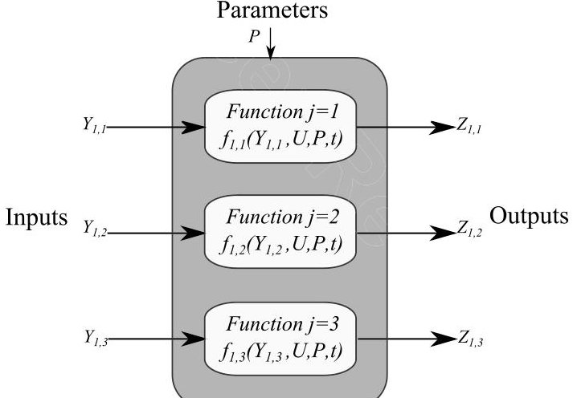

Fig. 1 Generic representation of the subsystem function $ Z_{s,j}=g_{s,j}(Y_{s,j},U,P_{s,j},t) $ for $ s=1 $ and $ j=1,2,3. $ All values are time-dependent.

Schedule: The schedule U(t) is a series of time-dependent events that describes how and when the subsystem functions operate on the states. Events are scheduled when there are opportunities. For example, a data download event may occurs when there is a line of sight between a ground station and satellite. The schedule is designed to achieve the mission objectives while satisfying the mission constraints. The schedule may be an output (e.g., when a solver is used to find an optimal schedule) or an input (e.g., when simulating a given schedule to test performance).

## B. Framework Formulation

The model is formulated as a conventional optimization problem in Eqs. (1-4). Mission objectives, represented in Eq. (1), maximize the total transfer of a mission-specific system state $ x^{*} $ , a component of X, over the planning horizon. The decisions in the optimization problem are when and how the events occur, which are captured in the schedule $ U(t) $ , which is an output of the optimization problem as formulated here. The constraints in the formulation include state dynamics [Eq. (2)] , bounds on state values [Eq. (3)] , and mission requirements [Eq. (4)]:

$$
\max _ {U (t)} \left\{x ^ {*} \left(T _ {f}\right) \right\} \quad \mathrm {s . t .}
$$

$$
\mathbf {X} (t + \Delta t) = \mathbf {N} (\mathbf {X}, P, t) + \sum_ {s \in S} \sum_ {j \in J _ {s}} \mathbf {F} _ {s, j} (\mathbf {X}, U, P _ {s, j}, t) \quad 0 \leq t \leq T _ {f}
$$

$$
\mathbf {X} _ {\min } \leq \mathbf {X} (t) \leq \mathbf {X} _ {\max } \quad 0 \leq t \leq T _ {f}
$$

$$
\Theta_ {k, i} \leq \int_ {t _ {i}} ^ {t _ {i + 1}} \dot {x} _ {k} (t) \mathrm {d} t \quad \forall x _ {k} \in \mathbf {X}, \quad i \in I _ {k}
$$

States evolve over time due to nominal dynamics and subsystem functions; see Eq. (2). Nominal dynamics are independent of subsystem functions. The vector of nominal dynamics equations is defined in Eq. (5), where each element $ k $ represents the nominal dynamics of state $ x_{k} $ . Orbital motion and battery self-discharge are example nominal dynamics of the state variables position and onboard energy, respectively:

$$
\mathbf {N} (\mathbf {X}, P, t) = \left[ n _ {1} (\mathbf {X}, P, t), \dots , n _ {k} (\mathbf {X}, P, t), \dots \right] ^ {T}
$$

The vector of subsystem functions that operates on the state vector is expressed in Eq. (6). The inputs to each function $ f_{s,j,k} $ include the states, parameters, schedule, and time. Note that the vector in Eq. (6) contains zero entries when combined subsystems and functions do not operate on specific states:

$$
\mathbf {F} _ {\mathbf {s}, \mathbf {j}} (\mathbf {X}, U, P _ {s, j}, t) = \left[ f _ {s, j, 1} (\mathbf {X}, U, P _ {s, j}, t), \dots , f _ {s, j, k} (\mathbf {X}, U, P _ {s, j}, t), \dots \right] ^ {T} \quad \forall s \in S, \quad j \in J _ {s}
$$

The nominal and functional dynamics in Eqs. (5) and (6) may each be described by any type of function; for example, they may be analytical or extracted from a simulation system.

The state vector $ \mathbf{X} $ is constrained by lower and upper bounds $ \left\{\mathbf{X}_{\min},\mathbf{X}_{\max}\right\}\in P $ , as in Eq. (3). Example bounds include maximum and minimum battery capacity and maximum data storage capacity.

Operational mission requirements are represented in Eq. (4) by enforcing a minimum change in system state over a specific time period. For example, there may be a mission requirement that a minimum amount of state (such as energy) must be acquired or consumed during a certain period of time. Each interval $ i\in I_{k} $ , where $ I_{k} $ is the set of intervals spanning the full planning horizon for state $ x_{k} $ , has a start time $ 0\leq t_{i}\leq T_{f} $ where the end of interval i corresponds to the start of interval i+1. Equation (4) enforces a minimum change of state $ x_{k} $ during every interval $ i\in I_{k} $ , represented as $ \Theta_{k,i} $ . The change in state during interval i is its integrated time rate of change from $ t_{i} $ to $ t_{i+1} $ . For states without requirements, $ \Theta_{k,i} $ will be zero $ \forall i\in I_{k} $ .

Another perspective for describing spacecraft operations is to consider subsystem functions individually. In particular, consider the analytical relationship between inputs and outputs specific to subsystem s and function j, $ \mathbf{Z}_{s,j}=g_{s,j}(\mathbf{Y}_{s,j},U,P,t), $ where the vector of inputs is $ \mathbf{Y}_{s,j} $ and the vector of outputs is $ \mathbf{Z}_{s,j} $ , which are both comprised of components of X. The function $ g_{s,j} $ is the combination of $ f_{s,j,k} $ $ \forall $ k $ \in $ K (i.e., it models the impact of subsystem s and function j on all state inputs and outputs). A diagram representing these relationships for a single subsystem is given in Fig. 1.

<!-- PDF_PAGE: 5 -->

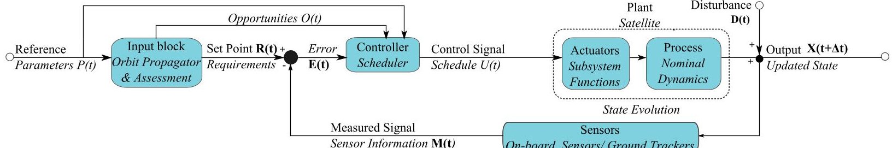

Fig. 2 Elements and dynamics of the system model represented with a conventional feedback control loop diagram. The nonitalicized labels are the conventional elements of a control feedback loop. The italicized labels are the elements of the modeling framework.

## C. Block Diagram Representation

We represent the model framework using a conventional control-system block diagram to demonstrate the interaction of the various model elements in Fig. 2. The set of parameters P are provided to the input block, which identifies opportunities for subsystem functions O and interprets the mission requirements R as control inputs. The error signal is expressed as $ \mathbf{E}=\mathbf{R}-\mathbf{M} $ , where M is estimated state values, which are measured by onboard or ground sensors. E, P, and R are provided to the scheduler, which generates the operational schedule, U. Note that U is an output of the controller and an input to the dynamic system. The states evolve according to both the nominal dynamics and subsystem functions as prescribed by the U, where updated states (after time $ \Delta t $ ) are denoted $ \mathbf{X} ( t+\Delta t ) $ . Unmodeled realistic disturbances D may be injected into the system and modify the state. Mission performance is evaluated by measuring the states and verifying if the mission requirements are satisfied and comparing realized objectives to their expected values. Feedback control exists when the scheduler updates U according to mission performance (i.e., uses E in for future scheduling decisions).

## IV. Application of Model Framework

This model consists of a single mobile space node, a spacecraft with deterministic elements and dynamics. We assume the inputs and dynamics are known a priori. In this section, we assume the schedule is an input to our simulator and developed with a simple heuristic or optimization algorithm. The model provides a detailed, analytical description of the energy, communication, and payload subsystems of a spacecraft and formulates an optimization problem to maximize data download. We assume a deterministic ground-station network exists and interacts with the spacecraft by collecting downloaded data.

## A. Elements

The elements of the spacecraft-specific model are summarized in Table 1. The parameters of the model are grouped into four categories: mission, vehicle, ground, and environment. Specific parameters are introduced in context of their usage later in this section and summarized in Table 2. Several parameters, such as orbital properties of the spacecraft and atmospheric density, are not specifically mentioned in the formulation but are implicit in the simulation systems described in later sections. The states of the model are position l, attitude q, onboard energy e, onboard data d, downloaded data $ d_{\mathrm{d l}} $ , and their derivatives. There are opportunities for solar illuminations $ o_{\mathrm{s o l}} $ , payload operations $ o_{\mathrm{p l}} $ , and downloads to grounds, $ o_{\mathrm{d l}} $ . The model assumes e, $ d_{\mathrm{d l}} $ , and d have no nominal dynamics. The subsystems are communication, energy collection, energy management, payload, data management, and the spacecraft bus. Subsystem functions are described in the next section.

In this example model, the schedule U(t) is an input prescribed a priori by the user of the model. U(t) defines when and how all events are executed. It is assumed to execute perfectly without feedback impacting scheduling decisions. The model simply captures deterministic dynamics and models the expected scenario. This is useful for determining feasibility of U(t) to meet mission requirements, if and when constraints are active, and how sensitive the scenario is to input parameters.

## B. Formulation

The objective of the mission, as represented in the optimization problem, is to maximize data downloaded $ d_{\mathrm{dl}} $ , which is expressed in Eq. (7). The model analytically captures state dynamics for energy e, data downloaded $ d_{\mathrm{dl}} $ , and onboard data d in Eqs. (9-11). Position l and attitude q are not explicitly modeled because there are no modeled subsystem functions that operate on these states. Simulators calculate l and q states as well as $ o_{\mathrm{sol}},o_{\mathrm{pl}} $ , and $ o_{\mathrm{dl}} $ , as will be shown in the following section. Upper and lower bounds on the onboard energy and data are enforced in Eqs. (12) and

Table 1 Elements in the formulation of the communication-focused model

<table border="1"><tr><td>Type</td><td>Elements</td></tr><tr><td>Parameters</td><td>See Table 2</td></tr><tr><td>States</td><td>Position l, attitude q, onboard energy e, onboard data d, downloaded data $d_{\mathrm{d l}}$, and derivatives</td></tr><tr><td>Subsystems</td><td>Communication, energy collection/management, payload, data management, spacecraft bus</td></tr><tr><td>Schedule</td><td>Defined a priori as an input</td></tr></table>

Table 2 Parameters that are explicitly used in the formulation of the communication-focused model

<table border="1"><tr><td>Category</td><td>Parameter</td></tr><tr><td>Mission</td><td>$T_{f},\mathrm{SNR}_{\min},e_{\min},\Theta_{i},I,$</td></tr><tr><td>Vehicle</td><td>$r_{\mathrm{op}},r_{\mathrm{pl}},r_{\mathrm{d l}},p_{\mathrm{op}},p_{\mathrm{pl}},p_{\mathrm{pr}},p_{\mathrm{d l}},A,\eta_{p},d_{\mathrm{max}},e_{\mathrm{max}},G_{t},L_{l},\eta_{r},e_{\mathrm{start}},d_{\mathrm{start}}$</td></tr><tr><td>Ground</td><td>$T_{s},G_{r},\eta_{\mathrm{d l}}$</td></tr><tr><td>Environment</td><td>$E_{\mathrm{solar}}$</td></tr></table>

<!-- PDF_PAGE: 6 -->

(13) . A mission requirement on download latency in Eq. (14) defines the minimum data download amount $ \Theta_{i} $ over specified time intervals $ i\in I $ where $ r_{\mathrm{d l}} $ is the rate of data download. Subsystem functions and their impact on state evolution are described next:

$$
\max _ {U (t)} C _ {N} \quad \mathrm {s . t .}
$$

$$
C _ {N} = d _ {\mathrm {d l}} \left(T _ {f}\right)
$$

$$
e (t) = e _ {\mathrm {s t a r t}} + \int_ {0} ^ {t} \left[ p _ {\mathrm {s o l}} (\tau) - p _ {\mathrm {o p}} (\tau) - o _ {\mathrm {p l}} p _ {\mathrm {p l}} (\tau) - p _ {\mathrm {p r}} (\tau) - o _ {\mathrm {d l}} p _ {\mathrm {d l}} (\tau) - p _ {\mathrm {s p}} (\tau) \right] \mathrm {d} \tau \quad \forall t \in [ 0, T _ {f} ]
$$

$$
d _ {\mathrm {d l}} (t) = \int_ {0} ^ {t} \eta_ {\mathrm {d l}} o _ {\mathrm {d l}} (\tau) r _ {\mathrm {d l}} (\tau) \mathrm {d} \tau \quad \forall t \in [ 0, T _ {f} ]
$$

$$
d (t) = d _ {\mathrm {s t a r t}} + \int_ {0} ^ {t} \left[ r _ {\mathrm {o p}} (\tau) + o _ {\mathrm {p l}} r _ {\mathrm {p l}} (\tau) - r _ {\mathrm {s p}} (\tau) \right] \mathrm {d} \tau - d _ {\mathrm {d l}} (t) \quad \forall t \in [ 0, T _ {f} ]
$$

$$
e _ {\min } \leq e (t) \leq e _ {\max } \quad \forall t \in [ 0, T _ {f} ]
$$

$$
0 \leq d (t) \leq d _ {\max } \quad \forall t \in [ 0, T _ {f} ]
$$

$$
\Theta_ {i} \leq \int_ {t _ {i} ^ {s}} ^ {t _ {i} ^ {e}} r _ {\mathrm {d l}} (t) \mathrm {d} t \quad \forall i \in I
$$

The function of the communication subsystem is to download data from the spacecraft to a ground-station network. Given download opportunities (i.e., when $ o_{\mathrm{d l}}=1 $), the subsystem uses on-orbit energy at the rate $ p_{\mathrm{d l}} $ to downloaded data $ d_{\mathrm{d l}} $ at the rate $ r_{\mathrm{d l}} $ with transmit power $ p_{t} $ . Consider the link equation, which defines the expected signal-to-noise ratio SNR, of the communication channel, as in Eq. (15) [52]:

$$
\mathrm {S N R} = \frac {p _ {t} G _ {t} G _ {r} L _ {l} L _ {s} L _ {a}}{k _ {B} T _ {s} r _ {\mathrm {d l}}}
$$

$ G_{t} $ and $ G_{r} $ are the gains of the transmit (spacecraft) and receive (ground station) antennas, respectively. Three sources of signal loss decrease SNR: $ L_{l} $ is the transmitter-to-antenna line loss; $ L_{s} $ is the free space loss, where $ L_{s} $ is inversely proportional to the transmission frequency and the square of the distance between the spacecraft and the ground station; and $ L_{a} $ is the transmission path loss resulting from the propagation medium and varies as a function of atmospheric weather. System noise is modeled as the product of the Boltzmann constant $ k_{B} $ and the noise temperature of the receiver $ T_{s} $ . In Eq. (15), we assume perfect spectral efficiency (i.e., $ \beta=r_{\mathrm{d l}} / B=1 $ , where B is the communication bandwidth). A minimum SNR, $ \mathrm{SNR}_{\mathrm{min}} $ , is required for maintaining an acceptable link quality such that $ \mathrm{SNR}\geq\mathrm{SNR}_{\mathrm{min}} $ [52].

Analysis is simplified by introducing a substitute variable $ \alpha $ , which is a measure of the energy per data (measured in Joules per bit) required to download data from the spacecraft to the ground at $ \mathrm{SNR}=\mathrm{SNR}_{\mathrm{min}} $ , as in Eq. (16). Because $ L_{s} $ and $ L_{a} $ are time-varying, $ \alpha $ is dynamic. Antenna gain terms may be occasionally time varying as well, depending on relative orientation of the antennas:

$$
\alpha = \frac {p _ {t}}{r _ {\mathrm {d l}}} = \frac {k _ {B} T _ {s} \left(\mathrm {S N R} _ {\min }\right)}{G _ {t} G _ {r} L _ {l} L _ {s} L _ {a}}
$$

The transmitter efficiency $ \eta_{r} $ relates the power provided to the radio, $ p_{\mathrm{d l}} $ , and the output power transmitted by the radio, $ p_{t} $ , such that $ p_{t}=\eta_{r} p_{\mathrm{d l}} $ Finally, the analytical relationship between the communication subsystem parameters $ r_{\mathrm{d l}} $ , $ p_{\mathrm{d l}} $ , and $ p_{t} $ , is expressed as an inequality:

$$
\frac {p _ {t}}{\eta_ {r}} = p _ {\mathrm {d l}} \geq \frac {\alpha r _ {\mathrm {d l}}}{\eta_ {r}}
$$

because $ \mathrm{S N R}_{\mathrm{m i n}} $ is a minimum constraint. During operations, use of the minimum $ p_{\mathrm{d l}} $ or maximum $ r_{\mathrm{d l}} $ can be exploited to optimize communication links [53].

The function of the energy-collection subsystem is to collect energy with solar panels when illuminated, i.e. when $ o_{\mathrm{sol}}=1 $ , which is dependent on l and q. The illuminating solar energy density $ E_{\mathrm{solar}} $ is converted to usable electrical energy at a rate $ p_{\mathrm{sol}} $ and is a function of solar panel efficiency $ \eta_{p} $ , light incidence angle $ \theta(t) $ , and the effective area of the panels, A. $ \theta $ is a complex relationship between the spacecraft configuration and attitude and is determined by simulators in this model. Analytically, the function is described Eq. (18), where K is the set of spacecraft body faces:

$$
p _ {\mathrm {s o l}} = \sum_ {k \in K} o _ {\mathrm {s o l}} E _ {\mathrm {s o l a r}} A _ {k} \eta_ {p} \cos \left(\theta_ {k}\right)
$$

The energy-management subsystem stores and regulates onboard energy e according to the expression in Eq. (9). Its input is $ p_{\mathrm{sol}} $ from the energy-collection subsystem. It outputs power to the other subsystems and manages energy stored in the battery, which is e. Stored energy is added or consumed depending on whether $ p_{\mathrm{sol}} $ exceeds the instantaneous power needs of the subsystems. The spacecraft bus requires continuous power $ p_{\mathrm{op}} $ . As prescribed by $ U(t) $ , the payload requires $ p_{\mathrm{pl}} $ during experiments, data management requires $ p_{\mathrm{pr}} $ during processing, and communication requires $ p_{\mathrm{dl}} $ during downloading. If the battery reaches full capacity (i.e., $ e=e_{\mathrm{max}} $ ), the energy-management subsystem diverts or spills surplus available solar energy at a rate of $ p_{sp} $ to prevent battery overcharging, as captured in Eq. (12). Depth of discharge management is enforced in

<!-- PDF_PAGE: 7 -->

<table border="1"><tr><td></td><td colspan="3">Operational mode</td></tr><tr><td>Mission parameters</td><td>Focused</td><td>Continuous</td><td>Opportunistic</td></tr><tr><td>Mission name</td><td>RAX-2</td><td>DICE</td><td>myPocketQub 391</td></tr><tr><td>Orbit altitude a,km</td><td>350-820</td><td>350-820</td><td>700</td></tr><tr><td>Orbit inclination i,deg</td><td>102</td><td>102</td><td>98.8</td></tr><tr><td>Spacecraft size</td><td>$10\times10\times30\text{cm}^{3}$</td><td>$10\times10\times15\text{cm}^{3}$</td><td>$46\times46\times69\text{mm}^{3}$</td></tr><tr><td>Payload data collection frequency</td><td>Several times/day</td><td>Continuously</td><td>Random(50% of time)</td></tr><tr><td>Payload data collection duration</td><td>$\approx$5 min</td><td>One orbit</td><td>10 min</td></tr><tr><td>Payload data collected amount (raw)</td><td>1.2 GB/day</td><td>10.5 MB/orbit</td><td>$\leq$512 MB/orbit</td></tr><tr><td>Download requirement,MB/day</td><td>1</td><td>0.29</td><td>1</td></tr><tr><td>Desired download,MB/day</td><td>5</td><td>1</td><td>1000</td></tr><tr><td>Average power $p_{\mathrm{sol}}$,W(best/expected/worst,P1/P2/P3)</td><td>8/5.5/3</td><td>6/4/3</td><td>3/2/1</td></tr></table>

Table 3 Example missions representing the three operational modes

Eq. (9) with a minimum battery storage capacity, $ e_{\min}=e_{\max}(1-\zeta) $ , where $ \zeta $ is the maximum allowable depth of discharge. At the start of the planning horizon, $ t=0 $ , the initial amount of stored energy is $ e_{\mathrm{start}}. $

The payload subsystem collects or generates data to be processed and downloaded when prescribed by an input $ U ( t ) $ . The payload consumes energy at a rate $ p_{\mathrm{pl}} $ and outputs data at a rate $ r_{\mathrm{pl}} $ .

The data management subsystem manages, stores, and regulates onboard data d according to Eq. (11). The inputs are data from the bus and payload subsystems at rates $ r_{\mathrm{op}} $ and $ r_{\mathrm{pl}} $ , respectively, and power at a rate $ p_{\mathrm{pr}} $ to process the data; see Eq. (9). Processing includes compressing data (which may significantly reduce the amount of data such that it can be downloaded) at a rate $ r_{l} $ and outputting data at a rate $ r_{\mathrm{d l}} $ . If data d reaches maximum level $ d_{\mathrm{m a x}} $ , as specified in Eq. (13), data are deleted at a rate $ r_{sp} $ to satisfy storage constraints. The initial amount of data on the spacecraft is $ d_{\mathrm{s t a r t}} $ .

The cumulative amount of data downloaded from the spacecraft, $ d_{\mathrm{d l}} $ , is analytically expressed in Eq. (10). $ d_{\mathrm{d l}} $ is the integral of the product of the download rate $ r_{\mathrm{d l}} $ and the download efficiency $ \eta_{\mathrm{d l}} $ , which is a function of the ground-station communication subsystem [21].

As a model-simplification technique, a spacecraft bus is included, which consists of the remaining spacecraft components not explicitly modeled by the previous subsystems. The input to the bus subsystem is power $ p_{\mathrm{op}} $ , and it outputs telemetry data at a rate $ r_{\mathrm{op}}. $

## V. Data Generation and Simulator

## A. Realistic Data Collection

To obtain realistic data sets, we have deployed two online surveys, one focusing on existing and upcoming small-satellite missions and the other focusing on the ground stations supporting these satellites [54,55]. These surveys were deployed to collect information on past, existing, and future small-satellite missions and ground stations, which are critical to verify our models and tools for realistic applications. Furthermore, optimizing realistic data sets provides insights about the performance potential and constraints of existing and future missions and networks.

## 1. Small Satellite Survey

The Small Satellite Survey is a database of operational information about past and future small-satellite missions [55]. The survey includes questions about the launch parameters, mission goals, download goals, and details on the spacecraft constraints such as onboard energy and data storage capacity.

Review of the survey indicated three representative satellite operational modes that capture how missions collect data: focused, opportunistic, and continuous. In the focused mode, all operational decisions, including data collection and download opportunities, are known a priori; the satellite has a deterministic schedule that does not vary. In the opportunistic mode, data collection is activated by stochastic events such as solar activity. In the continuous mode, data are collected or generated continually. Satellites may operate in a single or combination of these modes throughout its mission.

Three diverse missions from the satellite survey representing each of the operational modes are summarized in Table 3. The focused Radio Aurora Explorer (RAX) measures ionospheric properties using bistatic radar measurements [10,56]. RAX has the opportunity to collect radar data several times per day when it passes over the experimental zone located in Poker Flat, Alaska. After an experiment, RAX processes and downloads the data to eight globally distributed ground stations at a data rate of 9600 bps. The opportunistic myPocketQub 391 (myPQ) picosatellite mission will allow members of the public to upload software payloads and perform custom mission operations [57]. The myPQ satellite is designed to continuously download image and sensor data to a very large globally distributed network (with over 100 stations) at a maximum data rate of 1200 bps. The continuous Dynamic Ionosphere CubeSat Experiment (DICE) mission consists of a pair of satellites that study the interactions of the Earth's upper atmosphere and the sun using a suite of onboard payload instruments including electric field probes, Langmuir probes, and magnetometers. The two DICE satellites were launched with RAX in 2011 and download to two high-gain uhf antennas at a data rate greater than or equal to 1.5 Mbps.

## 2. Ground Satellite Survey

The Ground Station Survey provides a database of information on existing ground stations from the CubeSat and amateur radio communities [54,58]. The survey provides us with an online database containing necessary communication information for modeling these station, including their locations and capabilities. The ground-station networks used to support small satellites are independently owned and operated and not centrally controlled.

Three example networks from the survey with variable global distribution and capabilities are summarized in Table 4 for representative radios and operational settings. For these examples, we assume communication occurs at a constant data rate and power level, where the link budget is satisfied for all elevation angles. Energy utilization for download is computed using the RAX parameters (antenna gains, losses, and efficiencies). For $ L_{s} $ calculations, the S band and uhf stations are assumed to operate at frequencies of 2450 and 437.505 MHz, respectively. The geographic distribution of the N2 and N3 stations are shown in Fig. 3. The perimeters are the ground-station cone of visibility of a satellite with an altitude of 500 km projected onto the cartesian map assuming an elevation mask of 0 deg for the ground station.

<!-- PDF_PAGE: 8 -->

Table 4 Example networks from the ground station survey

<table border="1"><tr><td>Parameter</td><td colspan="3">Value</td></tr><tr><td>Network</td><td>N1</td><td>N2</td><td>N3</td></tr><tr><td>Number of stations</td><td>2</td><td>8</td><td>100</td></tr><tr><td>Locations</td><td>Wallops and SRI</td><td>RAX network</td><td>Globally distributed</td></tr><tr><td>Data rate r</td><td>115.2 kbps</td><td>9600bps</td><td>1200bps</td></tr><tr><td>Frequency type</td><td>S band</td><td>UHF</td><td>UHF</td></tr><tr><td>Antenna gain $ G_{r} $ dBi</td><td>46</td><td>19</td><td>19</td></tr><tr><td>Energy utilization $\alpha $ mJ/bits</td><td>0.0441</td><td>0.4665</td><td>0.4665</td></tr></table>

Link budget parameters are calculated with a representative radio that transmits at a constant data rate and power level.

## B. Simulator and Example Application

To demonstrate and validate the effectiveness of the modeling framework, a simulator was developed to execute the analytical model described in Eqs. (7-14). The simulator consists of custom Matlab scripts integrated with the high-fidelity Systems Tool Kit (STK) from Analytical Graphics, Inc. [59]. STK propagates the satellite orbit and attitude dynamics and combines this information with locations of ground stations and targets of interest to determine opportunities for energy and data collection and data download (i.e., $ o_{\mathrm{sol}} $ $ o_{\mathrm{pl}} $ $ o_{\mathrm{dl}} $ ). The custom Matlab scripts execute a given schedule to propagate the satellite states as in Eqs. (9-11) with input parameters from Table 3. In the simulations, the nominal, payload, and download data and energy rates and the communication parameters are constant during each interval, and energy collection occurs at a constant rate when in the sun. These are reasonable approximations for most satellites from the small-satellite community.

In this section, we demonstrate applicability of the model and simulator to a realistic mission scenario. In particular, we model the RAX-2 mission with power scenario P2 and in coordination with its dedicated ground network N2. The mission is simulated according to a simple greedy heuristic schedule $ U(t) $ , which is an input to the simulator. The satellite performs payload and download operations whenever there is an opportunity to do so. The simulation environment executes this schedule and propagates the satellite states as in Eqs. (9-11) with input parameters from Table 3. The simulation parameters are: $ p_{\mathrm{op}}=2 \mathrm{~W}, p_{\mathrm{pl}}=4 \mathrm{~W}, p_{\mathrm{dl}}=5 \mathrm{~W}, p_{\mathrm{pr}}=0 \mathrm{~W}, r_{\mathrm{dl}}=9.6 \mathrm{~kbps}, \eta_{\mathrm{dl}}=0.7 $ , and those from Table 3. In the simulations, we assume the nominal, payload, and download data and energy rates are constant during each interval. Furthermore, we assume energy collection occurs at a constant rate when in the sun and communication occurs whenever the satellite is above the horizon relative to a ground station in the network. These are reasonable approximations for most small satellites based on our operational experience.

The time histories of the onboard satellite energy and total downloaded data are shown in Figs. 4 and 5. $ ^{\S} $ Figure 4 shows the scenario with an eclipse fraction of 0.35, which is the maximum annual eclipse time experienced by this orbit, and the nominal power collection P2 $ ( p_{\mathrm{sol}}=3.3 \mathrm{~W}) $ Figure 5 shows the scenario with the minimum annual eclipse time experienced by this orbit (zero eclipse) and the worst-case power collection P1 $ ( p_{\mathrm{sol}}=3 \mathrm{~W}) $ .

The stored energy in Figs. 4a and 6a evolves according to Eq. (9), where the time-dependent slope is a function of the combination of solar illumination (see sun indicator), nominal operations, and experiments and downloads (see shaded patches). The slope is generally positive when in the sun and negative when in eclipse, with lower slopes corresponding to times where experiments or downloads occur. In both cases, the energy level never reaches the lower energy bound because there is generally more energy available then required for operations in this scenario. The energy level exceeds the upper capacity, and energy is spilled to satisfy the energy capacity constraint in Eq. (12) several times during the scenario (e.g., at 1.1, 1.6, 2.6, 3.2, 4.9, 6.5, and 8.1 h in Fig. 4a and nearly constantly in Fig. 5a). The downloaded data in Figs. 4b and 5b are the product of the rate of transmitted data (slope during downloads), duration of the downloads, and the download efficiency, as in Eq. (10). The no-eclipse scenario with the worst-case power value (P1) simulation predicts that the RAX-2 mission should satisfy download requirements [Eq. (14)] because it nearly downloads the daily requirement (1 MB) in the first 8 h; see Fig. 5a. However, it is not clear if the maximum eclipse scenario with the expected power value (P2) will complete the download requirement because it has only downloaded 0.3 MB in the first 8 h; see Fig. 4a.

Next, we compare the download results for scenarios with maximum- and zero-eclipse conditions with variable power-collection values in Fig. 6. The results are also summarized in Table 5 for the three power-collection values (P1, P2, P3). When there is zero eclipse and $ p_{\mathrm{sol}} \geq 1 $ W, all experiment and download opportunities are fully used and all constraints are satisfied, as shown in Fig. 5. However, for scenarios that experience the maximum possible eclipse (eclipse fraction of 0.35), the RAX-2 mission is not feasible for $ p_{\mathrm{sol}} < 4 $ W because there is insufficient energy to perform payload and download operations at every opportunity while satisfying constraints (9-14). For scenarios with $ p_{\mathrm{sol}} \geq 4 $ W, RAX-2 only uses a fraction of the download opportunities (due to limited available energy), for example only two download opportunities are used with the expected power value (P2); see Fig. 4b.

These simulations have demonstrated the ability of the model and simulation environment to capture a realistic mission and identify/quantify the factors that constrain spacecraft mission potential. For example, we have identified that download performance is influenced significantly by the interaction of eclipse duration (which is dynamic throughout the year) and power-collection value. Furthermore, these results motivate the development of optimal schedules U(t) to allocate resources to ensure that constraints are satisfied and download is maximized for all possible scenarios.

## VI. Communication Capacity Assessment Simulations

Motivated by the research goals stated earlier, this section explores trends in communication capacity as a function of realistic constraints. The three primary resources necessary to support data download are energy e, data d, and downlink time. The resources are constrained by the limited opportunities to collect energy $ \left( o_{\mathrm{sol}} \right) $ , acquire data $ \left( o_{\mathrm{pl}} \right) $ , and download data to ground stations $ \left( o_{\mathrm{dl}} \right) $ . Onboard data are usually abundant for space missions because payloads often generate more data than can be downloaded. For example, RAX-2 generates 1.2 GB per day while the satellite is only capable of downloading several megabytes per day. Thus, these simulations focus on constraints related to opportunities for energy collection and data download. Each of the simulations considers a single satellite communicating to a dedicated ground-station network. The communication-focused model and simulator enable assessment of the affects of both individual and combined parameters of the satellite and ground networks.

<!-- PDF_PAGE: 9 -->

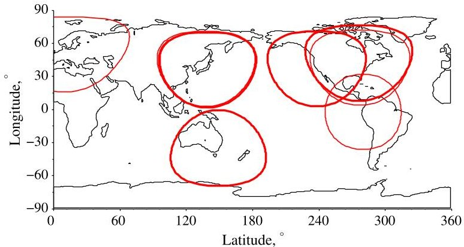

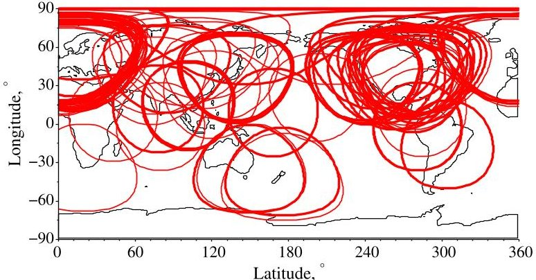

a) RAX network (N2)

b) Global network (N3)

Fig. 3 Global locations and projected visibility cones of stations in N2 and N3 assuming a satellite altitude of 500 km and an elevation mask of 0 deg.

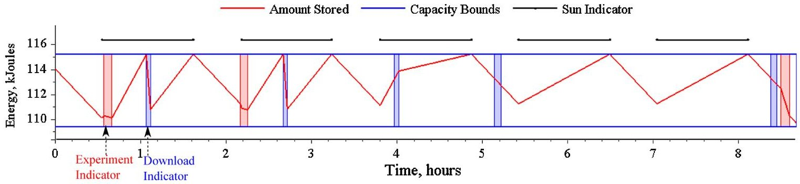

a) Stored energy

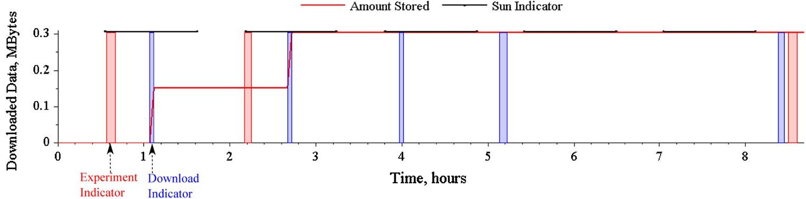

b) Downloaded data

Fig.4 Time histories of onboard stored energy and total data downloaded for an instance of the RAX-2 mission with $ p_{\mathrm{sol}}=5.5 $ W and maximum eclipse duration of 35% of orbit.

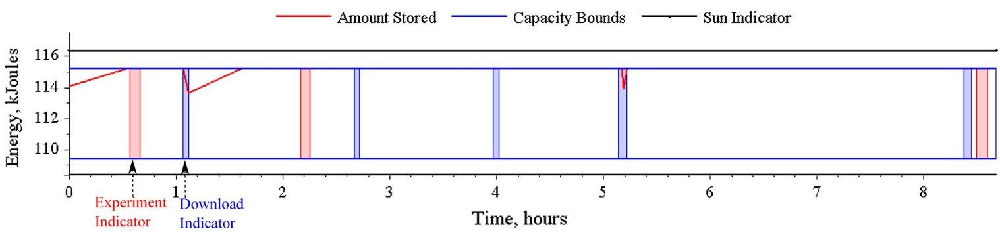

a) Stored energy

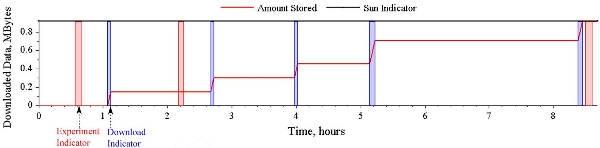

b) Downloaded data

Fig. 5 Time histories of onboard stored energy and total data downloaded for an instance of the RAX-2 mission with $ p_{\mathrm{sol}}=3 $ W and zero eclipse duration (all 97 min of orbital period are in sunlight).

<!-- PDF_PAGE: 10 -->

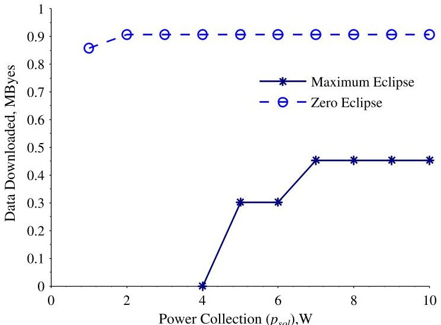

Fig. 6 Data downloaded for variable solar power-collection values $ p_{\mathrm{sol}} $ for an instance of the RAX-2 mission. Results are compared when there is maximum eclipse (eclipse fraction 0.35) and zero eclipse. Note that data are not plotted for infeasible mission scenarios.

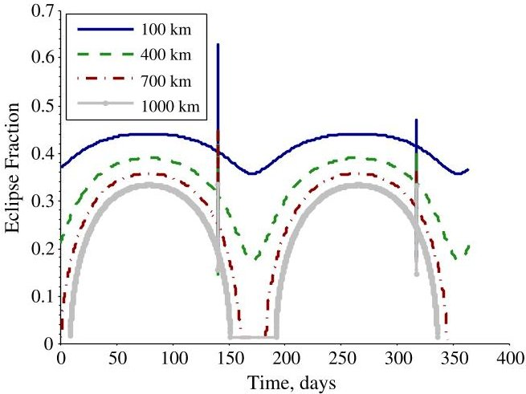

a) Variable altitude (i = 90 deg, e = 0)

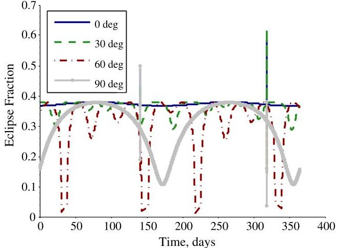

b) Variable inclination ( $ a=500 $ km, $ e=0 $ )

Fig. 7 Eclipse fractions for circular orbits with variable altitudes and inclinations for a one year scenario.

## A. Energy Constraints

Orbit parameters affect opportunities for power collection, which directly impacts the ability of the spacecraft to collect and download data. Because many small satellites are launched as secondary payloads, they have little control over orbit selection, and thus the orbital parameters of past and upcoming launces can vary greatly [55]. Motivated by this variability, the availability of energy for download from diverse low Earth orbits (LEOs) is assessed.

The annual variation in eclipse for a satellite is highly dependent on orbit inclination. Figure 7b plots the eclipse fraction, which is the fraction of time the satellite is in shadow per orbit to the orbital period, for varying inclinations. The data for the plot were generated with a right of ascension $ \Omega_{0}=0 $ deg, an eccentricity, $ e=0 $ , and an altitude of 500 km. The eclipse fraction varies from nearly constant for equatorial orbits ( $ i=0 $ deg) to a distinct bi-annual variation for polar orbits ( $ i=90 $ deg). This variation is due to orbit precession; inclined orbits precess due to Earth's nonuniform gravity field [52]. The sharp spikes at days 141 and 317 are due to the Moon's penumbra.

There is also an annual variation in eclipse fraction as a function of altitude as plotted in Fig. 7a where altitude ranges from 100 to 1000 km with a fixed inclination of 90 deg. As altitude increases, eclipse time decreases from 38 to 35 min, while orbital period increases from 86 to 105 min. Because of these combined effects, higher orbits have shorter relative eclipse fractions and greater seasonal variation.

These simulations demonstrate model and toolkit utility in quantifying the sensitivity of eclipse fraction, and thus power collection, relative to orbital parameters. For operational planning of an active mission, these simulations highlight times during the year when excess energy is available for additional payload operations or higher-power downlink or when the satellite must conserve energy to meet minimum requirements. These simulations are also useful during vehicle design because eclipse trends are important for the sizing and optimization of energy storage, energy collection, and thermal systems.

## B. Network Constraints

Satellite communication capacity is influenced by the size and distribution of the ground networks supporting the mission. To explore this effect, the model and simulator are employed to model the N3 network and operation of a DICE satellite with power level P2. To isolate the impact of ground network on capacity, it is assumed the satellite has sufficient energy to download whenever there is an opportunity. Furthermore, we

Table 5 Total data downloaded for different eclipse and power scenarios

<table border="1"><tr><td colspan="2">Scenario characteristics</td><td colspan="3">Data downloaded for each power setting</td></tr><tr><td>Type</td><td>Eclipse ratio</td><td>P1($p_{\mathrm{sol}}=3$W)</td><td>P2($p_{\mathrm{sol}}=5.5$W)</td><td>P3($p_{\mathrm{sol}}=8$W)</td></tr><tr><td>Zero eclipse</td><td>0</td><td>0.91MB</td><td>0.91MB</td><td>0.91MB</td></tr><tr><td>Maximum eclipse</td><td>0.35</td><td>Infeasible</td><td>0.30MB</td><td>0.45MB</td></tr></table>

<!-- PDF_PAGE: 11 -->

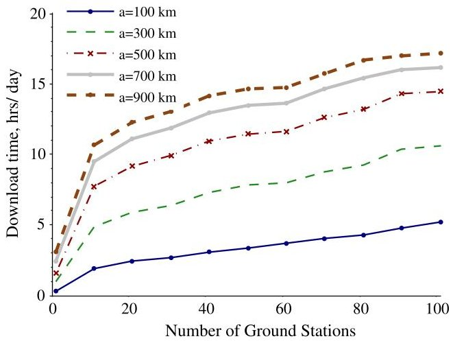

a) Altitude effects (i=90 deg, e=0)

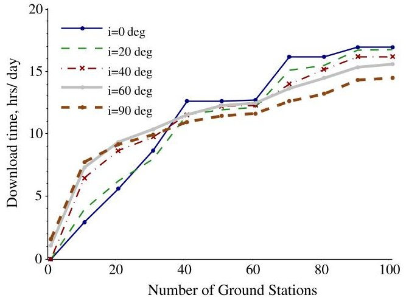

b) Inclination effects ( $ \alpha=5 0 0 $ km, $ e=0 $ )

Fig. 8 Communication capacity as a function of diverse orbital properties and ground network sizes for a one year simulation. The networks consist of randomly selected stations from N3 to simulate random network growth in this community.

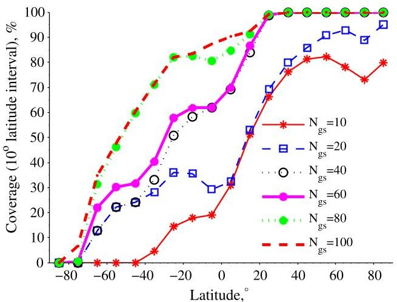

a) Ground station coverage

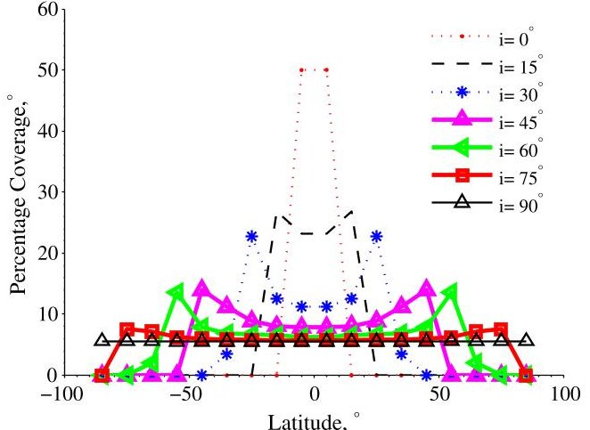

b) Satellite coverage

Fig. 9 Earth coverage for variable satellite inclinations assuming a circular orbit at an altitude of 500 km. Communicating to networks with variable numbers of ground stations, $ N_{\mathrm{gs}} $ (see Fig. 2).

assume the satellite can communicate with the ground station whenever it is above the horizon (which is representative of many small-satellite missions). This simplifying assumption provides an estimate of the total communication potential using a topological model (i.e., considering line-of-sight constraints) [21]. To obtain a more-accurate estimate of capacity, the total download can also be multiplied by the fraction of time communication is feasible or the expected efficiency, if available.

Communication capacity is directly proportional to download time for constant-rate communication. Thus, capacity results are represented by download time (e.g., minutes per day) such that they are applicable to mission scenarios with diverse data rates (data capacity is the product of download time and rate). Results for different orbital parameters and network sizes are shown in Fig. 8. Download time is plotted with respect to an increasing number of randomly selected stations from N3 (see Sec. V.A.2). The random addition of stations is representative of the random growth in the small-satellite community.

The combined effect of orbital altitude and network size on download time is demonstrated in Fig. 8a for a polar orbit (i.e., i = 90 deg). Higher-altitude orbits have a larger ground footprint, resulting in longer pass times and more pass opportunities, and thus greater download time. The addition of ground stations provides a nearly linear growth in communication capacity for low-altitude orbits (when the number of ground stations exceeds 10), while the growth rate does not increase consistently for higher-altitude orbits. This is because low-altitude orbits have a smaller footprint on the Earth, and therefore distributed ground stations are less likely to have overlapping footprints and be in view of an orbiting satellite simultaneously. Thus, the addition of stations provides improved coverage almost independent of network size for small and midsized networks; however, this is not true for larger networks.

The combined effect of orbital inclination and network size on communication capacity is demonstrated in Fig. 8b. There is a monotonic yet nonlinear growth in download time with an increase in the number of stations. This nonlinearity is due to the complex relationship between satellite ground tracks and ground-station coverage of randomly growing networks. For example, a new station near an existing station may not significantly increase capacity due to footprint overlap or if it is out of the latitude range of the satellite orbit.

The growth trend in Fig. 8b can be explained more rigorously by examining the combined coverage of ground-station footprints (as in Fig. 3), with the coverage of the satellite ground tracks. Capacity and download time are a direct function of coverage; for example, if the ground network

Table 6 Satellite coverage for different satellite inclinations and number of ground stations $ \left(N_{\mathrm{gs}}\right) $ ,“assuming” the satellite spends equal time in the latitude range (the simulation is for two weeks using a $ J_{4} $ orbital propagator)

<table border="1"><tr><td>Orbit type</td><td>Inclination,deg</td><td>Latitude range,deg</td><td>Coverage $ N_{\mathrm{gs}}=10, \% $</td><td>Coverage $ N_{\mathrm{gs}}=40, \% $</td><td>Coverage $ N_{\mathrm{gs}}=100, \% $</td></tr><tr><td>Equatorial</td><td>0</td><td>-10 to 10</td><td>25.4</td><td>65.8</td><td>88.9</td></tr><tr><td>Polar</td><td>90</td><td>-90 to 90</td><td>37.9</td><td>62.1</td><td>75.4</td></tr></table>

<!-- PDF_PAGE: 12 -->

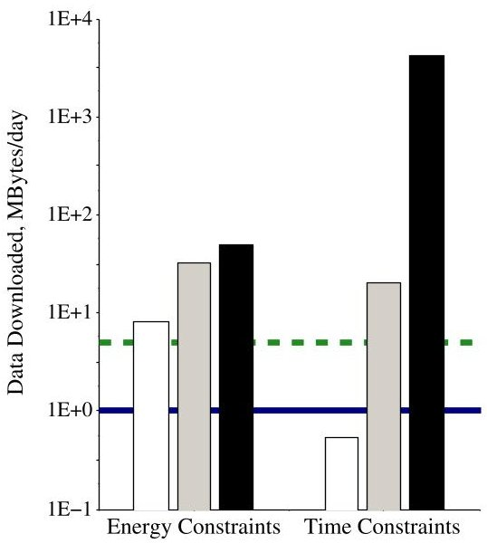

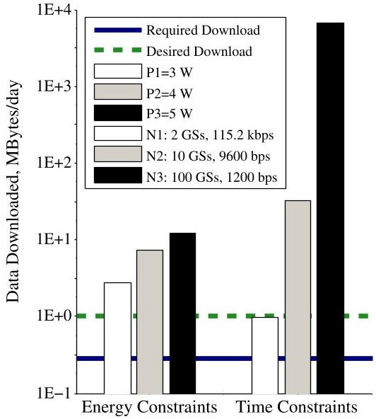

a) RAX-1 (Focused)

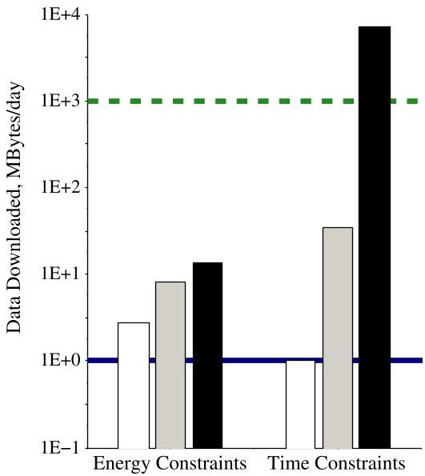

b) DICE (Continuous)

c) myPocketQub391 (Opportunistic)

Fig. 10 Communication capacity constraints compared to mission requirements and desired download for realistic satellites with diverse operational modes from Table 3. The simulation results are averaged for a two-week period.

covers 50% of the area where the satellite orbits, there will be 12 h of download time per day, and communication capacity is the product of download time and data rate. Figures 9a and 9b show the global coverage of networks (i.e., percentage of Earth visible from a ground network) and the global coverage of orbits (i.e., percentage of Earth covered by satellite ground tracks) for 10 deg latitude ranges. For the orbits we study, the longitudinal affects average over long-duration scenarios. Note the high coverage of northern latitudes for the N3 network, as seen in Fig. 3. The coverage for a satellite orbit and network combination is the product of the individual satellite and ground network coverage for a given latitude range. For both equatorial and polar orbits, the satellite spends approximately equal time in the latitude range it covers, which is $ [-10,10] $ deg for equatorial orbits and $ [-90,90] $ deg for polar orbits. Thus, for these cases, coverage is simply the average ground network coverage in Fig. 9a for the appropriate latitude ranges. Coverage results are summarized in Table 6 for equatorial and polar orbits and different ground network sizes.

Next, we connect the coverage trends and observations just discussed with the download time results in Fig. 8b. For small ground networks （ $ N_{\mathrm{gs}}<40 $ stations), higher-inclination orbits have greater coverage, and thus download time, relative to lower inclination orbits. This is because the ground tracks of higher inclination orbits cover greater latitude range and thus have greater download time to globally distributed stations, as in Fig. 9b. Lower-inclination orbits have a restricted latitude range and thus are less likely to cover footprints of distributed stations, particularly those at high latitudes. There is an interesting inflection point at $ N_{\mathrm{gs}}\approx 40 $ stations in Fig. 8b and Table 6, where the download time of lower-inclination orbits begins to exceed higher-inclination orbits. This trend occurs because, with $ N_{\mathrm{gs}}\geq 40 $ stations, lower-inclination orbits are able to exploit the nearly global coverage at low latitudes for larger networks, as shown by the footprints in Fig. 3b and the coverage for low latitudes in Fig. 9a. Even with large number of stations, N3 does not cover the full globe, particularly southern latitudes, because there are fewer ground stations there. Thus, high-inclination orbits that cover a great latitude range achieve lower coverage relative to lower-inclination orbits. The simulation environment has enabled an investigation into how global coverage impacts communication capacity trends for diverse networks and orbits.

## C. Constraint-Based Capacity and Comparison to Mission Requirements

The simulation results based on this modeling framework that are presented in this paper enable the comparison of mission-specific download requirements (see Table 3) to constraint-based capacity. Constraint-based capacity is the maximum download capacity that can be achieved when a specific set of constraints is considered and all others are relaxed. Two significant classes of mission constraints are those related to energy and networks. We define energy constraints as those that are exclusively representing the total available energy for downloads. These constraints are a function of the power collection (when in the sun) and eclipse time, as shown in Fig. 7. We define network constraints as those that are exclusively a function of the download time between satellites and ground networks, as described earlier in Fig. 8 and addressed in more detail in [21].

The required and desired download capacities are compared to the energy and network constraint-based capacity in Fig. 10 for the three missions from Table 3. The constraint-based capacity is plotted along the y axis for the three missions that are shown along the x axis. Horizontal lines represent the required and desired download, and vertical lines represent the energy and network constraint-based capacity. In the constraint evaluation, we assume that data are downloaded at a constant rate.

Considering energy constraints, each mission in Fig. 10 achieves its download requirement with any of the three power scenarios (P1, P2, P3), and the RAX-1 and DICE scenarios also achieve the desired download using any of the power scenarios. These results provide snapshots of capacity because they capture only a short planning horizon (two weeks), and eclipse trends vary throughout a year. Specifically, the satellites are all in near-polar orbits with mid-LEO altitudes; thus, as shown earlier in Fig. 7, the eclipse trends for these orbits vary significantly (from no eclipse time to >30% of the orbit) throughout a year. Energy-constraint results are informative for identifying constraint-based download capacity as a function of eclipse trends. They can also be useful for sizing solar panels to satisfy mission requirements during early design stages.

Considering network constraints, all three missions in Fig. 10 achieve their respective minimum download requirements by communicating to either of the two larger networks (N2 or N3). Download potential increases by up to two orders of magnitude when the network grows from two ground stations in N1 to eight ground stations in N2, consistent with capacity growth trends for near-polar orbits and small networks shown earlier in Fig. 8b. The download capacity of RAX-1 and DICE communicating to N3 increases by over two orders of magnitude relative to communicating to N2, despite transmitting at a lower data rate; see Figs. 10a and 10b. This is because the relative increase in download time exceeds the relative decrease in data rate. The myPQ mission only achieves its desired download capacity when communicating to the largest network (N3); see Fig. 10c. These simulation results demonstrate the how the constraint-based analysis can quantify the ability of different networks to achieve different goals.

<!-- PDF_PAGE: 13 -->

The results also highlight that network constraints are the limiting factor when a small network is used, and energy constraints are the limiting factor when larger networks are used for the scenarios studied in this section. The relative advantages of larger networks and/or higher power levels on the capacity have been quantified in this analysis and can enable the optimization of vehicle and network designs. This type of analysis enables the identification of mission scenarios that are infeasible and those with the potential to exploit surplus resources to reach and exceed desired download requirements.

Finally, the results in this section highlighted the importance of modeling visibility constraints, energy and data availability, and availability of ground network support. In addition, the results showed the dynamic nature of these constraints; download times vary as a function of the orbital track, and eclipse trends vary throughout the year. The foundational modeling and simulation framework developed in this paper captures the key constraints, the dynamic nature of the spacecraft operations, and can capture stochastic factors which are inherent to spacecraft operations. Operational scheduling is necessary to ensure that constrained resources are optimally allocated to ensure payload and download requirements are satisfied and mission goals are maximized.

As a demonstration of the utility of the model, we have applied the framework to develop a model-based systems-engineering (MBSE) representation of the Radio Aurora Explorer mission in Systems Modeling Language [60]. This foundational model was used to develop a simulation environment that integrates Systems Tool Kit and Matlab using Phoenix Integration Model Center to execute a specific mission scenario and perform trade studies [61]. Applying the framework to a specific mission instance requires minimal effort (several hours for an experienced systems engineer) once the problem is established.

## VII. Conclusions

The fundamental contribution of this work is an analytical modeling framework, which is a novel approach for modeling generic space systems. This unique framework is advantageous relative to existing approaches because it is modular, extensible, flexible, and enables both analytical and numerical assessment and optimization of spacecraft missions. The framework consists of templates to model satellite states, subsystem functions, mission constraints, mission requirements, and the interactions of these elements. This framework has been applied to develop a communication-focused model of a satellite that downloads data to a globally distributed ground-station network. This model has been executed in a simulation environment to assess the impact of satellite and network parameters on the communication capacity for realistic existing and upcoming small-satellite mission scenarios.

The examples in this paper demonstrate the utility of the framework to identify the active constraints that limit communication capacity and verify the feasibility of the satellite and network parameters relative to mission requirements. The model and simulation environment enable exploration of the small-satellite mission design space, for example to investigate how decisions and parameters related to the satellite orbits, ground networks, vehicle design, and operations constrain communication capacity. Understanding these active constraints in these missions is useful for operational scheduling and designing satellite subsystems and ground-station networks. In particular, identifying the constraints provides insight into how to exploit excess energetic or ground resources in spacecraft scheduling to optimize mission performance.

## Acknowledgments

This research was sponsored by the National Science Foundation through award CNS-1035236, the Canadian National Science and Engineering Research Council, and the Zonta Amelia Earhart Fellowship. We would like to thank Amy Cohn, Kyle Gilson, Andy Klesh, John Springmann, Derek Dalle, Justin Jackson, Allison Craddock, and the University of Michigan Radio Aurora Explorer Team for their input and support. We thank the CubeSat and amateur radio community for their support in completing the satellite and ground station surveys.

## References

[1] Woellert, K., Ehrenfreund, P., Ricco, A. J., and Hertzfeld, H., "Cubesats: Cost-Effective Science and Technology Platforms for Emerging and Developing Nations," Advances in Space Research [online], Vol. 47, No. 4, 2011, pp. 663-684. doi:10.1016/j.asr.2010.10.009

[2] Baker, D. N., and Worden, S. P., "The Large Benefits of Small-Satellite Missions," Transactions American Geophysical Union, Vol. 89, No. 33, Aug. 2008, pp. 301-302. doi:10.1029/2008EO330001

[3] Moretto, T., and Robinson, R. M., "Small Satellites for Space Weather Research," Space Weather Journal, Vol. 6, No. 5, May 2008, Paper S05007. doi:10.1029/2008SW000392

[4] Moretto, T., "Cubesat Mission to Investigate Ionospheric Irregularities," Space Weather [online], Vol. 6, No. 11, 2008. doi:10.1029/2008SW000441

[5] Crowley, G., Fish, C. S., Bust, G. S., Swenson, C., Barjatya, A., and Larsen, M. F., "Dynamic Ionosphere Cubesat Experiment (DICE)," AGU Fall Meeting, Paper A6, American Geophysical Union, Washington, D.C., Dec. 2009.

[6] Rowland, D., Weatherwax, A., Klenzing, J., and Hill, J., "The NSF Firefly Cubesat: Progress and Status," AGU Fall Meeting, Paper A7, American Geophysical Union, Washington, D.C., Dec. 2009.

[7] Lin, R., Parks, G., Halekas, J., Larson, D., Eastwood, J., Wang, L., Sample, J., Horbury, T., Roelof, E., Lee, D., Seon, J., Hines, J., Vo, H., Tindall, C., Ho, J., Lee, J., and Kim, K., "CINEMA (Cubesat for Ion, Neutral, Electron, MAgnetic Fields)," AGU Fall Meeting, Paper A9, American Geophysical Union, Washington, D.C., Dec. 2009.

[8] Li, X., Palo, S. E., Turner, D. L., Gerhardt, D., Redick, T., and Tao, J., "CubeSat: Colorado Student Space Weather Experiment," AGU Fall Meeting, Paper C1585, American Geophysical Union, Washington, D.C., Dec. 2009.

[9] Klumpar, D. M., Spence, H. E., Larsen, B. A., Blake, J. B., Springer, L., Crew, A. B., Mosleh, E., and Mashburn, K. W., "FIREBIRD: A Dual Satellite Mission to Examine the Spatial and Energy Coherence Scales of Radiation Belt Electron Microbursts," AGU Fall Meeting, Paper A8, American Geophysical Union, Washington, D.C., Dec. 2009.

[10] Cutler, J. W., Springmann, J. C., Spangelo, S., and Bahcivan, H., "Initial Flight Assessment of the Radio Aurora Explorer," Proceedings of the 25th Annual Small Satellite Conference, Logan, UT, Paper SSC12-XI-5, Aug. 2011.

[11] Ricco, A., Hines, J., Piccini, M., Parra, M., Timucin, L., Barker, V., Storment, C., Friedericks, C., Agasid, E., Beasley, C., Giovangrandi, L., Henschke, M., Kitts, C., Levine, L., Luzzi, E., Ly, D., Mas, I., McIntyre, M., Oswell, D., Rasay, R., Ricks, R., Ronzano, K., Squires, D., Swaiss, G., Tucker, J., and Yost, B., "Autonomous Genetic Analysis System to Study Space Effects on Microorganisms: Results from Orbit," Proceedings of the Solid-State Sensors, Actuators and Microsystems Conference (Transducers), 2007, pp. 33-37.

[12] Diaz-Aguado, M., Ghassemieh, S., Van Outryve, C., Beasley, C., and Schooley, A., "Small Class-D Spacecraft Thermal Design, Test and Analysis— Pharmasat Biological Experiment," Proceedings of the IEEE Aerospace Conference, IEEE Publ., Piscataway, NJ, March 2009, pp. 1-9.

[13] Minelli, G., Ricco, A., and Kitts, C., "O/OREOS Nanosatellite: A Multi-Payload Technology Demonstration," Proceedings of the 24th Small Satellites Conference, Logan, UT, Paper SSC10-VI-1, Aug. 2010.

<!-- PDF_PAGE: 14 -->

[14] Johnson, L., Whorton, M., Heaton, A., Pinson, R., Laue, G., and Adams, C., "Nanosail-D: A Solar Sail Demonstration Mission," Acta Astronautica, Vol. 68, Nos. 5-6, 2011, pp. 571-575. doi:10.1016/j.actaastro.2010.02.008

[15] Borowski, H., Reese, K., and Motola, M., "Responsive Access to Space: Space Test Program Mission S26," Proceedings of the IEEE Aerospace Conference, IEEE Publ., Piscataway, NJ, March 2010, pp. 1-8.

[16] Skrobot, G., "ElaNa Educational Launch of Nanosatellite: Enhance Education Through Space Flight," Proceedings of the 25th Annual Small Satellite Conference, Logan, UT, Paper SSC11-II-2, Aug. 2011.

[17] Ridley, A., Forbes, J., Cutler, J., Nicholas, A., Thayer, J., Fuller-Rowell, T., Matsuo, T., Bristow, W., Conde, M., Drob, D., Paxton, L., Chappie, S., Osborn, M., Dobbs, M., and Roth, J., and Armada Mission Team, "The Armada Mission Determining the Dynamic and Spatial Response of the Thermosphere/Ionosphere System to Energy Inputs on Global and Regional Scales," AGU Fall Meeting, Paper A7, American Geophysical Union, Washington, D.C., Dec. 2010.

[18] Swenson, C., Sojka, J. C., Fish, C., Larsen, M., Bingham, B., Young, Q., and Whitmore, S., "The High-Latitude Dynamic E-Field (HiDef) Explorer, a Proposed Network of 90 Cubesats," QB50 Workshop, Nov. 2009.

[19] "QB50 von Karman Institute for Fluid Dynamics," 2009.

[20] de Milliano, M., and Verhoeven, C., "Towards the Next Generation of Nanosatellite Communication Systems," Acta Astronautica, Vol. 66, Nos. 9-10, 2010, pp. 1425-1433. doi:10.1016/j.actaastro.2009.10.034

[21] Spangelo, S., Cutler, J., Klesh, A., and Boone, D., "Models and Tools to Evaluate Space Communication Network Capacity," IEEE Transactions on Aerospace and Electronic Systems, Vol. 48, No. 3, pp. 2387-2404, July 2012. doi:10.1109/TAES.2012.6237598

[22] McFadden, J., Ergun, R., Carlson, C., Herrick, W., Loran, J., Vernetti, J., Teitler, W., Bromund, K., and Quinn, T., "Science Operations and Data Handling for the FAST Satellite," Space Science Reviews, Vol. 98, Nos. 1-2, 2001, pp. 169-196. doi:10.1023/A:1013179624253

[23] Fu, A. C., Modiano, E., and Tsitsiklis, J. N., "Optimal Energy Allocation and Admission Control for Communications Satellites," IEEE/ACM Transactions on Networks, Vol. 11, No. 3, June 2003, pp. 488-500. doi:10.1109/TNET.2003.813041

[24] Vassaki, S., Panagopoulos, A., and Constantinou, P., "Effective Capacity and Optimal Power Allocation for Mobile Satellite Systems and Services," IEEE Communications Letters, Vol. 16, No. 1, Jan. 2012, pp. 60-63. doi:10.1109/LCOMM.2011.110711.111881

[25] Modiano, E., "Satellite Data Networks," Journal of Aerospace Computing, Information, and Communication, Vol. 1, 2004, pp. 395-398. doi:10.2514/1.12800

[26] Mosher, T., Barrera, M., Bearden, D., and Lao, N., "Integration of Small Satellite Cost and Design Models for Improved Conceptual Design-to-Cost," Proceedings of the IEEE Aerospace Conference, Vol. 3, IEEE Publ., Piscataway, NJ, 1998, pp. 97-103.

[27] Beering, D., Tseng, S., Hayden, J., Corder, A., Ooi, T., Elwell, D., Grabowski, H., Frederic, R., Franks, J., Fish, R., Johnson, A., and Gavin, N., "RF Communication Data Model for Satellite Networks," Proceedings of the IEEE Military Communications Conference, Piscataway, NJ, 2009, pp. 1-7.

[28] Lemaitre, M., Verfaillie, G., Jouhaud, F., Lachiver, J.-M., and Bataille, N., "Selecting and Scheduling Observations of Agile Satellites," Aerospace Science and Technology, Vol. 6, No. 5, Sept. 2002, pp. 367-381. doi:10.1016/S1270-9638(02)01173-2

[29] Martin, W., "Satellite Image Collection Optimization," Optical Engineering, Vol. 41, No. 9, 2002, pp. 2083-2087. doi:10.1117/1.1495856

[30] Defence, H. P., Harrison, S. A., Price, M. E., and Philpott, M. S., "Task Scheduling for Satellite Based Imagery," UK Planning and Scheduling Workshop, Special Interest Group, Univ. of Salford, Salford, England, U.K., 1999, pp. 64-78.

[31] Wolfe, W., and Sorensen, S., "Three Scheduling Algorithms Applied to the Earth Observing Systems Domain," Management Science, Vol. 46, No. 1, 2000, pp. 148-166. doi:10.1287/mnsc.2000.46.issue-1

[32] Potter, W., and Gasch, J., "A Photo Album of Earth: Scheduling Landsat 7 Mission Daily Activities," Proceedings of the 5th International Conference on Space Operations, Space Ops, Tokyo, Paper 26010, 1998.

[33] Burrowbridge, S., "Optimal Allocation of Satellite Network Resources," M.S. Thesis, Virginia Polytechnic Inst. and State Univ., Blacksburg, VA, 1999.

[34] Rao, J., Soma, P., and Padmashree, G., "Multi-Satellite Scheduling System for LEO Satellite Operations," Proceedings of 5th International Conference on Space Operations, Space Ops, Tokyo, 1998.

[35] Cheung, K.-M., Lee, C., Gearhart, W., Vo, T., and Sindi, S., "Link-Capability Driven Network Planning and Operation," Proceedings of the IEEE Aerospace Conference, Vol. 7, IEEE Publ., Piscataway, NJ, 2002, pp. 7-3281-7-3285.

[36] Pemberton, J., and Galiber, F., "A Constraint-Based Approach to Satellite Scheduling," DIMACS Workshop on Constraint Programming and Large Scale Discrete Optimization, Providence, RI, 2001, pp. 101-114.

[37] Smith, B., Sherwood, R., Govindjee, A., Yan, D., Rabideau, G., Chien, S., and Fukunaga, A., "Representing Spacecraft Mission Planning Knowledge in ASPEN," Artificial Intelligence Planning Systems Workshop on Knowledge Acquisition, Pittsburgh, PA, 1998.

[38] Rabideau, G., Knight, R., Chien, S., Fukunaga, A., and Govindjee, A., "Iterative Repair Planning for Spacecraft Operations Using the ASPEN System," Proceedings of the 5th International Symposium on Artificial Intelligence, Robotics and Automation in Space (ESA SP-440), Noordwijk, Netherlands, 1999, pp. 99-106.

[39] Chien, S., Knight, R., and Rabideau, G., "Casper: Using Local Search for Planning for Embedded Systems," Proceedings of the ESTEC Meeting on Onboard Autonomy, Noordwijk, The Netherlands, Oct. 2001.

[40] Chien, S., Sherwoodand, R., Tran, D., Cichy, B., Mandl, D., Frye, S., Trout, B., Shulman, S., and Boyer, D., "Using Autonomy Flight Software to Improve Science Return on Earth Observing One," Journal of Aerospace Computing, Information, and Communication, Vol. 2, Oct. 2005, pp. 196-216. doi:10.2514/1.12923

[41] Dvorak, D., Rasmussen, R., Reeves, G., and Sacks, A., "Software Architecture Themes in JPLS Mission Data System," Proceedings of the IEEE Aerospace Conference, IEEE Publ., Piscataway, NJ, Paper AIM-99-4553, March 2000.

[42] Aghevli, A., Bachmann, A., Bresina, J., Greene, K., Kanefsky, B., Kurien, J., McCurdy, M., Morris, P., Pyrzak, G., Ratterman, C., Vera, A., and Wragg, S., "Planning Applications for Three Mars Missions with Ensemble," Proceedings of the International Workshop on Planning and Scheduling for Space (IWPSS), 2006.

[43] Mark, B. A., Johnston, D., Tran, D., and Page, C., "Request-Driven Scheduling for NASA's Deep Space Network," International Workshop on Planning and Scheduling for Space (IWPSS), 2009, http://www-aig.jpl.nasa.gov/public/papers/johnston iwpss09 request.pdf.

[44] Clement, B. J., and Johnston, M. D., "The Deep Space Network Scheduling Problem," Proceedings of the Innovative Applications of Artificial Intelligence (IAAI), Vol. 3, 2005, pp. 1514-1520.

[45] Damiani, S., Dreihahn, H., Noll, J., Nizette, M., and Calzolari, G. P., "A Planning and Scheduling System to Allocate ESA Ground Station Network Services," The International Conference on Automated Planning and Scheduling, 2007.

[46] Cutler, J., and Fox, A., "A Framework for Robust and Flexible Ground Station Networks," Journal of Aerospace Computing, Information, and Communication, Vol. 3, No. 3, March 2006, pp. 73-92. doi:10.2514/1.15464

<!-- PDF_PAGE: 15 -->

[47] Barbulescu, L., Watson, J.-P., Whitley, L., and Howe, A., "Scheduling Space-Ground Communications for the Air Force Satellite Control Network," Journal of Scheduling, Vol. 7, No. 1, 2004, pp. 7-34. doi:10.1023/B:JOSH.0000013053.32600.3c

[48] Sun, B., Mao, L., Wang, W., Xie, X., and Qin, Q., "Satellite Mission Scheduling Algorithm Based on Genetic Algorithm," 2nd International Conference on Space Information Technology (SICE), Vol. 6795, No. 1, 2007, Paper 67950U. doi:10.1016/j.ijhydene.2007.04.016

[49] Kuwahara, T., Bohringer, F., Falke, A., Eickhoff, J., Huber, F., and Roser, H., "Operational Design and On-Board Payload Data Processing of the Small Satellite 'Flying Laptop' with an FPGA-Based Onboard Computing System," Proceedings of the 59th International Astronautical Congress (IAC), Vol. 6, Glasgow, Scotland, U.K., 2008, pp. 3880-3887.

[50] Smith, M., "Mars Trace Gas Mission Science Rationale & Concept," Presentation to the NRC Decadal Survey Mars Panel, Sept. 2009, http://mepag.nasa.gov/ decadal/TGM_Mars_Panel-cleared-9-4-09.pdf [retrieved Oct. 2012].

[51] Chen, C.-T., Linear System Theory and Design, 3rd ed., Oxford Univ. Press, New York, 1999.

[52] Wertz, J., and Larson, W., Space Mission Analysis and Design, 3rd ed. Microcosm, Portland, OR, 1999, pp. 533-569.

[53] Klesh, A., and Cutler, J., "Exploiting the Link: Improving Satellite Communication Through Higher Elevation Links," AIAA/AAS Astrodynamics Specialist Conference, AIAA Paper 2010-8269, Aug. 2010.

[54] Cutler, J., and Mann, J., "CubeSat Ground Station Survey," 2009-2011, http://gs.engin.umich.edu/gs_survey [retrieved Oct. 2012].

[55] Spangelo, S., and Cutler, J., "Small Satellite Survey," 2011-2012, http://gs.engin.umich.edu/sat survey [retrieved Oct. 2012].

[56] Bahcivan, H., Kelley, M., and Cutler, J., "Radar and Rocket Comparison of UHF Radar Scattering from Auroral Electrojet Irregularities: Implications for a Nano-Satellite Radar," Journal of Geophysical Research, Vol. 114, No. A6, June 2009. doi:10.1029/2009JA014132

[57] Johnson, M., "Cubesat-on-Demand," CubeSat Developers Summer Workshop, Logan, UT, April 2011.

[58] Mann, J., and Cutler, J., "Global Ground Station Survey," Summer Cubesat Workshop, Aug. 2008.

[59] "Systems Tool Kit (STK)," Analytical Graphics, Exton, PA, http://www.stk.com [retrieved Oct. 2012].

[60] Spangelo, S., Kaslow, D., Delp, C., Cole, B., Anderson, L., Fosse, E., Hartman, L., Gilbert, B., and Cutler, J., "Applying Model Based Systems Engineering (MBSE) to a Standard Cubesat," Proceedings of the IEEE Aerospace Conference, IEEE Publ., Piscataway, NJ, March 2012.

[61] Spangelo, S., Kaslow, D., Delp, C., Anderson, L., Cole, B., Foyse, E., Cheng, L., Yntema, R., Bajaj, M., Soremekum, G., and Cutler, J., "Model Based Systems Engineering (MBSE) Applied to Radio Aurora Explorer (RAX) Cubesat Mission Operational Scenarios," Proceedings of the IEEE Aerospace Conference, IEEE Publ., Piscataway, NJ, March 2013.

E. Modiano Associate Editor