<!-- PDF_PAGE: 1 -->

# Architecting Cellularized Space Systems using Model-Based Design Exploration

Aleksandr A. Kerzhner $ ^{1} $ , Mohammed O. Khan $ ^{2} $ , and Michel D. Ingham $ ^{3} $ Jet Propulsion Laboratory, California Institute of Technology, Pasadena CA

Jaime Ramirez $ ^{4} $ , Jeremy Hollman $ ^{5} $ , and Javier de Luis $ ^{6} $ Aurora Flight Sciences, Cambridge, MA Steven Arestie $ ^{7} $ and David Sternberg $ ^{8} $ Massachusetts Institute of Technology, Cambridge MA

## Nomenclature

<table border="1"><tr><td>$\alpha=$ function of Technology Readiness Level(TRL)</td></tr><tr><td>$\beta=$ complexity of each connection between pairs of components</td></tr><tr><td>$\gamma=1/n$</td></tr><tr><td>$\Pi_{i}=$ expected profit for missions of typei</td></tr><tr><td>A=Design Structural Matrix</td></tr><tr><td>$C^{AIT}=$ assembly, integration,and test cost</td></tr><tr><td>$C^{D}=$ development cost of each satlet variant</td></tr><tr><td>$C^{NR}=$ non-recurring development costs</td></tr><tr><td>$C^{PMSE}=$ aggregate system level PMSE estimate</td></tr><tr><td>$C_{i}^{R}=$ recurring costs(manufacturing costs,operations costs,and launch costs)</td></tr><tr><td>$C_{1}=$ complexity due to number and flight readiness of components</td></tr></table>

$ C_{2}= $ complexity due to pair-wise component interactions

<!-- PDF_PAGE: 2 -->

$ C_{3}= $ complexity due to topology of system architecture and complexity of integration $ E(A)= $ graph energy of the DSM $ m= $ number of interfaces $ m_{i}= $ number of specific missions of type i resulting from market projection $ n= $ number of components $ P s_{i}= $ probability of success of architecture in providing capabilities for mission type i $ R_{i}= $ nominal maximum revenue from mission type i AFS = Aurora Flight Sciences AIT = assembly, integration and test CER = cost-estimating relationship DSM = Design Structural Matrix IMCE = Integrated Model-Centric Engineering JPL = Jet Propulsion Laboratory PMSE = Project Management and Systems Engineering PODS = Payload Orbital Delivery System Satlet = cellularized satellite building blocks SSCM = Small Satellite Cost Model SysML = Systems Modeling Language TDRS = Tracking and Data Relay Satellites TRL = Technology Readiness Level

This paper describes a model-based architectural design and analysis approach developed to support the initial design of cellularized spacecraft architectures, such as the DARPA Phoenix program. As one of its technical pillars, the Phoenix program is aiming to construct new "aggregate satellites" on-orbit by combining cellularized building blocks referred to as "satlets." A critical question that needs to be addressed is "should there be a single satlet type that provides all the required satellite functionality, or should there be multiple specialized types"? Our initial approach includes capture of satlet design and aggregated satellite design trade spaces using the Systems Modeling Language (SysML), specification of requirements as parametric constraints on the set of acceptable solutions, automated search of this trade space and generation of pareto-optimal satlet architectures that satisfy mission requirements while maximizing a specified value metric. The initial results of our analysis suggest that a cellularized architecture should include sets of more specialized satlets: a central satlet type that includes components for computation and data processing, centralized attitude sensing and ground communication, a satlet type that provides actuation in the form of either reaction wheels or thrusters, a payload satlet type to provide any specialized functionality for a particular mission (e.g., an RF transceiver), and finally, "connector" satlet types that provide structural, mechanical and power interfaces between other satlets. These results validate our team's engineering judgment that (1) for different missions, different satlet functions scale differently (e.g., actuation needs scale up with aggregate satellite size, whereas communication needs may not); and (2) certain functions require geometric distribution (e.g., attitude actuation with thrusters), while others do not (e.g., attitude sensing with star tracker and rate gyros).

<!-- PDF_PAGE: 3 -->

## I. Introduction

For the past 50 years, the architecture of satellites has not seen fundamental changes. The

For the past 50 years, the architecture of satellites has not seen fundamental changes. The DARPA Phoenix program envisions developing a new class of very small 'satlets,' similar to nano satellites, which could be sent to the GEO region more economically as a "ride along" on a commercial satellite launch, and then attached to the antenna of a non-functional cooperating satellite robotically, essentially creating a new space system. Satlets are envisioned as being capable of providing some but not necessarily all of the functionality needed by the new satellite or space system. Full satellite functionality would be achieved by aggregating together multiple satlets (and potentially multiple types of satlets) into a single system. Designing the satlets and overall satellite architecture is challenging because of the large number of potential architectural variants for the final assembled system.

As part of the Phoenix Phase 1 activity, the Aurora Flight Sciences/JPL/MIT team undertook an extensive effort to explore and analyze this trade space. The objective of this effort has been to provide guidance in the selection of a satlet architecture for the Phoenix Demonstration program. In this paper, a model-based architectural design and analysis approach is presented to support the initial design of such cellularized architectures. This approach includes (i) capture of the satlet design trade space using the Systems Modeling Language (SysML), (ii) modeling of the required spacecraft functions and their contributions to a utility function, (iii) imposition of specific assumptions to limit the size of the state space and the complexity of the analysis, (iv) specification of mission requirements as parametric constraints on the set of acceptable solutions, (v) automated search of the trade space, and (vi) generation of Pareto-optimal satlet architectures that satisfy mission requirements while maximizing expected profit.

More specifically, the trade space analysis is performed using a value-driven engineering approach, where models are developed to capture the expected value of a particular architectural variant—in this case, the utility metric is expected "profit" from providing a satellite with a particular capability from the perspective of a telecommunications service provider. A large number of possible solutions are then automatically generated to provide coverage of the trade space and evaluated using the value function. Different repurposing scenarios are considered to assess the flexibility of a particular architecture. The set of possible configurations is generated in two stages-first by generating a library of potential satlets, and then by synthesizing complete "aggregate" satellite systems by combining together those potential satlets.

In this trade analysis, we primarily focused on understanding the major drivers and guiding the design in terms of the architectural functional allocation and sizing; that is, our analysis focused on allocating functions and components to a set of satlet "types", or "variants". We used our tool and approach to better understand the design vectors in the satlet paradigm and used as a baseline currently-available technologies, mostly derived from components used in the cubesat community, under the premise that they are an existing representative sample of the value of miniaturization and mass production. This analysis provided important high level insight into the satlet design problem. However, it is understood that cellularized spacecraft architectures enable novel performance modes and metrics, and that future technological developments would provide different instantiations of the functional components; consequently, the results of our present analysis should not be interpreted as prescribing the final design of satlet architectures. Nonetheless, our approach provides a platform to explore the capability space of cellularized architectures, and is part of future work planned to support how the construct of satlets would revolutionize satellite architectures.

<!-- PDF_PAGE: 4 -->

The design of the satlets and the specific combination at the aggregate level pose a number of trades to be considered, both in the functional space and in the component space. Our architecture trade analysis initially addressed three important questions:

- How many different types of satlet should be developed?

- What is the appropriate functional allocation to each satlet type?

- What types of components are the most appropriate for providing these satlet functions?

The results of this analysis suggest that a cellularized architecture may benefit from including sets of more specialized satlets: e.g., a central satlet type that includes components for computation and data processing, centralized attitude sensing and ground communication, a satlet type that provides actuation in the form of either reaction wheels or thrusters, a payload satlet type to provide any specialized functionality for a particular mission (e.g., an RF transceiver), and lastly, "connector" satlet types that provide structural, mechanical and power interfaces between other satlets. This result resembles the multicellular structure present in nature, where a minimum set of specialized cells aggregate together in sufficient quantity to create an organism. While this small set of cell types share some common functions and mechanisms, they also specialize to be able to perform specific functions, resulting in complex global behaviors and capabilities while maintaining local simplicity.

Previous work focused on cellularized approaches and in-situ repurposing has focused on the economics of the overall repurposing approach, considering both the cellularized system and other necessary elements (such as in-situ assembly capability and launch tempo) $ ^{1} $ . This paper builds on that previous work by focusing on developing an architecture of actual cellularized systems. Based on this previous work, this paper aims to provide an aggregate system which is capable of working within the larger context provided by this previous work and the guidelines of the DARPA Phoenix program.

## II. Modeling Assumptions

In representing the problem, we have made several assumptions about the overall architecture. These assumptions can be broken down into two categories: the first set of assumptions is to create a better understanding of the trade space; the second set of assumptions is to scope the automated trade analysis so that the analyses could be conducted in manageable timescales (e.g., hours instead of days).

The following is a set of assumptions to scope the trade space:

- To scope the operational scenarios, the assumption was made that, at least initially, this architecture would be deployed in geostationary Earth orbit.

- For the nominal set of analyses, it was assumed that the aggregate system would need to provide functionality similar to that of a regular satellite. With a cellularized architecture there is the opportunity to provide only partial functionality to support the repair of a malfunctioning satellite; for instance, providing a spare reaction wheel after one has failed.

- During the architecture selection process, we chose architectures that employ existing technology when possible. Certain emerging/enabling technologies are also considered, for instance the MEMS electrospray thrusters.

<!-- PDF_PAGE: 5 -->

- The trade space did not include some minor components that are expected in some satlets because their functions are outside the current scope of the analysis, e.g., cameras.

- The following is a list of assumptions for purposes of scoping the automated trade analysis, and associated rationale:

- The trade space analysis focused primarily on finding optimal aggregate system configurations, which are comprised of the repurposed aperture and satlets. It was assumed that other mission elements provided by the Phoenix program, such as a Servicer/Tender to provide assembly of satlets and ground stations, are fixed in design and functionality. However, the analysis is flexible enough to account for any changes to the functionality of these other elements. Furthermore, the scope of the analysis could be extended to consider design trades for the other mission elements.

- The satlet configurations are composed of various components and interfaces. They also consist of a general structural shell that is still being designed, and varies depending on the type of satlet. In the trade space analysis, the structural shell was approximated as 30% of the total mass of the satlet.

- For the purposes of the trade space analysis, each satlet was considered to be a separate, indivisible, self-sustaining unit, capable of performing the following functions: communication with other satlets, command processing, health management (i.e., determine its state, provide health information, and have some fault protection capability), and power management. Based on this assumption, the analysis did not consider physical interfaces between satlets, and the aggregation of satlets into assemblies - however, satlet interfaces and assemblies are a significant focus of our current detailed design activity. This assumption does not preclude further modularization of the satlets if further analysis shows that this would save cost. For example, if multiple satlet types share some common functions, it might make sense to develop a common module for this function.

- Satlet power use was restricted to a maximum value - approximately the amount that could be provided by its own deployable solar panels. The analysis does not preclude power sharing. During the detailed design phase, we are considering power sharing via physical power interfaces between satlets. If it is determined that a satlet type is always used in close proximity to, or in conjunction with another type of satlet, it may be possible to remove the power generation function from this satlet type, since it can be physically interfaced with the other satlet types and draw upon their power.

- Volume/packaging analysis with respect to delivery capability is not performed by the trade space analysis. Further analysis is being conducted during the detailed design phase to account for this.

- Thermal management is not modeled explicitly for consideration during the automated trade space analysis. Thermal management is the focus of significant analysis during the detailed design phase.

<!-- PDF_PAGE: 6 -->

- The trade space analysis considers the number of component interfaces on each satlet as a contributor to complexity, and thus to assembly, integration and test costs.

## III. Model-Based Exploration Methodology

The overall philosophy of our approach is to produce a satlet architecture/cellularization design that is both qualitatively and quantitatively supportable. This begins with a preliminary requirements analysis and scoping process to determine a reasonable trade space for a satlet architecture. As is the case with any such exploration, because of computational expense it is impossible to search the entire conceivable design space; thus, it is important to properly scope the problem. Once a trade space is established, the conceptual architecture selection process begins. Because of the large number of concepts that are feasible following preliminary scoping, an automated architecture exploration process is used to search the design space. The goal of the automated exploration is not to select a single architecture; rather, the automated trade analysis provides valuable insight to support an architecture decision, yet does not represent the sole means of making a final architecture decision. This is a very subtle distinction that is important to keep in mind. Because no model is complete, and because there are practical limitations of the computational techniques applied in any automated analysis, engineering judgment is still required to ultimately select an architecture. With this being said, it would be impossible to make an informed decision about the satlet architecture without performing an objective study of the trade space and the countless number of possible satlet configurations that can provide the required capabilities. In our case, even for the relatively small number of considered components (approximately 45 different component types, including several sizing choices for attitude control components such as thrusters and reaction wheels), more than $ 1 0^{1 2} $ potential configurations can be generated. Although many of these configurations represent poor solutions, there are still a significant number of viable solutions to consider. Not all of those viable solutions, however, provide the same value, nor achieve the same level of performance. Therefore, selecting a configuration without a thorough and sensible exploration of the possible options may reduce the advantages and overall value of the satlet approach to creating space systems. Additionally, by providing a value-based analysis of the satlet architectures, we can obtain results that validate the postulated benefit of a satlet-based approach to space systems. In other words, we can demonstrate that there is positive profit in performing a mission using this innovative architectural approach.

The overall concept for the methodology is shown in Figure 1. Preliminary scoping and requirements analysis are used to define a manageable exploration problem. The objective for the exploration is the expected value of producing a particular architecture, based on the revenue of successfully completing a mission minus the cost of the aggregate system. This will be more thoroughly discussed in Sections A-C. The tradespace for the problem is captured using the SysML modeling language (described in Section D). Finally, the automated trade space exploration (described in Section E) takes the objective function, mission requirements, and scoped trade space as inputs and then generates and evaluates a large number of potential cellularized architectures.

<!-- PDF_PAGE: 7 -->

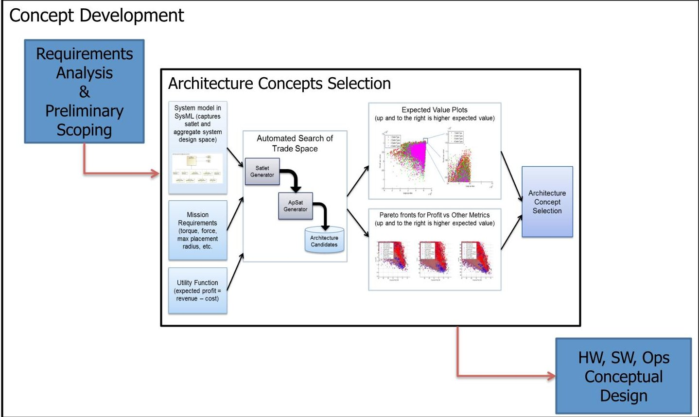

Figure 1. Satlet concept development

## A. Value-Based Objective

The main utility metric considered for our analysis was selected to be numerically grounded by a key consideration in the commercial realm, namely the expected value of the profit from a specified "mission" (operations of a repurposed aperture). The calculation of profit is comprised of three main components: (1) the total cost associated with the given satlet architecture and the given aggregate system, (2) a market projection, and (3) the (expected) revenue produced by the given satlet architecture and the given aggregate system in the specified market. While the satlet construct is being applied in a Government context (i.e. to support DoD communications worldwide), a value metric that can be measured against information that is available for comparison (the commercial market) was chosen in this initial analysis. This is illustrated in Figure 2.

<!-- PDF_PAGE: 8 -->

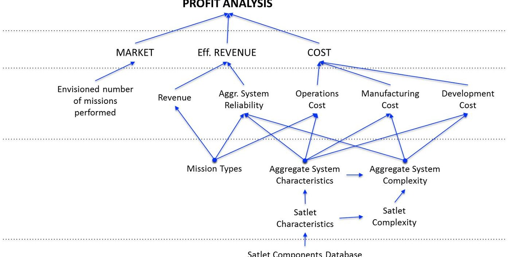

Figure 2: Profit analysis breakdown

Formally:

$$
\begin{array}{l} \Pi_ {i} = m _ {i} \left(E \left\{R _ {i} \right\} - C _ {i} ^ {R}\right) - C ^ {N R} \\ E \left\{R _ {i} \right\} = R _ {i} P s _ {i} \\ \end{array}
$$

Where $ \Pi_{i} $ is the expected profit for missions of type i, $ m_{i} $ is the number of specific missions of type i resulting from the market projection, $ R_{i} $ is the nominal maximum revenue from mission type i, $ P s_{i} $ is the probability of success of the specific architecture in providing the capabilities for mission type i, $ C^{NR} $ are the corresponding non-recurring development costs and $ C_{i}^{R} $ are the recurring costs including associated manufacturing costs, operations costs and launch costs. Operations costs and launch costs for this new cellularized spacecraft paradigm are uncertain; however, our initial assumption is that they would not be discernibly different between architectures. Therefore, they are not a strong discriminating factor for the purposes of our analysis and can be neglected (at least for the initial trade study).

The total non-recurring development cost for the architecture is based on three components:

$$
C ^ {N R} = \sum_ {v a r i a n t s} C ^ {D} + C ^ {P M S E} + p _ {2} \sum_ {v a r i a n t s} C ^ {A I T}
$$

This includes the development cost of each satlet variant $ C^{D} $ , an aggregate system level project management and systems engineering (PMSE) cost estimate $ C^{PMSE} $ and a percentage $ ( p_{2} ) $ of assembly, integration and test (AIT) cost $ C^{AIT} $ for each satlet type, assuming that some AIT

<!-- PDF_PAGE: 9 -->

elements do not have to be performed for every satlet instantiation but only once for each variant.

This model makes the important assumption of the aggregated value of satlet-based architecture: a significant fraction of the AIT costs are non-recurring, i.e., once the satlets were developed, the on-orbit "integration" or "assembly" cost of the aggregate system would be minor. Additionally, the AIT costs only partially affect the cost of every satlet built, because a large percentage of that cost is taken only once when developing the satlet type—not every time that an instantiation of the type is created.

The satlet level development cost, $ C^{D} $ is modeled using the satlet structural complexity (via a power law relationship). Software cost is included in this cost and is computed using a "source lines of code" calculation from the data Design Structural Matrix (DSM). The baseline PMSE cost, $ C^{PMSE} $ , equals the representative non-recurring funds provided by DARPA to one of the Phase 1 satlet performers (AFS with JPL), to support early-stage PMSE.

Each satlet's manufacturing cost is a function of the cost of its components and the individual AIT cost $ C^{AIT} $ . AIT costs are calculated from a power law relationship with complexity, and a baseline satlet AIT cost that is estimated from the labor hours of CubeSat test cases (more details on the Cost Model are provided in Section C). Labor hours were translated into AIT cost using Level 1, Level 2, and Level 3 engineer salaries charged by AFS. At the aggregate system level, AIT cost is also subject to a learning curve.

## B. Revenue Model

The revenues used during the exploration are from the perspective of a satlet producer and are estimates of what satellite customers would pay for the capability provided by a repurposed satlet-based system. (Note, in commercial markets revenue is accepted or collected more typically by "owner/operators" rather than the manufacturers of satellites.) Because of this selected perspective, the revenues are benchmarked to the cost of comparable satellite systems when this information is available. Also as part of the considered analyses, we looked at the sensitivity of the results to these assumed models because of the inherent uncertainty in predicting revenue. The nominal revenue values for mission types 1 (large aperture), 2 (small aperture), and 3 (attitude control of a large bus) would be as follows, assuming a year-long mission:

- Mission type 1 Revenue: $71.4 million

- Mission type 2 Revenue: $14.3 million

- Mission type 3 Revenue: $380 million

The revenue for mission type 1 is equal to the total cost of a known satellite, specifically a NASA Tracking Data and Relay Satellite (TDRS) satellite, approximately $500 million, divided by its average life (seven years). The revenue for mission type 2 is equal to the total cost of a representative telecomm satellite, approximately $100 million, divided by the average life of the satellite (seven years). The revenue for mission type 3 is equal to the operating profit that the representative telecomm company makes from one of their 12 satellites annually. For mission 3, it was assumed that the profit made by the telecomm company is based off of their satellites. With this thought process, the telecomm company would be willing to pay up to the profit made by each satellite to avoid lost capability.

<!-- PDF_PAGE: 10 -->

## C. Cost Model

A bottom-up approach to the cost model was developed for the satlet architectures. Although AIT and PMSE cost are typically estimated with parametric models such as the Small Satellite Cost Model (SSCM), our analysis drove us to a different, more detailed approach. The SSCM uses cost-estimating relationships (CERs), which are developed using historical data from completed satellites. Many models use CERs for each of the major subsystems (Attitude Determination and Control, Propulsion, Power, Telemetry, Tracking and Command, Structures, and Thermal), $ ^{2} $ where individual Phoenix satlets may not contain all of these subsystems. Simply leaving out the contribution of a particular CER is not prudent, as satlets may contain various numbers of components related to a particular subsystem (for example, all satlets may have processors or attitude rate sensors but might not all have actuation devices). Candidate satlets could be approximated using CERs, but many of the CER input parameters are outside of the valid range of the SSCM and other existing models.. Because of the expected size of Phoenix satlets, as well as the cellularized nature of the Phoenix aggregate systems, SSCM estimates are unrealistic for Phoenix satlet cost estimation.

Structural complexity has been found to scale with both AIT and PMSE cost with a power law relation $ ^{3} $ . The team chose to implement a structural complexity metric because it has been shown to be a predictor of development cost across several types of complex systems. The structural complexity metric used in the cost analysis contains three complexity factors:

$$
C = C _ {1} + C _ {2} C _ {3}
$$

$ C_{1} $ represents the complexity due to the number and flight readiness of the components, $ C_{2} $ represents the complexity due to pair-wise component interactions, and $ C_{3} $ represents the complexity due to the topology of the system architecture and the associated complexity of system integration, namely:

$$
C (n, m, A) = \sum_ {i = 1} ^ {n} \alpha_ {i} + \left[ \sum_ {i = 1} ^ {n} \sum_ {j = 1} ^ {n} \beta_ {i j} A _ {i j} \right] \gamma E (A)
$$

In Equation 4, n is the number of components, m is the number of interfaces, A is the Design Structural Matrix, $ \alpha $ is a function of Technology Readiness Level (TRL) as described by Equation 5, $ \beta $ is the complexity of each connection between pairs of components, $ \gamma $ is 1/n, and $ E ( A ) $ is the graph energy of the DSM. In our complexity analysis, items such as star trackers and thrusters were given higher values of $ \beta $ in comparison to those assigned to batteries, structural interfaces, etc. to reflect the extra software and integration effort that is required when these components are present in the system.

$$
\alpha = 5 \left(\frac {T R L _ {\max } - T R L}{T R L _ {\max } - T R L _ {\min }}\right)
$$

The power law relationship between complexity and development cost is given by Equation 6.

$$
Y = a X ^ {b}
$$

<!-- PDF_PAGE: 11 -->

This relationship was shown to reasonably predict the development cost of the two CubeSats for which we acquired detailed cost and architectural data, MotherCube (developed by AFS) and Armadillo (developed by the University of Texas). Figure 3 shows the predicted PMSE cost versus the actual PMSE cost for the two CubeSats, with $500K as a baseline PMSE cost for the aggregate system. As previously described, the $500K baseline represents the non-recurring Phase 1 PMSE costs for one of the satlet performers (AFS with JPL). For the AIT cost, a power law relationship is also used, but with a fixed AIT constant term of $60K based on CubeSat case studies, as previously described.

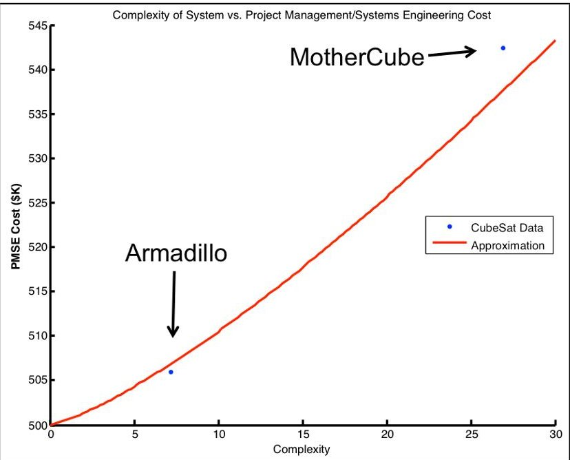

Figure 3. Relationship between complexity factor and PMSE cost

Before presenting the results from the implementation of the model, it is prudent to delve more deeply into the particulars of how the aggregate systems would be implemented to meet the primary requirements of repurposing an on-orbit aperture.

## D. Capturing Trade Space in SysML: Satlet and Aggregate System Model

The satlet and aggregate system model provides a structured description of the design space by capturing the relevant interactions at the functional level and the information specific to components. We have used the System Modeling Language (SysML) $ ^{4} $ to capture this information, leveraging JPL's Integrated Model-Centric Engineering (IMCE) framework $ ^{5} $ . The concept of operations description in the SysML model guides the conceptual thinking about the satlet trade space in terms of functional requirements and interface definitions throughout the life of the mission. The capability of each component in the trade space description maps to mission level behaviors in the Concept of Operations (ConOps)—we have defined this relationship as the functional capability of each component, decomposed from the top-level mission functions as shown in Figure 4. In this way, the ConOps provides the high level functional requirements for the initial trade space analysis.

<!-- PDF_PAGE: 12 -->

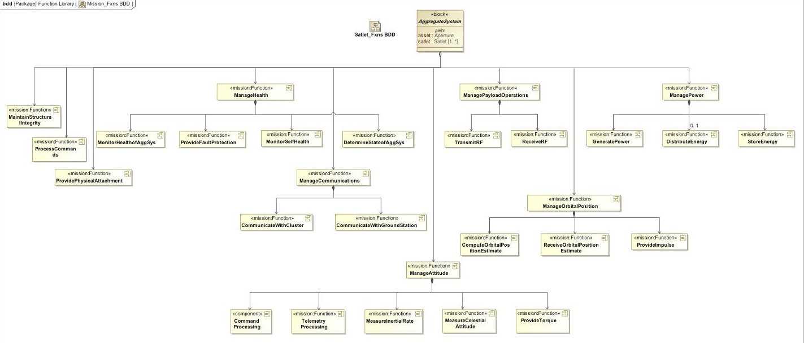

Figure 4. Functional decomposition of mission functions.

The ConOps covers the mission description from a satlet's perspective. It starts from satlet storage in preparation for launch and covers all mission milestones through decommissioning of the assembled aggregate system.

The architecture trade space description in the SysML model serves as the critical input to the trade space analysis. This part of the model holds the general definitions of the aggregate system, aperture, and satlets. It also holds the full inventory of satlet components currently considered (the 46 components) covering all functional satlet subsystems considered to support the stated mission of repurposing (e.g., avionics, power, etc.). Within the trade space, each component is mapped to mission level functions, which are specified in the ConOps model. From these very important relationships between components and mission functions, the trade analysis algorithms can compose various satlet designs (consisting of various aggregations of components) and aggregate system designs (consisting of various satlets and the repurposed aperture). The fulfillment of mission functions, as determined by the aggregation of components making up the satlets in each aggregate system, determines the validity and effectiveness of the aggregate system. (Note, the aggregation of functions by component is directly related to the components' stated operating behavior, and thus the aggregation may change depending upon the component characteristics.)

The function-to-component mapping in the SysML model is input into the trade analysis algorithm as a matrix of M components by N functions. Binary (0 or 1) entries within the array indicate whether a given component meets a given mission function. The component inventory from the SysML model is also input into the trade analysis algorithm as a matrix of M components by K component parameters (e.g., mass, power consumption, etc.). These two primary inputs from the SysML model can be modified or inspected in various SysML diagrams that relate to aggregate system definitions and satlet subsystem-centric component descriptions.

For example, Figure 5 shows how the aggregate system is defined in the SysML model. The aggregate system consists of a repurposed aperture and one to many satlets. This figure also shows the various mission functions seeded from the ConOps assessment. Figure 6 shows how a typical satlet subsystem's component trade space is captured. Each component contains its parameters (e.g. mass, power consumed, etc.), its multiplicity (how many of a given component can be on a single satlet), and mission function (whether or not it fulfills a mission function requirement). This figure also maps mission functions to mission behaviors in the ConOps.

<!-- PDF_PAGE: 13 -->

Component-centric trade space diagrams, such as Figure 6, exist for each satlet subsystem in the SysML model. The aggregation of this information is typically output as tables describing aspects of the trade space, such as the function-to-component mapping and the component-to-mass mapping.

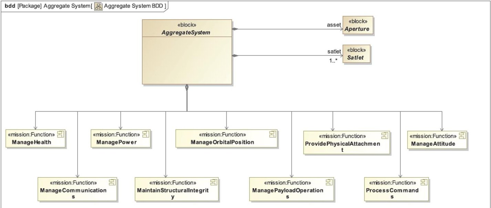

Figure 5. Definition of the aggregate system and mission functions in the SysML model. The mission functions are based on the ConOps model.

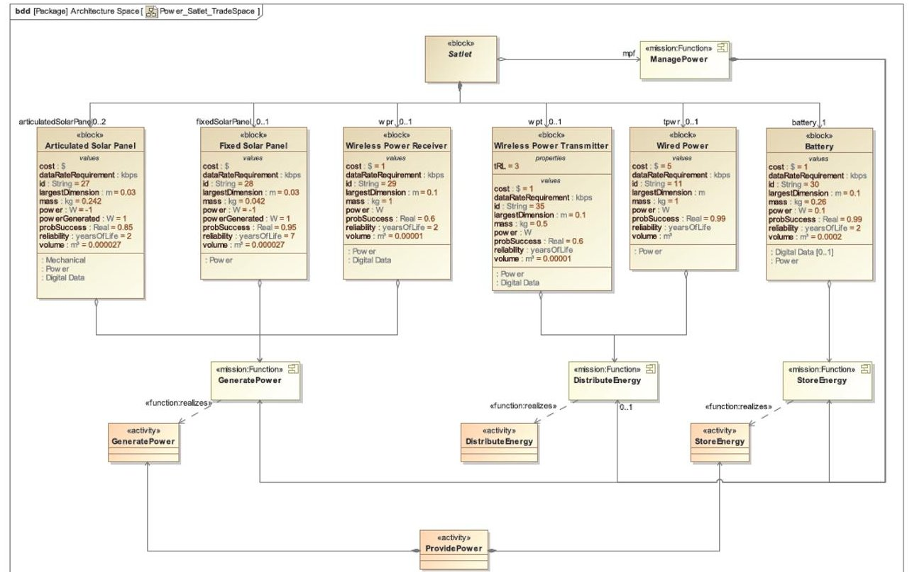

Figure 6. Satlet power subsystem component trade space in the SysML model. Component parameters and mapping to functions are captured for each component in the trade space model.

## E. Automated Trade Exploration

This section describes the automated trade exploration tool, its overall architecture, and the trade space exploration approach. This section is broken up into four parts—the first describes the tool architecture, the different components that make up the tool, and how they interact. The

<!-- PDF_PAGE: 14 -->

second describes our approach to satlet generation, i.e., creating the library of satlet types/variants. The third section describes our approach to composing the aggregate systems by selecting appropriate satlet types for accomplishing the specified mission. The fourth and final section describes our approach to sizing the aggregate system, i.e., choosing the number of each of the selected types to be included in a particular aggregate system instance.

Our approach, shown in Figure 7, includes:

(i) Capture of the satlet and aggregate system design trade space using the Systems Modeling Language (SysML);

(ii) Modeling of the contributions to a utility function (in this case, expected profit = revenue-cost);

(iii) Imposition of specific assumptions to limit the size of the state space and the complexity of the analysis;

(iv) Specification of mission requirements as parametric constraints on the set of acceptable solutions;

(v) Automated search of the trade space to generate Pareto-optimal satlet architectures that satisfy mission requirements while maximizing expected profit;

(vi) Comparison of Pareto fronts for the expected profit utility metric vs. other simpler metrics like mass and cost, to provide a sanity check on the results; and

(vii) Analysis of the sensitivity of the results to changes in satlet component parameters, mission requirements, and utility functions, to identify the key drivers for the architecture and to provide another sanity check on the results.

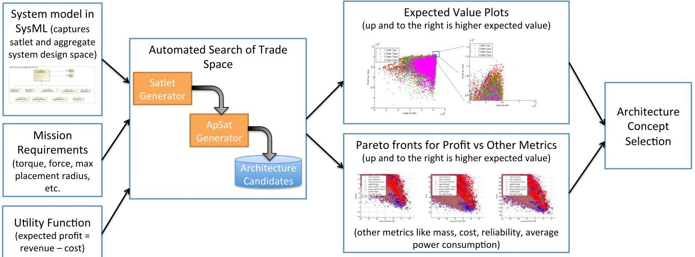

Figure 7. Overview of the architecture selection approach.

The tool is implemented as MATLAB code. MATLAB was chosen because of the capability of the language to express compactly matrix operations and to execute these operations efficiently. The exploration tool has several components, as shown in Figure 8.

<!-- PDF_PAGE: 15 -->

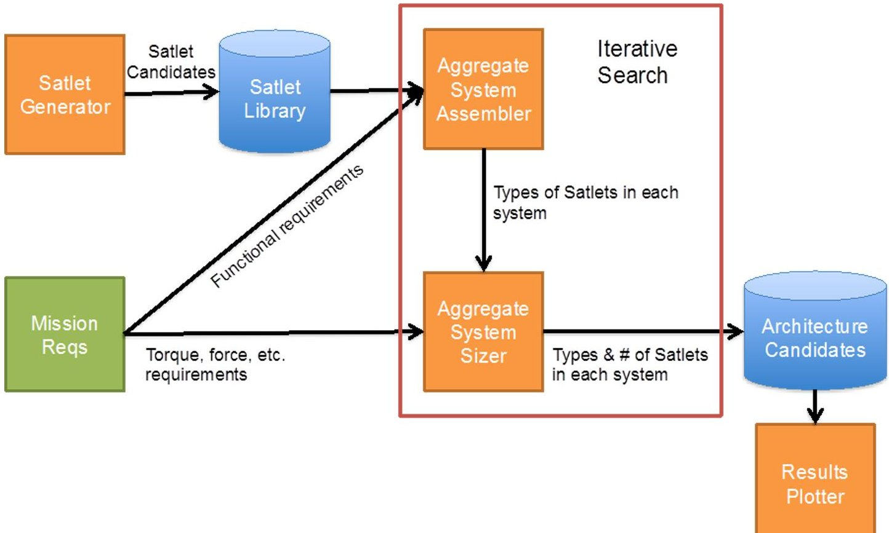

Figure 8. Overall Architecture Trade Tool Flow

## 1. Tool Architecture

The architecture exploration tool is broken up into several different components that interact by operating on common data structures. The first major component calculates mission requirements for the complete aggregate system. This includes such things as the translational thrust required for station keeping, the torque required for aperture pointing, and the angular momentum that needs to be de-saturated. These are chosen to be conservative upper bounds on these requirements to insure that the complete aggregate system has sufficient capability. In addition, delta V and total required propellant mass is calculated to provide a check on the assumption that the required propellant mass is small. The mission requirements are used during both the synthesis of candidate satlet solutions and the synthesis of complete aggregate systems. The satlet generation phase attempts to cover the span of possible satlet alternatives. Currently, the size of the potential satlet space is on the order of a hundred million satlet combinations. Most of these are not feasible combinations, with the current satlet library including approximately 700,000 "feasible" satlet combinations. The aggregate system space, on the other hand, cannot be exhaustively searched because of its size. Even when bounding the aggregate system search space to include a maximum of 4 satlet types, this still leaves $ 7 0 0 0 0 0^{4} $ options $ \sim2.4\mathrm{x}10^{24} $ . With the current analysis capability, the aggregate system search takes approximately 1 x $ 10^{-3} $ seconds for each alternative and therefore only a few hundred thousand aggregate systems were considered in this initial analysis.

## 2. Satlet Generation

Satlet generation is performed in two stages. The goal of the satlet generation process is to create a library of satlet options that can then be reused during any aggregate system level search. In the first step of satlet generation, the entire set of potential functional satlet variants is created based on the prescribed lower and upper bounds for each of the functions that a satlet can perform.

<!-- PDF_PAGE: 16 -->

Once the set of functional variants is generated, component realizations are generated by iterating through the set of functional variants and identifying all possible component combinations that can implement the specified functions. Each of these component realizations is stored in a satlet library for use during the aggregate system search phase. To reduce the memory used by the satlet library, filtering was performed at the satlet level to remove satlets that are either not realizable or unlikely to satisfy any mission requirements. For example, consider one of the initial assumptions described in Section II, which was used to help bound the trade space: a satlet must be self-sustaining during operation from a power perspective. Applying this particular assumption, and recognizing that there is a limited amount of solar panel area available on a satlet, this creates a restriction on the solar panel area that a satlet can require $ ( 0. 2 \mathrm{~ m}^{2} ) $ . Consequently, any satlets created with insufficient solar array size would be removed from the library. Similarly, we have made an assumption that all satlets are able to communicate with one another; consequently, the library would only include satlets with components needed to enable such inter-satlet communication.

## 3. Aggregate System Composition

Aggregate system composition occurs in two stages. First, a choice is made about the types of functional variants that will be included in the system. For example, at this stage a decision is made that the system will include a satlet type that provides impulse, etc. Once the functional satlet types are selected, a second step chooses specific satlet types that realize the prescribed functional variants, from the library developed in the Satlet Generation step. Both the functionality variants and component realizations are chosen at random.

A check is performed on the functional variants to insure that the satlets have the capability to perform all of the functions needed by the aggregate system. At this stage, the assumption is that if the functions are present on a given satlet, then they can be aggregated to perform the system level functionality. Note that, during this stage, the number of components needed to implement certain aggregate system functions is not considered; these types of checks are performed during the aggregate system sizing step.

Since the computational process used to assemble aggregate systems is based solely on a random seed, there is the possibility that the selected satlet functional variants are not capable of providing the required aggregate system functionality. In these cases, the aggregate system is adjusted by removing one of the chosen satlet types and replacing it with a more capable type able to account for the missing functionality.

## 4. Aggregate System Sizing

While the Aggregate System Assembly step chooses the types of satlets to be included in the system, the Aggregate System Sizing step chooses the number of each of the selected types to be included in a particular aggregate system instance. This number of satlets will change from mission to mission (for instance, results show that on average it takes more satlets to repurpose a larger aperture because of more significant attitude control requirements). The aggregate system sizing step begins by determining the required number of satlets with attitude control components that are needed to provide the translational thrust capability for station-keeping and torque capability for pointing. Once the station-keeping and pointing requirements are met, a check is performed on the number of attitude determination components inside the aggregated system to make sure the system can satisfy minimum sensing requirements. The reliability of the system is then calculated based on the reliability model, and additional satlets are added pseudo-

<!-- PDF_PAGE: 17 -->

randomly until the reliability of the system is above a prescribed threshold, currently 0.95. Once the final system has been sized, several metrics are calculated, such as total power usage, total solar panel area, total mass, and total cost.

## IV. Results

This section provides an overview of the results from the trade analysis. The sensitivity of the results to assumptions made about the component and AIT costs are also considered. In general, a heteregenous satlet architecture with a small number of specialized satlet types is found to be preferable. Because the functionality needed for each mission varies, different numbers of components would be needed in the final aggregate system. If components are bundled into a single satlet type, then in many cases a significant number of included components would be unneeded or overly redundant. However, further refinement of the types beyond a small number may be undesirable due to the fact that adding a new satlet type has some cost associated with it.

## A. Results Overview

This section presents an overview of the results. The results in this section use as a baseline a revenue model with two missions-one for a large 12m aperture (referred to as mission 1), and a second one for a smaller 2m aperture (referred to as mission 2). Figure 9 shows the general trade space distribution in the mission 1 profit vs. mission 2 profit space. This plot shows the profit distribution for solutions for the two different missions in terms of number of satlet types in the aggregate architecture. "Best" solutions are those that can provide a good profit for both mission cases (the pareto-optimal region at the top right corner of the trade space shown in Figure 9). Such solutions demonstrate mission flexibility, which is of value for a cellularized architecture because the same architecture can be customized and reused across multiple missions.

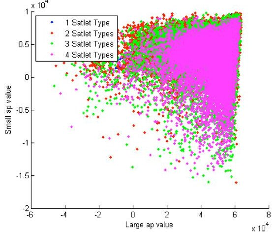

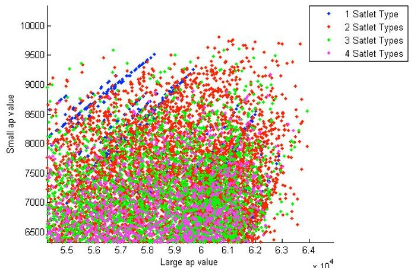

Figure 9. Two mission profit space showing the number of satlet-types in the architecture. The plot on the right shows a zoomed-in view of the upper right part of the plot on the left.

The results show that architectures that provide maximum benefit for both missions have two to three satlet types (note that the quoted number of satlet types is exclusive of any payload satlet types and connector satlet types). Usually, there is one satlet type that provides most of the attitude determination capability (in the form of star trackers and horizon sensors) and the heavy duty computing capability (e.g., in the form of flight processors and field programmable gate arrays). Usually, this satlet also carries an s-band antenna for the space to ground link. Another satlet type included in the architecture is an actuation satlet, which usually carries either small electrospray thrusters covering 2 degrees of freedom or reaction wheels. This actuation satlet type has some computing capability in the form of a flight processor and also has an integrated

<!-- PDF_PAGE: 18 -->

IMU. Although the component allocations may be slightly different, the satlet architectures in this region have a common breakdown, with the sensing components (star tracker and/or sun sensor) on a distinct satlet type. Most of the configurations are purely thruster-based although a few carry reaction wheels. For the architectures with 3 or 4 satlet types, the solutions usually include an additional satlet type that is purely for computing or ground to earth communications.

Furthermore, we note that architectures that are optimized for larger apertures tend to be overdesigned for smaller apertures, i.e., they require close to the same number of satlets for both missions. On the other hand, architectures that are optimized for small apertures but not for large apertures seem to require 3 times as many actuation satlets for the large aperture mission. By comparison, architectures that provide maximum benefit for both missions have intermediate thruster sizing requiring about 2 times the number of actuation satlets for the larger mission as compared to the small mission (namely about 6 for the small mission and about 12 for the larger mission).

Because of the assumptions used to scope the trade space and the automated exploration approach (Section II) and the inherent uncertainty in the inputs to the analysis, a number of sensitivity analyses were run to characterize how the solutions are affected by errors in our model and by relaxing certain assumptions. These sensitivity analyses provide an initial characterization of how the trade space changes in response to changes or uncertainty in the model and our input parameters; instead of trying to identify optimal solutions, our goal was to characterize the trends that appeared during the analyses. A description of several sensitivity analyses related to our cost model are covered in the next section.

Furthermore, several additional sensitivity analyses were run to understand the sensitivity of the results to changes and uncertainty in some of our assumed parameters, and to assess candidate satlet architectures against other engineering metrics. This includes the sensitivity to changes in the common failure mode parameter in the reliability model, the sensitivity to changes in the placement radius for the actuation satlets, the sensitivity of the solutions to the availability (or lack thereof) of emerging components (such as extremely small electrospray thrusters), and the sensitivity to the station keeping requirement. A significant trend seen across the set of sensitivity analyses is the apparent flexibility and robustness of architectures with two satlet types. In general, architectures with two satlet types remain in the pareto-optimal set across the sensitivity analysis cases because of the inherent flexibility in scaling the number of actuation satlets without incurring the cost of including expensive redundant components. For example, if we impose a geometric constraint on the satlet placement radius, the actuation satlets still appear but are more likely to carry reaction wheels instead of, or in addition to, the electrospray thrusters. Although there are a number of cases where architectures with one, three or four satlet types appear among the best solutions (and therefore represent promising architectures for the missions considered), there is always a significant concentration of architectures with two satlet types. Because of the inherent uncertainty in the parameters in our initial trade model, this suggests that architectures with two satlet types will likely be the most versatile and flexible.

The results of these analyses are consistent with engineering intuition, which leads us to consider the following principles:

1) For different missions, different satlet functions scale differently. For example, different missions might have different actuation requirements depending on the inertial properties of the aggregate system, and therefore would require more or less actuation capability from the set of satlets. On the other hand, the capability required from other functions, such as space to ground communication, may remain the same, independent of the inertial properties of the system.

<!-- PDF_PAGE: 19 -->

2) Certain functions require geometric distribution, while others do not. For example, an aggregate system with significant inertial properties may require large separation of thrusters to achieve the required moment arms for control, whereas the attitude sensing or computation resources require no such geometric dispersion.

## B. Cost Trades

Because the assembly, integration and testing (AIT) cost is based on the predicted complexity of a particular architecture, it is difficult to verify. Therefore, the sensitivity of the solutions to the predicted AIT cost is considered. The AIT cost includes a learning factor; that is, the more satlets of the same type, the lower the AIT cost. If the assumed AIT costs are 3 times larger than our nominal model, architectural solutions with 3 satlet types start to become less optimal, though solutions with 2 satlet types are still dominant (see Figure 10). Furthermore, if AIT costs elevate to 10 times larger than our nominal model, solutions with a smaller number of satlet types, including homogenous architectures, are favored, though very few solutions are likely to be profitable (see Figure 11).

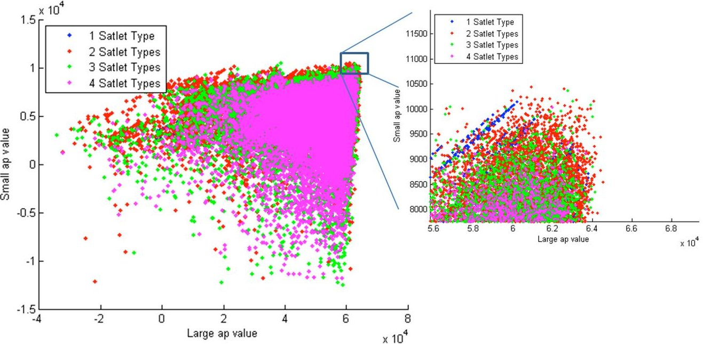

Figure 10. Two-mission profit trade space when AIT costs are 3 times the nominal model.

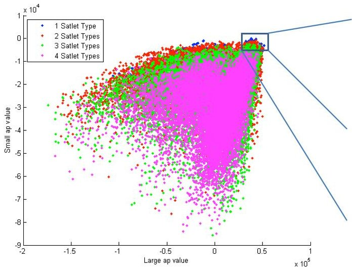

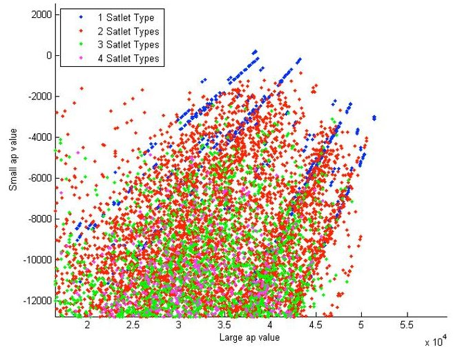

Figure 11. Two-mission profit trade space as AIT costs are 10 times the nominal model. With high AIT cost, profit for small missions is unlikely.

<!-- PDF_PAGE: 20 -->

In general, however, a fundamental principle of celluralized architectures is that AIT and component costs can be reduced through mass production. Additional analyses were run to understand the impact of decreasing AIT and component costs as a potential result of mass production. If AIT costs are significantly reduced to account for the impact of utilizing automated assembly-line type techniques (or other clever methods), then further specialized satlets are more valuable (as shown in Figure 12). If, on the other hand, components can be made significantly cheaper without significant effect on AIT, then the results favor homogenous designs because of the reduced cost of carrying redundant components (as shown in Figure 13). In our analysis, a breakeven point (where architectures with one satlet type and architectures with two satlet types provide comparable value) occurs when components are reduced to 30% of the cost while AIT remains the same, as is qualitatively shown in Figure 14, which shows roughly the same number of preferred architectures with one and two satlet types. At this point, the additional cost of carrying redundant components in a single-satlet-type architecture is approximately equivalent to the additional AIT costs of architectures with multiple types.

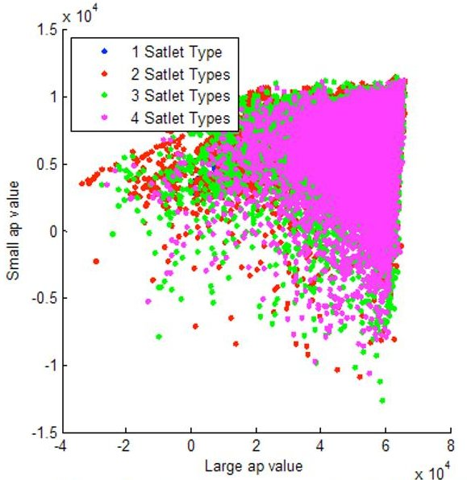

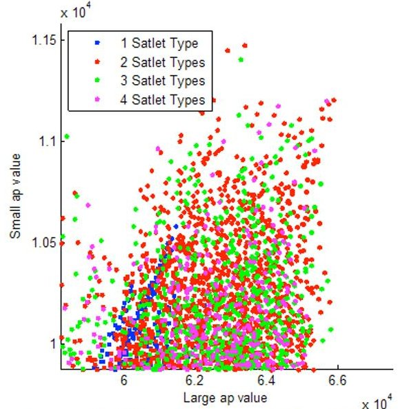

Figure 12. Results of the trade space analysis if the AIT costs are significantly lowered (to 10% of the nominal value)

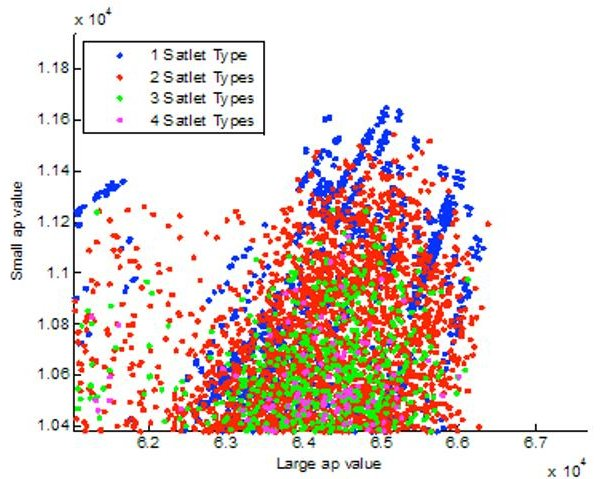

Figure 13. Results of the trade space analysis if AIT costs remain at nominal levels but component costs are significantly reduced (to 10% of nominal values).

<!-- PDF_PAGE: 21 -->

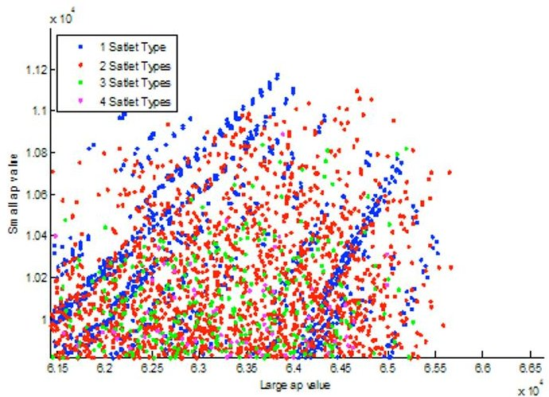

Figure 14. In our analysis, one breakeven point between homogeneity and heterogeneity occurs when AIT costs remain at nominal levels but the component costs are reduced to 30% of original value.

If the expectation is that both AIT and component costs would be reduced, then it is likely that the overall impact would not significantly alter the trade space. Figure 15 shows the trade space when both AIT and component costs are reduced to 30% of their original value. To get a better sense of the similarity between the preferred architectures for this case and those for the nominal case shown in Figure 9, our analysis tools enable us to select a region of the plots and then provide information on the architectures within that region, such as the distribution of components on each satlet type and the number of satlets of each type needed for each mission. For example, the figure on the right shows the different actuation components included in each satlet architecture. The satlet types from the preferred architectures that result from this case are very similar to those that result from the nominal case; they retain the same division of functionality between the satlet types and actuators present in the actuation satlet.

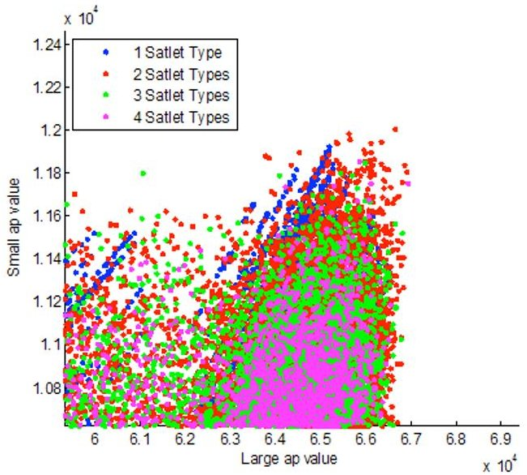

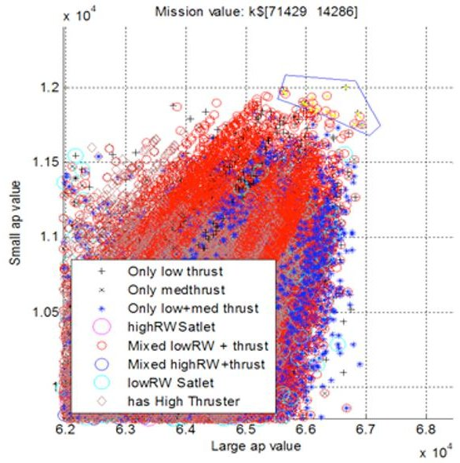

Figure 15. Results if both the AIT and Component costs are reduced to 30% of original value. These results show that if both AIT and component costs decrease at similar rates,the overall tradeoff is not impacted.

Also, in the nominal cost model there is no value assigned to the launch cost because the assumption is that with emerging technology, launch costs would be significantly cheaper than current traditional methods. If a more conventional launch cost model were used (for instance the cost of being launched aboard a SpaceX Falcon-9), then the cost savings resulting from

<!-- PDF_PAGE: 22 -->

launching less redundant mass in heterogenous architectures would become a larger driver—as seen in Figure 16.

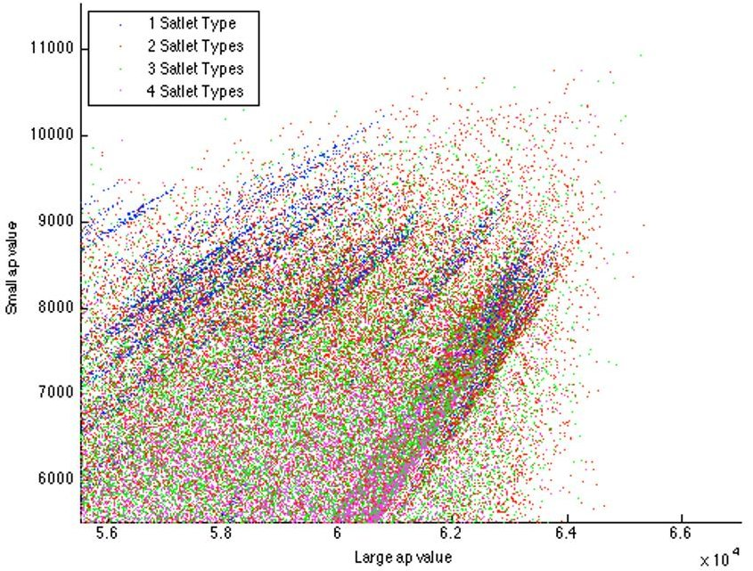

Figure 16. Results using a more traditional launch cost model.

## V. Future Work

As expected, initial rigorous analysis of the satlet architecture trade space has highlighted many interesting design trades that are worthy of more study. For example, our trade space analysis focused on the repurposed aperture and satlet elements of the Phoenix architecture. The scope of the analysis could eventually be extended to consider design trades for the other mission elements, such as the POD (Payload Orbital Delivery system that enables satlets to be carried into orbit as a ride-along payload hosted on a GeoSat launch), the Servicer/Tender, the robotic end-effector tools or the ground stations. Of particular interest would be the functionality tradeoffs between satlets and these other elements. Also, the limitations on packing volume, location and spacing of the satlets in the POD (as a separately launched entity) is expected to impose different constraints on the satlets which may influence some of the results presented, and will be investigated further.

Additionally, some parts of the functional space (e.g., telecommunications functions and components, thermal control functions and components) have not been explored at the same level of detail as the propulsion/ACS functions, power management functions, and command and data handling functions, for example. We are beginning to focus more attention on these other functions in the detailed design phase, currently underway.

Future work plans to consider opening up the input parameters for satlets to see what functions could be considered game changing (possibly showing functional spaces for satlets that do not exist using conventional satellite design assumptions). As an example, the thermal influence on tighter packed systems, like new configurations with other payloads or in the POD, is likely to have an influence on the architecture. Another example is expanding the set of considered satlet components to look beyond the traditional satellite parts that are in use today.

Another area that was not addressed in detail is the design of the software architecture for the satlets. For example, there are very interesting trades between the complexity of the software architecture, and the performance, reconfigurability, and robustness of the resulting aggregate systems. This is a crucial area that is an important consideration during the detailed design phase.

<!-- PDF_PAGE: 23 -->

Finally, another potential focus of future study is the examination of satlet architectures for drastically different mission types, such as optical telescopes or deep space robotic spacecraft. How much value does the Phoenix mission satlet architecture provide in the context of a brandnew mission? Would it be preferable to simply create new satlet types for such new missions, or is it satisfactory to leverage the existing architecture by making minor modifications to the existing satlet types and associated product lines?

## VI. Conclusion

Based on our modeling of the satlet architecture trade space, and given our assumptions, the analysis has driven us to a general design philosophy that recommends the development of satlets with the major functions allocated to the following different types:

- A central satlet type with components for computation and data processing, centralized attitude sensing and ground communication;

- A satlet type that provides actuation in the form of either reaction wheels or thrusters, as well as local computing resources and local attitude rate sensing in the form of an IMU.

In addition, we would include in the architecture the following additional satlet types to complement the two primary satlet types:

- a payload satlet type to provide any specialized functionality for a particular mission (e.g., an RF transceiver);

- "connector" satlet types that provide structural, mechanical, and power interfaces between other satlets.

Additional specific results from the analysis can be summarized as follows:

- Our modeling task concludes that given the exponential behavior of the cost vs. complexity, there is a benefit in reducing complexity by developing simpler satlet-level heterogeneous designs. Simplicity at the satlet level can still result in the required aggregate system behavior, which is the true goal of a satlet-based system architecture.

- The analysis of the pareto fronts of profit for different missions suggests that the actuation functionality should be separated from the centralized attitude sensing and ground communication functionality. This satisfies our engineering judgment; depending on the size of the aperture being repurposed, we may need many distributed actuators, but only a small number of attitude sensors and communication nodes with the ground.

- An important result of the analysis is that the Satlet-level Assembly, Integration and Testing (AIT) costs are a driving parameter in selecting the appropriate level of heterogeneity in the architecture. The AIT cost component is expected to be highly driven by the complexity of the individual satlets. High AIT cost, as compared to the cost of the components, would lead to less diverse types of satlets, because the costs of flying unnecessary redundancy would be overcome by the reduction in testing of separate types of satlets. However, for reasonable AIT cost levels, it is found that more benefit is achieved by reducing complexity at the satlet level, through some degree of heterogeneity.

<!-- PDF_PAGE: 24 -->

It should be noted that, even though we have converged on a satlet architecture that has several specific types, we are still advocating for the adoption of a flexible design paradigm. When multiple satlet types share some common functions, it may make sense to develop a common module for this function, and then leverage the commonality and reuse enabled by this module in the design of our satlet types. For example, we envision value in having a common structural and/or electronics platform ("satlet avionics module") that could then be combined with other modules to provide the full functionality required by the satlet type. Another example would be a flexible actuation satlet type that could be customized using modular thruster or reaction wheel components, depending on the mission.

## Acknowledgments

The work described in this paper was performed in part at the Jet Propulsion Laboratory, California Institute of Technology, under a contract with the Defense Advanced Research Projects Agency. The views expressed are those of the authors and do not reflect the official policy or position of the Department of Defense or the U.S. Government. The authors would like to thank James Henrickson for his valuable contributions in proofreading and formatting this paper.

## References

$ ^{1} $ Barnhart, D., Hill, L., Turnbull, M., and Will, P., "Changing Satellite Morphology through Cellularization", Proceedings of the AIAA Space Conference 2012, Pasadena, CA.

$ ^{2} $ "SSCM Overview." Aerospace: Assuring Space Mission Success. The Aerospace Corporation, n.d. Web. 10 Dec 2012. <http://www.aerospace.org/expertise/technical-resources/small-satellite-

$ ^{2} $ "SSCM Overview." Aerospace: Assuring Space Mission Success. The Aerospace Corporation, n.d. Web. 10 Dec 2012. <http://www.aerospace.org/expertise/technical-resources/small-satellite-cost-model/sscm-overview/>.

$ ^{3} $ Kaushik Sinha, Denman James and Olivier de Weck. (2012) Interplay between product architecture and organizational structure. Proceedings of the 14th International DSM Conference ISBN: 9783446433540.

$ ^{4} $ Friedenthal, S., Moore, A., and Steiner, R., A Practical Guide to SysML: The Systems Modeling Language, Morgan Kaufmann Publishers / OMG Press, 2008.

$ ^{5} $ Bayer, T., Cooney, L., Delp, C., Dutenhoffer, C., Gostelow, R., Ingham, M., Jenkins, J.S., and Smith, B., "An Operations Concept for Integrated Model-Centric Engineering at JPL", Proceedings of the IEEE Aerospace Conference 2010, Big Sky, MT, March 2010, IEEEAC Paper #1120.