<!-- PDF_PAGE: 1 -->

# Model Based Systems Engineering (MBSE) Applied to Radio Aurora Explorer (RAX) CubeSat Mission Operational Scenarios

Sara C. Spangelo James Cutler University of Michigan 1320 Beal Street Ann Arbor, MI 48104 saracs@umich.edu jwcutler@umich.edu

Louise Anderson

Elyse Fosse

Leo Cheng

Jet Propulsion Laboratory

California Institute of Technology

4800 Oak Grove Drive

Pasadena, CA 91109

louise.anderson@jpl.nasa.gov

elyse.fosse@jpl.nasa.gov

leo.y.cheng@jpl.nasa.gov

Chris Delp Bjorn Cole Jet Propulsion Laboratory California Institute of Technology 4800 Oak Grove Drive Pasadena, CA 91109 chris.delp@jpl.nasa.gov bjorn.cole@jpl.nasa.gov

Grant Soremekum Phoenix Integration 1715 Pratt Drive, Suite 2000 Blacksburg, VA 24060 grant@phoenix-int.com

Rose Yntema

Manas Bajaj

InterCAX

75 Fifth Street NW, Suite 312

Atlanta, GA 30308

rose.yntema@intercax.com

manas.bajaj@intercax.com

David Kaslow Analytical Graphics 220 Valley Creek Blvd. Exton, PA 19341 dkaslow@agi.com

Abstract—Small satellites are more highly resource-constrained by mass, power, volume, delivery timelines, and financial cost relative to their larger counterparts. Small satellites are operationally challenging because subsystem functions are coupled and constrained by the limited available commodities (e.g. data, energy, and access times to ground resources). Furthermore, additional operational complexities arise because small satellite components are physically integrated, which may yield thermal or radio frequency interference.

In this paper, we extend our initial Model Based Systems Engineering (MBSE) framework developed for a small satellite mission by demonstrating the ability to model different behaviors and scenarios.

We integrate several simulation tools to execute SysML-based behavior models, including subsystem functions and internal states of the spacecraft. We demonstrate utility of this approach to drive the system analysis and design process. We demonstrate applicability of the simulation environment to capture realistic satellite operational scenarios, which include energy collection, the data acquisition, and downloading to ground stations.

The integrated modeling environment enables users to extract feasibility, performance, and robustness metrics. This enables visualization of both the physical states (e.g. position, attitude) and functional states (e.g. operating points of various subsystems) of the satellite for representative mission scenarios.

The modeling approach presented in this paper offers satellite designers and operators the opportunity to assess the feasibility of vehicle and network parameters, as well as the feasibility of operational schedules. This will enable future missions to benefit from using these models throughout the full design, test, and fly cycle. In particular, vehicle and network parameters and schedules can be verified prior to being implemented, during mission operations, and can also be updated in near real-time with operational performance feedback.

## TABLE OF CONTENTS

1 INTRODUCTION ... 1

2 MBSE AND SYSML ... 2

3 CUBESATS ... 3

4 MODEL-BASED ENGINEERING ENVIRONMENT. 5

5 RAX CUBESAT MISSION ... 5

6 ANALYTICAL MODEL AND RESULTS ... 7

7 CONCLUSION ... 13

    ACKNOWLEDGMENTS ... 16

    REFERENCES ... 16

    BIOGRAPHY ... 17

## 1. INTRODUCTION

## MBSE Applied to CubeSats

This paper extends the work reported in our 2012 IEEE Aerospace conference paper [1], which reported on using Model Based Systems Engineering (MBSE) and the Systems Modeling Language (SysML) to model a standard CubeSat, and applied that model to an actual CubeSat, the Radio Aurora Explorer (RAX) mission [2], [3].

A CubeSat is a type of miniaturized satellite with a standard form factor based on standardized cubes with a size of $ 1 0^{3} $ $ \mathrm{c m}^{3} $ and weighing less than one kilogram. CubeSats typically consist of one to three cubes.

RAX is the first CubeSat funded by the National Science Foundation (NSF) [4]. It is a space weather mission designed to study plasma field-aligned irregularities in the ionosphere. It has enabled undergraduate students, graduate researchers, engineers, and scientists to be involved in the design, building, and operations of two spacecraft (RAX-1 and RAX-2).

<!-- PDF_PAGE: 2 -->

## INCOSE MBSE Challenge Project

This project is a key part of the International Council on Systems Engineering (INCOSE) MBSE Challenge project. The Challenge project was initiated at the January 2007 INCOSE International Workshop [5]. The MBSE Roadmap, Figure 1, was created to define the high-level, long term vision for the maturation and acceptance of MBSE across academia and industry.

Several MBSE Challenge teams were established to promote MBSE, advance the state of practice, and share lessons learned related to a diverse range of:

- MBSE applications

- Model scope

- Model quality and robustness

- Modeling standards

- MBSE process, methods, tools, and training

## Space Systems Challenge Team

The INCOSE Space Systems Working Group (SSWG) established the Space Systems Challenge team. The Challenge team initially included aerospace students and professors from Massachusetts Institute of Technology and Georgia Institute of Technology. The initial focus was on the modeling of a hypothetical FireSat space system [6]. FireSat is a low Earth orbit (LEO) satellite for detecting, identifying, and monitoring forest fires. This representative, however nonrealistic, textbook example was used in order to sidestep the challenges of working with International Traffic in Arms Regulations (ITAR) in an international collaboration. This space system is used as an example in the widely used and accepted Space Mission Analysis and Design (SMAD) textbook [6]. Much was learned from modeling FireSat.

Our follow-on CubeSat project was initiated in April 2011 to model an actual space system, a standard CubeSat, with the RAX satellite being the point design.

The team now includes University of Michigan Aerospace graduate students and a departmental professor; the INCOSE SSWG, including engineers from NASAs Jet Propulsion Laboratory (JPL) and from modeling and simulation tool vendors InterCAX, Phoenix Integration and Analytical Graphics, Incorporated.

The collaborative environment includes a CubeSat - MBSE Google group, a MBSE Google documents collection, a No Magic Teamwork server for SysML modeling, and biweekly/weekly Web conferencing.

## Advancement and Demonstration of MBSE State of Practice

Our Challenge team and project was created to assess, advance, and demonstrate the application of MBSE to a realistic mission in the space systems domain.

- MagicDraw

We are developing a SysML modeling framework and Model Based Engineering Environment for developing CubeSat models. The models formally describe the RAX mission using a domain specific extension of SysML made especially for CubeSat modeling. This environment incorporates several commercial off-the-shelf (COTS) tools:

- Cameo Simulation Tool Kit

- ParaMagic

- Systems Tool Kit

- PHX Model Center

- MATLAB

- We have built analysis models that analyzes the RAX system model to analyze:

- Solar energy collection and subsystem power consumption

- Communication subsystem signal to noise ratio

- Activity flow including behaviors and interactions

## 2. MBSE AND SYSML

MBSE is the formalized application of modeling to support system requirements, design, analysis, optimization, verification and validation, beginning in the conceptual design phase, continuing throughout development and into later life cycle phases including operations [7], [8].

One of the goals of MBSE is to transform the application of systems engineering by integrating information communication and analysis of systems engineering products. This goal is simply not possible in the current document-centric enterprise and thus we intend to replace it with a model-based approach.

Our application of MBSE uses SysML as the modeling language for formally describing and specifying the system. SysML is a graphical modeling language for modeling systems. It is used to specify, analyze, design, optimize, and verify systems and their hardware and software components. SysML was developed by INCOSE and the Object Management Group (OMG) [9].

Figure 2 illustrates the SysML diagram types. A system is described in terms of:

- Structural models illustrating the constituent elements of a system and their connections (using block diagrams).

- Behavioral activity and state models describing operational behaviors.

- Parametrics definitions for operational constraints and acausal behaviors specified by values and/or equations.

- Requirements text based requirements in the model that can be traced to design, analysis, and verification elements.

SysML is used to formally specify all aspects of a system either directly or by interfacing with other models. It enables systems engineers to create and evolve models in an integrated, collaborative, and scalable environment. It enables building models that can be used in early design stages that can support specification and design updates. Using models to define, develop, and ultimately operate a system is known as "Develop With What You Fly With" (DWWYFW) [8].

<!-- PDF_PAGE: 3 -->

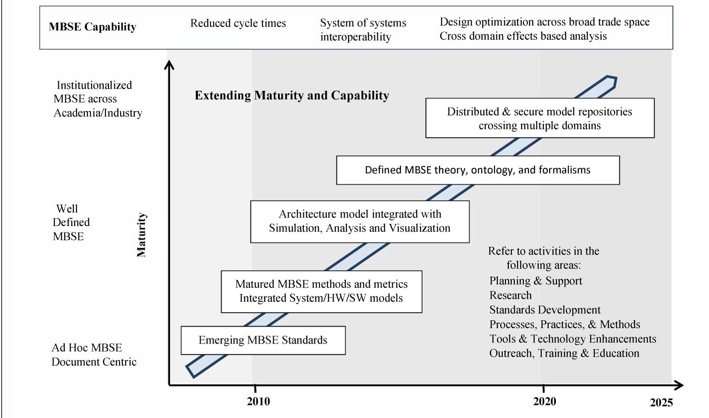

Figure 1. MBSE Roadmap

Figure 3 illustrates that the MBSE environment is an integration of modeling tools and design tools along with viewing and report generation tools. This integration facilitates the analysis of alternative design models, and supports robust design optimization.

The ability to integrate, collaborate, and scale is centered around having a model repository. The repository is an information resource that is accessible through basic webbased technologies in addition to desktop applications. A variety of model editors can be integrated with such a repository, enabling engineers of all disciplines to collaborate. This integration is facilitated by the use of standard SysML approaches. Using Internet technologies to implement this approach provides a nearly unlimited ability to scale.

## 3. CUBESATS

CubeSats are a type of low-cost, standardized nanosatellite that consists of one or more units (Us). A 1U is a cube $ 1 0 \mathrm{c m}^{3} $ on a side and approximately 1 kg [10]. These small satellites are typically launched as secondary payloads. They have enabled the university community to design, build, and launch satellites using primarily COTS components. More recently, the worldwide community has adopted the CubeSat standard as a means of performing novel scientific, surveillance, and technology demonstration missions at significantly reduced cost and with short development timelines.

## Current Approach to CubeSat Design

The current approach to design vehicles and perform operational planning for CubeSat missions is largely intuitionbased, and often relies on simplified trade-studies that do not explore the complete design space [6]. Furthermore, ad-hoc and often unverified approaches are used to combine multiple simulation environments that often critical neglect elements of the mission dynamics. Designing the satellite at an early development stage and neglecting key operational parameters (because they are often unknown or not modeled)can be problematic because decisions made in early design stages can have a significant impact on mission operations. For example, if a battery is sized prior to performing operational simulations, it may be of insufficient capacity to sustain the satellite throughout extended eclipse durations and thus the spacecraft may not be able to satisfy mission operations requirements.

## MBSE Approach to CubeSat Design

Our 2012 IEEE Aerospace conference paper delineated the CubeSat modeling objectives [1].

The current modeling effort is well under way, and we have accomplished many of the early work objectives. Our overall plan is to develop a CubeSat model development kit for the CubeSat community that will include (some of which have already been accomplished):

- A CubeSat meta-model describing CubeSat specific concepts and a modeling framework. The framework provides SysML structural and behavior models for the:

<!-- PDF_PAGE: 4 -->

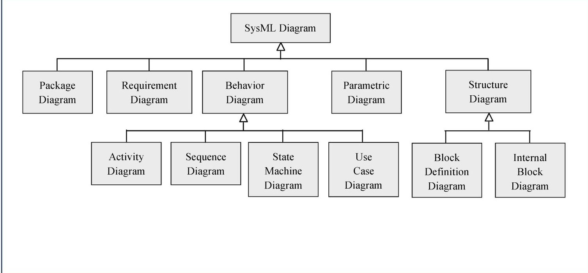

Figure 2. SysML Diagram Types, $ \textcircled{c} $Sanford Friedenthal, Elsevier Inc., 2012. All Rights Reserved

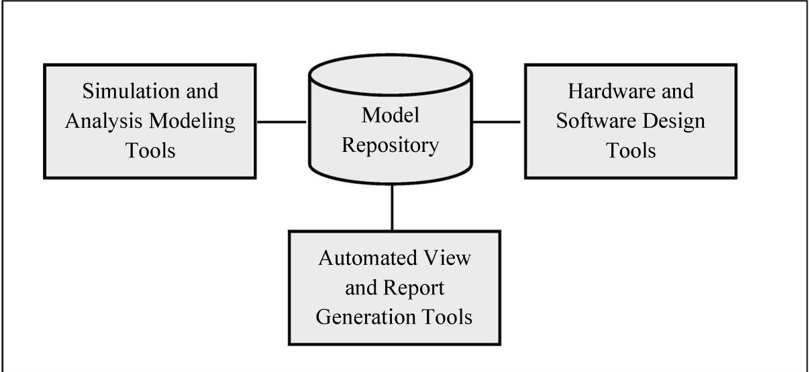

Figure 3. Model-Based Engineering Environment

- Mission:

* Mission elements which are systems that achieve the mission objective

* Mission environment, e.g. space particles and fields as well as Earths atmosphere layers and magnetic fields

- Flight system

- Ground system

- An example CubeSat model that existing and future teams can use as a template for describing and modeling their own satellites, optimizing satellite design, and evaluating mission operations.

- The model will include:

- The entire satellite mission including flight system, ground system, and targets of interest

subsystems, and components and their interfaces

- Key satellite structural components, including systems,

- Key satellite system and subsystem behaviors

- Key satellite constraints and measures of effectiveness

The model will provide the techniques to interface CubeSat SysML models with a diversity of COTS modeling analysis, and visualization tools. These tools can be used to extract the necessary information to solve a problem or analyze a relevant part of the system and then integrate the information/solution back into the mission specification. For example, an optimization algorithm may have as inputs the satellite position and opportunities to collect energy and data and output an operational schedule that can be interfaced with the exectue SysML model.

The model will enable verification that design updates comply with mission requirements. The model also helps effectively communicate design updates to all engineers working on the mission.

Ultimately the models will be used by mission operators

<!-- PDF_PAGE: 5 -->

to evaluate mission plans, generate schedules, and generate operational strategies that considering dynamic states such as satellite position, attitude, on-board energy, data, and thermal states. This is of paramount importance when responding to satellite component degradation and anomalies.

## 4. MODEL-BASED ENGINEERING ENVIRONMENT

A key capability of a so-called model-based engineering environment is the integration of modeling applications, repositories, and analysis applications. Figure 3 illustrates such a representative environment, which enables us to analyze and optimize system performance. The simulation environment brings to life the models described in the previous section, where various aspects of the system model, such as parametrics, activities, and state machines, can be executed.

- MagicDraw $ ^{\textcircled{R}} $ from No Magic is a graphical SysML modeling tool that enables the analysis and design of systems using standardized databases

- Conventional approaches for small spacecraft design and operational planning often consist of simulators that are "hacked" together in an ad-hoc manner, or require manual and time-consuming tasks to pass information between simulators. Unlike these approaches, our simulation environment supports the automated flow of information between simulators, enabling users to easily evaluate different design configurations or reconfigure the analysis for different mission scenarios in a rapid and convenient way.

- Cameo Simulation Toolkit $ ^{\textcircled{R}} $ (CST) from No Magic is an orchestrated heterogeneous simulation environment. CST integrates fUML, SCXML, and the Java math engine ot provide a coordinated analysis of a SysML model. It enables different MBSE behavioral models such as SysML State Machines and Activity Diagrams to be executed within MagicDraw.

- Next we list and describe the modeling and analysis applications in our MBSE environment that are used to develop and execute models:

- STK $ ^{\textcircled{R}} $ from Analytical Graphics, Incorporated (AGI) is a tool that supports high fidelity simulation and visualization of satellite behavior including orbital dynamics and satellite subsystems models for power, thermal, sensors, attitude control, and telemetry.

- MATLAB $ ^{\textcircled{R}} $ provides powerful numerical computing for evaluating functions, executing algorithms, and plotting results. MATLAB can also interface with other optimization toolboxes and solvers.

- ParaMagic $ ^{\textcircled{R}} $ is a SysML parametric solver and integrator for MagicDraw. It enables the execution of SysML parametric models and performing system trade studies through all stages of system development. ParaMagic can execute mathematical constraint relationships or wrap externally-defined models such as MATLAB/Simulink $ ^{\textcircled{R}} $ Mathematica $ ^{\textcircled{R}} $ , or Excel. ParaMagic leverages the acausal nature of SysML parametric relationships to execute models in different causalities, i.e. change inputs and outputs onthe-fly. It can detect and solve complex SysML block and parametric model structures, such as complex aggregates, recursion, and property and constraint redefinitions in the model hierarchy. Equivalent tools Melody $ ^{\textcircled{R}} $ , Solvea $ ^{\textcircled{R}} $

and ParaSolver $ ^{\textcircled{R}} $ are available for Rhapsody $ ^{\textcircled{R}} $ , Enterprise Architect $ ^{\textcircled{R}} $ , and Artisan Studio $ ^{\textcircled{R}} $ , respectively.

- PHX ModelCenter $ ^{\textcircled{2}} $ allows users to create and execute simulation workflows by integrating various types of simulation models, including Excel spreadsheets, STK scenarios, and Matlab scripts. Once a simulation workflow is created, PHX ModelCenter executes the workflow, automatically transferring data between the simulators. Users are able to execute multi-run studies by employing a rich set of trade study algorithms, optimization tools, and reliability analysis. PHX ModelCenter can also be used to execute parametric models developed in MBSE tools like MagicDraw and Rhapsody, enabling the user to evaluate performance and verify requirements throughout the design process.

This diverse set of modeling and analysis applications covers a broad range of capability for building and analyzing models with a particular emphasis on model and analysis integration. This integration capability is key to building a scalable model-based engineering environment that can support the full life-cycle of MBSE on a spacecraft development program.

Several diverse tools were used to demonstrate how diverse tools could be integrated into a common framework. Note that a different or smaller set of simulation or calculation tools could be utilized to accomplish similar goals.

## 5. RAX CUBESAT MISSION

## Mission Description

RAX is a space weather mission designed to study plasma field-aligned irregularities in the ionosphere [2], [3]. RAX performs experiments using a bi-static radar configuration which utilizes a high-powered ground-based radar station. The primary station is PFISR, located in Poker Flat, Alaska, as shown in Figure 4. The ground-based radar sends a high-powered signal that reflects off the irregularities and are measured by RAX. Highly accurate on-board timing and position is provided by a GPS receiver, which are required to satisfy the mission requirements. Rough timing is provided by on-board clocks and rough position knowledge is provided by ground-based tracking systems, which is necessary for operations not related to science experiments.

RAX is passively magnetically aligned with the Earth's magnetic field using on-board fixed magnets, as shown in Figure 5. Spacecraft attitude oscillations are dampened with hysteresis material. This type of attitude control system enables RAX to have its experimental (which are also used for communication) antennas pointed towards the Earth when it passes over the experimental zone near the North Pole. Furthermore, the GPS antenna was installed on the satellite face opposite the experimental antenna, is orientated towards the GPS constellation during experiments, when accurate timing and position is critical.

RAX-1 was launched in October of 2010 and RAX-2 was launched in November of 2011. At the time of writing (January 2013) RAX-2 is performing experiments and being operated on a daily basis from the command station at the University of Michigan in Ann Arbor and downloading to ground station partners located around the world.

<!-- PDF_PAGE: 6 -->

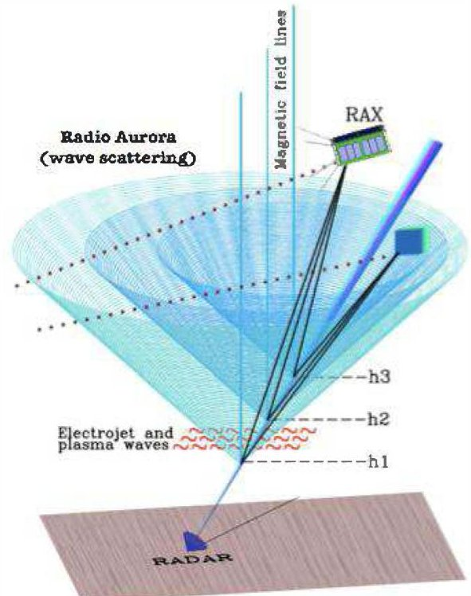

Figure 4. Radio Aurora Explorer (RAX) CubeSat Mission Bistatic Radar Configuration

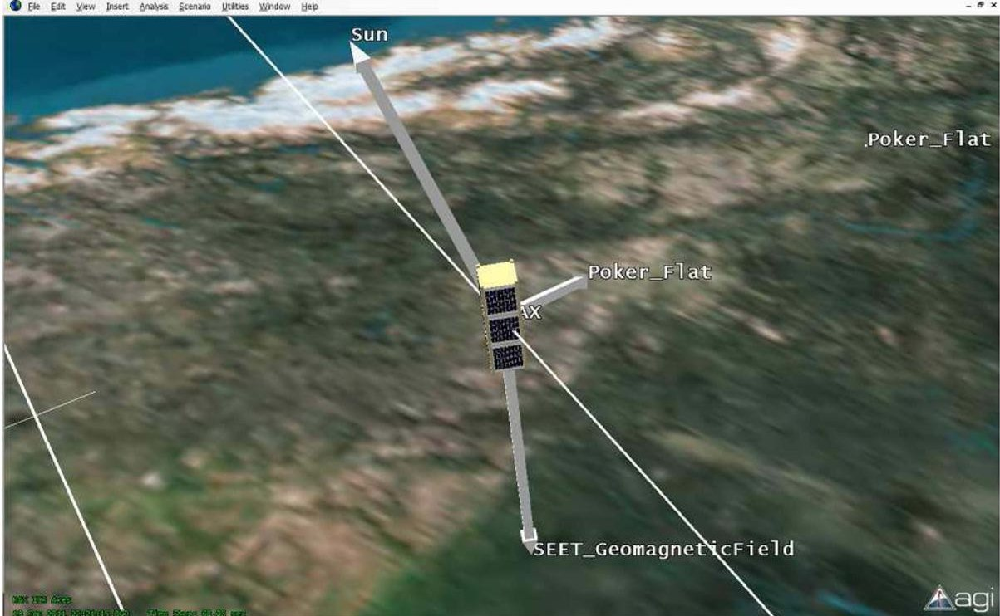

Figure 5. STK-generated schematic of RAX spacecraft with vectors pointing towards the experimental zone, Poker Flat, AK, the sun, and along the Earth's magnetic field.

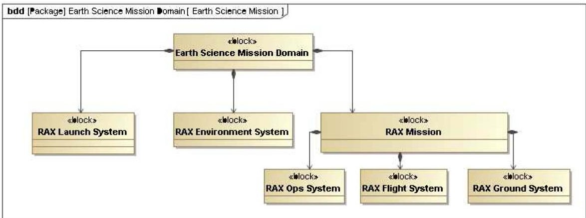

Figure 6. RAX Mission represented in a SysML Block Definition Diagram (BDD)

<!-- PDF_PAGE: 7 -->

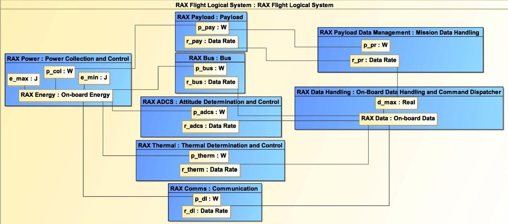

Figure 7. RAX Mission key properties represented in a SysML Internal Block Diagram (IBD) with Subsystems and Interactions

## RAX SysML Model

The RAX satellite SysML models are based on the operational satellite framework developed in Ref. [1]. The SysML representations in this section provide a visual representation of the RAX model. They describe the system behavior and can be applied to evaluate the system using the simulations and the performance metrics.

Figure 6 shows the RAX Block Definition Diagram (BDD) consisting of the RAX Launch System, RAX Environment, and RAX Mission. The majority of this paper focuses on the RAX Mission. However; the RAX Launch System and RAX Environment are also important to capture the complete system.

The RAX Mission model consists of both logical and physical models. The logical models consider the operations of the system while the physical models consider the physical components. The decomposition strategy is typically used by CubeSat designers to separate functionality into subsystems that correspond to logical concepts. For the CubeSat model, logical subsystem models describe the different concepts required to define the desired behavior of the system. The physical models specify the hardware and software that realize the logical design. For an example of this physical/logical model distinction, consider the Power subsystem. One of its logical functions is to store energy, while the physical battery hardware implements that functionality. Developing both logical and physical models allows the spacecraft systems engineers to clearly define the difference between the functionality (using logical models) and the hardware that supports this functionality (using physical models).

The focus of this paper is on the operations of the RAX system, thus we focus on the logical models. As described in Ref. [1], RAX has several functional subsystems, each supporting at least one critical part of the mission or other subsystems, which are described in Ref. [11]. The Internal Block Diagram (IBD) shown in Figure 7 illustrates key properties and interactions of the subsystems for the RAX Logical Flight System.

The Power Collection and Control subsystem is responsible

for acquiring energy by body-fixed solar panels, distributing power to support ongoing operations, and storing excess energy for future use in an on-board battery. The On-board Data Handling and Command Dispatcher subsystem is responsible for dispatching commands, and managing the storage of onboard data. The Mission Data Handling subsystem is responsible for processing, compressing, deleting, and filtering data for the satellite payload. The Communication subsystem receives commands from the ground command station in Ann Arbor and downloads data to its globally distributed ground station network. The Attitude Determination and Control, Thermal Determination and Control, Structures and Mechanism subsystems are self-explanatory, and are passive for the RAX satellites (i.e. are not active).

## 6. ANALYTICAL MODEL AND RESULTS

We use the system model for a variety of analysis applications, which include those listed below and are illustrated in Figure 8.

- Communication subsystem signal to noise ratio (SNR)

- Power

- Flight System Behavior

## Communication Subsystem (SNR) Analysis

Due to the importance and challenges of designing operating a communication subsystem for a small satellite, we provide a detailed view of the communication subsystem in this section. The SysML model presented in this section is based on the model in Ref. [11].

The main purpose of the communication subsystem is to download data from the satellite to ground stations. In this example, we assume there is a single ground station. To evaluate the communication subsystem, we are interested in analyzing the signal-to-noise ratio, SNR, of the communication link between the satellite communication subsystem and the ground station.

The SNR must exceed some minimum level, $ SNR_{min} $ , to

<!-- PDF_PAGE: 8 -->

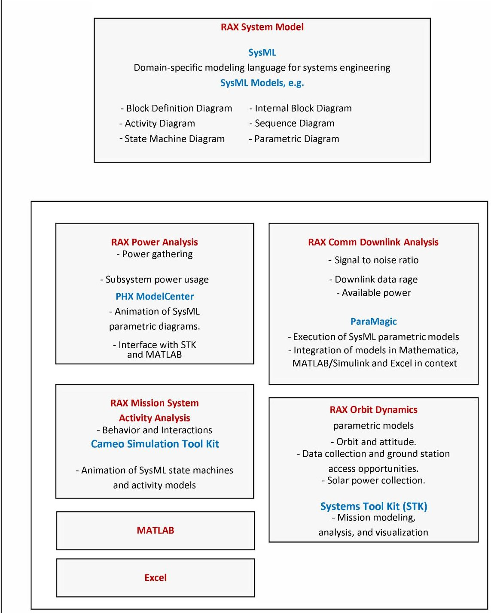

Figure 8. RAX Models and Simulations as related to various analysis/simulation tools

ensure a given error rate is achieved.

The SNR Analysis block in Figure 9 represents the communication link that we are evaluating. The link equation used for the analysis uses design variables that belong to the communication subsystem (Communication block), network of ground stations (Ground Network block), atmosphere (Atmosphere block), and the satellite trajectory (Orbital Elements block).

Figure 10 shows the SysML parametric model for the SNR Analysis block. The parametric model shows the link equation (calcSNR constraint property) which relates the SNR analysis variable to the system design variables specific to the communication subsystem, ground stations, atmosphere, and satellite trajectory. The parametric model also shows the space loss equation (calcLS constraint property) that relates the space loss $ ( L_{s} ) $ to propagation path distance $ ( L_{p} ) $ . These equations are represented in log form according to industry practice.

SysML parametrics are acausal in nature. The mathematical constraints in the parametric model are represented in a declarative manner, which implies that there are no fixed inputs and outputs specified at the parametric model level. The same parametric model can be solved with different combinations of inputs and outputs such as y=kx and where we solve for y given x and k. Or x=y/k where we solve for x given y and k. We can solve the equations with different combination of dependent and independent variables.

ParaMagic leverages the SysML standard to execute parametric models in the context of block instances, where each instance represents a specific design alternative or configuration or scenario in this case. ParaMagic can be used to execute a given parametric model for different causalities, such that input and output variables can be switched on-the-fly.

The intent of this analysis is to use the given parametric model in three different analysis scenarios:

<!-- PDF_PAGE: 9 -->

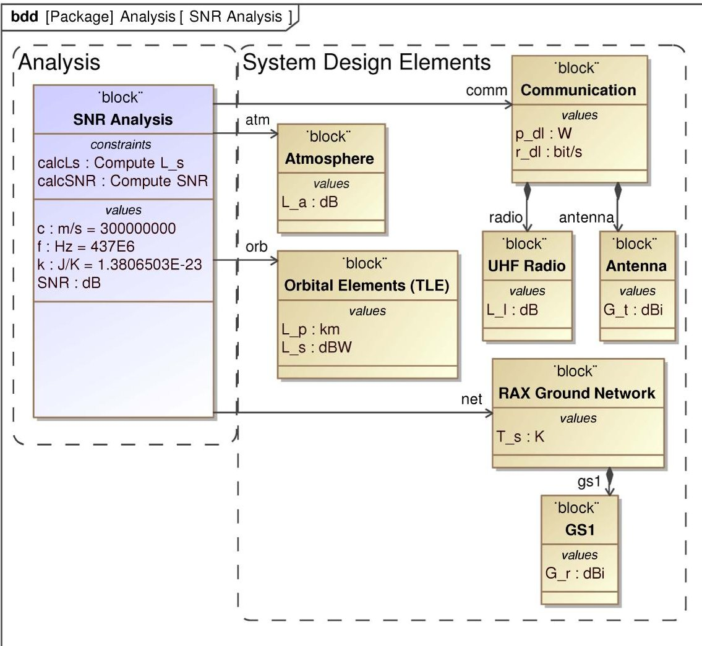

Figure 9. SysML Block Definition Diagram (BDD) illustrating the SNR Analysis model

- Analysis Scenario 1: Given the data download rate $ ( r_{dl} ) $ and the available power $ ( p_{dl} ) $ , compute the maximum feasible SNR for the communication link.

- Analysis Scenario 2: Given the data download rate $ ( r_{dl} ) $ and the desired SNR, compute the minimum feasible power required $ ( p_{dl} ) $

- Analysis Scenario 3: Given the available power $ ( p_{dl} ) $ and the desired SNR, compute the maximum feasible data download rate (r_dl) that can be achieved.

Figure 11 shows the SysML instance structure (block definition diagram) for an analysis of a specific design configuration with specific values of the properties. Figure 12 shows the ParaMagic browser for Analysis Scenario 1. As shown in the figure, all of the value properties have assigned values except for SNR and $ L_{s} $ . SNR is assigned target causality as the value of interest for Analysis Scenario 1 and $ L_{s} $ is left with undefined causality which means it will be solved only if necessary to the solve for the specific target value. Figure 12 shows the solved value of SNR (in the box). In this example, $ SNR_{min}=13 $ dB, which is acceptable and therefore the power allotted in the design is sufficient for the specified data download rate and acceptable error rate. The Update to SysML button at the right of the browser allows the user to update the solved values in response to the specific model and diagram.

Figure 13 shows the ParaMagic browser for Analysis Scenarios 2 and 3 (note the corresponding SysML instance structure is not shown). It shows that SNR has been assigned given

causality and value 13, equal to $ SNR_{min}. $ For Analysis Scenario 2 (LHS), the power required for download $ p_{dl} $ is computed given the minimum acceptable $ SNR $ and data download rate. For Analysis Scenario 3 (RHS), the data download rate r_dl is computed given the minimum acceptable $ SNR $ and available power.

## Power Analysis

To capture realistic power scenarios, we have developed a simulation that consists of simulations and analysis components from STK, SysML, and MATLAB. PHX ModelCenter acts as the glue that ties them together. We model dynamic orbits, opportunities to collect energy and download data, realistic schedules. We use the model to investigate the time history of the satellite states, including the on-board energy and data, and the amount of downloaded data.

We created a workflow for an example RAX mission scenario, which includes data and energy collection, on-board operations, and data download over a specified ground station. The simulation is executed during a specified scenario time. The state dynamics are a function of performed operations, including nominal, payload, and download operations, and available energy collection from the sun. We implement the RAX-specific scenario by combing the MagicDraw parametric model in Figure 14 with an orbital scenario from STK $ ^{\textcircled{R}} $ and custom analysis MATLAB scripts using PHX ModelCenter, as shown in Figure 15.

The simulation is a workflow that is created graphically by dragging and dropping reusable components and combining

<!-- PDF_PAGE: 10 -->

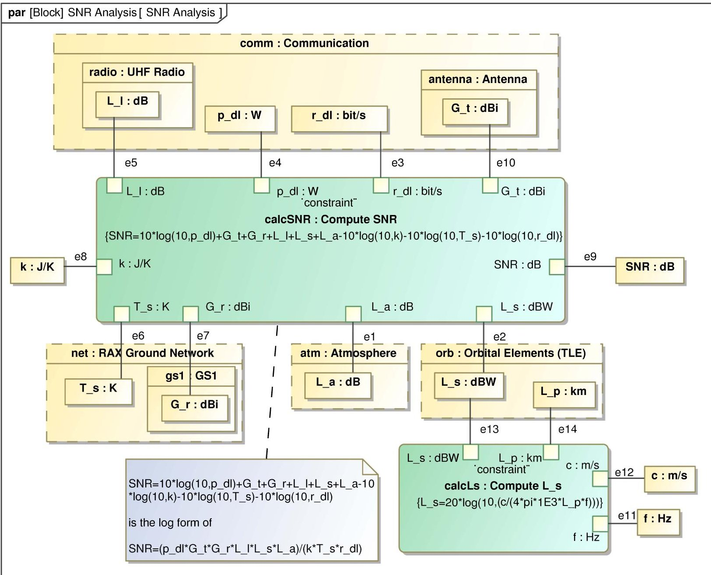

Figure 10. SysML parametric diagram showing the SNR Analysis link budget model

them using if-else branches, loops, and other flowchart-like constructs (using PHX ModelCenter). The graphical link editor is used to specify what data is passed between applications when we execute the model. Through a graphical user interface, accessible from within the MBSE tool or PHX ModelCenter, we execute the PHX ModelCenter model defined by a SysML parametric diagram.

This simulation environment enables us to evaluate design configurations, perform trade studies, and check requirements compliance. Analysis can also be automatically re-run with updated the parameter values.

We execute the power scenario in Figure 14 using the simulation workflow created in PHX ModelCenter, which automatically executes the workflow as many times as necessary, utilizing parallel computing resources as needed. When instructed, each component is executed automatically, transferring information between components. Using the simulation environment described above, we can perform parametric studies and use the multi-dimensional data visualization tools in PHX ModelCenter $ ^{\textcircled{R}} $ to interpret and analyze the results.

## Flight System Behavior Analysis

CAMEO Simulation Toolkit (CST) was used to analyze the RAX behavior and interactions. Simulation in this context means to execute the model so that the RAX System interactions and behaviors can be studied. A model is a simplified representation of the actual system (in this case RAX), thus creating a model that allows for useful simulation and analysis is an iterative process.

CST enables the user to execute and animate state machines and activity models. The sequence of steps to execute CST is to run a simulation, view the behavior by the model, and update the design appropriately if the behavior needs to be modified. CST functionality also supports verification and validation of the system.

The Mission Operations System (MOS) consists of the hardware, software, procedures, and personnel that control the Flight System and supports analysis of the Flight System behavior. The MOS operation team generates sets of commands that are to be executed on-board the Flight System. For RAX the On-Board Computer (OBC) is the main handler for processing commands and sending them to the relevant

<!-- PDF_PAGE: 11 -->

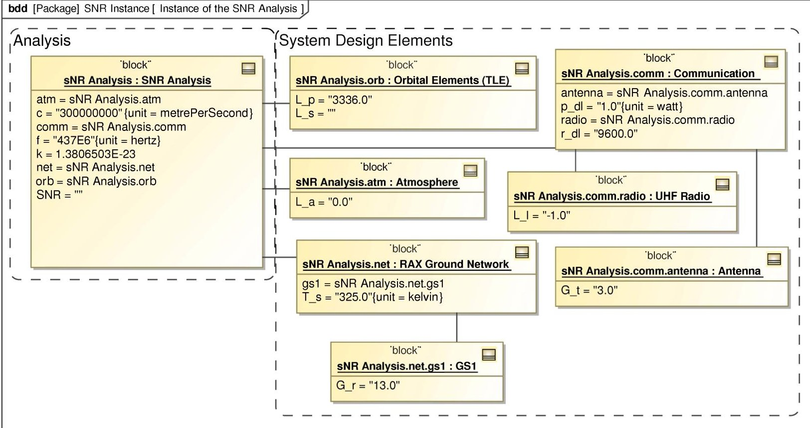

Figure 11. SysML BDD illustrating the instance structure setup for Scenario 1

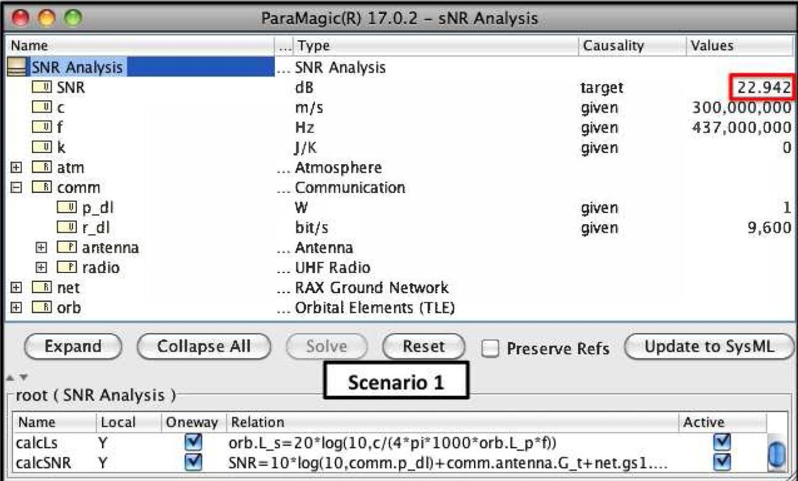

Figure 12. ParaMagic Browser showing results for Analysis Scenario 1

<!-- PDF_PAGE: 12 -->

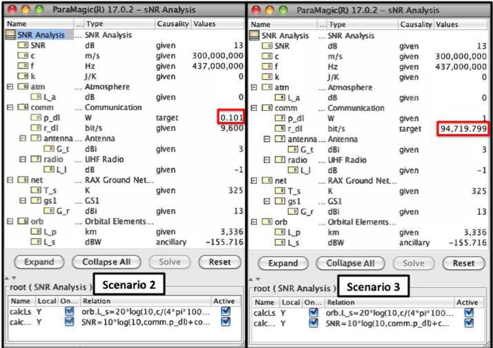

Figure 13. ParaMagic Browser showing results for Analysis Scenarios 2 and 3

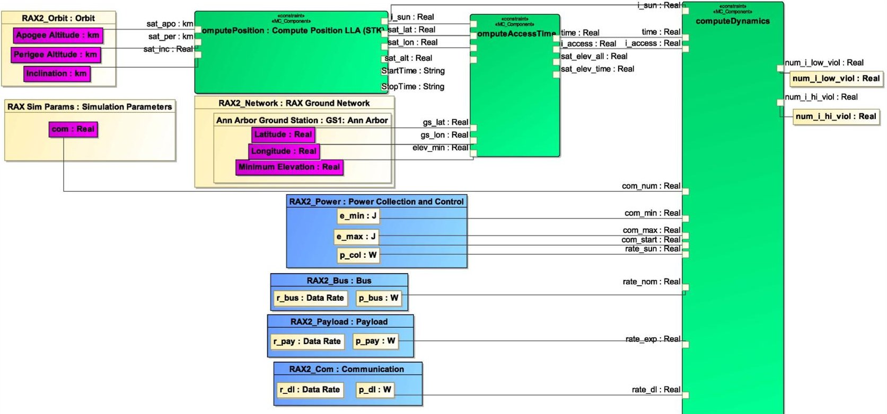

Figure 14. Parametric Diagram showing RAX Power Scenario in MagicDraw

<!-- PDF_PAGE: 13 -->

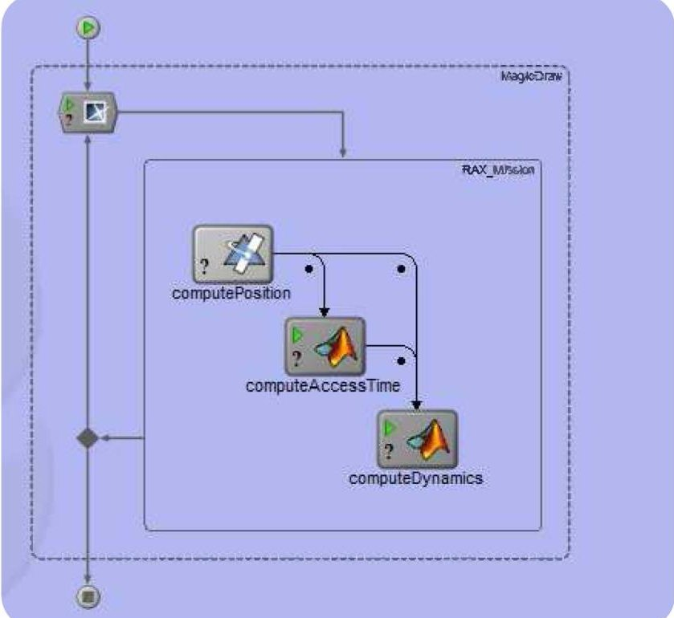

Figure 15. RAX Power Scenario in PHX ModelCenter integrated with STK and MATLAB as projected from the SysML model

subsystems for execution. This process was simulated in the RAX Model as described below.

Figure 16 shows the interface between the RAX Flight System and the RAX Ground System. The sets of commands are uploaded to the Flight System and provide the schedule, which includes when and how to perform an experiment and download data. For the RAX spacecraft, the experiment times are a function of when the spacecraft and target of interest have line-of-sight visibility and when the energetic activity in the ionosphere is predicted to exceed some minimum value.

The upload command consists of sending a signal from the control ground station, which traverses the Flight-Ground Interface, and is (with successful transmission) received by the OBC. The OBC has timing knowledge (with an onboard clock) and can dispatch the command information to the appropriate subsystems when a command approaches execution time.

Figure 17 shows the relevant states related to the Main Flight Computer . In this example, the Command Processing State has underlying behavior for dispatching commands.

Figure 18 depicts the behavior that the OBC performs in order to analyze command files sent from the ground. In this snippet of the process, the OBC determines what subsystem is being affected and whether or not this subsystem is entering upload or download mode. Once the determination is made, the OBC sends the final signal data to the Communications Subsystem, shown in Figure 19.

In Figure 19, the states for the Communication Subsystem are shown. Nominally the system is in the beaconing mode, but once a signal is received from the Main Flight Computer that indicates when the Flight System is uploading or downloading data, the Communication subsystem transitions to the relevant state.

Using CST for this analysis allows for the interfaces to the

different systems of the RAX Mission System to be analyzed and the actual information exchange between systems to be depicted and tested. The expected behavior as well as onflight observed behavior can be compared to what the model predicts. If a model is developed in the early phases of the Mission, these types of simulations will allow for verification and validation of the mission software and interfaces throughout the development lifecycle.

## 7. CONCLUSION

## Summary

The RAX model described in this paper demonstrates the utility and advantages of using a standards-based approach for modeling the system design and analysis using a "Develop With What You Fly With" (DWWYFW) philosophy. The SysML BDD and IBD diagram structures are the foundations that establish the fundamental relationships and interfaces between the system components. Going beyond traditional static system representations, we add parametric diagrams to enable interactive analysis of the design based on established physical principles (e.g. communications link margin, power constraints). Furthermore, time evolution of our system allows the analysis of the dynamic nature of the various flight and ground system states. These states are defined in the State Machine diagrams. Block representation, parameterization, and state definition all serve as the glue that ties the system together, and provides the framework for integrating the design model with the analytical models.

The role of the systems engineer is to understand all parts of the system in order to describe how the complete system functions. Unlike traditional requirements-based approaches using declarative "shall statements", the formalized descriptive language of SysML is not only human readable, but also allows for machines to read and interpret the description. This capability allows for the integration of seemingly disparate analysis tools (e.g. Matlab, STK, Excel, Mathematica) into

<!-- PDF_PAGE: 14 -->

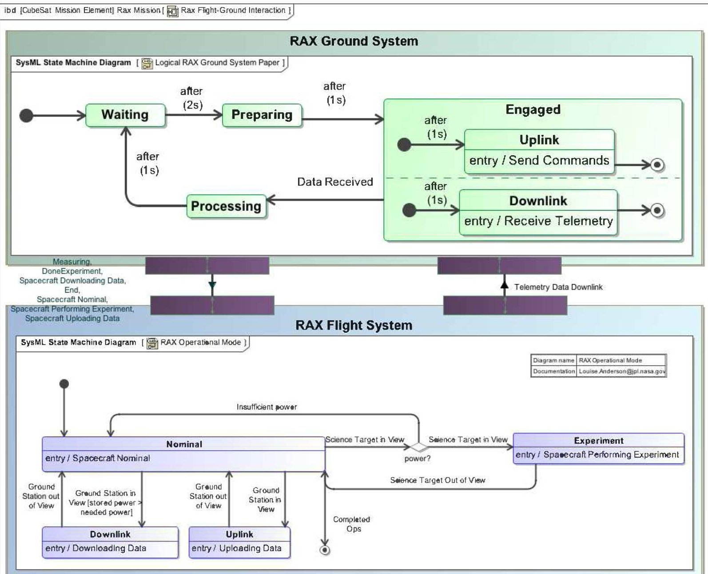

Figure 16. Composite diagram showing parts and behaviors of RAX Flight System

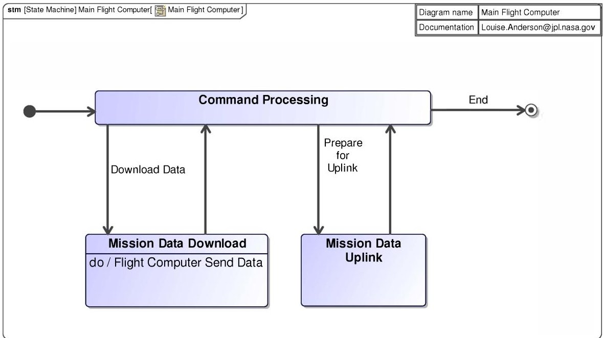

Figure 17. Main Flight Computer State Machine

<!-- PDF_PAGE: 15 -->

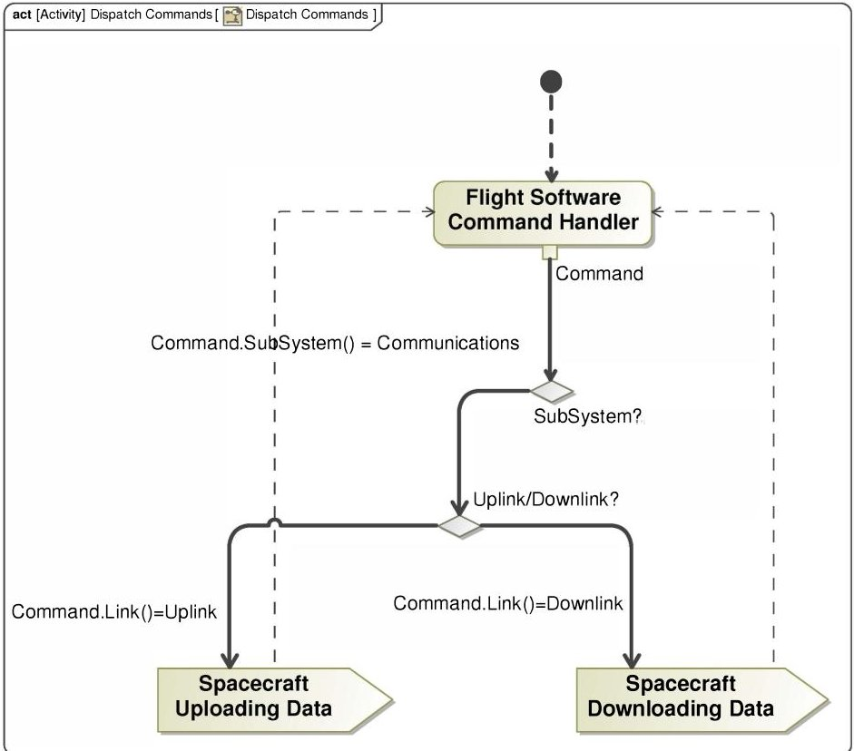

Figure 18. Activity Diagram for the On-Board Computer (OBC) Dispatch Commands Behavior

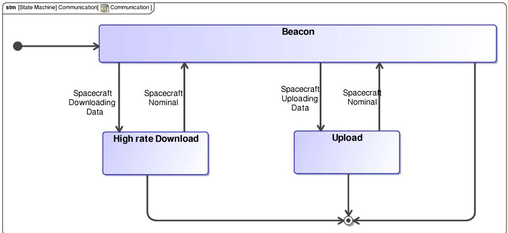

Figure 19. Communication Subsystem State Machine

## an integrated modeling environment.

We developed the MBSE simulation environment presented in this paper using a modular approach, which enabled easy growth of the model and multiple modelers to simultaneously contribute to the model. We first identified key framework elements, such as the subsystems, states, and their interactions. The framework is thus easily extended to include additional modeling elements, higher fidelity simulators, or more interactions between the components.

All modeling elements were introduced in the context of building or executing an analysis or simulation, which ensured they were required and minimized the overall complexity of the model. We also integrated existing software code into the simulator. A variety of modelers with different levels of expertise (ranging from beginner to expert SysML user) contributed to the model. Beginners found the learning curve reasonable, as they were building off the work of the experts

and thus learning as they contributed. Beginners found working with SysML easier if they had experience with the CubeSat mission itself or other tools that were incorporated into the framework (e.g. STK, Matlab).

## Lessons Learned: Challenges and Successes

Throughout the development of the models and simulations in this paper, we have experienced several lessons learned that are listed below:

- We were able to extract time-dependent parameters in PHX ModelCenter using a specific post-processing script and vendor support. This was a great advantage for executing the dynamic power system scenario.

- We were able to set up and execute SNR analyses for the Communication subsystem for different scenarios using ParaMagic. This enabled us to set up the parametric model

<!-- PDF_PAGE: 16 -->

once and execute it for different causalities, e.g. computing SNR given available power and data download rate, or alternatively compute the required power given acceptable SNR and data download rate.

We also encountered several challenges, listed below:

- Appropriate licenses are required for all simulation tools which can be challenging, and required vendor support.

- Setting up the simulation environment requires several steps, including creating wrapper files, wrapping models, saving, and re-opening models in PHX ModelCenter and MagicDraw. Thus, creating and testing the integration of models can be time consuming and inefficient.

- It is currently difficult to de-bug Matlab code and STK scenarios after they have been wrapped into the PHX Model-Center model, which can be time-consuming and frustrating.

- Wrapping STK models as parametric constraints and executing them using ParaMagic. This capability is in a prototype stage right now.

- The simulations currently allow the model to be stepped through in time to aid in visualizing what is occurring with spacecraft behavior. In the future, extending this approach to include constraint-based solving would provide a more complete analysis. In particular, the different states can be constrained using constraint value properties specified by the constraint modeling. With both methods working together, a dynamic approach of changing input values could be used to evaluate the equations and to visualize the behavior of the spacecraft based on input values.

## Future Work

Beyond the models, simulations, and analyses demonstrated in this paper, there are several additional ways to extend this work to more sophisticated analyses that can aid in both vehicle and mission operation design. Extensions include:

- The execution of parametric models to compute different performance parameters, using state machine and activity diagram simulations.

- The various simulations in this paper currently execute individually. Future work will bring these simulations together such that broader simulations can be performed, for example the power and communication systems could be analyzed and optimized simultaneously.

- The ability to verify optimal scheduling algorithms in the simulation environment would be extremely useful, as there is currently no unified environment where this can be done efficiently. In particular, it would be helpful to be able to assess the robustness of operational schedules to perturbations in various input parameters.

- Beyond demonstrating mission scenarios and performing trade studies, the modeling and simulation environment in this paper may also be useful for combined vehicle and operations optimization. In particular, due to the ease of identifying inputs and outputs, it is possible to vary specific parameters (assigned as inputs) and monitor how they impact other parameters (assigned as outputs). This type of analysis could be extremely useful for designing ground systems, sizing satellite components, etc. Furthermore, these types of trades can be useful for developing the simulation

system that will be used for later design trades and flight simulations, along the lines of "Develop With What You Fly With" (DWWYFW).

- Finally, comparing results from our simulation environment based on our modeling framework to real data from operational missions such as RAX will provide a means to verify, validate, and improve the models.

## ACKNOWLEDGMENTS

We thank the entire University of Michigan and SRI International RAX Teams for their contributions. We also thank Analytical Graphics, Inc (AGI), Phoenix Integration, and InterCAX for their generous support of our work. We thank the Natural Sciences and Engineering Research Council of Canada (NSERC) and Zonta International for their support.

We would also like to thank Sandy Friedenthal for his invaluable review, contributions, and guidance.

Parts of this research were carried out at the Jet Propulsion Laboratory, California Institute of Technology, under a contract with the National Aeronautics and Space Administration. REFERENCES

## REFERENCES

[1] S. Spangelo, D. Kaslow, C. Delp, B. Cole, L. Anderson, E. Fosse, B. Gilbert, L. Hartman, T. Kahn, and J. Cutler, "Applying model based systems engineering (mbse) to a standard cubesat," in IEEE Aerospace Conference, Big Sky, MT, March 2012.

[2] J. Springmann, B. Kempke, J. Cutler, and H. Bahcivan, "Initial Flight Results of the RAX-2 Satellite," in Proceedings of the 26th Annual Small Satellite Conference, Logan, UT, August 2012.

[3] J. Cutler and H. Bahcivan, "The Radio Aurora Explorer A Mission Overview" in AIAA Journal of Spacecraft and Rockets, Accepted 2012.

[4] T. Moretto, "Cubesat Mission to Investigate Ionospheric Irregularities," in Space Weather: The Journal of Research and Applications, November 2008.

[5] I. C. on Systems Engineering (INCOSE), "MBSE initiative," January 2007. [Online]. Available: https://connect.incose.org/tb/MnT/mbseworkshop/

[6] J. Wertz and W. Larson, Space Mission Analysis and Design, 3rd ed. Microcosm Press, 1999.

[7] I. C. on Systems Engineering (INCOSE) INCOSE Website. [Online]. Available: http://www.incose.org/ProductsPubs/products/sevision2020.aspx

[8] D. Bindschadler, C. Delp, and M. McCullar, "Principles to Products: Toward Realizing MOS 2.0 ," in SpaceOps Conference, Stockholm, June 2012.

[9] O. M. G. (OMG), OMG Website. [Online]. Available: http://www.omgsysml.org/

[10] K. Woellert, P. Ehrenfreund, A. J. Ricco, and H. Hertzfeld, "Cubesats: Cost-effective science and technology platforms for emerging and developing nations," Advances in Space Research, vol. 47, no. 4, pp. 663 684, 2011.

[11] S. Spangelo and J. Cutler, "Optimization of single satellite operational schedules towards enhanced communication capacity," in AIAA Guidance, Navigation, and Control Conference, Minneapolis, MN, August 2012.

<!-- PDF_PAGE: 17 -->

Louise Anderson is an early career hire Software Systems Engineer at JPL. She's currently on the Ops Revitalization team in Multimission Ground System and Services (MGSS). Louise is also currently Co-Lead of the Modeling Early Adopters group at JPL. She graduated in May 2010 from the University of Colorado-Boulder with a degree in Aerospace Engineering. Previously she worked at

the Laboratory for Atmospheric Space Physics in Boulder Colorado working as a Command Controller on the Mission Operations Team. She has worked on the mission ops team for Kepler, Sorce, AIM, Quikscat, and Icesat. Louise is a member of INCOSE, currently for INCOSE she is working on the Space Systems Working Group specifically on CubeSat Modeling.

Manas Bajaj, PhD is the Co-Founder and Chief Systems Officer at InterCAX (www.InterCAX.com) where he leads the development of software applications for MBSE. He has successfully led several government and industry-sponsored projects. Dr. Bajaj has been actively involved in the development, implementation, and deployment of the OMG SysML standard and the ISO STEP AP210 standard for electronics. He is a Content Developer (author) for the OMG Certified Systems Modeling Professional (OCSMP) certification program, and coaches organizations on SysML and MBSE. Dr. Bajaj's research interests are in the realm of SysML and model-based systems engineering (MBSE), computer-aided design and engineering (CAD/CAE), advanced modeling and simulation methods, and open standards for product and systems lifecycle management (PLM/SLM). He has authored several publications and won best paper awards. Dr. Bajaj earned his PhD (2008) and MS (2003) in Mechanical Engineering from the Georgia Institute of Technology, and B.Tech. (2001) in Ocean Engineering and Naval Architecture from the Indian Institute of Technology (IIT), Kharagpur, India. He is an INCOSE member and participates in the OMG and PDES Inc working groups.

Bjorn Cole is a systems engineer in the Mission Systems Concepts section of the Jet Propulsion Laboratory. His research interests are in the fields of design space exploration, visualization multidisciplinary analysis and optimization, concept formulation, architectural design methods, technology planning and more recently, model-based systems engineering. He is currently working

on pre-Phase A mission formulation. He earned his Ph.D. and M.S. degrees in Aerospace Engineering at the Georgia Institute of Technology and his B.S. in Aeronautics and Astronautics at the University of Washington.

Leo Cheng is currently a member of the Flight Control Team for the Spitzer Space Telescope. In addition to his real-time operations experience, Leo has extensive experience in the area of science planning and operations, including leading the development of the science plan for the Cassini mission's Huygens probe descent and landing on the surface of Titan. Originally from the island

of Guam, Leo holds a B.S. Degree in Physics from Cal Poly Pomona University and a M.S. Degree in physics from Rensselaer Polytechnic Institute.

James Cutler received a B.Sc. degree in Computer and Electrical Engineering from Purdue University, and M.S. and Ph.D. degrees in Electrical Engineering from Stanford University. He is currently an assistant professor in the Aerospace Engineering Department at the University of Michigan. His research interests center on space systems a multidisciplinary approach to enabling fu

ture space capability with particular emphasis on novel, nanosatellite missions. He is developing next generation communication capability, design optimization techniques, and space weather measurement missions. His research lab is developing and flying multiple nanosatellites for NSF and NASA.

Christoper Delp is the Systems Architect for the Ops Revitalization task in MGSS. He is also a Systems Engineer on the Europa Habitability Mission Model Based Systems Engineering Team. He is a founder of the Modeling Early Adopters grass roots Model Based Engineering working group. Previously he served as Flight Software Test Engineer for MSL and Software Test Engineer for the Tracking, Telemetry, and Command Endto-End Data Services. He also leads the INCOSE Space Systems Working Group's entry in the Model Based Systems Engineering Grand Challenge. Additionally, he has performed research on software verification and tools for Service-Oriented Architecture in support of the Deep-space Information Services Architecture. Prior to coming to JPL he worked as a software engineer performing DO-178b Level FAA flight qualified software development and testing on Joint Tactical Radio System (JTRS) and the T-55 Full Authority Digital Engine Controller (FADEC). Chris earned a Master of Science in Systems Engineering from the University of Arizona where he studied Model Based Systems Engineering, Simulation and Software Engineering. Previous to graduate studies, Chris performed his duties as a systems engineer on Missile Systems Verification and Validation.

<!-- PDF_PAGE: 18 -->

Elyse Fosse is a Software Systems Engineer for the Ops Revitalization task in MGSS. She also develops ground system cost models for deep space and Earth missions. She is also a member of the Multimission Ground Data System Engineering group at the Jet Propulsion Laboratory. Her interests include software and systems architecture, applications of model-based system engineering, and

cost model implementation and analysis. Elyse is also a part of the INCOSE Space Systems Working Group's entry into the Model Based Systems Engineering Grand Challenge. Elyse earned her M.A. in Applied Mathematics from Claremont Graduate University and her B.S. in Mathematics from the University of Massachusetts Amherst.

Dave Kaslow is Director, Product Data Management at Analytical Graphics, Inc. He has thirty-nine years of experience in both the technical and management aspects of developing ground mission capabilities. He is co-author of "Defining and Developing the Mission Operations System", "Activity Planning", "FireSat" and "Spacecraft Failures and Anomalies" in Cost-Effective

Space Mission Operations. He is also the author and coauthor of papers for the International Council on Systems Engineering (INCOSE) Annual International Symposiums and for the IEEE Aerospace Conference.

Grant Soremekun has a background in engineering design optimization and software development. He holds a B.S. in aerospace engineering and an M.S. in engineering mechanics from Virginia Tech. For the past 9 years, Grant has worked for Phoenix Integration, a software company specializing in process integration, multidisciplinary analysis, and design optimization. During this

time, he has fulfilled several roles, including software developer, application engineer, product manager, and is currently serving as the manager for Phoenix Integration western US sales.

Sara Spangelo completed her Master's in Aerospace Engineering at the University of Michigan, where she worked on optimizing trajectories for energyefficient periodic solar-powered UAVs. She has been involved in the GPS and operational scheduling of the Radio Aurora Explorer (RAX) CubeSat Mission from 2009-2012. She completed a Ph.D. in Aerospace Engineering at the University of Michigan, focusing on developing models, simulators, and optimization algorithms for scheduling small satellites and diverse heterogeneous ground networks towards enhanced communication capacity. She interned at JPL in 2012, where her work focused on integrating diverse simulation environments to enable Model-Based Systems Engineering of small spacecraft.

Rose Yntema is the Applications Engineer at InterCAX (www.InterCAX.com) where she applies MBSE techniques to complex systems in areas such as aerospace, energy, defense, and telecommunications. She is actively involved in the development of SysML parametric modeling and simulation software. Yntema earned her M.S. (2012) in Electrical and Computer Engineering from the Georgia Institute of Technology, and Sc.B. (2010) in Electrical Engineering from Brown University.