<!-- PDF_PAGE: 1 -->

IAC-13-B4.3.4

# PARAMETRIC CUBESAT FLIGHT SIMULATION ARCHITECTURE

Christopher Lowe University of Strathclyde, UK, christopher.lowe@strath.ac.uk

Malcolm Macdonald University of Strathclyde, UK, malcolm.macdonald.102@strath.ac.uk

Steve Greenland Clyde Space Ltd, UK, steve.greenland@clyde-space.com

This paper presents the architecture of a system of models that provides realistic simulation of the dynamic, inorbit behaviour of a CubeSat. Time-dependent relationships between sub-systems and between the satellite and external nodes (ground stations and celestial bodies) are captured through numerical analysis of a multi-disciplinary set of state variables including position, attitude, stored energy, stored data and system temperature. Model-Based Systems Engineering and parametric modelling techniques are employed throughout to help visualise the models and ensure flexibility and expandability. Operational mode states are also incorporated within the design, allowing the systems engineer to assess flight behaviour over a range of mission scenarios. Finally, both long and short term dynamics are captured using a coupled-model philosophy; described as Lifetime and Operations models. An example mission is analysed and preliminary results are presented as an illustration of early capabilities.

## I. INTRODUCTION

Flight simulators have generally been developed during the latter phases of spacecraft programmes, by software teams, as only then is sufficient information about the system available and the effort required to create the models considered worthy. Rapid growth within the CubeSat community however, would suggest change to this tradition to be valuable in order to provide simulation capabilities during early design phases. This is made particularly feasible by the modular format apparent in the CubeSat bus which limits the number of design variables and promotes use of parametric model-based system engineering (MBSE) techniques $ ^{1} $ . As a result, high fidelity flight simulation can be developed for the general mission case and rapidly customised for use during conceptual studies without demanding the level of resources that are out of grasp of modest budgets. Furthermore, a model-based approach to this problem lends itself naturally to development through the life of the mission, exploitation of a plug-in/plug-out module scheme and implementation of hardware-in-the-loop $ ^{2} $ .

The primary objective of this work is to introduce a parametric flight simulator designed to capture behaviour of a CubeSat with its environment and subsystems for the complete lifetime of the mission. The model architecture and governing equations are presented alongside results of the simulation for an example mission case.

## II. BACKGROUND

The CubeSat $ ^{3} $ is quickly becoming the bus of choice for low-cost space missions such as those conducted

within Universities or as technology demonstrators. This is partly due to the modularity inherent in the physical and electrical design, allowing frequently changing teams of relatively inexperienced personnel achieve success in a short time-scale. Furthermore, modularity has led to the introduction of a wealth of off the shelf components, instruments and sub-systems being developed, which again promote rapid development at low cost. These same characteristics are enabling features in being able to exploit MBSE and dynamic simulation for not just analysis, but design, a trait typically reserved for static models such as Aerospace's Small Satellite Design Model $ ^{4} $ , or large complex resources such as ESA's Concurrent Design Facility (CDF) $ ^{5} $ .

## II.I. State Variable Analysis

Simulation of a complete Space system is a complex, inter-disciplinary problem, which contains unknown variables that span a wide range of function families; from continuous, deterministic equations describing passive attitude motion, to stochastic, discontinuous equations describing visibility of a federated ground network to a satellite in Low Earth Orbit (LEO). Despite this complexity, the system can be conveniently described at any particular point in time by the values of a set of state variables representing the relationships between the vehicle's sub-systems and environment ( $ \mathrm{S I I I I . I I I} $ ). This same complexity demands

<!-- PDF_PAGE: 2 -->

the need for numerical methods to be employed in order to analyse the coupled dynamics successfully.

The architecture described in this work features a classic, initial value approach to state variable propagation, whereby the differential equations describing time-evolution of the state variables are integrated using numerical methods over a finite time interval. This process continues for the duration of the simulation, building a state variable matrix that describes the system over the period of interest. Illustration of a generic state variable analysis, in block diagram form, is shown in figure 1, from which the architecture in this work is built.

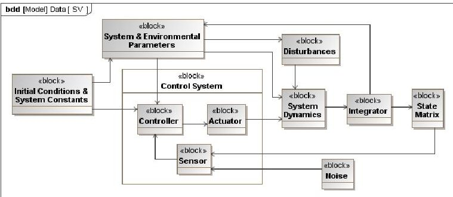

Fig. 1: SysML diagram of general State Variable instance

## III. MODEL ARCHITECTURE

The dynamic behaviour of a satellite in LEO is typically non-linear over a number of length-scales. For example, environmental perturbations contribute to secular variation in the orbital dynamics over periods of days and months, motion of the satellite about the earth occurs over minutes and data collection and transmission can take place over a period of seconds. Within this work the long-term dynamics are captured in a Lifetime model, which conducts analysis over the complete mission, whilst dynamics related to the other two scales are analysed over a number of orbits within an Operations model, consisting of higher detail and fidelity. Both models feature similar architectures which aim to derive state variables in a continuous manner using numerical methods and each are supplied information about the mission from a set of reference modules (figure 2).

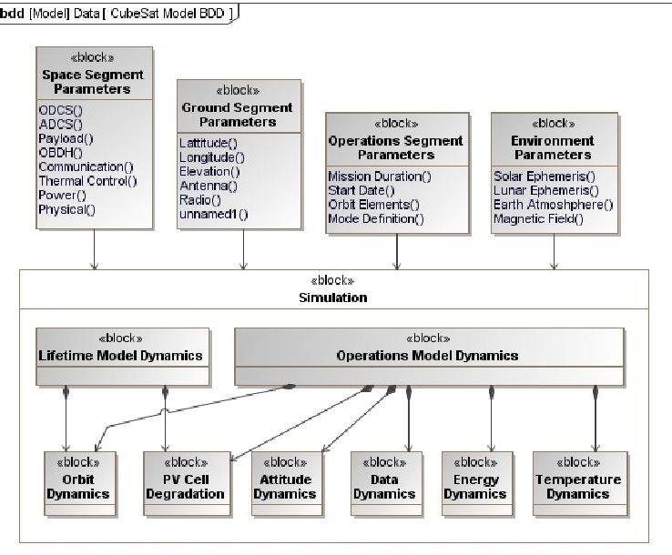

Fig. 2: SysML diagram of top-level architecture showing a selection of internal properties

The main reasons for applying a dual time-scale approach is to 1) maintain long-term stability in the equations of motion, 2) analyse system behaviour over the entire mission lifetime and 3) enable high-fidelity analysis without unnecessary computational expense. State variables are passed from the lifetime model to the operations model at discrete times $ \left(t_{\psi}\right) $ during the mission, which can be either regular intervals (e.g. 1 month) or specific events in demand of high-fidelity analysis (e.g. a slew manoeuvre). The operations model then simulates behaviour of the complete system for a period of time $ \left(t_{r}\right) $ , typically a number of orbits, using fixed short time intervals $ \left(\Delta t_{\gamma}\right) $ , typically on the order of seconds, to obtain a more detailed analysis. The time-domain structure and dual-fidelity model loop are illustrated in figures 3 and 4 respectively.

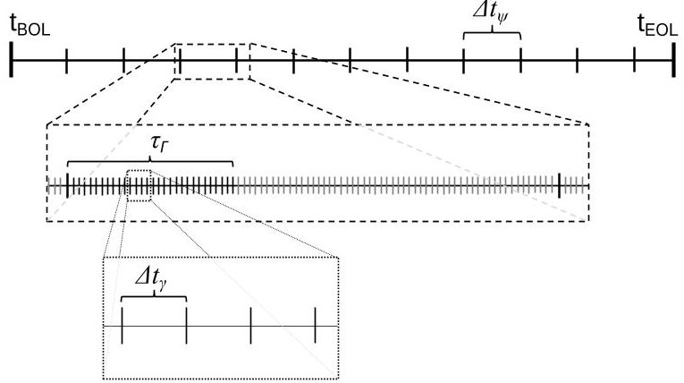

Fig. 3: Time domain definition (from lifetime model to operations model)

<!-- PDF_PAGE: 3 -->

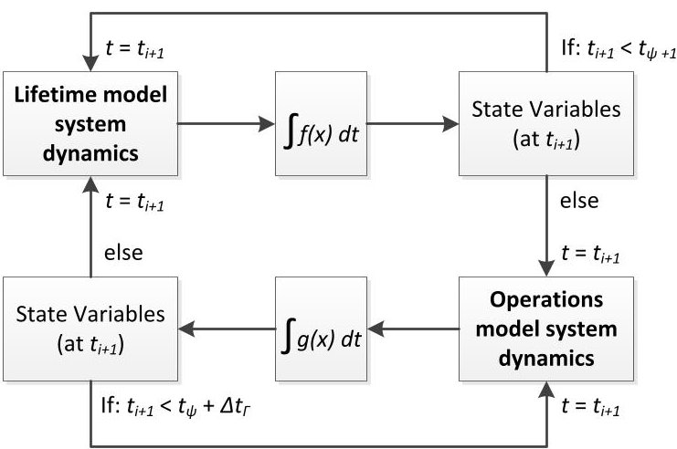

Fig. 4: Lifetime and Operational model loops with their associated decision variables.

The internal structure of each model is described in more detail in sections III.II & III.III.

## III.I. Reference Library

Success of this CubeSat flight simulator relies on a robust supply of information in the form of input parameters from a reference library. The reference library contains parameters such as environmental constants, subsystem performance characteristics, physical configuration, ground station locations and operational mode definitions. Thorough definition of the Space segment, Ground segment, Operations and environmental parameters, within these libraries, promotes parametric model architecture. This is considered vital if the simulator is to be used as a general mission design tool, as opposed to mission-specific validation tool.

## Space Segment

The Space segment library includes definition of all sub-system parameters that provide input to the Lifetime and Operations Models such as power demand (in each operating mode), data collection/transmission rate, sub-system mass, efficiencies and electrical characteristics. A definition of the structural layout is also defined from a library of potential configurations, i.e. the complete set of single-deployed panels and their associated solar arrays is pre-modelled such that the designer need only select the desired configuration from the database; minimising time spent re-modelling during trade studies. This parametric approach lends itself naturally to exploitation of automated optimisation.

Physical attributes of the CubeSat are defined within the model as mass, size, inertia and configuration and orientation of deployed panels. Deployed panels are defined by 3 parameters; 1) the body face against which the panel is stowed prior to deployment, 2) the edge

about which the panel is deployed and 3) the angle of deployment $ (\alpha) $ , illustrated in figure 5.

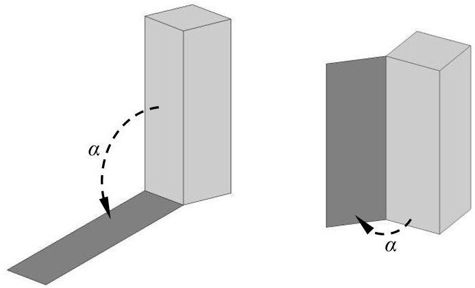

Fig. 5: Showing angle of deployment for stowed panels.

## Ground Segment

Ground network parameters are formulated in an entirely customisable manner such that both existing resources and potential future ground station locations can be implemented and tested. Capabilities of the ground station such as antenna gain, band frequency and minimum elevation are captured here such that an accurate assessment of the link budget can be made whenever a ground station with appropriate capabilities comes into view of the satellite. Data is only transferred to and from stations operating in frequencies appropriate to the space system modelled.

## Operational Modes

A spacecraft must be designed to operate in a number of modes such that it can manage sub-system behaviour as a function of environmental and platform conditions. ESA guidelines $ ^{6} $ specify a minimum of three operational modes that must be incorporated; Standby, Nominal and Survival, however other modes are likely to be incorporated in order for a mission to achieve its objectives. Each component $ ^{+} $ will have a number of modes in which it can function, which are preprogrammed within the reference library. The properties associated with a particular mode are dependent on the component; e.g. an antenna mode might be characterised by power demand and data rate while an attitude controller might be characterised by the type of algorithm to employ.

To formally describe the mode structure: Each component, c, has $ M_{c} $ modes, and there are n

<!-- PDF_PAGE: 4 -->

components on board, the total number of component modes is therefore (equation 1):

$$
N _ {M} = \sum_ {c = 1} ^ {n} M _ {c}
$$

For each platform mode (x), each component c must be assigned a particular component mode, $ m_{cx} $ (which is selected from the complete set, $ M_{c} $ ). E.g. in nominal p-mode, the communications transmitter might be set to operate in a continuous receive/opportunistic transmit manner. The complete set of modes can be defined within a matrix (figure 6).

<table border="1"><tr><td rowspan="2" colspan="2"></td><td colspan="5">Components(c)</td></tr><tr><td>1</td><td>2</td><td>3</td><td>. . .</td><td>n</td></tr><tr><td rowspan="6">Platform Mode</td><td>1</td><td>m11</td><td>m21</td><td>m31</td><td>. . .</td><td>mn1</td></tr><tr><td>2</td><td>m12</td><td>m22</td><td>m32</td><td>. . .</td><td>mn2</td></tr><tr><td>3</td><td>m13</td><td>m23</td><td>m33</td><td>. . .</td><td>mn3</td></tr><tr><td>.</td><td>.</td><td>.</td><td>.</td><td>.</td><td>.</td></tr><tr><td>.</td><td>.</td><td>.</td><td>.</td><td>.</td><td>.</td></tr><tr><td>x</td><td>m1x</td><td>m2x</td><td>m3x</td><td>. . .</td><td>mnx</td></tr><tr><td colspan="7">m1∈M1 m2∈M2 m3∈M3 mc∈Mc</td></tr></table>

Fig. 6: Example matrix of operational modes for platform and components

## Environment

Throughout the lifetime of any mission, a satellite will interact with various elements of the surrounding environment that effect operations and performance. The environmental phenomena modelled in this work are detailed in Table 1.

<table border="1"><tr><td>Parameter</td><td>Dependency</td></tr><tr><td>Solar Ephemeris</td><td>SRP, energy collection, eclipse</td></tr><tr><td>Earth Atmosphere</td><td>Drag</td></tr><tr><td>Earth Magnetic Field</td><td>Magnetic torque, magnetometers</td></tr><tr><td>Non-spherical Earth</td><td>Geo-potential perturbations, ground target locations.</td></tr></table>

Table 1: Environmental Parameters

## III.II. Lifetime Model

The objective of the Lifetime Model is to provide information on system dynamics that vary over days, months and years. It is beneficial to capture this information early in the design process since these phenomena often have significant effects on operations, such as the relationship between secular variation in the ascending node and eclipse duration-a critical factor in energy collection and power management. The long-term (LT) dynamics considered in this work are related to

position, mass, and nominal Photo-voltaic (PV) cell energy conversion efficiency. The ODEs governing change in each of these parameters ( $ \mathrm{\S I I I I . I V} $ ) are solved using variable-step numerical methods to minimise computation time and numerical errors.

## III.III. Operations Model

At discrete times during the Lifetime Model, shortterm (ST) dynamics are assessed within an Operations Model, which propagates changes in the system state over a number of orbits. These dynamics include those captured in the Lifetime Model, but also include attitude, on-board energy, on-board data and temperature. The ODEs are solved using fixed step methods to avoid problems seen at data/energy storage limit discontinuities when using variable-step solvers.

## III.IV. State Variables

The complete set of dynamic state variable equations is presented here, alongside supporting information about their formulation.

Orbital dynamics are modelled in Gaussian form of Lagrange's planetary equations of motion, written in modified equinoctial elements $ ^{7} $ . This definition allows direct application of perturbation forces in radial (R), transverse (T) and normal (N) directions in a local orbit coordinate frame. These forces are determined at each step in the simulation as the sum of a set of perturbations including non-spherical gravity potential, Solar Radiation Pressure (SRP) and atmospheric drag. Also included is the force from on-board thrusters (if applicable to the system). The equations of motion are defined by equations 2-7 $ ^{8} $

$$
\dot {p} = \frac {2 p}{w} \sqrt {\frac {p}{\mu}} [ R T N ] \left[ \begin{array}{l} 0 \\ 1 \\ 0 \end{array} \right]
$$

$$
\dot {f} = \frac {1}{w} \sqrt {\frac {p}{\mu}} [ R T N ] \left[ \begin{array}{c} w \sin L \\ (w + 1) \cos L + f \\ - (h \sin L - k \cos L) g \end{array} \right]
$$

$$
\dot {g} = \frac {1}{w} \sqrt {\frac {p}{\mu}} [ R T N ] \left[ \begin{array}{c} w \cos L \\ (w + 1) \sin L + g \\ (h \sin L - k \cos L) f \end{array} \right]
$$

$$
\dot {h} = \frac {s ^ {2}}{2 w} \sqrt {\frac {p}{\mu}} [ R T N ] \left[ \begin{array}{c} 0 \\ 0 \\ \cos L \end{array} \right]
$$

$$
\dot {k} = \frac {s ^ {2}}{2 w} \sqrt {\frac {p}{\mu}} [ R T N ] \left[ \begin{array}{c} 0 \\ 0 \\ \sin L \end{array} \right]
$$

$$
\dot {L} = \sqrt {\mu p} \left(\frac {w}{p}\right) ^ {2} + \frac {1}{w} \sqrt {\frac {p}{\mu}} [ R T N ] \left[ \begin{array}{c} 0 \\ 0 \\ h \sin L - k \cos L \end{array} \right] \tag {7}
$$

<!-- PDF_PAGE: 5 -->

The level of accuracy with which the user wishes to model the orbital perturbation can be customised based, e.g. for a mission above ~600km altitude, drag effects may be negligible and removed.

Rate of change in mass (m) is applicable only for systems on which an orbit control system is present and is formulated as the ratio of thrust (T) and specific impulse $ \left( \mathrm{I}_{\mathrm{sp}} \right) $:

$$
\dot {m} = \frac {T}{I _ {s p}}
$$

The state variables used to describe the attitude dynamics are quaternions and body angular rates. The body rates are modelled using Euler's equations for rigid bodies:

$$
\dot {\omega} _ {x} = \frac {M _ {x}}{I _ {x x}} - \frac {\omega_ {y b i} \omega_ {z b i} \left(I _ {z z} - I _ {y y}\right)}{I _ {x x}}
$$

$$
\dot {\omega} _ {y} = \frac {M _ {y}}{I _ {y y}} - \frac {\omega_ {z b i} \omega_ {x b i} \left(I _ {x x} - I _ {z z}\right)}{I _ {y y}}
$$

$$
\dot {\omega} _ {z} = \frac {M _ {z}}{I _ {z z}} - \frac {\omega_ {x b i} \omega_ {y b i} \left(I _ {y y} - I _ {x x}\right)}{I _ {z z}}
$$

Where M represents the total torque about each of the principal body axes, I is the body's principal moments of inertia and $ \omega $ is the rate of the body frame (fixed with the principal body axes) about the Earth Centred Inertial (ECI) frame.

The orientation of the spacecraft, in a rotating orbit frame (with its origin aligned with the body frame) is described using quaternion vectors $ ^{9} $:

$$
\dot {q} _ {0} = \frac {1}{2} \left(- \omega_ {x b o} q _ {1} - \omega_ {y b o} q _ {2} - \omega_ {z b o} q _ {3}\right)
$$

$$
\dot {q} _ {1} = \frac {1}{2} \left(\omega_ {x b o} q _ {0} + \omega_ {z b o} q _ {2} - \omega_ {y b o} q _ {3}\right)
$$

$$
\dot {q} _ {2} = \frac {1}{2} \left(\omega_ {y b o} q _ {0} - \omega_ {z b o} q _ {1} + \omega_ {x b o} q _ {3}\right)
$$

$$
\dot {q} _ {3} = \frac {1}{2} \left(\omega_ {z b o} q _ {0} + \omega_ {y b o} q _ {1} - \omega_ {x b o} q _ {2}\right)
$$

Here, $ \omega $ is the rate of the body rotation about the local orbit frame.

Degradation rate of the nominal energy conversion efficiency $ \left( \eta_{\mathrm{c e l l}} \right) $ for a particular PV cell can be approximated as a function of the trapped radiation fluence (protons and electrons) in the vicinity of the spacecraft. Work is currently on-going to identify a parametric relationship between spacecraft position and

cell degradation $ ^{10} $ , but for this work a constant rate of 2.75% per year is used as a degradation factor $ (\delta)^{11} $ .

$$
\dot {\eta} _ {c e l l} = \frac {- \delta \eta_ {c e l l}}{1 y r}
$$

Energy stored within the battery cells fluctuates continuously over the mission lifetime, but is typically periodic over the length of an orbit and characterised by discharging during eclipse and charging during sunlight. The rate of change of energy stored within the battery can be approximated by the power flow into/out of it:

$$
\dot {\varepsilon} _ {b a t} = V _ {b a t} I _ {b a t}
$$

Where $ I_{\mathrm{bat}} $ is the current flowing into the battery (negative current for discharge), which is dependent on the power demand from sub-systems, excess power available from the solar arrays and battery energy (figure 7). $ V_{\mathrm{bat}} $ is the battery voltage.

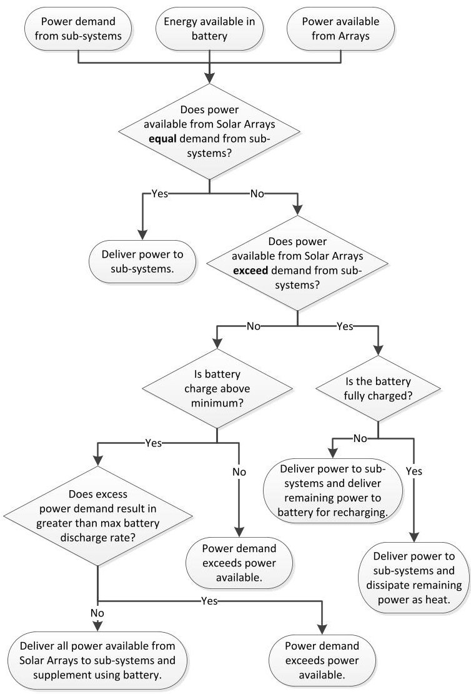

Fig. 7: Energy flow in/out of Electrical Power System

The power available (P) from each solar array (assuming n number of arrays) is calculated at each time

<!-- PDF_PAGE: 6 -->

step as a function of the array area in sunlight (determined from the spacecraft attitude, eclipse factor and panel shading) (A), the light angle of incidence $ \vartheta $ the energy conversion efficiency $ \left( \eta_{\mathrm{cell}} \right) $ , cell packing efficiency $ \left( \eta_{\mathrm{pack}} \right) $ and solar flux $ \mathrm{S}\approx1 3 6 6 \mathrm{W} / \mathrm{m}^{2} $ ..

$$
P = \sum_ {i = 1} ^ {n} \frac {A _ {i} \cos \theta_ {i}}{S \eta_ {c e l l} \eta_ {p a c k}}
$$

Other factors that contribute to the energy collection and distribution include variation in the solar cell conversion efficiency due to cell temperature, and decrease in battery voltage as a function of energy available within the battery.

As with energy, data can be considered a commodity in much the same way. Data flows in to the spacecraft via a payload, and flows out via compression, deletion or transmission from the antenna to a ground station. Rate of data accumulation can therefore be formulated as the difference between incoming and outgoing datarates (R):

$$
\dot {D} = R _ {i n} - R _ {o u t}
$$

The payload data rate (incoming) is dependent on; 1) target visibility, 2) component mode of operation and 3) available data storage on board. Currently, a greedy scheduling philosophy is employed such that data will be collected and/or downloaded whenever a target is in view, power is available and storage capacity is not at the upper or lower limit respectively. A threshold parameter is defined such that should storage capacity be reached, collection/transmission cannot recommence until the threshold value is met. This avoids the in/out cycling that could occur at a capacity limit with both collection and transmission taking place simultaneously.

For the purposes of temperature analysis, the satellite is modelled as an homogenous, single-node body. Heat is transferred to the body via solar radiation, Earth albedo, planetary radiation and internal system inefficiencies and is radiated away to deep space. The rate of change of temperature is a function of the system mass (m), specific heat capacity （c=897 J/kgK, Aluminium) and each of the heat flow parameters described previously:

$$
\dot {T} = \frac {1}{m c} \left(\dot {Q} _ {s u n} + \dot {Q} _ {p l} + \dot {Q} _ {a l} + \dot {Q} _ {s u b} - \dot {Q} _ {r a d}\right)
$$

## IV. RESULTS

An example mission has been simulated to illustrate application of the simulation architecture and its current capabilities. Details of the mission are summarised in table 2.

<table border="1"><tr><td>Symbol</td><td>Value</td><td>Unit</td><td>Description</td></tr><tr><td>$r_{p}$</td><td>500</td><td>km</td><td>Perigee altitude</td></tr><tr><td>$r_{a}$</td><td>3935.5</td><td>km</td><td>Apogee altitude</td></tr><tr><td>i</td><td>98</td><td>°</td><td>Inclination</td></tr><tr><td>e</td><td>0.2</td><td>-</td><td>Eccentricity</td></tr><tr><td>LTAN</td><td>2100</td><td>hrs</td><td>Local time of asc. node</td></tr><tr><td>$t_{BOL}$</td><td>20/03/2013</td><td>-</td><td>Start date</td></tr><tr><td>$t_{EOL}$</td><td>20/09/2013</td><td>-</td><td>End date</td></tr><tr><td>-</td><td>3</td><td>U</td><td>Form factor (size)</td></tr><tr><td>m</td><td>5</td><td>kg</td><td>mass</td></tr><tr><td>N</td><td>0</td><td>-</td><td>No. deployed panels</td></tr><tr><td>-</td><td>Nadir</td><td>-</td><td>Attitude orientation</td></tr><tr><td>$R_{p/I1}$</td><td>100</td><td>bps</td><td>Payload 1 data rate</td></tr><tr><td>$R_{p/I2}$</td><td>200</td><td>bps</td><td>Payload 2 data rate</td></tr><tr><td>$R_{comm}$</td><td>1200</td><td>bps</td><td>Antenna rate (VHF)</td></tr><tr><td>$A_{sa}$</td><td>0.096</td><td>m^{2}$</td><td>Solar cell area</td></tr><tr><td>$C_{bat}$</td><td>30</td><td>Whr</td><td>Battery capacity</td></tr><tr><td>$\eta_{cell}$</td><td>25</td><td>%</td><td>Solar cell efficiency</td></tr><tr><td>x</td><td>Nominal</td><td>-</td><td>Platform mode</td></tr></table>

Table 2: Example mission parameters

Three Ground Stations are assumed available for the mission, one in Oxford UK, one in Tokyo and one in Alaska. All are available for download but only Oxford is assumed available for upload to the satellite.

Over the 6 months mission, the orbital dynamics indicate a secular variation in the Right Ascension of Ascending Node and Argument of Perigee (figure 8), as can be expected of this type of non-frozen orbit.

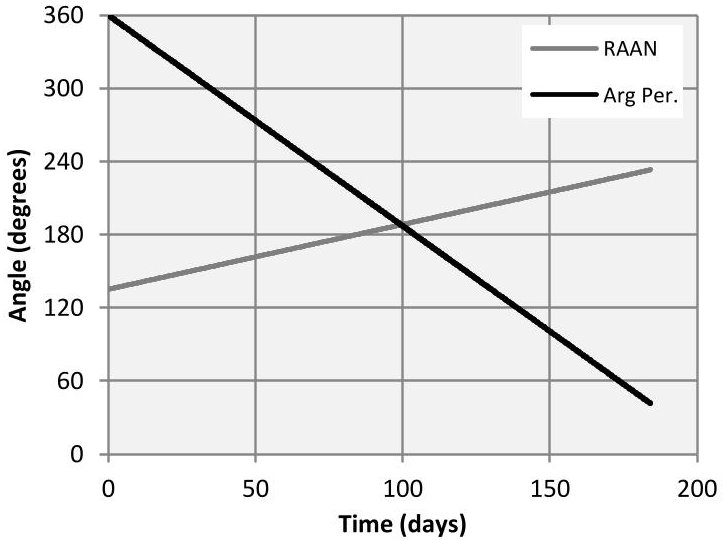

Fig. 8: Secular variation in the RAAN and Arg Per.

Plots of various parameters obtained from the Operations model are included (figures 9-14) and show development of the parameters over the initial 5 days of the mission.

<!-- PDF_PAGE: 7 -->

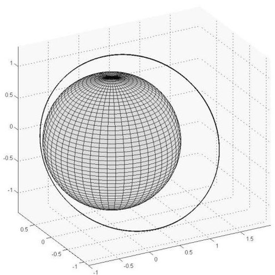

Fig. 9: Initial orbit about the Earth

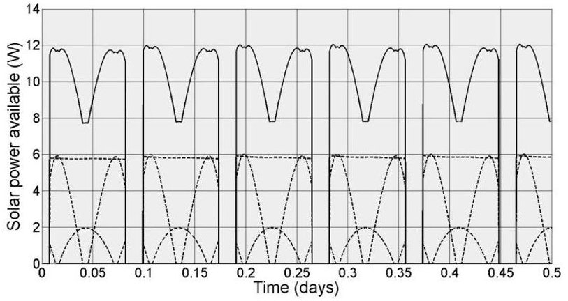

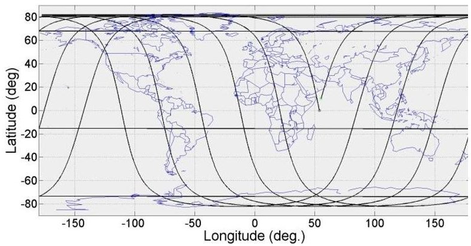

Fig. 10: Ground track

Fig. 11: Ground station visibility (solid = downlink opportunity, dashed = uplink opportunity)

Fig. 12: Power available from Solar Arrays (solid line = total, dashed line = individual solar arrays)

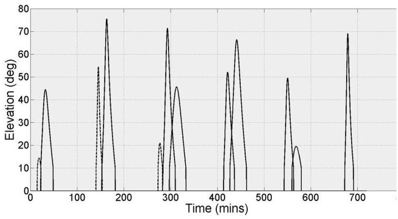

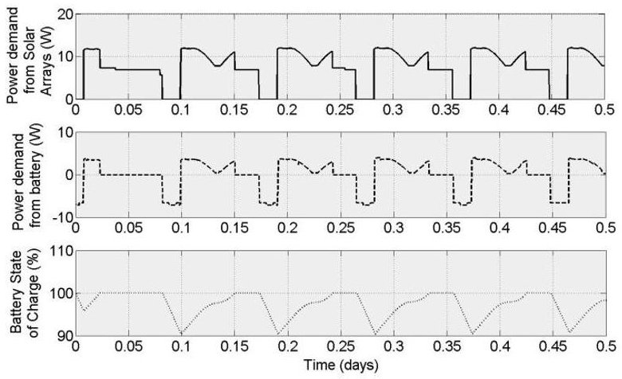

Fig. 13: Power demand from Solar Arrays (top) and Battery (middle) and Battery state of charge (bottom)

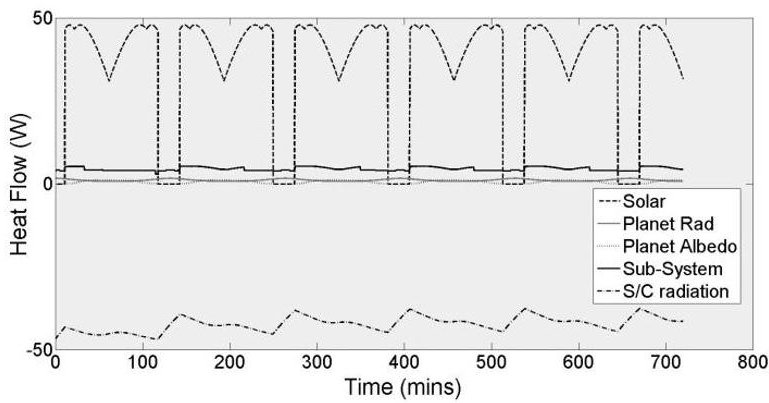

Fig. 14: Heat transfer to/from the satellite

V. CONCLUSIONS

Work is on-going in the development of missiongeneric, parametric models capable of multi-fidelity, multi-disciplinary analysis of CubeSat flight simulation. The model architecture is presented, in which dynamic equations of the system state variables are solved in both the life-time-scale and the orbit-time-scale. ModelBased Systems Engineering techniques are employed to ensure modularity and flexibility, while procedural

<!-- PDF_PAGE: 8 -->

programming is used to maximise the model functionality.

A selection of results from an example mission is presented, which show developments of various system parameters over time, and give an indication of the potential for the simulator.

## VI. FUTURE WORK

Significant developments in model capability are anticipated including, but not limited to, automated

operational mode switching logic, incorporation of additional satellites for constellation/swarm dynamics component failure analysis and higher fidelity parametrics between modules. In addition, work is underway to implement operational scheduling using multi-objective optimisation for optimal resource allocation and the application of "hardware-in-the-loop as part of a complete system validation facility.