<!-- PDF_PAGE: 1 -->

# Applying Model Based Systems Engineering (MBSE) to a Standard CubeSat

<table border="1"><tr><td>Sara C Spangelo
University of Michigan
1320 Beal Street
Ann Arbor, MI
saracs@umich.edu</td><td>David Kaslow
Analytical Graphics, Inc.
200 Valley Creek Blvd.
Exton, PA 19341
dkaslow@agi.com</td><td>Chris Delp
Jet Propulsion
Laboratory,
California Institute
of Technology
4800 Oak Grove Drive
Pasadena, CA 91109
chris.delp@jpl.nasa.gov</td><td>Bjorn Cole
Jet Propulsion
Laboratory,
California Institute
of Technology
4800 Oak Grove Drive
Pasadena, CA 91109
bjorn.cole@jpl.nasa.gov</td></tr><tr><td>Louise Anderson
Jet Propulsion
Laboratory,
California Institute
of Technology
4800 Oak Grove Drive
Pasadena, CA 91109
louise.anderson@jpl.nasa.gov</td><td>Elyse Fosse
Jet Propulsion
Laboratory,
California Institute
of Technology
4800 Oak Grove Drive
Pasadena, CA 91109
elyse.fosse@jpl.nasa.gov</td><td>Brett Sam Gilbert
Analytical Graphics, Inc.
200 Valley Creek Blvd.
Exton, PA 19341
bgilbert@agi.com</td><td>Leo Hartman
Canadian Space Agency
6767 Airport Rd.
Saint-Hubert, Québec
J3Y 8Y9
leo.hartman@asc-csa.gc.ca</td></tr><tr><td></td><td>Theodore Kahn
Blue Heron Services, Inc.
Suite 110, Holly 1 Building
44425 Airport Road
California, MD 20619
ted.kahn@blueheronserv.com</td><td>James Cutler
University of Michigan
1320 Beal Street
Ann Arbor, MI
jwcutler@gmail.com</td><td></td></tr></table>

Abstract-Model Based Systems Engineering (MBSE) is an emerging technology that is providing the next advance in modeling and systems engineering. MBSE uses Systems Modeling Language (SysML) as its modeling language. SysML is a domain-specific modeling language for systems engineering used to specify, analyze, design, optimize, and verify systems.

An MBSE Challenge project was established to model a hypothetical FireSat satellite system to evaluate the suitability of SysML for describing space systems. Although much was learned regarding modeling of this system, the fictional nature of the FireSat system precluded anyone from actually building the satellite. Thus, the practical use of the model could not be demonstrated or verified.

This paper reports on using MBSE and SysML to model a standard CubeSat and applying that model to an actual CubeSat mission, the Radio Aurora Explorer (RAX) mission, developed by the Michigan Exploration Lab (MXL) and SRI International.

## TABLE OF CONTENTS

TABLE OF CONTENTS ... 1

1. BACKGROUND ... 1

2. CUBESAT CASE STUDY OBJECTIVES ... 2

3. MBSE CHRONOLOGY ... 2

4. SYSML: THE SYSTEMS MODELING LANGUAGE ... 3

5. RADIO AURORA EXPLORER...3

6. MODEL AS REQUIREMENTS...4

7. CUBESAT TERMINOLOGY AND PATTERNS BASIS FOR

CUBESAT META-MODEL...4

8. CUBESAT MODELING FRAMEWORK...6

9. CUBESAT MISSIONS IN THE CUBESAT FRAMEWORK...6

10. SPACE ENVIRONMENT FRAMEWORK...7

11. MISSION ELEMENT FRAMEWORK...8

12. GROUND SYSTEM FRAMEWORK...8

13. FLIGHT SYSTEM FRAMEWORK...10

14. SYSML AND STK...17

15. CURRENT STATUS AND FUTURE PLANS...17

16. CONCLUSION...17

REFERENCES...19

BIOGRAPHY...19

ACKNOWLEGEMENTS...20

## 1. BACKGROUND

CubeSats, a type of nanosatellite, are low-cost, standardized satellites which are typically launched as secondary payloads. They have enabled the university community to design, build, and launch satellites using primarily off-the-shelf components. More recently, the worldwide community has adopted the CubeSat standard as a means of performing scientific, surveillance, and

<!-- PDF_PAGE: 2 -->

technology demonstration missions at significantly reduced cost.

This case study extends work sponsored by the International Council on Systems Engineering (INCOSE) Space Systems Working Group (SSWG) whose original charter in 2008 was to model FireSat, a fictional satellite for monitoring and reporting forest fires. [1] This satellite was used as an example in the widely used and accepted Space Mission Analysis and Design (SMAD) textbook. [2]

The FireSat project was designed to improve the understanding of applying Systems Modeling Language (SysML) to represent satellites. SysML is a systems engineering graphical modeling language that can formally specify every aspect of a system.

While much was learned regarding modeling FireSat, the hypothetical nature of FireSat precluded anyone from actually building the spacecraft. Therefore the practical use of the model could not be demonstrated or verified.

As in the FireSat effort, the CubeSat modeling group consists of individuals from multi-disciplinary areas in government, academia, and commercial organizations.

The The CubeSat Modeling Framework uses SysML to capture common design patterns of CubeSats: managing values, describing scenarios, and describing functions, parts, and subsystems as well as the relationships between these design patterns.

The Framework illuminates a path to an integrated modelbased engineering environment, including interoperability with system models, mission analysis, and 3D visualization capabilities provided by Analytical Graphics, Inc. (AGI) Systems Tool Kit (STK), formerly known as Satellite Took Kit.

This environment demonstrates the possibility of a highly diverse set of analysis applications that are provided with information about the space system from the system model to accomplish analysis driven by a formal description of the mission, flight and ground systems.

## 2. CUBESAT CASE STUDY OBJECTIVES

We continue our understanding of SysML issues as they pertain to satellite modeling, including modeling methodologies in a satellite design team environment. In addition to these initial goals, we have the following objectives:

- To codify the experience of Subject Matter Experts into a CubeSat Modeling Framework complete with domain specific extensions to SysML.

- To utilize the framework as an educational tool

- To research the integration of analytical models for orbital determination, structural design, executing schedules for operations, and other parametric analyses. Through our commercial participants, AGI and InterCAX, a provider of MBSE software and services, we plan to explore the integration of analytical models, thereby enabling the transfer of information between various modeling systems.

For CubeSat community we envision our work products consisting of:

-um A CubeSat meta-model describing CubeSat specific concepts and a Modeling Framework.

- following are the main points of the passage. Read the passage carefully and transcribe the main points. Then use the information to answer the following questions.

For the modeling community in general we will be providing:

- Proscriptive information regarding model development practice and procedures.

- A better understanding of issues surrounding the integration of analytical models into the SysML descriptive model.

## Theсессуары The model includes:

- The entire satellite mission, including orbital determination and interfaces to external entities such as ground stations and targets of interest.

- Key satellite hardware, including systems, subsystems and components and their interfaces, dependencies, and associations.

- Key satellite behaviors and interfaces to the various hardware entities.

- Key satellite constraints and measures-of-effectiveness.

## 3. MBSE CHRONOLOGY

SysML became an Object Management Group (OMG) adopted specification in June 2006. SysML is a domain-specific modeling language for systems engineering. It is used to specify, analyze, design, and verify systems consisting of hardware, software, information, personnel procedures, and facilities. [3]

Sandy Friedenthal proposed the Model Based System Engineering (MBSE) Initiative within the International Council on Systems Engineering (INCOSE) SE 2020 Vision at the Albuquerque, January 2007 INCOSE International Workshop (IW). [4] The INCOSE SSWG MBSE Challenge was initiated in August 2007. [5]

<!-- PDF_PAGE: 3 -->

The goal of the MBSE Challenge project was to model a hypothetical FireSat space system. FireSat is a spacebased system for detecting, identifying, and monitoring forest fires. The FireSat system consists of users, mission goals, a satellite system, primary ground station with mission control and payload data processing, secondary ground stations, and commercial communication satellites. The FireSat system is derived from the description in SMAD.

The MBSE FireSat modeling project involved individuals from the SSWG, aerospace students and professors from Massachusetts Institute of Technology and Georgia Institute of Technology, as well as individuals from a number of government and industry organizations. The modeling effort included using AGI's STK for performance analysis of candidate system configurations. The results were reported first in December 2007 then in a series of INCOSE workshops and symposiums, and INCOSE INSIGHT articles. They demonstrated that a space system could be modeled in SysML.

An interface between a SysML model and STK/ AGI Components was demonstrated in real-time at the February Phoenix 2011 INCOSE MBSE WS.

The MBSE CubeSat project was initiated in April 2011. The team includes University of Michigan Aerospace graduate students, a departmental professor, and the INCOSE SSWG, including JPL engineers, InterCAX AGI engineers, and others.

The collaborative environment includes a CubeSat MBSE Google group, MBSE Google documents collection, a NoMagic Teamwork server for SysML modeling, and bi-weekly Web conferencing through the JPL-hosted Meetingplace server.

## 4. SYSML: THE SYSTEMS MODELING LANGUAGE

Object Management Group (OMG) SysML is a standardized descriptive language for modeling systems born out of OMG Unified Modeling Language (UML). UML is a modeling language used in object-orientated software engineering. SysML is comprised of a graphical notation and an information model that emphasizes the formal capture, description, and communication of systems specifications. Diagrams can be constructed to describe various systems based on the structure and behavior of the system. The information model distinguishes SysML from conventional drawing and simulation tools in the following three specific ways:

- SysML accommodates the capture and description of numerical values and quantities through the use of International Organization for Standardization (ISO) Quantities, Units, Values, and Dimension standards. The strength of SysML is the formal

information model behind the diagrams. It enables any SysML model of a system to be tested to ensure that the units are complete and consistently defined.

- Conventional drawing and simulation tools provide text and diagram based documentation of models, but they generally lack the semantics and detail provided by SysML. The strength of SysML is the robust semantics and detail captured for formal specifications. This becomes significant when using the SysML model as a source of information for analysis and simulation tools

- Once a system is rendered in SysML, the model provides a coherent body of knowledge about the system. The SysML model can be used to interface and inter-operate with other tools and data sources.

## 5. RADIO AURORA EXPLORER

Radio Aurora Explorer (RAX) is the first National Science Foundation (NSF) funded CubeSat science mission. The RAX missions were built by students, engineers, and faculty from the University of Michigan in collaboration with scientists from SRI International. We have launched two RAX spacecraft, RAX-1 and RAX-2, with the same mission objective. RAX-2 is the reference CubeSat Mission the SysML team has chosen as the basis for building the CubeSat Modeling Framework.

The primary objective of the RAX mission is to study the formation of magnetic field-aligned plasma irregularities (FAI) in the lower polar ionosphere (80-300 km). [6] FAI are dense clouds of electrons that range from centimeters to kilometers in size, and are known to disrupt tracking and communication between Earth stations and orbiting spacecraft. Unlike equatorial FAI, height-resolved FAI have not been studied at polar latitudes due to the difficulty of collecting backscattered radar normal to the highly-inclined geomagnetic field lines, a critical requirement for radar measurements. To overcome this, RAX utilizes a bi-static radar configuration with a ground-based radar transmitter and a satellite-based receiver. The experimental zone is a cone with the vertex at designated Incoherent Scatter Radar (ISR) sites. The RAX-2 spacecraft is in a 410 by 820 kilometer, 101.5 degree inclination orbit. This orbit provides the spacecraft with the vantage point to receive the radar signals from above the experimental zone and from a wide range of scatter angles; a schematic is shown in Figure 1.

During a typical science experiment, scattered signals are detected by the on-board radar receiver (payload) and are saved to the spacecraft flash memory. Position and time information from the on-board GPS receiver provides accurate spatial and temporal information during a

<!-- PDF_PAGE: 4 -->

science experiment. RAX passes through the experimental zone in approximately five minutes. Data are then processed, compressed, and transmitted to the ground. This sequence of events is repeated daily throughout the planned one year mission lifetime. The primary ground radar station is the Poker Flat ISR located in Alaska.

The primary RAX ground station and operations center is located at the University of Michigan in Ann Arbor. In addition to payload data, telemetry data is also collected and downloaded. Telemetry data includes attitude determination sensor measurements, temperature values, voltages values, and other health and status information from the flight computer.

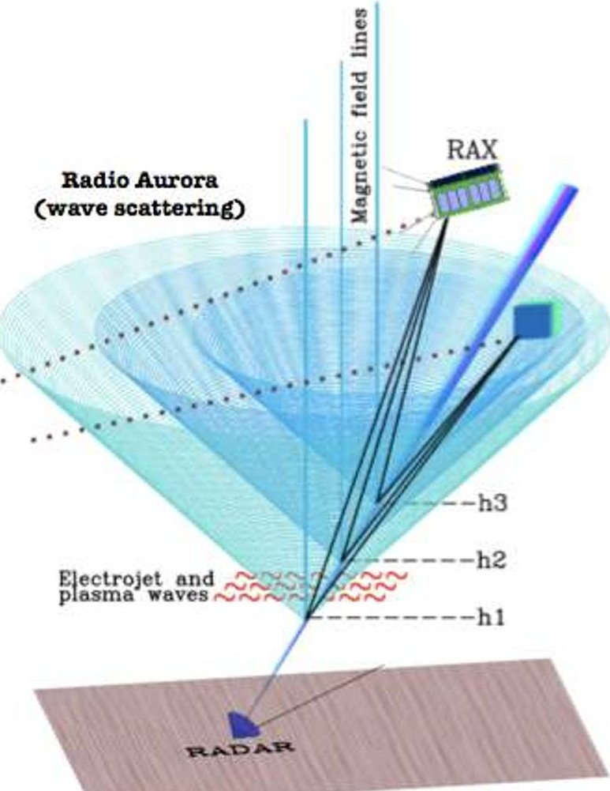

Figure 1. RAX Mission Data Environment

## 6. MODEL AS REQUIREMENTS

An important aspect of the job of a systems engineer is to produce specifications for designing, validating, verifying, and operating the system. In the document-centric practice of systems engineering, this is done primarily with requirements stated in terms such as shall, must, should, and will statements, accompanied by a various descriptive documents, illustrations, and analysis products.

In the MBSE paradigm, models enhance specification by describing behavior, interaction, and performance rather

than atomic narrative assertions. Prose requirements are used only as a supplement, where a formal behavioral model cannot be developed, e.g. "The system shall have 80% of its components produced in the United States". For physical aspects of systems, this is widely precedented. 3D Computer-Aided Design (CAD) models serve as representations of configurations, precise physical dimensions, and tolerances, and are used in simulations of user experience. These models capture the system's emergent properties in ways that shall statements never can.

## 7. CUBESAT TERMINOLOGY AND PATTERNS BASIS FOR CUBESAT META-MODEL

A few domain specific terms are commonly used for describing CubeSat Systems and Missions. For example:

- Part - a component of the spacecraft

- State - the value of a variable that describes a condition of the system for a given period of time

- Function (input, output) - a behavior of a Part that modifies the state of the Part based on the Function's input and output states

- Input: values used to affect the state of the Part

- Output: values used to report on the result of the Function's affect on the state of the Part

- Subsystem - have functions which operate on states

- Interface - an area of consideration on a Part for which interaction is an engineering concern. It usually requires coordination or standardization to function properly.

- Scenario - a sequence of functions to accomplish a Mission Objective.

Using SysML, we can take these common terms and provide a concrete syntax and semantics with which to build a framework for modeling CubeSat systems, as shown in Table 1.

By formally capturing this syntax and semantics, also known as meta-modeling, we have a basis for deriving common systems engineering patterns. Patterns are commonly recurring sets of concepts and relationships that describe some aspect of a system. We have identified and used these patterns for CubeSat models to establish a CubeSat Modeling Framework.

The pattern that will be used to model the Parts for the CubeSat Framework is illustrated in SysML in Figure 2. This model of a basic pattern for Parts can be read as a set of requirements. For example, "all CubeSat Parts shall have at least one interface" and "CubeSat Parts shall define functions such that inputs and outputs are specified

<!-- PDF_PAGE: 5 -->

as given values." Depending on how the requirements are written, this simple model represents 20-40 individual requirements. In this way, the model concisely describes

a consistent and coherent pattern with which to precisely capture specifications of the spacecraft.

Table 1. CubeSat - SysML Terminology

<table border="1"><tr><td rowspan="2">CubeSat Term</td><td colspan="2">SysML Concept</td></tr><tr><td>SysML Element</td><td>SysML Diagram Types</td></tr><tr><td>Part(Subsystem, System, etc)</td><td>Part</td><td>Internal Block Diagram(IBD),Block Definition Diagram(BDD)</td></tr><tr><td>Function(Input,Output)</td><td>Operation(Input Parameter:Parameter Type,Output Parameter:Parameter Type)</td><td>BDD,Sequence Diagram</td></tr><tr><td>State</td><td>Value Specification</td><td>BDD</td></tr><tr><td>Interface</td><td>Flow Port,Flow Specification</td><td>BDD</td></tr><tr><td>Scenario</td><td>Interaction</td><td>Sequence Diagram</td></tr></table>

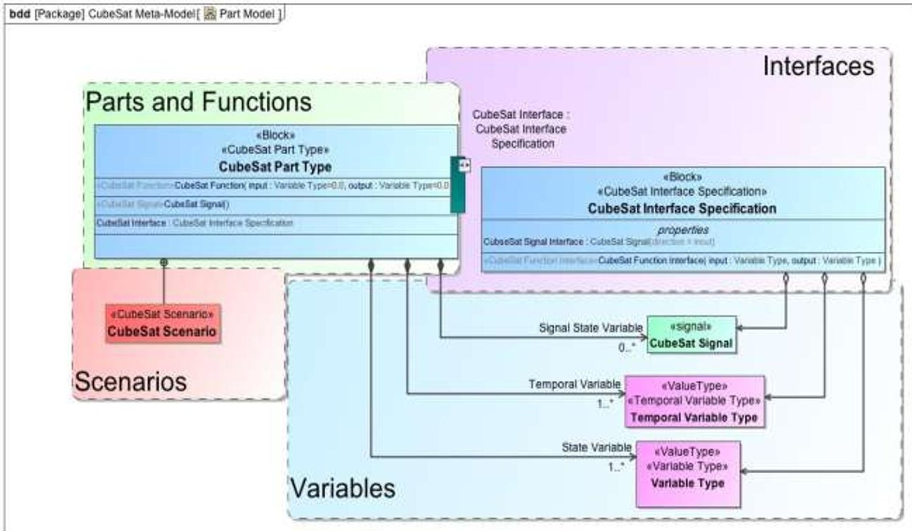

Figure 2. Pattern for Modeling CubeSat Framework

<!-- PDF_PAGE: 6 -->

## 8. CUBESAT MODELING FRAMEWORK

The Object Oriented Systems Engineering Methodology (OOSEM) [7] as applied according to the FireSat model is used in conjunction with the CubeSat Meta-Model, described in Figure 2, to create the CubeSat Modeling Framework. OOSEM provides a foundation for describing the composition of Systems and their Parts in a particular domain. By using this foundation, the CubeSat Modeling Framework provides structural and behavioral modeling facilities for:

- Mission

- Mission Environment

- Flight Systems and Subsystems

- Mission Elements

- Ground Systems and Subsystems

As shown in Table 2, OOSEM decomposes the domain, into the Elements the Mission is comprised of in the case of CubeSat, the Mission. The Mission block captures the scope of everything that will be in the model, including the system model, models of the system's operating environment, and models of how the CubeSat System interacts with the other systems. Mission Elements are systems that comprise the solution to achieving the Mission Objective.

Within the Mission Element, Flight Systems and Ground Systems are identified and further decomposed into logical and physical models. CubeSat systems designs tend to separate functionality into subsystems which correspond to logical concepts. Logical models or subsystem models in the CubeSat model the case of CubeSat, describe the different concepts required to define the desired behavior of the system.

The physical models of the system focus on the tangible implementation of the system that enables its' functionality. These models represent the hardware and software that specifies how the system is implemented. For example, one of the Power subsystem functions is to store energy. The physical battery hardware implements that functionality.

Having the CubeSat subsystem models and implementation models separated into these elements allows the CubeSat systems engineer to provide a very concrete separation of the definition of what functionality is needed versus how that functionality will be provided.

Table 2. CubeSat - OOSEM Concepts Mapping

<table border="1"><tr><td>CubeSat Concept</td><td>OOSEM Concept</td></tr><tr><td>Mission</td><td>Domain</td></tr><tr><td>Mission Objective</td><td>Use Case</td></tr><tr><td>Environment</td><td>Environment</td></tr><tr><td>Flight System,Ground System</td><td>System of Interest,Physical System,Logical System</td></tr><tr><td>Subsystem</td><td>Logical System</td></tr></table>

## 9. CUBESAT MISSIONS IN THE CUBESAT FRAMEWORK

Modeling a CubeSat Mission starts with defining the Mission architecture in terms of its structure and behavior. The Block Definition Diagram in Figure 3 illustrates how a CubeSat Mission decomposes into CubeSat Mission Element and a Space Environment, Stakeholders, and a set of Mission Objectives.

Separating the domain into a Mission Element and Space Environment separates the concerns associated with each. Identifying the key Elements in the domain allows the role of each Element to be explicitly modeled in terms of function in support of the Mission Objective. It also allows performance and interaction to be described. This is key to understanding the function and performance of the spacecraft as it interfaces with the environment.

Employing the CubeSat Modeling Framework to model the RAX mission requires the definition of a RAX Mission Element and an Earth Orbit Space Environment, which are illustrated in Figure 4. The RAX Mission Element consists of a CubeSat Ground System and a CubeSat Flight System. Earth Orbit Environment includes the RAX Orbital Environment i.e. atmospheric density and solar effects, as well as the scientific phenomenon RAX studies, FAI in the ionosphere.

The Mission Elements interact with the Earth Orbit Environment in many diverse ways. The Flight System interacts directly with the Environment both in terms of science mission observations as well as exploiting and tolerating other environmental effects. The Ground System communicates with the Flight System and interacts with environmental phenomena. Other Parts of the Ground System are not directly influenced by the environment. They focus on modeling of ground command and control of the Mission.

<!-- PDF_PAGE: 7 -->

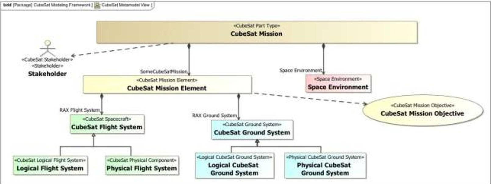

Figure 3. CubeSat Mission Environment

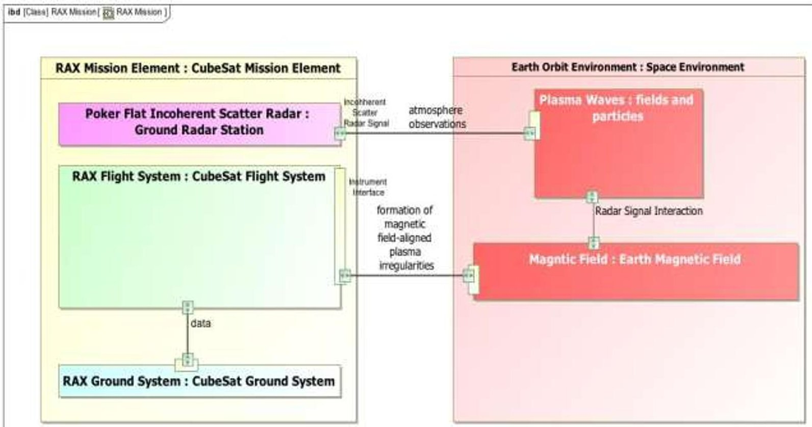

Figure 4. RAX Mission Element and Earth Orbit Environment

## 10. SPACE ENVIRONMENT FRAMEWORK

RAX is a science observation mission. The CubeSat Modeling Framework provides basic building blocks for modeling the Space Environment where the CubeSat operates. For the RAX specific mission, gravitational and magnetic fields are crucial in order to model and

determine the satellite position and attitude profile. RAX utilizes a passive magnetic stabilization system which uses the magnetic field lines to achieve the orientation necessary to perform experiments, obtain lock with the GPS constellation, and communicate with ground stations. The Earth's ionosphere is also important to consider in our model since the primary targets of the science mission, FAI, occur here.

<!-- PDF_PAGE: 8 -->

The SysML Internal Block Diagram, in Figure 5, provides the basis for modeling both the propagation of radio waves and also the trapping of ionospheric particles. Each aspect of the Earth's atmosphere has different effects on the propagation of radio waves. Water vapor is primarily concentrated in the troposphere and absorbs radio waves at various frequencies. The ionosphere contains charged elements that interact with radio waves. Both these factors influence the transmission of communication signals between the satellite and ground station. It also contains the primary science target of the mission: a series of trapped plasma formations.

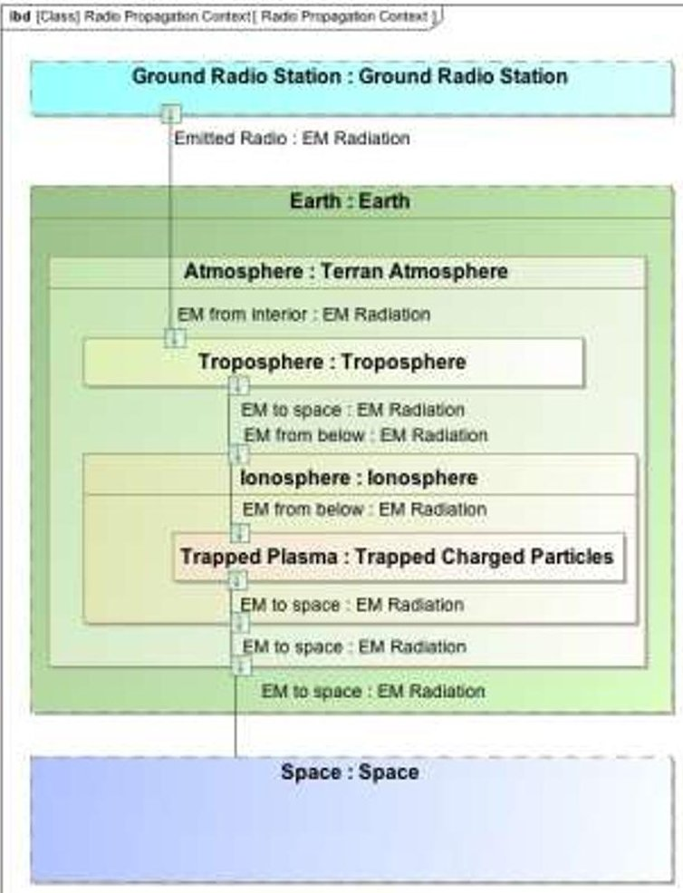

Figure 5. Space Environment Framework

## 11. MISSION ELEMENT FRAMEWORK

Mission Elements are the first architectural decomposition of the Mission. Figure 6 illustrates the pattern for identifying the Mission Elements.

For RAX-2, the Launch Service consisted of the launch on a Delta II rocket from the Vandenberg Air Force Base in California on October 28, 2011. RAX-2 was launched as a secondary payload on an Educational Launch of Nanosatellites (ELaNa) launch supported by NASA. Like

many CubeSats, it was deployed from a standardized Poly Picosatellite Orbital Deployer (P-POD) device.

The details of the Flight and Ground Systems are described in the next two sections.

## 12. GROUND SYSTEM FRAMEWORK

Decomposing the CubeSat Ground System into its physical and logical Parts is illustrated in Figure 7. This allows for the Ground System's desired function to be separated from how the Ground System will be implemented. The CubeSat Ground System's function is to provide uplink, (command, and control) and downlink capabilities for the CubeSat Flight System and is identified in the Modeling Framework by the CubeSat Ground System Logical Components block.

The Framework models this functionality through the CubeSat Ground System Physical Components block. The CubeSat Ground System is structurally composed of a CubeSat Ground Station, which further decomposes into radio and antenna, as well as a CubeSat Ground Information System. The Information System provides the infrastructure for data planning and commanding, as well as the data collected by the ground station can be dispersed to interested parties. These physical components interface with the uplink and downlink functionality of the Ground System.

Separating the Ground System into its physical and functional implementation allows the Framework to be flexible. A specific application of the Framework may choose a different Ground System physical implementation, but the Ground System's function will always be to provide uplink, downlink, command and control capabilities. This flexibility allows the Framework to be applied to a variety of architectures with variation in functionality allocated between Flight and Ground Systems..

The RAX Ground System consists of a global community of ground stations. [8] The ground station network supporting the RAX missions consist of antennas, radios, and ground station computers and software. Nominally, every 20 seconds, RAX beacons telemetry data, on an ultra high frequency (UHF) radio band, and any ground station worldwide can receive the beacons, decode them using the available RAX ground station software, and send the data to the RAX team. RAX also downlinks science and health data continuously when commanded over specified ground stations.

<!-- PDF_PAGE: 9 -->

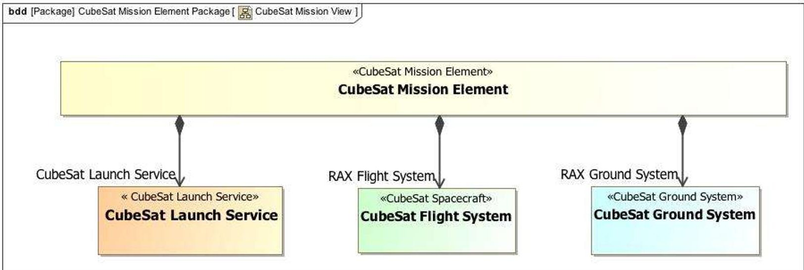

Figure 6. CubeSat Mission Element Framework

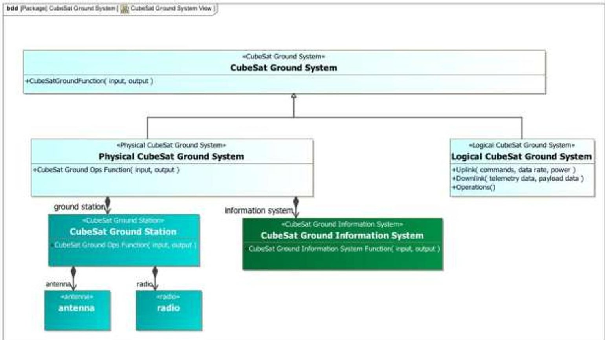

Figure 7. CubeSat Ground System Framework

<!-- PDF_PAGE: 10 -->

## 13. FLIGHT SYSTEM FRAMEWORK

The CubeSat Flight System is decomposed into physical and logical Parts, as illustrated in Figure 8. The CubeSat Modeling Framework defines the subsystems that perform functions such as power generation, thermal control, attitude control, and orbit control.

The subsystem models describe the subsystem in terms of the functions they perform which are necessary to achieve the Mission Objectives, while the physical models specify the Parts required to implement the subsystems.

Modeling these concepts provides a far more explicit and precise description of functionality. By formally separating what the System is intended to do from what the candidate implementation is capable of, systems engineers can objectively evaluate and trade different

functional architectures both in terms of Mission scope and the solution space.

The subsystems perform functions which operate on states, transforming input states to output. The states defined in the CubeSat Modeling Framework are satellite position and attitude, on-board stored energy and data, and satellite thermal states, i.e. temperatures at different locations on the satellite. These states interact through the operational of subsystem functions. Figure 9 shows each of the logical subsystems that are Parts of the Flight System specified by the CubeSat Modeling Framework.

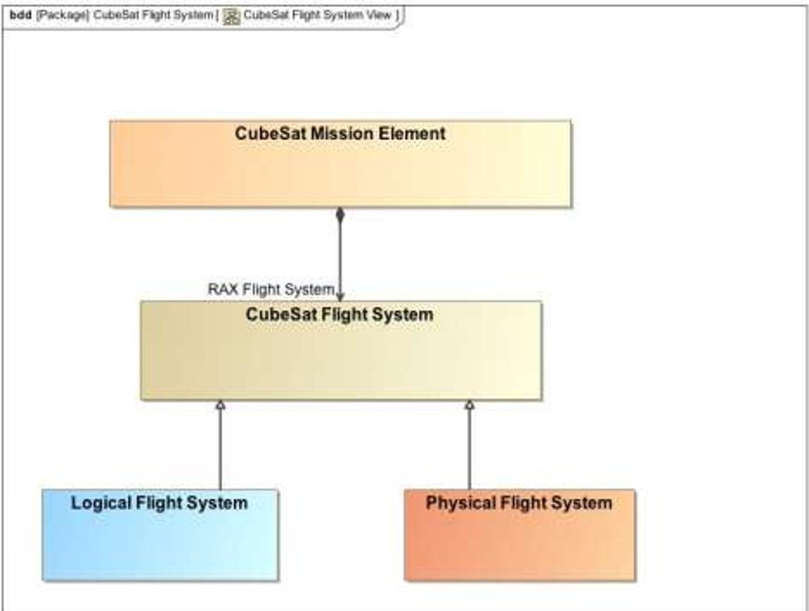

Figure 8. CubeSat Flight System Framework

<!-- PDF_PAGE: 11 -->

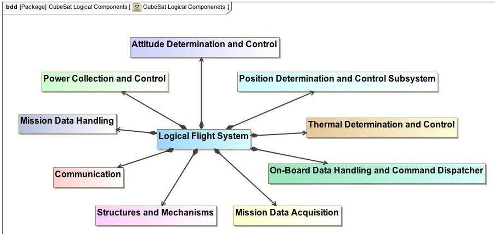

Figure 9. Logical Subsystem Components of CubeSat Logical Flight System

Table 3 describes the functions for each of the logical subsystems and their inputs and outputs. This table is typical of a view usually hand-generated by CubeSat systems engineers. However this table was generated from the model.

An example subsystem is the Position Determination and Control Subsystem. One of its functions is to Determine Position. Table 4 shows the Position Determination Function inputs and outputs. Position reference and available energy (in the form of instantaneous power) are the inputs to the function and a position estimate is the output.

## RAX Scenario

A key RAX Mission Scenario, Collection of FAI Data to satisfy the mission objective, can be constructed using the functions provided by the CubeSat Modeling Framework and SysML Sequence Diagram.

The targets of interest for the mission are dense clouds of electrons known as FAI in the northern regions of the lower ionosphere. Collection of the radar signal, which has scattered off of FAI, by the payload and download of payload data and telemetry are main scenarios that occur in the CubeSat Mission.

The scenario shown in Figure 10 is an example of Target of Interest data collection. Multiple subsystems are

involved in data collection from a Target of Interest. For example, the Mission Payload Acquisition subsystem and the Payload Radar Receive Antenna collect the Target of Interest data. The Mission Data Handling subsystem is responsible for processing, filtering, storing, or deleting data. The processed and compressed data is downlinked to the Ground Station by the Communication subsystem. The payload Flight Computer and the Main Flight Computer provide overall control. During the entire scenario, power is consumed by the subsystems described above.

Figure 11 is a SysML Sequence Diagram of the interaction of the logical system components involved in the collection of data from a Target of Interest. The Power Collection and Control subsystem regulates energy and supplies power to the various subsystems throughout the scenario. The Mission Data Handling subsystem processes, filters, compresses, and deletes data. The Main Flight Computer coordinates the interaction of the subsystems, and all function calls originate from this subsystem. Each function call to the logical subsystem components contains the specific values and types of data passed for this scenario instance. The information conveyed by the values and types of data passed for this collect data scenario are summarized in Table 5.

<!-- PDF_PAGE: 12 -->

Table 3. Functions of Logical Subsystem Components

<table border="1"><tr><td>#</td><td>System Logical Component</td><td>Function(Input:DataType,Output:DataType)</td></tr><tr><td>1</td><td>Structures and Mechanisms</td><td>Enable Operations of Subsystems(Controls:Controls,Mechanism States:Mechanism States)
Inertia Control of Position and Altitude(Forces:Force,Moments:Moment,Position:Position,Attitude:Attitude)
Mass Control of Position and Altitude(Forces:Force,Moments:Moment,Position:Position,Attitude:Attitude)</td></tr><tr><td>2</td><td>Power Collection and Control</td><td>Regulate Energy(Solar Power:Power,Battery Electrical Power:Power)
Collect Energy(Solar Power:Power,Battery Electrical Power:Power)
Store Energy(Solar Power:Power,Battery Electrical Power:Power)</td></tr><tr><td>3</td><td>Position Determination and Control Subsystem</td><td>Determine Position(Position Reference:Position Reference Data,Energy:Energy,Information on Position:Position)
Control Position(DesiredOrbit:Orbit,Energy:Energy,PositionAdjustmentForce:Force)</td></tr><tr><td>4</td><td>On-Board Data Handling and Command Dispatcher</td><td>Dispatch Commands(Mission Commands from Ground:Commands,Subsystem Commands:Commands)</td></tr><tr><td>5</td><td>Mission Data Handling</td><td>Process Data(Energy:Energy,Mission Data:Mission Data,Mission DataProcessed:Mission Data)
Compress Data(Energy:Energy,Mission Data:Mission Data,Mission DataProcessed:Mission Data)
Delete Data(Energy:Energy,Mission Data:Mission Data,Mission DataProcessed:Mission Data)
Filter Data(Energy:Energy,Mission Data:Mission Data,Mission DataProcessed:Mission Data)</td></tr><tr><td>6</td><td>Mission Data Acquisition</td><td>Collect Mission Specific Data(Energy:Energy,Mission Data:Mission Data)</td></tr><tr><td>7</td><td>Communication</td><td>Transmit Telemetry(Flight Computer Telemetry Data:Data Rate,Flight Computer Mission Data:Data Rate,Energy:Power,Ground Station Telemetry Data:Data Rate,Ground Station Mission Data:Data Rate)
Receive Operations Commands(Ground Station Data:Data Rate,Energy:Power,Flight Computer Operations Commands:Data Rate)</td></tr><tr><td>8</td><td>Attitude Determination and Control</td><td>Determine Attitude(Attitude Reference:Attitude,Energy:Energy,Filtered Attitude Measurements:Attitude,Sensor Measurements:Attitude Sensor)
Control Attitude(Energy:Energy,Desired Attitude:Attitude,Attitude Torque:Torque)</td></tr><tr><td>9</td><td>Thermal Determination and Control</td><td>Detect Temperature(Thermal Reference:Thermal Data,Thermal State Data:Thermal Data)
Control Temperature(Current Temperatures:Temperature,Temperature Control Commands:Commands)</td></tr></table>

Table 4. Inputs and Outputs of Position Determination Function

<table border="1"><tr><td>#</td><td>Input/Output of Function</td><td>Type</td><td>Direction</td></tr><tr><td>1</td><td>Energy</td><td>Energy</td><td>in</td></tr><tr><td>2</td><td>Position Reference</td><td>Position Reference Data</td><td>in</td></tr><tr><td>3</td><td>Estimate of Position</td><td>Position</td><td>out</td></tr></table>

<!-- PDF_PAGE: 13 -->

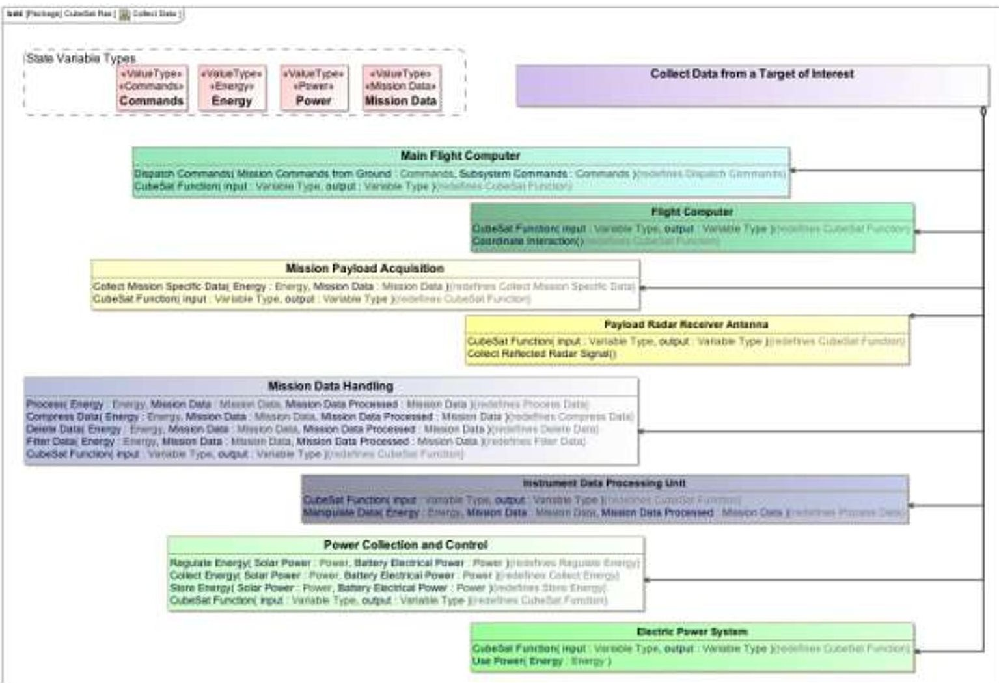

Figure 10. Collection of FIA Data Scenario

<!-- PDF_PAGE: 14 -->

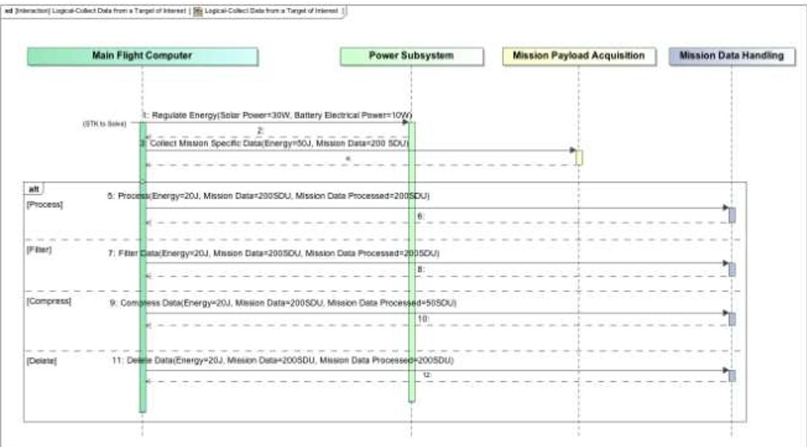

Figure 11. Logical Subsystem Sequence Diagram: Collection of FIA Data Scenario

Table 5. Data Exchange: Collection of FIA Data Scenario. For Illustration Only. Not RAX Specific

<table border="1"><tr><td>Function</td><td>Inputs/Outputs</td><td>Value Specified</td><td>State Variable Type</td></tr><tr><td>(Power Subsystem)Regulate Energy</td><td>Solar Power(Input)Battery Electric Power(Output)</td><td>30W10W</td><td>PowerPower</td></tr><tr><td>(Mission Payload Acquisition)Collect Data</td><td>Energy(Input)Mission Data(Output)</td><td>50J200SDU</td><td>EnergyMission Data</td></tr><tr><td>(Mission Data Handling)Process Data</td><td>Energy(Input)Mission Data(Input)</td><td>20J200SDU</td><td>EnergyMission Data</td></tr><tr><td>(Mission Data Handling)Filter Data</td><td>Energy(Input)Mission Data(Input)</td><td>20J200SDU</td><td>EnergyMission Data</td></tr><tr><td>(Mission Data Handling)Compress Data</td><td>Energy(Input)Mission Data(Input)</td><td>20J200SDU</td><td>EnergyMission Data</td></tr><tr><td>(Mission Data Handling)Delete Data</td><td>Energy(Input)Mission Data(Input)</td><td>20J200SDU</td><td>EnergyMission Data</td></tr></table>

<!-- PDF_PAGE: 15 -->

## Physical Components of the Flight System

The CubeSat Modeling Framework also contains a library of physical Part types of hardware and software common to CubeSat Missions. The physical components of the Flight System perform the functions defined by the Subsystems. Figure 12 and Figure 13 provide example hardware and software Part types of the Framework organized into packages representative of the subsystems.

The Framework provides an Attitude Determination and Control Subsystem illustrated in Figure 14 shows how the CubeSat Modeling Framework can allocate the functionality of the subsystems to the physical Parts that implement and perform that functionality.

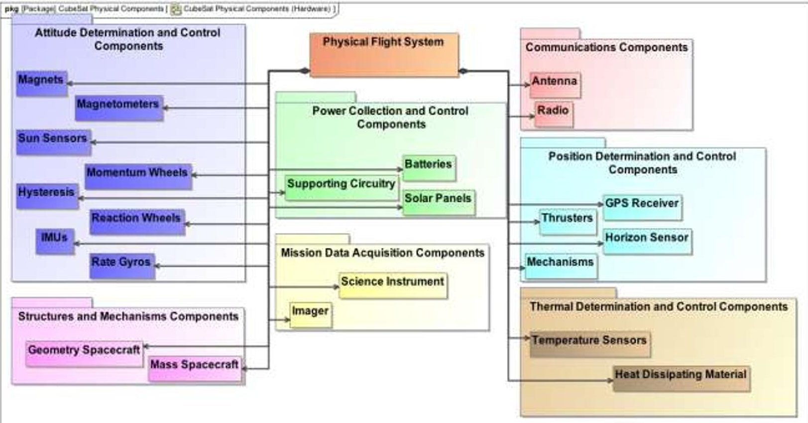

Figure 12. Physical Flight System Components - Hardware

<!-- PDF_PAGE: 16 -->

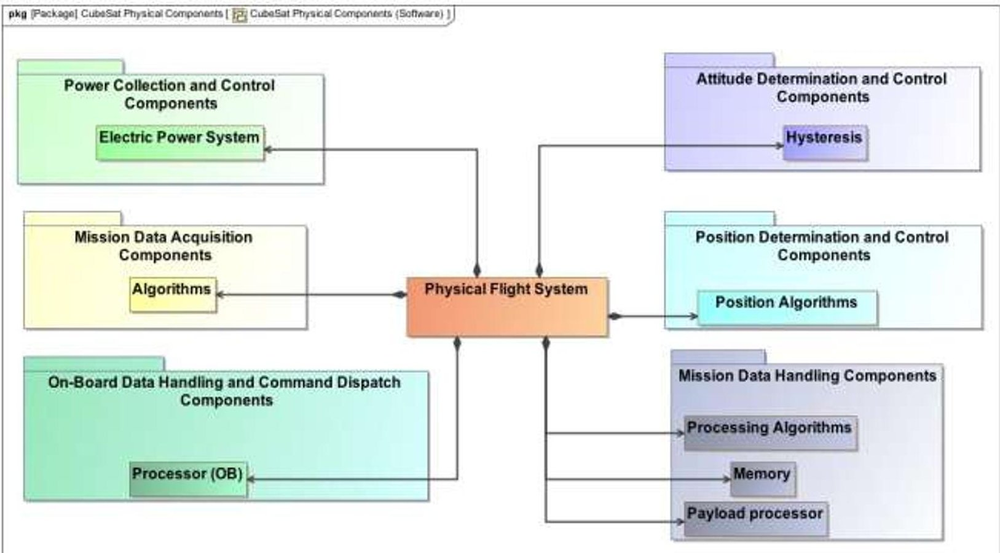

Figure 13. Physical Flight System Components - Software

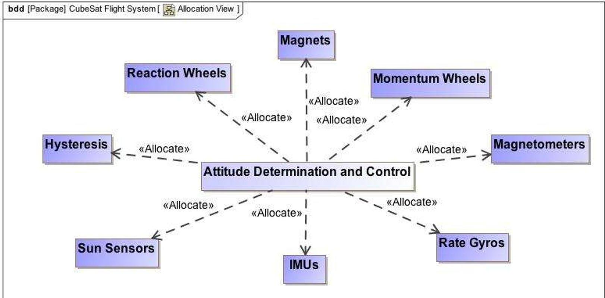

Figure 14. Example Mapping of Physical Parts to Logical Attitude Determination and Control Subsystem. Not RAX Specific

<!-- PDF_PAGE: 17 -->

## 14. SYSML AND STK

AGI produces commercial off the shelf (COTS) analysis and visualization software for space, air, and ground operations.

## SysML - AGI Components Interface Demo

AGI Components, a family of low-level class libraries provides access to specific analytical and 3D visualization capabilities. Dynamic Geometry Library provides modeling of time and position for accurate vehicle propagation and sensor modeling. Additionally, the library provides algorithms to compute position orientation, and inter-visibility intervals between land, sea, air, and space assets. The Spatial Analysis Library enables component Users to compute asset coverage of gridded regions and time-dynamic platforms.

An interface between a SysML model and AGI Components was demonstrated in real-time at the February Phoenix 2011 INCOSE MBSE WS. The interface was developed using Systems Lifecycle Management (SLIM) methodology. [9] SLIM is a collaborative, model based system engineering workspace. SLIM allows users to employ discipline-specific models such as STK as SysML elements for plug-and-play with the system model.

The SysML model set up and executed a scenario containing a satellite and a ground station. It used AGI Components to calculate the satellite-to-ground station accesses and used Insight3D to display the accesses. The SysML model also reported the accesses. The SysML model was constructed using Magic Draw from No Magic and used ParaMagic from InterCAX to interface with AGI Components.

## CubeSat SysML - STK Interface

Schemas have been defined for the exchange of data between the CubeSat SysML model and STK. One set of schemas provides for the setup of STK scenarios by the CubeSat SysML model. Another set provides for the reporting of the results of the STK scenario execution back to the CubeSat model.

## 15. CURRENT STATUS AND FUTURE PLANS

Figure 15 is an overview of the current state of the CubeSat Modeling Framework. The CubeSat System Modeling Framework has reached its first milestone, which was to establish the basic structure of the Framework with CubeSat terminology, incorporated formal MBSE patterns and methods, and demonstrated the use of the model to produce some common specifications for CubeSats. We have also illuminated a path to interoperability with other domain specific modeling tools for space systems, such as STK.

The next steps will focus on expanding the basic Framework to describe details of behavior models and the role of state in behavior and Measures of Performance. The focus will also be on trade studies with CubeSat demonstration of interaction between STK models and CubeSat SysML models with emphasis on semantic transformations that are only possible in a completely model based environment.

## 16. CONCLUSION

The capabilities presented in this paper have the potential to greatly improve the design and operation of CubeSat missions. The current approach to design and operational planning for CubeSat missions is largely intuition-based, often relies on trade-studies that do not explore the complete design space, uses ad-hoc and often unverified methods to combine multiple simulation environments, and often neglects elements of the mission dynamics. For example, on-board energy dynamics are often neglected and orbit averages assumed.

SysML models provide a comprehensive description of the Mission such that it can interface with a diversity of analysis tools. These tools can extract the portion of the information necessary to solve a problem or analyze a relevant part of the system and integrate the solution back into the mission specification. For example, an optimization algorithm which takes as inputs satellite position and opportunities to collect energy and data and generates operational schedule can be interfaced with the SysML model.

A SysML model interfaced with STK, enables satellite designers to consider how design parameters, such as satellite battery, radio, and ground station networks influence the potential to achieve the Mission Objectives. Furthermore, spacecraft operational planning can be simulated and optimized more accurately with SysML interfaced with STK. This modeling capability can also enable satellite operators to schedule satellite operations considering position, attitude, on-board energy, data, and thermal states.

<!-- PDF_PAGE: 18 -->

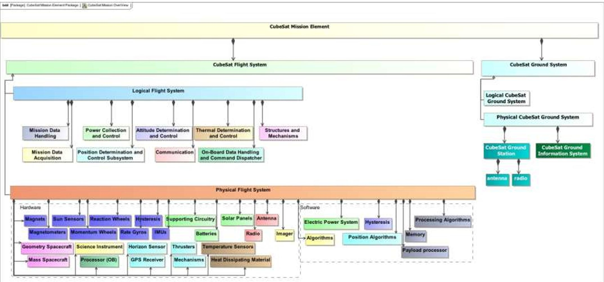

Figure 15. General Overview of CubeSat Modeling Framework with Representative Physical Components. Not RAX Specific.

<!-- PDF_PAGE: 19 -->

## REFERENCES

[1] SSWG site: https://connect.incose.org/tb/aero/sswg/default.aspx,

[2] Space Mission Analysis and Design, Third Edition, by W. Larson and J.. Wertz (editors). Microcosm Press, Hawthorne, CA and Springer, New York, NY, 2008

[3] OMG site: http://www.omgsysml.org

[4] MBSE Initiative site: https://connect.incose.org/tb/MnT/mbseworkshop/default.aspx,

[5] INCOSE MBSE Grand Challenge Space Systems Working Group site. http://mbse.gfse.de/documents/45.html

[6] J. Cutler, H. Bahcivan, J. Springmann, S. Spangelo, "Initial Flight Assessment of the Radio Aurora Explorer", Proceedings of the 25th Small Satellite Conference, Logan, Utah, August 2011.

[7] A Practical Guide to SysML, The Systems Modeling Language by Sanford Friedenthal, Alan Moore, and Rick Steiner. Morgan Kaufman Publishing, San Francisco, CA, 2008

[8] RAX Ground Station Network site http://rax.engin.umich.edu/?page_id=304

[9] M. Bajaj, D. Zwemer, R. Peak, A. Phung,. A. Scott, M. Wilson, "SIM: Collaborative Model-Based System Engineering Workspace for Next-Generation Complex Systems", 2011 IEEE Aerospace Conference Proceedings.

## BIOGRAPHY

Louise Anderson is an early career hire Software Systems Engineer at JPL. She's currently on the Ops Revitalization team in MGSS. Louise is also currently Co-Lead of the Modeling Early Adopters group at JPL. She graduated in May 2010 from the University of Colorado-Boulder with a degree in Aerospace

Engineering. Previously she worked at the Laboratory for Atmospheric Space Physics in Boulder Colorado working as a Command Controller on the Mission Operations Team. She has worked on the mission ops team for Kepler, Sorce, AIM, Quikscat, and Icesat. Louise is a member of INCOSE, currently for INCOSE she is working on the Space Systems Working Group specifically on CubeSat Modeling.

James W. Cutler received a B.Sc. degree in Computer and Electrical Engineering from Purdue University, and M.S. and Ph.D. degrees in Electrical Engineering from Stanford University. He is currently an assistant professor in the Aerospace Engineering Department at the University of Michigan. His research

interests center on space systems-a multidisciplinary approach to enabling future space capability with particular emphasis on novel, nanosatellite missions. He is developing next generation communication capability, design optimization techniques, and space weather measurement missions. His research lab is developing and

flying multiple nanosatellites for NSF and NASA.

Bjorn Cole is a systems engineer in the Mission Systems Concepts section of the Jet Propulsion Laboratory. His research interests are in the fields of design space exploration, visualization, multidisciplinary analysis and optimization, concept

formulation, architectural design methods, technology planning, and more recently, model-based systems engineering. His most recent body of work concerns the infusion of systems modeling as a data structure into multidisciplinary analysis and architectural characterization. He earned his Ph.D. and M.S. degrees in Aerospace Engineering at the Georgia Institute of Technology and his B.S. in Aeronautics and Astronautics at the University of Washington.

at the University of Washington.

Christopher Delp is the Systems Architect for the Ops Revitalization task in MGSS. He is also a Systems Engineer on the Europa Habitability Mission Model Based Systems Engineering Team. He is a founder of the Modeling Early Adopters grass roots Model Based Engineering working group. Previously he served

as Flight Software Test Engineer for MSL and Software Test Engineer for the Tracking, Telemetry, and Command End-to-End Data Services. He also leads the INCOSE Space Systems Working Group's entry in the Model Based Systems Engineering Grand Challenge. Additionally, he has performed research on software verification and tools for Service-Oriented Architecture in support of the Deep-space Information Services Architecture. Prior to coming to JPL, he worked as a software engineer performing DO-178b Level FAA flight qualified software development and testing on Joint Tactical Radio System (JTRS) and the T-55 Full Authority Digital Engine Controller (FADEC). Chris earned a Master of Science in Systems Engineering from the University of Arizona where he studied Model Based

<!-- PDF_PAGE: 20 -->

Systems Engineering, Simulation and Software Engineering. Previous to graduate studies, Chris performed his duties as a systems engineer on Missile Systems Verification and Validation.

Elyse Fosse is a Software Systems Engineer for the Ops Revitalization task in MGSS. She also develops ground system cost models for deep space and Earth missions. She is also a member of the Multimission Ground Data System Engineering

group at the Jet Propulsion Laboratory. Her interests include software and systems architecture, applications of model-based system engineering, and cost model implementation and analysis. Elyse is also a part of the INCOSE Space Systems Working Group's entry into the Model Based Systems Engineering Grand Challenge. Elyse earned her M.A. in Applied Mathematics from Claremont Graduate University and her B.S. in Mathematics from the University of Massachusetts Amherst.

Brett Sam Gilbert earned his Bachelor of Science in Aerospace Engineering at Pennsylvania State University in 2005. He has since been working at Analytical Graphics, Inc. primarily as a software tester. In addition to duties at work, he enjoys researching and developing

programs for designing orbital trajectories. He currently holds a private pilot license with a glider rating and is training for his single engine license.

Leo Hartman received his PhD in Computer Science from the University of Rochester in 1990. Since 1993 he has worked at the Canadian Space Agency (CSA) as a research scientist His interests include on-board autonomy, fault management, networking and communication and mission modeling and simulation. He

is also the CSA representative on the Management Council of the Consultative Committee for Space Data Systems.

Theodore Kahn worked for four years on NASA's Constellation Program promoting model based systems engineering. Work included a pilot project modeling the development of the Ares rocket using the Unified Profile for DoDAF and

MODAF (UPDM) as well as applying the Systems Modeling Language (SysML) for the representation of a new mission development process system. He is currently working at Blue Heron Services developing the

infrastructure supporting the monitoring and statistical analyses for vetting the U.S. Navy's new aircraft Event Based Maintenance procedures.

Dave Kaslow is Director, Product Data Management at Analytical Graphics, Inc. He has thirty-eight years of experience in both the technical and management aspects of developing ground mission capabilities. He is co-author of

"Defining and Developing the Mission Operations System", "Activity Planning", "FireSat" and "Spacecraft Failures and Anomalies" in Cost-Effective Space Mission Operations. He is also the author and co-author of papers for the International Council on Systems Engineering (INCOSE) Annual International Symposiums and for the IEEE Aerospace Conference.

ompleted a Bachelor of Science in Mechanical Engineering at the University of Manitoba with a Minor in Management in 2008. She pursued a Master of Science in Aerospace Engineering at the University of Michigan, graduating in 2010. Her Master's work focused on developing kinematic and energetic models and optimizing trajectories for energyefficient periodic solar-powered UAV flight in collaboration with the

SolarBubbles student fight team. From 2009-2011, she was the Position and Time Lead for the Radio Aurora Explorer (RAX) Satellite Mission, the first NSF-funded CubeSat science mission, which was launched in November 2010. She is currently pursuing a Ph.D. in Aerospace Engineering at the University of Michigan. The focus of her ongoing doctoral work is on developing models, simulators, and optimization algorithms for scheduling constellations of small satellite constellations and diverse heterogeneous ground networks towards enhanced communication capacity.

## ACKNOWLEGEMENTS

Parts of this research were carried out at the Jet Propulsion Laboratory, California Institute of Technology, under a contract with the National Aeronautics and Space Administration.

We would like to thank the University of Michigan RAX team for their contributions. This work was supported by NSF grant ATM-0838054 to SRI International and the University of Michigan.