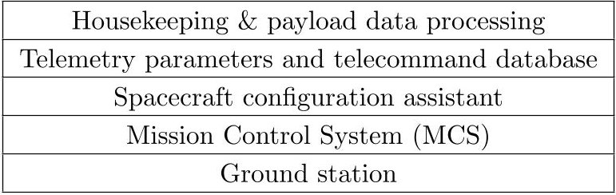
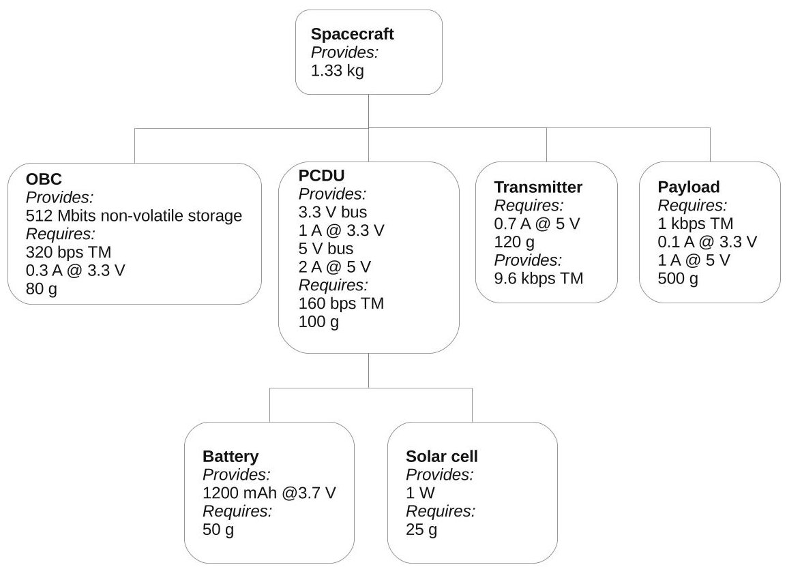
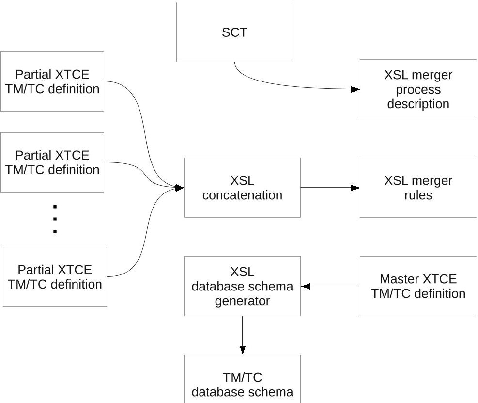

<!-- PDF_PAGE: 1 -->

# Operations of a Self-Reconfigurable CubeSat

Radim Badsi, $ ^{*} $

The OpenCube Initiative, Oppenheimerstrasse 1, 64295 Darmstadt, Germany

Merlin F. Barschke, $ ^{\dagger} $

Technische Universität Berlin, Marchstr. 12-14, 10587 Berlin, Germany The OpenCube Initiative, Oppenheimerstrasse 1, 64295 Darmstadt, Germany

Baptiste Soyer, $ ^{ \ddagger} $ Chris Engeldrum, $ ^{ \S} $ Johan Marx $ ^{ \P} $

The OpenCube Initiative, Oppenheimerstrasse 1, 64295 Darmstadt, Germany

Space missions having a very short lead time (less than 6 months) are currently in the focus of both the private sector and space agencies. They can address immediate needs of the customers or secure a competitive advantage. Self-reconfigurable satellite platforms provide the required level of agility and flexibility, while keeping costs low due to standardisation. Such a platform would allow payloads to be integrated by simply connecting them to the spacecraft bus which would reconfigure itself automatically to meet the payloads requirements. Although this technology may seem unconventional and error-prone, it is well understood and widely used outside of the space sector (e.g. network routers). To guarantee an adequate level of reliability, the platform must include safeguards to detect and prevent the use of payloads exceeding physical resource constraints (e.g. power, data storage, downlink capacity). Provided the behaviour of the reconfiguration system is deterministic, commanding and telemetry processing tools can also be adapted automatically to match the configuration of the spacecraft. We propose the use of existing processes and tools to perform the tailoring process. An XSLT processor can apply a set of transformations, describing the onboard payloads, to a master XTCE file, containing the definitions of non-payload-specific commands and telemetry parameters. Operational procedures are customised in a similar fashion. In many nanosatellite missions the final configuration is dependent on the readiness of the payloads what might even lead to a launch without payload. The flexibility provided by a self reconfigurable platform enables a highly agile approach and the potential to replace late experiments with other, more mature payloads, without undermining operations. We demonstrate this process with OpenCube- $ \alpha $ , the maiden mission of a self-configurable open-source CubeSat platform named OpenCube.

## I. Introduction

The quest for a shorter development time of space missions is a new challenging goal for the space sector, where the lead times are still counted in years, even for small space missions. Although versatile spacecraft buses are already offered by manufacturers such as Boeing or Astrium, they need to be tailored on a case-by-case basis to the requirements of the customer.

Thomson $ ^{1} $ explains that the cost and time of making changes to a product, particularly later in a project, are strongly influenced by design interdependencies between system components; a change in one component causes a sequence of changes in other components, leading to an increase in design cost and time. We propose

<!-- PDF_PAGE: 2 -->

to drastically reduce the dependencies between different satellite subsystems, the Onboard Computer (OBC) and the payload by using a self-reconfigurable satellite platform with a high level of agility and flexibility. We identified standardisation as a key feature to allow a fast integration of a wide range of payloads.

Such a platform design allows payloads to be integrated by connecting them to the spacecraft bus which then reconfigures itself automatically to meet the payloads requirements.

This plug&play concept also holds many advantages for spacecraft operations. Since it includes a robust resources management system, all available resources can be used at any time of the mission. In fact, the worst case scenario no longer needs to be used as the basis for the mission. Thus, events such as the failure of a solar cell can be acted on autonomously, without adjourning the ongoing operation. Even in the nominal case, an autonomous management of the available resources can improve the mission outcome by allocating all available resources where needed. Onboard autonomous attitude maneuver planning $ ^{2,3} $ could be realised in the near future thanks to recent progress in computational power. This is particularly relevant for optical Earth observation missions, because it would enable the satellite to adjust operations to the weather situation. However, this approach would also require an flexible resources management that allows for realtime changes in the operation schedule of the payload.

Additionally, ground systems can be made more flexible and reusable by embracing the concept of a self-reconfigurable platform. Tailoring of the control systems can be automated by storing the definition of the telemetry parameters and telecommands of each subsystem in a standard format and merging them to produce a master TM/TC definition, that can be used to configure the control system.

Whereas applying self-reconfiguration concepts to large geostationary satellites is still a far away idea, they can already be used for nanosatellite missions. The CubeSat concept, $ ^{4} $ that proved to be a reliable platform for scientific research (i.e. the NASA-Ames GeneSat-1 and Pharmasat-1 $ ^{5} $ ), technology demonstration (BEESAT-1 of the Berlin Institute of Technology $ ^{6} $ ), and verification and proof of concept missions (SwissCube-1 of the EPFL $ ^{7} $ ), seem to be a well suited platform for validating such an approach.

The OpenCube Initiative, which was founded by a group of young space professionals in 2011, seeks to develop a such self-reconfigurable CubeSat bus, called OpenCube and underlying software and hardware concepts that will allow for improved satellite development, integration and operation.

This paper describes the main ideas behind our self-reconfigurable spacecraft bus concept and the impact of our novel design choices on the spacecraft, the Mission Control System (MCS), and operations.

## II. Space Segment

## A. On-Board Discovery of Payloads

Before an OpenCube bus is assembled, the OBC does not require any prior knowledge of the connected subsystems or payloads. This is to ensure, that any of the used subsystems or even the payload can be replaced at any time prior launch without causing a need for adaptation of the satellite bus. In fact, the full configuration of the satellite bus is regenerated after every reset of the OBC to allow on-orbit reconfiguration triggered, for example, by remote reflashing of a payload computer or reprogramming of an FPGA-based device. Only a minimal description of subsystems and payloads is required by an OpenCube OBC at configuration time as its role is not to control the payloads, but to manage on-board resources. For this purpose, the payloads must transmit a list of their requirements, such as expected typical power consumption and attitude pointing requirements (in average and maximum values) and a list of their housekeeping parameters (including size and priority) to the OBC, when requested. This discovery process is initiated when the OBC transmits a multicast IP datagram, i.e. a message directed to a specific address that all connected subsystems and payloads need to monitor continuously. Subsystems and payloads then individually reply to this request and wait for an acknowledgement message from the OBC to confirm that operation can be initiated. Before the acknowledgement is given by the OBC, it sets up the power buses. Any anomaly in power consumption during satellite operation is reported to the subsystem or payload, so that it can initiate contingency procedures like disabling a subsystem or reducing the duty cycle of an experiment.

## B. Resources Management

CubeSats, and satellites in general, have very restricted resources (electrical power, storage space, downlink capacity, etc.) that need to be managed efficiently in order to increase the output of the mission. Traditionally, the usage of the available resources is pre-calculated and planned on the ground, since the lack

<!-- PDF_PAGE: 3 -->

of technology required for on-orbit reprogramming (reliable uplink channels, complex on-board software), limited human resources and safety factors make any post-launch changes in planning impractical, in the case of most nanosatellite missions. Therefore, missions are planned with respect to the worst-case nominal scenario so that many resources remain unused, especially at the beginning of the mission, when the satellite is in excellent condition.

We propose to manage on-board resources dynamically based on the requirements of each payload and a set of criteria defining the priorities in case of conflicts.

The initial resources are allocated during the initialisation of the OBC. All requests should be accepted at this stage, unless the spacecraft is in a non-standard situation, e.g. reduced power input due to faulty solar cells. A payload can subsequently request additional resources for a limited amount of time, for example during an experiment.

We call such a request a booking.

A booking includes:

- The name of the requested resource

- The required amount (if applicable)

- The time when the resource is required

- The duration for which the resource is required

- A timeout for the request (if the resource cannot be allocated within the timeout, the payload will be notified and the booking cancelled)

Bookings are ideally made as early as possible to allow OBC to find adequate solutions to potential conflicts.

## 1. Non-time-critical (soft) bookings

If the exact time at which a resource becomes available to the payload is not important, the OBC will queue the request in an available slot. The payloads need to specify a timeout when requesting resources to avoid resource starvation and deadlocks. When a booking is unsuccessful, i.e. the timeout is exceeded, the payload is notified.

## 2. Time-critical (hard) bookings

A payload may require a resource at a specific point in time (e.g. when taking pictures of the Earth). In this case, the timeout for the request is zero.

## 3. Allocation Rules

The allocation of resources is governed by a set of simple rules:

1. The priority and the position in the queue define the order of allocation.

2. If a payload holds any additionally allocated resources and requests a new resource that cannot be allocated immediately, all additionally allocated resources are preempted, i.e. the payload must release them and wait for them to become available again. This is to prevent deadlock situations.

3. The priority of requests that have been pending for a long time must be increased to prevent starvation.

The deterministic nature of the allocation process guarantees its predictability. It can hence be simulated on the ground to determine and validate the behaviour of the system.

Internally, the bookings are based on a multi-level waiting queue, with the number of levels (priorities) corresponding to the number of consumers (subsystems or payloads). The resources are represented as semaphores, $ ^{8} $ a well understood and reliable computer science concept for controlling access to limited resources. A semaphore is decremented when a resource is allocated and incremented when it is released by a consumer. The semaphores are set, during the initialisation of the spacecraft, to preconfigured baseline

<!-- PDF_PAGE: 4 -->

values, corresponding to the expected amount of resources. Their value is then continuously adjusted to match the actual availability. As the future availability of a resource cannot be predicted without the knowledge of its behaviour, this adjustment is handled by specific modules of the resources manager. For example, the determination of the remaining capacity of a battery is based on calibrations updated during the discharge cycle.

## III. Ground Segment

## A. Architecture

For the most part, the ground infrastructure required to support a plug&play nanosatellite is similar to the one used for traditional, one-off CubeSat missions. Yet, significant changes need to be made to the pre-launch preparation activities.

In fact, one of the goals of our self-reconfigurable architecture is to reduce the development time of a mission. We propose to streamline several key activities of the pre-launch preparation process, including budgets determination and configuration of Telemetry, Tracking and Command (TT&C) ground systems. The most obvious way to achieve this would be to reduce the complexity of the pre-launch process. However, most CubeSats already use very simple and somewhat informal pre-launch processes. Therefore, an alternative approach is needed. We believe that a substantial improvement can be achieved by adopting a layered architecture, that will maximise the number of elements that can be shared as-is by several independent missions. Our inspiration is the well known Open Systems Interconnection (OSI) model, which describes a structuring technique for networks, where each layer provides services to the layers above it, and uses the functions of the layer immediately below it. The interfaces between adjacent layers are clearly defined and designed to minimise exchanges.

Table 1. OpenCube GS layers

Such a separation between the layers not only encourages the reuse of components, but also permits an easy replacement of any of the layers, e.g. the payload.

To illustrate the concept, we will concentrate on two of these layers, that form the core of our platform.

## B. Spacecraft configuration

By definition, the configuration of a self-reconfigurable spacecraft is highly dynamical. An in-depth knowledge and understanding of the configuration is nevertheless essential when calculating the budgets (power, mass, bitrates, etc.). To update the calculations and models manually, when the configuration changes, is a time consuming and error-prone process. For that reason, we identified changes in spacecraft configuration as an activity that needs to be automated. To provide a formal description of the configuration, we developed a new schema, called Spacecraft Configuration Tree (SCT), that describes the spacecraft in terms of relationships between its various components. An example SCT can be seen in figure 1.

An SCT node corresponds to a subsystem or one of its components, the maximum depth of the tree (level of detail) being at the discretion of the user. The root of the tree is the entire spacecraft (or the fleet/constellation if the SCT describes the relations between several spacecraft). A node can provide capabilities (services) to the other nodes and/or require their services.

In order to validate the configuration, all the requests and capabilities must be propagated upwards, towards the root and, if possible, matched against each other at every level. If the validation is successful, there will be no outstanding requests at the root. The remaining capabilities correspond to the margin.

A proof-of-concept implementation has been developed using the XML format to encode the tree and an XSLT processor controlled by an XSL stylesheet to perform the validation.

<!-- PDF_PAGE: 5 -->

Figure 1. Example of a basic Spacecraft Configuration Tree.

It is expected that the various subsystems of the spacecraft will be delivered with partial SCTs. The final configuration is compiled by merging these partial trees, using hints provided within them. As the configuration of the spacecraft may depend on requirements that are either nonfunctional or difficult to describe (e.g. how to distribute payloads on two power buses having similar parameters), a part of the virtual assembly process must be done manually. A graphical tool to facilitate this is currently under development.

In the unfortunate event of a partial or full failure of one of the subsystems during the operational phase, the SCT validator can be used to evaluate the impact of the failure on the mission and simulate various scenarii to compensate for a sudden loss of resources. A good practice is to model the failure as a virtual node requiring an amount of resources that corresponds to the loss.

## C. Telemetry parameters and telecommand database

Similarly to the configuration of the spacecraft, a full definition of the available telemetry and telecommands can be obtained by merging the respective definitions belonging to each subsystem. We selected an existing technology, the XTCE format, $ ^{10-12} $ as a basis for our system.

XTCE is a versatile exchange format for the description of telemetry and telecommand databases. XTCE files are supplied by the manufacturer of the spacecraft and serve as a basis for the configuration of the control systems. We determined that the XTCE format is also suitable for partial definitions to be bundled with each subsystem. The comprehensive database of all telemetry parameters and telecommands can be generated from partial definitions by flattening the SCT of the spacecraft (i.e. generating a list of all subsystems) and concatenating the respective XTCE files. The unified master file can be thereafter processed to generate a TM/TC database to be used by the control system. Again, we are using a XSLT processor and an XSL stylesheet to perform the transformation to an SQL schema. Such a definition can be used directly by a mission-independent control system. Figure 2 shows the steps of the transformation process.

<!-- PDF_PAGE: 6 -->

Figure 2. Merger process of partial TM/TC definitions.

## IV. Conclusions and Future Works

This paper described the key elements of a plug&play bus and how they affect the traditional designs of both the space and the ground segment. Furthermore, operational implications have been examined. The main idea behind the developed concept is to standardise interfaces to allow for a wide range of payloads to be used on the same bus design.

Additionally, we proposed a set of tools to automate the design of the mission and facilitate the operations. A custom format based on XML trees has been identified as an appropriate way to describe the requirements of payloads, their operational scenario, as well as the required resources (e.g. power, data storage, downlink capacity, etc.). Thus, the OBC can dynamically allocate resources to the payload, using well understood concepts for controlling access to limited resources.

The commanding and telemetry processing tools can also be adapted automatically to match the configuration of the spacecraft. Our approach is based on an existing format, XTCE, a notable effort to standardise exchange formats for TM/TC definitions. XTCE is currently being deployed by CNES and other space agencies. $ ^{13} $ We developed and evaluated a novel approach, based on existing technologies such as XSLT, to bundle partial XTCE definitions with the subsystems and automatically merge them to produce a master TM/TC definition that can be used to configure the control system. We believe that a similar approach can be applied to operational procedures.

The concept presented here is still somewhat basic, but improvements could be brought into the design by allowing more complex resources to be taken into account as criteria for the booking. For example, an Earth Observation payload would only be turned on if the resource sensor towards the Earth is available. This would make the allocation process more complex as the state (for example the attitude) of the spacecraft would need to change for bookings to be allocated optimally (using, for example, onboard autonomous attitude maneuver planning). A rigid definition of those complex rules need to be decided, for the system to make optimal and deterministic decisions.

Those few considerations show additional work need to be carried out to allow our concept to support complex missions. However with its severely limited capabilities and resources (power, available mass and volume for payload, attitude control, etc.), a CubeSat can implement the presented plug&play concept without any loss of functionality compared to a traditional configuration.

<!-- PDF_PAGE: 7 -->

## Appendix A

## Acronym List

FPGA Field Programmable Gate Array

IP Internet Protocol

MCS Mission Control System

OMC Onboard Computer

OSI Open Systems Interconnection

SCT Spacecraft Configuration Tree

SQL Structured Query Language

TC Telemetry

TM Telecommand

TM/TC Telemetry and Telecommand

TT&C Telemetry, Tracking and Command

XML Extensible Markup Language

XSL Extensible Stylesheet Language

XSLT XSL Transformation

XTCE XML Telemetric & Command Exchange

<!-- PDF_PAGE: 8 -->

## References

$ ^{1} $Thomke, S. H., "The role of flexibility in the development of new products: An empirical study," Research Policy, Vol. 26, 1997, pp. 105-119.

$ ^{2} $Komfeld, R. P., "On-board Autonomous Attitude Maneuver Planning for Planetary Spacecraft using Genetic Algorithms," Proceedings of the AIAA Guidance, Navigation & Control Conference, American Institute of Aeronautics and Astronautics (AIAA), Reston, VA, USA, 2003.

$ ^{3} $Cui, P., Zhong, W., and Cui, H., "Onboard Spacecraft Slew-Planning by Heuristic State-Space Search and Optimization," Proceedings of the 2007 IEEE International Conference on Mechatronics and Automation, Institute of Electrical and Electronics Engineers (IEEE), 2007, pp. 2115-2119.

$ ^{4} $The CubeSat Program, Cal Poly SLO, "CubeSat Design Specification (CDS)," Tech. Rep. Rev. 12, 2009.

$ ^{5} $Hines, J., "Biological NanoSatellite Missions and Technologies at NASA-Ames Research Center," Proceedings of the 4th European CubeSat Symposium, Von Karman Institute for Fluid Dynamics, Brussels, Belgium, 2012, p. 34.

$ ^{6} $Kayal, H., Baumann, F., Briess, K., and Montenegro, S., "BEESAT: A PicoSatellite for the On-Orbit Verification of Micro Wheels," Proceedings of Recent Advances in Space Technologies, Institute of Electrical and Electronics Engineers (IEEE), 2007, pp. 497-502.

$ ^{7} $Richard, M., "SwissCube Lessons Learned after Two Years in Orbit," Proceedings of the 4th European CubeSat Symposium, Von Karman Institute for Fluid Dynamics, Brussels, Belgium, 2012, p. 84.

$ ^{8} $Dijkstra, E. W., "Over seinpalen," 1965.

$ ^{9} $International Organization for Standardization (ISO), "Information technology - Open Systems Interconnection - Basic Reference Model: The Basic Model," Tech. Rep. ISO/IEC 7498-1:1994, 1994.

$ ^{10} $The Consultative Committee for Space Data Systems (CCSDS), "XML Telemetric and Command Exchange (XTCE). Green Book," Tech. Rep. CCSDS 660.0-G-1, 2006.

$ ^{11} $The Consultative Committee for Space Data Systems (CCSDS), "XML Telemetric and Command Exchange (XTCE). Blue Book," Tech. Rep. CCSDS 660.0-B-1, 2007.

$ ^{1 2} $ Object Management Group (OMG), "XML Telemetric and Command Exchange (XTCE)," Tech. Rep. formal/2008-03-01, 2008.

$ ^{13} $Cortiade, E., Berriri, F., Minguillon, D., and Ferreira, J., "Strategy for the Integration of XTCE into the CNES Generic Products," Proceedings of the European Ground System Architecture Workshop, European Space Agency (ESA), Darmstadt, Germany, 2007, p. 17.